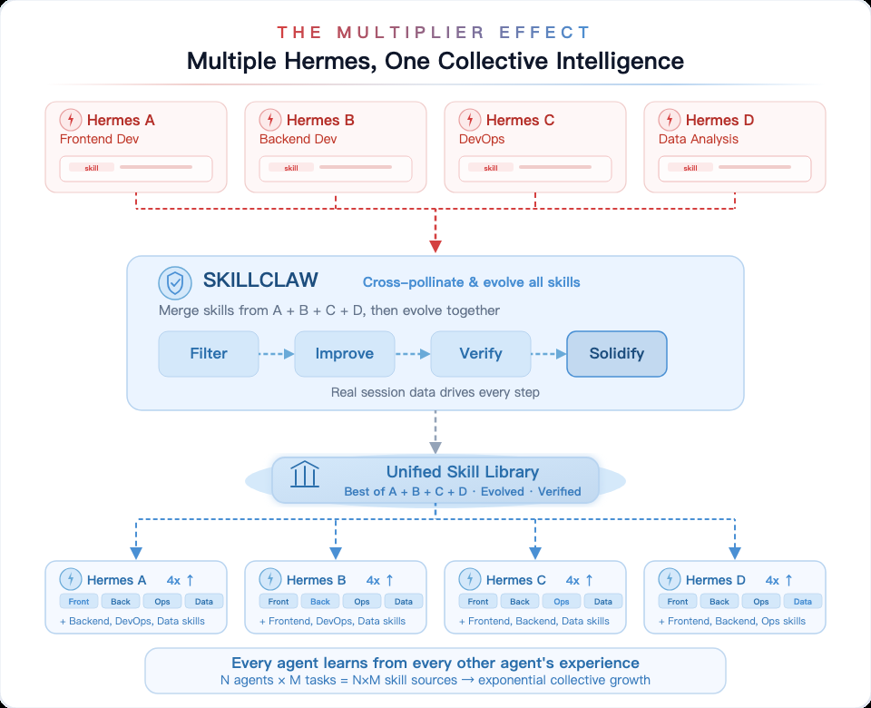
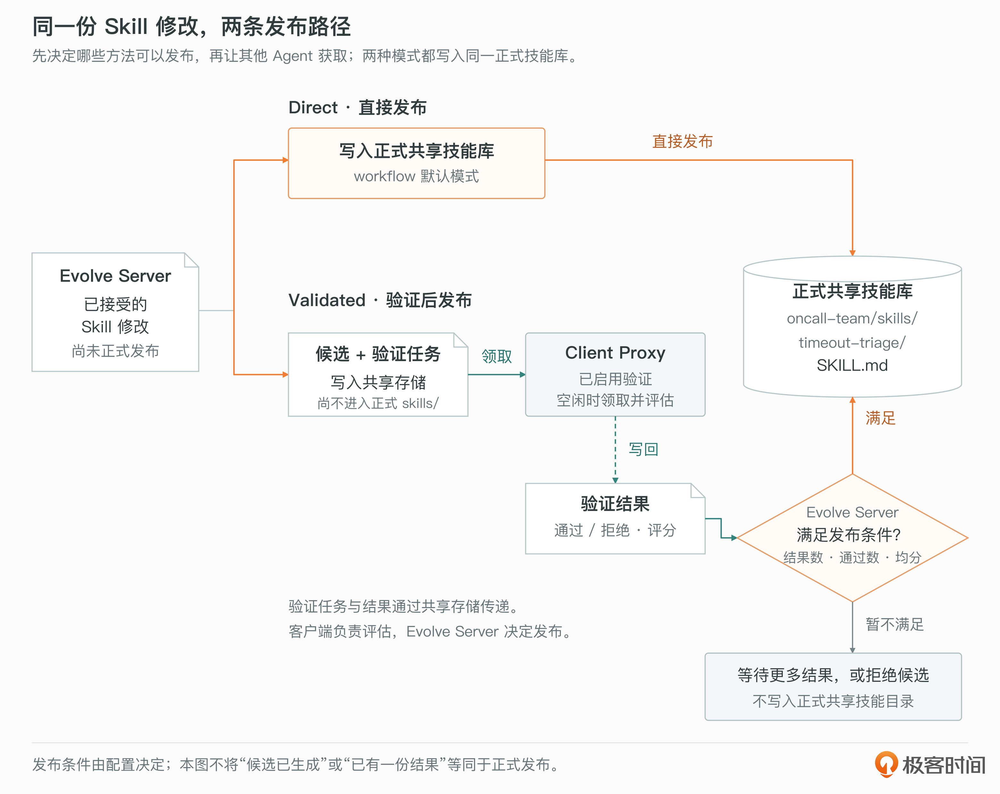
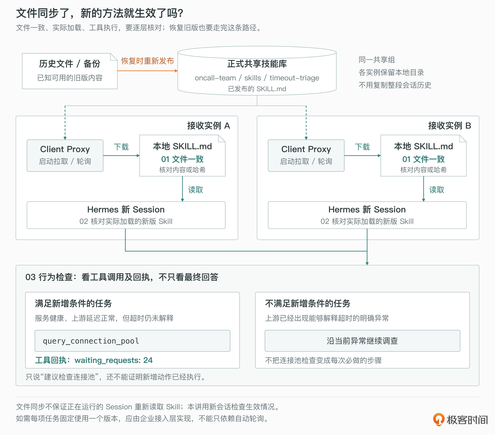
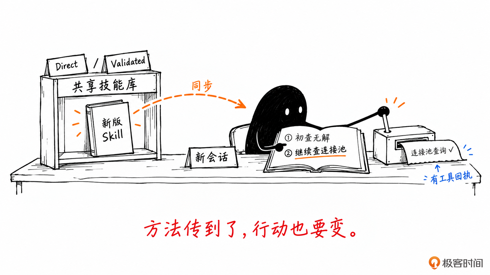

# 22 | SkillClaw（下）：怎样将演化后的Skill分发给其他Agent？

你好，我是 Tyler。

上一讲，我们通过 SkillClaw 汇集了多个 Hermes 实例的在线经历，再由 Evolve Server 在离线侧蒸馏出一份更完整的超时诊断 Skill。

```
新版 timeout-triage 已经增加了连接池检查：当服务健康状态和上游延迟都无法解释超时
```

时，Agent 应继续查询连接池，而不是直接结束调查。

但其他在线 Hermes 实例可能仍在使用旧版方法。即使 Evolve Server 已经完成修订，这些实例也不会自动获得原始会话中的经验。而我们希望一个 Agent 积累的经验经过 SkillClaw 演化后，可以被其他 Agent 直接复用，而不需要它们重新经历相同的故障。

这就需要用到 SkillClaw 的发布与同步机制。它将演化结果写入共享技能库，再由各个客户端获取和加载新的 Skill。

```
这一讲，我们就继续跟踪 timeout-triage，看看新方法怎样发布、同步，以及如何确认它
```

真正改变了其他 Hermes 实例的执行行为。



## 同一份 Skill 修改，为什么有两种发布方式？

上一讲的 Execute 阶段已经完成了 Skill 修订，但生成一份新文件，与允许其他在线实例使用它，是两个不同的步骤。

```
SkillClaw 提供 direct 和 validated 两种发布模式。
```

### Direct：直接发布演化结果

```
direct
是 SkillClaw 的 workflow 引擎默认采用的模式。
```

当 Evolve Server 完成演化并接受修改结果后，就会将新的 Skill 写入正式共享技能库。例如，

```
在 oncall-team 共享组中，文件可以保存在：
oncall-team/
 skills/
   timeout-triage/
     SKILL.md
这里的 skills/ 是正式共享目录。Client Proxy 后续从这个目录获取已经发布的方法。
```

Direct 的优点是传播路径短。后台完成修订后，新的 Skill 就可以进入客户端的同步流程。

但对于生产故障诊断，团队也可能希望在新方法影响其他实例之前，先安排一次独立检查。这时可以使用 Validated 模式。

### Validated：先验证，再发布

```
在 validated 模式下，Evolve Server 不会立即将候选写入正式的 skills/ 目录，而是先
```

创建一个验证任务。

启用了验证功能的 Client Proxy 会在本地空闲时领取任务，评估候选 Skill，再将验证结果写回共享存储。Evolve Server 根据收到的结果和配置的发布条件，决定是否正式发布。

我们可以通过以下配置启动 Evolve Server：

```
EVOLVE_PUBLISH_MODE=validated \
EVOLVE_VALIDATION_REQUIRED_RESULTS=1 \
EVOLVE_VALIDATION_REQUIRED_APPROVALS=1 \
EVOLVE_VALIDATION_MIN_MEAN_SCORE=0.75 \
EVOLVE_VALIDATION_MAX_REJECTIONS=1 \
skillclaw-evolve-server \
 --engine workflow \
 --interval 300 \
 --storage-backend local \
 --local-root /srv/skillclaw-share \
--group-id oncall-team
```

这里设置了四项条件：至少收到一份验证结果、至少有一份通过结果、平均评分达到 0.75，并且拒绝数量不超过设定上限。这些数值是课程里的演示配置，实际要求要结合你的团队 / 业务需求确定。

服务端启用 Validated 后，还需要至少一个客户端参与验证：

```
skillclaw config validation.enabled true
skillclaw config validation.idle_after_seconds 300
skillclaw config validation.poll_interval_seconds 60
skillclaw validation status
skillclaw validation run-once --force
正常情况下，Client Proxy 在空闲后自动检查待验证任务。练习时可以使用 run-once --
force 主动执行一次验证，观察客户端是否领取任务，以及结果是否返回共享存储。
```

Evolve Server 在后续处理周期检查验证结果。满足发布条件的候选进入正式技能库；未满足条件的候选继续等待或被拒绝，不会直接分发给其他实例。

Direct 和 Validated 的区别，在于演化结果是否需要经过额外的客户端验证，才能成为正式共享版本。

这里的 Validated 是 SkillClaw 自带的候选发布机制。对于需要严格检查业务正确性和工具调用的场景，还可以结合前面建立的业务 Eval，但不需要重新实现发布流程。



## 新版 Skill 怎样到达其他 Hermes 实例？

```
假设新的 timeout-triage 已经正式发布。现在，我们让另一台 Hermes 实例获取它。
```

SkillClaw 的 Client Proxy 不仅负责在线会话采集，还负责本地 Skill 与共享技能库之间的同步。

每个 Hermes 实例仍然保留自己的技能目录。共享存储保存正式发布的方法，Client Proxy 则将这些方法同步到本地。这样，多个实例不必复制彼此的会话历史，只需要共享已经整理好的Skill。

### 先手动拉取新版本

SkillClaw 提供了四条技能管理命令：

```
skillclaw skills list-remote
skillclaw skills pull
skillclaw skills push
skillclaw skills sync
其中，list-remote 查看共享技能库，pull 下载共享 Skill，push 上传本地 Skill，sync
```

则执行双向同步。

```
对于已经由 Evolve Server 发布的 timeout-triage，接收端只需要先查看远端内容，再执
```

行拉取：

```
skillclaw skills list-remote
skillclaw skills pull
拉取完成后，我们就可以在接收实例的本地 Skill 目录中找到新版 SKILL.md。
```

这里有一项需要在首次同步时确认的行为：SkillClaw 的默认完整拉取可能根据远端清单同步本地目录，删除本地独有的 Skill。因此，已有技能库在首次拉取前，应检查共享内容并备份本地文件。

### 再让客户端自动更新

手动同步确认正常后，就可以启用 SkillClaw 的自动更新。

沿用上一讲已经配置好的共享组，我们只需要增加：

```
skillclaw config sharing.auto_pull_on_start true
skillclaw config sharing.skill_reload_mode poll
skillclaw config sharing.skill_reload_interval_seconds 30
auto_pull_on_start
让客户端启动时检查共享技能库，skill_reload_mode poll 开启周期性拉取，
skill_reload_interval_seconds 设置检查间隔。
```

重新启动 Client Proxy 后，客户端就可以定期获取共享技能库中的正式版本，并将变化同步到本地目录。

对于多个 Hermes 实例，只要它们连接同一个共享组，就可以分别获取演化后的 Skill，而不需要在每台机器上重新运行 Evolve Server。

```
到这里，新的 timeout-triage 已经从共享后端传递到了接收实例。
```

接下来，我们要验证这项同步究竟带来了什么变化。

## 文件同步了，新方法就真正生效了吗？

要确认新版 Skill 真正生效，还需要检查三个环节：文件同步、Skill 加载和实际执行。

```
首先，核对本地与共享端 SKILL.md 的内容或哈希，确认文件同步成功。接着，启动新的
Hermes 会话，通过技能读取记录确认 Agent 加载了新版 timeout-triage。最后，通过两
```

类任务检查 Agent 的实际执行行为。

第一类是新增能力测试。 假设接口持续超时，但服务健康状态和上游延迟都正常，现有检查无法解释故障。我们固定任务输入和工具数据，分别使用新旧版本进行测试。旧版在完成初始检查后停止调查，而新版应继续查询连接池，并在执行轨迹中留下真实的工具调用和回执：

```
query_connection_pool
result: waiting_requests = 24
```

第二类是原有能力回归测试。 假设上游延迟检查已经发现异常，调用链和故障时间线也支持这一判断。此时，Agent 应继续沿着上游异常调查，无须额外查询连接池。

通过这两类测试，我们可以检查新版 Skill 是否补上了缺失的诊断步骤，同时保留原有的正确处理流程。



### 如果新版带来了退步怎么办？

SkillClaw 提供了 Dashboard，可以查看本地和共享 Skill、验证任务、发布历史及相关会话。

```
skillclaw dashboard sync
skillclaw dashboard serve
```

我们可以借助 Dashboard 定位某次修订及其相关的历史记录。如果发现新版影响了原有任务，就从历史文件或备份中找回已知可用的内容，通过共享技能库重新发布，再让客户端同步。

恢复后，还要在新的 Hermes 会话中检查实际行为，确认接收实例使用了恢复后的方法。

这里恢复的是后续任务采用的 Skill，不会撤销已经执行的工具调用和已生成的报告。因此，保留 Skill 版本及执行记录，才能追溯一次不合适的修改产生了哪些影响。

至此，我们就完成了从新 Skill 发布到其他 Agent 实际使用的整个过程。

## 小结

学到这里，我们做个总结吧。



上一讲，我们通过 SkillClaw 收集多个 Hermes 实例的执行经历，再由 Evolve Server 蒸馏出新的 Skill。这一讲则完成了发布、同步和接收端生效的验证。

SkillClaw 的 Direct 和 Validated 模式决定演化结果怎样进入正式共享技能库，Client Proxy 则通过手动拉取或自动轮询，将共享版本同步到不同实例。

但真正体现程序记忆共享价值的，不是多个实例拥有了相同文件，而是一个 Agent 从实际经历中获得的方法改进，能够改变其他 Agent 后续的执行行为。

到这里，我们就把 SkillClaw 的在线会话采集、离线技能演化与跨实例分发连接起来。不同Agent 可以持续积累经验，再将其中值得复用的方法交给整个团队使用。

下一讲，我们继续讨论怎样把这些能力组织成长期运行的 Agent 自进化系统。

## 系统设计题

下面是本讲的系统设计题和课后练习。

题面你的团队部署了多个 Hermes On-call Agent，它们通过 SkillClaw 共享一套超时诊断 Skill。

```
最近，Evolve Server 根据某些实例的真实经历，为 timeout-triage 增加了连接池检查。
```

现在，希望让其他实例在不重新经历原始故障的情况下，直接获得并使用这项改进。

请设计从 Skill 发布到实际生效的流程：怎样选择 Direct 或 Validated 模式，如何让接收实例自动获取新版本，以及怎样通过相同故障任务的对照实验，确认新增方法真正进入了工具执行过程。

进一步考虑，如果接收实例已经下载了新版文件，却没有执行连接池查询，你会怎样区分 Skill未加载、任务不满足触发条件，以及 Agent 没有正确执行方法这几种情况？

配套练习放在 GitHub 配套工程中，对应这一讲的练习目录。你可以让一个 Hermes 实例获取共享后端发布的新 Skill，再使用固定的故障任务，比较同步前后的工具调用和诊断结果。

期待你在留言区记录收获或者提出疑问。如果这一讲对你有启发，也欢迎分享给身边更多朋友。
