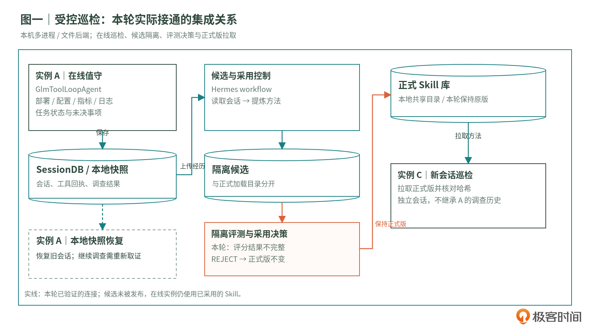
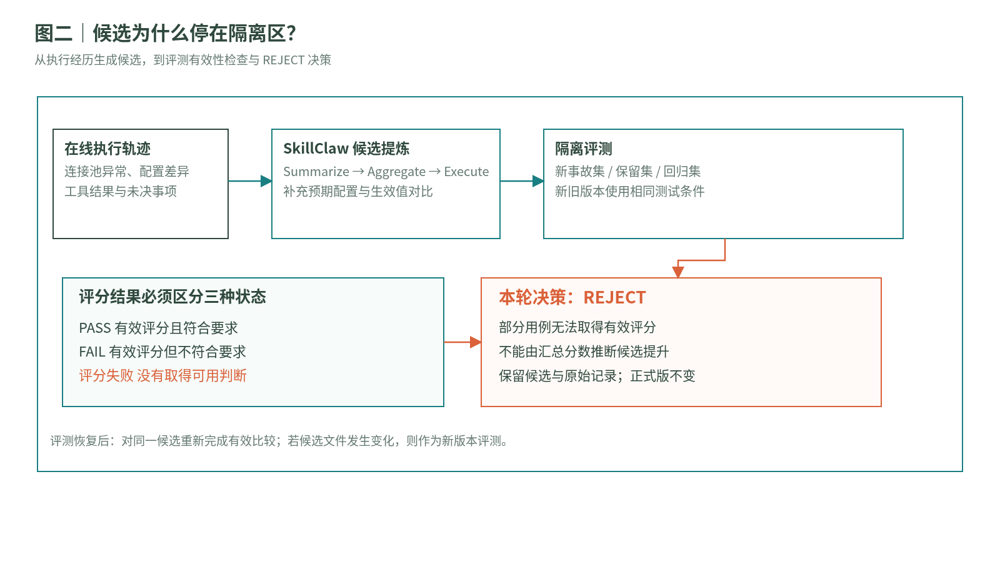
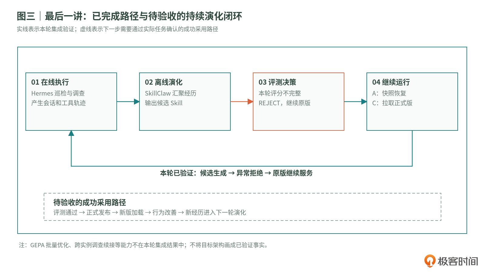
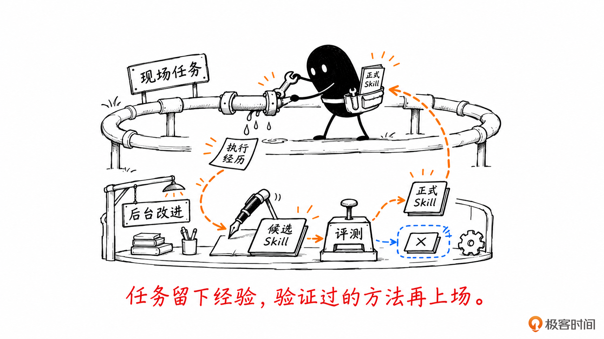

# 23 | 自进化OncallAgent：把每一层接成一条线

你好，我是 Tyler。

经过前面二十多讲，我们已经为 Hermes On-call Agent 加入了上下文管理、长期记忆、Skill自主修订、GEPA 离线优化和 SkillClaw 跨实例经验共享等能力。现在，我们来完成最后一步：把这些能力连接起来，让 Agent 在日常工作中积累经验，让经过验证的方法改进进入后续任务。

这一讲，我们重点看三个问题：执行经历怎样进入后台演化，新 Skill 怎样进入下一轮任务，以及整个过程怎样持续运行。



- 图一：自进化 On-call Agent 的端到端架构

## 一次任务怎样推动 Skill 改进？

继续看我们的 On-call Agent。它使用当前正式版 Skill 执行巡检和故障调查，通过 OpenViking按需获取外部上下文，再调用工具查询现场状态。

每次任务结束后，Hermes 都会留下执行轨迹，包括任务输入、工具调用、返回结果和最终判断。为了支持后续演化，还需要关联任务标识、执行实例和实际使用的 Skill 版本。

这些信息随会话进入 SkillClaw 的共享存储。Evolve Server 通过 Summarize、Aggregate 和Execute 分析执行经历，寻找方法缺口并生成 Skill 候选。

例如，前面我们已经遇到过连接池异常的调查。Agent 发现配置文件中的连接池上限与实例实际生效值不一致，于是后台可以据此提出一条新的诊断规则：

- 当连接池耗尽或请求持续等待时：1.查询配置文件中的连接池参数。

- 2.查询实例实际生效的连接池参数。

- 3.比较预期值与生效值。

- 4.如果存在差异，继续调查配置漂移与故障的关联。

除了通过 SkillClaw 从在线经历中提炼方法，我们还可以利用积累的历史任务，通过 GEPA 搜索更好的 Skill。

两种方式都可以产生候选，但还需要一个统一的交接环节，将候选与原始版本、修改内容和执行依据关联起来，再交给评测系统。

例如，候选可以使用以下记录：

```json
{
 "candidate_id": "timeout-triage-017",
 "base_version": "timeout-triage-016",
 "source": "skillclaw",
 "status": "pending_evaluation"
}
```

这是总装时设计的候选管理格式，用于关联版本和评测结果，并非 SkillClaw 的固定数据结构。

## 新 Skill 怎样进入下一轮任务？

候选生成后，我们让它与当前正式版在相同任务和独立上下文中比较，检查新增能力、原有能力和关键回归要求。

通过评测的候选进入正式技能库，其他 Hermes 实例再通过 SkillClaw 拉取或自动同步。未通过评测的候选则继续保留在隔离区域，在线实例使用原有版本。

这里要把评测决定和正式发布连接起来。SkillClaw 支持 Direct 和 Validated 发布模式；如果系统要求统一评测，就必须在发布前完成相应检查，避免候选未经批准进入共享技能库。

新版发布后，还需要知道每项任务实际使用了哪个版本。因此，我们可以在执行记录中保留：

```json
{
 "task_id": "oncall-024",
 "agent_id": "oncall-02",
 "skill_version": "timeout-triage-017"
}
```

这样，后台不仅能检查文件是否同步，还能根据执行轨迹判断新方法是否发挥作用。

例如，新版增加配置对比步骤后，连接池异常任务中应出现对应的工具调用；对于没有连接池异常的任务，则不应无条件执行这项检查。

这些后续任务又会产生新的执行经历，继续进入 SkillClaw，成为下一轮 Skill 演化的材料。



- 图二：候选评测、正式发布、客户端同步与下一轮执行

## 怎样让自进化持续运行？

当多个 Hermes 实例长期运行时，需要处理三个问题。

首先，在线执行与后台演化分开运行。Hermes 使用正式版 Skill 处理业务任务，SkillClaw 和GEPA 在后台生成候选。即使演化或评测失败，也不影响在线实例继续工作。

其次，记录实际使用的版本。共享技能库发布了新文件，不意味着所有实例已经加载。对于长程任务，还可以在任务开始时固定 Skill 版本，避免执行过程中切换方法。这需要在 Hermes的运行接入层实现。

最后，将上线后的结果反馈给演化系统。例如，新版已经能够检查配置漂移，却仍然无法解释某些连接池耗尽问题。这些新经历可以继续推动 Skill 修订。如果发现新版影响了原有任务，就恢复已知可用的版本，重新同步并验证。

前面的集成实验中，我们已经验证了候选生成、评分异常时拒绝采用、正式版本继续运行，以及快照恢复和跨实例同步。候选成功采用后能否持续改善后续任务，还需要通过实际执行进一步验证。

至此，整个过程形成了一条循环：真实任务产生经历，后台从经历中改进 Skill，评测决定是否采用，新方法进入下一轮任务，再产生新的经验。



- 图三：自进化 On-call Agent 的持续运行闭环

## 小结



从最初的工具调用，到上下文管理、长期记忆、Skill 自主修订、离线优化和跨实例共享，我们已经逐步完成了 Hermes On-call Agent 的主要能力建设。

最后这一讲，将这些能力连接成了一套持续演化机制。Agent 在真实任务中积累经验，后台据此改进工作方法，经过验证的新 Skill 回到在线执行过程，继续接受实际任务的检验。

整套课程到这里就结束了。希望你能够将这套方法用于自己的 Agent 系统，让它在长期运行中不断积累和改进可复用的工作经验。

## 系统设计题

最后，我们用一道综合系统设计题，为整套课程做个收尾。

题面

你的团队部署了多个 Hermes On-call Agent，希望将长期记忆、Skill 自进化、GEPA 离线优化和 SkillClaw 跨实例共享整合为一套持续演化系统。

请设计从任务执行、经历回收、Skill 候选生成、版本评测到正式发布的完整流程，并说明怎样让新版本的执行结果继续进入下一轮演化。

进一步考虑，如果候选评测失败，或者已发布版本出现退步，系统应该怎样保证在线任务不受影响？

配套练习放在 GitHub 配套工程中，对应这一讲的练习目录。你可以将前面各讲完成的组件连接起来，运行一次从在线任务到候选生成、评测与版本决策的完整流程。

期待你在留言区分享自己的实践结果。如果整套课程对你有所帮助，也欢迎推荐给身边正在建设 Agent 系统的朋友。
