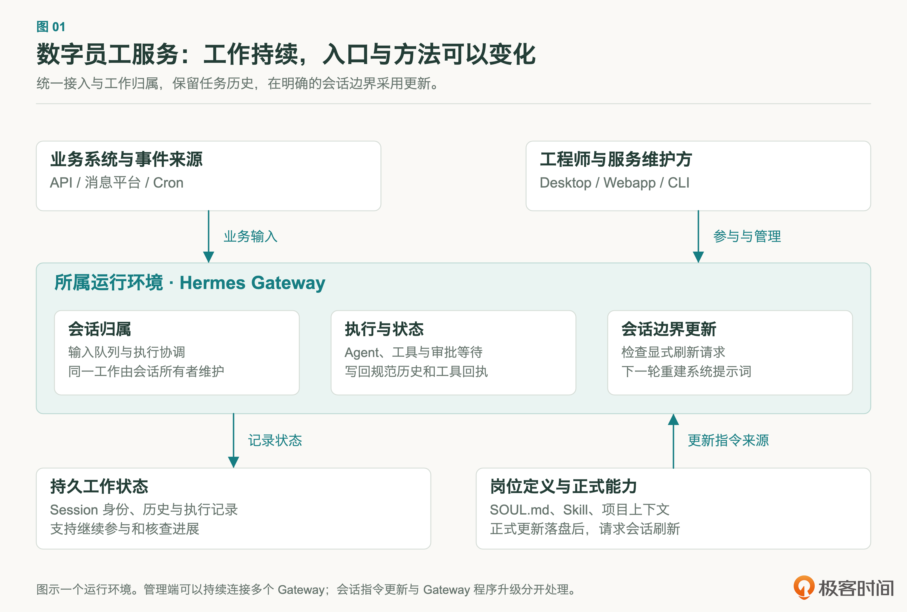
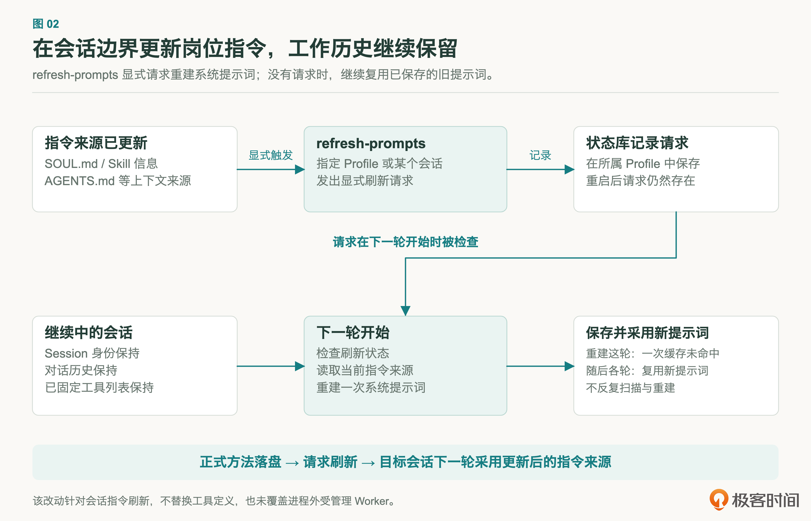
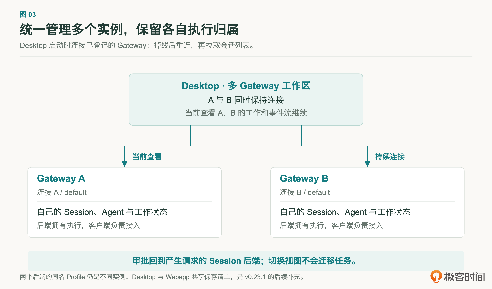

# 加餐01 | 从Agent到数字员工：HermesGateway背后的运行时架构演进

你好，我是 Tyler。

企业把一项工作长期交给 Agent 以后，需要维护的对象就变了。

一开始都很简单，在终端里把 Agent 拉起来，给个任务，等它跑完返回。但 Agent 一旦进了业务系统，节奏就变了，监控、工单、消息平台、定时调度会持续把请求推过来，几件事同时在跑，人只在需要拍板的时候介入；与此同时，岗位指令和 Skill 还在不断更新，你不可能为了同步一次方法，就把正在跑的工作全部清空。

到了这个阶段，你要交付的就不再是一个能跑通的 Agent，而是一项能持续接单、自己维护任务状态、还能接受更新的服务。Agent 循环本身负责把工作做完，服务架构要解决的是另一个问题——让这份能力在不同入口、不同任务、不同版本之间都能稳定地被复用。

Hermes 这轮 Gateway 更新，我更愿意放在这个层面来看：统一会话所有权、Gateway 直接提供 Webapp、多后端长连、已有会话的指令刷新，再加上常驻运行时的资源修复，分别对应服务在接入、更新和运维上会遇到的真实问题。

这轮改动里有一条主线值得我们单独拎出来说说，于是就有了这次加餐。这条主线就是Hermes 如何把需要持续维护的工作状态，和会变化的交互入口、工作方法分开。服务本身一直在跑，入口可以换，岗位方法也可以在明确的时机更新。

## 服务统一接单，运行时统一维护工作

运行这样一项服务，第一个要讲清楚的是工作归属。

业务系统把任务交进来，你中途补充要求，定时调度又推来新的输入——入口可以不同，但只要属于同一项正在进行的工作，就该进入同一套执行协调。谁收输入、谁安排后续、谁等审批、谁写回结果，每一环都得有明确的负责方。

要是每个入口都自己跑一份 Agent，职责立刻就散了——哪怕它们读的是同一份聊天记录，也可能各自触发后续动作，重复写入、甚至把消息弄丢。Hermes 这轮统一运行时，针对的就是这个问题：把会话的执行所有权收拢到 Gateway。

在这套结构里，CLI、Desktop、编辑器、消息平台、Cron 都只是客户端或输入来源，统一接到会话所有者上。输入队列、执行协调、审批等待、权威历史的写入，都由 Gateway 管理；就连受管理的进程外 Worker，也通过所有者交回记录。

这样一来，业务接入和具体执行就解耦了。你要加一个任务来源、或者加一种人工参与方式，接的都是同一个已经在跑的服务，不必因为多了一个客户端，就另起一份独立的工作过程。

Webapp 也直接由 Gateway 提供。v0.23.0 把完整的 Desktop 工作区搬进了浏览器，聊天、插件、设置、工作区交互全部复用已有的会话接口；浏览器只负责展示和输入，Agent 依旧在后端用它自己的工具、文件和网络环境。



你可以直接远程参与服务，不用在每台设备上重新部署一套工具运行环境。前端资源和会话接入都由 Gateway 一起提供，也省得再搭一套 Web 服务去同步 Agent 状态；Docker 和 Nix 分发已经纳入 Webapp 的构建产物，这层管理入口可以跟着运行环境一起部署。

接入还要管住访问范围。Webapp 默认关闭，本机走 Gateway 提供的一次性链接，远程访问则进入配置好的登录流程。它能直接访问终端和工作资源，所以入口权限要按这个实际能力来管理。还要说清楚，这里的统一 Gateway 是单个运行环境的接入和执行归属，不等于所有业务都得共用一个进程、一套权限。

业务平台依旧负责判断任务属于哪个服务、哪个环境、哪份已有工作，Gateway 只在这之后维护对应会话。业务接管和事故关联前面讲过，这里要补的是另一件事：多种入口怎么共用同一套运行时。

## 服务持续运行，岗位方法仍然要更新

服务一旦跑起来，新的矛盾很快就冒出来：工作状态要持续，但工作方法不能一直停在启动那一刻的版本。

岗位说明会修订，规则会补充，验证过的 Skill 会陆续发布。对一项长期运行的服务，你希望它保留任务进展，同时把这些更新接进来。可要是每次改岗位指令都得新开会话，工作上下文就和方法更新绑死了；要是只能靠重启进程更新，又会连累同一运行时里的其他任务。

Hermes 之前的会话提示词策略，正好把这个问题摆到了台面上。

为了命中模型提供方的提示词缓存，进行中的会话会一直用已保存的系统提示词；Gateway重启后，这份提示词还能从数据库恢复，而内存里的 Agent 可能还拿着旧副本。结果就是，磁

```
盘上的 SOUL.md、Skill 描述、项目上下文明明已经改了，旧会话照样发之前构建的内容。
```

这其实是个典型的取舍：提示词稳定，缓存才好复用；但要长期复用，又得有一个明确的更新

```
机制。v0.23.0 加入的 hermes sessions refresh-prompts，就是这个显式的采用入
```

口。

你可以对整个 Profile、或者某个指定会话发出刷新请求，请求会保存在这个 Profile 的状态库里。目标会话下一轮开始时检查到它，重新构建系统提示词，再把新内容和刷新状态存下来；对话历史、Session 身份、已经固定的工具列表都原样保留。



这样，指令就能在会话边界热更新：正式方法已经落盘，继续中的任务在明确的下一轮采用更新。它不要求清空历史，也不需要为这次指令刷新重启整个 Gateway。

采用边界同样要讲清楚。已经发出去的一次调用不会被中途改写，工具定义也不会借机被换掉。这个改动明确没有覆盖进程外的受管理 Worker，所以刷新会话指令、升级所有执行进程，依旧是两件不同的事。

成本也可以算清楚：只在重建那一轮承担一次缓存未命中的成本，之后的轮次继续复用新提示词；不发请求，就维持原来的复用方式。系统不必为了发现一次更新，每轮都去读取、重建所有指令来源。

这一步，正好给自进化体系补上了一个具体的服务操作。前面讲过怎么评测候选、发布正式Skill，但新方法到达运行环境之后，还得让已有任务在合适的时机采用它。现在，发布流程可以在正式指令落盘后，向选定的会话发出刷新请求。

要记录的东西也更具体了，哪些文件已经发布，哪些会话收到了刷新请求，哪些会话在下一轮完成了重建。版本发布、请求刷新、实际采用，可以拆成三步分别核对。这是企业集成能用上的新机制，但别理解成任意候选一生成，就会自动进入所有在线任务。

## 多个运行实例，需要统一管理而保留执行边界

数字员工服务如果想铺进更多业务环境，往往需要多个运行实例。

它们用的工具不同、访问的网络不同，资源和故障隔离要求也可能不同——既有岗位配置的差异，也有运行位置的差异。Hermes 用 Profile 组织配置和状态；要不要再上独立机器或容器，看实际运行条件决定。

管理上的要求随之而来：你得能在一个工作区里看到多个实例，同时保留每份工作的真实归属；否则，统一界面反而会把任务到底在哪个环境执行给盖住。

多 Gateway 连接的改动，回应的就是这个要求。旧客户端围绕当前选中的后端切换，动不动就清空、重新拉取会话列表；要是某个后端启动时离线，恢复之后也未必能及时出现在列表里。

新的方式在 Desktop 启动时就连上所有已登记的 Gateway，整个窗口期间保持连接；后端掉线就持续重连，连上之后再拉会话列表。你当前在看哪份工作，跟客户端维护哪些后端连接，就此分开管理。



这样，离线、恢复、切换就有了各自的处理路径。有一个实际验证过的场景：SSH 后端启动时离线，20 秒后恢复，旧版在后续检查里仍然列不出会话，改完之后重连就能正常显示。管理入口得能重新发现已经恢复的实例，反映的状态才是真实的。

多个实例同时可见，控制请求还得回到正确的位置。客户端靠连接加 Profile 的组合来识别目

```
标——哪怕两个 Gateway 都有 default Profile，也依旧是两份独立实例，聊天、记忆、终
```

端、在跑的任务都留在各自后端。

审批就是个典型例子。你正在看实例 B，实例 A 的任务可能正在等确认，审批按钮就得回到产生请求的那个会话，而不是发给当前选中的后端。切换视图没有改变执行归属，管理动作就得继续用原来的归属信息。

## 常驻运行时，要对整个服务的资源负责

统一运行时把许多任务装进同一个服务，也把原本只影响单次执行的资源问题放大了。

一项工作答复完，不代表它占用的对象已经释放；一次维护动作哪怕发生在两轮任务之间，也可能卡住其他任务的响应。任务能不能持续完成，很考验共享运行时怎么处理这些收尾和维护。

其中一项修复，针对的就是执行路径变化后遗漏的收尾。消息平台原来的路径会在回复交付后跑回调，统一之后的本地和 API 会话却没有把这些回调取出来执行。结果闭包一直引用着这一

```
轮的 Agent、历史和结果，部分 /goal 状态通知也没送到客户端。
```

修复把收尾职责交回给真正接纳、执行输入的路径，在回复交付后跑完回调、释放引用，资源留存和状态通知缺失两个问题一起解决。对服务来说，回复交付、状态通知、资源回收，必须在同一套执行生命周期里衔接好。

另一项修复，处理的是周期性内存整理带来的停顿。原来部分路径每次整理都先强制一次全量垃圾回收，常驻进程里的对象一多，这次扫描会把其他线程一起暂停，正在聊天、等流式结果、用 Desktop 的任务全都会受影响。

现场日志里有一次观测：这类整理大约每分钟一次，垃圾回收加内存整理的中位耗时在 272毫秒左右。这个数字只对应当时那个 Gateway，但共享服务的维护动作，落进了所有会话都能感受到的响应路径。

改完之后，常规整理不再每次强制全量回收；全量回收放到空闲期补做，等整个进程连续五分钟没有任务执行再进行。已关闭的 Agent 之间还互相持有引用，形成闭环，谁都无法被回收；这类引用会在环产生的位置直接断开。

这类改动和统一 Gateway，其实是同一设计的两面。执行和管理职责集中之后，状态可以统一维护，但释放和维护的边界也得划清楚；否则实例跑得越久、任务越多，历史任务留下的资源就越容易拖累当前服务。

服务更新还要区分变更对象。岗位指令可以在会话边界刷新，但 Gateway 程序本身的升级依旧涉及进程生命周期。这次停止、重启命令对活动任务的保护，就是为了避免把普通进程操作直接施加到正在承载工作的服务上；它给了运维一层保护，但不等于已经实现任意版本的无中断滚动升级。

## 小结

回过头看，Hermes 这轮更新围绕的是几件相互关联的事：统一接入和工作归属，让长期任务能采用新的岗位指令，统一管理多个运行实例，再让共享运行时长期保持可用。

Gateway 维护执行和状态，Webapp、Desktop 提供参与服务的工作区，多 Gateway 连接保

```
留各实例的归属，refresh-prompts 在保留会话的前提下给出指令更新入口；内存和收尾
```

修复，则进一步处理这套共享运行基础已经暴露出来的问题。

这也是本篇和前面自进化机制的接口：我们已经知道怎么改进方法，接下来要解决的是让一项持续工作的服务能接收、管理、采用这些改进。方法会继续演化，承载工作的服务就得有明确的接入、更新和运维方式。

下一篇加餐，我们看 Hermes Group Chats：当多个数字员工进入同一个协作空间，它们怎么分工、共享信息，共同完成一项长期任务。

期待你在留言区分享自己的实践结果。如果课程对你有启发，别忘了推荐给身边正在建设Agent 系统的朋友。
