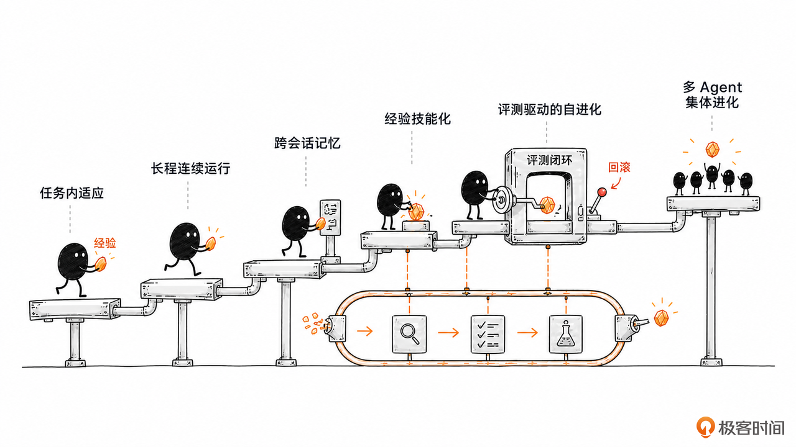
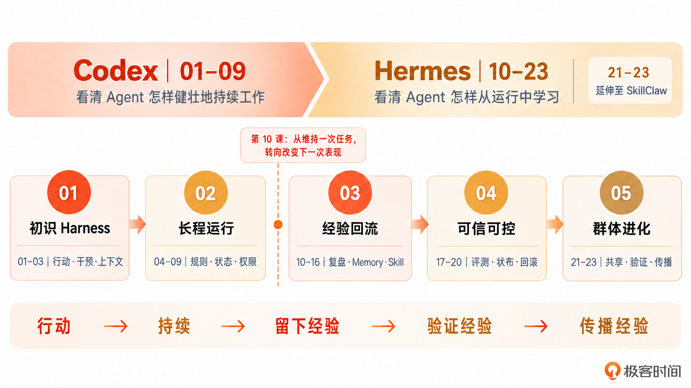
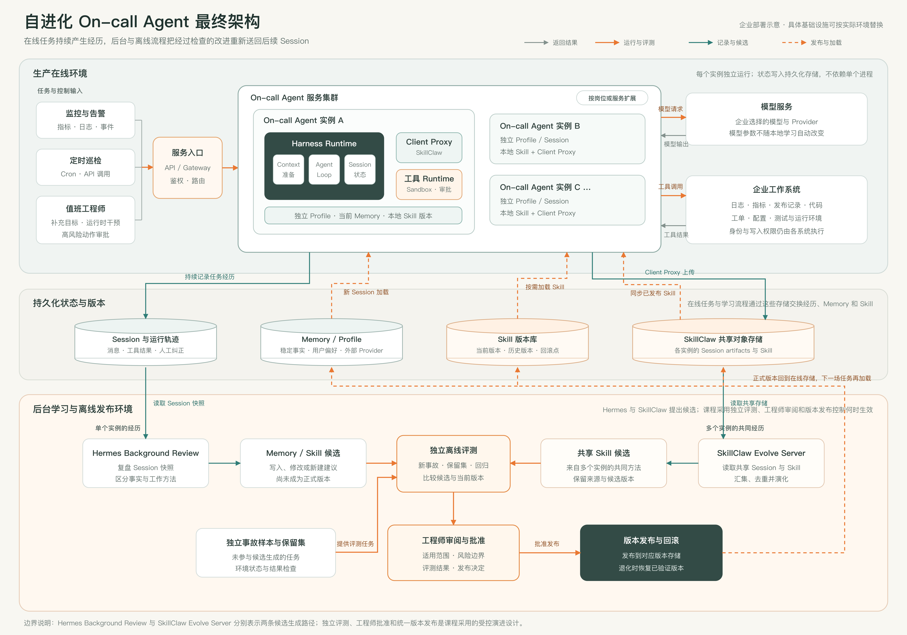
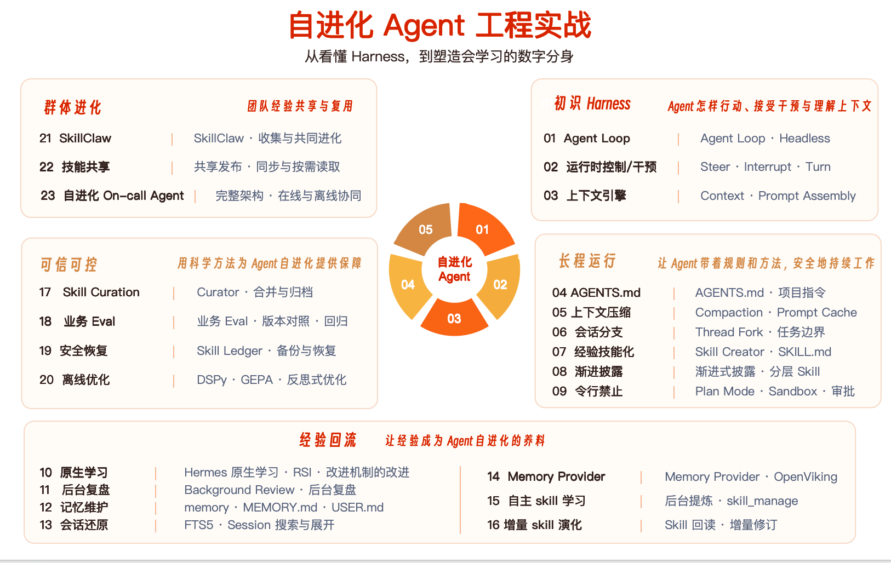

# 开篇词 | 从看懂Harness，到塑造会学习的数字分身

你好，我是 Tyler。欢迎和我一起学习《自进化 Agent 实战》。这门课的核心，是构建能在业务中持续成长的 Agent。

过去几年，我带领的团队一直在做数字员工平台。早期，我们更关注数字员工能不能独立完成一项任务。随着 Agent 进入真实业务流程，问题很快变为它能不能在人离开以后继续承担这项工作？

## 为何需要 Harness in the loop？

Human in the loop 的概念你应该不陌生。简单来说就是为了弥补 Agent 自身能力的不足，从系统设计之初，人就被作为一个必要组件嵌入到自动化工作流中，在关键环节负责判断、确认或接管。

工程师守在屏幕旁，其实一直在替 Agent 维持任务：记住最初目标，发现偏离时调整方向，判断哪些系统可以操作，在关键动作前叫停，并根据日志、测试和监控侧的信息决定是否接受它的工作。随着 Agent 进入后台、流水线或者长期在线服务，我们希望人不再始终守在这些位置时，这些职责仍然必须有“人”承担，而这个角色就变成了 Harness 。

我们结合例子来讨论。一名 On-call（值班）Agent，负责替你半夜起床排查问题。告警到来以后，它可以查询日志、核对发布记录、检查运行指标，甚至在授权范围内修改配置。

这样的 Agent 其实行动能力很强了，但无人值守场景下，还无法持续、稳定地按照既定目标、方法和边界开展工作。

- 任务中断或会话重启后，会丢失本次排查已经积累的线索与判断。

- 单次事故学到的处理思路，不会自动保存，下次遇到同类问题仍要重新摸索。

- 容易把某一次场景下有效的办法，直接套用到条件不一样的故障上。

- 不同 Agent 独立积累经验，彼此之间无法共享复用。

所以，人的目标怎样表示，每一轮模型看见什么，任务状态怎样延续，哪些动作可以自动执行，哪些操作必须请求审批，什么结果才算真正完成，都需要明确地留在 Harness 中，这就是我说的“Harness in the loop”。

## Agent 怎样从工作中成长？

有了 Harness 保驾护航，Agent 终于可以开始承担长期工作了。但新问题会自然出现：怎么让Agent 在工作里成长。

这门课里所说的可控自进化，是指在受控机制下，Agent 在真实业务运行中持续收集工作轨迹、人工反馈，自动提炼事实记忆与可复用技能，经过评测、审批后更新自身能力，做到可审计、可管控的能力迭代。它是 Harness 驱动的一套有边界、可回滚的持续学习闭环。

这个定义现在略显抽象，后续课程你会逐渐加深理解，此时我们先简单用人来类比。比方说，一名长期从事某个业务领域的工程师，会在多年工作中持续积累经验，专业水平也随之提高。同样地，我们自然也会期望 Agent 可以积累“工作经验”，升级能力，产出更高的价值。

对于 Agent 来说，经验积累，就是持续提升学习能力，这项能力大致沿着这样一条路线发展：任务内适应 → 长程连续运行 → 跨会话记忆 → 经验技能化 → 评测驱动的自进化 → 多 Agent集体进化

最初，Agent 只能在当前任务中学习。命令执行失败，它会调整参数；测试没有通过，它会继续修改；用户提供了新的信息，它会重新规划。但这些变化主要存在于当前 Context 中，任务结束以后便可能消失。

随后，Harness 开始保存 Thread 和任务状态，管理 Context，处理历史压缩、中断恢复、权限审批和结果验收。经过几十轮甚至几百轮调用以后，Agent 仍然知道自己要完成什么、当前走到哪里，以及哪些决定必须交给人。

在稳定运行的基础上，Agent 才能把工作中的经验带到新的会话。比如，“日志已经迁移到新的入口”是一项相对稳定的环境事实，适合保存为 Memory；“发布与告警时间相邻时，应先作为调查线索，不能直接确认因果关系”是一种可以重复使用的工作方法，更适合整理为 Skill。

不过，自动生成 Memory 和 Skill，还不足以构成可靠的自进化。的确，Memory 让 Agent 记住重要信息，Skill 让 Agent 掌握可复用的方法。但新的经验是否适用于其他场景，Skill 能否在正确时机触发，关键步骤是否完整，有没有把一次事故中的偶然现象固化为长期规则，都需要经过评测和回归验证。

因此，自进化需要一条受控的学习闭环：在线任务产生运行轨迹，后台复盘从轨迹、工具结果、人工纠正和最终验收中提出候选。离线环境比较新旧版本，经过审批、发布和版本管理的改进再进入后续任务；版本管理同时保留回退能力，上线后若表现退化，可按受控流程撤回上一版本。

当这套机制扩展到多个 Agent、设备和用户时，一个数字分身学会的方法，还可以经过汇集、去重和验证，转化为团队乃至组织的共同能力。

## 这门课怎样展开？

课程将沿着刚刚这条演进路线，以一名长期在线的 On-call（值班）Agent 为例，观察它如何持续工作、积累经验，并将个体经验转化为团队能力。（这个例子天然包含长程状态、环境变化、因果判断、工具权限、人工审批和结果验收，而工程师也对这类业务场景更熟悉。）

它平时检查部署、配置和运行指标，告警到来以后转入故障调查，事故结束以后再回到巡检。还会在一班值守结束以后复盘自己的工作，为下一次值班留下经过验证的经验。

课程前半部分以 Codex 为主要观察对象。Codex 对 Thread、Turn、Item 等运行时对象的划分比较清晰，对初学者理解长程任务的技术抽象也更为友好。我们会沿着 On-call Agent 的一次完整值班，拆开 Agent Loop、Context、Thread、历史压缩、任务分支、Sandbox、审批和结果验收，看 Harness 怎样持续维护一项任务的目标、状态、边界和控制权。

当问题从“怎样把任务持续运行下去”推进到“任务结束以后怎样从中学习”，课程会转向Hermes。Hermes 将后台复盘、长期 Memory、历史 Session、Skill 管理和写入审批组织在一套相对完整、一致的自进化机制中，适合用来观察一段运行经历怎样被提炼为未来可以继续使用的事实和方法。

在此基础上，我们会进一步连接在线运行、后台学习与离线优化。真实任务负责产生轨迹，后台流程负责提出 Memory 或 Skill 候选，离线评测负责比较不同版本，再通过审批、发布、回归，让经过验证的改进进入新的 Session。

最后，课程会借助 SkillClaw 等集体学习架构，把自进化从单个 Agent 扩展到多个 Agent，讨论不同实例产生的经验怎样汇集、去重和验证，又怎样按照岗位、项目和权限边界同步给其他数字分身。

Codex 和 Hermes 分别帮助我们看清两段连续的工程过程：前者让我们理解长程 Agent 怎样运行，后者让我们理解 Agent 怎样从运行中学习。

课程结束时，你会亲手组装出一名自进化的 On-call Agent。配套代码位置：https://github.com/tylerelyt/self-evolving-agent-harnesshttps://github.com/tylerelyt/self-evolving-agent-harness

它能够在你离开后，按照既定目标和权限边界持续工作；遇到高风险操作时请求人工介入，并通过日志、测试和监控接受验收。任务结束后，它还会复盘运行轨迹、失败与纠正，提出Memory 或 Skill 更新候选。经过评测、审批和版本管理的改进，会进入后续任务；版本始终可追溯、可回退，万一上线后表现退化，能按受控流程撤回，而不是让有问题的版本继续运行。

贯穿课程的是同一条不断向前延伸的技术路线：长程运行 → 经验留存 → Memory 与 Skill 提炼 → 评测与发布 → 多 Agent 经验传播。

## 利用 Harness 自进化能力，构建可靠企业级 Agent

大模型和通用 Harness 可以提供基础能力，但企业自己的业务规则、知识边界、验收方式和风险责任，仍需要工程师完成设计与落地。自进化也不会自动让 Agent 变得可靠；相反，它会把长程运行、状态管理、经验积累和版本更新中的问题进一步暴露出来。

当 Agent 开始从工作中学习，工程师还要对它记住什么、改变什么，以及如何证明这些变化有效负责。

具体而言，Agent 工程师需要具备以下三方面能力：

- 理解并选择 Harness。 看懂不同 Harness 如何组织任务执行、状态管理、上下文、工具调用和权限控制，理解设计取舍，判断哪些能力可以复用，哪些需要结合业务扩展。

- 把业务要求落实为系统设计。 将岗位目标、工作方法、责任边界和验收标准转化为任务流程、工具权限、人工介入和结果检查机制，让 Agent 的工作可观察、可验证、可控制。

- 构建受控的进化闭环。 从运行轨迹、工具结果和人工纠正中提炼 Memory 与 Skill 候选，通过评测、审批和发布每次更新，让有价值的经验沉淀下来，也让错误变化能够被发现和撤回。

这门课程正是围绕这些能力设计的。你会从一名 On-call Agent 出发，理解它如何运行、如何积累经验，以及如何在工程控制下持续改进。下面整理了课程的知识导图，供你快速了解完整的学习路径。

真正有价值的 Agent，不仅能够完成任务，还能在企业边界内持续工作，并把经过验证的经验带入下一次工作。掌握这套方法，你就能从“把 Agent 做出来”，进一步走向“让 Agent 在真实业务中可靠地运行和成长”。让我们开始吧！
