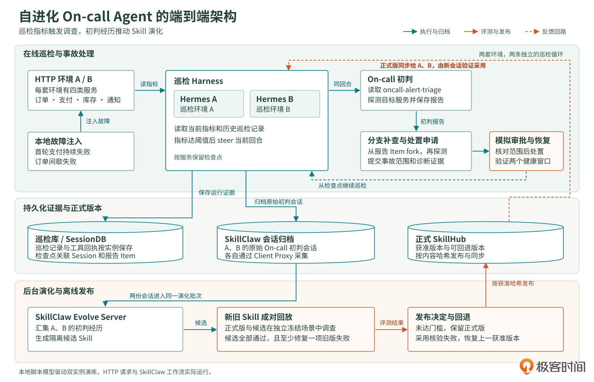
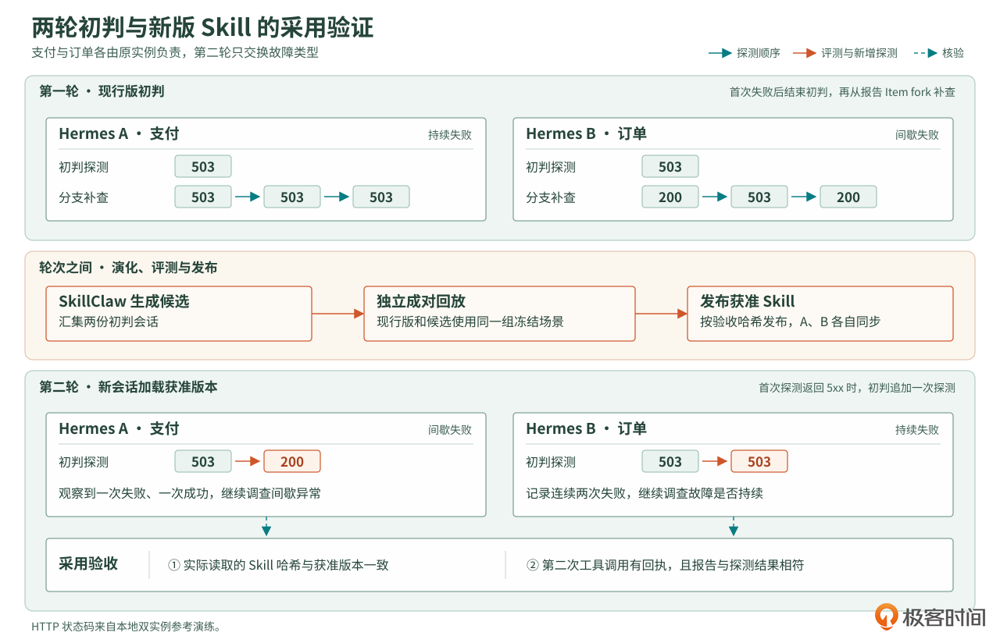
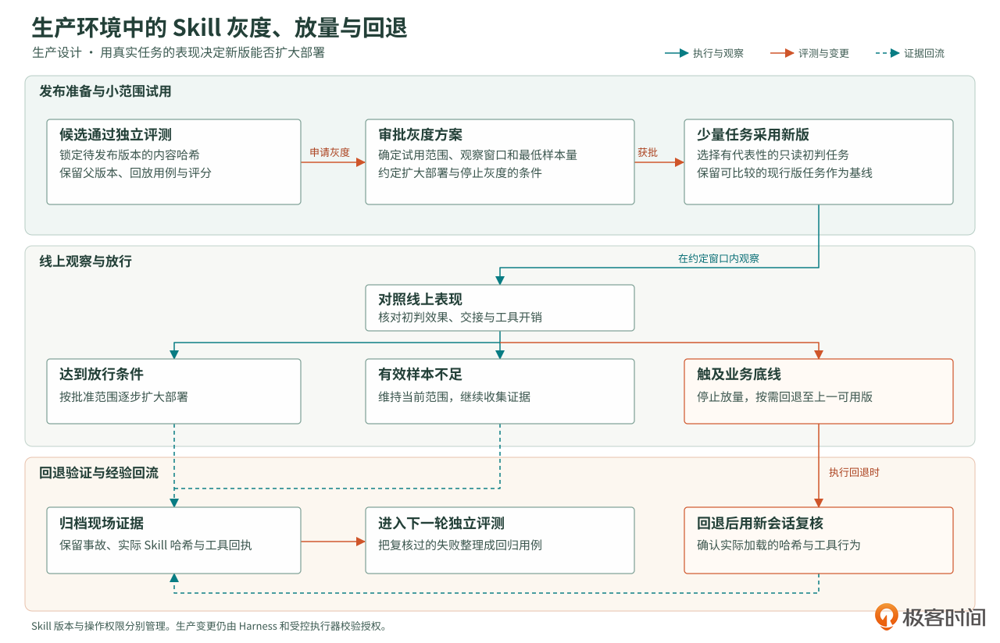

# 综合实战 | 让OncallAgent在生产环境中持续成长

你好，我是 Tyler。

如果让 Agent 真正进入企业生产环境，承担一项长期业务职责，我们需要考虑的就不只是它能否完成一次任务。它需要持续运行，接收不同来源的工作，维护任务上下文和历史经验，调用企业系统处理问题，也需要在遇到不确定情况时与人协作。业务环境发生变化时，它还要负责修正已经过时的信息，从实际执行中发现不足，改进自己的工作方法。

这些都是生产环境对数字员工的真实要求。

在前面二十多讲中，我们围绕这些要求，逐步实践了长程任务控制、上下文与记忆管理、Skill自主修订、离线优化和跨实例共享。这一讲，我们以 On-call 为业务场景，完整展示一套数字员工如何承担业务职责、积累经验、改进方法，并在生产治理机制下持续运行。

本次实战部署两个 Hermes 实例，分别负责支付和订单两套独立环境。它们持续巡检服务状态，收到告警后开展故障调查，需要人工介入时向值班工程师交接，完成处置和恢复验证后继续巡检。后台通过 SkillClaw 汇集两个实例的执行经历，提炼新的 Skill 候选，再通过独立评测和版本治理决定是否发布。

整个演练分为两轮。第一轮，支付和订单分别遇到不同的故障，从调查中发现现有方法的不足；后台根据执行经历生成新的 Skill，经过评测后发布。第二轮交换故障类型，让两个 Agent在新的现场中使用改进后的方法，验证一次事故中积累的经验能否真正改变下一次值守。

本次使用两套独立的本地 HTTP 环境和脚本模型驱动。Hermes 的工具调用、服务探测，以及SkillClaw 的会话归档、技能演化和同步均实际执行。生产环境中的灰度发布、持续监控和版本治理，则进一步作为企业部署要求展开。



## 让数字员工持续承担值守工作

生产环境中的 On-call Agent 需要持续关注服务状态。支付和订单服务不会因为工程师关闭终端就停止运行，负责值守的数字员工也不能依赖某个人随时启动一个命令。它需要按照既定周期巡检，在没有告警时持续检查服务状态，在异常出现时及时接管调查，并在事故处理完成后回到原来的工作节奏。

支付和订单分别运行自己的 Hermes 实例。Harness 管理巡检周期、服务范围、任务状态和工

```
具权限；service-patrol Skill 则规定每轮检查的方法，包括读取哪些指标、如何参考历史
```

状态，以及报告中需要保留哪些证据。

每次巡检完成后，系统按照服务和环境保存结构化记录，同时关联 Hermes 的 Session 和报告Item。下一轮巡检可以直接查询最近的检查结果，工程师需要复核某次健康判断时，也可以沿着报告找到原始会话，查看当时的工具调用和指标返回。Harness 负责让工作持续推进，Skill 负责规定每次工作应该怎样完成。

当外部监控发现异常，会将包含事故 ID、环境、服务和发生时间的告警发送给 Harness。Harness 根据环境与服务归属确定接收实例，并通过事故 ID 识别重复投递。同一个事故即使被监控系统重复通知，也应关联已有调查，而不是重新创建一项独立任务。

```
如果 Hermes 正在执行巡检，就通过 steer 将告警送入当前任务，让模型在后续调用中接收
新事件，转入故障调查。随后，Hermes 加载 oncall-alert-triage Skill，围绕告警范围
```

查询指标和探测接口，形成初判报告。

第一轮中，支付和订单服务都出现 HTTP 5xx。两端首次探测均返回 HTTP 503。按照现有Skill，Agent 完成一次探测、记录失败结果，随后结束初步调查。

真正的差异是在补查中出现的。我们从两份初判报告的 Item 创建调查分支，让 Agent 沿着原有上下文继续查询。支付服务在补查期间连续三次返回 503，订单服务的三次结果则依次为200、503、200。两起事故最初看起来十分相似，进一步调查后才显现出持续失败与间歇失败的区别。

```
通过 Hermes 的 fork，补查继承初判时已经取得的告警、指标和工具结果，同时保留独立的
```

调查分支。工程师可以回看最初的判断，也可以沿着补查记录继续分析，而不必重新建立整个事故上下文。

这些状态码还不足以确定故障根因。支付请求连续失败，订单请求在成功与失败之间交替，只能说明观测期间出现了不同的请求表现。究竟是上游依赖、某个实例还是配置变更造成的，还需要结合日志和调用链继续调查。Agent 将已经确认的现象、尚待验证的假设和下一步操作分别写入报告，供值班工程师接手。

## 人工交接与恢复验证

生产环境中的数字员工不仅需要自主执行，也需要知道什么时候应该交给人。

当调查需要人工介入时，Agent 通过 Page 通知值班工程师，提交事故范围、关键证据、当前判断和恢复建议。通知完成并留下交接记录后，Harness 可以继续推进日常巡检。支付服务的人工交接不会阻塞订单服务的独立调查。

对于回滚配置、重新部署等生产操作，Agent 只负责提出建议。值班工程师确认后，受控执行器再核对事故、环境和授权范围，执行相应变更。演练通过解除本地模拟故障来验证这一过程。

处置完成不等于服务已经恢复。 特别是订单服务在故障期间已经出现过 HTTP 200，单次成功请求不能说明间歇故障已经消失。

因此，实验要求在处置后的两个互不重叠的 30 秒指标窗口中，分别确认存在实际请求且 5xx数量均为零。生产部署还应设置最低有效请求量和错误率阈值，避免低流量服务仅凭一两次成功请求就被误判为健康。只有两个窗口都满足预设条件，状态机才允许关闭事故。

处置执行、服务恢复和事故关闭分别保留记录。完成交接和恢复验证后，支付和订单 Agent 重新进入巡检，继续维护各自负责的服务状态。

## 业务变化后，怎样维护数字员工的记忆？

生产环境中的业务系统持续变化。服务地址会迁移，接口会升级，依赖关系和配置也会发生变化。如果数字员工只记住过去的工作经历，却不能修正已经过时的信息，就可能在下一次任务中继续使用失效的入口。

例如，支付服务的诊断入口发生迁移后，旧地址返回 HTTP 410。Agent 根据请求结果确认原有入口已经失效，再请求替代地址，得到 HTTP 200。后台据此修订 Memory 中的入口信息。

随后启动一个新的 Hermes 会话，只提供服务和环境，让 Agent 自己找到并使用新地址。通过这个会话，我们可以检查更新后的记忆是否真正进入后续任务。

Memory 中的历史信息需要保留来源和时间。对于无法确认的新地址或相互冲突的证据，Agent 应当保留不确定状态，等待进一步验证，再决定是否更新原有记忆。

订单服务在第一轮调查中出现的 200、503、200 请求序列，也是值得保留的历史事实。以后支付 Agent 遇到类似故障，可以检索这段经历，了解过去曾出现间歇失败，但判断自己的现场时仍然需要重新查询当前指标。

Memory 解决的是业务事实怎样被记录、检索和修正。 另一个问题是，如果数字员工过去掌握的工作方法本身存在不足，又应该怎样改进？

## 从执行经历中改进工作方法

Memory 保存过去发生过什么，Skill 保存以后遇到类似条件时应该怎样行动。

回到第一轮的两份初判。支付和订单首次探测都得到 503，但现有 Skill 没有安排后续检查。直到补查，两个 Agent 才发现不同的请求表现。

这说明现有方法缺少一项有价值的诊断步骤：首次探测返回 5xx 时，再执行一次请求，根据两次结果决定后续调查方向。

我们希望将这项经验沉淀为一条可复用的初判规则：

```
### HTTP 5xx 初判
1. 首次探测目标服务，记录请求时间、目标实例和返回结果。
2. 如果返回 5xx，在满足安全重试条件时再执行一次探测，
  保存第二次请求及其回执。
3. 如果两次均返回 5xx，记录连续两次请求失败，
  继续调查服务是否存在持续异常。
4. 如果第一次返回 5xx、第二次返回 2xx，
  记录两次请求结果不一致，继续调查间歇异常。
5. 如果首次返回 2xx，记录本次未复现，
  不执行不必要的补充探测。
6. 如果请求超时、连接失败、返回结果缺失或出现其他异常，
  如实记录执行状态，不强行归入上述结果。
```

这项修改改善的是初判阶段的取证方法。两次探测可以帮助 Agent 识别不同的故障表现，但不能仅凭状态码证明故障持续，也不能直接确定根因。第二次探测还需要设置超时和调用次数限制，并确保操作本身安全、可重复，避免诊断行为给生产服务带来额外压力。

原始请求序列仍然保留在事故记录中，新规则则可以被其他从未处理过这两起事故的 Agent 使用。

对于生产环境中的数字员工，工作方法不能只依赖初始配置。服务变化会带来新的调查要求，实际执行也会暴露原有 Skill 没有覆盖的情况。能够从经历中发现方法缺口，并将有效改进沉淀为可复用的 Skill，是数字员工持续履职的重要能力。

## 多个数字员工怎样共享经验？

如果经验只保存在产生它的 Agent 身上，其他实例就可能重复遇到相同的问题。

支付 Agent 在一次故障中积累的诊断经验，应该能够帮助订单 Agent 改进下一次调查。为此，我们使用 SkillClaw 将两个实例的在线经历汇集到同一个共享技能演化流程。

支付和订单实例分别通过 Client Proxy 将初判会话归档，并上传到同一个 SkillClaw 共享组。每份记录关联来源实例、事故 ID、实际加载的 Skill，以及工具调用和回执。

Evolve Server 从共享存储读取这些经历，通过 Summarize、Aggregate 和 Execute 提炼改进机会。

进入 SkillClaw 本轮演化的是两份原始初判会话，补查分支另行保留，用于事故处置和后续复盘。两个初判显示，Agent 都在第一次请求返回 503 后结束了初判，暴露出相同的方法缺口。补查分支则提供了后续实际请求结果，帮助工程师判断为什么需要增加这项检查。

因此，候选规则的生成依据包括初判会话中暴露的方法缺口，以及工程师对补查证据的分析。

```
整理后的改进方向进入候选修订流程，再由 Evolve Server 修改 oncall-alert-triage，
```

增加首次返回 5xx 后再次探测的规则，并保留候选与原始 Skill 的版本关系。

两项调查的完成时间可能不同。支付已经结束交接时，订单可能还在补查。Client Proxy 分别归档已经完成的会话，Evolve Server 根据可用材料组织演化批次。在线 Agent 不必等待后台学习，也不必因为其他实例尚未结束调查而停止工作。

候选生成后，当前正式版继续服务。新 Skill 进入独立评测，只有达到业务准入条件后才能进入正式发布流程。

这种共享不是无条件复制彼此的会话历史，而是让经过整理和验证的方法在不同实例之间复用。每个实例仍然保留自己的任务上下文、工具权限和业务边界。

## 让改进的方法经过检验再投入使用

候选增加了第二次探测，但这项修改是否真正改善了初判，还需要通过实际执行验证。

如果直接使用第一轮的完整调查报告作为输入，Agent 可能从报告中找到状态码序列，却没有真正学会新的探测方法。因此，我们准备三个独立冻结的现场，让现行版和候选版分别从新的Hermes 会话开始，使用相同的告警输入、工具和现场数据进行回放。

测试场景

- 探测结果期望行为

- 503 → 503

持续失败

- 执行第二次探测，记录连续失败

- 503 → 200

间歇异常

- 执行第二次探测，识别结果不一致

- 首次 200

未复现异常

- 报告本次未复现，不追加探测

前两项检验新增规则是否真正执行，第三项检验新规则有没有影响原来的正确行为。评测不仅看最终报告，还要检查 Agent 实际加载的 Skill、工具调用顺序和工具返回结果。

在参考演练中，现行版通过 1/3，候选版通过 3/3。 候选修复了原有初判中的不足，也没有让首次返回 200 的任务执行多余查询，因此满足本次实验设置的发布条件。

SkillClaw 和独立 Eval 承担不同职责。SkillClaw 负责从在线经历中提炼和修改 Skill，独立Eval 负责判断候选是否真正改善了业务行为。评测使用冻结的任务集，让新旧版本在相同条件下执行，再根据工具轨迹和业务结果作出判断。

对于评测结果异常、执行证据缺失或无法明确判断的用例，单独标记并保留，不纳入通过率统计。这样可以避免评测数据不完整时产生虚假的通过结果。

这只是一次小规模验证。真正进入企业环境后，测试集还需要不断扩充。Langfuse 可以用于管理真实执行记录和评测数据集，逐步纳入实例异常、配置漂移、缺少关键日志和跨环境证据混淆等场景。

数据整理时，同一事故的初判和补查必须作为一个整体划分。它们虽然属于不同 Session，却共享同一个故障现场。如果把初判放进训练集、补查放进留出集，模型就可能在训练阶段已经接触测试事故的信息。因此，应当按照事故 ID 划分数据，同一事故的告警、初判和补查一起进入同一个数据分区。

原始 Trace 用于还原调查过程，冻结快照保证新旧版本面对相同现场，独立标注用于判断结果。这样，评测才能回答候选 Skill 是否真正改变了 Agent 的实际工作方法。

## 新方法怎样进入其他数字员工的工作？

候选通过评测后，系统按照内容哈希发布批准版本，再由两个 Hermes 实例同步。

文件同步只是第一步。我们还要确认 Agent 在后续任务中实际读取了新版 Skill，并执行了新增的诊断步骤。

第一轮中，支付遇到持续失败，订单遇到间歇异常。第二轮则交换两套环境的故障类型，让支付处理间歇异常，订单处理持续失败。

新版 Skill 同步后，分别在两端启动新的 Hermes 会话。支付首次探测返回 503，随后再次请求，得到 200。Agent 据此报告两次请求结果不一致，并将间歇异常作为后续调查方向。

订单首次请求同样返回 503，第二次仍然返回 503，因此报告连续两次请求失败，并继续保留根因尚未查明的判断。



验证重点是两项证据：会话中实际读取的 Skill 内容哈希，以及首次返回 503 后新增的工具调用和对应回执。

两端的执行记录均显示，Agent 读取了批准版本，并在不同于第一轮的故障现场中执行了第二次探测。第一轮调查中发现的方法不足，经过 SkillClaw 演化、独立评测和跨实例发布，已经转化为第二轮任务中的实际操作。

每次长程任务开始时，还应记录实际使用的 Skill 版本和内容哈希，任务执行期间保持一致。即使共享技能库发布了新版本，已经开始的调查也继续使用启动时的版本。新版本从后续任务开始采用，保证每份调查报告都能够追溯当时使用的方法。

新的执行记录又会进入 SkillClaw，为下一次演化提供材料。一个数字员工积累的经验，经过整理、验证和共享，最终成为其他数字员工可以使用的工作方法。

## 让数字员工在生产环境中持续受控

本地双实例演练验证了候选生成、独立评测、版本发布和实际采用。企业生产环境中的任务更多，运行条件也更加复杂。离线评测通过，只能说明候选在既定测试范围内达到要求，还需要通过真实任务观察它在不同业务条件下的表现。

以这次增加的第二次探测规则为例，可以先让新版处理一部分支付或订单告警，其他实例暂时保留现行版。这样，团队可以在真实任务中观察新方法的表现，同时保留可比较的基线。

发布之前，应当固定候选的父版本、内容哈希、修改说明、评测数据集和采用结果，并确定灰度范围、观察窗口、最低有效样本量和停止条件。这些信息共同构成一次 Skill 变更的发布依据。

灰度期间，需要将任务结果与实际加载的 Skill 版本关联起来。观察指标不能只看任务是否结束，还应关注初判准确性、关键事故漏交接、工具调用次数、任务耗时和模型成本。

例如，新版增加第二次探测后，可能改善了间歇故障的识别，但也可能增加正常请求的探测次数。如果调用成本和服务压力明显上升，即使诊断准确性有所改善，也需要重新权衡。

生产环境还要同时关注数字员工的运行健康度和业务履职质量。前者包括 Gateway 健康状态、活跃会话、任务队列积压、工具调用失败率和任务超时；后者包括诊断质量、漏交接、重复调查和业务处理结果。运行正常不代表业务判断正确，任务成功结束也不代表工作质量达标。

观察结果决定下一步如何处理。样本不足时，继续维持当前灰度范围；表现稳定并达到预设条件时，逐步扩大部署；如果触及关键业务底线，则停止放量，必要时回退到上一已知可用版本。



回退之后，还要重新检查各实例实际加载的 Skill 哈希，并通过新的任务确认行为已经恢复。已经开始的长程调查则保留任务启动时使用的版本，避免执行过程中切换方法。

生产权限也必须与 Skill 内容分开管理。新版 Skill 即使增加了回滚建议，也不意味着 Agent 自动获得了生产变更权限。实际操作仍由 Harness 和受控执行器检查授权范围，必要时由工程师确认。

当一次变更出现问题时，团队应该能够从具体任务反查完整过程：当时使用了哪版 Skill，候选来自哪些会话，经过了哪些评测，由谁批准发布，哪些实例完成同步，以及上线后出现了哪些异常。

这样，一次生产问题才能与具体的方法变更建立联系，并为下一轮修订提供依据。新的执行经历进入后台，新的候选经过评测，正式版本再根据生产表现决定是否保留或回退。

生产环境中的 Skill 治理由此形成一个持续过程：候选经过评测进入灰度，线上表现决定是否扩大范围，异常触发停止或回退，而实际执行经历继续进入后台演化。

## 小结

生产环境中的数字员工，需要持续承担明确的业务职责。它既要能够长期运行、接收外部任务，也要维护工作上下文和历史经验；既要掌握可复用的工作方法，也要能够从实际执行中发现不足、改进方法，并在权限和评测机制的约束下持续工作。

支付和订单的值守场景只是一个具体例子。类似的要求也存在于研发、数据分析、客户服务和企业运营等岗位。业务系统持续变化，数字员工需要更新记忆；工作中不断出现新的情况，数字员工需要改进方法；多个数字员工承担相似职责，就需要共享经过验证的经验；方法进入生产环境，则需要评测、监控和版本治理。

这些不是数字员工的附加功能，而是它在生产环境中长期承担业务职责所需要的基本能力。

本专栏的主体内容到这里正式收官。前面二十多讲，我们围绕这些真实需求展开了系统实践。后续还会通过不定期的加餐，继续分享 Agent 技术的新进展和工程实践。

希望这套专栏能够为你建设自己的数字员工提供参考，让 Agent 不只是完成一次任务，而是真正成为能够在生产环境中持续工作的业务成员。

配套项目：tylerelyt/self-evolving-agent-harness

## 系统设计题

下面是本讲的系统设计题和课后练习，也是加餐的重点内容，看你能不能自己想出来。

题面

某公司计划建设一个面向企业用户的 AI Agent 平台。用户可以通过 Web、Desktop 和 CLI 等不同客户端访问 Agent，也可以在不同设备之间切换，继续查看和操作此前启动的任务。

Agent 运行在远程计算节点上，部分任务可能持续数小时，执行过程中会不断调用模型和外部工具。用户可以随时查看执行进度、补充指令、中断任务或重新连接。平台还需要支持多个Agent 在不同机器上独立运行，并在运行节点异常或重启时尽可能恢复尚未完成的任务。

请你作为系统设计负责人，设计这套平台。重点说明多客户端如何共享同一任务状态、多个用户操作如何协调、长时间运行的任务如何保证连续性，以及运行节点发生故障时如何恢复执行。同时考虑系统的扩展性、资源调度和数据安全。

期待你在留言区分享自己的实践结果。如果整套课程对你有所帮助，也欢迎推荐给身边正在建设 Agent 系统的朋友。
