# Case12 | 大模型推理性能优化：大模型推理新突破：分布式推理技术探索与实践

- 作者 | 阿里巴巴智能引擎 /TRE/ 高性能网络团队 石新飞，刘侃，张弛，张泽超，包文鼎，李雨航，董纪莹，张莹

在大模型的推理过程中，通常可以将任务分为两个阶段：Prefill 阶段处理所有输入的 Token，生成第一个输出 Token，并生成 KVCache。Decode 利用 KVCache 进行多轮迭代，每轮生成一个 Token。Pefill 阶段通常是计算密集型的，Decode 阶段通常是显存带宽瓶颈。

业界常见的调度器（Continuous Batching）会在每一轮调度中，剔除已经完成的请求，并且将能满足显存需求的 Prefill 请求和 Decode 请求凑批执行。Prefill 阶段运行时间较长，此时Decode 阶段的时延受到较大影响。最终体现为只要请求出现了 P-D 请求凑批执行，那么请求的平均时延和 P99 时延就会出现巨大波动，这个问题在线上场景时刻存在。

当然也有其他调度策略：

1. Prefill 优先策略，Prefill-Decode 请求不允许凑批，那么对 Decode 请求的影响更大。

2. Decode 优先策略，Prefill-Decode 请求不允许凑批，会使得 GPU 利用效率降低。

3. Chunked Prefill [1] 技术将 Prefill 的请求拆成多个部分多轮执行，在每轮中和 Decode 请求凑批执行，可以提高 Decode 请求的交互性能，但是它的总时延还是会受到 Prefill 请求的影响。并且因为 Prefill 请求仍然长时间占用显存，导致 Decode 请求的并发受到限制。

好像并没有完美的解决方案，既然不能同时满足两个阶段的需求，干脆直接将它们拆分得了。

我们预计 P-D 分离可以带来一些好处：它们可以选择不同的机型，Prefill 采用高算力的GPU，Decode 采用大显存的 GPU。它们可以选择不同的量化方式和凑批大小。这样就可以同时优化首字时间（TTFT）和 Time Between Tokens（TBT）。最重要的是不同请求的Prefill 阶段的执行不再会影响 Decode 阶段，使得请求总时延和 P99 时延稳定。

在学术界和工业界都有 P-D 分离技术的使用，总结来看，都取得了不错的效果：

1. Mooncake [2] 是业界大规模使用 P-D 分离技术的例子。Mooncake 构建了以 KVCache 为中心的 P-D 分离调度集群，形成了 Prefill/Decode Pool 以及分布式异构介质 KVCachePool，全局负载均衡技术预测了 Prefill 和 Decode 的负载，在满足 SLA 的约束下最大化吞吐，在高负载下预测请求的执行时间，提供早停能力。

2. Splitwise [3] 开发了一个 GPU 集群，旨在实现三个主要目标：提升吞吐量、减少成本和降低能耗。该集群的设计将 LLM 推理过程分为两个独立的机器池，以优化不同阶段的处理效率。同时，他们还增设了第三个机器池，专门用于处理 Prefill 和 Decode 阶段的混合批处理，并且能够根据实时计算需求灵活调整其规模。

3. DistServe [4] 通过将预填充和解码计算分配至不同的 GPU，从而消除了二者之间的干扰。针对应用程序的总时延和每个 Token 运行时间的需求，DistServe 为每个阶段量身定制了资源分配和并行策略的优化方案。此外，DistServe 还考虑到服务集群的带宽，将这两个阶段放置在一起，以减少由任务分解所带来的通信开销。

在下文，我们也阐述了我们的 P-D 分离方案上线的实际效果。

## P-D 分离方案上线效果

我们在 RTP-LLM 上实现了 P-D 分离，并且在 72B 场景 A 和 14B 场景 B 全量上线。

72B 场景 A 效果如下：实例个数下降 24%，平均时延下降 48%，P99 时延下降 78%。

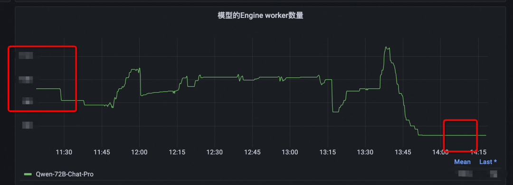

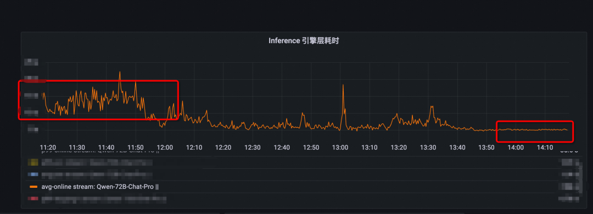

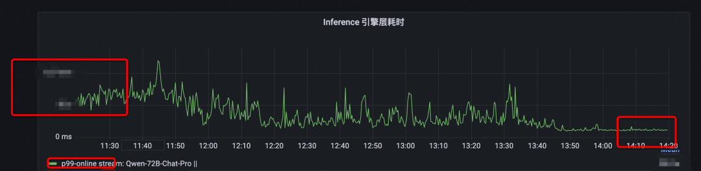

14B 场景 B 上线效果：平均时延降低 32%。

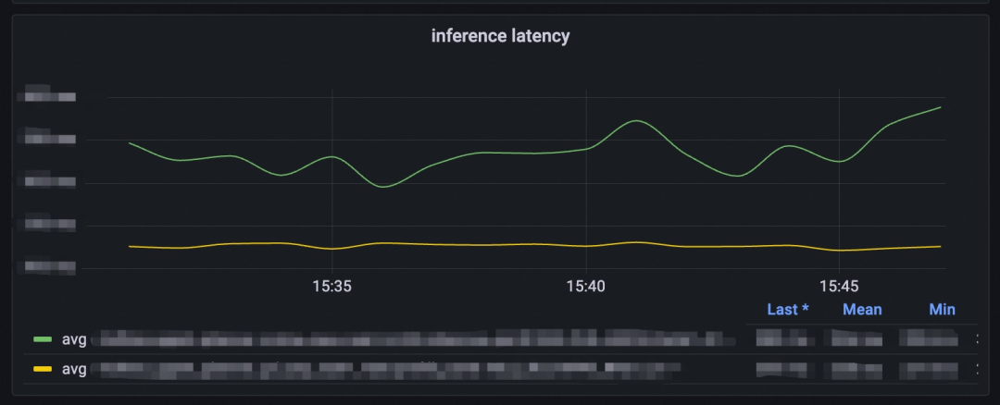

可以看到 P-D 分离在我们的线上业务取得了不俗的效果。接下来，我们会从通信机制、成本、分布式系统的复杂性以及面向未来的 P-D 分离设计等方面详细讨论 P-D 分离的难点问题。

### 通信机制

我们在本章节，讨论数据传输和控制信息传输两个问题。其中数据传输部分使用 TCP /RDMA，TCP 使用在无 RDMA 卡的简单环境。而控制信息的传输主要是为了控制整个流程运转，以及配合 RDMA 的单边操作。

### 数据传输

首先，拆分开的 Prefill-Decode 该怎么同步数据，同步什么数据。很自然的，我们认为是将Prefill 计算过程中产生的 KVCache 传递给 Decode（在 PP 等场景下传输中间计算结果）。KVCache 的量很大，在我们的场景中，单个请求的 Prefill 阶段大概会有 5G 大小的KVCache。如此大的数据量，如果在 Prefill 阶段执行完毕的时候同步到 Decode，瞬间洪峰流量会把 Decode 打爆，并且同步会需要很长时间，会使得请求的时延上升很多，最后使得 P-D分离得不偿失。

很幸运的是目前的大模型结构都是按层的，我们可以在单层计算完毕的时候，直接将KVCache 发送给 Decode。一般 Prefill 执行时间比较长，例如在 200 毫秒 到 10 秒之间，甚至更高。将发送代价平摊到长时间内，那么就不会出现瞬时洪峰流量。但是我们还有个担心，在大规模使用 P-D 分离的情况下，传输流量是否会将整个网络环境打爆，流控机制是否足够好，能否使得 Prefill-Decode 之间，距离尽可能的短，让 Prefill-Decode 更靠近 [4]，减少流量外溢的影响，这是未来可以研究的问题。

在最后一层计算结束的时候时候，最后一层或者几层的 KVCache 的发送还需要一些时间，所以我们对于发送速度有一定的要求。对于传输，我们有不少方案：包括 TCP 和 RDMA [5]。

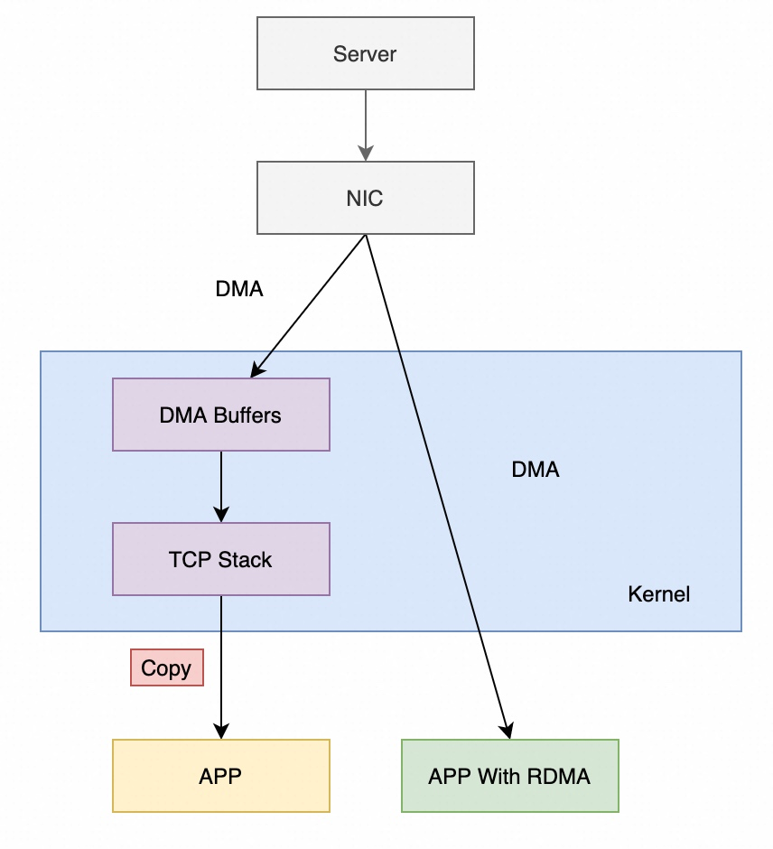

TCP

TCP 使用起来简单，但是 TCP 需要从内存发送，所以需要将 KVCache 从显存拷贝到主机内存。用户态还需要拷贝到内核协议栈和 DMA Buffer。存在用户态 / 内核态 / 中断上下文的多次切换。大包拆分，增加的包头控制信息，降低了有效载荷比例。虽然校验、拆包和组包等工作可以 Offload 到网卡，但是不彻底，内核路径的负担依然很重。再加上超时重传、回退策略、冷启动都降低了 TCP 的速度。最后内核协议栈受到主机 CPU 负载的影响很大。所以总体上TCP 时延长且不稳定。综合来看，我们是需要一个时延稳定的发送大包的机制，RDMA 毫无疑问是在我们的考虑范围。

RDMA

执行路径 [11]

由图中，我们可以看到 TCP 路径很长，而 RDMA 路径很短。在接收端，网卡可以直接写入应用层对应的地址。此时，不存在各种拷贝代价，不存在内核态协议栈的处理开销，网卡已经处理掉协议的工作。用户 APP 可以使用 Epoll 的方式来获取发送就绪的事件（延迟稍高），也可以使用 Polling 的方式去轮询事件的状态（时延短且稳定，CPU 稍高，此时可以关闭网卡中断，应用层不存在上下文切换），在小包发送场景下，可以使用 Polling 固定次数然后再 Epoll的方式来降低时延。

操作原语 [6]

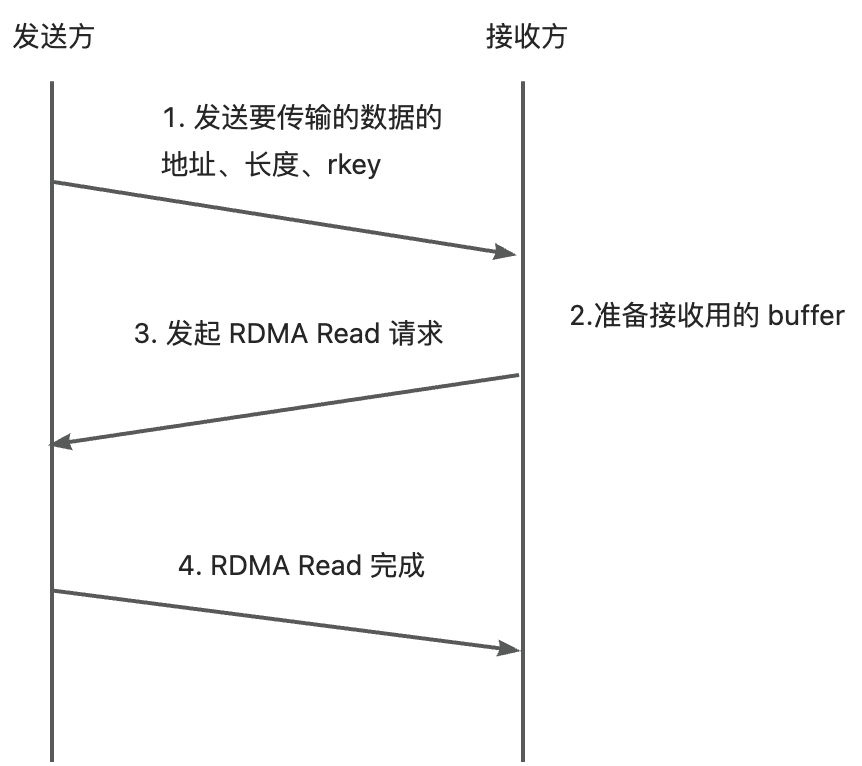

RDMA 有双边操作 Send/Recv 、单边操作 Read/Write 四种操作元语。双边操作（这里没有展示图），需要更复杂的控制流，需要发送方和接收方进行协调，发送方需要等待接收方的响应才能确定何时继续，开销要大一些。上图展示的是单边操作，控制流简单，可以减少等待延迟。所以我们线上的方案采用单边操作。由 TCP/RPC 来完成第一步操作：传输远端数据的地址，长度和 rkey。实际上，确实有很方案使用 TCP 等协议作为控制通道来传递 RDMA 的控制信息，例如微软的 SMB 和 IBM 的 GPFS 等。RDMA 不但可以传输内存数据，也可以直接发送和接收显存数据，我们在 Nvidia GDR 链接手册中 [7]，看到了这一点。

安全性从上面我们也可以看到 RDMA 用户态拥有很强的控制权，绕过了内核，并且在用户态可以直接操作硬件写入内存或者显存。那么 RDMA 传输的数据地址会不会被别的应用写入或者读取，从而造成数据污染或者泄漏呢？答案是不会的，RDMA 在发送和接收数据之前，需要提前申请 Protect Domain 和注册 MR，得到的 mkey 会保护用户权限。

RDMA 库

RDMA 也有缺点：首先它依赖硬件，幸运的是，我们新的机型都是拥有 RDMA 网卡的。除此之外，RDMA 有着编程复杂、调试复杂等问题。这些复杂性，完全脱离了我们业务的控制，所以需要一个良好的封装库来操作 RDMA。可选的有 PyTorch Gloo、MPI、NCCL 和 ACCL。

- 其中 Gloo [8] 和 MPI [9]，我们认为它们在基于 CPU 的传输上性能比较好，在 GDR 的传输上没有 NCCL 性能好，所以不考虑他们。

- NCCL [10] 在单机内部使用 Nvlink 和 Pcie 建立链接。在多机之间，采用 Double BinaryTree 进行集合通信，在基于 GPU 的传输上性能优异。但是 Nccl 必须提前建立好集合通信的集合，并不能动态增删节点，除非是新创建一个通信集合。这对于 P-D 分离场景频繁动态的替换节点是非常不合适的。

- ACCL 库 [11]，可以建立点对点通信。可以动态的创建新的链接，使用多网卡，聚合网卡带宽。将 GPU 和网卡进行亲近性匹配，也可以动态感知拓扑，并且在此基础上优化AllReduce / AllGather 等实现无阻塞的算法。综合以上考虑，我们最终选择了 ACCL 库作为我们的 RDMA 通信库。

### 控制信息传输

我们可以看到 P-D 之间需要多次交互控制信息，那使用什么机制来发送控制信息呢：TCP，GRPC [12] ，还是 ARPC [13]。TCP 协议首先排除掉，它比较裸露，使用不方便，而且不具备兼容升级能力。ARPC，是阿里内部的 RPC 协议，性能比较强，但是在 TCP 传输协议下不具备 Stream 能力，而 P-D 分离需要进行多轮会话，所以我们最终还是选择了 GRPC Stream方案。除了 KVCache，我们还需要将 Prefill 产出的 First Token 同步给 Decode，当然此时，Decode 可能还没有完全接收完毕 KVCache，那这个时候只能等待了。也就是先等待KVCache，再串行等待 First Token，RPC 协议发送这种短信息是很快的，所以我们可以接受时延的微小增加。

### 成本

在本章节，我们讨论 P-D 分离是否能降本的问题。首先 P-D 分离带来了凑批策略的变化，也同时使得 P-D 的资源分配（实例个数，GPU 卡型）不再一致。这就为将种类纷繁的卡型纳入统一管理从而减少碎片带来了基础条件。当然，在此基础上我们希望更进一步的减少显存占用大小，降低显存的无效占用时间。

### 凑批策略

Prefill-Decode 融合架构下，由于 Prefill 的计算瓶颈特性，所以 Prefill 的 Batch Size 不会很大，这样就导致 Decode 阶段的 Batch Size 也不一定能上来。但是 Decode 其实是更适合大批次运行的，在达到计算瓶颈之前，随着 Batch Size 的增大，Decode 时延的增长是比较缓慢的。在 P-D 分离之后，Prefill 本身的 Batch Size 仍然不会很大。为了充分发挥 Decode 的能力，我们应该配置更多的 Prefill，减少 Decode 实例个数，使得 Decode 能进行大 Batch 推理。

### 资源分配

P-D 分离之后，应该各自如何配置 CPU 和 GPU 呢？首先，相比较 P-D 融合架构，CPU 消耗的会更多，因为增加了多次 GPRC 交互，并且 Decode 的 Response 需要流式的返回给Prefill。而我们使用的 GRPC C++ 版本，可以使用多线程从而利用多 CPU 核的能力。所以它们只需要有充分的 CPU 即可。GPU 方面，Prefill 非常消耗算力，并且在 Prefill 传输KVCache 给 Decode 之后，显存不需要占用，那么可以用来服务其他请求。所以 Prefill 一般是先达到计算瓶颈，而不是显存容量瓶颈，所以 Prefill 应该选择计算能力强的卡型。

从凑批策略章节可知 Decode 的实例个数会变少，所以并发执行的请求比较多，并且 Decode的总时间一般比较长，所以显存有效占用时间比较长，所以 Decode 应该着重选择显存大的卡型。

### 成本管理

从 P-D 分离的资源分配章节，我们从它们的特性出发，已经推导出 P-D 的机型可能不一致。但现实是，我们有什么机型呢。现实中，我们有不同类型不同数量的 GPU，AMD，ARM 等计算设备。显存小的，我们可以组成更大的 TP，计算能力差的，我们可以使用更多实例。并且对于 Prefill / Decode 内部，也可能是不同的卡型。例如说，Decode 有多组不同配置，不同TP，不同卡型的集群。充分的将一些小卡，一些数量不足的卡，组织起来，形成大容量集群。勤俭持家，是中华传统美德。

那 P-D 分离架构能降低成本吗？例如说在 P-D 融合架构下，是 20 个节点承担 10 QPS 的流量。在 P-D 分离架构下，至少一个 Decode 节点，最好有两个，保证 Decode 不会同时挂掉，那么还剩下 18 个 Prefill 节点，此时它还能承担 10 QPS 的流量吗？

我们认为考察一个服务的质量，不是单独考察时延，也不是单独考察吞吐。而是考察在一定时延（包括平均时延和 P99 时延）限值范围下的吞吐，或者是考虑相同吞吐下的时延。我们认为 P-D 分离可以降低时延，那么就可以使用更少的实例个数来承担和之前一样的 QPS，这样就可以节省成本。更进一步的，我们可以把业务方的资源额度下的边边角角的一些零碎的卡型纳入管理范围。

### 量化

还能进一步降低成本吗？我们想到量化可以使得显存占用变少，从而可以提高请求并发度。我们已经支持的量化类型包括 W8A16、W4A16 和 W8A8（INT8 和 FP8）。在这里，如果计算类型维持 FP16，那么量化仅在短 Prompt 时有助于加速 Load Weight；而计算类型如果对应的改成 INT8/FP8，则可以利用 INT8/FP8 的算力（通常是 FP16 的两倍）。若不考虑模型效果，假设各种量化方案下模型都有足够优秀的表现能力，我们当然希望 Prefill 能更充分的利用算力，Decode 可以用上更充足的带宽。

在过去的部署里，我们很难协调一个问题，当用户的输入和输出都比较长时，我们应该给用户推荐怎么样的量化方案？W4A16 有更好的 Decode 性能，但会造成很长的 TTFT（甚至大于FP16）；W8A8 确实可以更快完成 Prefill，但时延却不一定短于 W4A16，更长的时延也不利于更大的吞吐。有没有可能两个阶段使用不同的量化方案呢？在单部署只保存一份模型权重的情况下，这是做不到的。

所幸 P-D 分离终于为我们提供了 Prefill 和 Decode 分开部署的方案。基于 P-D 分离的方案，我们可以自由地在 Prefill 机器部署 FP16 / W8A8 的模型文件，来获得相对不错的 Prefill 性能；而 Decode 机器则可以自由地选择 W4A16 / W4A8 的方案，来获得整体的更优性能。这是 P-D 分离在部署上的额外收益，为部署模型精度提供了更多的选择。

### 显存有效占用

我们不但希望减少显存占用，并且希望能更有效的占用显存：

- 在 Prefill 的请求排队结束开始执行时，此时 Decode 开始申请显存资源，可以减少排队期间的无效显存占用。

- 在 Prefill 发送完毕显存时，可以将显存立刻释放给其他请求使用。

- 在 Decode 请求结束时，Decode 才回传计算产出的 KVCache 给 Prefill，而不是从Decode 的第一个输出 Token 开始就一边生成一边传输，减少 Prefill 的显存占用时间。当然这个策略，可能会使得传输时延的影响被放大，所以可以提前发送，在计算和传输的Overlap 与显存占用时间之间取得平衡。

### 分布式

P-D 分离，并不是银弹，它在带来多种好处的同时，也带来了网络上的复杂性。我们知道网络是比较容易出现问题的，那么如何能保障 P-D 分离的稳定性呢？这基本上和传统分布式服务遇到的问题一致。我们借鉴分布式系统的经验，为 P-D 分离集群引入了多节点 / 多集群，基于服务发现和负载均衡组件，自动化并且人工可控制的进行故障迁移、恢复和回退，以及兼容灰度升级，为用户的服务保驾护航。并且对于 Prefill-Decode 我们引入了不同的配置，配合各自的特性，最大化它们的收益。

### Serverless

我们提供的推理产品，既支持私有部署，也支持共享访问，也即 MaaS 服务（Model as aService），用户付费，获得模型的访问能力，不需要关心基础设施资源的分配和运维部署，以及可用性，我们自然提供满足 SLA 要求的服务。

对于 P-D 分离集群来说，我们提供了多种 Prefill-Decode 集群，并且部署了自动弹性策略。随着压力的增大，而自动分配更多资源进行服务。在某个 Prefill-Decode 集群出现问题的时候，请求会自动重试其他同机房的机器。并在一定程度下，可选地可以回退到 Prefill 执行 Decode请求。最大限度的保障服务的可用性。新启动的机器，除了模型权重之外，不需要持有任何状态即可服务。一个会话，也不需要任何状态，可以直接迁移到另外的 Decode 机器。这为部署带来了相当大的灵活性。

### 系统复杂性

P-D 分离之后，系统会变得比较复杂。首先它需要，至少一个 Prefill 节点，一个 Decode 节点。很多流量稀疏场景，一张卡已经足够。此时 P-D 分离并没有带来收益，成本反而还增加了。所以，我们也需要支持 P-D 分离架构，回退成普通模式。并且在请求级别的目标输出长度比较短的时候，应该能自适应的回退到 P-D 融合模式。

P-D 分离之后，网络上的错误会更容易出现，并且因为部署的 Decode 个数比较少，如果他们出现了服务不可用的问题影响会更大。我们在部署了多节点来保障分布式系统的可靠性之外，还部署了多 Cluster，进一步加强稳定性。在发布的时候，可以按照 Cluster 级别单独灰度升级。在故障的时候，会自动切换到其他正常的节点 / Cluster 来服务。依赖我们的服务发现组件还可以提供可控性，我们可以在单节点故障的时候，直接降低单节点的权重，或者控制下线，从而不再访问故障节点，降低故障影响范围。

Prefill 和 Decode 的特性很不同，所以参数配置上很多都是不同的。例如凑批策略，量化类型，TP 大小，PP 大小，任务超时时间，重试时间，显存申请策略，RDMA 软硬件队列大小，是否可回退执行等。这些需要靠完善的产品机制，在拉起 Prefill-Decode 实例的时候，分别传入不同的参数值。

P-D 分离之后，我们需要考虑它的升级过程，不但需要保证总服务可用度，还要保证兼容性。首先如果只有 1 个 P-D 实例，需要保证在升级的时候，起新下老。并且保证新的 Prefill 访问新的 Decode，这样才能保证协议兼容性。那这个如何控制呢？我们可以通过在服务发现中注册自己的版本信息，在 Prefill 访问的时候，选择对应的版本来进行访问。

### 负载均衡

在 P-D 分离复杂的异构机型集群下，并且 Decode 本身还存在多集群，而且多集群的 TP 大小可能还不一致。此时当前的 Prefill 访问哪一台 Decode，这有很多的策略：

- 基于访问后端的总时延：但是不同请求的总时延的差异是很大的，这不是一个好指标。

- 基于后端产出的单轮 Token 的时延：好像有一定的可行性，不过这和当前凑批的大小也有一定的关系，而且这个指标可能存在一定的跳跃性，需要做滑动指数平均。

- 基于后端的剩余显存容量：如果后端的集群是异构的，那么这个策略会失效。

- 基于后端的吞吐：也就是单位时间内产出的 Token 总数，在离线场景可能是比较适合的。

但是不论负载策略是哪个，都要基于服务发现，及时地将不健康的和下线的节点，在负载均衡里面屏蔽掉访问。同时我们也需要可以配置不同的负载衡均衡策略。

### 面向未来

前文分析了 P-D 分离的降本收益和分布式系统的实现。未来我们希望 P-D 分离方案尽可能的扩展到所有的场景，这就需要考虑 P-D 分离和其他特性配合的问题，这些特性涉及到大模型推理的各个方面。其中，我们将长序列和 Chunk Prefill 两个问题单独讨论，它们代表着近期要做的一个方向。

### 特性兼容

首先我们考虑几个和 KVCache 有关系的特性：

- KVCache 量化之后得到的将是 KVCache INT8/FP8 量化的结果和对应的 Scale Tensor，那么我们的传输引擎应该设计为可传输任意类型的 Tensor。

- ReuseCache ，在 Prefill 先执行 Reuse Cache 减少 KVCache 的生成。在 Decode 执行Reuse Cache，可以减少 KVCache 的传输，这对于 System Prompt 同样有效。

还有一些特性可能会影响流程：

- 图像多模态，一般分为 VIT 部分和大语言模型部分。在 Prefill 节点上先执行 VIT 阶段和Prefill 阶段，然后再传递 KVCache 给 Decode 执行，依然可以使用上 P-D 分离。甚至说，把 VIT 部分单独成一个进程，能使得三个角色相互不影响，并且按照各自特性独立优化。

- Chunk Prefill 会使得一个请求的 Prefill 阶段被拆分成了多个子阶段，分多次运行。在每个子阶段运行过程中，都会将 KVCache 传递给 Decode。等所有的 KVCache 都收到了，此时 Decode 开始运行。

- Prefill 上，First Token 产出完毕，此时请求的状态不能销毁，所以需要单独调度。Decode上，请求接收之后，需要等到 KVCache 和 First Token 传输完毕，才能执行，所以也需要单独的调度。综合来看，它们需要改造调度器。

- 权重的 INT8 / INT4 量化，MOE 专家模型，静态 / 动态 LORA，这些是和生成 KVCache 无关的计算部分，所以不会影响 P-D 分离流程。

### 长序列

在 Prompt 日渐变长的大趋势下，P-D 分离能解决长序列问题吗？我们分析认为不能：长序列问题，主要是时延高和显存占用高造成的。Prefill 和 Decoded 分离，特别是 Decode 阶段并不能解决缓存占用大的问题。但是却可以组合一些方法：例如如果 Decode 的显存占用比较大的话，可以使用更大的 TP Size。如果 Prefill 执行压力比较大，可以使用 Chunk Prefill 或者Ring Attention 来分摊计算压力。而 P-D 分离的 CacheStore 组件，设计上是用来传递任何类型的 Tensor，为这些方案打下了坚实的基础。

### Chunk Prefill

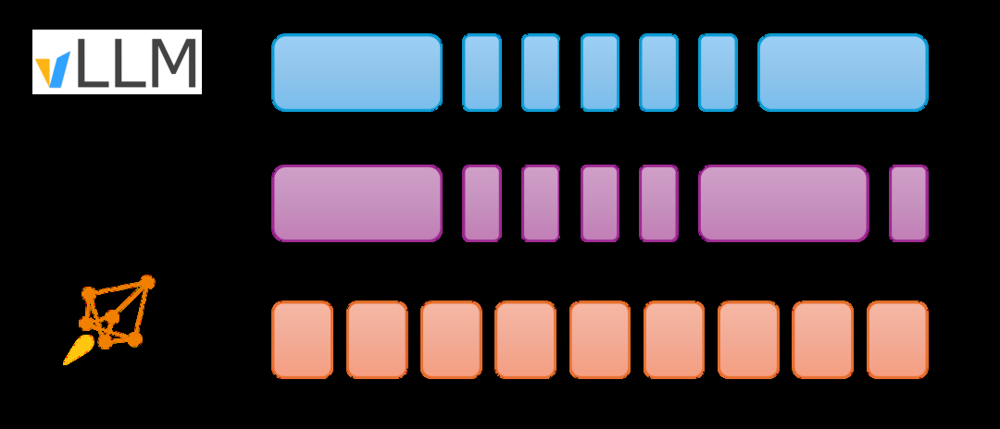

在背景部分，我们简单的讨论了 Chunk Prefill，现在我们仔细讨论下它和 P-D 分离的关系。如上图 DeepSpeed 实现了 Chunk Prefill [1]，又名 FastGen，它认为 Decode 可以和 Prefill凑批执行，这样就可以利用上 Prefill 加载的权重。在 Linear 层，它们可以一起执行，在Attention 阶段分开执行，不过在很多场景下，Attention 时间占比比较小。这样就可以将Decode 和 Prefill 一起变成计算密集型任务。此时 Decode 应该是凑批越大越好。

但是同时带来的问题就是，Decode 的时延会比较高。所以需要在吞吐和时延之间有个平衡。在 Prefill 上，达到 GPU 计算瓶颈之后，更长的序列会使得 Prefill 时延陡增，所以在遇到这个拐点之后，Perfill 吞吐不再增加。这个值就是我们需要找到的 Chunk Size 值，Decode +Prefill 的总 Token Size 应该小于等于这个 Chunk Size，但是这个 Chunk Size 不一定很好寻找。而且 Decode 和 Prefill 的请求密度，不一定能达到最完美的比例。最完美的比例就是：在Prefill 的每一轮执行中，Decode 都能凑批执行。如果 Decode 的密度高，那么可能 Decode会单独运行。如果 Prefill 密度高，那么 Prefill 会单独运行。

从上面的分析，我们认为 Chunk Prefill 不能解决 Decode 的总时间被影响的问题。但是Prefill 和 Chunk Prefill 的结合，使得 Prefill 每次都能将 GPU 打满，并且也不超出它的最大处理能力。在 P-D 分离场景下，依然可以在 Prefill 上使用这个策略。

### P-D 分离方案

在上文，我们从成本、时延等分析了 P-D 分离的好处，并且也看到了 P-D 分离带来的分布式复杂性，同时也探讨了不同的通信机制的优缺点。接下来我们剖析工业界四种 P-D 分离的实现，包括 vllm，Mooncake，TensorRT-LLM 和 InfiniStore，阐述了它们的优点和不足之处。在最后提出了我们自己的 CacheStore 传输引擎方案。

### vllm

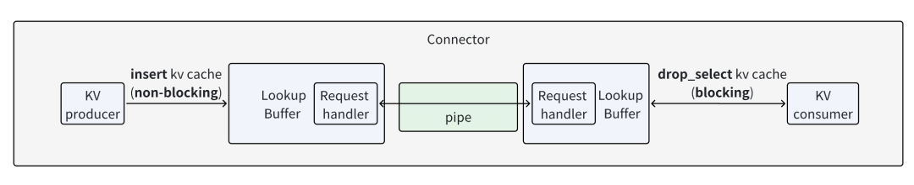

从实现上来看：vllm [14] 实现了 Connector 基类，提供操作基础 API。由 LookupBuffer 组成双端队列，发送者使用 Insert 原语插入 Buffer 队列，并且通过 Signal Pipe 唤醒消费者，消费者请求从 Buffer 队列中寻找需要的 Item，从 Buffer 中取出，使用 Data Pipe 发送。在 Buffer队列满的时候，对发送者进行反压。vllm 的实现可以发送任意类型的 Tensor。

从发送机制上来看：

- 支持 PyNccl Store：采用的是 Nccl 和 Gloo（在 Mooncake 的测试结论中 [15]，我们发现Gloo 的性能比不过普通的 TCP 模式，更不要说 RDMA 模式）。

- 支持 Mooncake Store：使用 Mooncake 的 Transfer Engine，这是一个比较高效的方案，在下文中有具体的说明。

- 支持 InfiniStore：这是一个简单的 KV Store，在下文中有具体的说明。

综合来看，vllm 的 P-D 分离还在初级阶段，很多特性不支持：不支持按层发送；不支持TP/PP；不支持 Prefix Cache，不支持 Chunk Prefill；也不支持调度和协调者；很多特性都不兼容（虽然，这些特性已经开始在规划了）。默认实现的性能预计也不够好。不过，vllm 方案有一定的灵活性，用户可以定制其中 Connector 、Buffer 以及 Pipe 的实现，拥有插件的能力，在开源界比较容易吸引其他人来定制开发和贡献代码。

### Mooncake

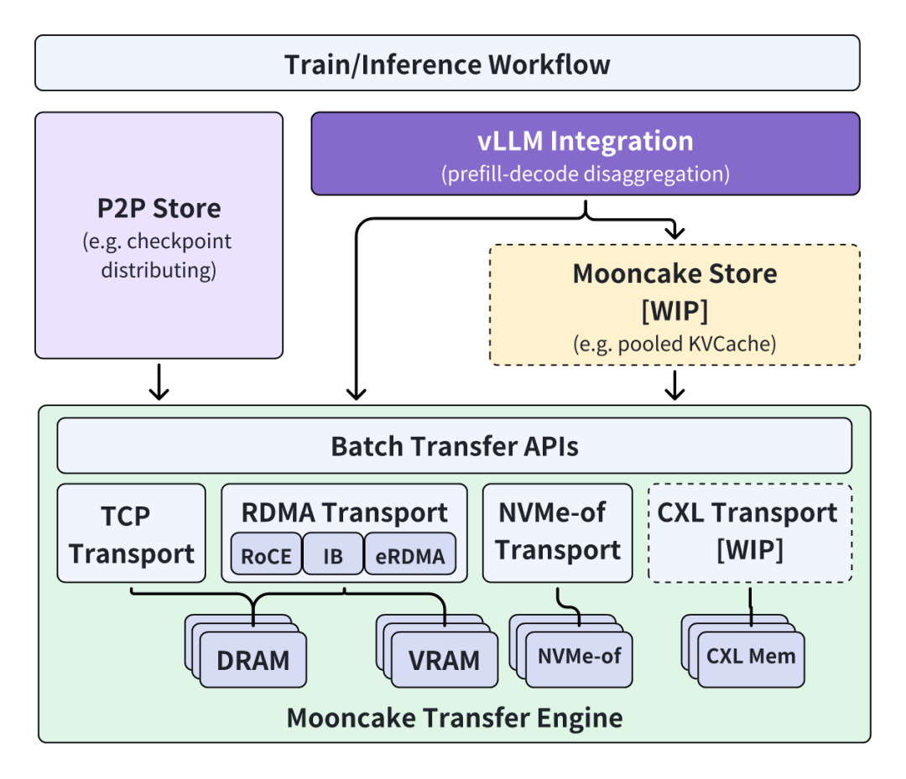

在背景章节我们叙述了 Mooncake 论文 [2] 中介绍的特性。目前 Mooncake 所依赖的传输引擎Transfer Engine 部分 [15] 已经开源。Mooncake 是工业界大规模使用 RDMA 传输进行 P-D分离的例子，可以说是比较先进稳定的方案。 我们看到它支撑了 P2P 模式，这是为了Checkpoint 的分发。对应的，我们已经具备大规模的数据链式分发、内存 Cache 和用户态文件系统。

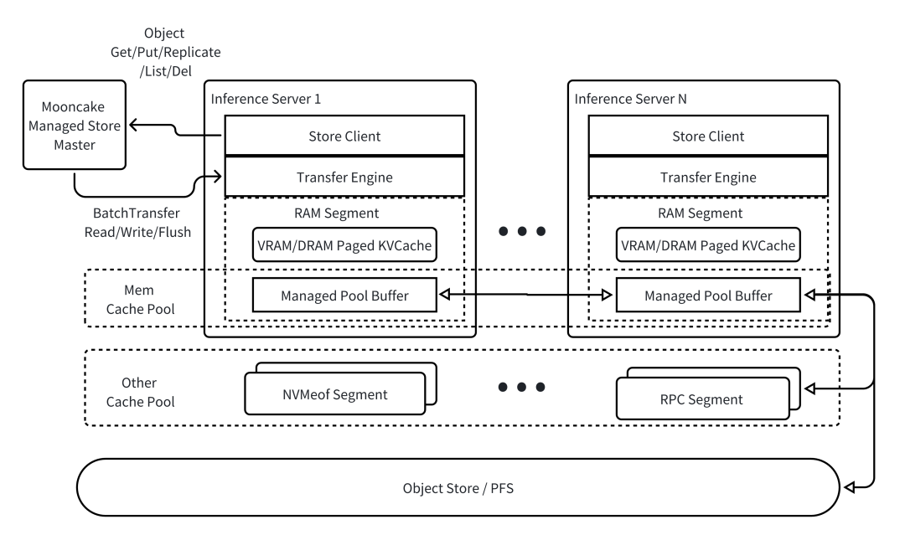

在 Mooncake Store 部分：

- 它支持了 TCP、RDMA、NVME 和 CXL（在开发）四种传输方案，并且 RDMA 部分支持了 RoCE、IB 和 eRDMA 三种方案。

- 它使用了 Segment 概念，代表着 CPU DRAM、GPU VRAM、NVME Segment 和 RPCSegment 中的全部地址空间，而 Buffer 是其中的一部分待发送或接收的空间范围。

- Mooncake Store 在 Buffer 层面提供了三个基本原语：Read、Write、Flush。

- 在上层它支持的不再是简单的 KV，而是对象传输，在这层提供了 Get、Put、List、Del、Replicate 等基本操作。并且提供了驱动 Transfer Engine 的 Master 节点。

- 支持动态增删缓存资源。

- 支持多网卡，聚合网卡带宽，提高并行发送能力。

- 支持 Eager、Lazy、None 三种级别的刷新方式，在性能和一致性之间取得平衡。

- 可以自定义 CPU / GPU 和网卡之间的亲近性，也可以自动感知拓扑路径，并且在偏好路径出现问题的时候，自动回避到其他路径。

- 所有节点都需要链接到元信息服务，类似于服务发现，支持 etcd、http 和 redis。

### TensorRT-LLM

目前 TensorRT-LLM [16] 也有 P-D 分离的方案：

- 使用 MPI 启动多 P-D 实例，使用 MPI 和 UCX 两种方案进行传输。

- 提供可以被重载实现的基类接口 CacheTransceiver ：发送方使用 sendAsync 接口异步发送，接收方使用 receiveSync 接口异步接收。

- 可以检查传输状态，不支持按层发送。

- 可以发送 KVCache，但是没有看到可以发送其他 Tensor，例如 Logits，Hidden States等。

因为 TensorRT-LLM 的实现没有具体的开源和详细的文档，所以具体细节不再分析。综合来看，TensorRT-LLM 的 P-D 分离实现还是比较原始阶段，没有节点管理，没有负载均衡，没有按层发送 Overlap 计算和传输。在单个节点上多 GPU 之间通信默认使用 PCIE，需要调整UCX 选项才能使用 Nvlink。

### InfiniStore

InfiniStore [17] 是使用在分离式推理引擎中的一个分布式 KV Store，在 vllm 中正在合并这个传输方案的实现。

- 它提供本机 GPU 传输，跨机器的 RDMA 传输，其中 RDMA 传输支持 Ethernet 和 IB 两种方案。

- Client 和 Server 调用 Connect 链接对方。

- Client 使用 Rdma Write Cache 原语写入 Cache，Server 使用 Read Cache 原语读取Cache，两个操作都是异步操作。

- 也提供用户注册 MR 区间的方式来管理显存。

- 还提供检查 Cache 中是否存在特定的 Key 以及 Key 的匹配信息。

- 在 Demo 中，做了一个演示，可以在 Prefill 中，按层计算，独立线程进行传输，计算和传输之间使用 Cuda Event 进行同步。

综合来看，这是一个轻量级别的 KV Cache Store，简单易用，可以支持任意 Key 的任意Value 远程异步存储和远程异步读取。

### CacheStore

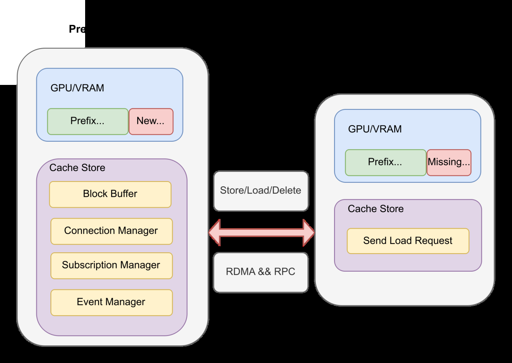

从上文的思考，以及其他方案的剖析，我们明确了我们的 CacheStore 方案的目标：

- 支持不同的数据传输机制，并且要包含 RDMA。

- 控制信息的传输使用 TCP / RPC 协议。

- 支持简单易用的异步接口，使得业务层可以不关心下层传输机制的复杂性。

- 计算和传输 Overlap。

- 可以发送任意类型的 Tensor。

- 最大化 RDMA 的并行性，充分使用网络带宽。

- 考虑分布式系统的容错性。

综合以上思考，我们设计了我们的 CacheStore 方案：

- 从上层语义来看，支持 Store、Load 和 Delete 原语，后期会支持 Match 和 BroastCast 原语。

- Store 接口支持传入 cudaEvent 来做计算和传输之间的同步。

- Load 接口，可以等待一层或者多层的 KVCache。

- Store 和 Load 都是异步接口，支持传入回调函数。

- 在请求结束的时候，调用 Delete，释放 CacheStore 对于 KVCache 的引用。

- 我们设计了 Block 概念用来支持传输任意类型的的 Buffer 数据，业务层指定 Block 的 Key和 Block 的 Value（即 Block 对应数据的地址）。目前支持了传输 KVCache，Int8 KVCache的 Scale，Logits，Hidden States 和其他中间计算结果。

- 支持 TCP 和 RDMA 两种传输协议，RDMA 使用单边 Write 协议。

- 使用 ARPC 传递其他控制信息和 RDMA Meta 信息：包括地址，长度和 rkey。

- CacheStore 在 Peer 之间进行 RDMA 链接的创建销毁重建。

- CacheStore 使用了多网卡，多链接，多队列，最大限度的提高并行传输能力。

- Accl 负责最优先路径的选择和路径规避。

- 同时我们在 Prefill 层支持了服务发现和负载均衡组件，定制了多种负载均衡策略。

## 总结

在本文中，我们从平均时延，总体时延，吞吐，成本，量化，资源分配，Serverless 以及和其他特性的配合等方面阐述了 P-D 分离的好处，并且比较了 TCP 传输和 RDAM 传输的一些特性。从实现的角度剖析了几个业界大模型推理引擎的 P-D 分离实现，最后提出了我们自己的CacheStore 传输引擎方案。

参考文献

- Chunk Prefill（https://github.com/microsoft/DeepSpeed/blob/master/blogs/deepspeed-fastgen/README.md）

- Mooncake 论文（https://arxiv.org/abs/2407.00079）

- Splitwise（https://arxiv.org/abs/2311.18677）

- DistServe（https://arxiv.org/abs/2401.09670）

- RDMA 基础功能介绍（https://developer.aliyun.com/article/1599640）

- RDMA 操作语义（https://developer.aliyun.com/article/1599640）

- GPU GDR（https://developer.nvidia.com/blog/using-cuda-stream-ordered-memory-allocator-part-2）

- Gloo（https://github.com/facebookincubator/gloo）

- MPI（https://www.open-mpi.org/）

- Nccl（https://developer.nvidia.com/nccl）

- Accl（https://help.aliyun.com/zh/pai/user-guide/accl-alibaba-high-performance-collective-communication-library）

- GRPC（https://grpc.io/）

- ARPC（https://github.com/alibaba/havenask/tree/main/aios/network/arpc）

- VLLM（https://github.com/vllm-project/vllm）

- Mooncake Transfer Engine（https://github.com/kvcache-ai/Mooncake）

- TensorRT-LLM（https://github.com/NVIDIA/TensorRT-LLM）

- Infinistore（https://github.com/ds2-lab/infinistore）
