# Case1 | 从数据到决策：AI驱动的QuickBI架构设计与实践

- 嘉宾介绍：王璟尧，毕业于浙江大学信电系，10 年数据产品建设和技术架构经验。现任阿里云智能集团高级技术专家，Quick BI 数据智能研发负责人，负责 BI 平台架构、新一代智能 BI 建设等工作，在元数据管理、BI + AI、大模型应用等领域上有丰富经验。

在生成式 AI 重构数据生产力的时代，BI 工具正从“被动响应”走向“主动洞察”。在 InfoQ 举办的QCon 全球软件开发大会（北京站）上，阿里云智能集团瓴羊高级技术专家王璟尧分享了“从数据到决策：AI 驱动的 Quick BI 架构设计与实践”，他介绍了阿里云 Quick BI 如何通过技术架构跃迁、结合大模型的突破实现从传统 BI 到 AI 驱动的智能 BI 的跨越式进化。并重点解析领域大模型与 BI 引擎的协同设计、NL2SQL 算法调优与架构演进、AI + BI 在场景落地实践过程中的技术权衡，为行业提供可复用的技术范式。

以下是演讲实录（经编辑）。

## BI 领域的技术演进及趋势

### 传统 BI VS 大模型驱动 BI

早期 BI 是在数据仓库和数据库不断发展演进后形成的需求场景：数据仓库会将各类数据融合到一起进行数据清洗和分析，随后业务人员对自助分析产生了一系列诉求，早期的 BI 工具便应运而生，像 90 年代的 Business Object 就是一个比较有代表性的例子，具有一定限度的自助式分析能力。当时其实还没有“商业智能”这一概念，随着自助分析能力要求的不断提高，可视化、自助式可交互的分析需求也越来越强烈，于是敏捷 BI 应运而生：基于可视化的自助式、可交互的分析，以 Tableau/Qlik 为代表，其最大特点是可通过拖拉拽、按钮点击等简单操作就能完成报表的搭建工作。

进入大模型时代，大模型强大的语言分析和生成能力以及更接近人类思维的推理方式，让 BI领域进行了重新定位：即从一个单纯的工具到数字助手的进化，模型能力的突破让商业“智能”可以从 DEMO 和实验室走向实际应用。Quick BI 也在各类大模型技术发展的时代洪流中逐步演进，不断成熟与发展，实践落地智能小 Q 系列，给用户带来全新的、端到端的产品体验。

传统数据分析存在局限性，它几乎主要聚焦于报表平台的工作流程：业务方提出需求，产研团队加工执行，然后制作简单的报表，以辅助管理仪表板。传统数据分析主要面向一线业务和老板，工具即使再敏捷，交付物本质上也是以固定式报表作为承载。尽管敏捷 BI 的诞生缓解了部分问题，但业务团队和数据团队之间难以融合贯通的问题依然无法避免。而在 AIGC 时代，大模型加持的对话式分析可以对自然语言灵活响应，简单、自动地完成需求，或许“人人都是数据消费者”及“数据民主化”不再仅仅是一句口号了。

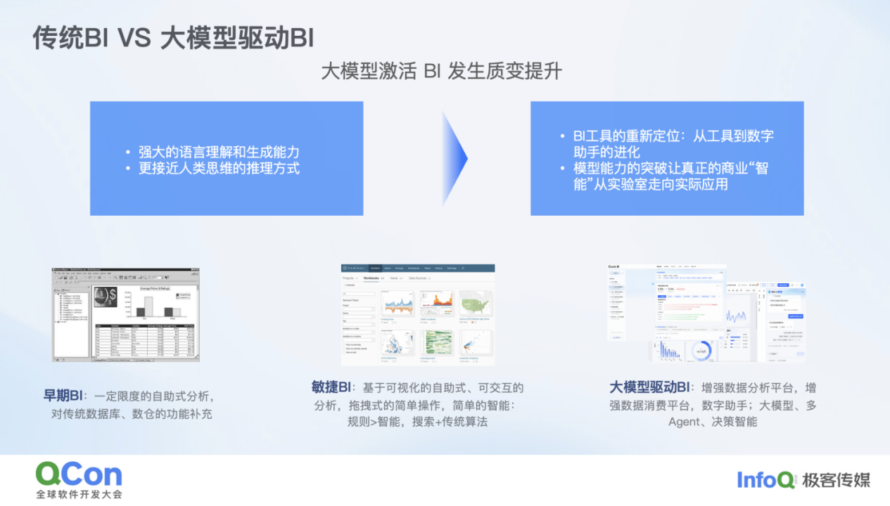

### 大模型驱动的业务落地方向

基于用户的实际需求和大模型 Agent 技术发展，我们对大模型驱动的业务落地演进方向做了大致判断。从执行到思考，从智能到智慧，难度系数逐步增加。大模型刚出现的初期，大家都在做 Copilot（即搭建助手）：用户通过 Copilot 用简单指令或描述就能辅助搭建报表，从而降低BI 工具的使用门槛和成本。然后是 Chat BI，理论上它会改变整个分析流程，用户像和人类对话一样向系统提问，由系统即时理解并返回准确的分析结果，所有人都可以随时随地的获取数据，降低传统 BI 报表和仪表板出现的必要性。

再接着是洞察分析：基于数据、业务知识，利用机器学习算法、数据挖掘技术的融合，叠加上大模型的语言理解和推理能力，让使用传统算法的洞察分析脱胎换骨，实现更精准的总结、诊断、归因，能够自动发现数据中隐藏的价值。第四阶段可能还为时过早，很多厂商将其称为DI（即决策智能 Decision Intelligence）。

随着数据量爆炸式增长和分析技术进步，如多模态、多元信息整合、多 Agent 技术等，我们可能不再满足于单个功能，产品形态会演变成分析平台主动在海量数据中发现价值，通过完整数据报告或主动 Feeds 流方式推送给我，不仅能给出“发生了什么”，还能进一步解释 “为什么会发生”、“未来会怎么样”，为用户提供更高阶的决策支持，这是也许是目前能看得到的数据分析领域的理想态。

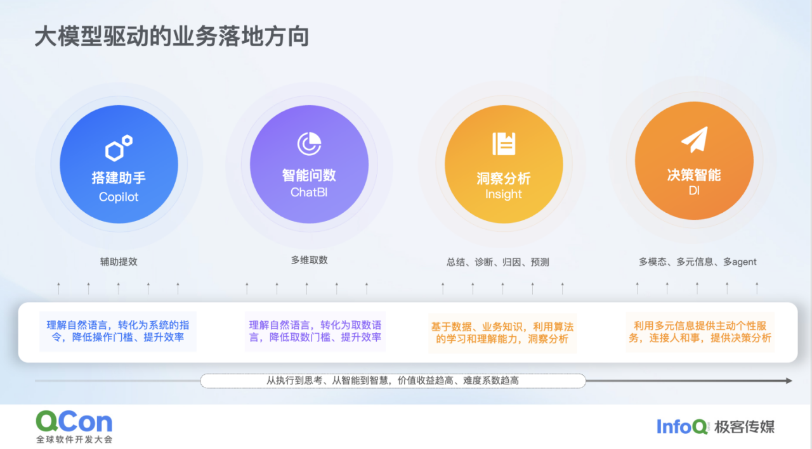

基于对业务落地的判断，企业级智能 BI 分析离不开 BI 工具、大模型和企业私域知识这三者的有效融合。首先，BI 工具作为核心框架，凭借强大的数据分析和可视化能力，将规模庞大和复杂的数据转化为直观易懂的图文报表，为企业搭建洞察业务的桥梁。要最大化的发挥 BI 工具本身的作用，如高性能分析引擎、可视化、安全管控、开放集成能力、协调办公能力等。其次，BI 工具并非孤立的存在，大语言模型的加入为其注入了灵魂，通过大模型理解自然语言指令，精准理解用户意图，大大降低数据分析门槛。此外，随着多模态、multi-agent 等技术的成熟，大模型的记忆、推理、规划、反思、工具使用能力反过来推动大模型在各领域的丰富应用，包括数据分析产品。最后，绝大部分企业级的智能数据应用都离不开私域数据，作为大模型应用的根据，只有将企业数据、企业内部知识、行业知识深度整合，才能让 BI 分析更具针对性和业务价值。

## 大模型落地 QuickBl 全景

Quick BI 是阿里云上的一款 SaaS 的 BI 产品，连续 5 年入选 Gartner 的商业智能和数据分析魔力象限，也连续 5 年作为国内唯一入选榜单的国产 BI 产品，承载其智能化能力的产品叫智能小 Q。

### 大模型重塑整个 BI 分析流程

在大模型时代，有句话说得非常到位：所有产品都值得用大模型技术重做一遍，BI 产品也不例外。传统的 BI 产品，其分析流程在模式上相对比较固定，从数据到结果，基本要经历从数据连接、到数据建模、到数据分析、到数据可视化、再到数据协同和消费的整个流程。这个流程离不开业务人员的人工搭建操作，对用户的模型理解和配置技能有较高要求。

而在大模型时代，这个流程的每一个环节都有可能被重塑。例如，在数据连接环节，我们可以对数据准备的 ETL 任务进行辅助开发，对连接的数据源进行数据探查和校验；在建模上，可以对字段质量进行评估，实现计算字段生成优化和 SQL 诊断；在数据分析阶段，对报表一键美化、洞察归因和自然语言生成报表；在消费端，有 Chat BI 智能问数；最终的消费态则可以有智能决策和数据解读报告这样的形态。当我们打开思维去尝试探索后会发现，这里面的发挥空间会非常大。

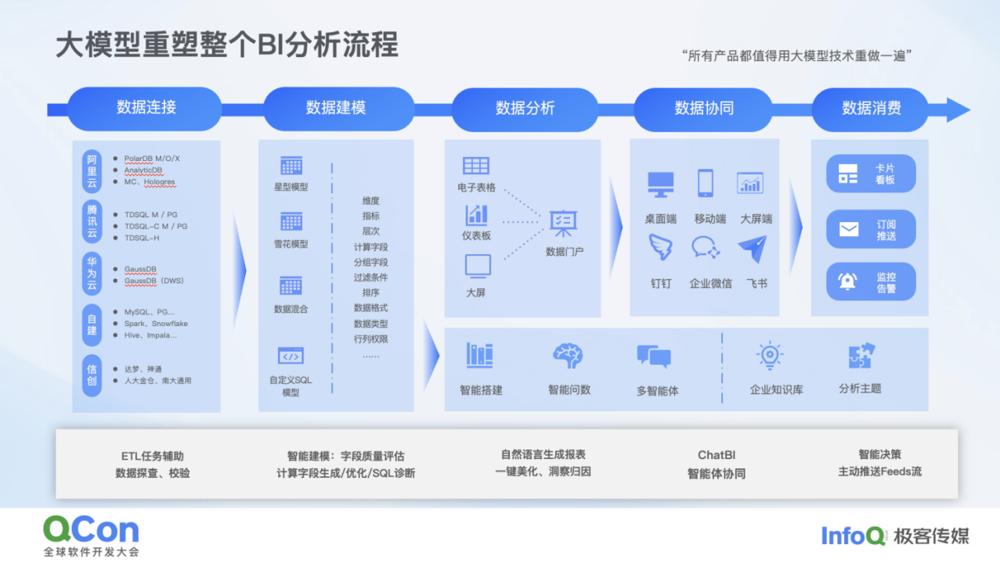

### BI Copilot

BI Copilot 的具体形式就是智能搭建。分析师在原有搭建报表的流程时，用自然语言替代繁杂的功能寻找、拖拉拽按钮和配置，直接完成用户想要的操作。在这个领域，我们更多瞄准的是那些高频多步的、或者强依赖分析师经验的功能。例如：

1. 金额大于 3000 的标红 - 就是个典型的条件格式场景；

2. 帮我美化下这个报表

3. ……

从技术流程图可以看出，我们将原本强耦合在底层产品内部的一些能力做了解耦和开放，在渲染引擎、搭建引擎和用户会话之间构建了一整套指令系统和前端 API 层。大模型作为稳定的“中介”，负责对接会话层和指令系统，将用户自然语言意图转换成底层引擎能识别的“API”指令。在这个部分，我们基于基座模型微调了适合 QBI 搭建的增强指令识别系统，即带有指令CMD 和参数 Params 的 NL2API。初级 API 进过指令系统的复杂处理，如依赖检测、指令调度、执行等，最终会调用暴露出来的 API 层，最终在渲染引擎和搭建引擎的加持下，完成一整套动作。不过，在这层面上 NL2API 系统相对封闭，因为大模型本质上主要是为 Quick BI 或自身应用系统内部业务服务的。

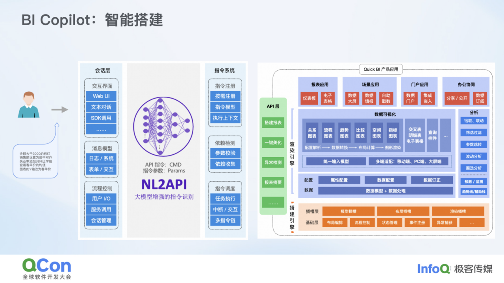

BI copilot 的另一个重要应用是数据洞察。用户对洞察的期望通常是：看懂图表 -> 补充信息 ->分析和解释数据现象 -> 定位问题 -> 支撑行动决策。这几个步骤里，任意一个步骤想要做好都需要天时地利人和的：算法够优秀、支撑数据够多、流程组织够清晰。

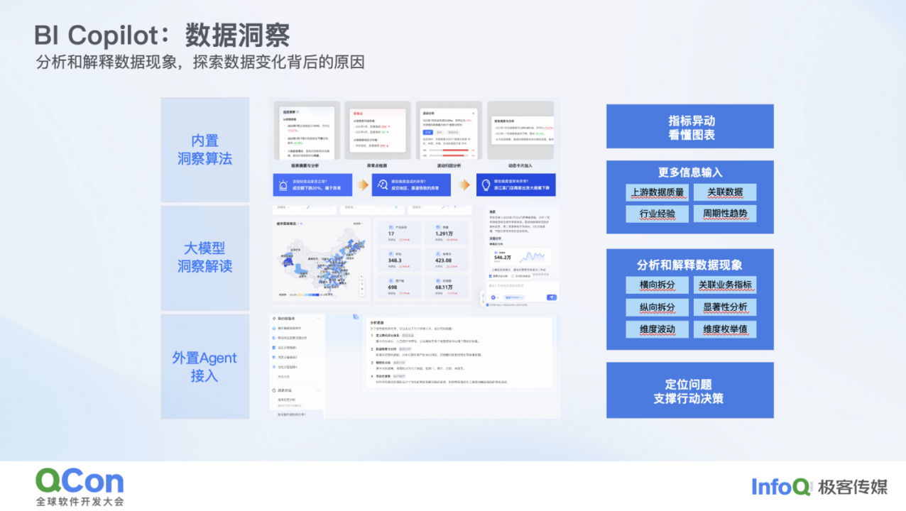

目前我们在洞察领域做了如下三方面的探索：

一是内置洞察算法，这部分主要使用经典统计计算模型，毕竟智能化并不能完全等于大模型。例如，关注指标变动是否正常，若不正常，是哪些维度造成异常，本质上是参考历史数据、行业经验及其他关联数据，寻找对业务目标最具解释力的维度，这就是内置洞察算法。

二是大模型的洞察解读，将报表数据和背后所在数据集的数据以及配置元数据等信息组合，利用通用模型在数据解读、语义理解等方面的优势，通过 Prompt 工程 +Multi-Agent 的方式完成的解读方式。

第三，QuickBI 具备外置 Agent 接入能力（如 Dify 或百炼等），让客户特定的工作流和业务逻辑对接到小 Q 对话流里。作为一款通用工具型产品，一定没法满足所有用户的个性化定开需求，这算是一种体验很好的曲线救国方式。

### Chat BI

在当今的商业智能（BI）领域，Chat BI 这一概念正逐渐成为焦点。Quick BI 已经成功落地了智能问数这一场景，这在国内国际都引起了众多企业的浓厚兴趣。目前，众多厂商的 Chat BI产品都在致力于实现类似的功能，技术路线也呈现出多样化，如 NL2DSL（自然语言到领域特定语言）、NL2Python、NL2SQL 等，可谓是百家争鸣。

以 QuickBI 的智能问数为例，一个智能问数的用户旅程大致如下：用户首先输入一个问题，系统在前置处理阶段会进行权限管控和流量管理等操作。随后，我们利用经过训练的大模型领域模型对问题意图进行判断。如果该任务需要多步才能完成，系统会将其拆分为多个子任务；若单步即可返回结果，则直接进入核心流程。通过一系列召回算法，我们将元数据、知识库等信息组合起来，输入到大模型中。最终，大模型以 DSL 和 SQL 的形式将结果传递给 BI 底层的查询引擎。查询引擎负责方言翻译、高级计算下推等复杂流程，并最终以图表形式呈现结果。这些图表在呈现过程中仍然可以进行交互和调整。整个流程的关键在于，我们能够清晰地梳理从上到下的所有字段血缘关系。

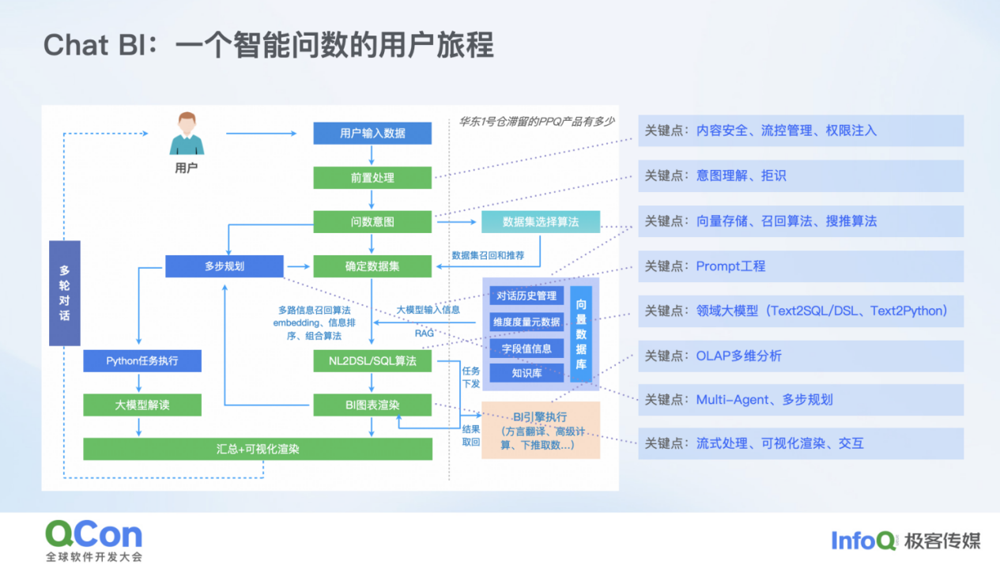

### 通用大模型与自研领域模型的混合流程设计

在通用大模型与自研领域模型的流程设计中，我们秉持着开放的态度。本质上，用户的自然语言通过大模型转换为代码，代码再通过我们工程内部的方式转化为技术逻辑，最终在产品中体现为具体的展现形式。BI Agent（在某些场合被称为 AI 中间层），它通过组织编排各种大模型的输出和流程代码，实现自然语言与代码的有效连接。BI Agent 会定义一些 API 和 DSL，为了让模型能够与应用系统有效交互，我们正在通过 MCP 的方式将其能力开放。

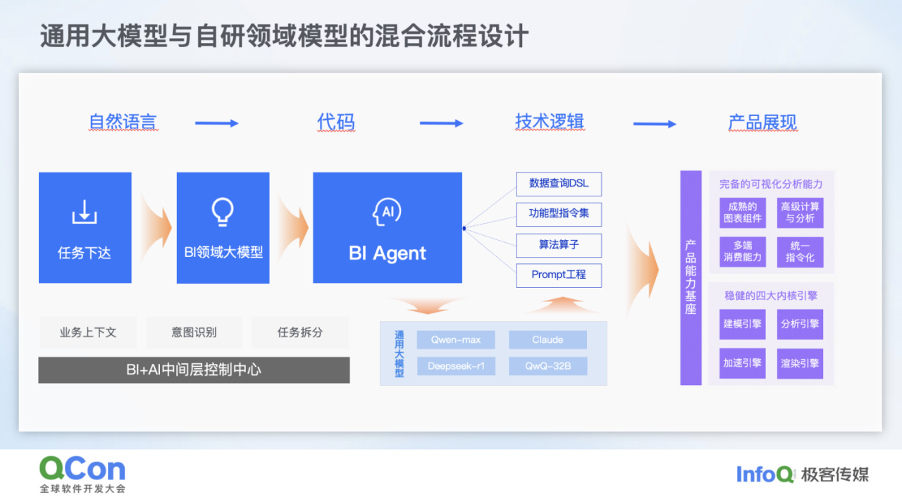

BI Agent 与中间层的控制中心配合，经过业务上下文处理、意图识别、任务拆分等步骤，使BI 系统能够理解模型的返回结果，并据此进行进一步的操作。此外，在处理复杂任务时，我们还会按照正确的顺序执行编排的子任务，确保任务的成功完成。举个例子，需要获取“X 部门的经营分析报告”，LLM 本身是不会直接总结的，它需要调用取数工具先获取每个月的销量情况，再基于各种拆解数据做归纳分析，这里的“取数工具”就作为最原子化的 BI Agent 存在。

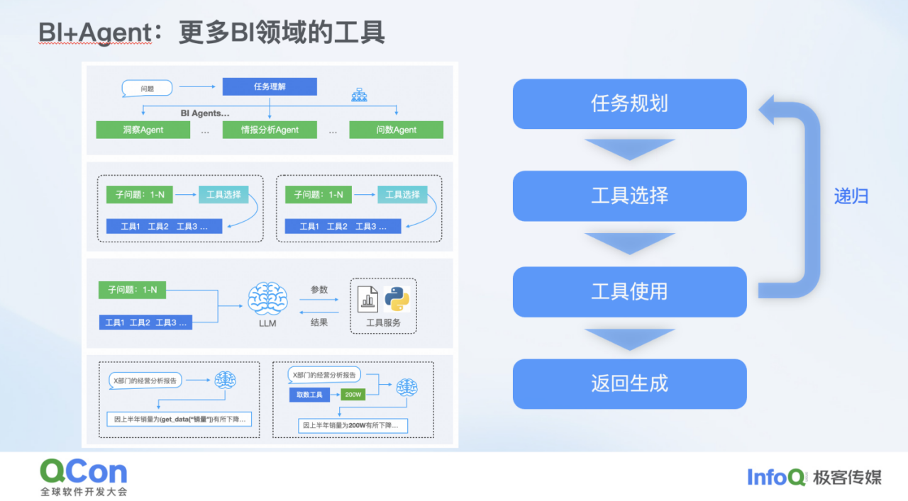

## 工程架构设计

在设计工程架构的最初阶段，我们在最初阶段经历了诸多纠结与讨论。我们曾反复思量，是要打造一个代码助手，还是 SQL 插件，又或是增强版的 BI 工具呢？无论最终选择何种形态，技术路径的抉择都必须着重考量几个关键问题。

首先，该系统是否具备企业级的特性。这关乎到权限管理、租户隔离等诸多方面，以及它能否与现有的业务场景无缝兼容。其次，系统的前端界面是否交互便捷、易于使用，这至关重要。再者，系统是否拥有开放集成的能力，能否提供 API 接口，是否能够嵌入到自有系统，或是接入自有知识库和数据源。此外，多场景的适应性也不容忽视。在早期，我们发现许多开源的Demo 项目，它们仅用几行代码就跑起来一个 Chat BI，虽在特定场景下效果显著，但难以在企业级的真实场景中落地应用。最后，系统的未来拓展性也是必须考量的因素之一。

### 智能小 Q 分层架构

下图展示了智能小 Q 的整体技术架构。从图中可以清晰地看到，智能小 Q 从上至下依次为应用层、AI 中间层、自研领域大模型和通用模型层，以及 BI 基座引擎层。AI 中间层处于上层应用与大模型之间，主要承担任务分发与协同的职责。我们通过构建 API 和 DSL，实现了Agent 与算子的有效对接，让大模型应用更具确定性，避免以前通过自然语言输入的应用表达不稳定，使得在 BI 领域的大模型的应用编程变成确定性应用编程。作为支撑小 Q 的关键部分，基座的 BI 引擎确保了数据分析的强复用性。分析引擎涵盖了从数据连接建模到复杂分析的全方位能力，而渲染引擎则承载着图表可视化及交互的重任。整套系统都是在 Quick BI 已有的能力基座上进行开发的。

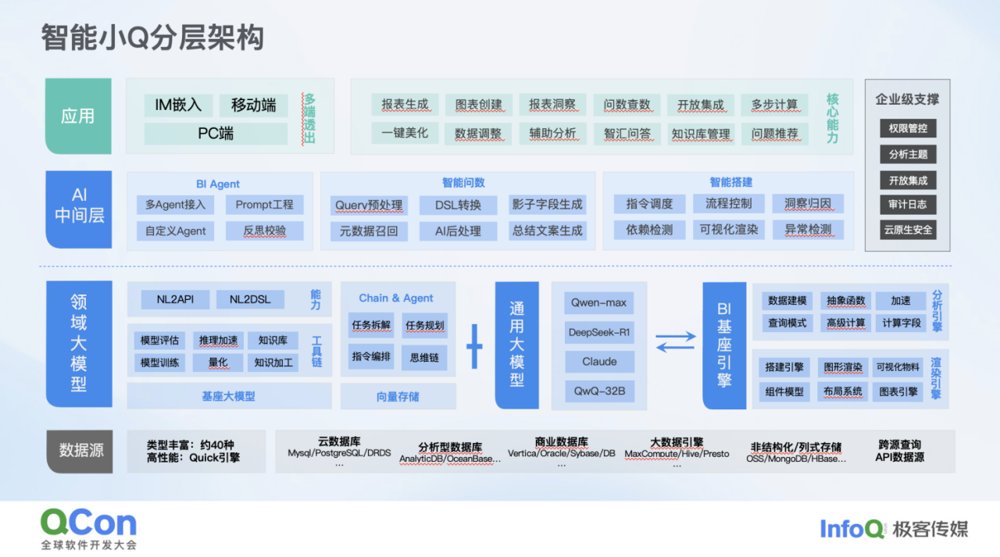

### 自研模型在 SQL 语义生成的可控性

在自研模型的 SQL 语义生成技术路线上，目前主流的有两种方式：Text to SQL 和 Text toDSL。我们对这两种技术路线进行了长期且深入的对比分析。Text to SQL 是直接将文本转换为 SQL 语句，直接在物理数据源上进行查询；而 Text to DSL 则是先经过一层抽象的语法，再分发到数据源进行查询。从业务特性来看，Text to SQL 在门槛较低的情况下，能够充分利用大模型的泛化能力，简化数据分析过程。然而，它也存在一些局限性。由于缺乏数据模型的抽象定义，直接对标物理表，使得大模型生成 SQL 的过程变得异常复杂。

此外，大模型不可能被训练去了解市面上众多数据源的方言。以 Quick BI 为例，它支持四五十种方言，如果要对私域数据进行私有模型训练，成本将难以控制。而且，即使是同一数据源的不同版本，如 MySQL 5.7 和 8.0，它们支持的函数也有差异（如开窗函数），这对大模型来说并不友好。从技术限制角度而言，DSL 的灵活性相对较弱，其查询能力受限于 BI 引擎的能力边界。从适用场景来看，Text to SQL 更适合门槛较低、没有复杂业务分析要求的场景；而Text to DSL 则更适合业务场景明确、面向大型团队和企业级应用的场景。对于 QuickBI 来说，技术路线从纯 Text to DSL 到 Text to SQL to DSL，再到混合模式，可谓是吸收各个路线的优势。

### 一个问数问题的工程链路

我们从工程链路的角度剖析一下问数。用户问了一个相对复杂的问题后，经过模型的复杂链路处理，包括 Agent 路由、各种实体召回，由自研 BI 大模型生成 DSL，经由工程端的查询参数构造后，发给查询引擎进行取数。查询分析引擎会处理复杂计算字段（如 LOD 函数、自定义抽象函数）、注入用户的行列权限等，最终翻译成物理 SQL 和内存计算进行取数处理。

从下图的例子可以看到，相对抽象的 LOD 函数会被稳定转义成适配不同数据源方言的 JOIN，大大降低了模型生成 SQL 的难度和稳定性。在这种工程架构下，可以解决传统 NL2SQL 面临的三大关键问题：

1）保证可用，具备企业级的管控能力，如完备的权限能力、开放集成能力等；

2）保证可信，BI 引擎的引入降低模型生成原生 SQL 的难度，对取数的每个链路都做到逻辑有迹可循，查询元数据血缘透出，提升结果的可信度；

3）结果可交互，复用了 BI 丰富的可视化能力，在生成的图表后链路上可修改并进行二次查询。

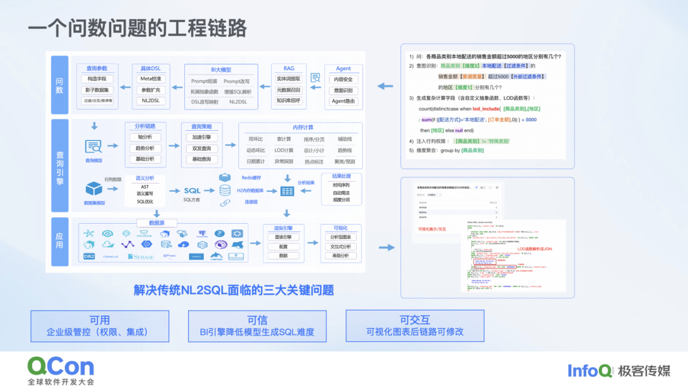

## 算法设计实践

### NL2SQL 算法的挑战

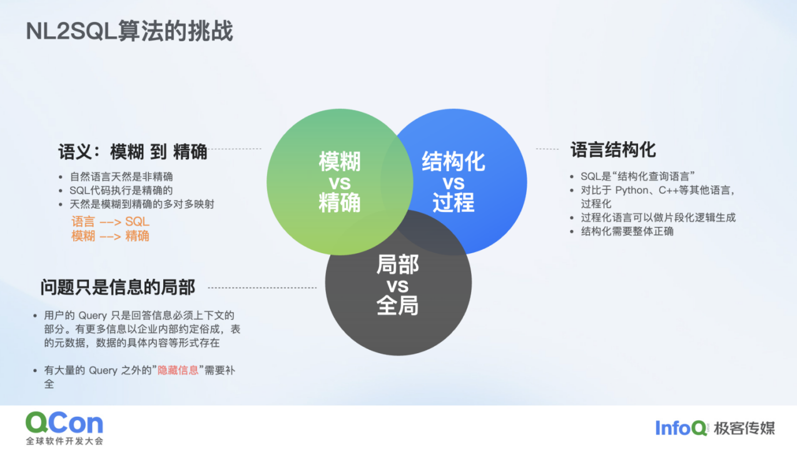

与通用模型处理的其他类型问题相比，NL2SQL 算法领域面临的挑战主要集中在以下三个部分：

1. 语义的模糊到精确：自然语言天然是非精确的，同样一个意图可以有多种不同方式的表达，而 SQL 代码及执行是精确的，用户对结果的正确性的容忍度非常低。因此 NL2SQL 天然属于模糊到精确的多对多映射问题。

2. 语言结构化：SQL 是“结构化查询语言”，而对比与 Python/C++ 等其他编程语言是过程化的语言。这里有什么区别呢？过程化语言可以做片段化的逻辑生成，对模型推理的要求偏低，但结构化语言需要结构和逻辑整体正确，难度相对大些。

3. 在问数任务的绝大部分场景下，用户的问题只提供了信息的局部，只是回答信息必须上下文的很少一部分。有更多信息以企业内部约定俗称、表元数据的简称、数据的具体内容形式存在。这点相信在这个领域的各位应该也有比较深刻的体会。事实上，有大量的 Query 之外的“隐藏信息”需要补全，而这又无形中对系统的配套设施提出了更高要求。

我们在训练模型前，对要达到的效果做了定义和预演。即什么样的数据分析助手是“好”的助手？

首先在风格和调性上来说，主要有以下几点：

1. 有效性，模型必须保证准确和稳定，即单位 token 的有效信息密度高，不啰嗦；

2. 准确性，在最小可用的数据和关联拓展之间做一个平衡。用户问数往往是看一系列数据，不是单个数据，我们会在某些场景下主动给一些关联数据，实践下来会给用户一些“小惊喜”；

3. 在复杂任务上的表现，过程中逐步规划、反馈，通过多个简单任务组合解决复杂任务。当然，这里如何拆分子任务、子任务的粒度也是另外一个较大的话题了（过于原子化和过于抽象都是有问题的）。

其次对于大模型能力，主要有以下几点：

1. 基础能力稳定性高：在问数基础、高频场景下需要稳定且高准确度的表现，避免过多的过程性解释；

2. 在数据分析场景下的专业性：模型训练能够对数据分析师、业务常用的分析思路有理解，能给出专业的数据建议。比如用户问单个指标的时候，同时看一下指标趋势也没有坏处；

3. 规划、矫正能力：具备将复杂任务拆解为用户易于理解。易于干预的子任务，能根据不同的上下文、用户提示，矫正复杂任务的执行规划。

### 一个问数问题的大模型旅程

从算法的视角来重新看问数的链路：大模型在生成抽象 SQL/DSL 的过程中，经历了元数据选取、上下文添加、问题改写、完整 Prompt 构建、输出、转译等步骤。这其中最重要的一步就是领域模型的训练，领域模型训练需要足够的信息来进行正确推理，这些信息主要包括任务描述和通识能力，例如大模型不知道今天是哪天，我们需要将当前时间戳加入其中。其次是表和字段信息，这是非常关键的，如果没有表的字段信息和维度枚举值，对于 NL2SQL 来说将是一场灾难。再者是私域知识库，相关的知识条目以及是否做强制改写等，都会给大模型提供启发。另外，参考样例也很重要，什么是好、什么是坏的，我们在产品上通过点赞、点踩等方式给大模型提供真实的 few-shot 示例。经过各种选表问题改写 SQL 等流程后，最终生成的Prompt 会交给领域模型完成推理。

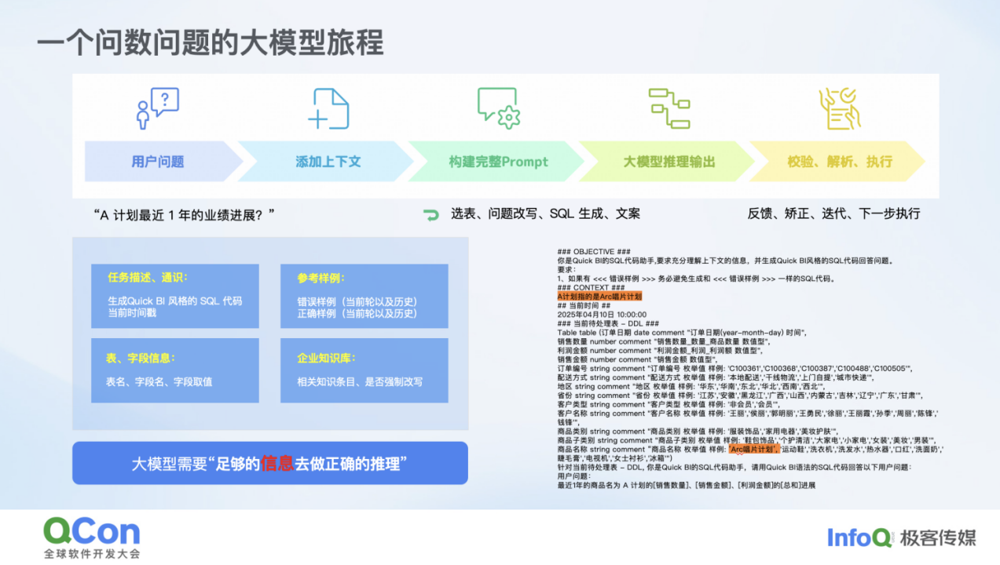

### 基于 BI 引擎的 NL2SQL 算法演进

前面有讲到，最初我们定义了特定的查询语言 DSL, 用于表达对于不同查询参数的描述，由大模型直接学习并生成 DSL，再通过中间层将抽象的 DSL 在元数据和知识库的召回后实例化，转换成实际 QBI 的查询参数执行真实的取数；这里的几个好处，比如 SQL 方言屏蔽、高级计算能力复用等等。但随着支持的问数能力越来越多，问数的意图千变万化，要准备这套 DSL语义的样本成本在逐渐增大，毕竟 DSL 是我们自定义的，通用模型训练并不含这部分内容。同时，各类通用基座模型本身对意图转简单 SQL 确是有大量积累的。于是我们在单表查询的标准 SQL 基础上拓展了抽象函数和高级计算符，变成增强 SQL 语言，以训练基座模型对于增强 SQL 的生成来提升对复杂意图的理解准确度，然后通过自研语法解析器来改写成 DSL 映射。也就是说，增强 SQL 和 DSL 是可以稳定转换的。这样既能巧妙利用通用模型的能力，又能大大降低训练样本的准备成本。至此，复杂查询意图到取数流程就被串联起来了。

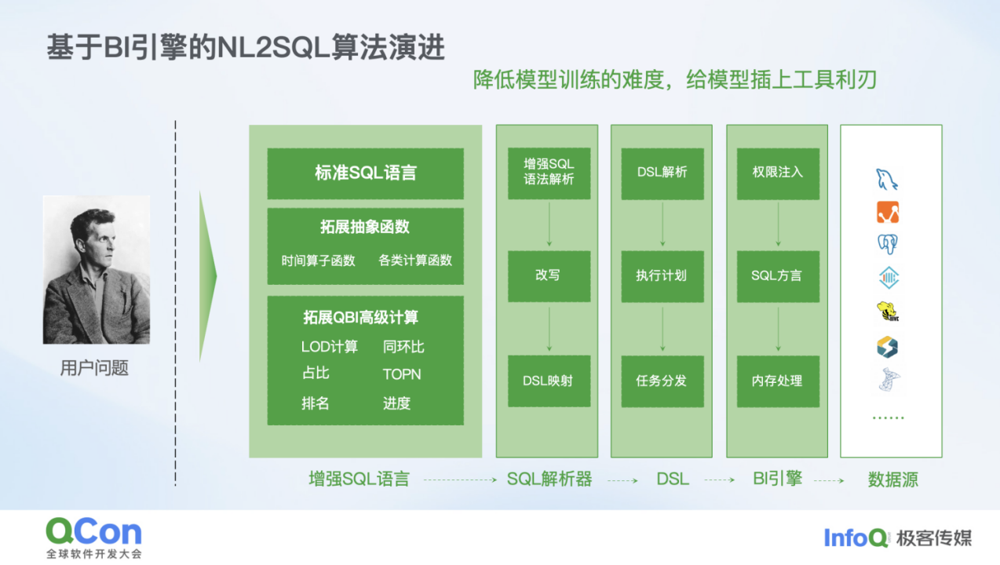

### Text2DSL：丰富的算子和函数

对于上述架构的最终选择，有两个重要因素支撑才能成立。第一个是丰富的算子和函数，得益于 Quick BI 内置大量逻辑函数，如聚合数值处理、文本处理，以及 LOD 函数、时间算子等。例如，计算环比对于 SQL 来说可能很复杂，我们会将大量复杂分析场景定义封装在这些算子和函数里，大模型在生成增强 SQL 时不需要感知这些复杂内容，它只需要知道如何使用这些算子和函数即可，这有点像现在流行的 Agent 方式。第二个是完善的数据模型，我们作为 BI系统本身就支持很多关联模型，包括自定义 SQL 模型，如单表星形、雪花星系等经典 BIOLAP 模型。实际上，我们会将复杂的多表关联合并和嵌套查询下推到数据建模层，这些信息对大模型来说是透明的。大模型不需要感知这些，因为 Chat BI 不仅仅是 NL2SQL 算法的炫技，更重要的是解决实际客户的问题。有时我们会将复杂建模放在前面，对于整个大模型来说，它只是一个单表的、带有各种复杂函数的 SQL 生成逻辑。

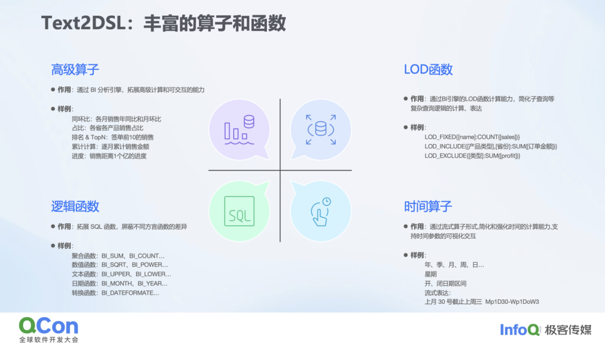

另一个重要的计算逻辑是多步计算。多步计算是为了解决一些纯 NL2SQL 无法处理的问题，转而通过 NL2Python，或者说 NL2Python Agent 的方式来解决。举个简单例子，询问销售金额日环比超过 40% 的用户有哪些？我们可能只能算日环比，超过 40% 对于人来说很简单，但实际上这是一个多步计算的解决方案。在这个流程中，大模型会进行多次推理，这里的Python Agent 会触发大模型在当前输入上进行二次推理。通过合理的任务拆解，可以降低整个复杂问题的解决难度。

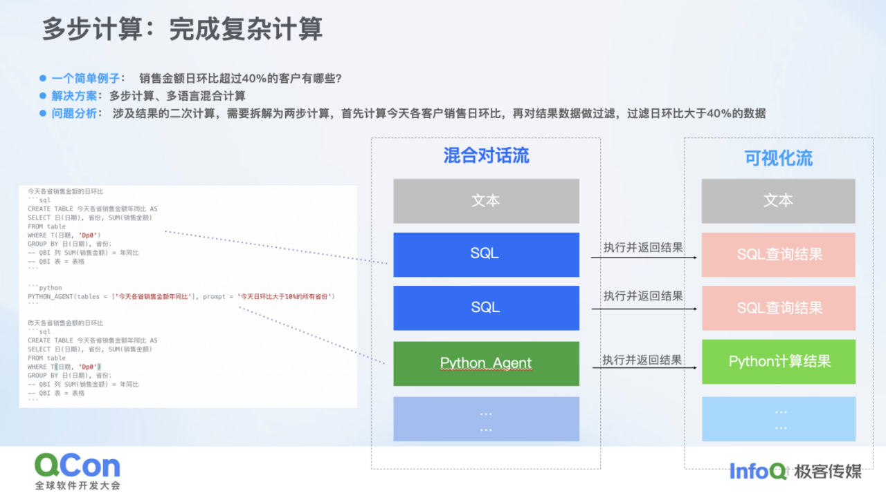

此外，关于领域模型的训练，我们这边的训练主要分为三个部分：继续预训练、微调和GRPO。简单来说，在预训练阶段，我们会把 Query 质量不高但有大量抽象 SQL 的东西作为预训练的一部分。在微调阶段，我们会把高质量的 query 和 SQL 对应关系放到微调中进行训练。最终通过强化学习 GRPO 的方式把整个模型训练好。

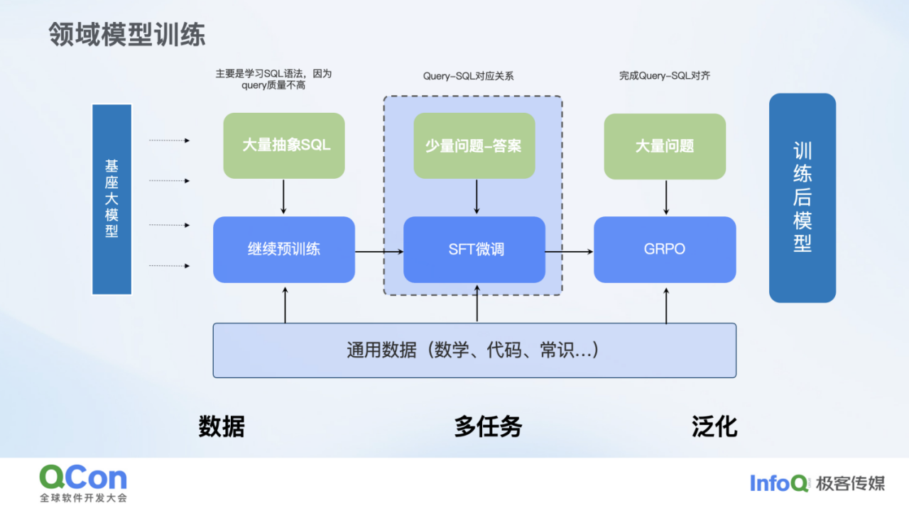

### 大模型与好数据：训练数据准备

大模型是离不开好数据的，只有大量 + 优质的训练数据加持，模型才有可能突破。下图是我们数据准备的一个数据飞轮：

一方面我们依赖了人工构造，我们有一只专门的数据团队去构造、收集复杂的训练数据。其次，利用模版、AI 去生成，各类大小模型的结合提升训练数据的质量和覆盖。然后是数据蒸馏，对一些复杂问题，我们会通过大模型训练小模型的方式。与此同时，我们还会在数据准备过程中利用模型生成一些有价值的错误，这些样本随后可以在执行引擎的协助下执行验证并进行错误归纳，相当于反例的标注，这对于训练非常有必要。我们实践下来发现，有价值的错误在整个训练过程中是非常有必要的。

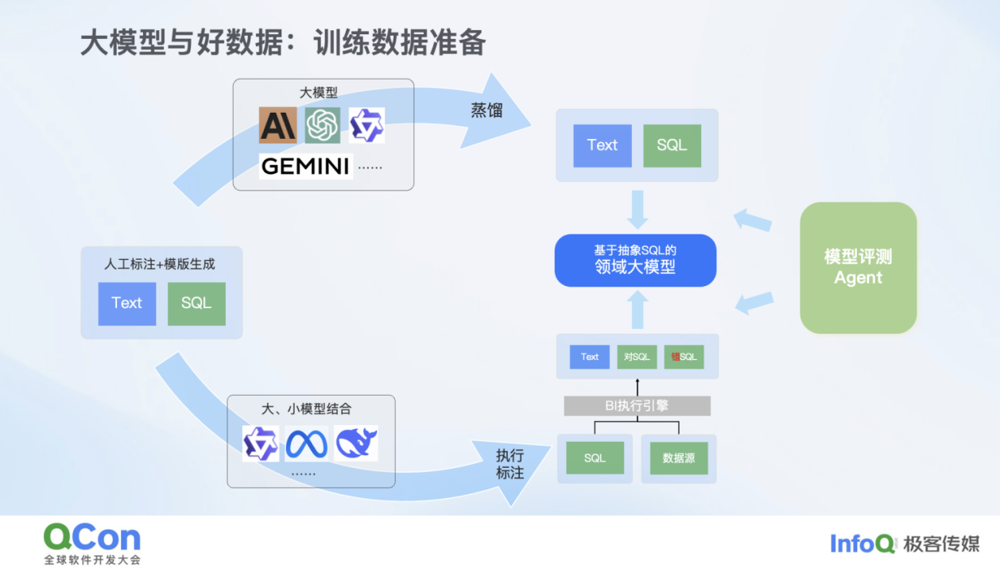

## 业务价值与展望

### 智能小 Q 客户实践场景

以零售品牌为例，它们直接利用我们的 SaaS 产品来推进功能演进。还有快消品客户，更是将我们的小 Q 直接嵌入到他们的业务系统中。实际上，在客户那里，我们进行了一些实践和调优工作。作为一个通用的 BI 工具，无需任何配置的前提下想要直接达到 90% 以上的准确率是不现实的。事实上，脱离具体应用场景谈准确率，多少有些不切实际。

这里有一个案例，一开始我们完全没有介入时，准确率仅为 65%。通过交付过程中的介入，引导用户如何使用、如何提问，以及让用户通过点赞、点踩的方式参与，我们的模型可以自动进行 SFT。在这种场景下，最终将模型强化后的问数准确率提升到了 92%。主要提升点在于指标维度的扩充、指标覆盖等，让用户尽可能多地提供信息，针对复杂问题进行自动拆解。很多时候，客户的问题并非单纯的问数问题，比如他们可能会让你去分析一下某个情况，这就需要进行问题拆解。此外针对无法回答的问题，提供用户提示，即拒识方面的引导优化也是非常有必要的。

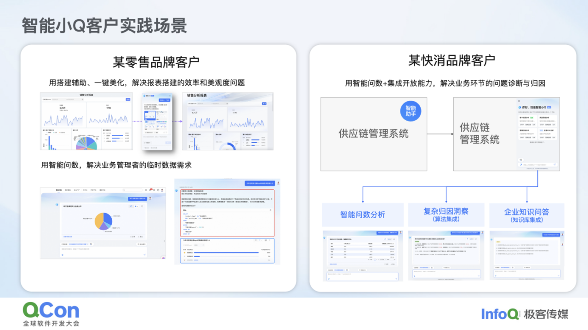

### Bl 未来发展

目前大模型擅长的包括：语义理解、代码生成、分析思路、文本生成、任务编排…… 我认为大模型在以下几个方面会有长足进步，具体进步包括：

1. 动态推理能力：包括任务拆分、逻辑推演、冲突解决；

2. 多模态感知能力：未来可能会整合跨平台的报表数据、根据截图、报告来挖掘出更有意义的数据科学部分；

3. 模型能力本身的持续进化、自我反思机制的增强：在整体水位线上能让智能来的更加真切；

4. 自主决策能力：非预设路径的行动生成和决策。在更高的角度来看，随着大模型这些能力的持续进化，我相信将会推动智能 BI 从任务执行者向决策主体跨越，进而让整个领域在交互模式和能力边界上都有相应的变化。

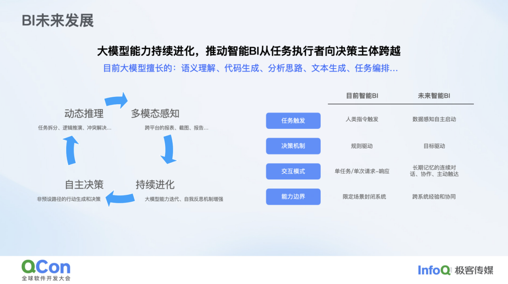
