# Case2 | 当代码遇上大模型：智能编程助手的架构设计与工程实践

- 嘉宾介绍段潇涵，字节跳动豆包 MarsCode/Trae IDE 架构师，致力于大语言模型在研发工程领域的落地实践，构建基于大语言模型的 AI 编码助手；同时致力于推进 IDE 云端化进程，与研发基础设施平台融合，为开发者提供一站式的智能研发体验。

在人工智能快速发展的今天，大语言模型正在重塑软件开发的范式。从最初的代码补全工具，到基于 Prompt 的智能助手，再到具备自主规划与执行能力的 Agent，我们正经历着开发模式的革命性转变。在 InfoQ 举办的 QCon 全球软件开发大会上，字节跳动豆包 MarsCode /Trae IDE 架构师段潇涵做了专题演讲“从指令到 Agent：基于大语言模型构建智能编程助手”，他深入介绍了如何基于大语言模型构建新一代智能编程助手，分享了从概念到落地的完整实践经验。

## 内容亮点

- 在 Agent 技术架构方面，不同于传统的 prompt 模板方案，将开发需求分解为具体步骤，并在执行过程中进行自我反思和修正

- 在上下文感知方面，构建代码知识图谱，实时构建代码的结构和依赖关系等，解决了大语言模型处理大型代码库时的上下文限制问题

以下是演讲实录（经编辑）。

在人工智能快速发展的今天，大语言模型正在重塑软件开发的范式。从最初的代码补全工具，到基于 Prompt 的智能助手，再到具备自主规划与执行能力的 Agent，我们正经历着开发模式的革命性转变。本次演讲深入探讨如何基于大语言模型构建新一代智能编程助手，分享从概念到落地的完整实践经验。

演讲首先剖析当前研发效率的痛点，展示传统开发工具的局限性，以及大语言模型为我们带来的新机遇。接着，详细介绍了智能编程助手的技术架构，包括 Agent 的核心设计理念、工程能力构建方法、以及与 IDE 的深度集成实践。通过实际案例的演示，我们展示智能助手如何在代码理解、生成、优化等场景中提供有效支持。

作为一线实践者，我们也会分享在工程落地过程中积累的经验与教训，包括架构选型、prompt优化、系统集成等关键决策点的思考。最后，我们展望智能编程助手的发展方向，探讨如何打造真正的智能研发伙伴。

## 编程助手解决的痛点

首先我们来回顾一下过往代码补全及代码生成的经验，以及在大语言模型时代，它能帮大家解决的一些痛点。我们可以看到代码智能编程助手的演进流程，大体可以分为两条线。

首先是代码补全这一条线。最早的时候，代码补全是基于语法规则的静态语法分析。现在，各家 IDE（里肯定都有这样的功能。比如我们在写代码时，它会突然出现一个下拉框，列出当前类中可用的函数和变量，我们在编程中经常使用这种功能。

第二个阶段是基于机器学习和统计数据分析的代码补全，它会更进一步，让我们感觉更有智能。比如曾经有一个插件叫 TabNine，大家如果有用过应该有体会。它刚出来的时候非常惊艳。

到了第三个阶段，也就是像 Copilot 这类工具出现的时候，大家会觉得大语言模型真的改变了这个时代。它能够理解代码意图，分析更多代码上下文，通过更广泛的上下文让代码生成更符合逻辑、更加完整。它不再是一行代码片段的生成，而是会有更多上下文联动。比如现在大家常见的 Tap 键超级补全类的功能，它可以修改代码全文的引用。比如我改了一个函数的名字，所有调用的地方都可以通过一个 Tab 键全部修改掉。这个时代会让人感觉更惊艳。

再看代码生成这一条线，它也经历过几个时期。

第一个时期是现在仍在使用的，比如在项目初始化时，基于某些模板或脚手架。它的优势在于各家公司可以自己定制流程，在特定场景下可以一键生成项目框架。但它的局限性在于灵活性非常受限，只能是硬编码的方式。

第二个阶段是基于元信息生成代码的方案。简单解释一下什么是元信息生成：大家在前几年会经常看到类似于 OpenAPI 的平台。我们会声明好 API 的元信息，然后它可以自动帮你生成调用代码，甚至可以生成不同语言的调用代码。这在云厂商、PaaS 厂商或 SaaS 厂商提供的SDK 中比较常见。它的优势在于能够精确地支撑业务，比如云厂商提供 SDK，过去多种语言的 SDK 都是完全手写编码，现在通过声明 API，可以用各种语言的生成器，根据元信息生成多种语言的 SDK，从而减少大量重复工作。不过它的劣势在于，更多依赖于元信息管理，比较复杂，而且生成逻辑需要根据不同的编程语言单独处理生成器。

到了大语言模型时代，代码生成变得更加自然。我们可以通过自然语言与大语言模型交互，要求它帮我们生成特定场景的代码。比如 ChatGPT 刚出来的时候，我自己感觉非常惊艳。我可以把需求以及可能已有的代码片段上下文贴到它的输入框里，它就能生成代码，而且代码质量相对来说是中等偏上。我们可以看到，代码智能的发展从最开始的简单补全，已经慢慢演化到现在可以与人协同交互，理解偏复杂场景，从代码片段补全到全流程支撑的状态。

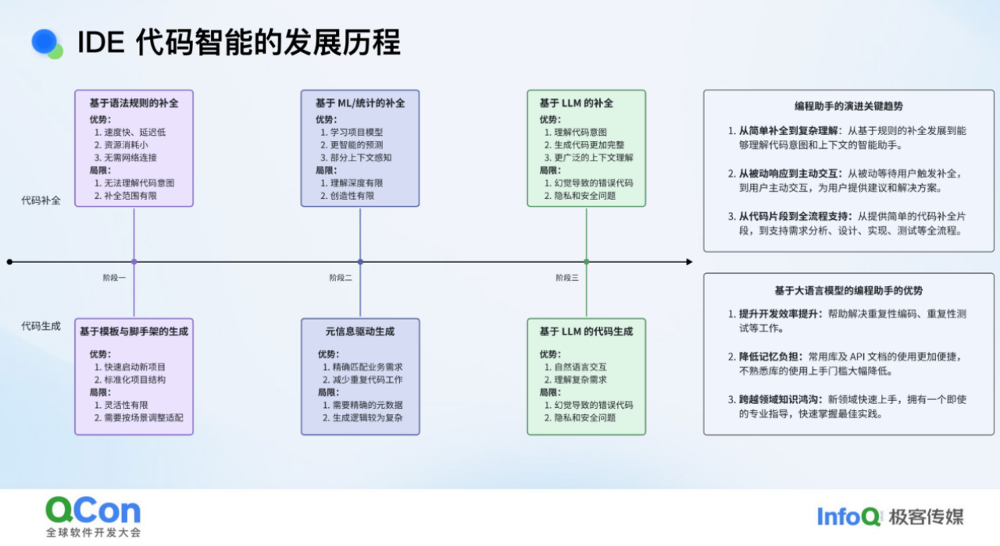

在这个时代，研发人员可以从以下几个方面受益：一是提升研发效率。研发效率的提升不一定体现在时间缩短，也可能是心态或工作量上的提升。大量的重复性编码，尤其是业务上可能存在的面条型代码，都可以由大语言模型来实现。二是降低记忆负担。我自己比较常用这个功能。在做开源项目时，会用到很多开源库，而开源库的 API 如果不熟悉，就需要反复查阅文档。有了大语言模型，它的记忆能力比人类更强，我们可以直接利用它来补全这些 API，更加便捷。三是跨越知识鸿沟。大家可能会有这种感受，有了大语言模型，我们的能力不再局限于原来定位的工作。比如我是客户端开发人员，也可以用大语言模型帮我写一些服务端代码；我是服务端开发人员，想自己写前端控制页面，也不用再依赖学习前端完善的基础知识，或者与前端同事配合。我可以利用 AI 生成一个虽然可能只有五六十分，但也能用的代码。

## Agent 技术架构与核心能力

### Agent 架构概览

接下来我将重点讲解一个 Agent 的形态，它的技术架构大概是什么样的，以及我们通过什么样的工程手段可以把大语言模型结合落地到我们的 IDE 中。首先，我们可以通过一张比较直观的图来展示，我们的技术架构大体分为四层。

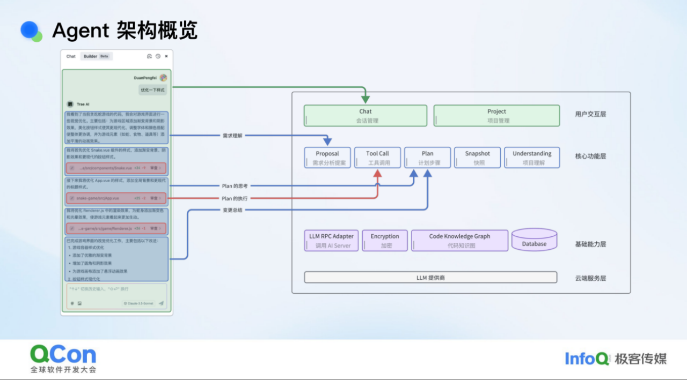

首先，最直观的是用户界面（UI）如何与用户衔接。

第二层是 Agent 的核心功能，其中有两个模块，连线非常多，说明这是比较核心的部分。一个模块是计划的执行，另一个是工具的调用。通过蓝色和红色框区分，计划执行时，模型会输出规划，同时搭配 IDE 提供的工具执行操作，例如文件的修改、查询等。

再往下一层，是我们为了构建 Agent 架构体系所需要的基础能力。其中一个关键点是代码知识图谱（Code Knowledge Graph）。大语言模型要理解项目信息，首先需要构建足够的信息，并以合适的结构和方式提供给模型。此外，技术层还需要关注大语言模型的适配器，因为目前模型厂商和种类众多，工程能力需要对接各家厂商，并协调模型之间的协作。加密和数据管理也是工程领域必不可少的环节。通过这样的架构设计，我们可以将大语言模型的能力与 IDE 结合起来，提升开发效率和智能化水平。

### Agent 工程能力构建

我们再来看一张更细致的图，了解如何构建 Agent 的工程能力。这张图从左到右展示了从用户需求输入到 Agent 主流程 Server 的过程。Agent 主流程 Server 负责拆解用户的需求流程，并利用大语言模型将其拆分为逐步的规划。

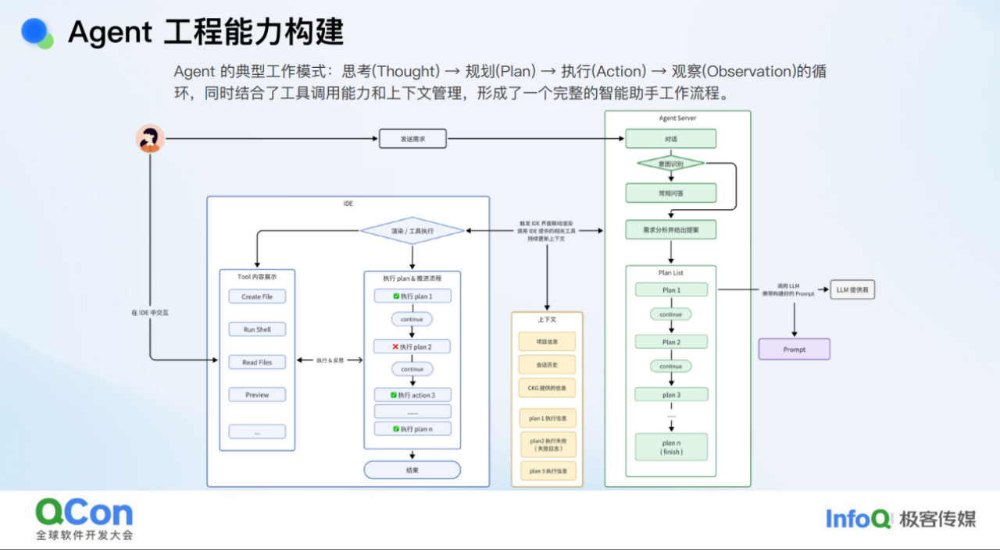

与此同时，从左侧回看，IDE 为大语言模型提供了工具集，这些工具集可以类比为大语言模型的“手和脚”，用于触发调用和变更代码文档，以及生成 SVG 素材等。从右侧往左侧看，从模型的视角出发，模型接收到的信息结构是什么，以及它能够做到什么。图中紫色框标注的是“prompt”，这与大家常用 ChatGPT 时输入的文本类似。这段文本进一步拆解后，可以看到黄色框标注的“上下文”，它包含许多组成部分。

Agent 在 IDE 中的工程实现看起来非常流畅，主要是因为我们通过工程手段将这一整套环节串联起来，从而实现了从用户需求到模型执行的完整流程。

### Prompt 结构

我们继续深入分析下图右侧的 Prompt 结构。首先，从结构定义来看，Prompt 包含基础的角色目标和工作方式，主要是引导模型在特定场景下以何种思路解决问题，或者在研发过程中使用何种技术栈来解决问题。接下来是工具的定义。IDE 为大语言模型提供了便捷的工具，例如文本文件操作、终端（Terminal）联动、预览（Preview）、代码检查（Lint）以及错误分析等功能。最后是格式要求。在使用类似 ChatGPT 的聊天软件时，我们通常会按照这样的结构来定义完善的 Prompt。

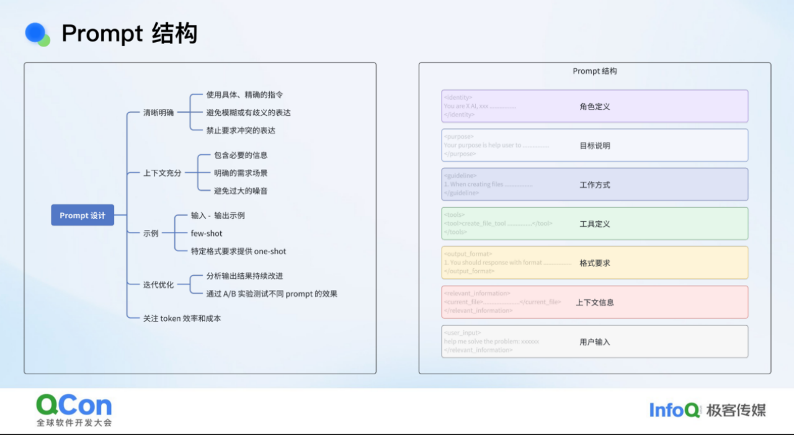

再看红色框标注的上下文信息部分，这是 Agent 与 IDE 结合使用大语言模型时，与直接使用聊天型大语言模型的最大差异所在。Agent 的上下文信息联动性和完善性更强，比简单地将代码文件复制到输入框中，让模型生成后再复制回来的方式要完善得多。用户输入的部分就是用户的具体要求，这里不再赘述。

在 Prompt 设计方面，除了结构清晰之外，描述也必须清晰、精准且无歧义，不能有冲突，这样才能更好地引导模型按照预期效果执行。上下文信息要充分，但并非越多越好，关键是要精准。如果信息量过大，可能会产生噪音，影响模型的理解和生成效果。

此外，示例的作用非常重要。在与模型交互时，模型有时难以仅通过推理理解用户期望的细节，或者有些内容用自然语言难以描述清楚。就像人与人交流时，一个直观的演示（demo）往往比文字描述更有效。例如，通过视频展示 Agent 如何自动执行某项工作，比单纯用文字描述更容易让人理解。在 Prompt 设计时，还需要注意以下几点：

1. 迭代优化的稳定性：在 Prompt 演进过程中，要考虑到迭代优化可能带来的破坏性。可以采用 A/B 测试或通过大量评测集来验证效果，确保 Prompt 的演进是稳定的。

2. 模型输出的可靠性：在大语言模型时代，过去常说的“代码不会骗我”可能不再成立。因为模型可能会产生幻觉，导致输出错误内容。因此，我们不能像过去一样依赖单元测试，而是需要通过评测案例和实验来验证 Prompt 的效果。

最后，成本问题也需要关注。Prompt 的内容丰富且量大，而目前使用模型的成本仍然较高。因此，需要考虑如何通过优化等方式降低使用成本。

### 上下文感知

在拆解了 Prompt 的整体结构之后，我们再深入分析红色框标注的上下文信息部分。我们将进一步拆解上下文信息，看看 Agent 是如何与大语言模型进行交互的。在上下文拆解中，有一个关键点是：在与大语言模型的对话过程中产生的信息需要被跟踪。用通俗的话来说，这就是模型产生的数据所造成的“副作用”，它会对全局产生影响。我们需要跟踪这些信息，以保持模型输出信息的连贯性和完整性，确保后续的交互能够持续地基于之前的信息进行。这样可以避免模型重复做相同的事情。

具体案例分析

1. 代码权限变更

- 场景描述：例如，对于代码权限的变更，这会对操作系统或文件系统产生全局影响。假设文件 a 的权限已经通过 chmod 命令被修改过一次。

- 跟踪的重要性：我们可以通过历史信息获取这些变更记录，但历史信息会持续进行压缩和摘要处理，以避免超出上下文窗口（context window）的限制。因此，这些信息非常重要，需要进行跟踪，以确保不会丢失关键信息。

2. 环境变更

- 场景描述：另一种情况是对环境的变更。例如，启动了一个后台服务，比如一个 HTTP 服务器正在监听某个端口并为用户提供服务。

- 跟踪的重要性：这种全局变更也需要被跟踪，因为它们会影响整个系统的运行状态。

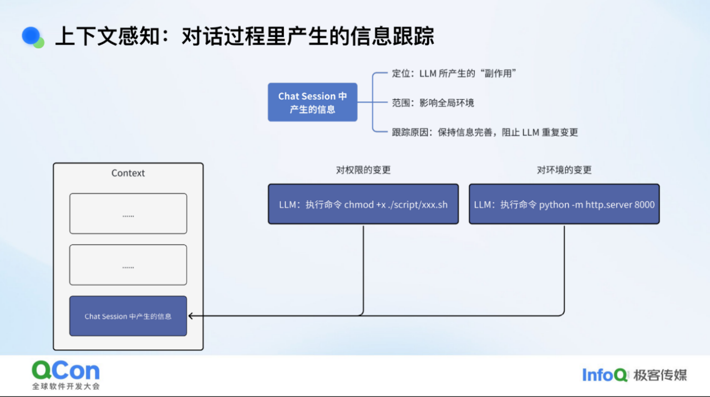

第二部分是关于人的操作信息及其产生的变更。因为 Agent 实际上是一种人与 AI 交互协作的方式，所以人类产生的信息对模型来说是非常重要的部分。

具体案例分析

1. 倾向性引导

- 场景描述：例如，使用某种实践方式（如 V3 实践）时，用户会在 git commit 中添加一些信息（message），表达自己对项目的期望。

- 影响：这些信息反映了用户的倾向性，会对整个项目产生全局性的影响。通过这种方式，用户可以向 AI 模型传达自己对项目的方向、目标和期望，从而引导 AI 在后续的协作中更好地符合用户的意图。

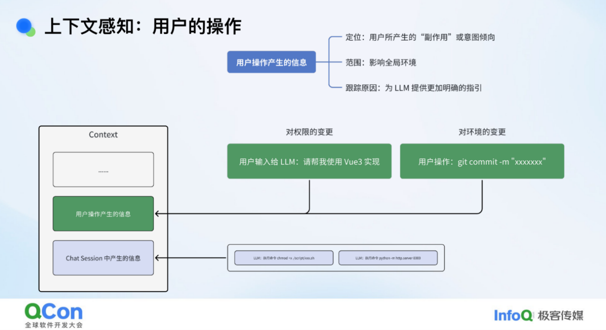

第三部分是比较关键的内容，之前提到的 代码知识图谱（Code Knowledge Graph）。对于我们的代码仓库，无论是本地项目还是从 Git 拉取的项目，都可以统称为代码仓库。如果想让模型了解代码仓库的功能、所做的工作以及代码的组织结构，那么我们需要提前进行项目的索引构建和分析。

在下图的最右侧，可以看到代码知识图谱的构建过程。我们会分析仓库中的文件，这些文件不仅限于代码文件，例如 README 文件或者仓库中存放的架构描述文件等，这些文件也可以被索引和构建，因为它们所包含的知识对模型来说非常重要。同时，代码的目录结构本身也是一个关键信息。大致的分类包括代码类文件、文档类文件和 README 类文件。我们会根据一定的规则对这些文件进行切割，具体来说，可能会结合静态语法分析，例如按照函数维度、类（class）维度等将文件切割成片段，并将这些片段记录到索引库中。

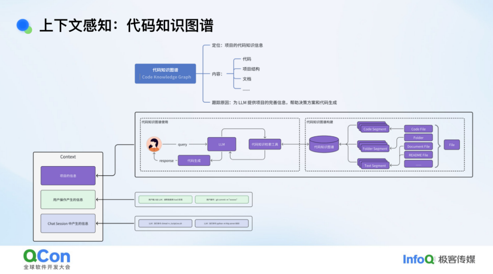

从右侧向左侧看是消费阶段。当用户的需求输入时，大语言模型会判断这次需求是否与项目相关，或者与项目的哪些部分相关。它会提取相关的关键词或实体，检索我们已经构建好的代码知识图谱，并将检索到的信息补充到上下文中。

### 多轮对话与记忆管理

在分析完单轮交互的上下文信息后，我们已经清楚地了解到在单轮交互中，我们向语言模型传入了哪些信息。接下来，我们再看看在多轮交互中，这些信息是如何交互和处理的。在单轮交互中，我们已经积累了大量的上下文信息。随着交互轮次的增加，历史信息会不断累积，导致信息量线性增长。每一轮交互都会携带前面所有的历史信息，以确保信息的完整性。然而，当交互轮次达到两三轮或三四轮时，大量的历史信息可能会超出大语言模型的上下文窗口限制。那么，对于超出部分，我们应该如何处理呢？主要有以下三种处理方式。

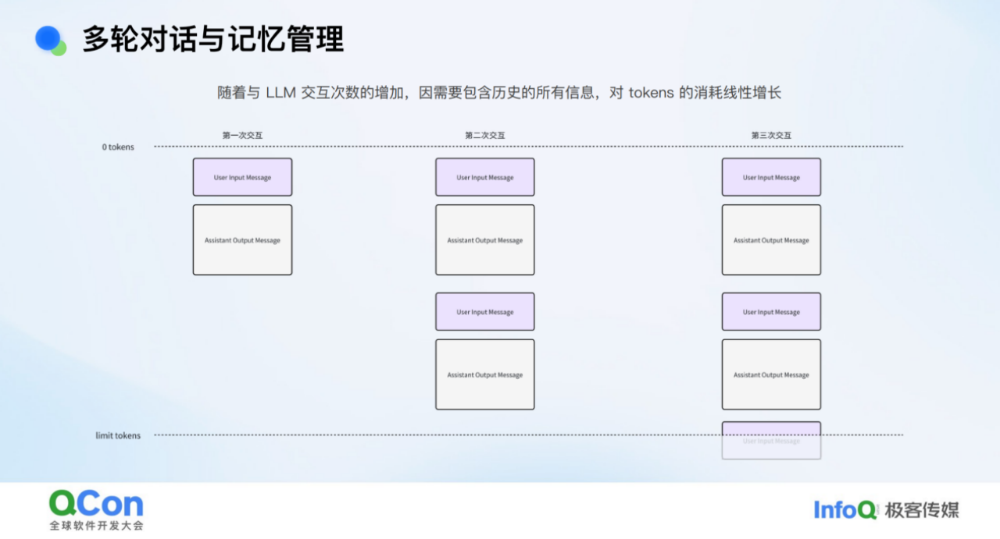

1. 粗暴截断：第一种方式比较直接且在工程上实现较为简单。我们按照近期到远期的倒序方式，直接截断较远的历史信息，以确保不会超出上下文窗口限制，避免模型报错。这种方式虽然可以保证工程的正常运行，但有一个明显的劣势：会丢失大量的历史信息，导致模型在经过一段时间或若干轮交互后，出现类似“失忆”的状态。

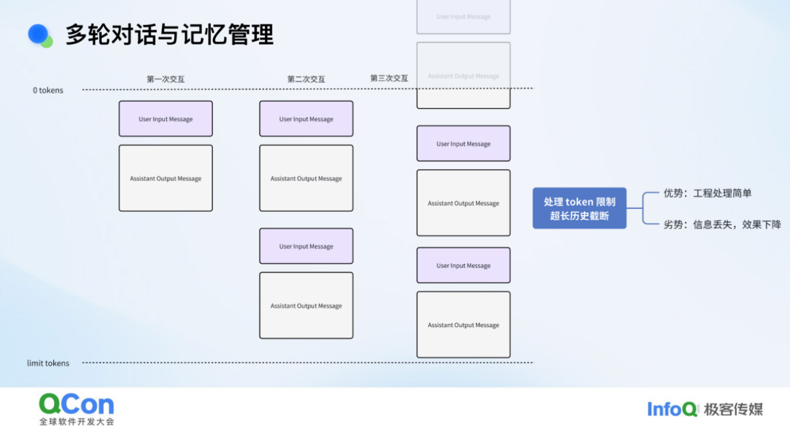

2. 压缩与摘要，以保留历史信息，但可能会降低信息密度。为了尽可能避免信息密度的下降，我们可以使用大语言模型本身来进行拆解、分析和总结。这样可以更好地保持信息密度，但会带来一个问题：大语言模型的使用成本较高，尤其是在处理大量历史信息进行总结时，输入内容会更多，导致成本难以控制。虽然这种方式在效果上符合预期，但成本增加是一个需要考虑的问题。

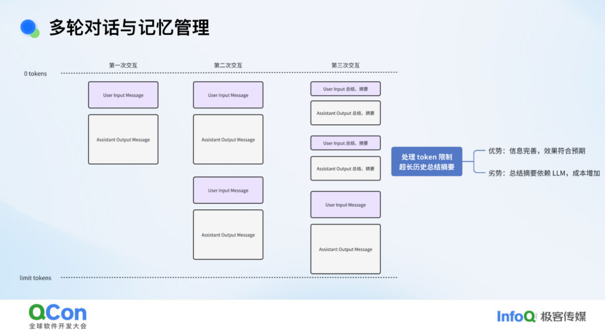

3. 工程折中方案。我们会从大模型返回的信息以及用户输入的信息中，通过工程手段和规则策略，决定哪些信息的影响面足够小且有一定的权重，从而将其裁剪掉。例如，在执行流程中，模型会输出规划以及生成的代码。这些代码已经被应用到项目中，并重新被索引到代码知识图谱中。如果后续需要使用这些代码，我们可以通过这种方式进行补偿。因此，我们可以对产生的大量代码进行精简。这种方式虽然会丢失部分信息，但这些信息是我们经过决策后认为其丢弃的影响面足够小的，同时成本也能够得到有效控制。

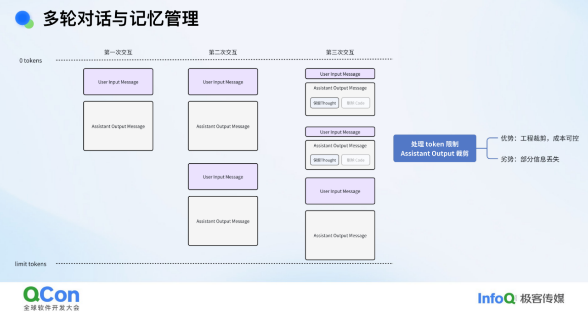

### Prompt Caching

关于如何降低成本，我们之前提到过大量的历史信息和 Prompt 文本信息。目前，大语言模型的各家厂商虽然在具体实现上存在一些细微差异，但大体逻辑是类似的，都提供了一种叫作Prompt Caching（提示词缓存） 的功能。这个功能会对 Prompt 进行完整的前缀匹配。

因此，在设计 Prompt 时，我们会尽可能将静态内容放在 Prompt 模板的前置部分。这样，如下图所示，在第二轮交互时，第一轮交互的内容可能会被缓存；到第三轮时，前两轮的内容也可能被缓存。不过，这张图展示的是一个极端理想的状态。我们知道，用户的输入以及当时的情况可能会导致数据不稳定，尤其是在真正超出上下文窗口时，工程上的一些裁剪操作可能会导致历史数据发生变化。

下图是一个极端理想的情况，即前置内容完全没有变更，且都是偏静态的内容，这样可以实现完全的缓存。这在设计时是需要大家仔细考虑的。目前，一般来说，启用缓存后，各家厂商的成本相比没有启用缓存时，通常可以降低到 1/10 的价格。这是一个我们可以操作且收益比较显著的优化点。

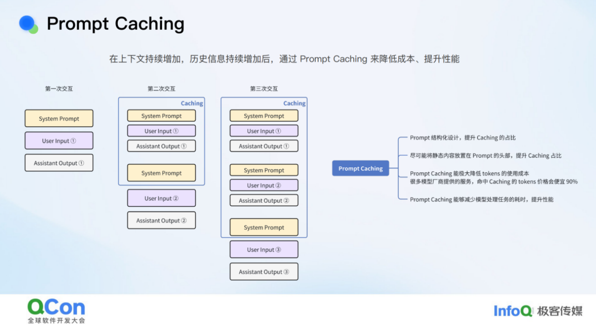

### Agent 与 IDE 系统集成

最后一部分我们来探讨一下 IDE 与 Agent 如何结合。IDE 会提供一系列工具集，其中前三个工具尤为重要：首先是文档文件的编辑工具，包括增删改查和搜索功能；其次是终端的编辑工具，这些工具在我们人工开发过程中也经常使用；第三是检索类工具，包括关键词检索和正则表达式检索。最后，还有项目的一些元信息，例如项目所使用的技术栈，这些信息可以通过扫描获取。

请看下图右侧，工作流部分显示 IDE 和工具执行分为两大模块：IDE 中的工具运行模块和 UI渲染模块。通过这种方式，我们可以将数据和界面完全分离，所有的主逻辑都在 Agent Server中控制，完全依赖数据驱动，因为与语言模型的交互主要就是数据交互。这种架构使得工具界面的渲染完全跟随数据结构，例如，如果某一天我们希望改变渲染卡片的颜色或布局，我们不需要修改 Agent Server 中的逻辑，因为界面渲染是基于数据结构动态生成的。

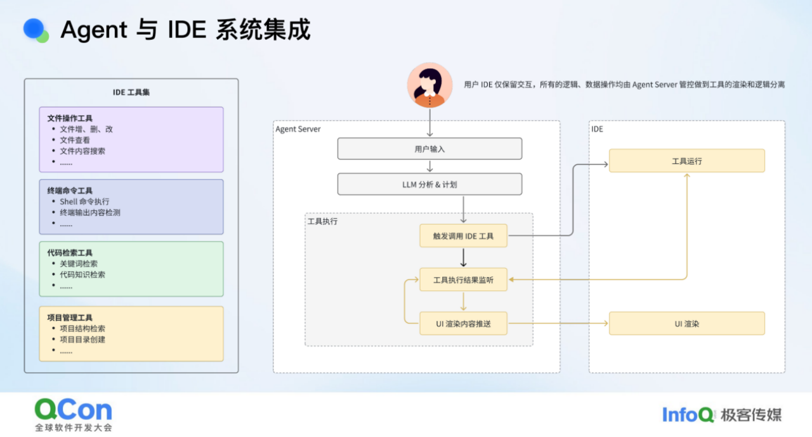

## 实践效果与案例分享

接下来我分享一个真实案例。我用自己写的一个小项目来说明，虽然它叫贪吃蛇，但可能和大家通常理解的版本不太一样。我们特意在这个项目中设计了一些测试场景，以验证场景的复杂度。

### 场景一：从 0 到 1 的创建

我们首先要求 Agent 帮助创建一个贪吃蛇游戏。这个要求非常简单，只是一条语句。Agent 帮我们实现了游戏的基本逻辑，使用 JavaScript 编写了游戏代码，并通过 HTML 进行渲染。同时，Agent 还启动了一个静态服务器来托管这个 HTML 文件，服务器是用 Python 实现的。

随后，我们进一步要求使用 Vite + Vue 技术栈来重构项目。Agent 能够很好地完成这个任务。它首先分析了当前项目的目录结构，然后重新初始化项目，使用 Vite 的方式重新构建，并安装了必要的依赖。接着，Agent 修改了代码，完成了项目的重构。

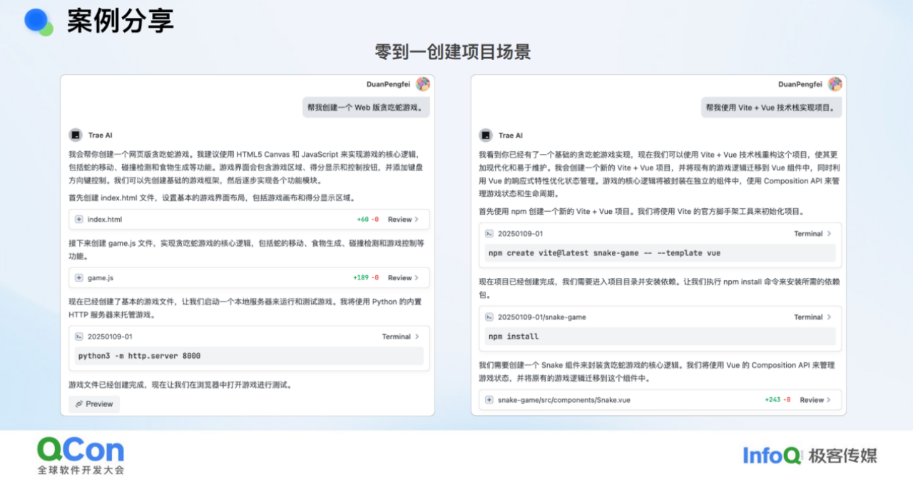

### 场景二：在已有项目中添加新功能

第二个典型场景是在已有项目中添加新功能。我们要求给贪吃蛇游戏增加一个爆炸粒子特效。对于前端开发人员来说，实现这样的特效可能需要花费一些时间，但 Agent 却能非常熟练地完成。它在短短两三分钟内修改了所有代码，并且完成了运行调试。

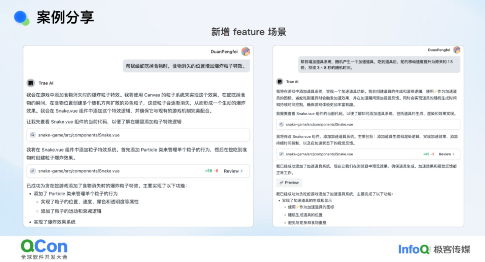

接着，我们又提出了一个更高级的需求：增加一个道具系统。道具系统涉及更多维度的碰撞检测和更复杂的倒计时逻辑。Agent 也很好地实现了这些功能，展现了其强大的能力。

### 场景三：修复错误

第三个场景展示了 Agent 并非总是完美无缺。在实际案例中，Agent 生成的代码确实出现了错误。我们把错误反馈给 Agent，并要求它修复。右侧图中展示的是在终端中启动构建时的错误日志。我们将这些日志提供给 Agent，它成功地修复了所有错误。

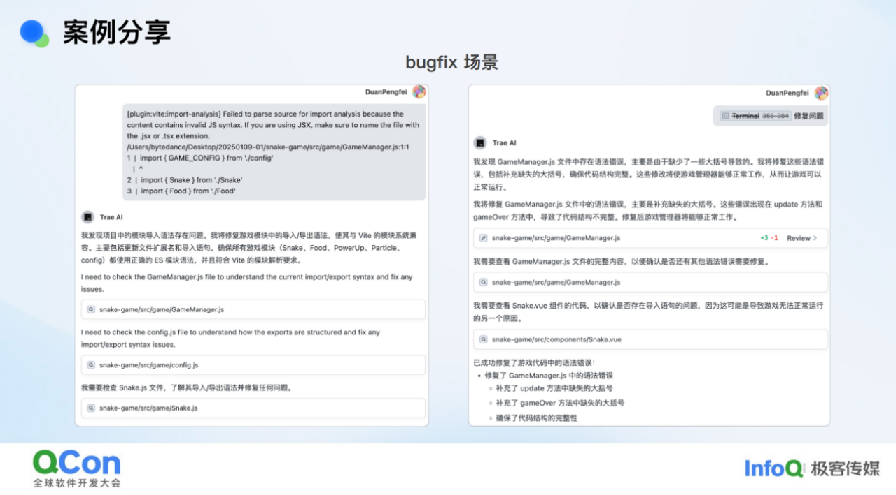

通过直观地观察 Agent 帮助我们创建的贪吃蛇游戏，我们发现道具系统和粒子碰撞检测都实现得相当不错。如果人工实现这样一个小游戏，可能需要花费半天甚至一天的时间，但 Agent 或结合大语言模型，可能只需要半小时到一小时，再加上一些细节调整。

以我自己为例，我完全不懂游戏开发，包括碰撞检测的具体实现。虽然贪吃蛇游戏本身很小，但其游戏逻辑、每一帧图像的绘制等，对我来说都是陌生的领域。然而，大语言模型帮助我们跨越了这些障碍，即使是不太了解相关领域的研发工程师，也能借助它开发出这样的小游戏。

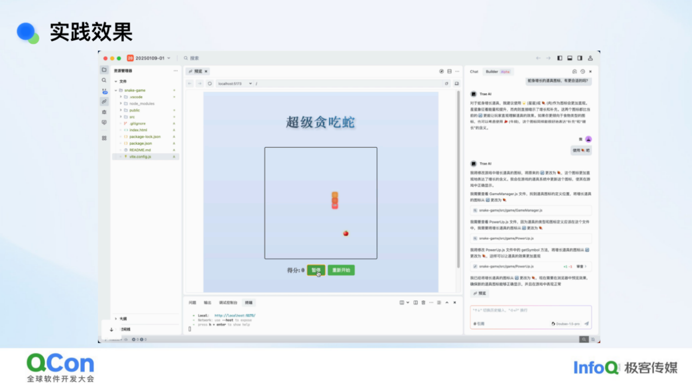

## 经验总结

### 模型生成内容的不确定性

在工程过程中，模型生成内容的不确定性是一个关键问题，主要分为两种情况：

内容格式不符合要求

有时模型输出的内容格式可能不符合我们的需求，导致工程与模型的衔接出现问题。例如，一些模型支持 function call 功能，直接以 JSON 或 YAML 格式输出。这种情况下，模型厂商通常会负责后处理。但如果模型不支持 function call，我们就需要回到原始的 Prompt 引导方式，明确告诉模型应该遵循什么样的 JSON schema 或 YAML schema 来输出内容。

然而，模型仍然可能输出错误的格式，尤其是 JSON 格式，容易出现括号、引号、冒号等格式异常。从工程角度来看，我们需要确保即使格式异常，也能正常执行工作流程，而不是直接中断 Agent 的工作流程。为此，我们可以实现一个类似于修复 JSON 的工具包，例如在GitHub 上可以找到许多类似 repair json 或 fix json 的库。这些库相对较新，说明这是一个普遍存在的问题，大家都在努力解决。

内容输出的不稳定性

即使模型输出的格式正确，其内容也可能存在不确定性。例如，要求模型实现一个贪吃蛇游戏，第一次可能采用单文件方式，第二次可能使用 Vite + Vue，第三次可能生成 Vite +React。由于 Agent 是为研发领域构建的，我们作为研发领域的工程师或专家，应该提供更明确的技术指引，例如在实现 Web 类游戏时，应该选择什么样的技术栈。这样可以确保模型的输出更加稳定，避免出现一会儿像专业工程师，一会儿又像入门小白的情况。

### 模型服务的稳定性和兼容问题

模型服务的稳定性也是一个重要问题。目前，模型供应商众多，模型种类繁多，我们在 IDE中为用户提供了选择不同模型的能力。然而，不同模型之间的稳定性以及不同供应商之间的稳定性差异较大。在大语言模型时代，尤其是在资源紧张的情况下，模型的成功率远未达到过去所说的 99.9%、99.99% 的水平，能够达到 99% 已经相当不错。因此，我们需要关注如何实现灵活的负载均衡，并建立统一的模型接入层，以提高系统的健壮性和稳定性。只有这样，大语言模型在工程上的落地才是可行的，而不仅仅是一个玩具或演示项目。

### Prompt 调试

Prompt 的设计和调试是一个需要特别关注的环节。由于模型输出存在不确定性，我们需要通过大量的数据积累或 A/B 实验来验证 Prompt 的效果。此外，不同模型的训练数据和特性不同，很难设计出一个适用于所有模型的通用 Prompt。尤其是在为用户提供多种模型选择时，我们需要考虑如何让 Prompt 更好地贴合每个模型的特性及其训练数据，从而获得更好的效果。在实际应用中，可能只需要调整一两个词或稍微改变 Prompt 的组织结构，就能在不同模型上取得更好的效果。

## 未来展望

我大致从四个方向来思考未来的发展。

1. 认知增强

目前的 Agent 仍处于早期形态，可以将其类比为一个实习生。我们发现这个“实习生”在某些场景下可能无法做到完全符合预期（比如达到 80 分），当它无法完成任务时，我们可能需要人工接手。但我们的期望是，Agent 的认知和领域知识能够不断增强，甚至超越人类。这里的领域知识不仅仅是知识的积累，而是能够将这些知识组合起来，形成某一领域的最佳实践。当Agent 能够做到这一点时，我们就会感受到它的成长，从一个初级开发者逐渐变成一个有 1 到3 年经验的开发者，甚至最终成为一个资深开发者。

目前，多模态已经在一些场景中得到应用，例如 Trae IDE 中的 Agent 也支持多模态，但更多地是处理图片类内容，这对于前端或客户端开发者较为友好，比如可以通过设计稿截图来还原内容。然而，我所期望的多模态不仅仅是图片，还包括 PPT、音频、视频，甚至是结构化的数据（尽管它们仍然是文本文件，但更偏向于结构化数据）。如果 Agent 能够更好地结合和理解这些不同类型的内容，其效果将会更好。此外，深度推理能力也是未来的一个发展方向，我们期望这些能力能够落地到 Agent 的工程实践中，并最终体现在产品形态上，为用户提供更好的服务。

2. 工具整合与扩展

目前，IDE 为 Agent 提供了一些默认工具。随着 MCP 协议的逐步推广，各家厂商也开始支持这一协议，这为工具的扩展提供了更多可能性。进一步来说，在人与 AI 的交互过程中，是否可以自定义一些工具，甚至与物理世界进行交互？这种物理世界的交互可能涉及物联网（IoT），甚至人形机器人等，这将是未来 Agent 需要探索的一个方向。

3. 集体智能与多 Agent 协作

集体智能更多地体现在协作上，即多 Agent 的协作。在这种情况下，Agent 的角色和领域将更加专业化。目前，我们期望一个 Agent 能够胜任所有领域的工作，例如在编程领域，既能做前端，又能做后端，还能做客户端和嵌入式开发，但现阶段这并不现实。因此，未来可能更多地会按领域进行专业化分工，就像工程师有各自的专业领域一样。在这种情况下，我们需要更多地考虑多 Agent 协作的方式。最近，Google 发布了 Agent-to-Agent 协议，这表明业界也在探索这一技术领域的演进。

4. 自主性提升

这是一个更长远的方向，期望 Agent 能够自主规划以解决复杂问题。目前，一些产品（如Devin）已经聚焦于解决复杂任务和长耗时问题。此外，Agent 如果具备了自主决策和解决问题的能力，是否也能自己构建缺失的工具？例如，IDE 提供的工具可能不够用，MCP 协议提供的工具也可能不足，Agent 是否能够自己创造工具并持续自我完善？这可能标志着 AI 的自我滚动发展，人类参与的比例可能会进一步降低。

此外，还有一个深度研究的方向是，目前大语言模型对用户需求的响应主要基于其训练数据，或者我们提供的辅助工具（如互联网搜索补充的信息）。如果上下文中没有提供相应的指导，同时其训练数据中也没有相关内容，那么它如何解决这种未知问题，更好地应对复杂问题，这也是未来需要探索的方向。
