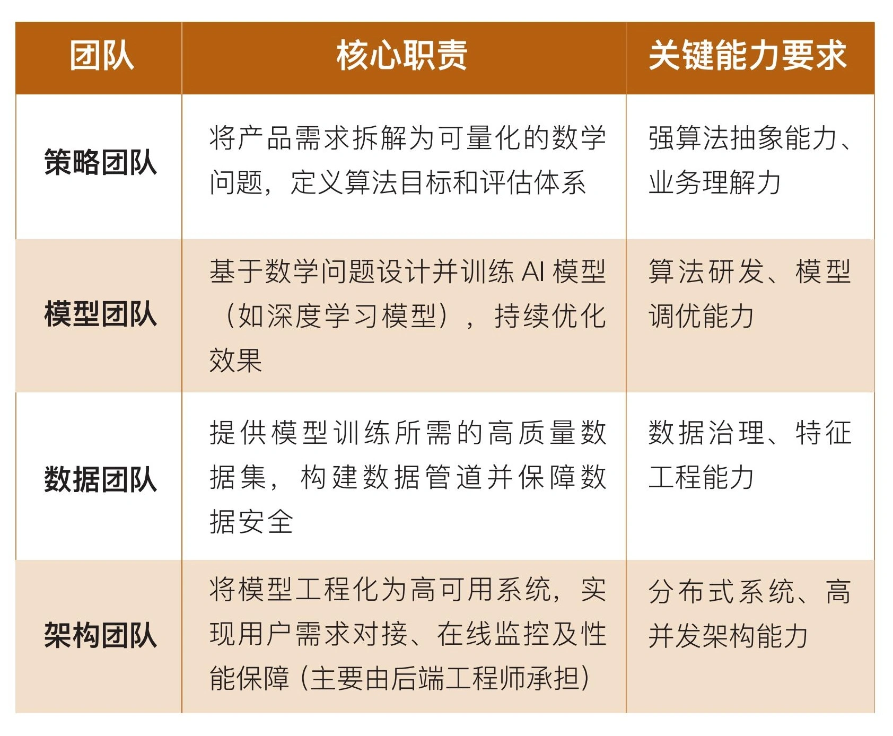

# Q29 | AI团队：岗位划分以及配合？

- 作者介绍：Tyler，前亚马逊应用科学家，头部大厂 AIGC 算法技术负责人鲁四喜，某大厂金融科技创新业务质量负责人裴雷，东亚中国首席数据分析师兼创新中心总经理孙源青，华泰证券人力资源部副总经理

Q：一家公司在组建 AI 团队时，会划分哪些核心岗位？每个岗位主要负责哪部分工作？岗位之间是如何相互配合的？

Tyler：AI 系统的设计和落地是一个大军团作战的过程。在大厂里，这个工作已经分得非常的细了，会有策略团队、模型团队、数据团队、架构团队这四个团队。

策略团队是先把这个产品需求的问题去拆解成一个数学问题，这个过程是对算法功底要求比较高的。之后就需要把数学问题转化成工程问题，这就是我们后端工程师的天下了，这个没有人会比后端工程师做得更好。比如说怎么去保证整个系统的高可用，怎么去满足用户的需求，怎么去做一个良好的在线的监控，这些都是我们后端工程师非常擅长的工作。之后，在系统上线之前我们还需要去训练一个模型，而训练模型的工作更多的是有算法背景的同学去做。

鲁四喜：我之前从事 AI 算法测试时，将关键角色分为以下几类：

- 产品角色：需明确产品定位与交互设计，同时具备 AI 思维

- AI 算法角色：负责模型设计及调优工作

- 开发工程师团队：需基本了解算法与 LLM，清楚 LLM 的能力边界

- 测试团队：从工程、数据、算法三个维度开展测试工作。其中 60%-70% 的时间用于算法测试，需进行样本采集、设计各类 bad case 与场景，以排查算法漏洞，因此耗时较长。

裴雷：AI 算法工程师负责研究、开发和优化应用于金融业务的 AI 算法，如信用风险评估模型、智能客服对话算法等。需运用机器学习、深度学习算法处理金融数据，通过数据分析挖掘潜在规律，为业务决策提供支持。

数据分析师承担金融数据的收集、整理、清洗和分析工作。从海量金融交易数据、客户信息数据中提取有价值信息，为 AI 模型训练提供高质量数据，同时通过数据分析洞察业务趋势，为AI 项目提供数据驱动的决策依据。

AI 开发工程师专注于将 AI 算法和模型集成到银行的业务系统中，实现 AI 应用的开发和部署。像开发智能营销系统、智能风控系统等，确保 AI 应用在银行实际业务场景中稳定运行，并与现有银行系统进行有效对接。

AI 产品经理负责规划和管理银行的 AI 产品，结合金融业务需求和市场趋势，确定 AI 产品的功能特性、发展方向和迭代计划。协调研发、算法、数据分析等团队，推动 AI 产品从概念到上线的全流程工作， 保障产品满足用户需求和业务目标。

孙源青：核心岗位包括产品经理、内容分析师、AI 算法工程师、开发工程师（前端、后端）、测试工程师等等。

产品经理主要负责 AI 产品的功能设计与整体规划，协调各方资源推动产品从概念到落地的全过程，把握产品方向与市场竞争力。

内容分析师承担内容标注工作，依据 AI 模型需求，精准标注各类数据，为模型训练提供高质量、贴合需求的“教材”，提升模型对数据的理解与学习效果。

AI 算法工程师专注于模型训练，运用前沿算法与海量数据，不断优化模型的性能与准确性，使其能够高效处理复杂任务并输出可靠结果，同时探索创新算法以突破技术瓶颈。

开发工程师（前端、后端）负责 AI 产品的工程实现，前端工程师打造直观、流畅的用户操作界面，提升用户体验；后端工程师构建稳定、高效的服务器架构，保障产品在复杂场景下的运行稳定性与响应速度。

测试工程师开展模型评测工作，通过设计多样化的测试用例与场景，全面评估 AI 模型及产品在功能、性能、兼容性等方面的优劣，及时发现并反馈问题，为产品质量保驾护航。
