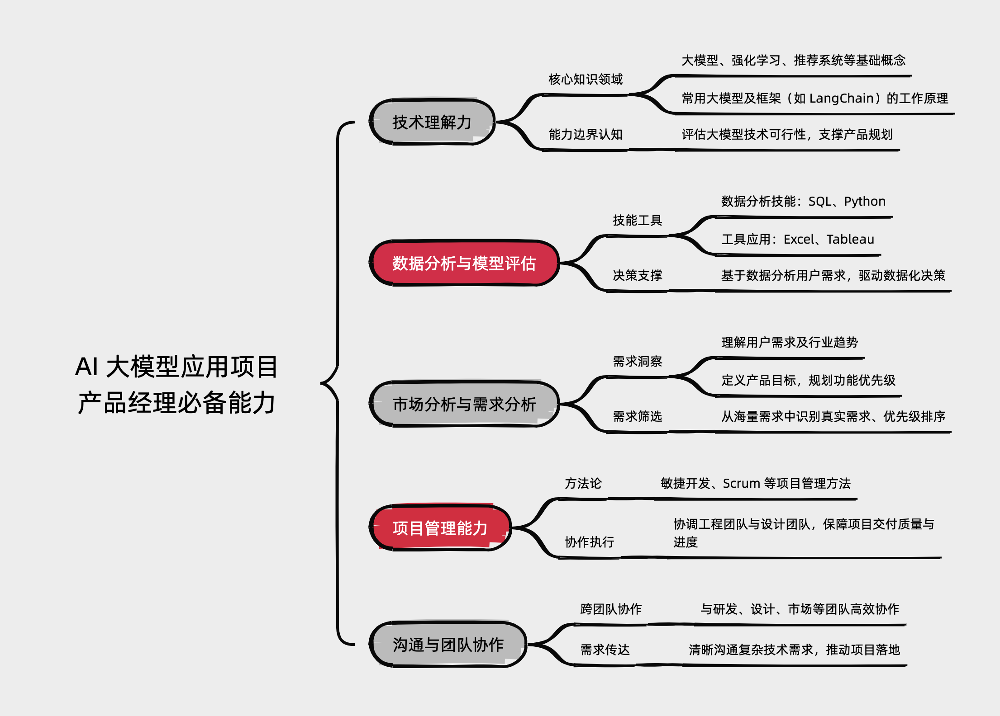

# Q43 | 跨界：AI大模型应用项目的产品经理必备能力

- 作者介绍：彭靖田，Google Developers Expert，《深入理解 TensorFlow》作者

- Simon，米可世界 AI Lab 负责人

- 裴雷，东亚中国首席数据分析师兼创新中心总经理

- 孙源青，华泰证券人力资源部副总经理

Q：企业在招聘 AI 产品经理时，看重哪方面的能力和经验？如果想成为一个 AI 大模型应用项目的产品经理，应该培养哪些方面的能力？

彭靖田：通常来说，产品经理的要求是比较高的，你需要掌握的能力也是多方面的，需要的不仅仅是技术方面的能力。具体来说，我觉得下面几点是比较最重要的。

a. 技术理解力：学习和理解大模型、强化学习、推荐系统等基础概念，特别是常用大模型和框架（如 LangChain）的工作原理。了解大模型的能力边界，这样你才能更好地评估技术可行性，从而制定合理的产品规划。

b. 数据分析与模型评估：掌握数据分析的基本技能，如 SQL 和 Python，可以使用数据分析工具（如 Excel、Tableau）来理解用户需求和数据驱动的决策。

c. 市场分析与需求分析：理解用户需求和行业趋势，能够清晰定义产品目标，规划功能优先级，保证 Agents 系统能切实满足客户的需求。当海量的需求从前线提过来的时候，你能够通过你的认知，包括你的分析能力去理解哪些是真实的需求，哪些是优先级低的需求，哪些是不需要去响应的需求，这对产品经理来说也是非常重要的。

d. 项目管理能力：掌握敏捷开发、Scrum 等项目管理方法，协调工程团队和设计团队，确保项目按时高质量交付。

e. 沟通与团队协作：能够有效沟通复杂的技术需求，与研发、设计、市场等团队紧密协作，推动项目顺利进行。

短期来看，其实我不建议大家把自己的第一份工作定位为产品经理， 因为在经济上行的时候，所有的团队都想要投资源做事情，所以会有很多产品经理这个岗位的招聘需求。但是当经济下行的时候，你会发现，产品经理的岗位需求是非常少的，因为没有那么多新项目要做了。但是，如果你第一份岗位是技术类的岗位，你可以从工程师的视角去理解研发团队是怎么样去工作的，以及产品实现过程中有哪些各种各样的难点和细节，这些对于你未来想要去转型做产品经理会更好，这个是我的一个建议。

Simon：AI 产品经理和任何产品经理一样，最重要的基本功是产品能力，也就是用户需求的理解力，并且把用户需求翻译成研发人员可落地的、体验好的产品需求文档的能力，包括与相关的研发人员做沟通、协调好需要的资源和跟进结果交付的能力。

除此之外，对于 AI 产品经理，我们还会比较看重大家对于技术的基础理解力，包括技术当前发展到什么阶段了、什么能实现什么不能实现、实现起来会有什么坑或者障碍等等，都有一定的理解。还有就是学习能力，包括学习英文材料的能力，以及较好的从互联网上获取新动向、新信息的能力，能够发现新的好玩的、有用的技术，用到我们的产品里。最后是数据隐私和版权、相关法律法规的敏感度。

对于更高阶的 AI 产品经理，我们会希望大家能够关注硬件和 AI 技术的发展趋势，对于产业未来的技术发展方向、成本变化趋势、资源 丰富程度，都要有一定的判断。

裴雷：能力方面，具备较强的金融业务理解能力，深入了解银行的各类业务流程和客户需求；掌握 AI 技术基础知识，如机器学习、深度学习的基本概念和应用场景；拥有出色的数据分析能力，能通过数据洞察用户需求和产品问题；具备良好的项目管理能力，确保 AI 产品按时交付和迭代；要有优秀的沟通协作能力，协调跨部门团队推进项目。

经验方面，有金融行业产品管理经验，尤其是在 AI 相关产品（如智能投顾、智能客服产品）的规划和管理方面有成功案例；参与过从 产品需求调研、设计到上线运营的全流程项目经验，熟悉敏捷开发流程。

孙源青：我们认为，AI 产品经理的以下能力非常重要。

技术理解能力：需要掌握 AI 技术原理，如机器学习、深度学习、自然语言处理等，熟悉大模型架构、训练与优化方法，了解数据标注、模型训练等流程，能准确把握技术发展方向并合理运用解决实际问题。

业务场景落地能力：要求深入了解业务，具备敏锐业务洞察力，挖掘业务中的 AI 应用场景，将 AI 技术与业务需求深度融合，为业务创造价值，如在证券领域发现投研、风险管理等环节的可应用 AI 的点。

产品规划与设计能力：需制定清晰产品路线图和策略，明确产品功能、特性及优先级，输出高质量产品文档和原型，依据市场和用户调研，规划产品演进路径。

数据思维与分析能力：要具备数据敏感度，运用数据分析工具，深入分析业务数据和用户行为数据，为产品决策提供依据，通过数据评估产品效果，及时调整优化。

行业洞察与市场前瞻能力：关注 AI 行业动态和技术趋势，研究竞争对手产品，预判市场变化，提前布局产品方向；拥有创新思维和探索精神，尝试新的 AI 技术和应用模式，为公司带来新增长机会。

持续学习与沟通能力：因 AI 领域技术更新快，需有持续学习能力，掌握前沿技术；具备良好英语能力，阅读英文文献，了解国外最新技术和产品信息。
