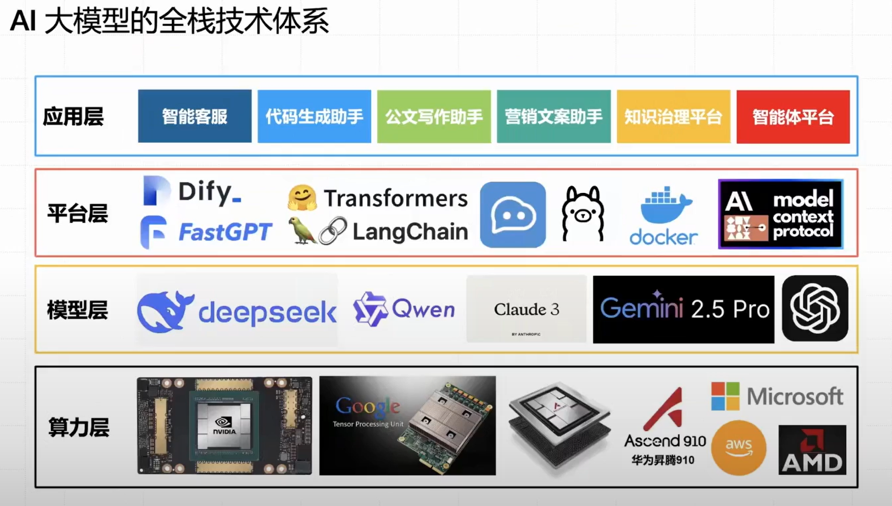

# Q51 | 技术体系：AI全栈工程师的学习路径

- 作者介绍：彭靖田，Google Developers Expert 《深入理解 TensorFlow》作者

Q：一个 AI 全栈工程师的学习路径应该是什么样的？

彭靖田：一个全栈的 AI 工程师需要掌握的技术，至少可以分成四层——应用、 平台、模型、硬件。

应用层：如上图所示 6 个常见实践场景，但也有一些企业内部的一些其他类型的应用。

平台层：有新的技术体系出来的时候，我们都可以去关注。比如，我认为 2025 年到 2030 年应该会有更多的人进入到 AI 大模型的这个赛道，所以 Dify 这种对基础门槛要求更低的技术，用拖拉拽的方式去完成 Agent 的搭建，是需要大家去了解和掌握的，包括 Dify 如何私有化部署。再比如，在国内，为了做好智能客服，我们要能够在微信生态、钉钉生态、企微生态、飞书生态等去做各种各样的客服机器人，那 LangBot 也是一个不错的项目，并且它也支持Dify。MCP 这个最近很热的一个协议。这些一个个出现的时候，我们都可以学习。

模型层：哪个大模型走的比较前沿？有哪些新的框架（比如 MoE 架构）？训练方法？DeepSeek 最新的论文你有没有了解过？如果你想在 AI 大模型这个领域按 5-10 年的发展做自己的长期规划，以后要做到技术负责人的话，这些都是你需要了解的。

算力层就不单独展开说了。

当然，这四层只是 AI 全栈技术的四层体系，要想成为技术负责人，那就不只是说纯技术的部分应该怎样去做，还得会资源协调、企业内部 AI 团队的人才组织，成为“懂原理，会落地”的复合型人才。
