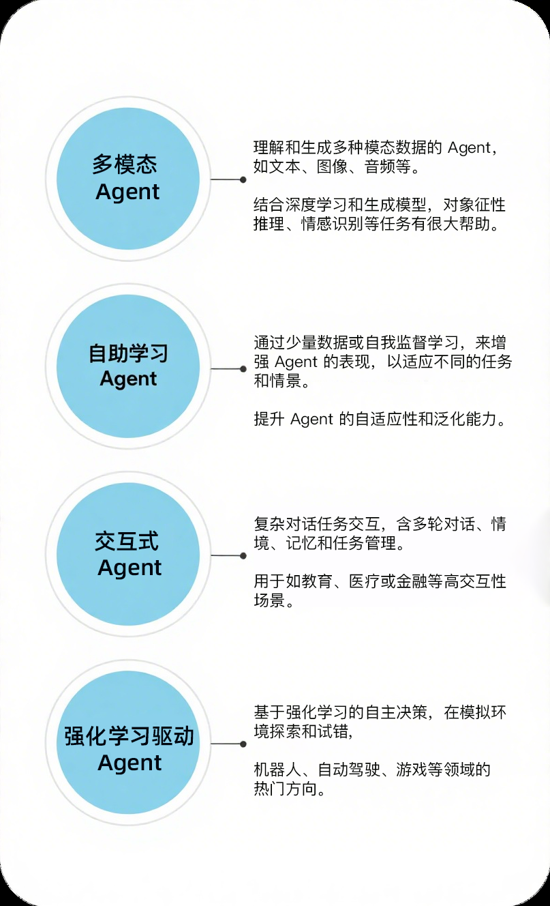

# Q55 | 科研：如何选择Agent相关的研究方向？

- 作者介绍：黄佳，新加坡科研局资深研发工程师

Q：如果要做科研，可以如何选择 Agent 相关的研究方向？

首先要说明，这个问题取决于你在国内还是国外做科研，以及你是在硕士阶段还是博士阶段。不同的情况下的答案也是完全不一样的。

如果你只读到硕士的话，更重要的是要多花时间去学习一些实际的技能，因为你最终是要投身到产业界的。这里列出一些比较热门的方向：

1. 多模态 Agent：研究能够理解和生成多种模态数据的 Agent，如文本、图像、音频等。这类研究可以结合深度学习和生成模型，对象征性推理、情感识别等任务有很大帮助。

2. 自主学习 Agent：探索通过少量数据或自我监督学习来增强 Agent 的表现，以适应不同的任务和情景，这方面的研究可以帮助提升 Agent 的自适应性和泛化能力。这是目前难度最高的一类 Agent。

3. 交互式 Agent：研究在复杂对话和任务中与人类进行交互的 Agent，包括多轮对话、情境记忆和任务管理。应用于如教育、医疗或金融等需要较高交互性的场景。

4. 强化学习驱动的 Agent：基于强化学习（RL）的自主决策 Agent 可以在模拟环境中通过探索和试错来学习复杂行为，是机器人、自动驾驶、游戏等领域的热门方向。

如果是读博士的话，其实并不推荐去研究 Agent，而是应该研究一些更底层的东西。
