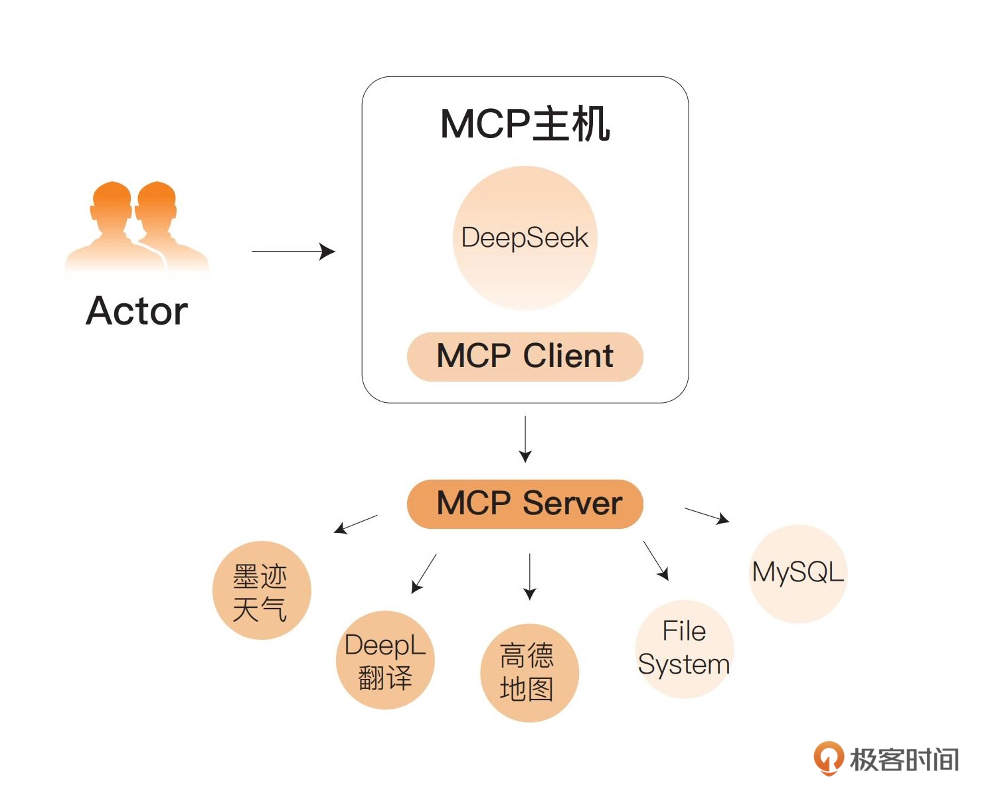
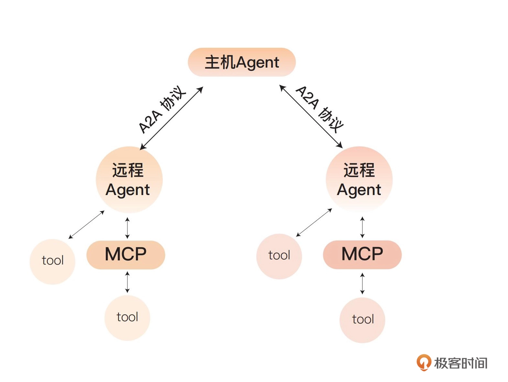

# Q5 | 洞察：MCP、A2A解决了什么问题？

- 作者介绍：邢云阳，某大厂 AI 与容器技术专家

Q：最近，MCP、A2A 等协议引起了用户的激烈讨论，这两类协议分别解决了什么问题？

（注：以下内容截取自极客时间专栏《DeepSeek 应用开发实战》）

邢云阳：Agent 最牛的是能够通过调用工具实现大模型与外界环境的交互，让大模型不再“闭关锁国”。Agent 在 2024 年得到了人们广泛认可，发展得十分迅速，现在已经成了 AI 应用开发的必备技术了。

去年下半年，Anthropic（Claude 模型的母公司）推出了模型上下文协议 MCP，该协议旨在统一大型语言模型（LLM）与外部数据源和工具之间的通信协议。MCP 主要是为了解决当前 AI模型因数据孤岛限制，无法充分发挥潜力的难题，MCP 使得 AI 应用能够安全地访问和操作本地及远程数据，为 AI 应用提供了连接万物的接口。这个协议在社区发展得非常好，现在已经有很多 AI 应用或框架，比如 Spring AI 等接入了 MCP，也有很多开发者为其贡献了 MCPServer。

MCP 采用的是经典的客户端 - 服务器架构，我首先需要介绍几个概念。

- MCP 主机（MCP Hosts）：发起请求的 LLM 应用程序（例如 Claude Desktop、IDE 或 AI工具）。

- MCP 客户端（MCP Clients）：在主机程序内部，与 MCP Server 保持 1:1 的连接。

- MCP 服务器（MCP Servers）：为 MCP Client 提供上下文、工具和 prompt 信息。

- 本地资源（Local Resources）：本地计算机中可供 MCP Server 安全访问的资源（例如文件、数据库）。

- 远程资源（Remote Resources）：MCP Server 可以连接到的远程资源（例如通过 API）。

看名称就知道，A2A 是一个与 Agent 有关的协议，对于各路人马创建的 Agent，A2A 提供了一种统一的封装方式。这样一来，不同来源的 Agent 能够实现互相调用，从而打破彼此之间的隔阂，避免 Agent 成为孤立的“信息孤岛”，这对推动 Agent 之间的协同合作与生态发展很有价值。

如上图中，Agent 分为主机 Agent 与远程 Agent。其中主机 Agent 仅负责管理与分发，而远程Agent 则是具体处理业务的 Agent，比如体育助手 Agent 等。

每一个独立的远程 Agent 都可以调用自身的工具，调用方式既可以是传统的函数调用，也可以通过 MCP 实现；多个远程 Agent 可以使用 A2A 协议，通过一个主机 Agent 进行管理。

为何需要一个主机 Agent 管理多个 Agent 呢？

曾有读者提出疑问：如果为 Agent 提供一万个工具，它是否能够有效选择并使用？

对此， 我的回答是否定的。

在互联网时代，设计 API 时通常会对其进行分组管理，例如 /v1/user/xxx 和 /v1/prod/xxx 等路径划分了不同的功能模块。进入 AI 时代后，我们同样不应期望 Agent 成为一个无所不包的“全能管家”，而应使其专注于特定领域的能力构建。因此，赋予 Agent 的工具也应限定于其专业领域内的若干个（如几个或几十个）核心工具。

以图中为例，左侧的远程 Agent 可以是一个体育助手，集成了“懂球帝”相关功能；右侧的远程Agent 则可以是一个地图助手，具备高德地图的查询能力。若没有 A2A 协议，这两个远程Agent 将各自独立、无法协同；而有了 A2A 协议之后，当用户向主机 Agent 提问“今晚的 XX比赛的比赛地点附近是否有烧烤店？”时，主机 Agent 会先调用左侧体育助手 Agent 查询出XX 比赛的比赛地点在哪？之后调用右侧的高德地图 Agent 查询比赛地点附近有哪些烧烤店，从而实现这样一个看似简单实则包含多个领域的用户提问，这便是各 Agent 遵循统一协议、实现标准化所带来的协作优势。

综上所述，A2A 所解决的核心问题是 Agent 如何进行标准化封装，从而实现多 Agent 协同工作的能力，其抽象层级高于 MCP，二者构成了互补性的协议体系。
