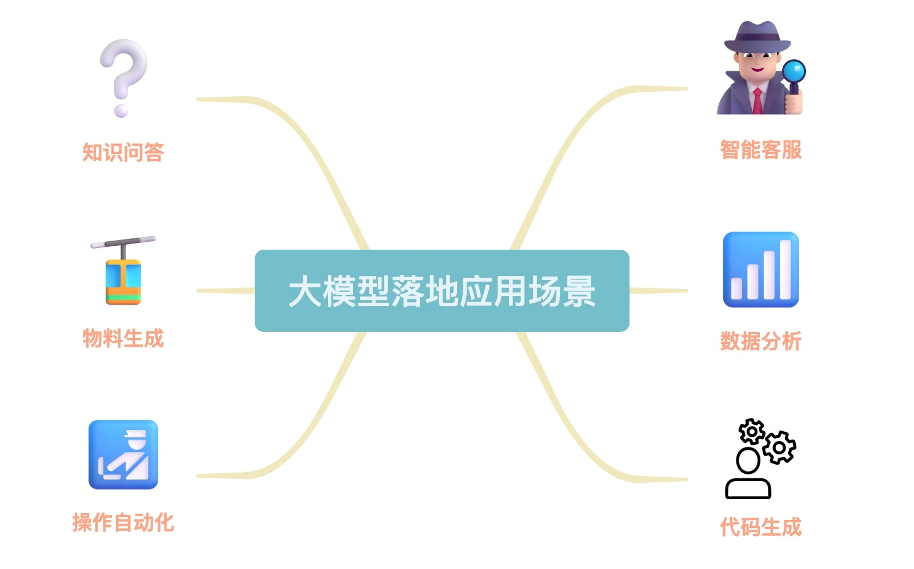

# Q68 | AI落地：企业如何有效选择合适的场景？

Q：在 AI 技术落地过程中，企业如何有效选择合适的场景？

InfoQ：具体来说，在新兴技术的发展初期，企业可以容忍短期低回报率，鼓励内部试点与概念验证（POC）。

到了应用落地阶段，核心就是要围绕“价值导向”做判断。不同于追求技术前沿，企业更看重短期内能否产生实效，尤其对于成熟技术来说，要看在六个月到一年半内的时间里能否得到可量化的投资回报，尤其如果在前六个月产生效果会被特别重视，这类项目要占到 80%，超长周期项目则谨慎推进。

落地过程中，企业会明确用户体验红线：禁止将用户视为“小白鼠”。所有正式上线应用需严格满足以下指标：业务侧，提升效率或数据质量的可量化验证；技术侧，Token 响应速度、系统稳定性等硬性标准；体验底线：避免用户感知为“人工智障”。

下面是当前大模型落地中，常见的相对成熟的应用场景。这些场景背后有三个共性：重复性强、具备一定创意需求和范式可沉淀，这决定了其最为适合用大模型或 Agent 切入，并尽早产出价值。

- 知识问答。很多企业以聊天机器人的形态引入大模型，有的直接接入大模型，有的则在此基础上融合内部知识库，构建更符合企业需求的问答系统，这类场景尤其在大型企业中率先落地。

- 智能客服。真正用大模型去完全替代传统基于规则的技术来做智能客服，效果比以前好很多，这个场景相对成熟。

- 物料生成。涉及多模态能力的应用，包括文生图、文生视频等。许多电商企业需要制作大量SKU 图文内容，现在基本用 AI 完成，人力只负责流程管理和后期修正。这个场景已经相对成熟。

- 数据分析。企业对数据分析的需求越来越多样，小型公司可能用 chat-Excel 这类工具应对轻量级需求（比如 100 个表以内的数据），而企业级用户则更依赖 Data Agent 类产品。该场景的核心是数仓治理、指标治理和口径规范性，否则难以支持上层应用。

- 操作自动化。可以看作是传统 RPA 的升级版，可以在其中加入 planning 的能力，向行业Agent 演进。这一类的 Agent 不是简单的流程自动化，而是具备一定决策能力的智能代理。

- 代码生成。代码补全是较为成功的应用。但在企业看来，20%~30% 的 AI 代码贡献率并不是很理想，因为开发人员每天真正写代码的时间可能也只有 20%~30%，大部分时间用在沟通、需求理解等方面。另外，Cursor 等在跨职能协作场景中应用效果较好，但还难以用在核心业务领域中。

对于企业来说，AI 应用并不是要做“替代”，而是用来优化日常运营体系的方式，从流程自动化到交互智能化，都是企业效率升级的重要路径。
