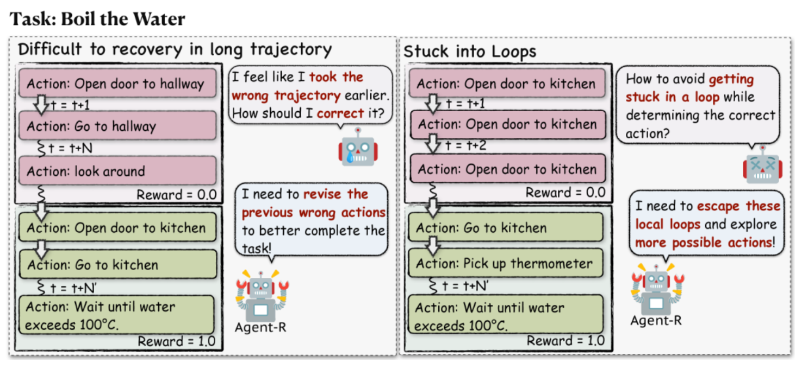

# Q6 | Agent：当前发展还存在哪些问题？

- 作者介绍：向邦宇，阿里巴巴代码平台负责人

Q：智能体当前发展还存在哪些问题？这些问题会随着开源模型的进步而消失吗？

(注：以下内容截取自向邦宇的文章《从“人驱动”到“模型驱动”：聊聊 Agent 在 2025 年的爆发与挑战》，若有异议，请以文章内容为准）

向邦宇：Agent 存在的挑战不仅仅是一次性就把事情做好，而是在一个长链路任务下需要具备反思的能力。

- 图片来源网络

- Agent 难以从错误的长轨迹中恢复（Difficult to recovery in long trajectory）

- 在任务执行过程中，智能体可能选择了错误的动作序列，导致偏离正确轨迹智能体需要回顾并修正之前的错误动作，以完成任务

- 图中左侧展示了智能体在错误轨迹中浪费时间（例如开错门、走错路径），最终未能获得奖励

- Agent 也容易陷入局部循环（Stuck into Loops）

- 智能体可能在某些状态中反复执行相同的动作，陷入局部循环，无法探索新的可能性

- 图中右侧展示了智能体重复执行“打开厨房门”的动作，未能有效推进任务

- 智能体需要跳出局部循环，探索更多可能的动作以完成任务

问题会随着开源模型的进步而消失吗？

在之前，训练过程中通过计算 Loss 来降低梯度，从而提升模型效果。这种点对点的模型能力提升，在过去的打榜或 ChatBot 等产品形态中确实取得了巨大成功。然而，在 Agent 场景下，以往极致地优化局部最优解并不一定能成为全局最优解。例如，一个多步骤任务从 a 到b 再到 c 和 d，虽然每一步都是最优的，但对于整个任务而言，a 直接到 d 可能才是最优路径。过去的经验表明，无论国外模型发布何种新功能，国内的开源模型总能迅速跟进，这一次是否依然能够顺利实现呢？

另一个问题是，Claude 作为一个断档级别的存在，其优秀之处远不止于编写代码的能力，它在几乎所有能力上都处于领先地位。近期与许多同行交流后发现，大家似乎尚未充分认识到这一点，在如何使我们的模型在指令遵循、长上下文理解、规划及反思等方面达到 Agent 能使用的水平的问题上毫无头绪。究竟是由于其基础能力强大且数据质量较高所致，还是采用了某些特殊的训练方法或标注手段使其具备如此强大的能力，目前外界对此一无所知。要知道，Claude 3.5 Sonnet 已经是在去年六月发布的，这是令人比较担心的。
