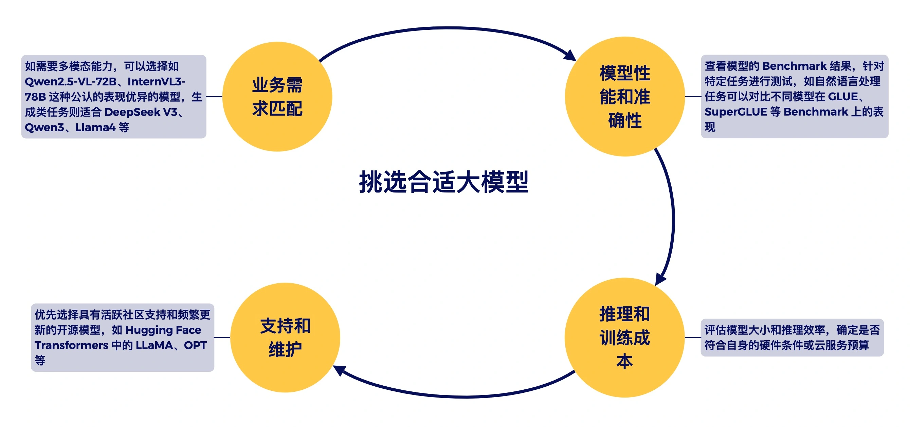

# Q72 | 选型：如何根据业务评估开源大模型性能？

- 作者介绍：彭靖田，Google Developers Expert

Q：开源大模型很多，如何根据自身业务评估各个开源大模型的性能，挑选出合适的大模型呢？

彭靖田：

业务需求匹配：如需要多模态能力，可以选择如 CLIP 或 Gopher 类的模型，生成类任务则适合 GPT、OPT。

模型性能和准确性：查看模型的 Benchmark 结果，针对特定任务进行测试，如自然语言处理任务可以对比不同模型在 GLUE、 SuperGLUE 等 Benchmark 上的表现。

推理和训练成本：评估模型大小和推理效率，确定是否符合自身的硬件条件或云服务预算。

支持和维护：优先选择具有活跃社区支持和频繁更新的开源模型，如 Hugging FaceTransformers 中的 LLaMA、OPT 等。
