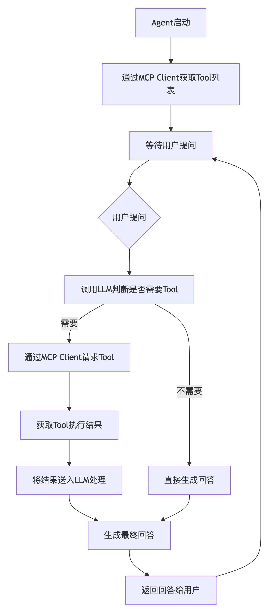

# Q81 | 对接：Agent如何对接MCP服务端？

- 作者介绍：彭靖田，Google Developers Expert

Q：Agent 如何对接 MCP 服务端（不是 stdio）？

彭靖田：Agent 需要一个 MCP Client 对接 MCP 服务端（这是标准的 Agent-MCP 工程化接入方式），完整请求流程如下：

1. Agent 启动时，通过 MCP Client 获取 tool 列表；

2. 用户提问，Agent 调用 LLM 判断是否需调用 tool；

3. 如果需要，Agent 通过 MCP client 请求 tool；

4. 获取结果后再次送入 LLM 完成回答；

5. 最终返回给用户。

