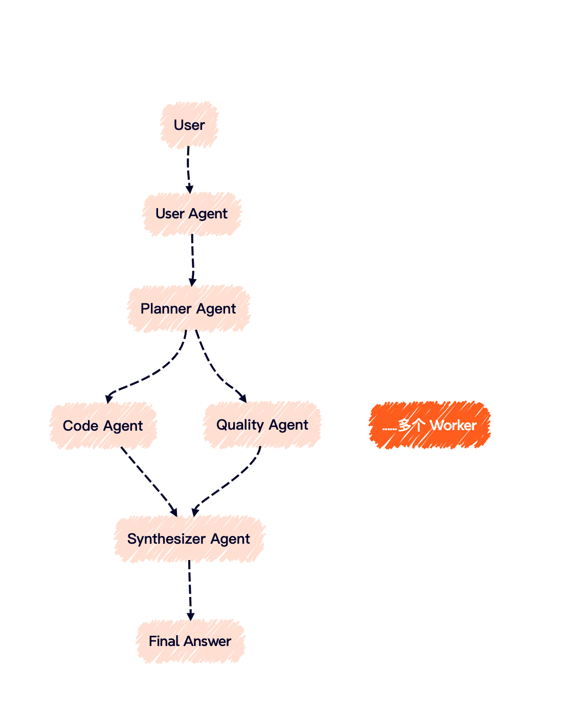

# Q83 | 架构：如何设计多Agent架构？

- 作者介绍：彭靖田，Google Developers Expert

Q：如何设计多 Agent 架构？

彭靖田：多 Agent 架构设计核心在于任务分工、消息调度、上下文管理。这里推荐一个简洁清晰的五步设计模板：

1. 确定 Agent 类型（按职责分工）a. 用户代理：接收用户请求

- b. 规划 Agent：任务分解与分配

- c. 专家 Agent：领域任务执行

- d. 总结 Agent：结果整合输出

2. 定义 Agent 间通信机制a. 顺序协作：线性流程调用

- b. 协商协作：自主讨论投票

- c. 调度器协调：中控路由管理

3. 共享上下文管理a. 状态记录：任务状态 / 工具结果

- b. 历史压缩：摘要防上下文污染

4. 任务分配策略a. 静态路由：基于关键词分配

- b. 动态规划：LLM 实时决策分配

5. 执行与容错机制a. 重试机制：单 Agent 容错

- b. 输出验证：结果完整性校验

框架推荐

- AutoGen（强协作流程）

- CrewAI（轻量 Agent 协作）

- LangGraph（灵活、强状态管理、适合自定义）
