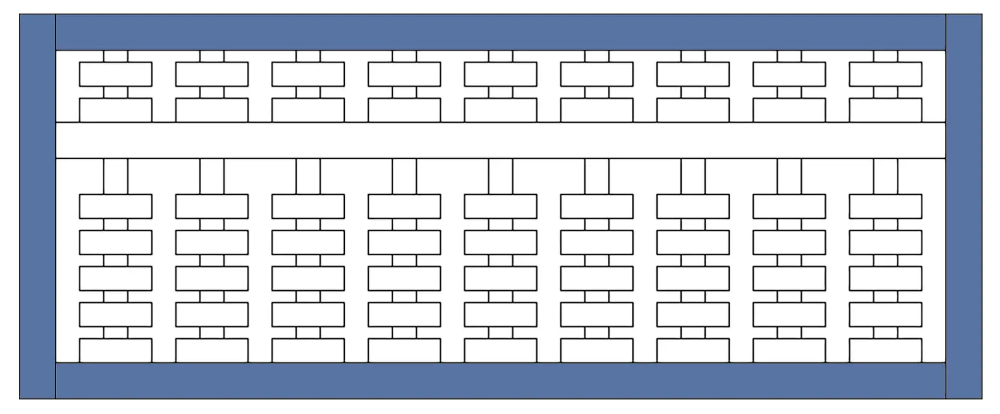
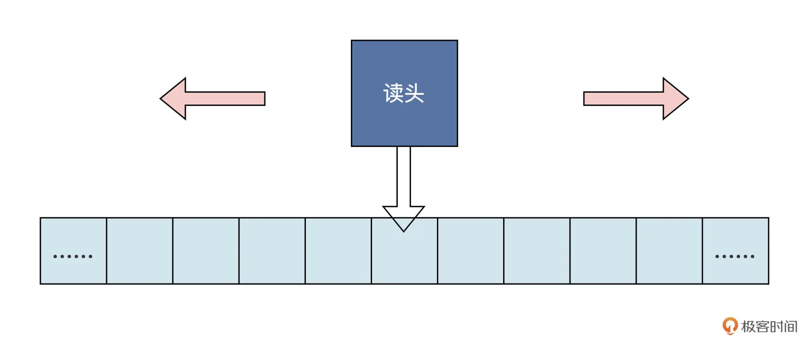
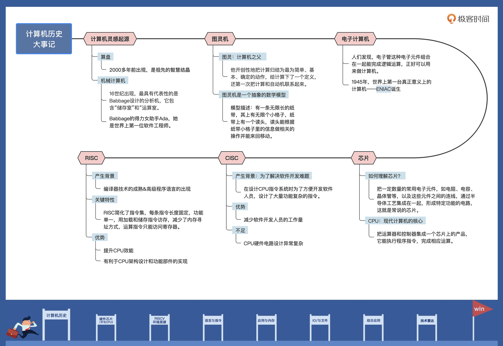

# 01 | CISC&RISC：从何而来，何至于此

你好，我是 LMOS。

这个专栏我会带你学习计算机基础。什么是基础？

基础就是根，从哪里来，到哪里去。而学习计算机基础，首先就要把握它的历史，这样才能了解计算机是怎么一步步发展到今天这个样子的，再根据今天的状况推导出未来的发展方向。

正所谓读历史方知进退，明兴衰。人类比其它动物高级的原因，就是人类能使用和发现工具。从石器时代到青铜器时代，再到铁器时代，都是工具种类和材料的发展，推动了文明升级。

让我们先从最古老的算盘开始聊起，接着了解一下机械计算机、图灵机和电子计算机。最后我会带你一起看看芯片的发展，尤其是它的两种设计结构——CISC 与 RISC。

### 从算盘到机械计算机

算盘就是一种辅助计算的工具，由中国古代劳动人民发明，迄今已有两千多年的历史，一直沿用至今。我准备了算盘的平面草图，你可以感受一下：

上图中周围一圈蓝色的是框架，一串一串的是算椽和算珠，一根算椽上有七颗算珠，可以上下拨动，从右至左有个、十、百……亿等计数位。有了算盘，计算的准确性和速度得到提高，我们从中可以感受到先辈的智慧。

与其说算盘是计算机，还不如说它是个数据寄存器。“程序”的执行需要人工实现，按口诀拨动算珠。过了两千多年，人们开始思考，能不能有一种机器，不需要人实时操作就能自动完成一些计算呢？

16 世纪，苏格兰人 John Napier 发表了论文，提到他发明了一种精巧设备，可以进行四则运算和解决方根运算。之后到了 18 世纪，英国人 Babbage 设计了一台通用分析机。这期间还出现了计算尺等机械计算设备，主要是利用轴、杠杆、齿轮等机械部件来做计算。

尤其是 Babbage 设计的分析机，设计理论非常超前，既有保存 1000 个 50 位数的“齿轮式储存室”，用于运算的“运算室”，还有发送和读取数据的部件以及负责在“存储室”、“运算室”运算运输数据的部件。具体的构思细节，你有兴趣可以自行搜索资料探索。

一个多世纪之后，现代电脑的结构几乎是 Babbage 分析机的翻版，无非是主要部件替换成了大规模集成电路。仅此一点，Babbage 作为计算机系统设计的“开山鼻祖”，就当之无愧。

值得一提的是，Babbage 设计分析机的过程里，遇到了一位得力女助手——Ada。虽说两人的故事无从考证，但 Ada 的功劳值得铭记，她是为分析机编写程序（计算三角函数的程序、伯努利函数程序等）的第一人，也是公认的世界上第一位软件工程师。

又过了一个世纪，据说美国国防部花了十年光阴，才把开发军事产品所需的全部软件功能，都归纳整理到了一种计算机语言上，期待它成为军方千种计算机的标准。1981 年，这种语言被正式命名为 ADA 语言。

可惜的是，这种分析机需要非常高的机械工程制造技术，后来政府停止了对他们的支持。尽管二人后来贫困潦倒，Ada 也在 36 岁就英年早逝，但这两个人的思想和为计算机发展作出的贡献，足以彪炳史册，流芳百世。

### 图灵机

机械计算机有很多缺点，比如难于制造，难于维护，计算速度太慢，理论不成熟等。这些难题导致用机械计算机做通用计算的话，并不可取。

而真正奠定现代通用计算机理论的人，在 20 世纪初横空出世，他就是图灵，图灵奖就是用他名字命名的。

图灵在计算可行性和人工智能领域贡献卓越，最重要的就是提出了图灵机。

图灵机的概念是怎么来的呢？图灵在他的《论可计算数及其在判定问题中的应用》一文中，全面分析了人的计算过程。他把计算提炼成最简单、基本、确定的动作，然后提出了一种简单的方法，用来描述机械性的计算程序，让任何程序都能对应上这些动作。

该方法以一个抽象自动机概念为基础，不但定义了什么“计算”，还首次将计算和自动机联系起来。这对后世影响巨大，而这种“自动机”后来就被我们称为“图灵机”。

图灵机是一个抽象的自动机数学模型，它是这样运转的：有一条无限长的纸带，纸带上有无限个小格子，小格子中写有相关的信息。纸带上有一个读头，读头能根据纸带小格子里的信息做相关的操作，并且能来回移动。

如果你感觉文字叙述还不够形象，我再来画一幅示意图：

我们不妨想象一下，把自己写的一条条代码，放入上图纸带的格子中，随着读头的读取代码做相应的动作。读头移动到哪一个，就会读取哪一格的代码，然后执行相应的顺序、跳转、循环动作，完成相应计算工作。

如果我们把读头及读头的运行规则理解为 CPU，把纸带解释为内存，把纸带上信息理解为程序和数据，那这个模型就非常接近现代计算机了。在我看来，以最简单的方法抽象出统一的计算模型，这就是图灵的伟大之处。

### 电子计算机

图灵机这种美好的抽象模型，如果没有好的实施方案，是做不出实际产品的，这将是一个巨大的遗憾。为此，人类进行了多次探索，可惜都没有结果。最后还是要感谢弗莱明和福雷斯特，尽管他们一个是英国人，一个是美国人。

这两个人本来没什么交集，不过后来福雷斯特在弗莱明的真空二极管里，加上了一个电极（一种栅栏式的金属网，形成电子管的第三个极），就获得了可以放大电流的新器件，他把这个新器件命名为三极管，也叫真空三极管。这个三极管提高了弗莱明的真空二极管的检波灵敏度。

不过，一个三极管虽然做不了计算机，但是许多个三极管组合起来形成的数字电路，就能够实现布尔代数中的逻辑运算，电子计算机的大门自此打开。

1946 年，ENIAC 成功研制，它诞生于美国宾夕法尼亚大学，是世界上第一台真正意义上的电子计算机。

ENIAC 占地面积约 170 平方米，估计你在城里的房子也放不下这台机器。它有多达 30 个操作台，重达 30 吨，耗电量 150 千瓦。

别说屋子里放不下，电费咱们也花不起。这台机器包含了 17468 根电子管和 7200 根晶体二极管，1500 个继电器，6000 多个开关等许多其它电子元件，计算速度是每秒 5000 次加法或者400 次乘法，大约是人工计算速度的 20 万倍。

但是三极管也不是完美的，因为三极管的内部封装在一个抽成真空的玻璃管中，这种方案在当时是非常高级的，但是仍然不可靠，用不了多久就会坏掉了。电子计算机一般用一万多根三极管，坏了其中一根，查找和维护都极为困难。

直到 1947 年 12 月，美国贝尔实验室的肖克利、巴丁和布拉顿组成的研究小组，研制出了晶体管，问题才得以解决。现在我们常说的晶体管通常指的是晶体三极管。

晶体三极管跟真空三极管功能一样，不过制造材料是半导体。它的特点在于响应速度快，准确性高，稳定性好，不易损坏。关键它可以做得非常小，一块集成电路即可容纳十几亿到几十亿个晶体管。

这样的器件用来做计算机就是天生的好材料。可以说，晶体管是后来几十年电子计算机飞速发展的基础。没有晶体管，我们简直不敢想像，计算机能做成今天这个样子。具体是如何做的呢？我们接着往下看。

### 芯片

让我们加点速，迈入芯片时代。我们不要一提到芯片，就只想到 CPU。

CPU 确实也是芯片中的一种，但芯片是所有半导体元器件的统称，它是把一定数量的常用电子元件（如电阻、电容、晶体管等），以及这些元件之间的连线，通过半导体工艺集成在一起的、具有特定功能的电路。你也可以把芯片想成集成电路。

那芯片是如何实现集成功能的呢？

20 世纪 60 年代，人们把硅提纯，切成硅片。想实现具备一定功能的电路，离不开晶体管、电阻、电容等元件及它们之间的连接导线，把这些集成到硅片上，再经过测试、封装，就成了最终的产品——芯片。相关的制造工艺（氧化、光刻、粒子注入等）极其复杂，是人类的制造极限。

正因为出现了集成电路，原先占地广、重量大的庞然大物才能集成于“方寸之间”。而且性能高出数万倍，功耗缩小数千倍。随着制造工艺的升级，现在指甲大小的晶片上集成数十亿个晶体管，甚至在一块晶片上集成了 CPU、GPU、NPU 和内部总线等，每秒钟可进行上 10 万亿次操作。在集成电路发展初期，这样的这样的性能是不可想像的。

下面我们看看芯片中的特例——CPU，它里面包括了控制部件和运算部件，即中央处理器。1971 年，Intel 将运算器和控制器集成在一个芯片上，称为 4004 微处理器，这标志着 CPU 的诞生。到了 1978 年，开发的 8086 处理器奠定了 X86 指令集架构。此后，8086 系列处理器被广泛应用于个人计算机以及高性能服务器中。

那 CPU 是怎样运行的呢？CPU 的工作流程分为以下 5 个阶段：取指令、指令译码、执行指令、访存读取数据和结果写回。指令和数据统一存储在内存中，数据与指令需要从统一的存储空间中存取，经由共同的总线传输，无法并行读取数据和指令。这就是大名鼎鼎的冯诺依曼体系结构。

CPU 运行程序会循环执行上述五个阶段，它既是程序指令的执行者，又被程序中相关的指令所驱动，最后实现了相关的计算功能。这些功能再组合成相应算法，然后由多种算法共同实现功能强大的软件。

既然 CPU 的工作离不开指令，指令集架构就显得尤其重要了。

### CISC

从前面的内容中，我们已经得知 CPU 就是不断地执行指令，来实现程序的执行，最后实现相应的功能。但是一颗 CPU 能实现多少条指令，每条指令完成多少功能，却是值得细细考量的问题。

显然，CPU 的指令集越丰富、每个指令完成的功能越多，为该 CPU 编写程序就越容易，因为每一项简单或复杂的任务都有一条对应的指令，不需要软件开发人员写大量的指令。这就是复杂指令集计算机体系结构——CISC。

CISC 的典型代表就是 x86 体系架构，x86 CPU 中包含大量复杂指令集，比如串操作指令、循环控制指令、进程任务切换指令等，还有一些数据传输指令和数据运算指令，它们包含了丰富的内存寻址操作。

有了这些指令，工程师们编写汇编程序的工作量大大降低。CISC 的优势在于，用少量的指令就能实现非常多的功能，程序自身大小也会下降，减少内存空间的占用。但凡事有利就有弊，这些复杂指令集，包含的指令数量多而且功能复杂。

而想实现这些复杂指令，离不开 CPU 运算单元和控制单元的电路，硬件工程师要想设计制造这样的电路，难度非常高。

到了 20 世纪 80 年代，各种高级编程语言的出现，大大简化了程序的开发难度。

高级语言编写的代码所对应的语言编译器，很容易就能编译生成对应的 CPU 指令，而且它们生成的多条简单指令，跟原先 CISC 里复杂指令完成的功能等价。因此，那些功能多样的复杂指令光环逐渐黯淡。

说到这里，你应该也发现了，在 CPU 发展初期，CISC 体系设计是合理的，设计大量功能复杂的指令是为了降低程序员的开发难度。因为那个时代，开发软件只能用汇编或者机器语言，这等同于用硬件电路设计帮了软件工程师的忙。

随着软硬件技术的进步，CISC 的局限越来越突出，因此开始出现了与 CISC 相反的设计。是什么设计呢？我们继续往下看。

### RISC

每个时代都有每个时代的产物。

20 世纪 80 年代，编译器技术的发展，导致各种高级编程语言盛行。这些高级语言编译器生成的低级代码，比程序员手写的低级代码高效得多，使用的也是常用的几十条指令。

前面我说过，文明的发展离不开工具的种类与材料升级。指令集的发展，我们也可以照这个思路推演。芯片生产工艺升级之后，人们在 CPU 上可以实现高速缓存、指令预取、分支预测、指令流水线等部件。

不过，这些部件的加入引发了新问题，那些一次完成多个功能的复杂指令，执行的时候就变得捉襟见肘，困难重重。

比如，一些串操作指令同时依赖多个寄存器和内存寻址，这导致分支预测和指令流水线无法工作。另外，当时在 IBM 工作的 John Cocke 也发现，计算机 80% 的工作由大约 20% 的 CPU指令来完成，这代表 CISC 里剩下的 80% 的指令都没有发挥应有的作用。

这些最终导致人们开始向 CISC 的反方向思考，由此产生了 RISC——精简指令集计算机体系结构。

正如它的名字一样，RISC 设计方案非常简约，通常有 20 多条指令的简化指令集。每条指令长度固定，由专用的加载和储存指令用于访问内存，减少了内存寻址方式，大多数运算指令只能访问操作寄存器。

而 CPU 中配有大量的寄存器，这些指令选取的都是工程中使用频率最高的指令。由于指令长度一致，功能单一，操作依赖于寄存器，这些特性使得 CPU 指令预取、分支预测、指令流水线等部件的效能大大发挥，几乎一个时钟周期能执行多条指令。

这对 CPU 架构的设计和功能部件的实现也很友好。虽然完成某个功能要编写更多的指令，程序的大小也会适当增加，更占用内存。但是有了高级编程语言，再加上内存容量的扩充，这些已经不是问题。

RISC 的代表产品是 ARM 和 RISC-V。其实到了现在，RISC 与 CISC 早已没有明显界限，开始互相融合了，比如 ARM 中加入越来越多的指令，x86 CPU 通过译码器把一条指令翻译成多条内部微码，相当于精简指令。x86 这种外 CISC 内 RISC 的选择，正好说明了这一点。

历史的车轮滚滚向前，留下的都是经典，历史也因此多彩而厚重，今天的课程就到这里了，我们要相信，即便自己不能改写历史，也能在历史上留下点什么。我们下一节课见，下次，我想继续跟你聊聊芯片行业的新贵 RISC-V。

### 重点回顾

今天我们一起完成了一次“穿越之旅”，从最早的算盘、机械计算机，现代计算机雏形的图灵机，一路讲到芯片和 CPU 的两种指令架构集。

其实仅仅一节课的时间，很难把计算机的历史一一道来，所以我选择了那些对计算机产生和演进最关键的事件或者技术，讲给你听。我把今天的重点内容为你梳理了一张思维导图。

有了这些线索，你就能在脑海里大致勾勒出，计算机是如何一步步变成今天的样子。技术发展的“接力棒”现在传到了我们这代人手里，我对未来的发展充满了期待。

就拿 CPU 的发展来说，我觉得未来的 CPU 可能是多种不同指令集的整合，一个 CPU 指令能执行多类型的指令，分别完成不同的功能。不同类型的指令由不同的 CPU 功能组件来执行，有的功能组件执行数字信号分析指令，有的功能组件执行图形加速指令，有的功能组件执行神经网络推算指令……

### 思考题

为什么 RISC 的 CPU 能同时执行多条指令？

欢迎你在留言区跟我交流互动，如果觉得这节课讲得不错，也推荐你分享给身边的朋友。
