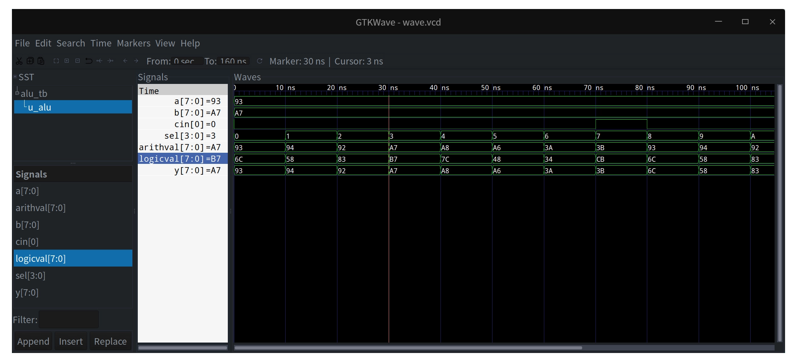
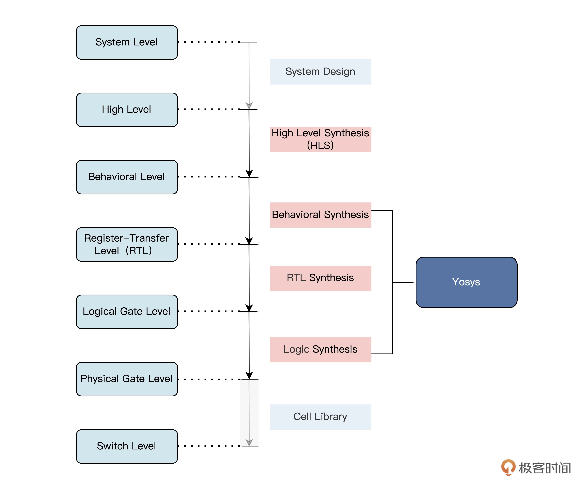
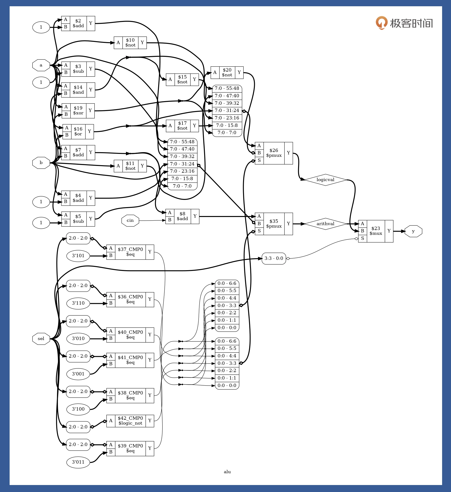
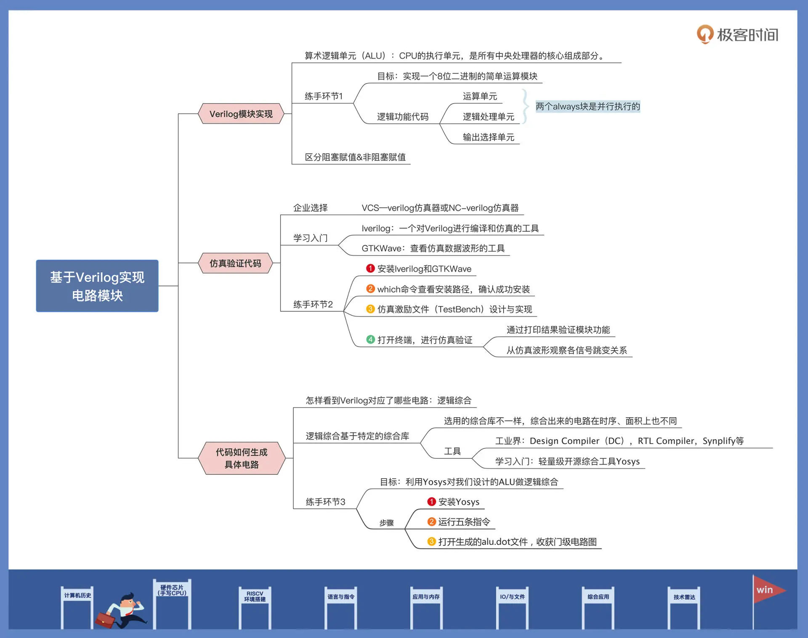

# 04 | 硬件语言筑基（二）-代码是怎么生成具体电路的？

你好，我是 LMOS。

上节课，我们学习了硬件描述语言 Verilog 的基础知识。今天我会带你一起用 Verilog 设计一个简单的电路模块。通过这节课，你不但能复习巩固上节课学到的硬件语言知识，还能在动手实践中体会代码是怎么生成具体电路的。

## Verilog 代码编写

如果你学过计算机组成原理的课程或图书，应该对 ALU 并不陌生。算术逻辑单元（Arithmetic&logical Unit，ALU）是 CPU 的执行单元，是所有中央处理器的核心组成部分。

利用 Verilog，我们可以设计一个包含加、减、与、或、非等功能的简单 ALU 模块，代码如下：

```
module alu(a, b, cin, sel, y);
 input [7:0] a, b;
 input cin;
 input [3:0] sel;
 output [7:0] y;
 reg [7:0] y;
 reg [7:0] arithval;
 reg [7:0] logicval;
 // 算术执行单元
 always @(a or b or cin or sel) begin
   case (sel[2:0])
     3'b000  : arithval = a;
     3'b001  : arithval = a + 1;
     3'b010  : arithval = a - 1;
     3'b011  : arithval = b;
     3'b100  : arithval = b + 1;
     3'b101  : arithval = b - 1;
     3'b110  : arithval = a + b;
     default : arithval = a + b + cin;
   endcase
 end
 // 逻辑处理单元
 always @(a or b or sel) begin
   case (sel[2:0])
     3'b000  : logicval =  ~a;
     3'b001  : logicval =  ~b;
     3'b010  : logicval = a & b;
     3'b011  : logicval = a | b;
     3'b100  : logicval =  ~((a & b));
     3'b101  : logicval =  ~((a | b));
     3'b110  : logicval = a ^ b;
     default : logicval =  ~(a ^ b);
   endcase
 end
 // 输出选择单元
 always @(arithval or logicval or sel) begin
   case (sel[3])
     1'b0    : y = arithval;
     default : y = logicval;
   endcase
 end
endmodule
```

通过上面的代码，我们实现了一个 8 位二进制的简单运算模块。其中，a 和 b 是输入的两个 8位二进制数，cin 是 a 和 b 做加法运算时输入的进位值，4bit 位宽的 sel[3:0] 则是 CPU 中通常所说的指令操作码。

在这个 ALU 模块中，逻辑功能代码我们把它分成三个部分，分别是运算单元、逻辑处理单元和输出选择单元。运算单元是根据输入指令的低三位 sel[2:0]，来选择执行加减等运算。同理，逻辑处理单元执行与或非门等操作。最后，根据指令的最高位 sel[3]，来选择 Y 输出的是加减运算单元结果，还是逻辑处理的结果。

你还记得上节课的例子么？当时我们一起研究了一个 4 位 10 进制的计算器，里面用到了时钟设计。也就是说，这个计算器是通过时序逻辑实现的，所以 always 块中的赋值语言使用了非阻塞赋值“<=”。

```
always@(posedge clk or negedge reset_n) begin
 if(!reset_n) begin                  //复位时，计时归0
     cnt_r        <= 4'b0000 ;
   end
```

而今天我们实现的 ALU 模块，用到的是组合逻辑，所以 always 块中使用阻塞赋值“=”。

怎么区分阻塞赋值和非阻塞赋值呢？阻塞赋值对应的电路结构往往与触发沿没有关系，只与输入电平的变化有关；而非阻塞赋值对应的电路结构往往与触发沿有关系，只有在触发沿时，才有可能发生赋值的情况。

另外，在前面 8 位二进制的代码里，算术执行单元和逻辑处理单元的两个 always 块是并行执行的。所以它们的运算结果几乎是同时出来，这里值得你好好理解一下。如果你没有发现两个块并行，可以暂停下来回顾一下。

## 如何通过仿真验证代码

就像我们开发软件，需要代码编译器和模拟器一样，Verilog 这种硬件语言的代码，也需要运行验证。那怎么来运行验证呢？现在很多企业采用的是 VCS—verilog 仿真器或者是 NC-verilog 仿真器，这些工具都需要花重金去购买才能使用，普通人用起来成本太高了。

除了重金购买这些 EDA 工具之外，我们还有更节约成本、也更容易学习入门的选择。我给你推荐两个轻量级开源软件，分别是 Iverilog 和 GTKWave。Iverilog 是一个对 Verilog 进行编译和仿真的工具，而 GTKWave 是一个查看仿真数据波形的工具。

Iverilog 运行于终端模式下，安装完成之后，我们就能通过 Iverilog 对 verilog 执行编译，再对生成的文件通过 vvp 命令执行仿真，配合 GTKWave 即可显示和查看图形化的波形。

在 Linux 系统下安装 Iverilog 和 GTKWave 非常简单。以 Ubuntu 为例，我们通过 apt-get 就可以直接安装。

- 安装 Iverilog：sudo apt-get install iverilog安装 GTKWave：sudo apt-get install gtkwave

安装完成之后，我们需要使用 which 命令查看安装路径，确认是否安装成功。

- which iverilogwhich vvpwhich gtkwave

有了软件和 Verilog 代码。在运行仿真前，我们还需要设计一个重要的文件，即仿真激励文件，也就是 TestBench。在仿真时，要把 TestBench 放在所设计模块的顶层，以便对模块进行系统性的例化调用。

我们把 TestBench 放在设计模块的顶层，以便对模块进行系统性的例化，调用所设计的各个模块并对其进行仿真。

针对上面的 ALU 模块，设计了一个给 ALU 产生运算指令和数据的 TestBench，并且把 ALU的运算结果打印出来，TestBench 的代码如下：

```
`timescale 1 ns / 1 ns
module alu_tb;
 reg[7:0] a, b;
 reg cin;
 reg[3:0] sel;
 wire[7:0] y;
 integer idx;
 //对alu模块进行例化，类似于软件程序中的函数调用
 alu u_alu(.a(a), .b(b), .cin(cin), .sel(sel), .y(y));
 initial
 begin
   //给 a 和 b 赋初值
   a = 8'h93;
   b = 8'hA7;
   for (idx = 0;  idx <= 15;  idx = idx + 1)
   begin
     // 循环产生运算指令 sel 的值
     sel = idx;
     // 当指令 sel = 7 时是加法操作，设定进位值cin=1
     if (idx == 7)
       cin = 1'b1;
     else
       cin = 1'b0;
     //每产生一个指令延时10ns
     #10
     // 延时之后打印出运算结果
     $display("%t: a=%h, b=%h, cin=%b, sel=%h, y=%h", $time, a, b, cin, sel, y);
   end
 end
initial
begin
 $dumpfile("wave.vcd");        //生成波形文件vcd的名称
 $dumpvars(0, alu_tb);        //tb模块名称
end
endmodule
```

这里我要说明一下，TestBench 是不可以综合成具体电路的，只用于仿真验证，但和上一节课介绍的可综合的 Verilog 代码语法类似。

设计工作告一段落。我们终于可以打开终端开始跑仿真了。你需要在 Verilog 代码所在的文件目录下执行以下指令：

- iverilog -o wave -y ./ alu_tb.v alu.vvvp -n wave -lxt2

可以看到，运行结果输出如下：

- LXT2 info: dumpfile wave.vcd opened for output.10: a=93, b=a7, cin=0, sel=0, y=93// 指令 0：y = a;20: a=93, b=a7, cin=0, sel=1, y=94// 指令 1：y = a + 1;30: a=93, b=a7, cin=0, sel=2, y=92// 指令 2：y = a - 1;40: a=93, b=a7, cin=0, sel=3, y=a7// 指令 3：y = b;50: a=93, b=a7, cin=0, sel=4, y=a8// 指令 4：y = b + 1;60: a=93, b=a7, cin=0, sel=5, y=a6// 指令 5：y = b - 1;70: a=93, b=a7, cin=0, sel=6, y=3a// 指令 6：y = a + b;80: a=93, b=a7, cin=1, sel=7, y=3b// 指令 7：y = a + b + cin;90: a=93, b=a7, cin=0, sel=8, y=6c// 指令 8：y = ~a;100: a=93, b=a7, cin=0, sel=9, y=58// 指令 9：y = ~b;110: a=93, b=a7, cin=0, sel=a, y=83// 指令 10：y = a & b;120: a=93, b=a7, cin=0, sel=b, y=b7// 指令 11：y = a | b;130: a=93, b=a7, cin=0, sel=c, y=7c// 指令 12：y = ~(a & b);140: a=93, b=a7, cin=0, sel=d, y=48// 指令 13：y = ~(a | b);150: a=93, b=a7, cin=0, sel=e, y=34// 指令 14：y = a ^ b;160: a=93, b=a7, cin=0, sel=f, y=cb// 指令 15：y = ~(a ^ b);

有了运行结果，我们就可以打开 GTKWave 查看仿真波形了，这里需要在终端执行如下指令：

- gtkwave wave.vcd



从打开的波形可以到，ALU 模块输出的信号 Y，这是根据输入指令 sel 和输入的数据 a、b 和cin 的值，经过加减运算或者逻辑运算得到的。

## 代码是如何生成具体电路的？

经过上面的仿真，从打印的结果上已经看到了我们设计的模块功能。而通过查看仿真波形，我们同样也能知道各个信号的跳变关系。

但是，你可能还有个疑惑，不是说设计的 Verilog 语句，基本都会对应一份电路吗？怎样才能看到 Verilog 对应了哪些电路呢？

别急，这就是我马上要讲的逻辑综合。通过逻辑综合，我们就能完成从 Verilog 代码到门级电路的转换。而逻辑综合的结果，就是把设计的 Verilog 代码，翻译成门级网表 Netlist。

逻辑综合需要基于特定的综合库，不同的库中，门电路基本标准单元（Standard Cell）的面积、时序参数是不一样的。所以，选用的综合库不一样，综合出来的电路在时序、面积上也不同。因此，哪怕采用同样的设计，选用台湾的台积电（TSMC）工艺和上海的中芯国际（SMIC）的工艺，最后生产出来的芯片性能也是有差异的。

通常，工业界使用的逻辑综合工具有 Synopsys 的 Design Compiler（DC），Cadence 的 RTLCompiler，Synplicity 的 Synplify 等。然而，这些 EDA 工具都被国外垄断了，且需要收取高昂的授权费用。

为了降低学习门槛和费用，这里我们选择 Yosys，它是一个轻量级开源综合工具。虽然功能上还达不到工业级的 EDA 工具，但是对于我们这门课的学习已经完全够用了。



如上图所示，利用 Yosys 软件，可以帮助我们把 RTL 代码层次的设计转换为逻辑门级的电路。

好，我先大致带你了解下，这个软件怎么安装和使用。在 Ubuntu 中安装 Yosys 非常简单，在终端中依次执行以下命令即可：

- sudo add-apt-repository ppa:saltmakrell/ppa

- sudo apt-get updatesudo apt-get install yosys

完成了安装，我们就能使用 Yosys，对上面设计的 ALU 模块做简单的综合了。

直接在终端输入“yosys”，启动 Yosys 软件。启动成功后，我们通过后面这五条指令，就能得到到 ALU 的逻辑电路图文件了。

第一步，在 Yosys 中读取 Verilog 文件。

- read_verilog alu.v

第二步，使用后面的命令，检查模块例化结构。

- hierarchy -check

接着是第三步，执行下一条命令，来完成高层次的逻辑综合。

- proc; opt; opt; fsm; memory; opt

到了第四步，我们就可以用 write_verilog 生成网表文件。

- write_verilog alu_synth.v

最后，我们再用下方的命令，输出综合后的逻辑图。

- show -format dot -prefix ./alu

这一套动作完成后，我们终于迎来了收获成果的时刻。打开生成的 alu.dot 文件，我们就可以看到 ALU 模块的门级电路图了，如下所示：



可以看到，这张图是由基本的 and、or、not、add、sub、cmp、mux 等电路单元组成。如果你还想进一步了解它们底层电路结构，可以自行查阅大学里学过的《数电》《模电》。

当然，Yosys 功能还不只这些，这里我只是做个简易的演示。更多其它功能，如果你感兴趣的话可以到官网上学习。

到这里，类似于 CPU 里面的核心单元 ALU 电路，我们就设计完成了。

## 总结回顾

今天我们一起了解了怎么把 Verilog 代码变为具体的电路。为了实现代码编写、验证和仿真的“一站式”体验。我还向你推荐了几个开源软件。我们来回顾一下这节课的重点。

首先，我们用 Verilog 编写了一个类似 CPU 内部的 ALU 模块，该模块实现了加、减、与、或、非等基本运算功能。

针对上面的 ALU 模块，我们还设计了一个用于产生运算指令和数据的 TestBench，并且把ALU 的运算结果打印出来。利用这个 TestBench，可以验证 ALU 模块的功能是否正确。

接下来，我们还用到了两个轻量级开源软件，分别是 Iverilog 和 GTKWave。Iverilog 是一个对Verilog 进行编译和仿真的工具，GTKWave 可以查看仿真数据波形的工具。利用这两个软件，我们完成了 ALU 模块的仿真和验证。

此外，我还推荐了一款轻量级开源综合工具 Yosys。通过这个工具，我们把上面设计的 ALU模块综合出了具体的门级电路。

感谢你耐心看到这里，我还给你准备了一张知识导图，总结今天所学的内容。



## 扩展阅读

仅仅一两节课的内容，就想要把所有 Verilog 的相关知识学完是不可能的。因此，在课程之外，需要你去多搜索，多阅读，多动手编写 Verilg 代码，才能更好地掌握 Verilog 的相关知识，这里我精心为你整理了一些参考资料，供你按需取用：

1. 首先是硬件描述语言 Verilog HDL 的语言标准文件《IEEE Standard Verilog HardwareDescription Language (1364-2001)》。

2. 如果你对底层的基本电路还不熟悉，不妨复习一下大学所学的教材。这里我推荐由童诗白和华成英编写的《模拟电子技术基础》第四版，以及阎石编写的《数字电子技术基础》。

3. 你要是想全面学习数字集成电路的设计、仿真验证、逻辑综合等相关知识，可以看看电子工业出版社出版的《Verilog HDL 高级数字设计》。

4. 最后，你要是真的想学芯片设计，从更深层次去理解数字电路设计，推荐阅读这本 MohitArora 撰写、李海东等人翻译的图书——《硬件架构的艺术——数字电路的设计方法与技术》。

## 思考题

既然用 Verilog 很容易就可以设计出芯片的数字电路，为什么我们国家还没有完全自主可控的高端 CPU 呢？

期待你在留言区记录自己的学习收获或者疑问。如果这节课对你有帮助，也推荐你分享给更多朋友，我们一起来手写迷你 CPU。
