# 05 | 指令架构：RISC-V在CPU设计上到底有哪些优势？

你好，我是 LMOS。

上节课，我们学习了设计一个 CPU 所需要的相关基础知识，并带你认识了一些后面将会用到的 EDA 软件工具。看完课程的讲解，还有上手运行的 Demo，你是否对接下来要设计 CPU 已经蠢蠢欲动了？

哈哈，先别着急，我们在设计 CPU 之前，还有一些很关键的知识需要补充学习。没错，就是CPU 的指令集架构。

指令集可以说是一个 CPU 的基石，要实现 CPU 的计算和控制功能，就必须要定义好一系列与硬件电路相匹配的指令系统。所以，在设计 CPU 之初，工程师就应该清楚 CPU 应该具有怎样的指令架构。

## 什么是指令集？

在第一节课我们讲历史的时候，曾经提到过，CPU 既是程序指令的执行者，又被程序中相关的指令所驱动。不过，我并没有具体说明什么是指令。其实指令就是我们交代 CPU 要执行的操作。

那到底什么是指令集呢？

我给你打个比方：假如你有一条狗，经过一段时间的训练，它能“听懂”了你对它说一些话。当你对它说“坐下”，它就乖乖地坐在地上；当你对它说“汪汪叫”；它就汪汪汪地叫起来，当你对它说“躺下”，它马上就会躺下来……这里你说的“坐下”、“汪汪叫”、“躺下”这些命令，就相当于计算机世界里的指令。

当然，你还可以继续训练狗，让它识别更多指令，我们把所有的这些指令汇总在一起，就是一个指令集。如果指令集里面没有“上厕所”这个命令，那么即使你对狗下这个命令，它也不会去执行。CPU 也一样，必须要有特定的指令集才能工作。

不同的 CPU 有不同的指令集，根据它们的繁简程度可以分为两种：复杂指令集 CISC 和精简指令集 RISC。

指令集架构（英文叫 Instruction Set Architecture，缩写为 ISA）是软件和硬件的接口，不同的应用需求，会有不同的指令架构。我们要想设计一款 CPU，指令集体系就是设计的出发点。

## RISC-V 指令集架构

在开始设计一款处理器之前，我们需要选定它的指令集架构。学过前面的课程，我们知道RISC-V 指令集具有明显的优势：一是 RISC-V 完全开放，二是 RISC-V 指令简单，三是RISC-V 实行模块化设计，易于扩展。

我给你列了一个表，用于给你展示一下 RISC-V 基础指令集和扩展指令集，如下所示：

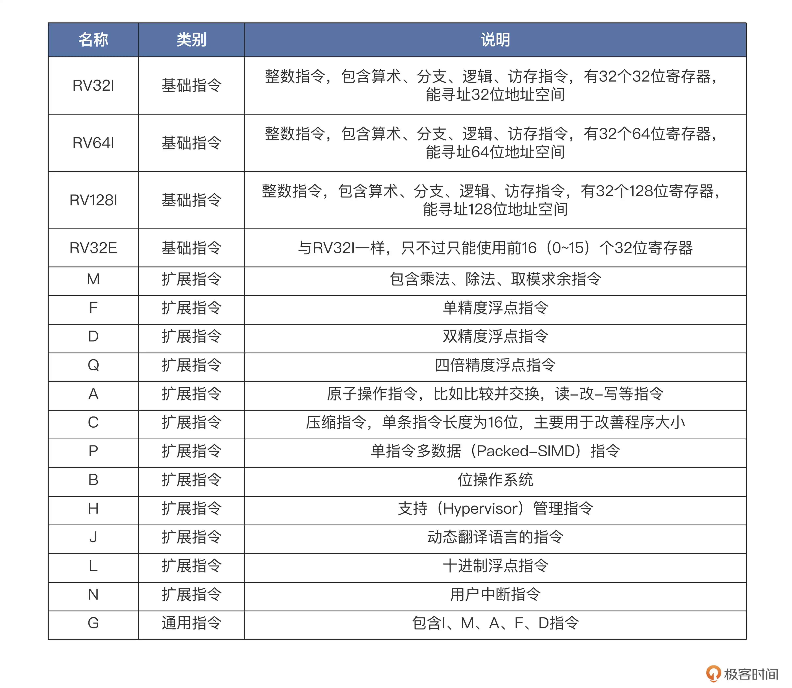

要满足现代操作系统和应用程序的基本运行，RV32G 指令集或者 RV64G 指令集就够了（G是通用的意思 ，而 I 只是整数指令集，G 包含 I），注意 RV32G 指令集或者 RV64G 指令集，只有寄存器位宽和寻址空间大小不同，这些指令按照功能可以分为如下几类。

1. 整数运算指令：实现算术、逻辑、比较等运算操作。

2. 分支转移指令：实现条件转移、无条件转移等操作。

3. 加载存储指令：实现字节、半字、字、双字（RV64I）的加载、存储操作，采用的都是寄存器相对寻址方式。

4. 控制与状态寄存器访问指令：实现对系统控制与系统状态寄存器的原子读 - 写、原子读 - 修改、原子读 - 清零等操作。

5. 系统调用指令：实现系统调用功能。

6. 原子指令：用于现在你能看到的各种同步锁。

7. 单双浮点指令：用于实现浮点运算操作。

从上表我们也可以看到，RISC-V 指令集具有模块化特点。这就允许我们根据自己的应用需求，选择一个基础指令集，加上若干个扩展指令集灵活搭配，就可以得到我们想要的指令集架构，进而根据这样的指令架构，设计出贴合我们应用需求的 CPU。

作为一个初学者，我们先从 RISC-V 的核心开始。它最核心的部分是一个基础整数指令集，叫做 RV32I。RV32I 就表示 32 位的 RISC-V。指令集的命名方式我在第二节课给你提到过，如果你印象不深了，可以去回顾一下。仅仅依靠 RV32I，我们就可以运行一个完整的软件栈。

RV32I 包含的指令是固定的，永远不会改变。这为编译器设计人员，操作系统开发人员和汇编语言程序员提供了稳定的基础知识框架。

接下来我们看一张图，这是 RV32I 基础指令集的名称表示。

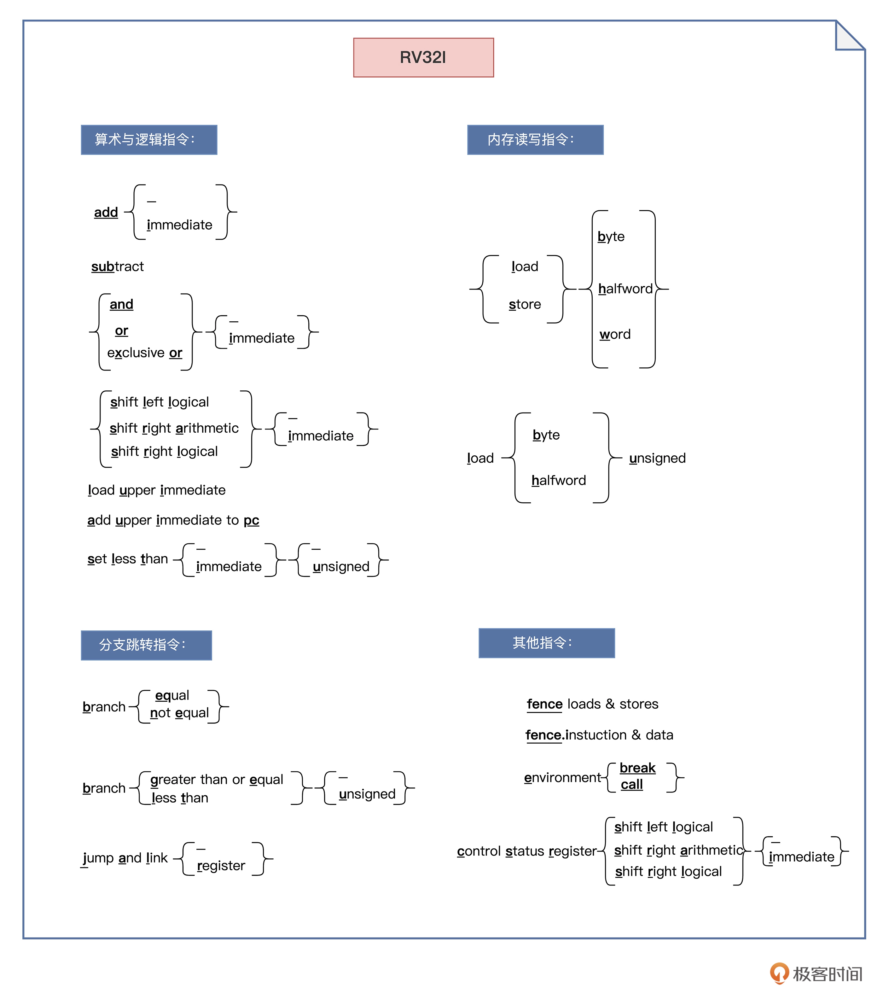

这些名称，你乍一看是不是有点眼花缭乱？先别慌，我讲一下命名规则，你就能明白了。

从图中我们可以看到，有些字母带有下划线。我们把带有下划线的字母从左到右连接起来，就可以组成一个 RV32I 的指令。对于每一个指令名称，集合标志{}内列举了指令的所有变体，变体用加下划线的字母或下划线字符 _ 表示。如果大括号内只有下划线字符 _，则表示对于此指令变体不需用字母表示。

我们再结合例子加深一下理解。下图表示了这四个 RV32I 指令：bge，blt，bgeu，bltu。

通过前面第三节课硬件描述语言基础的学习，我们知道了 CPU 的硬件逻辑里只有“0”和“1”，那么问题来了，怎么用“0”和“1”来表示出上述的指令呢？

要想回答这个问题，我们需要依次去了解指令格式，指令中要用到的寄存器以及指令集中各种功能的指令。

## 指令格式

我们先从 RV32I 的指令格式说起。从下图可以看到，RISCV 总共也就只有 6 种指令格式。

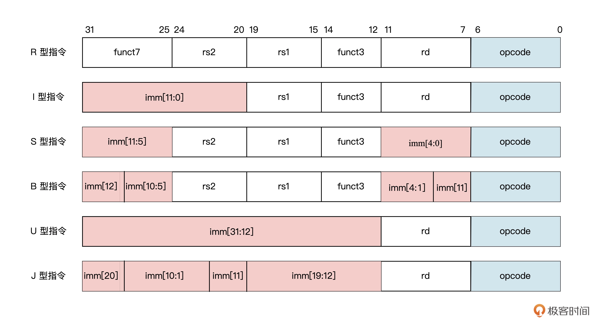

六种指令各司其职，我把它们的作用整理成了表格，这样你看起来一目了然。

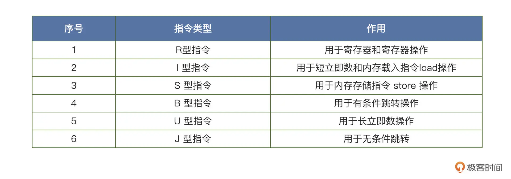

不要小看这些指令，我们来分析一下它们到底有哪些优势。这些指令格式规整有序，结构简单。因为指令只有六种格式，并且所有的指令都是 32 位长度的，所以这些指令解码起来就比较简单，可以简化解码电路，提高 CPU 的性能功耗比。

上图中的 opcode 代表指令操作码，imm 代表立即数，funct3 和 funct7 代表指令对应的功能，rs1、rs2 和 rd 则分别代表源寄存器 1、源寄存器 2 以及目标寄存器。RISC-V 的一个指令中可以提供三个寄存器操作数，而不是像 x86 一样，让源操作数和目的操作数共享一个字段，因此相比 x86 指令，RISC-V 减少了软件的程序操作。

而且，源寄存器（rs1 和 rs2）和目标寄存器（rd），都设计固定在所有 RISC-V 指令同样的位置上，指令译码相对简单。所以，指令在 CPU 流水线中执行时，可以先开始访问寄存器，然后再完成指令解码。

此外，这些指令格式的所有立即数的符号位总是在指令的最高位。这个设计有什么好处呢？它意味着，有可能成为关键路径的立即数符号扩展，可以在指令解码前进行。这样可以加速符号扩展电路，有利于 CPU 流水线的时序优化。

## RV32I 寄存器

之前讲指令格式时，我们说到了源寄存器 rs1、rs2 和目标寄存器 rd，那你知道指令中的寄存器都有哪些吗？

在 RISC-V 的规范里定义了 32 个通用寄存器。其中，有 31 个是常规寄存器，1 个恒为 0 值的 x0 寄存器。0 值寄存器的设置，是为了满足汇编语言程序员和编译器编写者的使用需要，他们可以使用 x0 寄存器作为操作数，来完成功能相同的操作。

比如说，我们如果需要插入一个空操作，就可以使用汇编语句 “addi x0 , x0, 0 ”（相当于0+0=0）来代替其他指令集中的 nop 空指令。

由于访问寄存器中的数据要比访问存储器的速度快得多，一般每条 RISC-V 指令最多用一个时钟周期执行（忽略缓存未命中的情况），而 ARM-32 或者 x86-32 则需要多个时钟周期执行的指令。因为 ARM-32 只有 16 个寄存器，而 X86-32 仅仅只有 8 个寄存器。

因此，寄存器越多，编译器和汇编程序员的工作就会越轻松。

之前第二节课，我给你列过 RV32I 的 32 个通用寄存器，这里我再带你复习一下，温故知新。表中的 ABI 全称为 Application Binary Interface，即应用程序二进制接口，也就是寄存器的别名，在汇编程序设计时会用到。

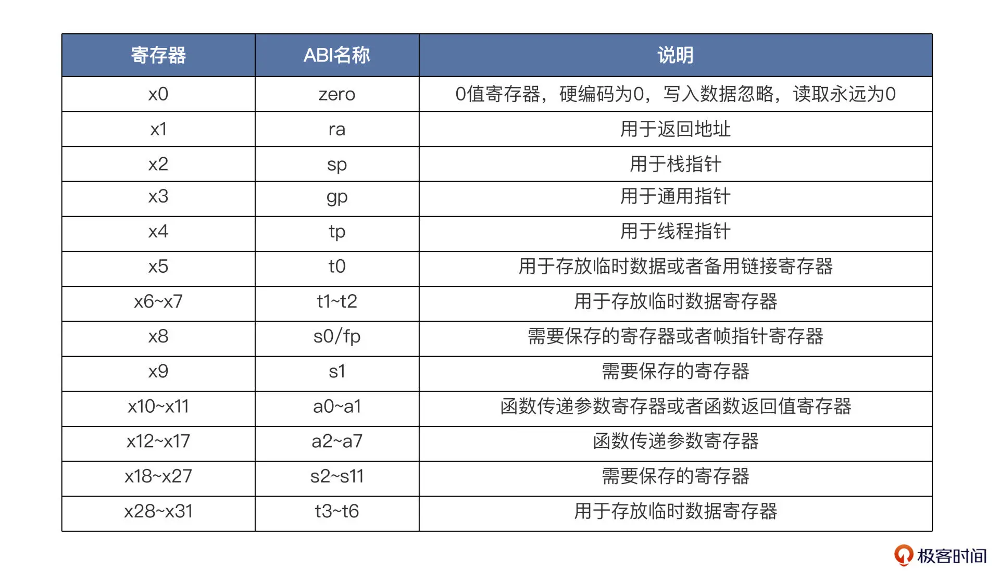

寄存器的内容我们就先讲这些，后面实现 CPU 的时候具体用到了，我再详细解释。

## RV32I 的各类指令解读

接下来我们研究一下 RV32I 的各种指令。如果你写过汇编程序应该知道，一般用得较多的就是算术和逻辑处理语句了，我们先从这类指令说起。

### 算术与逻辑指令

在 RV32I 的指令中，包括算术指令（add, sub）、数值比较指令（slt）、逻辑指令（and, or,xor）以及移位指令 （sll, srl, sra）这几种指令。

这些指令和其他指令集差不多，它们从寄存器读取两个 32 位的值，并将 32 位的运算结果再写回到目标寄存器。RV32I 还提供了这些指令的立即数版本，就是如下图所示的 I 型指令：

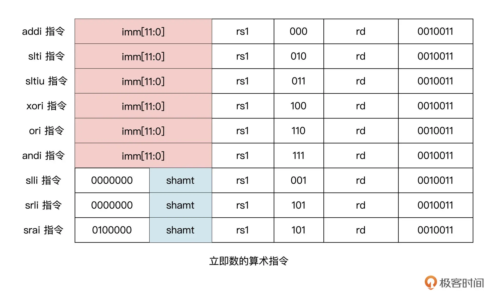

同样的，RV32I 也提供了寄存器和寄存器操作的指令，包括加减运算、数值比较、逻辑操作和移位操作。这些指令的功能和前面的立即数指令相似，不同的是，这里把指令中的立即数对应位置替换成了源寄存器 rs2。

寄存器和寄存器操作的指令如下表所示：

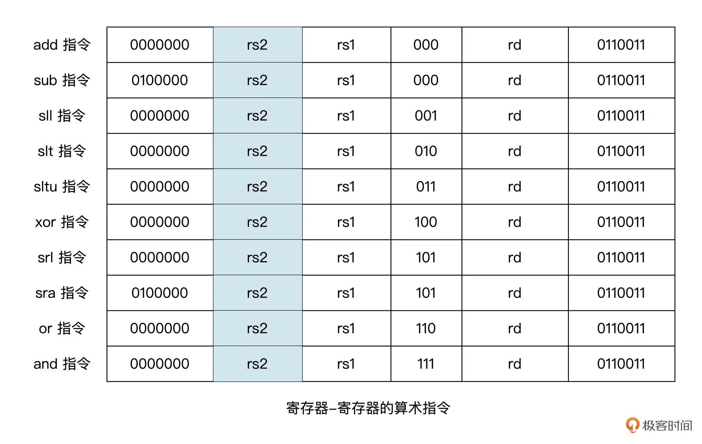

需要指出的是，在寄存器和寄存器操作的算术指令中，必须要有减法指令，这和立即数操作指令有所不同。

### RV32I 的 Load 和 Store

与 CISC 指令集具有众多的寻址方式不同，RV32I 省略了像 x86-32 指令集那样的复杂寻址模式。在 RISC-V 指令集中，对内存的读写只能通过 LOAD 指令和 STORE 指令实现。而其他的指令，都只能以寄存器为操作对象。

你可以看看后面的这张图，里面列出了 Load 指令和 Store 指令格式：

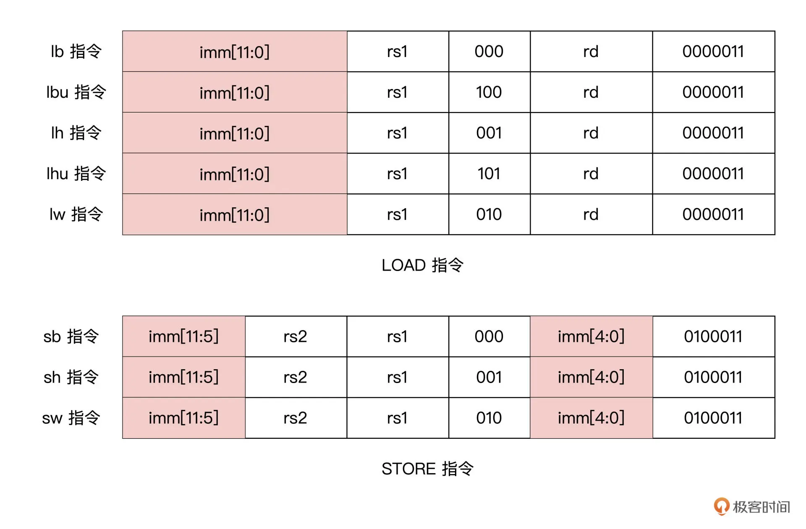

如上图所示，加载和存储的寻址模式只能是符号扩展 12 位的立即数，加上基地址寄存器得到访问的存储器地址。因为没有了复杂的内存寻址方式，这让 CPU 流水线可以对数据冲突提前做出判断，并通过流水线各级之间的转送加以处理，而不需要插入空操作（NOP），极大提高了代码的执行效率。

### 分支跳转指令

学习了前面的第二节课，相信你对 RISC-V 指令架构特点已经有所了解，RISC-V 遵循的是大道至简的原则。它的指令数目非常简洁，基本指令只有 40 多条，其中只有 6 条有条件跳转指令，减少了跳转指令的条数，这样硬件设计上更为简单。

下面，我们分别来看看 RV32I 条件跳转指令和无条件跳转指令的运行原理。这些原理只要你耐心听我讲完就能理解，而且之后也会应用在我们的在 MiniCPU 实现中。

### 有条件分支跳转

RV32I 中的条件跳转指令是通过比较两个寄存器的值，并根据比较结果进行分支跳转。比较可以是：相等（beq），不相等 （bne），大于等于（bge），或小于（blt）。

如下图所示，大于等于（bge），和小于（blt）则跳转指令为有符号数比较，RV32I 也提供了相应的无符号数的比较指令，分别为 bgeu 和 bltu。剩下的两个比较关系（大于和小于等于），可以通过简单地交换两个操作数位置，来完成相同的比较。例如， x < y 可以表示为 y > x ，同样的， x ≤ y 也表示为 y ≥ x。

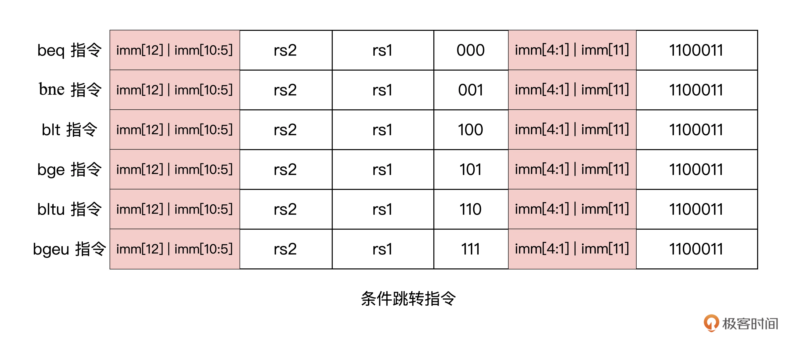

### 无条件分支跳转

除了有条件分支跳转，RV32I 还提供了无条件跳转指令，无条件跳转指令还可以细分为直接跳转和间接跳转这两种指令。

直接跳转指令 JAL 如下图所示。RISC-V 为 JAL 指令专门定义了 J-TYPE 格式。

JAL 指令的执行过程是这样的。首先，它会把 20 位立即数做符号位扩展，并左移一位，产生一个 32 位的符号数。然后，将该 32 位符号数和 PC 相加来产生目标地址（这样，JAL 可以作为短跳转指令，跳转至 PC±1 MB 的地址范围内）。

同时，JAL 也会把紧随其后的那条指令的地址，存入目标寄存器中。这样，如果目标寄存器是零，则 JAL 就等同于 GOTO 指令；如果目标寄存器不为零，JAL 可以实现函数调用的功能。

间接跳转指令 JALR 如上图所示。JALR 指令会把 12 位立即数和源寄存器相加，并把相加的结果末位清零，作为新的跳转地址。同时，和 JAL 指令一样，JALR 也会把紧随其后的那条指令的地址，存入到目标寄存器中。

## RV32I 的其他指令

除了内存地址空间和通用寄存器地址空间外，RISC-V 中还定义了一个独立的控制与状态寄存器（Control Status Register，CSR）地址空间。

每个处理器实现的 CSR 会因设计目标不同而有差异，但这些 CSR 的访问方式却是一致的，访问这些 CSR 的指令定义在了用户指令集中（Zicsr 指令集扩展）。

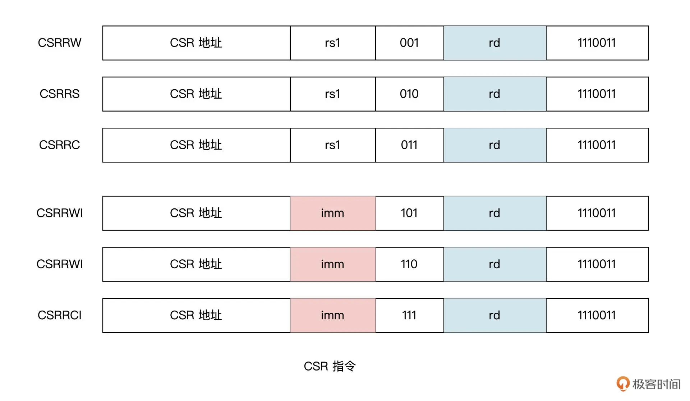

有了上图这些 CSR 指令，能够让我们轻松访问一些程序性能计数器。这些计数器包括系统时间、时间周期以及执行的指令数目。

在 RISC-V 指令集中，还有其他的一些指令，例如用于系统调用的 ecall 指令，在调试时用于将控制转移到调试环境的 ebreak 指令等。对于这些扩展的指令，这里就不展开讲了。

好，到这里，我们就把 RISC-V 的基础整数指令集——RV32I 大体梳理了一遍。你可能感慨，比起训练一条狗，训练“CPU”要复杂得多。不过，通过 RV32I 这个最核心的指令集，我们也看到了 RISC-V 的很多设计优势。

相比 CISC，RISCV 确实更容易学习和使用。学习了这些基本指令的功能，我们就可以设计出简单的 CPU 了。

## 重点回顾

好了，今天的课程就到这里，让我们来回顾一下今天学到的内容。

首先，我们知道了什么是 CPU 的指令集，并选择 RISC-V 最核心的基础整数指令集 RV32I 重点学习。RV32I 包含的指令是固定的，永远不会改变。我们学好 RV32I，不但能为学习 RISC-V 的扩展指令集打下基础，也能为编译器设计、操作系统开发和汇编程序设计搭建好前置的基础知识框架。

RISC-V 到底在 CPU 设计上有哪些优势？我们从指令格式、寄存器以及指令解读这几个方面入手，做了不少讨论。

RISC-V 仅有 6 种指令格式，它们分别是：R 类型指令、 I 型指令、 S 型指令、B 类型指令、U 型指令和 J 型指令。这些指令格式规整有序，结构简单，所以指令解码起来比较简单，有利于简化解码电路，提高了 CPU 的性能功耗比。

此外，在 RISC-V 的规范里，定义了 32 个通用寄存器。其中有 31 个常规寄存器，一个恒 0值的 x0 寄存器。由于 RISC-V 的寄存器有数量上的优势，使得基于 RISC-V 设计 CPU 不用那么频繁地去访问存储器，指令执行起来更快，也让编译器和汇编程序员的工作更加轻松。

之后我们了解到，RV32I 的指令包括算术指令、数值比较指令、逻辑指令以及移位指令，这些指令和其他指令集差不多。但是， RISC-V 与 CISC 指令集具有众多的寻址方式不同，RV32I省略了如 x86-32 指令集的复杂寻址模式。在 RISC-V 指令集中，对内存的读写只能通过LOAD 指令和 STORE 指令实现。

RISC-V 遵循的是大道至简的原则，它的指令数目非常简洁，基本指令只有 40 多条，而分支跳转指令只有 8 条，其中 6 条是带条件跳转指令，2 条是无条件跳转指令。这些指令条数的减少，使硬件设计更简单。

除了上面提到的指令，RISC-V 还有其他的一些指令，比如，还定义了一个独立的控制与状态寄存器地址空间，其地址宽度是 12 位的。根据每个设计的目标不同，每个处理器实际实现的CSR 可能会有所不同。对于剩余没有介绍的一些指令，如果你感兴趣的话，可以自己查阅相关资料（比如 RISC-V 的官方手册）来学习。

最后我为你梳理了这节课的知识导图，供你参考。

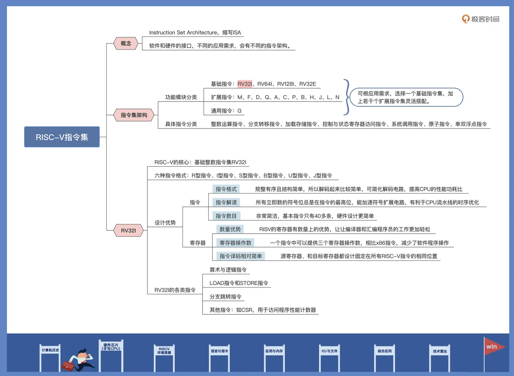

## 思考题

今天我们讲到了 RISC-V 中的分支跳转指令 JAL。想想看，为什么要通过调整立即数的某些位，从 U-TYPE 指令得到 J-TYPE 指令格式呢？这样调整以后有什么好处？

期待你记录自己这节课学完的收获或者疑问，我在留言区等你。如果这节课对你有启发，也推荐你分享给更多朋友。下节课我们就要着手设计迷你 CPU 了，敬请期待。
