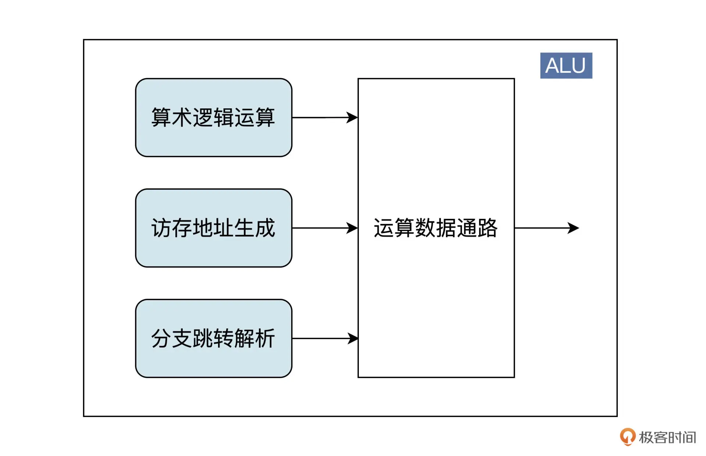
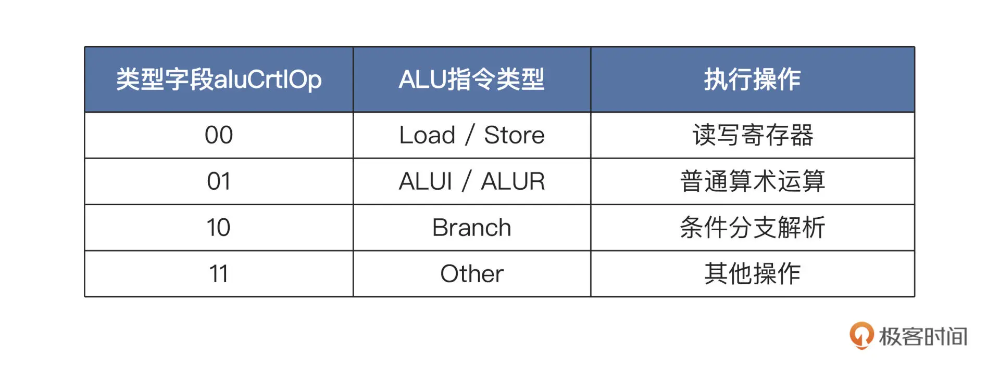
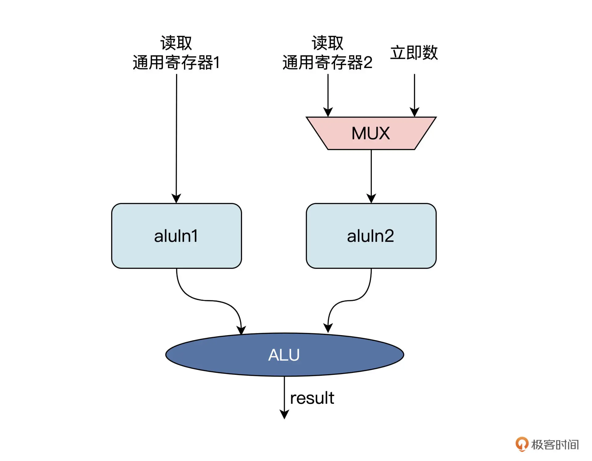
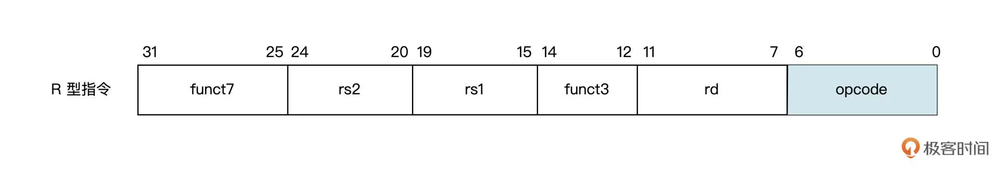
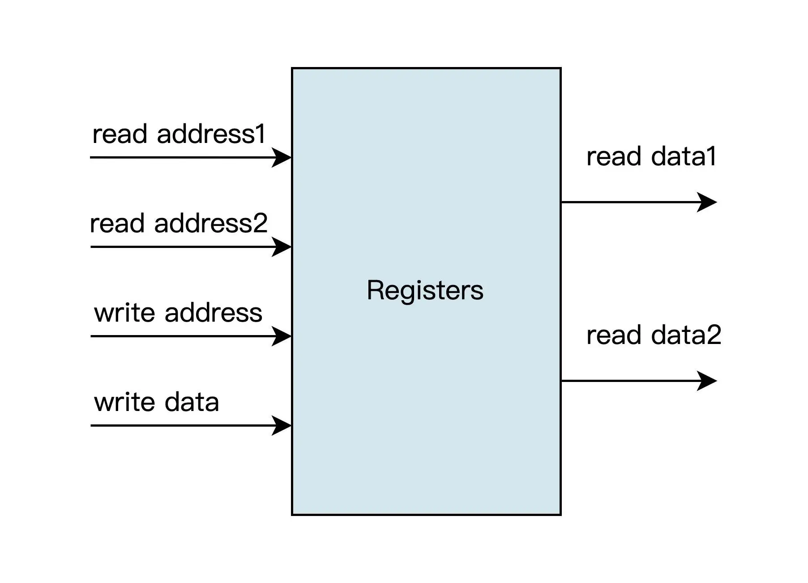
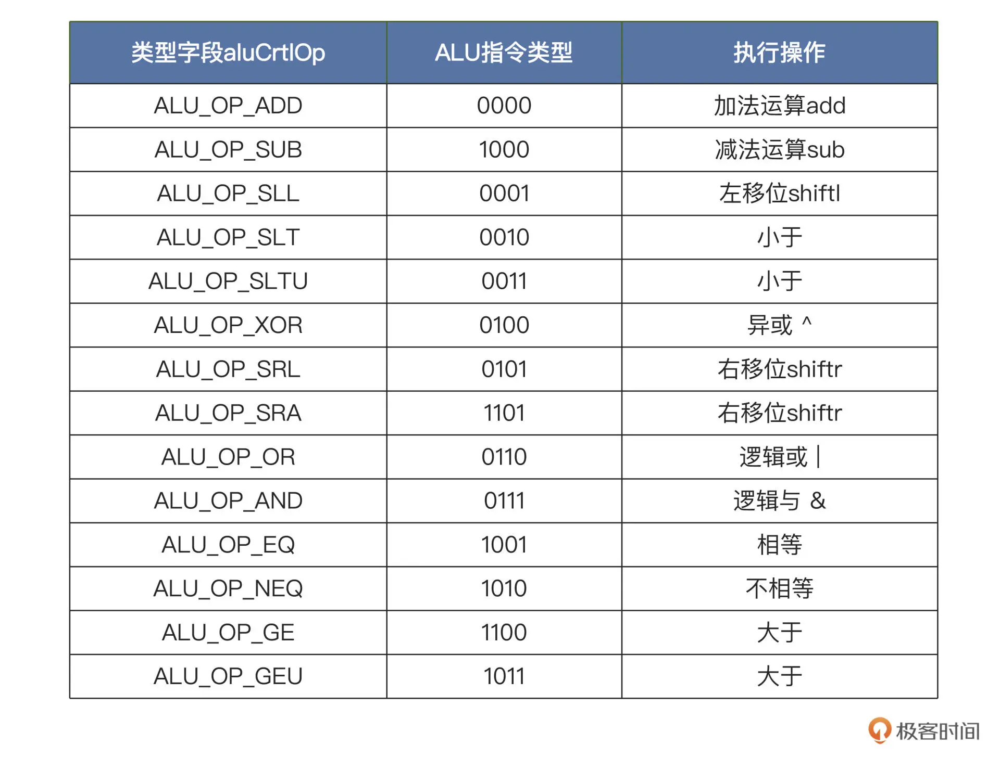
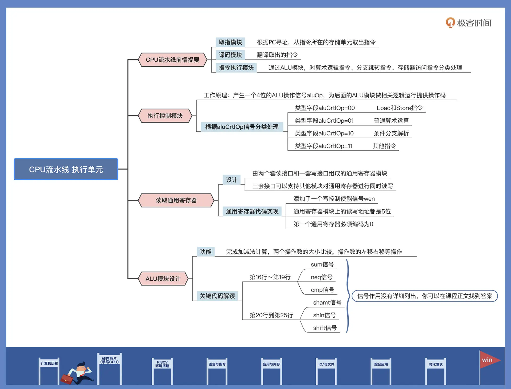

# 08 | 手写CPU（三）：如何实现指令执行模块？

你好，我是 LMOS。

上一节课，我们完成了 CPU 流水线的指令译码模块设计。我们一起探讨了 RISC-V 指令是如何翻译的，还学会了提取不同类型指令中的信息。最后根据流水线的需要，我们设计出了译码控制模块和数据通路模块。

接下来，我们利用译码后的这些信息继续设计流水线的下一级——执行单元。指令执行算是CPU 流水线中最复杂的一个阶段了，不过别担心，经过前面课程的准备，我们一定可以搞定它。

## CPU 的执行概述

回顾前面我们已经设计完成的 CPU 流水线步骤：

1. 取指模块根据程序计数器（PC）寻址到指令所在的存储单元，并从中取出指令。

2. 译码模块对取出的指令进行翻译，得到功能码、立即数、寄存器索引等字段，然后根据某些字段读取一个或两个通用寄存器的值。

经过流水线的这两个步骤之后，下一步就需要把这些指令信息发送给执行单元去执行相关操作。根据译码之后的指令信息，我们可以把指令分为三类，分别是算术逻辑指令、分支跳转指令、存储器访问指令。

上节课我们已经详细解读了 RISC-V 指令集的指令格式，正是因为格式上比较简单而且规整，所以不同类别的指令执行过程也是类似的。这样，RISC 执行单元的电路结构相比 CISC就得到了简化。

所以在指令执行阶段，上述的这三类指令都能通过 ALU 进行相关操作。比如，存储访问指令用 ALU 进行地址计算，条件分支跳转指令用 ALU 进行条件比较，算术逻辑指令用 ALU 进行逻辑运算。



上图就是 ALU 模块的设计框图。在 ALU 模块中，指令可以分成三类来处理：第一类是普通的ALU 指令，包括逻辑运算、移位操作等指令；第二类指令负责完成存储器访问指令 Load 和Store 的地址生成工作；第三类是负责分支跳转指令的结果解析和执行。这就是流水线执行阶段的核心模块 ALU 的设计思路。

## 执行控制模块的设计

根据上节课设计的译码模块，我们已经得到了指令的功能码、立即数、寄存器索引等字段信息。

你是否还记得？我们在译码模块里根据指令的 7 位操作码 opcode 字段，还产生了一个 ALU执行的指令控制字段 aluCrtlOp。这正是上文提到的 ALU 模块把指令分成三类执行的控制信号。

具体的信号编码，你可以参考后面的表格：



根据 2 位执行类型字段 aluCrtlOp，以及指令译码得到的操作码 funct7 和 funct3，就可以设计我们的执行控制模块了。

结合前面的表格，我们来看看执行控制模块如何根据 aluCrtlOp 信号做判断。

如果 aluCrtlOp 等于（00），对应的指令类型就是 Load 和 Store 指令，也就是通过加法运算来计算访存地址；如果 aluCrtlOp 等于（01），相应的指令类型就是 ALUI/ALUR，同样也是根据输入的 funct7 和 funct3 字段决定执行哪些算术运算，比如加减运算、移位操作等；如果类型字段等于（10），就对应着分支跳转指令，流水线就会相应去完成条件分支的解析工作。

表格最后一列你先不用关注，扩展功能时才可能用到，这里先关注前三类情况即可。

具体设计的 Verilog 代码如下：

```
module ALUCtrl (
   input [2:0]  funct3,
   input [6:0]  funct7,
   input [1:0]  aluCtrlOp,
   input        itype,
   output reg [3:0] aluOp
);
   always @(*) begin
     case(aluCtrlOp)
       2'b00:  aluOp <= `ALU_OP_ADD;           // Load/Store
       2'b01:  begin
         if(itype & funct3[1:0] != 2'b01)
           aluOp <= {1'b0, funct3};
         else
           aluOp <= {funct7[5], funct3};   // normal ALUI/ALUR
       end
       2'b10:  begin
         case(funct3)                    // bxx
           `BEQ_FUNCT3:  aluOp <= `ALU_OP_EQ;
           `BNE_FUNCT3:  aluOp <= `ALU_OP_NEQ;
           `BLT_FUNCT3:  aluOp <= `ALU_OP_SLT;
           `BGE_FUNCT3:  aluOp <= `ALU_OP_GE;
           `BLTU_FUNCT3: aluOp <= `ALU_OP_SLTU;
           `BGEU_FUNCT3: aluOp <= `ALU_OP_GEU;
           default:      aluOp <= `ALU_OP_XXX;
         endcase
         end
       default: aluOp <= `ALU_OP_XXX;
     endcase
   end
endmodule
```

这里要注意的是，当 aluCtrlOp 等于（01）时，需要根据 funct3 和 funct7 产生 ALU 的操作码。在前面的译码模块中，已经为我们提供了 I 型指令类型的判断信号 itype。如果是 itype 信号等于“1”，操作码直接由 funct3 和高位补“0”组成；如果不是 I 型指令，ALU 操作码则要由funct3 和 funct7 的第五位组成。

根据上述的三类指令，就会产生一个 4 位的 ALU 操作信号 aluOp，为后面的 ALU 模块做相关逻辑运行提供操作码。

## 通用寄存器

在 ALU 模块开始执行运算之前，我们还需要提前完成一个操作——读取通用寄存器。在参与ALU 逻辑运算的两个操作数中，至少有一个来自于通用寄存器，另一个可以来自于通用寄存器或者指令自带的立即数，如下图所示：





由于第七节课提到的 6 种指令中的 R 型指令有三个操作数，分别对应于两个源寄存器 rs1 和rs2，以及一个目标寄存器 rd。一条 R 指令类似于有三个参数的函数，如 add（rd，rs1，rs2），完成的功能就是先读取 rs1、rs2 两个参数，然后相加，最后把结果写入到 rd 参数中。

对应到每条指令，则需要从通用寄存器模块中读取其中两个寄存器中的数据，之后还要把运算结果写入另一个通用寄存器。每读取一个寄存器，就需要输入一个寄存器索引，并输出一个通用寄存器中的值。两个操作数对应的寄存器需要同时读取，所以通用寄存器模块需要两个读地址接口和两个读数据输出接口。

此外，处于流水线上的指令是并发执行的，在读取通用寄存器的同时，可能还需要写入数据到通用寄存器，所以需要一套写地址和写数据接口。因此，通用寄存器模块的设计框图如下：



根据上述的设计思路，我们就可以设计和实现通用寄存器代码了。

```
module gen_regs (
   input  clk,
   input  reset,
   input  wen,
   input  [4:0] regRAddr1, regRAddr2, regWAddr,
   input  [31:0] regWData,
   output [31:0] regRData1,
   output [31:0] regRData2
);
   integer ii;
   reg [31:0] regs[31:0];
   // write registers
   always @(posedge clk or posedge reset) begin
       if(reset) begin
           for(ii=0; ii<32; ii=ii+1)
               regs[ii] <= 32'b0;
       end
       else if(wen & (|regWAddr))
               regs[regWAddr] <= regWData;
   end
   // read registers
   assign regRData1 = wen & (regWAddr == regRAddr1) ? regWData
                   : ((regRAddr1 != 5'b0) ? regs[regRAddr1] : 32'b0);
   assign regRData2 = wen & (regWAddr == regRAddr2) ? regWData
                   : ((regRAddr2 != 5'b0) ? regs[regRAddr2] : 32'b0);
endmodule
```

这里添加了一个写控制使能信号 wen。因为写寄存器是边沿触发的，在一个时钟周期内写入的寄存器数据，需要在下一个时钟周期才能把写入的数据读取出来。为了提高读写效率，在对同一个寄存器进行读写时，如果写使能 wen 有效，就直接把写入寄存器的数据送给读数据接口，这样就可以在一个时钟周期内，读出当前要写入的寄存器数据了。

从前面的章节中我们知道，通用寄存器总共有 32 个，所以通用寄存器模块上的读写地址都是

## 25

5 位（

- =32）。

其中，还有一个寄存器比较特殊，从代码中也可以看到它的特殊处理，即读地址 regRAddr1= 5’b0 时的寄存器。我们把第一个寄存器叫做 0 值寄存器，因为在 RISC-V 指令架构中就规定好了，第一个通用寄存器必须编码为 0，也就是把写入该寄存器的数据忽略，而在读取时永远输出为 0。

## ALU 模块设计

当操作码和操作数都准备好后，我们就可以开始 ALU 模块的实现了。

上述执行控制模块根据三类指令产生的 ALU 操作信号 aluOp，在 ALU 模块就能以此为依据，执行相应的运算了。操作码对应的 ALU 操作如下表所示：



根据表格中的操作编码和对应的运行操作，很容易就可以设计出 ALU 模块，具体的设计代码如下：

```javascript
module alu (
 input  [31:0] alu_data1_i,
 input  [31:0] alu_data2_i,
 input  [ 3:0] alu_op_i,
 output [31:0] alu_result_o
);
 reg  [31:0] result;
 wire [31:0] sum    = alu_data1_i + ((alu_op_i[3] | alu_op_i[1]) ? -alu_data2_i
 wire        neq    = |sum;
 wire        cmp    = (alu_data1_i[31] == alu_data2_i[31]) ? sum[31]
                    : alu_op_i[0] ? alu_data2_i[31] : alu_data1_i[31];
 wire [ 4:0] shamt  = alu_data2_i[4:0];
 wire [31:0] shin   = alu_op_i[2] ? alu_data1_i : reverse(alu_data1_i);
 wire [32:0] shift  = {alu_op_i[3] & shin[31], shin};
 wire [32:0] shiftt = ($signed(shift) >>> shamt);
 wire [31:0] shiftr = shiftt[31:0];
 wire [31:0] shiftl = reverse(shiftr);
 always @(*) begin
   case(alu_op_i)
     `ALU_OP_ADD:    result <= sum;
     `ALU_OP_SUB:    result <= sum;
     `ALU_OP_SLL:    result <= shiftl;
     `ALU_OP_SLT:    result <= cmp;
     `ALU_OP_SLTU:   result <= cmp;
     `ALU_OP_XOR:    result <= (alu_data1_i ^ alu_data2_i);
     `ALU_OP_SRL:    result <= shiftr;
     `ALU_OP_SRA:    result <= shiftr;
     `ALU_OP_OR:     result <= (alu_data1_i | alu_data2_i);
     `ALU_OP_AND:    result <= (alu_data1_i & alu_data2_i);
     `ALU_OP_EQ:     result <= {31'b0, ~neq};
     `ALU_OP_NEQ:    result <= {31'b0, neq};
     `ALU_OP_GE:     result <= {31'b0, ~cmp};
     `ALU_OP_GEU:    result <= {31'b0, ~cmp};
     default:        begin
                     result <= 32'b0;
       end
   endcase
 end
 function [31:0] reverse;
   input [31:0] in;
   integer i;
   for(i=0; i<32; i=i+1) begin
     reverse[i] = in[31-i];
   end
 endfunction
 assign alu_result_o = result;
endmodule
```

在上面的 ALU 模块代码中，输入信号 aluIn1 和 aluIn2 分别是源操作数 1 和源操作数 2，信号aluOp 是执行控制模块产生的 ALU 运算控制码。ALU 的功能就是根据运算码 aluOp 来完成两个源操作数的逻辑运算，并把结果通过信号 aluOut 输出。

ALU 模块的总体代码比较简单，但里面这段代码（第 16 行～第 19 行）不好理解，别担心，我这里专门拿出来给你讲一下。

```
 wire [31:0] sum    = aluIn1 + ((aluOp[3] | aluOp[1]) ? -aluIn2 : aluIn2);
 wire        neq    = |sum;
 wire        cmp    = (aluIn1[31] == aluIn2[31]) ? sum[31]
                      : aluOp[0] ? aluIn2[31] : aluIn1[31];
```

首先，代码中的 sum 信号其实就是两个源操作数的和，不过当运算码 aluOp 的第 3 位和第 1位为“1”时做的是相减运算，这是为减法指令或者后面的比较大小而准备的运算。你可以对照上面的 ALU 运算表格来理解。

neq 信号表示的是比较两个操作数是否相等，这就是根据前面的两个操作相减的结果判断，如果它们的差不为“0”，也就是 sum 信号按位与之后不为“0”，则表示两个操作数不相等。

cmp 信号表示两个操作数的大小比较，如果它们的最高位（也就是符号位）相等，则根据两个操作数相减的差值的符号位（也是数值的最高位）判断。如果是正数，表示源操作数 1 大于源操作数 2，否则表示源操作数 1 小于源操作数 2。

如果它们的最高位不相等，则根据 ALU 运算控制码 aluOp 的最低位判断。如果 aluOp 最低位为“1”，表示是无符号数比较，直接取操作数 2 的最高位作为比较结果。如果 aluOp 最低位为“0”，表示是有符号数比较，直接取操作数 1 的最高位作为比较结果。

下面我们再来看看移位操作相关的代码，其中的 shamt 信号是取自源操作数 2 的低五位，表示源操作数 1 需要移多少位（25=32）。shin 信号是取出要移位的数值，根据 aluOp 判断是左移还是右移，如果是右移就直接等于源操作数 1，如果是左移就先对源操作数的各位数做镜像处理。

shift 信号是根据 aluOp 判断是算术右移还是逻辑右移，如果是算术右移，则在最高位补一个符号位。shiftt 信号是右移之后的结果，这里用到了$signed() 函数对移位前的数据 shift 进行了修饰，$signed() 的作用是决定如何对操作数扩位这个问题。

具体的过程是，在右移操作前，$signed() 函数先把操作数的符号位，扩位成跟结果相同的位宽，然后再进行移位操作，而 shiftr 就是右移后的结果。

我们再专门看看 ALU 模块代码的第 20 行到第 25 行，这部分主要用来完成移位操作。

```
 wire [ 4:0] shamt  = aluIn2[4:0];
 wire [31:0] shin   = aluOp[2] ? aluIn1 : reverse(aluIn1);
 wire [32:0] shift  = {aluOp[3] & shin[31], shin};
 wire [32:0] shiftt = ($signed(shift) >>> shamt);
 wire [31:0] shiftr = shiftt[31:0];
 wire [31:0] shiftl = reverse(shiftr);
```

请你注意，左移的结果 shiftl，是由右移后的结果进行位置取反得到的。因为对于需要左移的操作数，在前面已经做了位置取反，所以移位操作时也是进行右移处理，最后把结果再一次做位置取反就可以了。

好了，恭喜你走到这里，CPU 流水线中执行阶段的内容就告一段落了。下一节课我们继续完成流水线的访存模块的设计。

## 重点回顾

这节课告一段落，我来给你做个总结。

指令执行算是 CPU 流水线中最复杂的一个阶段了，需要我们慢慢推导，细细思考，才能理清楚里面的逻辑关系。这节课的内容和前面的第五节课到第七节课的知识关联比较多，不懂的地方你可以再回去看看。

下面我们一起来回顾一下今天的重点内容。为了实现 CPU 的指令执行模块，我们先梳理了设计思路。我们把指令分成逻辑运算、存储器访问、条件分支判断这三类指令进行处理。这三类指令经过 ALU 执行相关操作之后，统一由数据通路来输出结果。

接着我们设计了执行控制模块。根据译码模块里产生的指令控制字段 aluCrtlOp，执行控制模块可以根据上述的三类指令，相应产生一个 4 位的 ALU 操作信号 aluOp，为后面的 ALU 模块提供运算执行码。

根据指令在流水线中执行时对通用寄存器的读写特点，我们为 32 个通用寄存器组设计了由两个套读接口和一套写接口组成的通用寄存器模块，这三套接口可以支持其他模块对通用寄存器进行同时读写。

最后，根据执行控制模块产生的 ALU 运算控制信号 aluOp，我们设计出了 ALU 模块。在 ALU模块中，可以完成加减法计算，两个操作数的大小比较，操作数的左移右移等操作。



如果你有兴趣的话，可以参考前面 RISC-V 指令架构里列出的指令，自己试试实现更多的指令操作。下节课，我们继续探索访存相关模块如何设计和实现，敬请期待。

## 思考题

在 ALU 模块代码中，为什么要把左移操作转换为右移进行处理？

欢迎你在留言区跟我交流讨论，积极参与思考有助于你深化理解。如果觉得这节课还不错，别忘了分享给身边的朋友，邀他跟你一起手写 CPU！
