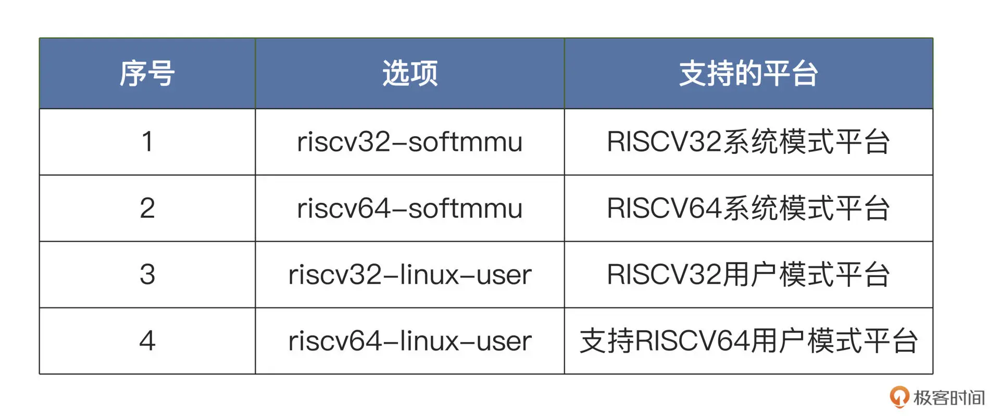
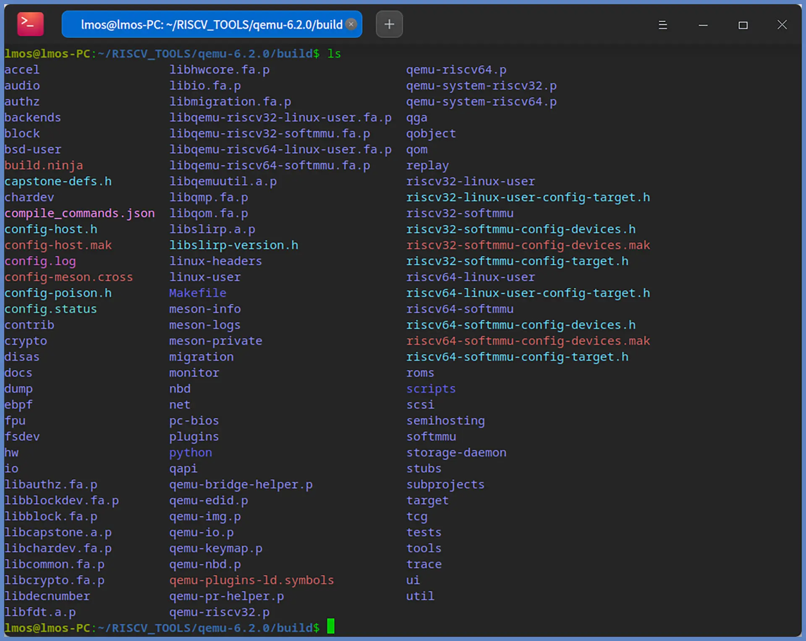
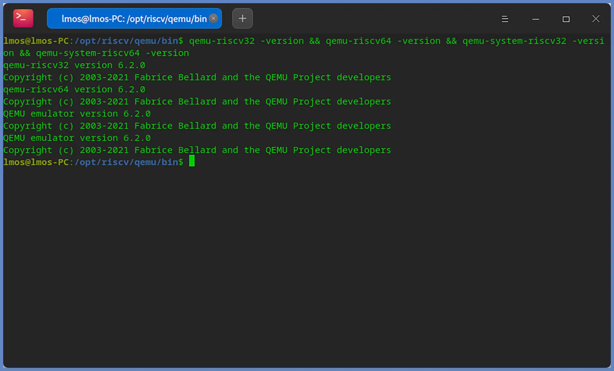
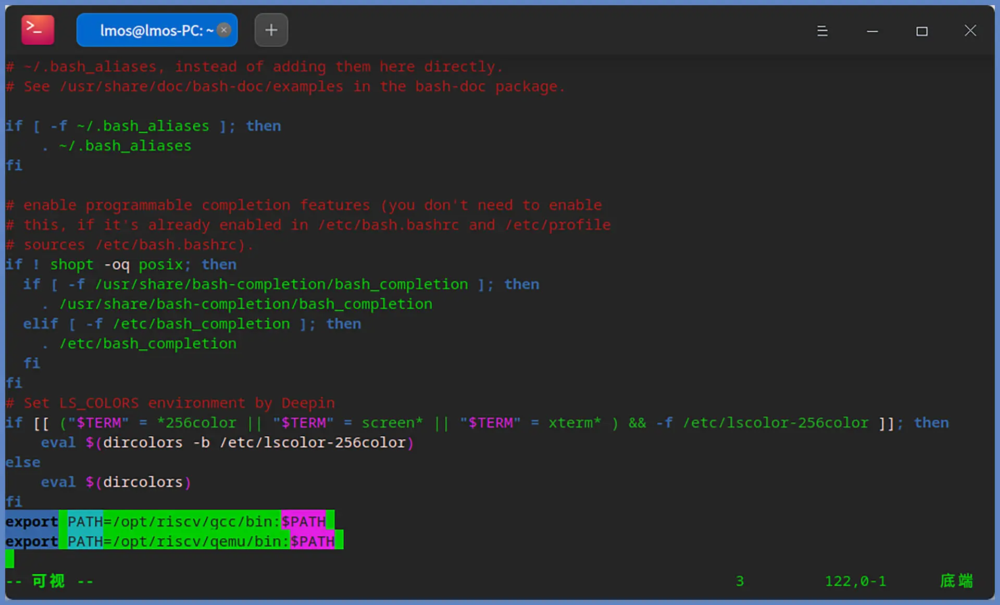
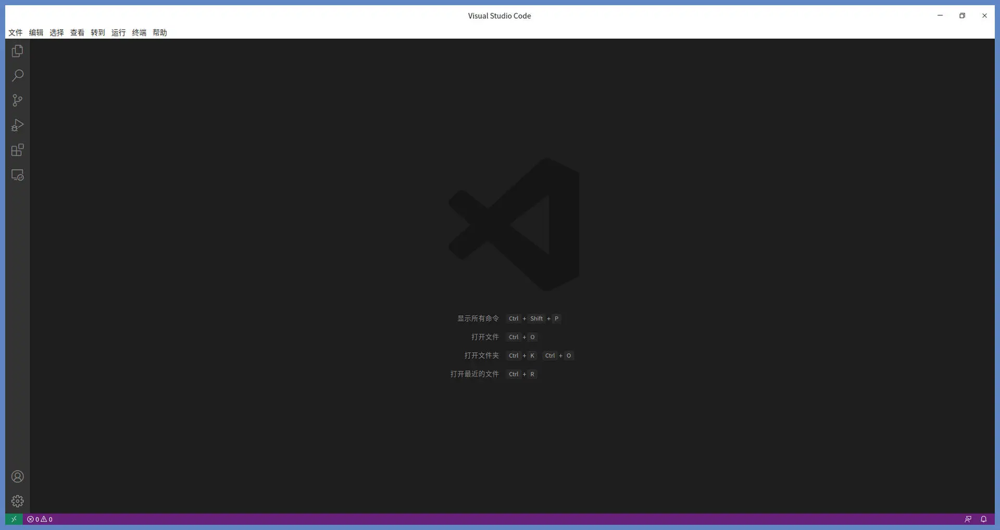
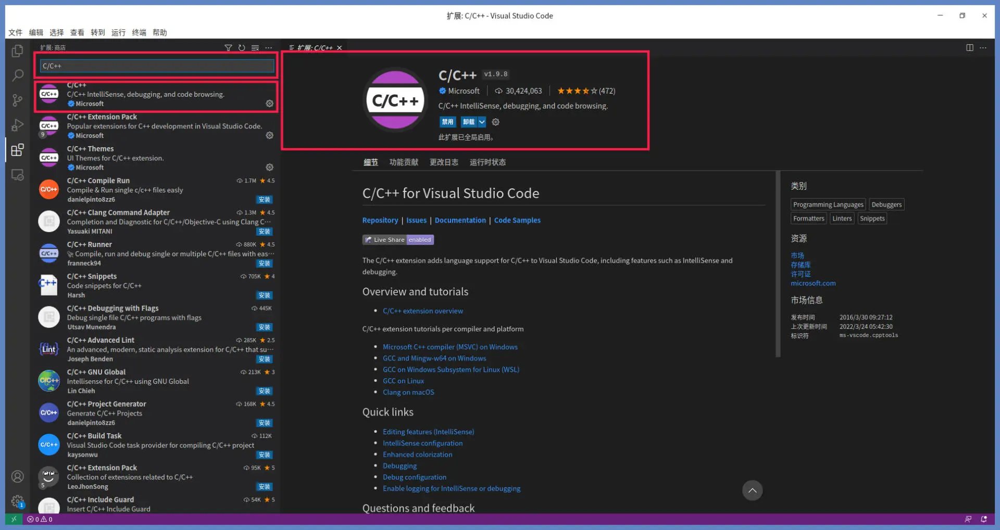
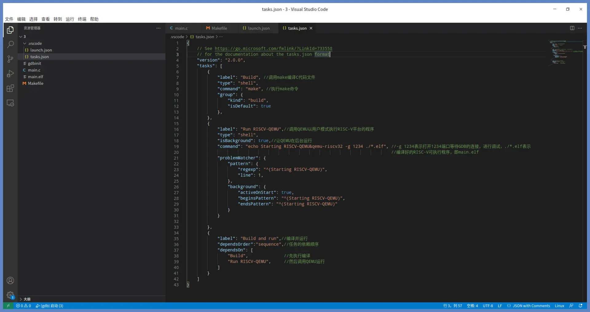
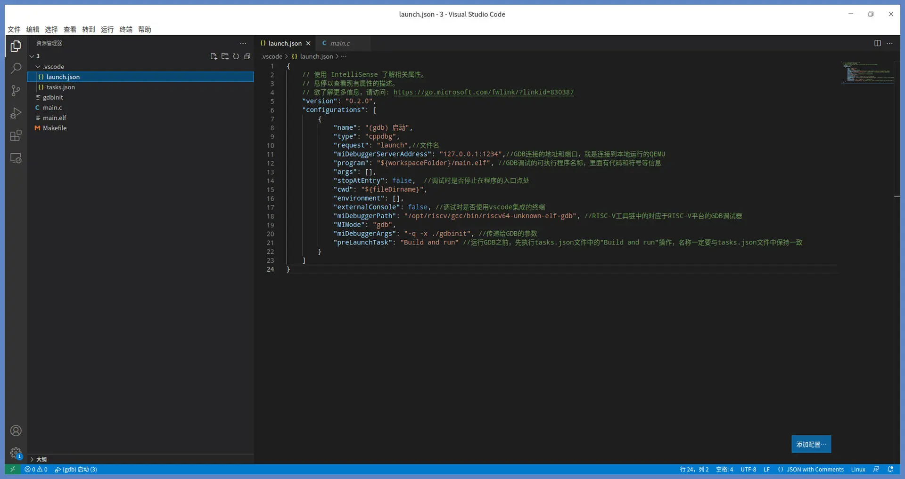
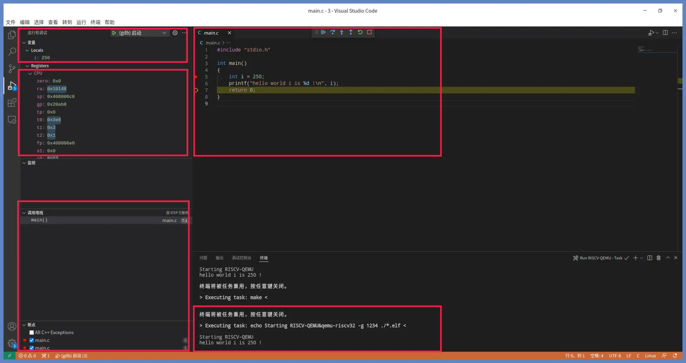
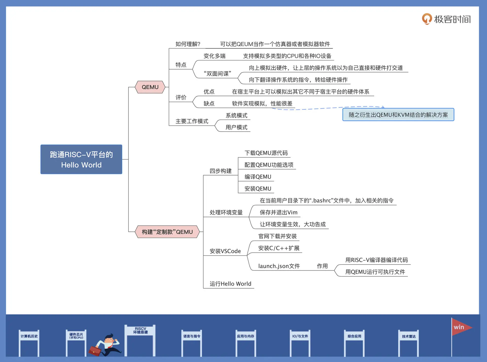

# 13 | 小试牛刀：跑通RISC-V平台的HelloWorld程序

你好，我是 LMOS。

在上一课中，我们一起约定了主环境，安装了编译工具和依赖库，构建了交叉编译 RISC-V 工具链。

今天我们继续构建 RISC-V 版的模拟器 QEMU（代码你可以从这里下载），让它成为“定制款”，更匹配我们的学习需要。为此，我们需要设置好主环境的环境变量，安装好 VSCode 及其插件，这样才能实现编辑、编译、运行、调试 RISC-V 程序的一体化、自动化。

话不多说，我们开始吧。

## RISC-V 运行平台

有了上节课成功构建好的交叉编译器，有很多同学可能按捺不住，急着想写一个简单的 HelloWorld 程序，来测试一下刚刚构建的交叉编译器。

恕我直言，这时你写出来的 Hello World 程序，虽然会无警告、无错误的编译成功，但是只要你一运行，铁定会出错。

这是为什么呢？因为你忘记了交叉编译器，生成的是 RISC-V 平台的可执行程序，这样的程序自然无法在你的宿主机 x86 平台上运行，它只能在 RISC-V 平台上运行。

摸着自己的荷包，你可能陷入了沉思：难道我还要买一台 RISC-V 平台的计算机？这样成本可太高了，不划算。

贫穷让人学会变通，为了节约成本，我们希望能用软件模拟 RISC-V 平台。嘿！这当然可以，而且前辈们，早已给我们写好了这样的软件，它就是 QEMU。

## 揭秘 QEMU

什么是 QEMU？QEMU 是一个仿真器或者说是模拟器软件，与市面上 BOCHS 类似，由软件来实现模拟。

QEMU 就像计算机界的“孙悟空”，变化多端，能模拟出多种类型的 CPU，比如 IA32、AMD64、ARM、MIPS、PPC、SPARC、RISC-V 等。QUEM 通过动态二进制转换来模拟CPU。除了 CPU，它还支持模拟各种 IO 设备，并提供一系列的硬件模型。这使得 QEMU 能模拟出完整的硬件平台，使得 QEMU 能运行各种操作系统，如 Windows 和 Linux。

你可以把 QEMU 当做一个“双面间谍”，因为在它上面运行的操作系统，也许还认为自己在和硬件直接打交道，其实是同 QEMU 模拟出来的硬件打交道，QEMU 再将这些指令翻译给真正硬件进行操作。通过这种模式，QEMU 运行的操作系统就能和宿主机上的硬盘、网卡、CPU、CD-ROM、音频设备、USB 设备等进行交互了。

由于 QEMU 的以上这些特点，导致 QEMU 在宿主平台上可以模拟出其它不同于宿主平台的硬件体系，这是 QEMU 的优点。

不过，由于是用了软件来实现的模拟，所以性能很差，这也是 QEMU 的缺点。正因为这个缺点，后来就出现了 QEMU 和 KVM 结合使用的解决方案。

KVM 基于硬件辅助的虚拟化技术，主要负责比较繁琐的 CPU 和内存虚拟化，而 QEMU 则负责 I/O 设备的模拟，两者合作各自发挥自身的优势，成就了强强联合的典范。

回归主题，关于 QEMU，现阶段你最需要记住的就是，它有两种主要工作模式：系统模式和用户模式。

在系统工作模式下，QEMU 能模拟整个计算机系统，包括 CPU 及其他 IO 设备。它能运行和调试不同平台开发的操作系统，也能在宿主机上虚拟不同数量、不同平台的虚拟电脑。而在用户工作模式，QEMU 能建立一个普通进程，运行那些由不同体系处理器编译的应用程序，比如后面我们要动手编写的 RISC-V 版的 Hello World 程序。

## 构建我们的“定制款”QEMU

说了这么多，其实是想让你更加了解 QEMU。

下面我们来办正事儿——构建适合我们的 QEMU，如果我们不是有特殊要求——模拟 RISC-V平台且带调试功能的 QEMU，用不着亲自动手去构建，只需要一条安装指令就完事了。

构建 QEMU 用四步就能搞定：首先下载 QEMU 源代码，接着配置 QEMU 功能选项，然后编译 QEMU，最后安装 QEMU。

我们需要从 QEMU官网上下载稳定版本的 QEMU 源代码。如果你和我一样，觉得在浏览器上点来点去非常麻烦，也可以在切换到 RISCV_TOOLS 目录的终端下，输入如下指令：

```bash
wget https://download.qemu.org/qemu-6.2.0.tar.xz #下载源码包
tar xvJf qemu-6.2.0.tar.xz #解压源码包
```

这里跑完第一条指令以后，下载下来的是压缩的 QEMU 源码包。所以，在下载完成后，你要用第二条指令来解压。

由于上节课我们构建 RISC-V 工具链时，已经统一安装了构建 QEMU 所需要的相关依赖库，所以这里就不用安装相关依赖库了。

解压成功后，我们就要开始配置 QEMU 的功能了。同样，为了不污染源代码目录，我们可以先在 qemu-6.2.0 目录下，建立一个 build 目录，然后切换到 build 目录下进行配置，输入如下指令：

```bash
mkdir build #建立build目录
cd build #切换到build目录下
../configure --prefix=/opt/riscv/qemu --enable-sdl --enable-tools --enable-debug
```

上述配置选项中，–prefix 表示 QEMU 的安装目录，我们一起约定为“/opt/riscv/qemu”目录，–enable-sdl 表示 QEMU 使用 sdl 图形库， --enable-tools 表示生成 QEMU 工具集，–enable-debug 表示打开 QEMU 调试功能。

最重要的是 --target-list 这个选项，它表示生成 QEMU 支持的模拟目标机器。不同选项所支持的平台不同，我们的选择如下表所示：



如果你什么都不选的话，它会默认生成 QEMU 支持的所有平台。按前面我们讲的操作配置，配置成功后，build 目录下会生成后面截图里展示的文件和目录。



配置好功能选项之后，下一步就是编译 QEMU 了。只要配置成功了，编译这事儿就非常简单了，我们只要输入如下指令，然后交给计算机编译就好了。别忘了等待期间泡杯茶，不知道你会不会像我一样哼起那首歌：“世上有没有人，安静的等待你，一直不愿回神……”

```bash
sudo make -j8
```

最后就是安装 QEMU，经过漫长等待以后，我们终于迎来编译的成功。这时，你还需要输入如下指令进行安装。

```bash
sudo make install
```

这里说明一下，QEMU 不像 RISC-V 工具链那样，会在编译结束后自动安装，它需要手动安装。

我们在终端中切换到“/opt/riscv/qemu/bin”目录下，执行如下指令：

```
qemu-riscv32 -version && qemu-riscv64 -version && qemu-system-riscv32 -version &&
```

上述指令会输出 qemu-riscv32、qemu-riscv64、qemu-system-riscv32、qemu-system-riscv64 的版本信息，以证明能运行 RISC-V 平台可执行程序的 QEMU 构建成功。你可以对照一下后面的截图。



到这里，RISC-V 平台的编译环境和执行环境已经构建完成，并且能生成和执行 32 位或者 64位的 RISC-V 平台的可执行程序，无论是 RISC-V 平台的应用程序，还是 RISC-V 平台的操作系统。

### 处理环境变量

不知道你发现了没有？我们运行 QEMU 和 RISC-V 工具链相关的程序，都要切换到/opt/riscv/xxxx/bin 目录中才可以运行，而不是像 Linux 中的其它程序，可以直接在终端中直接运行。

革命还未成功，我们还得努力。这是因为我们没有将 QEMU 和 RISC-V 工具链的安装目录，加入到 Linux 的环境变量中。

接下来我们就开始处理环境变量，修改环境的方法有好几种。这里我为你演示比较常用的一种，那就是在当前用户目录下的“.bashrc”文件中，加入相关的指令。

这里说的“当前用户的目录”就是在终端中执行"cd ~" 指令。怎么操作呢？我们切换到当前用户目录下，来执行这个指令。然后，在文件尾部加上两行信息就行了。具体指令如下所示：

```bash
cd ~ #切换到当前用户目录下
vim ./.bashrc #打开.bashrc文件进行编辑
#在.bashrc文件末尾加入如下信息
export PATH=/opt/riscv/gcc/bin:$PATH
export PATH=/opt/riscv/qemu/bin:$PATH
```

上述操作完成以后，你会看到下图所示的结果：



随后，我们按下键盘上 ESC 键，接着输入":wq"以便保存并退出 Vim。这样操作后，你会发现环境变量并没有生效。

这里还差最后一步，我们在终端中输入如下指令，让环境变量生效：

```
source ./.bashrc
```

现在，你在任何目录之下输入 QEMU 和 RISC-V 工具链相关的程序命令，它们就都可以正常运行了。

### 安装 VSCode

有了 QEMU 和 RISC-V 工具链相关的程序命令，我们虽然可以编译调试和执行 RISC-V 平台的程序了，但是必须在终端中输入多条指令，才能完成相关的工作。

这对于很多同学来说，肯定觉得很陌生，特别是在图形化盛行的今天，我们更期待能有个轻量级的 IDE。

这里我们约定使用 VSCode，它安装起来也很简单。在 VSCode 官网上下载 deb 包，下载后双击 deb 安装，或者切换到刚才下载 VSCode 目录的终端中，输入如下指令就行了。

```bash
sudo apt-get install -f *.deb
```

安装好后，在你的桌面会出现 VSCode 图标，双击打开后的页面如下所示：



不过，有了 VSCode 我们目前只能写代码，还不能编译和调试代码，所以需要给 VSCode 安装 C/C++ 扩展。我们只需打开 VSCode，按下 ctrl+shift+x，就能打开 VSCode 的扩展页面，在搜索框中输入 C/C++ 就可以安装了，如下所示：



至此，我们的 VSCode 及其需要的扩展组件就安装完成了。

下一步，我们还需要在你的代码目录下建立一个.vscode 文件夹，并在文件里写上两个配置文件。这两个配置文件我已经帮你写好了，如下所示。



在.vscode 文件夹中有个 tasks.json 文件，它主要负责完成用 RISC-V 编译器编译代码的功能，还有用 QEMU 运行可执行文件的功能。

我们先说说这里的编译工作是怎么完成的。具体就是通过调用 make，读取代码目录中的Makefile 脚本，在这个脚本中会调用 riscv64-unknown-elf-gcc 完成编译。等编译成功后，才会调用 QEMU 来接手，由它运行编译好的可执行程序。代码注释已经写得很清楚了，你可以停下来仔细看看。

不过，tasks.json 文件虽然解决了编译与运行的问题，但是它也是被其它文件调用的。被谁调用呢？那就是我们的调试配置文件 launch.json 文件，它用于启动调试器 GDB，只不过这里启动的不是宿主平台上的 GDB，而 RISC-V 工具链中的 GDB。其内容如下所示：



当我们写好代码后，按下 F5 键后，VSCode 就会执行 launch.json 文件的调试操作了。这里调试器和要调试的可执行程序已经制定好了。不过由于 preLaunchTask 的指定，开始执行调试命令之前，VSCode 会首先执行 tasks.json 文件中的操作，即编译和运行。

### 运行 Hello World

下面我们一起来写下那个著名的程序——Hello World！写好后，在 main 函数所在的行前打上一个断点，按下 F5 键，就会看到如下界面。



如果不出意外，哈哈，放心，按我提供给你的步骤，也出不了意外，你一定会看到以上界面。

我们重点来观察红色方框中的信息，可以查看代码变量值、CPU 的寄存器值、函数的调用栈、断点信息、源代码以及程序执行后在 VSCode 内嵌终端中输出的信息。有了这些信息，我们就能清楚地看到一个程序运行过程的状态和结果。

走到这里，我们的定制款 QEMU 以及 VSCode 就搭好了，可以去图形化编辑、编译、运行和调试 RISC-V 平台的可执行程序了。

## 重点回顾

好了，我们的 RISC-V 平台的 Hello World，也是我们在宿主机上开发的第一个非宿主机的程序，现在已经成功运行，这说明我们之前的工作完成得很完美，今天的课程不知不觉也接近了尾声。

下面来回顾一下，这节课我们都做了些什么。

首先，我们构建了能运行 RISC-V 可执行程序的 QEMU 模拟器，这使得我们不必购买 RISC-V平台的机器，就能在宿主机上运行 RISC-V 可执行程序。这不但大大方便了我们的开发工作，而且节约了成本。

然后，我们处理了环境变量，方便我们在任何目录下，都可以随意使用 RISC-V 工具链中的命令和 QEMU 相关的命令。

最后，我们安装了 VSCode，还在其中安装 C/C++ 扩展并对其进行了相应的配置。以后我们在 VSCode 图形环境下编写代码、编译代码和调试代码，就能一气呵成了。

这节课的要点我整理了导图，供你参考。



恭喜你坚持到这里，通过两节课的内容，我们拿下了开发环境这一关，这对我们后续课程中的实验相当重要。下一模块讲解和调试 RISC-V 汇编指令的时候，你会进一步体会到环境搭建好的便利，先好好休息一下，咱们下节课见。

## 思考题

处理环境变量后为什么要执行 source ./.bashrc，才会生效？

欢迎你在留言区提问或者晒晒你的实验记录。如果觉得有收获，也推荐你把这节课分享给你的朋友。
