# 17 | RISC-V指令精讲（二）：算术指令实现与调试

你好，我是 LMOS。

上节课，我们学习了算术指令中的加减指令和比较指令。不过一个 CPU 只能实现这两类指令还不够。如果你学过 C 语言，应该对“<<、>>、&、|、!”这些运算符并不陌生，这些运算符都需要 CPU 提供逻辑和移位指令才可以实现。

今天我们就继续学习逻辑指令（and、or、xor）和移位指令 （sll、srl、sra）。代码你可以从这里下载。话不多说，我们开始吧。

## 逻辑指令

从 CPU 芯片电路角度来看，其实 CPU 更擅长执行逻辑操作，如与、或、异或。至于为什么，你可以看看 CPU 的基础门电路。

RISC-V 指令集中包含了三种逻辑指令，这些指令又分为立即数版本和寄存器版本，分别是andi、and、ori、or、xori、xor 这六条指令。我们学习这些指令的方法和上节课类似，也涉及到写代码验证调试的部分。

### 按位与操作：andi、and 指令

首先我们来学习一下 andi、and 指令，它们的形式如下所示：

```
andi rd，rs1，imm
#andi 立即数按位与指令
#rd 目标寄存器
#rs1 源寄存器1
#imm 立即数
and rd，rs1，rs2
#and 寄存器按位与指令
#rd 目标寄存器
#rs1 源寄存器1
#rs2 源寄存器2
```

上述代码中 rd、rs1、rs2 可以是任何通用寄存器，imm 是立即数。

andi、and 这两个指令完成的操作，我们用伪代码描述如下：

```
//andi
rd = rs1 & imm
//and
rd = rs1 & rs2
```

按位与的操作，就是把 rs1 与 imm 或者 rs1 与 rs2 其中的每个数据位两两相与。两个位都是1，结果为 1，否则结果为 0。

下面我们在工程目录下建立一个 and.S 文件，写代码验证一下这两个指令，如下所示：

```
.globl andi_ins
andi_ins:
   andi a0，a0，0xff       #a0 = a0&0xff，a0是C语言调用者传递的参数，a0也是返回值，这样计
   jr ra                   #函数返回
.globl and_ins
and_ins:
   and a0，a0，a1          #a0 = a0&a1，a0、a1是C语言调用者传递的参数，a0是返回值，这样计
   jr ra                   #函数返回
```

这里我们已经写好了 andi_ins 与 and_ins 函数，分别去执行 andi 和 and 指令。

andi 指令是拿 a0 寄存器和立即数 0xff 进行与操作。由于立即数是 0xff，所以总是返回 a0 的低 8 位数据；and 指令则是拿 a0 和 a1 寄存器进行与操作，再把结果写入到 a0 寄存器。

下面我们用 VSCode 打开工程按下“F5”调试一下，如下所示：

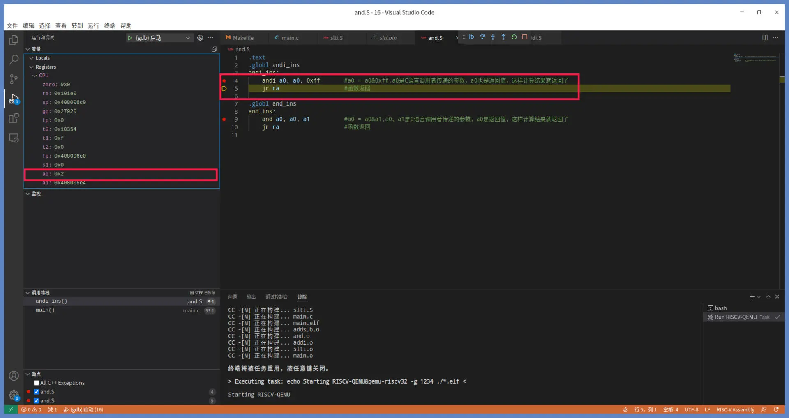

上图中是执行完 andi a0，a0，0xff 指令之后，执行 jr ra 指令之前的状态。可以看到，a0 寄存器中的值确实已经变成 2 了，这说明运算的结果是符合预期的。

andi_ins 函数返回后，输出的结果如下图所示：

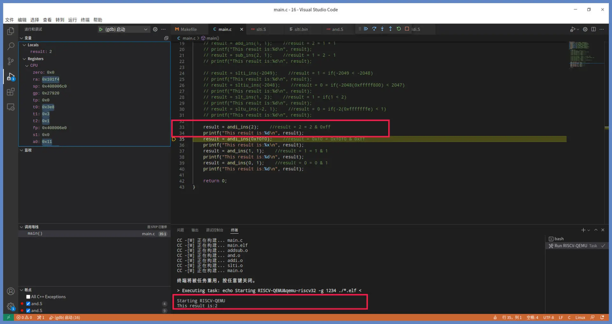

因为 2 的二进制数据是（0b00000000000000000000000000000010）与上 0xff 的二进制数据是（0b00000000000000000000000011111111）结果确实是 2，所以返回 2，结果是正确的。

接下来，我们对 and_ins 函数进行调试。

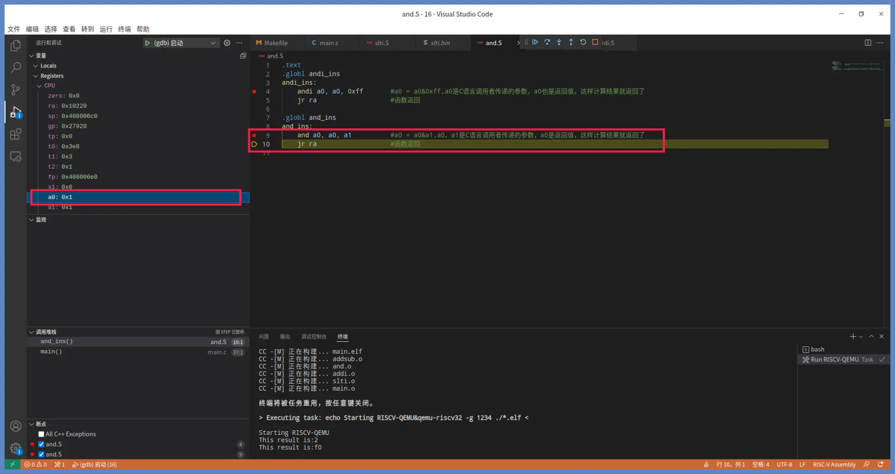

上图展示的是执行完 and a0，a0，a1 指令之后，执行 jr ra 指令之前的状态。我们看到 a0 寄存器中的值已经变成了 1，这说明运算的结果是正确的。

and_ins 函数返回后，输出的结果如下图所示：

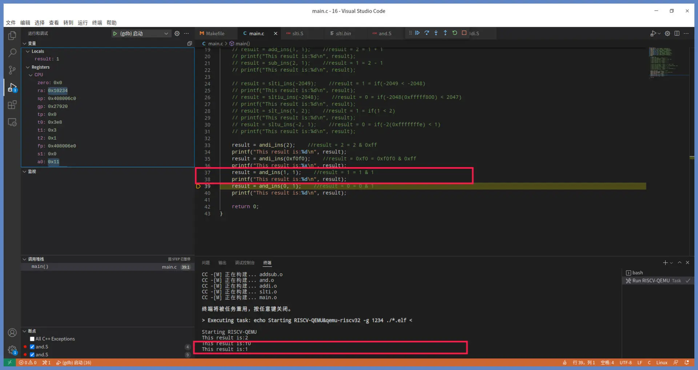

上图中因为 1 的二进制数据是（0b00000000000000000000000000000001）与上 1 的二进制数据是（0b00000000000000000000000000000001）确实是 1，所以返回 1，结果完全正确。

### 按位或操作：ori、or 指令

按位与操作说完了，我们接着来学习一下或指令 ori、or，它们的形式如下：

```
ori rd，rs1，imm
#ori 立即数按位或指令
#rd 目标寄存器
#rs1 源寄存器1
#imm 立即数
or rd，rs1，rs2
#or 寄存器按位或指令
#rd 目标寄存器
#rs1 源寄存器1
#rs2 源寄存器2
```

同样地，上述代码中 rd、rs1、rs2 可以是任何通用寄存器，imm 表示立即数。

我们还是从伪代码的描述入手，看看 ori、or 完成的操作。

```
//ori
rd = rs1 | imm
//or
rd = rs1 | rs2
```

按位或的操作就是把 rs1 与 imm 或者 rs1 与 rs2 其中的每个数据位两两相或，两个位有一位为 1，结果为 1，否则结果为 0。

我们在 and.S 文件中写写代码，做个验证，如下所示：

```
.globl ori_ins
ori_ins:
   ori a0，a0，0           #a0 = a0|0，a0是C语言调用者传递的参数，a0也是返回值，这样计算结
   jr ra                   #函数返回
.globl or_ins
or_ins:
   or a0，a0，a1           #a0 = a0|a1，a0、a1是C语言调用者传递的参数，a0是返回值，这样计
   jr ra                   #函数返回
```

上述代码中 ori_ins 与 or_ins 函数，分别执行了 ori 和 or 指令。

ori 指令是拿 a0 寄存器和立即数 0 进行或操作，由于立即数是 0，所以总是返回 a0 原本的数据；or 指令是拿 a0 和 a1 寄存器进行或操作，再把结果写入到 a0 寄存器。

我们还是到 VSCode 里，按下“F5”调试一下，如下所示：

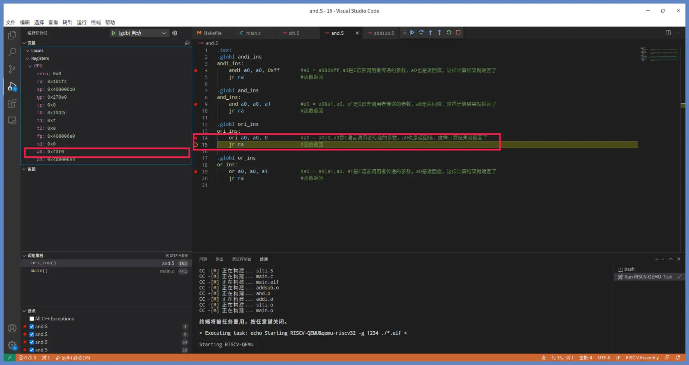

上图中是执行完 ori a0，a0，0 指令之后，执行 jr ra 指令之前的状态。如果 a0 寄存器中的值确实已经变成 0xf0f0 了，就说明运算的结果正确。

ori_ins 函数返回后，输出的结果如下图所示：

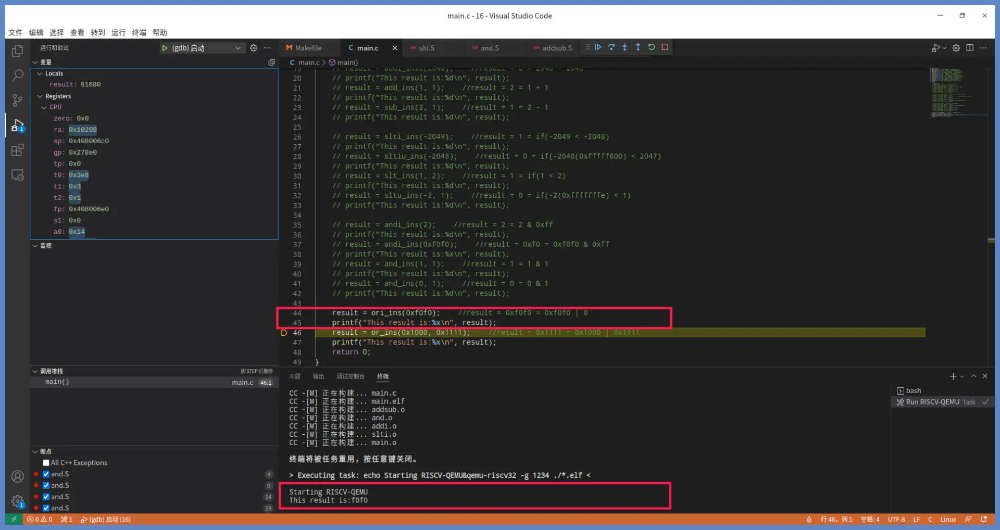

因为 0xf0f0 的二进制数据是（0b00000000000000001111000011110000）或上 0 的二进制数据是（0b00000000000000000000000000000000）按位或操作是“有 1 为 1”，所以返回0xf0f0，结果是正确的。

我们再用同样的方法调试一下 or_ins 函数，如下图所示：

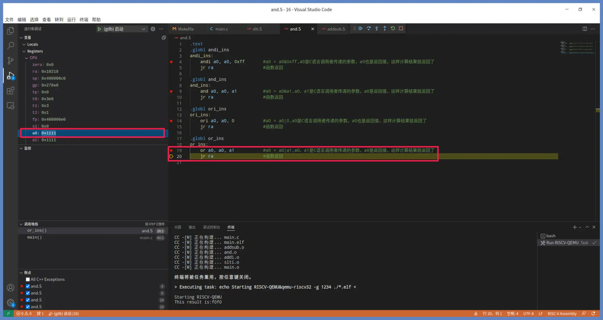

上图展示的是执行完 or a0，a0，a1 指令之后，执行 jr ra 指令之前的状态。如果我们看到 a0寄存器中的值确实已经变成 0x1111 了，就说明运算的结果正确，符合预期。

or_ins 函数返回后，输出的结果如下：

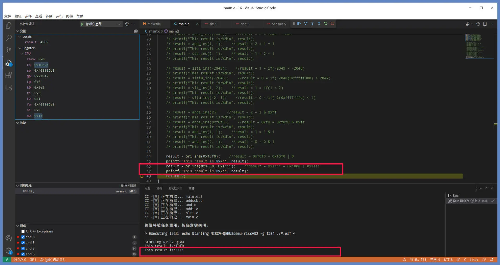

上图中 or_ins 函数第一个参数为 0x1000 的二进制数据是（0b00000000000000000001000000000000）第二个参数为 0x1111 的二进制数据是（0b00000000000000000001000100010001）两个参数相或，而按位或操作是“有 1 为 1”，所以返回 0x1111，结果是正确的。

### 按位异或操作：xori、xor 指令

最后，我们再说说逻辑指令中的最后两条指令 xori、xor，即异或指令的立即数版本和寄存器版本，它们的形式如下所示：

```
xori rd，rs1，imm
#xori 立即数按位异或指令
#rd 目标寄存器
#rs1 源寄存器1
#imm 立即数
xor rd，rs1，rs2
#xor 寄存器按位异或指令
#rd 目标寄存器
#rs1 源寄存器1
#rs2 源寄存器2
```

形式上和前面与操作、或操作差不多，就不过多重复了。

xori、xor 完成的操作用伪代码描述如下：

```
//xori
rd = rs1 ^ imm
//xor
rd = rs1 ^ rs2
```

按位异或的操作是把 rs1 与 imm 或者 rs1 与 rs2 其中的每个数据位两两相异或，两个位如果不相同，结果为 1。如果两个位相同，结果为 0。

在 and.S 文件中写代码验证一下，如下所示。

```
.globl xori_ins
xori_ins:
   xori a0，a0，0          #a0 = a0^0，a0是C语言调用者传递的参数，a0也是返回值，这样计算结
   jr ra                   #函数返回
.globl xor_ins
xor_ins:
   xor a0，a0，a1          #a0 = a0^a1，a0、a1是C语言调用者传递的参数，a0是返回值，这样计
   jr ra                   #函数返回
```

我们已经写好了 xori_ins 与 xor_ins 函数，分别是执行 xori 和 xor 指令。xori 指令是拿 a0 寄存器和立即数 0 进行异或操作，由于立即数是 0，而且各个数据位相同为 0，不同为 1，所以同样会返回 a0 原本的数据 ；而 xor 指令是拿 a0 和 a1 寄存器进行或操作，再把结果写入到a0 寄存器。

下面我们按下“F5”调试一下，如下所示：

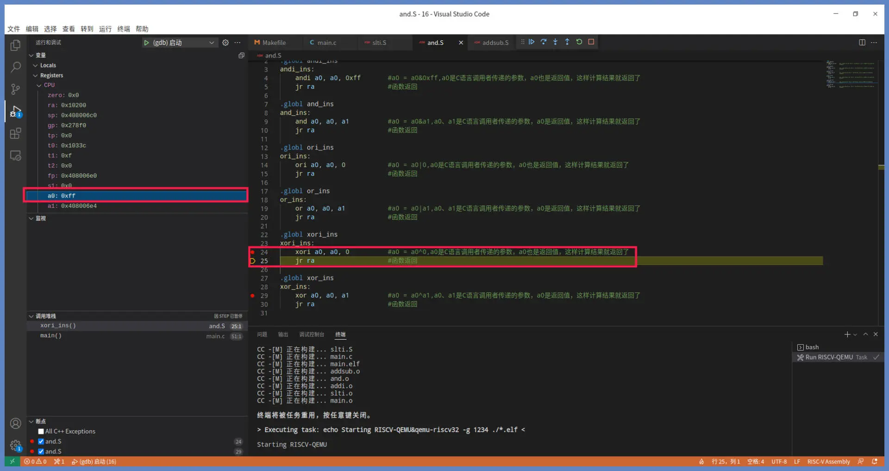

上图中是执行完 xori a0，a0，0 指令之后，执行 jr ra 指令之前的状态，我们已经看到 a0 寄存器中的值已经变成 0xff 了，这说明运算的结果正确。

xori_ins 函数返回后，输出的结果如下图所示：

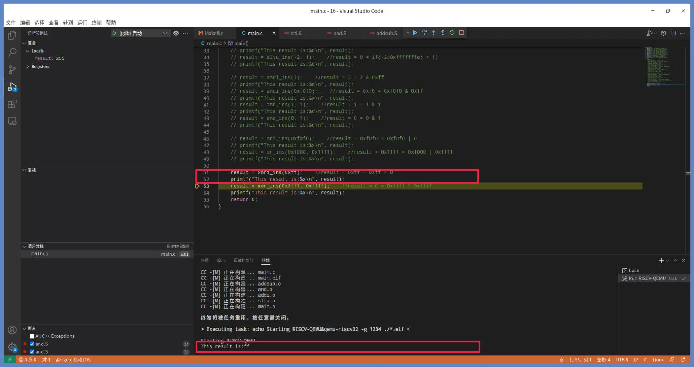

结合上面这张截图不难发现，我们传递给 xori_ins 函数的参数是 0xff，因为 0xff 的二进制数据是（0b00000000000000000000000011111111）异或上 0 的二进制数据是（0b00000000000000000000000000000000）按位异或操作是“相同为 0，不同为 1”，所以返回 0xff，结果是正确的。

我们再来调试一下 xor_ins 函数。xor a0，a0，a1 指令执行完成之后，执行 jr ra 指令之前的状态如图所示：

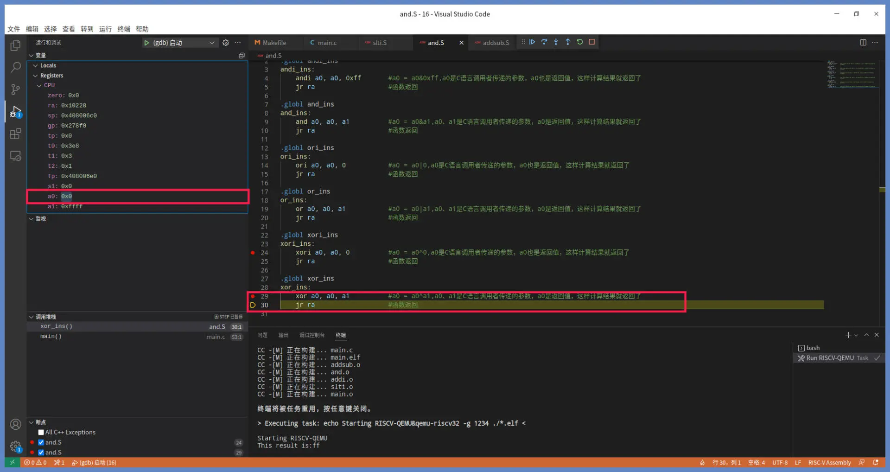

我们看到 a0 寄存器中的值已经变成 0 了，这说明运算的结果正确，符合预期。

xor_ins 函数返回后，输出的结果如下图所示：

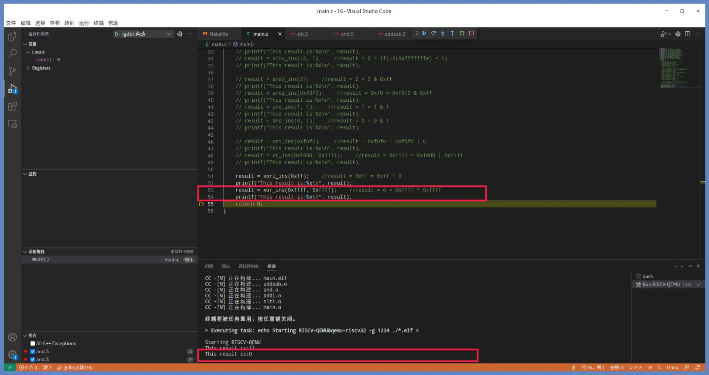

由于我们给 xor_ins 函数传递了两个相同的参数都是 0xffff。因为 0xffff 的二进制数据是（0b00000000000000001111111111111111）两者异或，按位异或操作是“相同为 0，不同为1”，所以返回 0，结果是正确的。

下面我们看一下 andi、and、ori、or、xori、xor 这六条指令的二进制数据。

我们打开工程目录下的 and.bin 文件，如下所示：

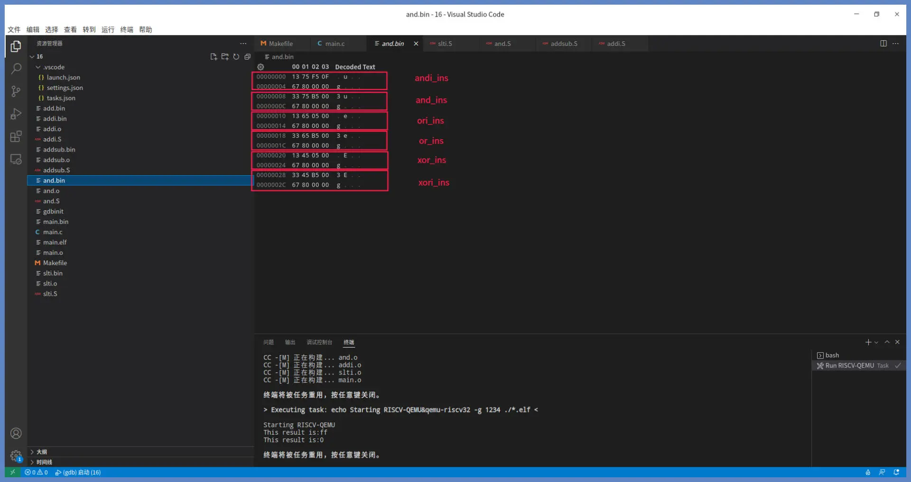

上述图中的 12 个 32 位数据是 12 条指令，其中六个 0x00008067 数据是六个函数的返回指令。

具体的指令形式，还有对应的汇编语句，我用表格帮你做了整理。

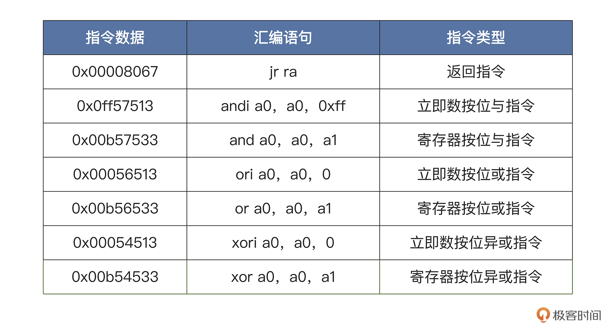

同样地，我带你拆分一下 andi、and、ori、or、xori、xor 指令的各位段的数据，看看它们是如何编码的。

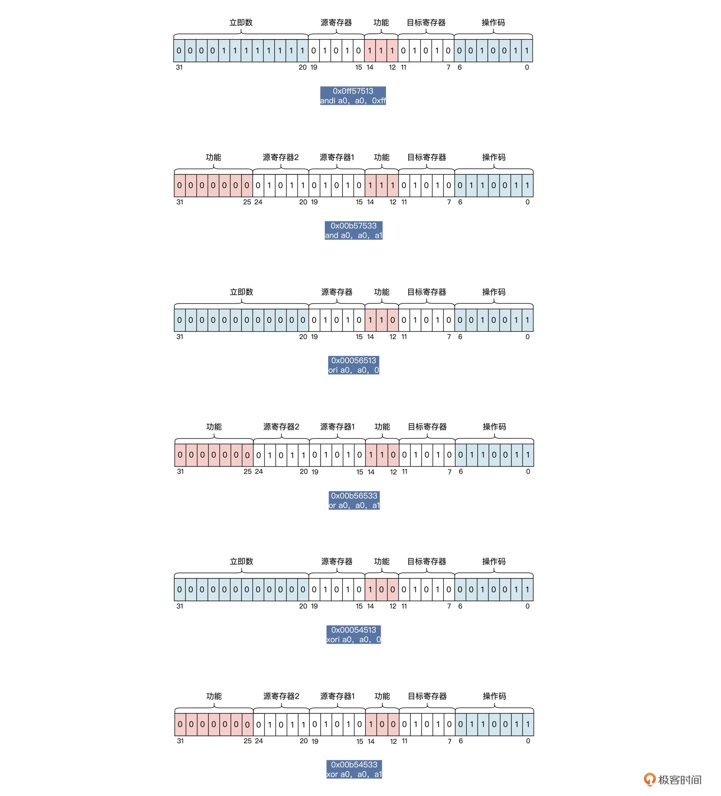

从上图中可以发现，立即数版本和寄存器版本的 and、or、xor 指令通过操作码区分，而它们之间的寄存器和立即数版本是靠功能位段来区分，立即数位段和源寄存器与目标寄存器位段和之前的指令是相同的。

到这里六条逻辑指令已经拿下了，咱们继续学习移位指令。

## 移位指令

移位指令和逻辑操作指令一样，都是 CPU 电路很容易就能实现的。

RISC-V 指令集中的移位指令包括逻辑左移、逻辑右移和算术右移，它们分别有立即数和寄存器版本，所以一共有六条。逻辑右移和算术右移是不同的，等我们后面用到时再专门讲解。

### 逻辑左移指令：slli、sll 指令

我们先看看逻辑左移指令，也就是 slli、sll 指令，它们的形式如下所示：

```
slli rd，rs1，imm
#slli 立即数逻辑左移指令
#rd 目标寄存器
#rs1 源寄存器1
#imm 立即数，rs1左移的位数，0~31
sll rd，rs1，rs2
#sll 寄存器逻辑左移指令
#rd 目标寄存器
#rs1 源寄存器1
#rs2 源寄存器2，rs1左移的位数
```

上述代码中 rd、rs1、rs2 可以是任何通用寄存器。imm 是立即数，其实在官方文档中，这里是 shamt，表示 rs1 左移 shamt 位。这里我为了和之前的形式保持一致，才继续沿用了imm。

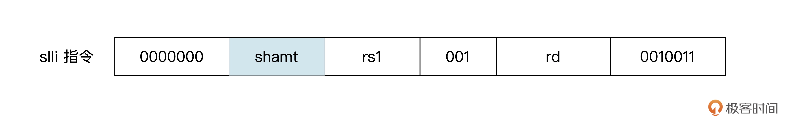

slli、sll 它们俩完成的操作，用伪代码描述如下：

```
//slli
rd = rs1 << imm
//sll
rd = rs1 << rs2
```

逻辑左移的操作是把 rs1 中的数据向左移动 imm 位，或者把 rs1 中的数据向左移动 rs2 位，右边多出的空位填 0 并写入 rd 中。

我们用图解来表达这一过程，这样你就能一目了然了。

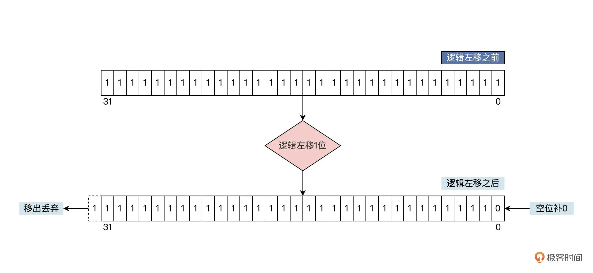

接下来我们在工程目录下，建立一个 sll.S 文件，写代码验证一下，如下所示：

```
.globl slli_ins
slli_ins:
   slli a0, a0, 4          #a0 = a0<<4，a0是C语言调用者传递的参数，a0也是返回值，这样计算
   jr ra                   #函数返回
.globl sll_ins
sll_ins:
   sll a0, a0, a1          #a0 = a0<<a1，a0、a1是C语言调用者传递的参数，a0是返回值，这样
   jr ra                   #函数返回
```

这里已经写好了 slli_ins 与 sll_ins 函数，它们会分别执行 slli 和 sll 指令。立即数逻辑左移 slli指令是把 a0 中的数据左移 4 位。而逻辑左移 sll 指令是把 a0 中的数据左移，左移多少位要取决于 a1 中的数据，完成移动后再把结果写入到 a0 寄存器。

我们还是用 VSCode 打开工程，按下“F5”调试，如下所示：

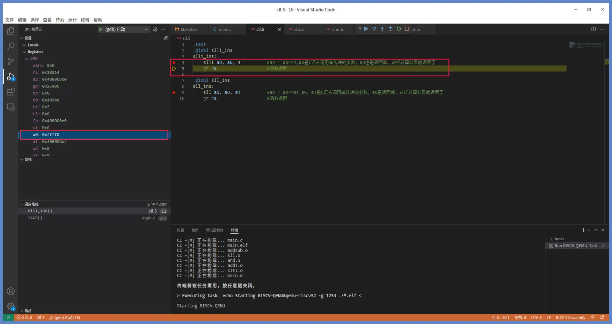

上图中是进入 slli_ins 函数，执行完 slli a0，a0，4 指令之后，执行 jr ra 指令之前的状态，我们给 slli_ins 函数传进来的参数是 0xffff。现在对照图示就能看到，a0 寄存器中的值确实已经变成 0xffff0 了，这说明运算结果是正确的。

slli_ins 函数返回后，输出的结果如下：

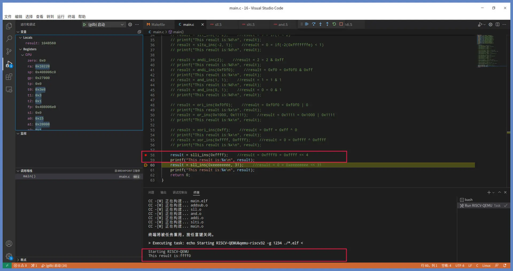

因为 0xffff 二进制数据是（0b00000000000000001111111111111111），逻辑左移 4 位后的结果是 0xffff0，它的二进制数据是（0b00000000000011111111111111110000），结果正确无误。

下面我们接着对 sll_ins 函数进行调试，如下所示：

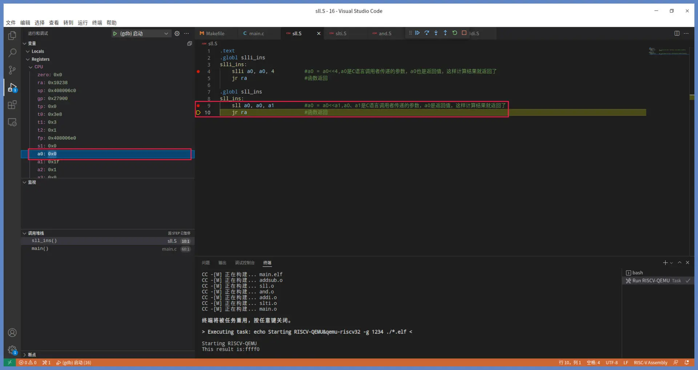

上图中是进入 sll_ins 函数，执行完 sll a0，a0，a1 指令之后，执行 jr ra 指令之前的状态，我们给 sll_ins 函数传进来的参数是 0xeeeeeeee 和 31（a1 寄存器）。如果看到 a0 寄存器中的值确实已经变成 0 了，这说明运算结果是正确的。

sll_ins 函数返回后，输出的结果如下图所示：

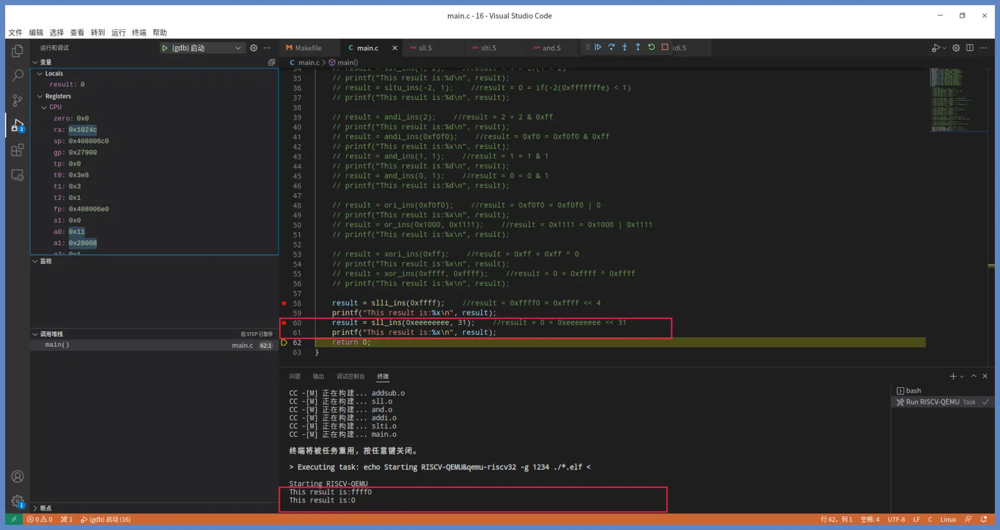

第一个参数 0xeeeeeeee 的二进制数据是（0b11101110111011101110111011101110），逻辑左移 31 位后的结果是 0，因为它把所有的二进制数据位都移出去了，然后空位补 0，所以结果正确无误。

### 逻辑右移指令：srli、srl

有逻辑左移就有逻辑右移。逻辑右移指令 srli、srl，分别对应着立即数和寄存器版本，它们的形式如下：

```
srli rd，rs1，imm
#srli 立即数逻辑右移指令
#rd 目标寄存器
#rs1 源寄存器1
#imm 立即数，rs1右移的位数，0~31
srl rd，rs1，rs2
#srl 寄存器逻辑右移指令
#rd 目标寄存器
#rs1 源寄存器1
#rs2 源寄存器2，rs1右移的位数
```

上述代码中 rd、rs1、rs2 可以是任何通用寄存器。imm 是立即数。为了和之前的形式保持一致，我们还是沿用 imm，而非官方文档中的 shamt。

srli、srl 完成的操作，可以用后面的伪代码来描述：

```
//srli
rd = rs1 >> imm
//srl
rd = rs1 >> rs2
```

逻辑右移的操作是把 rs1 中的数据向右移动 imm 位。或者把 rs1 中的数据向右移动 rs2 位，左边多出的空位填 0 并写入 rd 中。

你可以对照我画的图示来理解这一过程。

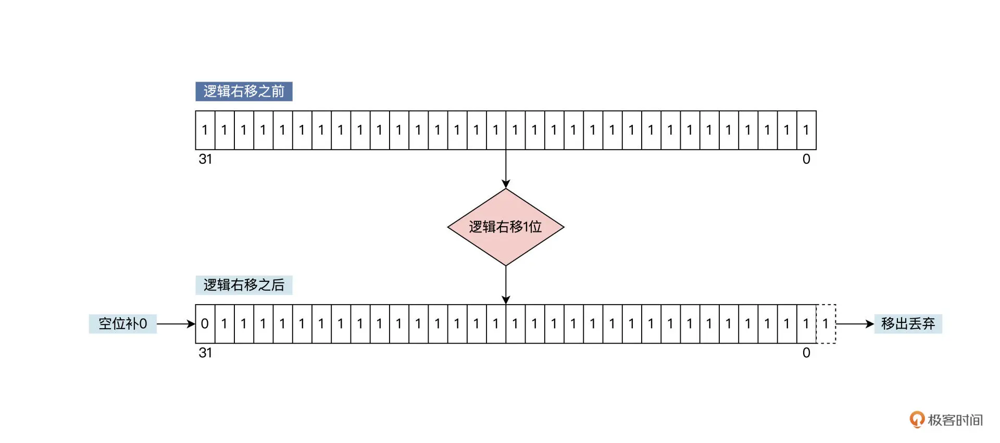

光看看格式自然不够，我们在 sll.S 文件中写段代码来验证一下，如下所示：

```
.globl srli_ins
srli_ins:
   srli a0, a0, 8          #a0 = a0>>8,a0是C语言调用者传递的参数，a0也是返回值，这样计算
   jr ra                   #函数返回
.globl srl_ins
srl_ins:
   srl a0, a0, a1          #a0 = a0>>a1,a0、a1是C语言调用者传递的参数，a0是返回值，这样
   jr ra                   #函数返回
```

逻辑右移的两个函数 srli_ins 与 srl_ins，我已经帮你写好了。代码中立即数逻辑右移 srli 指令是把 a0 中的数据右移 8 位。逻辑右移 srl 指令，则是把 a0 中的数据右移，右移多少位要看a1 中数据表示的位数是多少，再把结果写入到 a0 寄存器。

两条右移指令做了哪些事儿咱们说完了，老规矩，打开工程按下“F5”就可以调试了，效果如图：

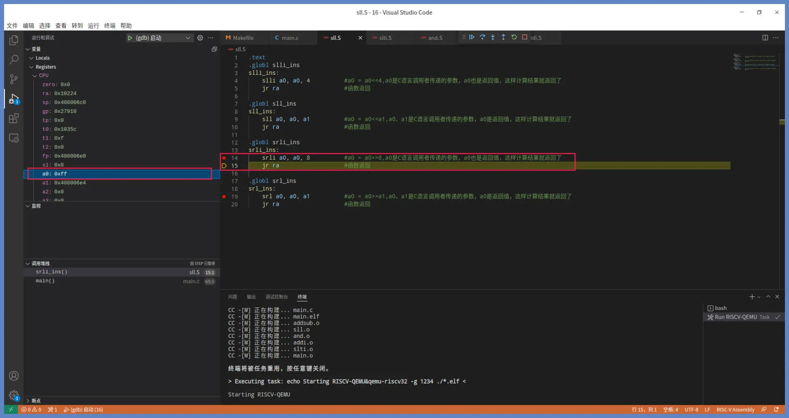

上图中是进入 srli_ins 函数，执行完 srli a0，a0，8 指令之后，执行 jr ra 指令之前的状态，我们给 srli_ins 函数传进来的参数是 0xffff。现在，对照截图可以看到 a0 寄存器中的值确实已经变成 0xff 了，这说明运算结果正确。

srli_ins 函数返回后，输出的结果如下图所示：

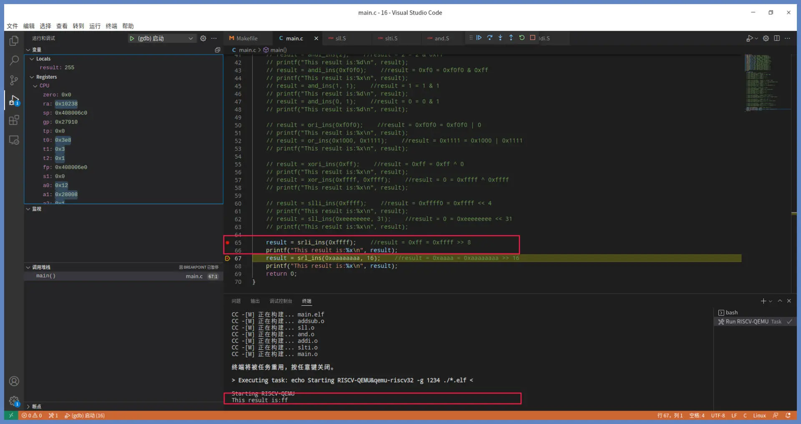

因为调用函数 srli_ins 的参数 0xffff 的二进制数据是（0b00000000000000001111111111111111），逻辑右移 8 位后的结果是 0xff，它的二进制数据是（0b00000000000000000000000011111111），结果正确，符合我们的预期。

拿下了 srli_ins 函数，接下来就是 srl_ins 函数的调试，如下所示：

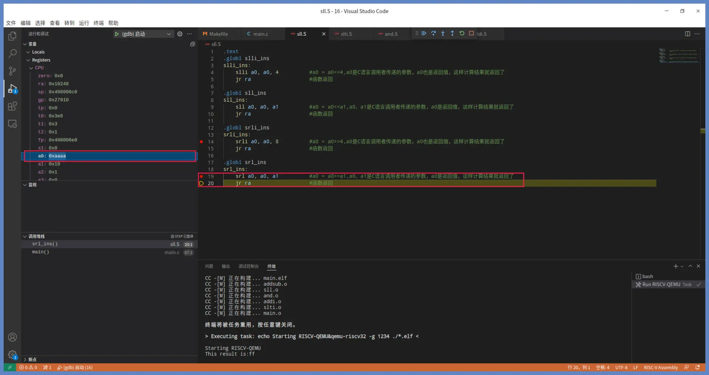

上图中是调用进入 srl_ins 函数，执行完 srl a0，a0，a1 指令之后，执行 jr ra 指令之前的状态，给 srl_ins 函数传进来的参数是 0xaaaaaaaa。可以看到，a0 寄存器中的值确实已经变成0xaaaa 了，所以运算结果也是正确的。

srl_ins 函数返回后，输出的结果如下图所示：

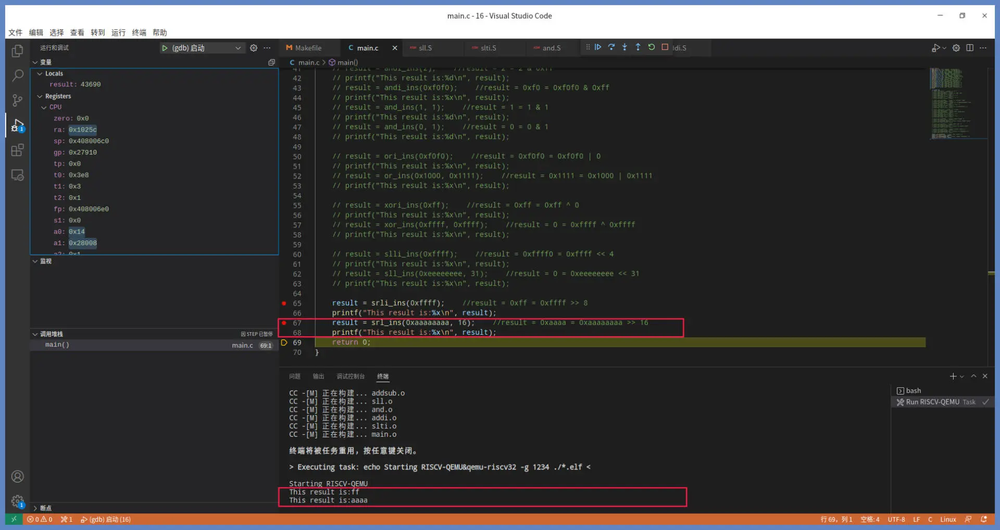

给 srl_ins 函数传进来的第一个参数是 0xaaaaaaaa 的二进制数据是（0b10101010101010101010101010101010），逻辑右移 16 位后的结果是 0xaaaa，其二进制数据为（0b00000000000000001010101010101010 ），因为它把低 16 位二进制数据位移出去了，然后高 16 位的空位补 0，所以结果正确无误。

### 算术右移指令：srai、sra

最后还有两个算术右移指令，它们和逻辑右移的最大区别是，数据在逻辑右移之后左边多出空位用 0 填充，而数据在算术右移之后左边多出的空位是用数据的符号位填充。如果数据的符号位为 1 就填充 1，如果为 0 就填充 0。

它们的形式和伪代码与逻辑右移是一样的，只不过指令助记符由 srli、srl，变成了 srai、sra。

下面我们直接在 sll.S 文件中，写代码进行验证。

```
.globl srai_ins
srai_ins:
   srai a0, a0, 8          #a0 = a0>>8,a0是C语言调用者传递的参数，a0也是返回值，这样计算
   jr ra                   #函数返回
.globl sra_ins
sra_ins:
   sra a0, a0, a1          #a0 = a0>>a1,a0、a1是C语言调用者传递的参数，a0是返回值，这样
   jr ra                   #函数返回
```

上述代码中的两个函数 srai_ins 与 sra_ins，可以实现算术右移。先看立即数算术右移 srai 指令，它把 a0 中的数据右移了 8 位。而算术右移 srl 指令是把 a0 中的数据右移，右移多少位由a1 中的数据表示的位数来决定，之后再把结果写入到 a0 寄存器。

我们按下“F5”，调试的结果如下：

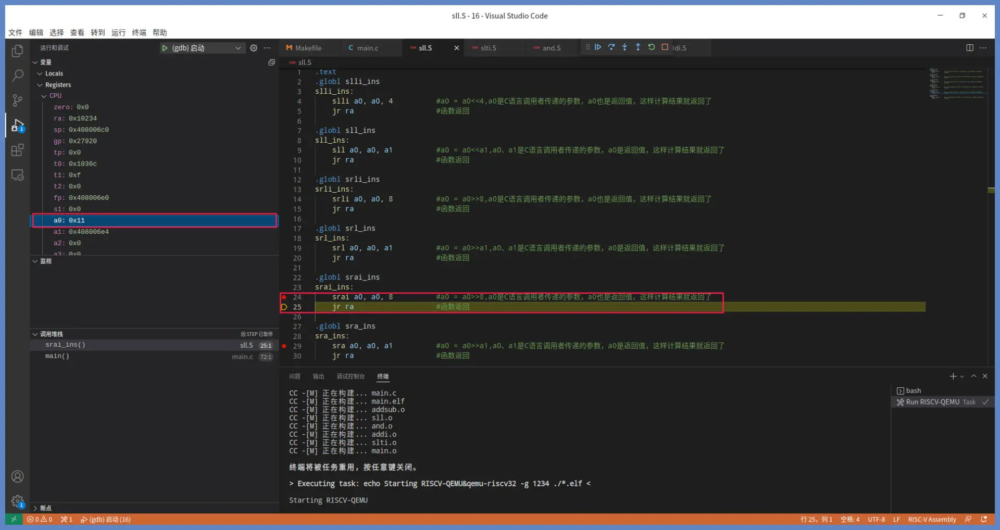

上图中是进入立即数算术右移函数 srai_ins，执行完 srai a0，a0，8 指令之后，执行 jr ra 指令之前的状态。对照图里红框的内容可以看到，给 srai_ins 函数传进来的参数是 0x1111。如果 a0 寄存器中的值确实已经变成 0x11 了，就代表运算结果正确。

srai_ins 函数返回后，输出的结果如下：

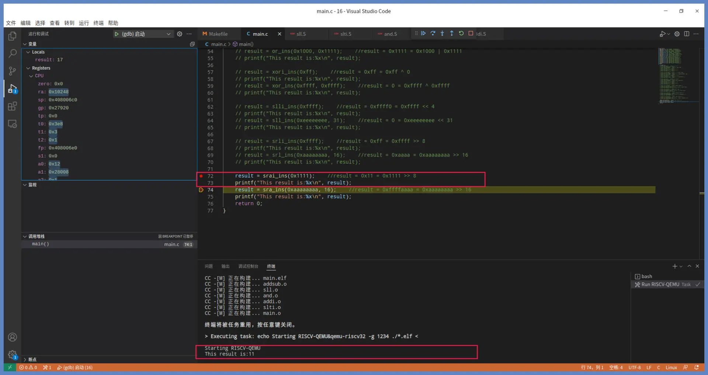

因为我们给立即数算术右移函数 srai_ins 的参数 0x1111，其二进制数据是（0b00000000000000000001000100010001），符号位为 0，所以算术右移 8 位后的结果是0x11，它的二进制数据是（0b00000000000000000000000000010001），结果非常正确。

我们接着调试一下 sra_ins 函数，如下所示：

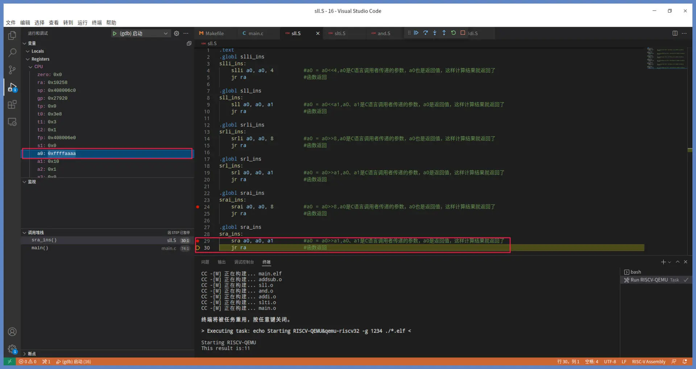

上图中是进入算术右移函数 sra_ins，执行完 sra a0，a0，a1 指令之后，执行 jr ra 指令之前的状态。对照图里左侧红框的部分，我们就能知道 sra_ins 函数传进来的参数是0xaaaaaaaa，你可能判断 a0 寄存器里输出的结果应该是 0x0000aaaa，但调试显示的实际结果却是 0xffffaaaa。

出现这个结果，你很奇怪是不是？但这恰恰说明运算结果是正确的。我们先看看 sra_ins 函数返回后输出的结果是什么，然后再分析原因。

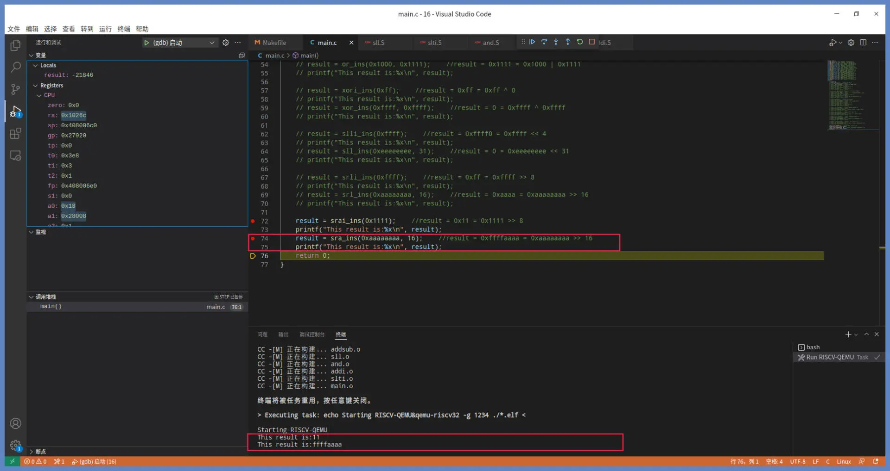

因为我们给算术右移函数 sra_ins 的参数是 0xaaaaaaaa 和 16，这表明对 0xaaaaaaaa 算术右移 16，0xaaaaaaaa 的二进制数据是（0b10101010101010101010101010101010），注意其符号位为 1，所以算术右移 16 位后的结果是 0xffffaaaa，它的二进制数据是（0b11111111111111111010101010101010），结果是符合预期的。输出的结果也证实了这一点。

下面我们还是要看一下 slli、sll、srli、srl、srai、sra 这六条指令的二进制数据，我们打开工程目录下的 sll.bin 文件。

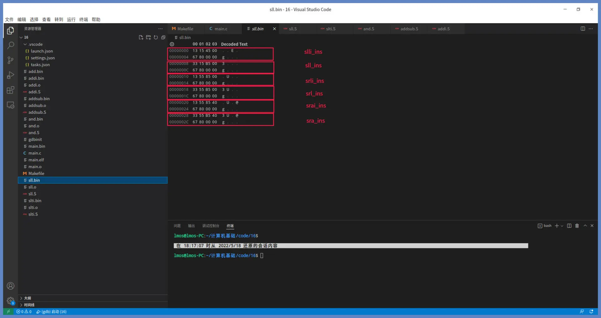

可以看出，图中的 12 个 32 位数据是 12 条指令，其中六个 0x00008067 数据是六个函数的返回指令。具体的指令形式，还有对应的汇编语句，你可以参考后面的表格。

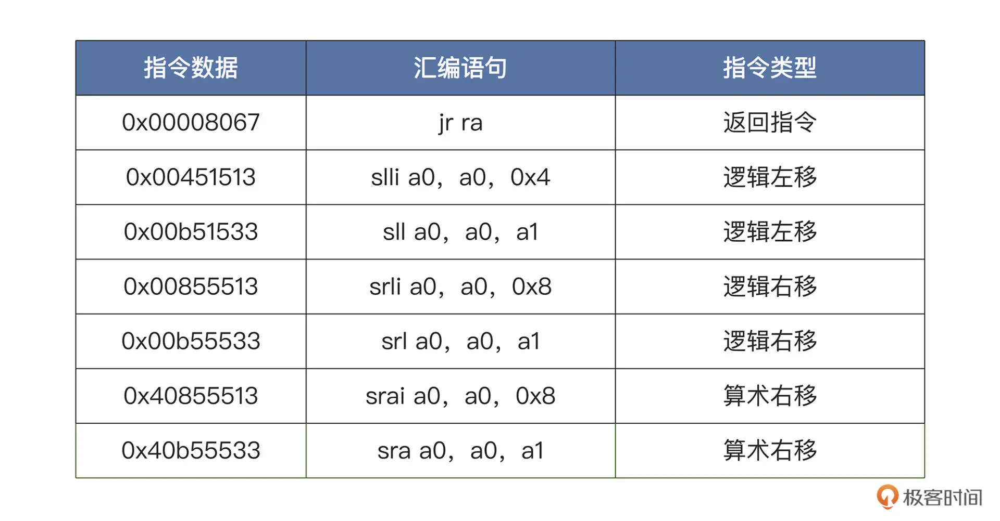

我们拆分一下 slli、sll、srli、srl、srai、sra 指令的各位段的数据，看看它们是在内存中如何编码的，你可以结合示意图来理解。

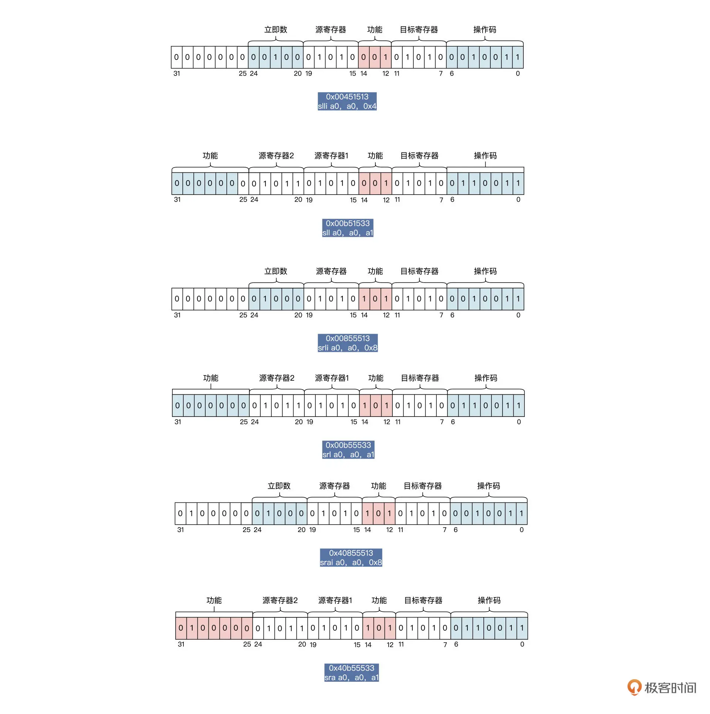

我虽然给你详细展示了这些指令如何编码，但并不需要你把细节全部硬记下来，重点是观察其中的规律。

从上图中我们可以发现，sll、srl、sra 指令的立即数版本和寄存器版本要通过操作码区分，而它们之间是靠功能位段来区分的，源寄存器与目标寄存器所在的位段和之前的指令是相同的。需要注意的是，这些立即数版本的立即数位段在官方文档中叫 shamt 位段，并且只占 5 位，而其它指令的立即数占 12 位，这里为了一致性还是沿用立即数。

到这里，六条移位指令我们就讲完了。

## 重点回顾

今天我们学习了逻辑指令和移位指令。

逻辑操作的指令包括 andi、ori、or、xori、xor，分别能对寄存器与寄存器、寄存器与立即数进行与、或、异或操作。有了这些操作，CPU 才能对数据进行逻辑运算，在一些情况下还能提升 CPU 的执行性能。更多的应用，后面课程里我们还会继续学习。

数据移位指令包括 slli、sll、srli、srl、srai、sra，也能分别能对寄存器与寄存器、寄存器与立即数进行逻辑左移、逻辑右移、算术右移操作。这些指令与逻辑指令一起执行数据的位运算时，相当有用，在特定情况下能代替乘除法指令。

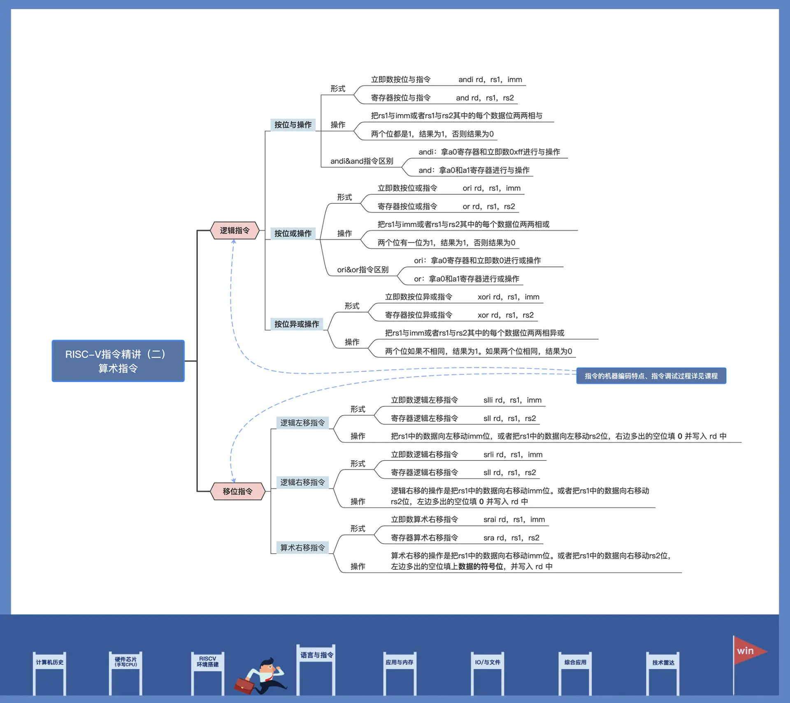

经过漫长的学习，我们用两节课程的篇幅，一鼓作气学习了 RISC-V 全部的算术指令，分为加减、比较、逻辑、移位四大类别，一共有 19 条指令。这些指令作用于数据的运算，在应用程序中扮演着重要角色。

但是 CPU 有了这些算术指令就够了吗？这显然是不行的，起码还需要流程控制指令和数据加载储存指令，我们会在后续课程中继续讨论。

## 思考题

为什么指令编码中，目标寄存器，源寄存器 1，源寄存器 2，占用的位宽都是 5 位呢？

欢迎你在留言区记录自己的疑问或收获，参与越多，你对内容的理解也更深入。如果觉得这节课内容不错，别忘了分享给更多朋友。
