# 19 | RISC-V指令精讲（四）：跳转指令实现与调试

你好，我是 LMOS。

前面我们学习了无条件跳转指令，但是在一些代码实现里，我们必须根据条件的判断状态进行跳转。比如高级语言中的 if-else 语句，这是一个典型程序流程控制语句，它能根据条件状态执行不同的代码。这种语句落到指令集层，就需要有根据条件状态进行跳转的指令来支持，这类指令我们称为有条件跳转指令。

这节课，我们就来学习这些有条件跳转指令。在 RISC-V 指令集中，一共有 6 条有条件跳转指令，分别是 beq、bne、blt、bltu、bge、bgeu。

这节课的配套代码，你可以从这里下载。

## 比较数据是否相等：beq 和 bne 指令

我们首先来看看条件相等跳转和条件不等跳转指令，即 beq 指令和 bne 指令，它们的汇编代码书写形式如下所示：

```
beq rs1，rs2，imm
#beq 条件相等跳转指令
#rs1 源寄存器1
#rs2 源寄存器2
#imm 立即数
bne rs1，rs2，imm
#bne 条件不等跳转指令
#rs1 源寄存器1
#rs2 源寄存器2
#imm 立即数
```

上述代码中，rs1、rs2 可以是任何通用寄存器，imm 是立即数（也可称为偏移量），占用 13位二进制编码。请注意，beq 指令和 bne 指令没有目标寄存器，就不会回写结果。

我们用伪代码描述一下 beq 指令和 bne 指令完成的操作。

```
//beq
if(rs1 == rs2) pc = pc + 符号扩展（imm << 1）
//bne
if(rs1 != rs2) pc = pc + 符号扩展（imm << 1）
```

你可以这样理解这两个指令。在 rs1、rs2 寄存器的数据相等时，beq 指令就会跳转到标号为imm 的地方运行。而 rs1、rs2 寄存器的数据不相等时，bne 指令就会跳转到 imm 标号处运行。

下面我们一起写代码来验证。在工程目录下，我们需要建立一个 beq.S 文件，在文件里用汇编写上 beq_ins、bne_ins 函数，代码如下所示：

```
.global beq_ins
beq_ins:
   beq a0，a1，imm_l1          #a0==a1，跳转到imm_l1地址处开始运行
   mv a0，zero                 #a0=0
   jr ra                       #函数返回
imm_l1:
   addi a0，zero，1            #a0=1
   jr ra                       #函数返回
.global bne_ins
bne_ins:
   bne a0，a1，imm_l2          #a0!=a1，跳转到imm_l2地址处开始运行
   mv a0，zero                 #a0=0
   jr ra                       #函数返回
imm_l2:
   addi a0，zero，1            #a0=1
   jr ra                       #函数返回
```

我们先看代码里的 beq_ins 函数完成了什么操作，如果 a0 和 a1 相等，则跳转到 imm_l1处，将 a0 置 1 并返回，否则继续顺序执行，将 a0 置 0 并返回。然后，我们再看下 bne_ins函数的操作，如果 a0 和 a1 不相等则跳转到 imm_l2 处，将 a0 置 1 并返回，否则继续顺序执行将 a0 置 0 并返回。

我们在 main.c 文件中声明一下这两个函数并调用它们，然后用 VSCode 打开工程目录，按下“F5”键来调试，情况如下所示：

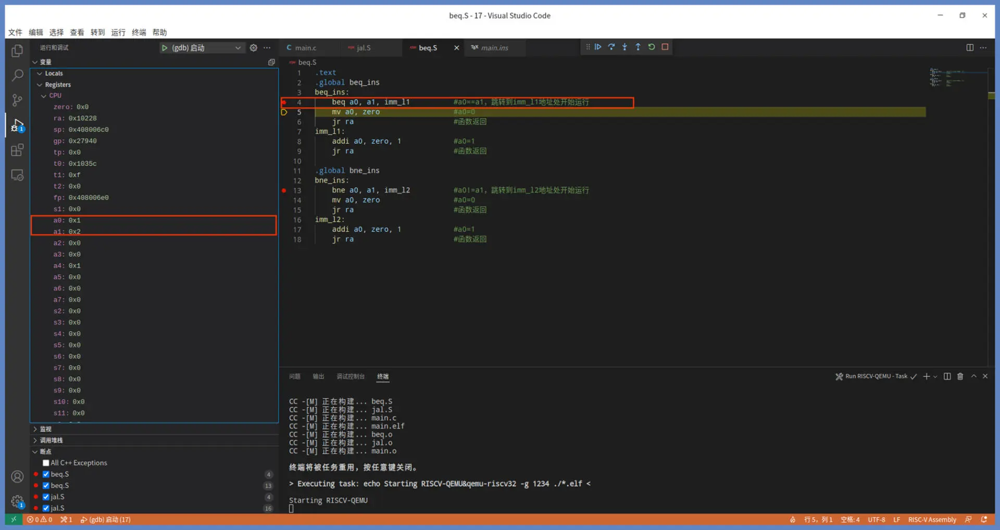

上图是执行“beq a0，a1，imm_l1”指令后的状态。由于 a0、a1 寄存器内容不相等，所以没有跳转到 imm_l1 处运行，而是继续顺序执行 beq 后面的下一条指令，最后返回到 main 函数中。

函数返回结果如下图所示：

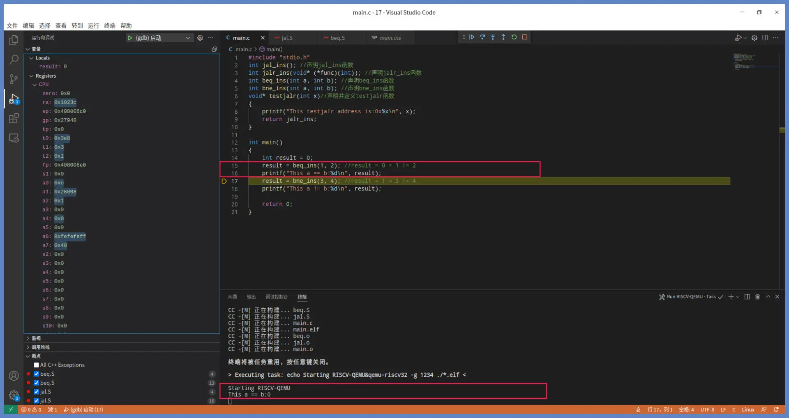

从图里我们能看到，首先会由 main 函数调用 beq_ins 函数，然后调用 printf 输出返回的结果，在终端中的输出为 0。这个结果在我们的预料之中，也验证了 beq 指令的效果和我们之前描述的一致。

下面我们继续调试，就会进入 bne_ins 函数中，如下所示：

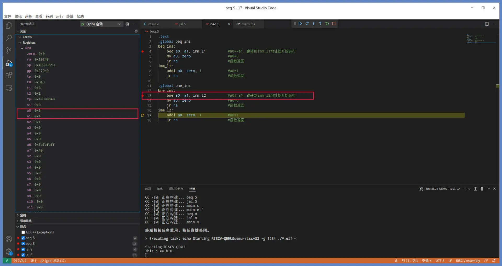

上图中是执行“bne a0，a1，imm_l2”指令之后的状态。同样因为 a0、a1 寄存器内容不相等，而 bne 指令是不相等就跳转。这时程序会直接跳转到 imm_l2 处运行，执行 addi a0，zero，1指令，将 a0 寄存器置为 1 后，返回到 main 函数中，如下所示：

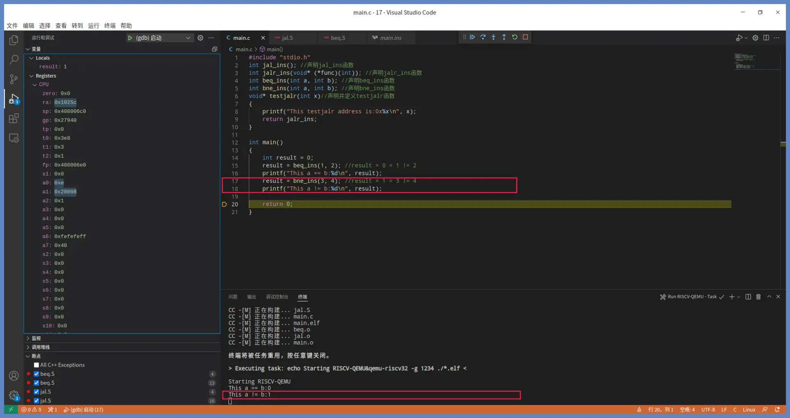

上图中第二个 printf 函数打印出 bne_ins 函数返回的结果，输出为 1。bne 指令会因为数据相等而跳转，将 a0 寄存器置为 1，导致返回值为 1，这个结果是正确的。

经过上面的调试验证，我们不难发现：其实 bne 是 beq 的相反操作，作为一对指令搭配使用，完成相等和不相等的流程控制。

## 小于则跳转：blt 和 bltu 指令

有了 bqe、bne 有条件跳转指令后，就能实现 C 语言 == 和 != 的比较运算符的功能。但这还不够，除了比较数据的相等和不等，我们还希望实现比较数据的大小这个功能。

这就要说到小于则跳转的指令，即 blt 指令与 bltu 指令，bltu 指令是 blt 的无符号数版本。它们的汇编代码书写形式如下：

```
blt rs1，rs2，imm
#blt 条件小于跳转指令
#rs1 源寄存器1
#rs2 源寄存器2
#imm 立即数
bltu rs1，rs2，imm
#bltu 无符号数条件小于跳转指令
#rs1 源寄存器1
#rs2 源寄存器2
#imm 立即数
```

和 bqe、bne 指令一样，上述代码中 rs1、rs2 可以是任何通用寄存器，imm 是立即数（也可称为偏移量），占用 13 位二进制编码，它们同样没有目标寄存器，不会回写结果。

blt 指令和 bltu 指令所完成的操作，可以用后面的伪代码描述：

```
//blt
if(rs1 < rs2) pc = pc + 符号扩展（imm << 1）
//bltu
if((无符号)rs1 < (无符号)rs2) pc = pc + 符号扩展（imm << 1）
```

你可以这样理解这两个指令。当 rs1 小于 rs2 时且 rs1、rs2 中为有符号数据，blt 指令就会跳转到 imm 标号处运行。而当 rs1 小于 rs2 时且 rs1、rs2 中为无符号数据，bltu 指令就会跳转到 imm 标号处运行。

我们同样通过写代码验证一下，加深理解。在 beq.S 文件中，我们用汇编写上 blt_ins、bltu_ins 函数，代码如下所示：

```
.global blt_ins
blt_ins:
   blt a0，a1，imm_l3          #a0<a1，跳转到imm_l3地址处开始运行
   mv a0，zero                 #a0=0
   jr ra                       #函数返回
imm_l3:
   addi a0，zero，1            #a0=1
   jr ra                       #函数返回
.global bltu_ins
bltu_ins:
   bltu a0，a1，imm_l4         #a0<a1，跳转到imm_l4地址处开始运行
   mv a0，zero                 #a0=0
   jr ra                       #函数返回
imm_l4:
   addi a0，zero，1            #a0=1
   jr ra                       #函数返回
```

blt_ins 函数都做了什么呢？如果 a0 小于 a1，则跳转到 imm_l3 处，将 a0 置 1 并返回，否则继续顺序执行将 a0 置 0 并返回。

接着我们来看 bltu_ins 函数的操作，如果 a0 中的无符号数小于 a1 中的无符号数，程序就会跳转到 imm_l4 处，将 a0 置 1 并返回，否则继续顺序执行，将 a0 置 0 并返回。

我们还是用 VSCode 打开工程目录，按下“F5”键来调试验证。下图是执行“blt a0,a1,imm_l3”指令之后的状态。

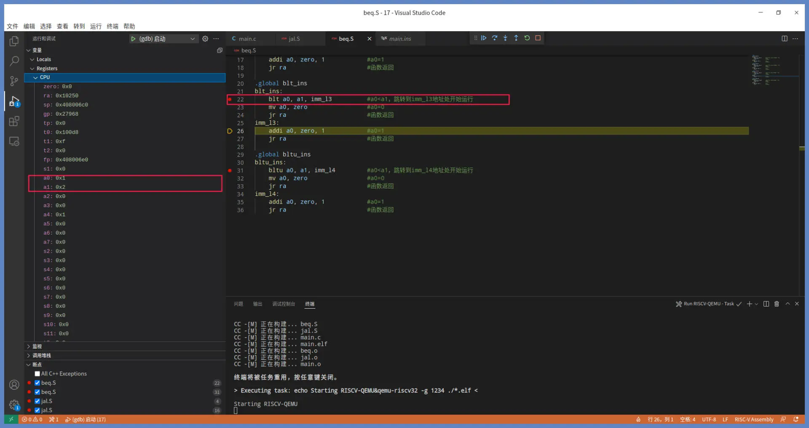

由于 a0 中的有符号数小于 a1 中的有符号数，而 blt 指令是小于就跳转，这时程序会直接跳转到 imm_l3 处运行，执行 addi a0，zero，1 指令，将 a0 寄存器置为 1 后，返回到 main 函数中。返回结果如下所示：

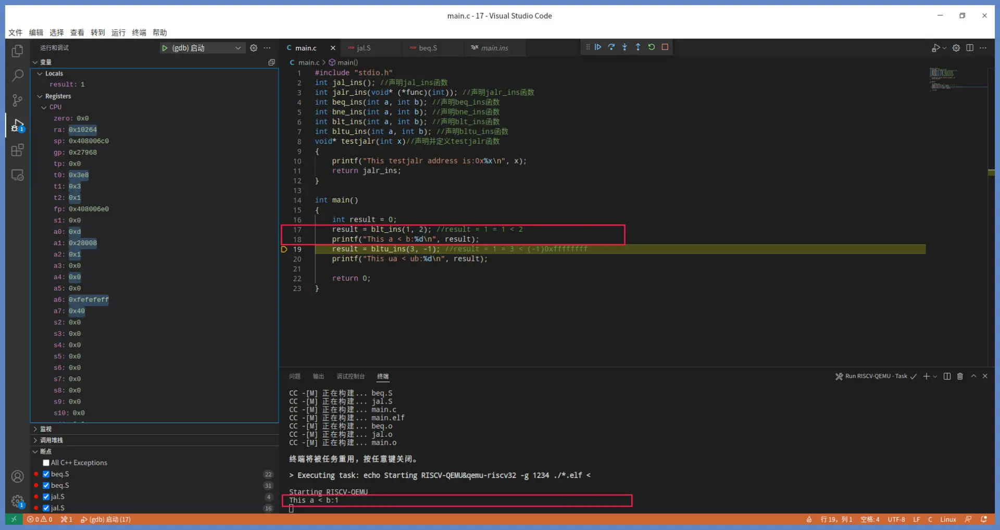

对照上图可以发现，main 函数先调用了 blt_ins 函数，然后调用 printf 在终端上打印返回的结果，输出为 1。这个结果同样跟我们预期的一样，也验证了 blt 指令的功能确实是小于则跳转。

我们再接再厉，继续调试，进入 bltu_ins 函数中，如下所示：

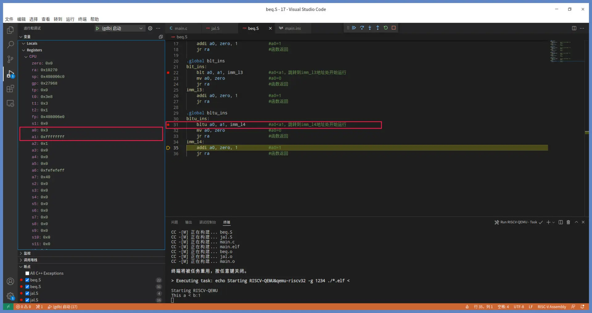

图里的代码表示执行“bltu a0，a1，imm_l4”指令之后的状态。

由于 bltu 把 a0、a1 中的数据当成无符号数，所以 a0 的数据小于 a1 的数据，而 bltu 指令是小于就跳转，这时程序就会跳转到 imm_l4 处运行，执行 addi a0，zero，1 指令，将 a0 寄存器置为 1 后，就会返回到 main 函数中。

对应的跳转情况，你可以对照一下后面的截图：

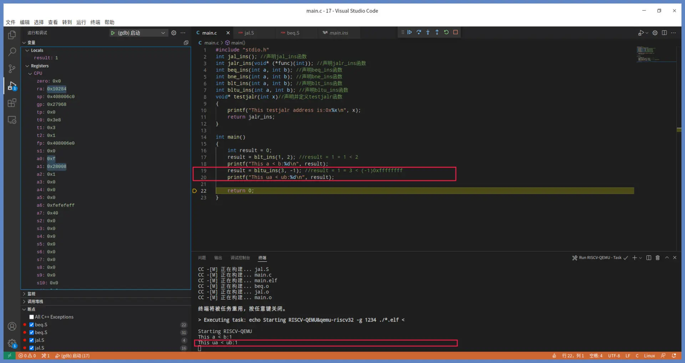

我们看到上图中调用 bltu_ins 函数传递的参数是 3 和 -1，应该返回 0 才对。然而 printf 在终端上输出为 1，这个结果是不是出乎你的意料呢？

我们来分析一下原因，没错，这是因为 bltu_ins 函数会把两个参数都当成无符号数据，把 -1当成无符号数是 0xffffffff，远大于 3。所以这里返回 1，反而是 bltu 指令正确的运算结果。

## 大于等于则跳转：bge 和 bgeu 指令

有了小于则跳转的指令，我们还是需要大于等于则跳转的指令，这样才可以在 C 语言中写出类似"a >= b"这种表达式。在 RISC-V 指令中，为我们提供了 bge、bgeu 指令，它们分别是有符号数大于等于则跳转的指令和无符号数大于等于则跳转的指令。

这是最后两条有条件跳转指令，它们的汇编代码形式如下：

```
bge rs1，rs2，imm
#bge 条件大于等于跳转指令
#rs1 源寄存器1
#rs2 源寄存器2
#imm 立即数
bgeu rs1，rs2，imm
#bgeu 无符号数条件大于等于跳转指令
#rs1 源寄存器1
#rs2 源寄存器2
#imm 立即数
```

代码规范和前面四条指令都相同，这里不再重复。

下面我们用伪代码描述一下 bge、bgeu 指令，如下所示：

```
//bge
if(rs1 >= rs2) pc = pc + 符号扩展（imm << 1）
//bgeu
if((无符号)rs1 >= (无符号)rs2) pc = pc + 符号扩展（imm << 1）
```

我们看完伪代码就能大致理解这两个指令的操作了。当 rs1 大于等于 rs2，且 rs1、rs2 中为有符号数据时，bge 指令就会跳转到 imm 标号处运行。而当 rs1 大于等于 rs2 时且 rs1、rs2 中为无符号数据，bgeu 指令就会跳转到 imm 标号处运行。

我们继续在 beq.S 文件中用汇编写上 bge_ins、bgeu_ins 函数，进行调试验证，代码如下所示：

```
.global bge_ins
bge_ins:
   bge a0，a1，imm_l5          #a0>=a1，跳转到imm_l5地址处开始运行
   mv a0，zero                 #a0=0
   jr ra                       #函数返回
imm_l5:
   addi a0，zero，1            #a0=1
   jr ra                       #函数返回
.global bgeu_ins
bgeu_ins:
   bgeu a0，a1，imm_l6         #a0>=a1，跳转到imm_l6地址处开始运行
   mv a0，zero                 #a0=0
   jr ra                       #函数返回
imm_l6:
   addi a0，zero，1            #a0=1
   jr ra                       #函数返回
```

结合上面的代码，我们依次来看看 bge_ins 函数和 bgeu_ins 函数都做了什么。先看 bge_ins函数，如果 a0 大于等于 a1，则跳转到 imm_l5 处将 a0 置 1 并返回，否则就会继续顺序执行，将 a0 置 0 并返回。

而 bgeu_ins 函数也类似，如果 a0 中无符号数大于等于 a1 中的无符号数，则跳转到 imm_l6处将 a0 置 1 并返回，否则继续顺序执行，将 a0 置 0 并返回。

我们用 VSCode 打开工程目录，按“F5”键调试，情况如下：

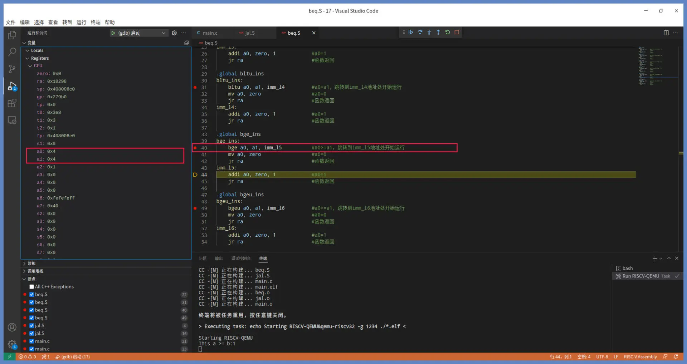

上图中是执行“bge a0，a1，imm_l5”指令之后的状态，由于 a0 中的有符号数，大于等于 a1中的有符号数。而 bge 指令是大于等于就跳转，所以这时程序将会直接跳转到 imm_l5 处运行。执行 addi a0，zero，1 指令，将 a0 寄存器置为 1 后，就会返回到 main 函数中。

对照下图，可以看到调用 bge_ins(4,4) 函数后，之后就是调用 printf，在终端上打印其返回结果，输出为 1。

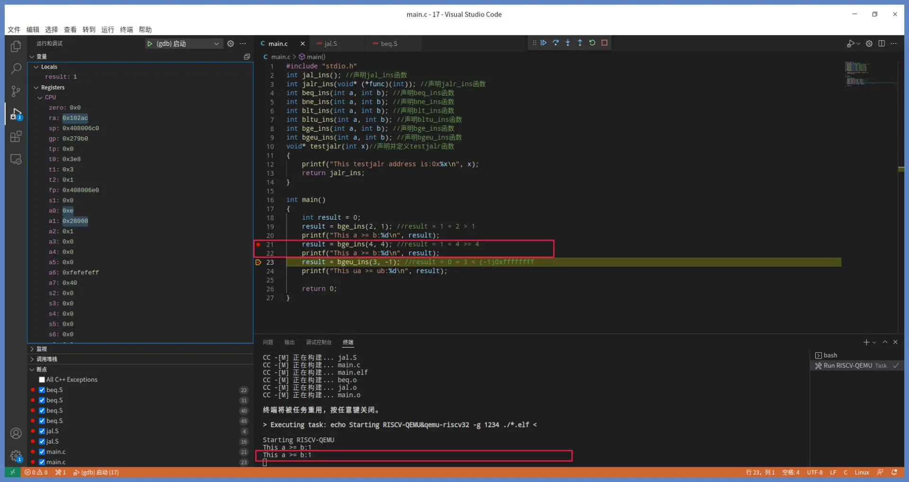

因为两个数相等，所以返回 1，这个结果正确，也验证了 bge 指令的功能确实是大于等于则跳转。

下面我们继续调试，就会进入 bgeu_ins 函数之中，如下所示：

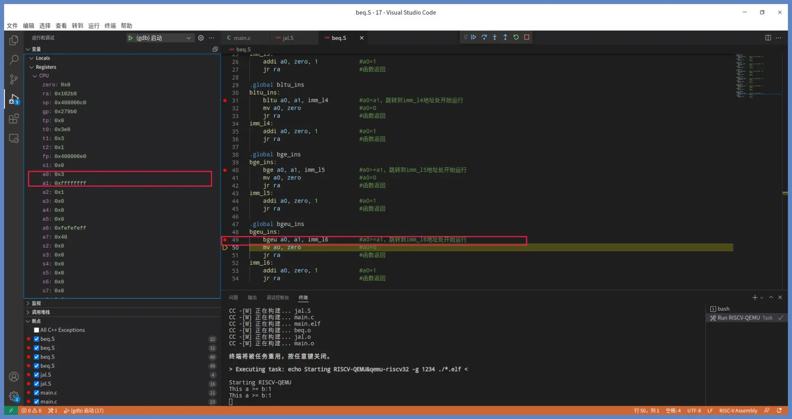

上图中是执行“bgeu a0，a1，imm_l6”指令之后的状态。

由于 bgeu 把 a0、a1 中的数据当成无符号数，所以 a0 的数据小于 a1 的数据。而 bgeu 指令是大于等于就跳转，这时程序就会就会顺序运行 bgeu 后面的指令“mv a0，zero”，将 a0 寄存器置为 0 后，返回到 main 函数中。

可以看到，意料外的结果再次出现了。你可能疑惑，下图里调用 bgeu_ins 函数传递的参数是3 和 -1，应该返回 1 才对，然而 printf 在终端上的输出却是 0。

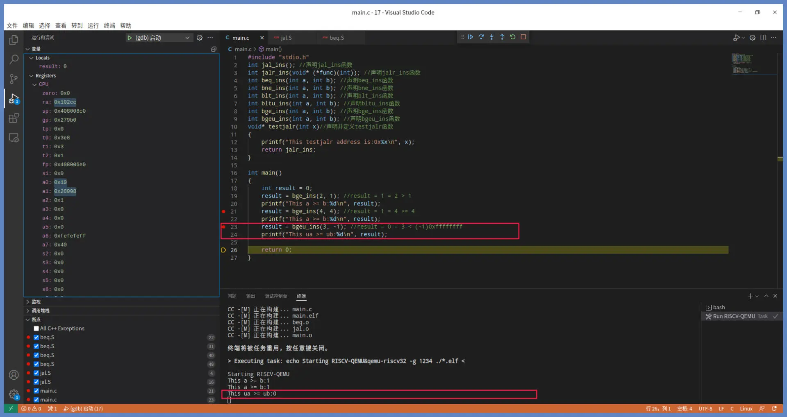

出现这样的情况，跟前面 bltu_ins 函数情况类似，bgeu_ins 函数会把两个参数都当成无符号数据，把 -1 当成无符号数是 0xffffffff，3 远小于 0xffffffff，所以才会返回 0。也就是说，图里的结果恰好验证了 bgeu 指令是正确的。

到这里，我们已经完成了对 beq、bne、blt、bltu、bge、bgeu 指令的调试，熟悉了它们的功能细节，现在我们继续一起看看 beq_ins、bne_ins、blt_ins、bltu_ins、bge_ins、bgeu_ins函数的二进制数据。

沿用之前查看 jal_ins、jalr_ins 函数的方法，我们将 main.elf 文件反汇编成 main.ins 文件，然后打开这个文件，就会看到这些函数的二进制数据，如下所示：

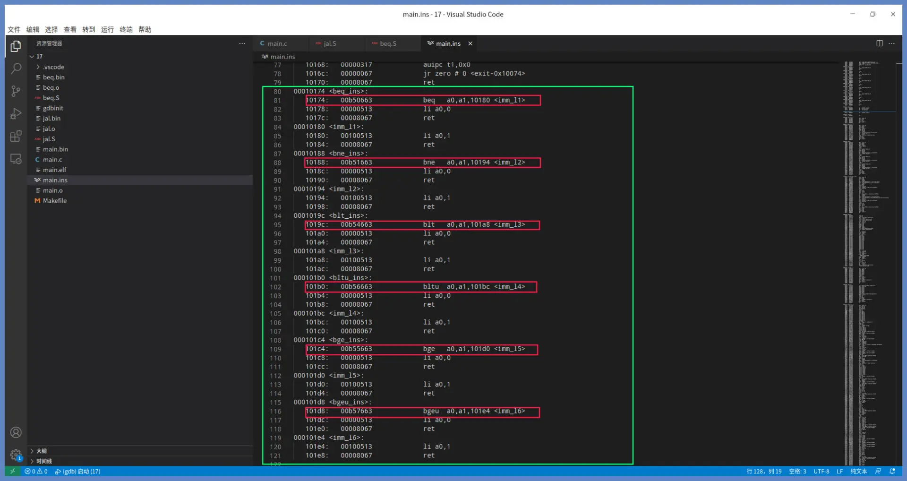

上图里的反汇编代码中使用了一些伪指令，它们的机器码以及对应的汇编语句、指令类型，我画了张表格来梳理。

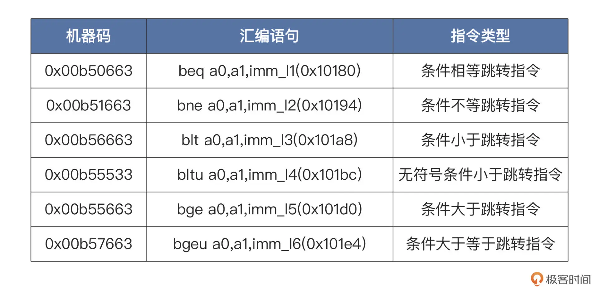

有了这些机器码数据，我们同样来拆分一下这些指令各位段的数据，在内存里它们是这样编码的：

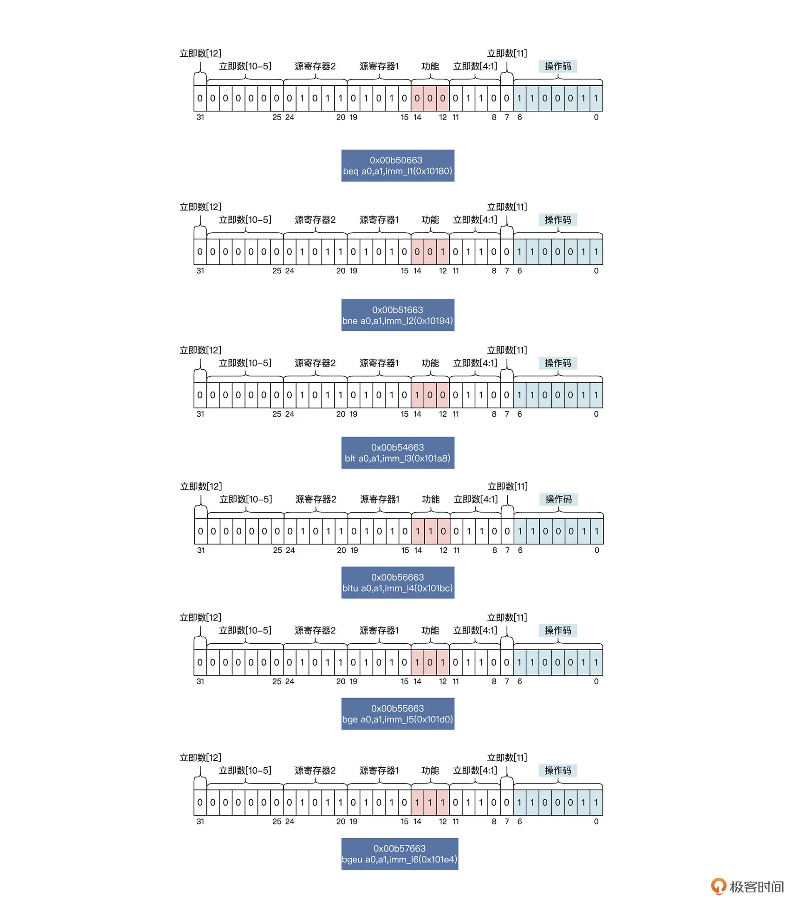

看完图片我们可以发现，bqe、bne、blt、bltu、bge、bgeu 指令的操作码是相同的，区分指令的是功能码。

这些指令的立即数都是相同的，这和我们编写的代码有关，其数据正常组合起来是0b00000000110，这个二进制数据左移 1 位等于十六进制数据 0xc。看看那些 bxxx_ins 函数代码，你就明白了，bxxx 指令和 imm_lxxx 标号之间（包含标号）正好间隔 3 条，一条指令 4字节，其偏移量正好是 12，pc+12 正好落在 imm_lxxx 标号处的指令上。

## 重点回顾

这节课就要结束了，我们做个总结。

RISC-V 指令集中的有条件跳转指令一共六条，它们分别是 beq、bne、blt、bltu、bge、bgeu。

bne 和 beq 指令，用于比较数据是否相等，它们是一对相反的指令操作，搭配使用就能完成相等和不相等的流程控制。blt、bltu 是小于则跳转的指令，bge、bgeu 是大于等于则跳转的指令，区别在于有无符号数。这六条跳转指令的共性是，都会先比较两个源操作数，然后根据比较结果跳转到具体的偏移地址去运行。

这节课的要点我给你准备了导图，供你参考复习。


到这里，我们用两节课的时间掌握了 RISC-V 指令集的八条跳转指令。正是这些“辛勤劳作”的指令，CPU 才获得了顺序执行之外的新技能，进而让工程师在高级语言中，顺利实现了函数调用和流程控制与比较表达式。

下节课我们继续挑战访存指令，敬请期待。

## 思考题

我们发现在 RISC-V 指令集中，没有大于指令和小于等于指令，这是为什么呢？

别忘了在留言区记录收获，或者向我提问。如果觉得课程还不错，别忘了推荐给身边的朋友，跟他一起学习进步。
