# 21 | RISC-V指令精讲（六）：加载指令实现与调试

你好，我是 LMOS。

之前我们已经学过了 RISC-V 中的算术指令、逻辑指令、原子指令。这些指令主要的操作对象是寄存器，即对寄存器中的数据进行加工，这是 RISC 体系的重要特性。

但你是否想过寄存器中的数据从哪里来呢？答案是从内存中来，经过存储指令加载到寄存器当中。

RISC-V 是一个典型的加载储存体系结构，这种体系类型的 CPU，只有加载与储存指令可以访问内存，运算指令不能访问内存。这节课我们就来学习一下 RISC-V 的加载指令。

顾名思义，加载指令就是从一个地址指向的内存单元中，加载数据到一个寄存器中。根据加载数据大小和类型的不同，加载指令还可以细分成五条加载指令，分别是加载字节指令、无符号加载字节指令、加载半字指令、无符号加载半字指令、加载字指令。

这节课的代码，你可以从这里下载。

## 加载字节指令：lb 指令

我们先从加载字节指令开始说起。在研究加载字节指令之前，我们先来看看 RISC-V 的加载指令的格式，其对应的汇编语句格式如下：

```
指令助记符 目标寄存器，源操作数2(源操作数1）
```

对于加载指令，指令助记符可以是 lb、lbu、lh、lhu、lw，目标寄存器可以是任何通用寄存器，源操作数 1 也可以是任何通用寄存器，源操作数 2 则是立即数。

我们用汇编代码来描述一下加载字节指令，形式如下：

```
lb rd,imm(rs1)
#lb 加载字节指令
#rd 目标寄存器
#rs1 源寄存器
#imm 立即数（-2048~2047）
```

上述代码中 rd 和 rs1 可以是任何通用寄存器。立即数 imm 为 12 位二进制数据，其范围是-2048~2047，前面课程已经说明了，RISC-V 指令集中所有的立即数都是有符号数据，这里的imm 在其他的文档里也称为偏移量，为了一致性，我们继续沿用立即数的叫法。

lb 指令完成的操作，用伪代码描述如下所示：

```
rd = 符号扩展（[rs1+imm][7:0]）
```

我来为你解释一下，上面的伪代码执行的操作是怎样的。

首先 lb 指令会从内存单元里 rs1+imm 这个地址里取得 8 位数据，也就是第 0 位到第 7 位的数据。然后，把这个数据进行符号扩展，扩展成 32 位数据。如果符号位为 1，则该 32 位的高24 位为 1，否则为 0。最后 lb 指令再把这个 32 位的数据赋给 rd。

下面我们一起写代码验证一下。为了方便之后的调试，我们需要先设计好代码的组织结构，这个过程前面几节课我们反复做过，现在估计你已经相当熟练了。首先创建 main.c 文件并在上面写好 main 函数。然后写一个 load.S 文件，用汇编写上 lb_ins 函数。

lb_ins 函数的代码如下所示：

```
.text
.globl lb_ins
#a0内存地址
#a0返回值
lb_ins:
   lb a0, 0(a0)       #加载a0+0地址处的字节到a0中
   jr ra              #返回
```

对照代码，我们可以看到这个函数只有两条指令，第一条指令把 a0+0 地址处的字节加载到a0 中，第二条指令就是返回指令，a0 作为函数的返回值返回。

你可以用 VSCode 打开工程目录，按下“F5”键调试一下。首先，我们把断点停在 lb a0，0(a0)指令处，如下所示：

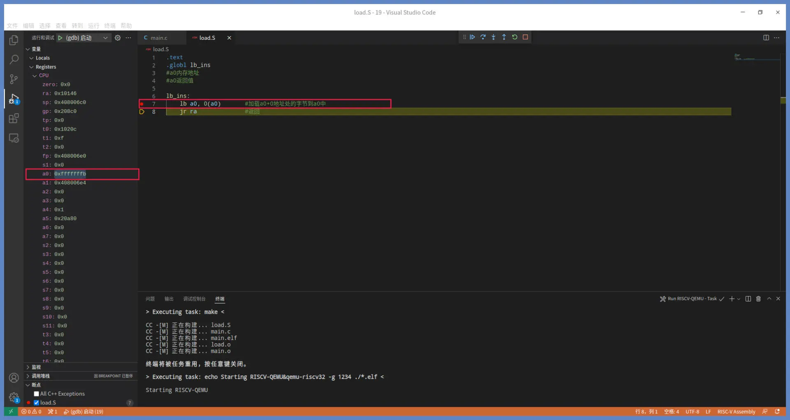

上图中是刚刚执行完 lb a0，0(a0) 指令之后，执行 jr ra 指令之前的状态。

我们可以看到，a0 寄存器中的值已经变成了 0xfffffffb，我们继续单步调试返回到 main 函数中执行 printf 函数，打印一下 lb_ins 函数返回的结果，如下图所示：

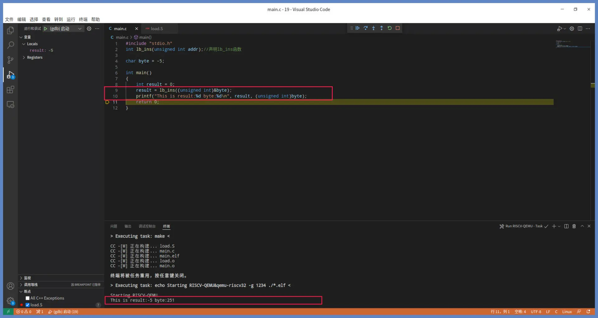

如上图所示，byte 变量的值为 -5，其补码为 0xfb，我们把 byte 的地址强制为无符号，整体传给 lb_ins 函数。

调用规范告诉我们，C 语言函数用 a0 寄存器传递第一个参数。lb 指令虽然只加载了内存地址处的 8 位数据（0xfb），但是它会用数据的符号位把数据扩展成 32 位（0xfffffffb），再传给目标寄存器，即 a0 寄存器，这样 a0 就会作为返回值返回，所以结果为 0xfffffffb。这证明了 lb 指令工作是正常的。

## 无符号加载字节指令：lbu 指令

接着我们来看一看 lb 指令的另一个版本，就是无符号加载字节指令，它的汇编代码是这样写的：

```
lbu rd,imm(rs1)
#lbu 无符号加载字节指令
#rd 目标寄存器
#rs1 源寄存器
#imm 立即数（-2048~2047）
```

上述代码里，rd，rs1，imm 与 lb 指令的用法和规则是一样的。lbu 指令完成的操作，我们用伪代码描述如下：

```
rd = 符号扩展（[rs1+imm][7:0]）
```

因为 lbu 指令获取 8 位数据的位置，还有把数据扩展成 32 位赋给 rd 的过程，都和 lb 指令一样，我就不重复了。注意是无符号扩展，即符号位为 0。

接下来咱们写个代码验证一下，同样在 load.S 文件中用汇编写上 lbu_ins 函数 ，代码如下所示：

```
.globl lbu_ins
#a0内存地址
#a0返回值
lbu_ins:
   lbu a0, 0(a0)      #加载a0+0地址处的字节到a0中
   jr ra              #返回
```

在 lbu_ins 函数中，第一条指令把 a0+0 地址处的字节加载到 a0 中，之后 a0 会作为函数的返回值返回。

同样地，用 VSCode 打开工程目录，这里我们需要在 lbu a0，0(a0) 指令处打下断点，随后按下“F5”进行调试，如下所示：

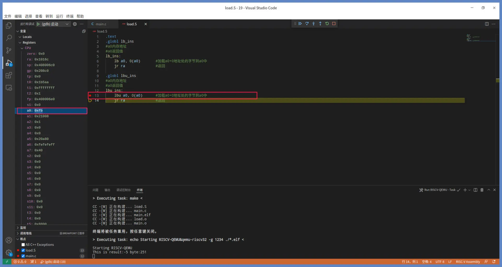

上图中是执行完 lbu a0，0(a0) 指令之后，执行 jr ra 指令之前的状态，现在 a0 寄存器中的值已经变成了 0xfb。

我们继续单步调试，返回到 main 函数中，让 printf 函数打印 lbu_ins 函数，返回的结果如下图所示：

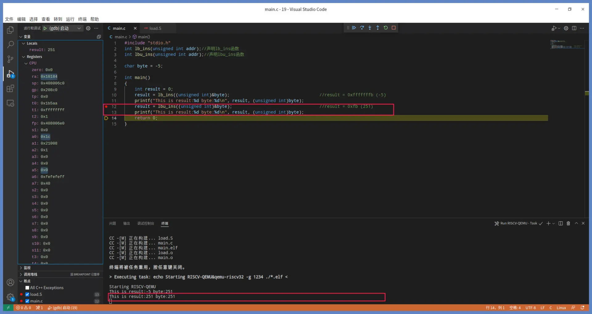

同样的，byte 变量的值为 -5，其补码为 0xfb，我们把 byte 变量的地址强制为无符号整体传给lbu_ins 函数并调用它。

在 lbu_ins 函数中，lbu 指令只加载内存地址处的 8 位数据（(0xfb），但是它与 lb 指令不同，它会用 0 把数据扩展成 32 位（0x000000fb），再传给目标寄存器，即 a0 寄存器。这样 a0 就会作为返回值返回，故而 result 为 0xfb（251）。这证明了 lbu 指令是正常工作的。lbu 指令的这种无符号扩展特性，非常易于处理无符号类型的变量。

## 加载半字指令：lh 指令

有了能够加载一个字节的指令，我们还需要加载双字节的指令，也叫加载半字指令。在 RISC-V 规范中，一个字是四字节，所以两个字节也称为半字。

下面我们一起来学习加载半字指令。我们还是先从汇编代码的书写形式来熟悉它，如下所示：

```
lh rd,imm(rs1)
#lh 加载半字指令
#rd 目标寄存器
#rs1 源寄存器
#imm 立即数（-2048~2047）
```

上述代码中，rd 和 rs1 可以是任何通用寄存器。立即数 imm 为 12 位二进制数据，其范围是-2048~2047。

lh 指令完成的操作，用伪代码描述如下：

```
rd = 符号扩展（[rs1+imm][15:0]）
```

经过前面的学习，相信你已经找到了规律，现在自己也能解读这样的伪代码了。还是熟悉的过程：先读取数据，找到内存单元 rs1+imm 这个地址，从里面获取第 0 位到第 15 位的数据，再对这个 16 位数据进行符号扩展（扩展为 32 位数据）；接着根据符号位分情况处理，如果符号位为 1 则该 32 位的高 16 位为 1，否则为 0；最后把这个 32 位数据赋值给 rd。

下面是写代码验证时间。我们在 load.S 文件中用汇编写上 lh_ins 函数，代码如下：

```
.globl lh_ins
#a0内存地址
#a0返回值
lh_ins:
   lh a0, 0(a0)       #加载a0+0地址处的半字到a0中
   jr ra              #返回
```

上面的 lh_ins 函数中，第一条指令把 a0+0 地址处的半字加载到 a0 中，而 a0 将会作为函数的返回值返回。

我们用 VSCode 打开工程目录，在 lh a0，0(a0) 指令处打下断点，随后按下“F5”键调试一下，如下所示：

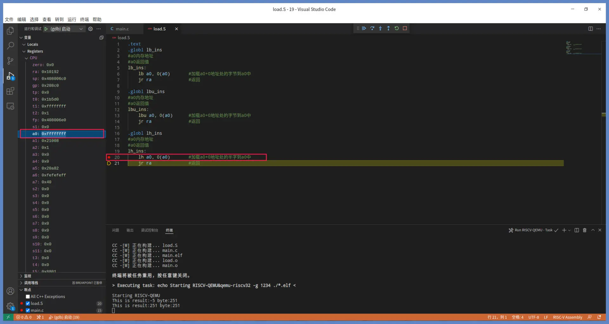

上图中是执行完 lh a0，0(a0) 指令之后，执行 jr ra 指令之前的状态。从图中我们可以看到 a0寄存器中的值已经变成了 0xffffffff。

我们继续单步调试，返回到 main 函数中，让 printf 函数打印一下 lh_ins 函数返回的结果，如下图所示：

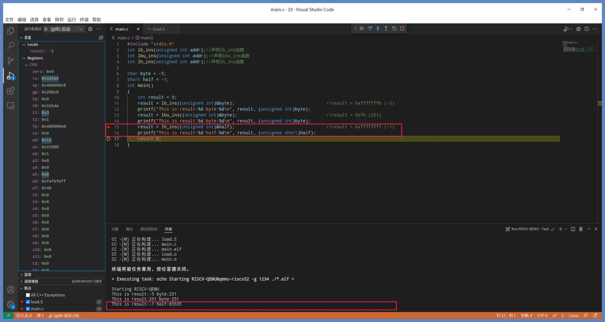

对照图片不难发现，short 类型的 half 变量占用两个字节，其值为 -1，它的补码为 0xffff，我们把 half 的地址强制为无符号整体传给 lh_ins 函数。

在 lh_ins 函数中，lh 指令虽然只加载内存地址处的 16 位数据（0xffff），但是它会用数据的符号位把数据扩展成 32 位（0xffffffff），再把扩展后的数据传递给 a0 寄存器，这样 a0 就会作为返回值返回，故而 result 为 0xffffffff。这证明了 lh 指令工作正常。

## 无符号加载半字指令：lhu 指令

加载半字指令也分为两种版本，即有符号版本和无符号版本。我们再看看无符号加载半字指令lhu，它的汇编代码书写形式如下所示。

```
lhu rd,imm(rs1)
#lhu 无符号加载半字指令
#rd 目标寄存器
#rs1 源寄存器
#imm 立即数（-2048~2047）
```

上述代码中 rd，rs1，imm 与 lh 指令的用法和规则是一样的。

我用伪代码为你描述一下 lhu 指令完成的功能。

```
rd = 符号扩展（[rs1+imm][15:0]）
```

lhu 指令的操作过程与 lh 指令一样，我就不重复了，但符号位为 0，lhu 会进行无符号扩展，即数据的高 16 位为 0。

接下来就是代码验证环节，我们同样在 load.S 文件中用汇编写上 lhu_ins 函数，代码如下所示：

```
.globl lhu_ins
#a0内存地址
#a0返回值
lhu_ins:
   lhu a0, 0(a0)       #加载a0+0地址处的半字到a0中
   jr ra               #返回
```

可以看到上面的 lhu_ins 函数中，第一条指令会把 a0+0 地址处的字节加载到 a0 中，而 a0 将会作为函数的返回值返回。

我们用 VSCode 打开工程目录，在 lhu a0，0(a0) 指令处打下断点，随后按“F5”键调试，如下所示：

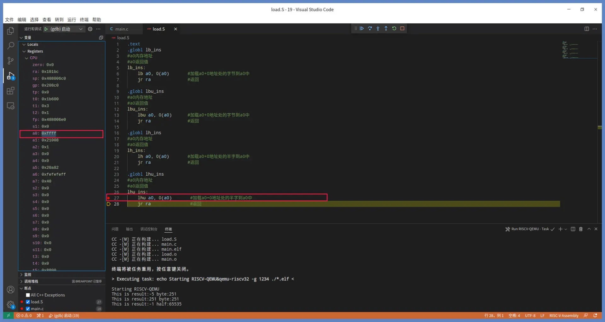

上图是执行完 lhu a0，0(a0) 指令之后，执行 jr ra 指令之前的状态，可以看到 a0 寄存器中的值已经变成了 0xffff。

我们继续单步调试，返回到 main 函数中，让 printf 函数打印一下 lhu_ins 函数返回的结果，如下图所示：

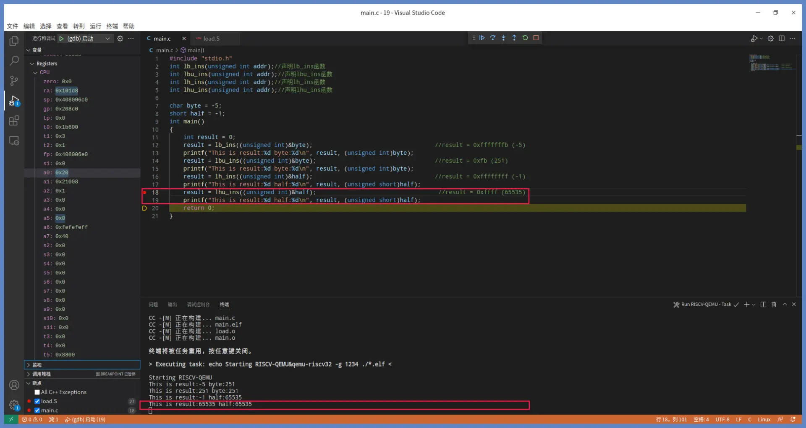

如上图所示，我们把 half 的地址强制为无符号整体传给 lhu_ins 函数。在 lhu_ins 函数中，lh指令虽然只加载内存地址处的 16 位数据（0xffff），但是它会用数据的符号位把数据扩展成 32位（0x0000ffff），给 a0 寄存器作为返回值返回，故而 result 为 0xffff，也就是 65535。这证明了 lhu 指令工作正常。与 lbu 指令一样，这里同样是为了让编译器方便处理无符号类型的变量。

## 加载字指令：lw 指令

对于一款处理器来说，最常用的是加载其自身位宽的数据为 32 位的 RISC-V 处理器，加载字指令是非常常用且必要的指令，一个字的储存大小通常和处理器位宽相等。

现在。我们一起来学习最后一条加载指令，即加载字指令。我们先来看看加载字指令 lw，它的汇编代码书写形式如下：

```
lw rd,imm(rs1)
#lw 加载字指令
#rd 目标寄存器
#rs1 源寄存器
#imm 立即数（-2048~2047）
```

lw 指令完成的操作，用伪代码描述是这样的：

```
rd = （[rs1+imm][31:0]）
```

我们看看上面的伪代码执行的操作。首先找到内存单元 rs1+imm 这个地址，从里面获取第 0位到第 31 位的数据，注意数据无需进行符号扩展，最后把这个 32 位数据赋值给 rd。

写代码验证的思路，现在你应该也很熟悉了。同样还是在 load.S 文件中，用汇编写上 lw_ins函数，代码如下所示：

```
.globl lw_ins
#a0内存地址
#a0返回值
lw_ins:
   lw a0, 0(a0)        #加载a0+0地址处的字到a0中
   jr ra               #返回
```

我们可以看到，lw_ins 函数完成的操作就是，先把 a0+0 地址处的一个字加载到 a0 中，再把a0 作为函数的返回值返回。

用 VSCode 打开工程目录，在 lw a0，0(a0) 指令处打下断点，随后按下“F5”键调试，调试截图如下所示：

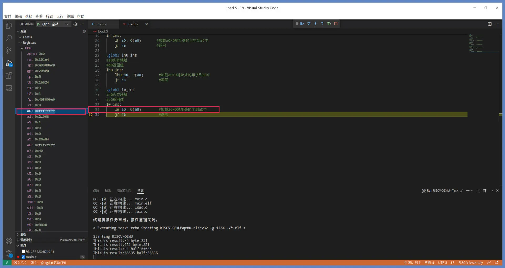

上图中是执行完 lw a0，0(a0) 指令之后，执行 jr ra 指令之前的状态，现在 a0 寄存器中的值已经变成了 0xffffffff。继续单步调试执行，就可以返回到 main 函数中。

我们通过 printf 函数打印一下 lw_ins 函数返回的结果，如下图所示：

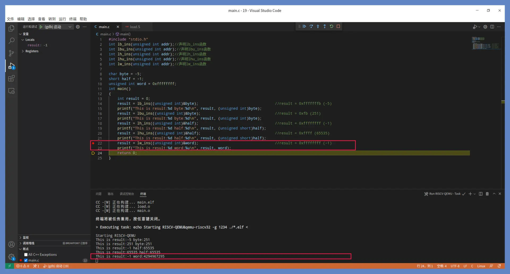

这里我们把 word 的地址强制为无符号整体传给 lw_ins 函数。在 lw_ins 函数中，lw 指令会直接加载内存地址处的 32 位数据 (0xffffffff)，给 a0 寄存器作为返回值返回，result 值为0xffffffff，但因为它是有符号类型，故而 0xffffffff 表示为 -1。而 word 为无符号整形，0xffffffff则表示为 4294967295，这证明了 lw 指令功能是正确无误的。

到这里，我们已经完成了对 lb、lbu、lh、lhu、lw 这五条指令的调试，也熟悉了它们的功能细节。现在我们继续研究一下 lb_ins、lbu_ins、lh_ins、lhu_ins、lw_ins 函数的二进制数据。

你只需要打开终端，切换到该工程目录下，输入命令：riscv64-unknown-elf-objdump -d./main.elf > ./main.ins，就会得到 main.elf 的反汇编数据文件 main.ins。接着，我们打开这个文件，就会看到上述函数的二进制数据，如下所示：

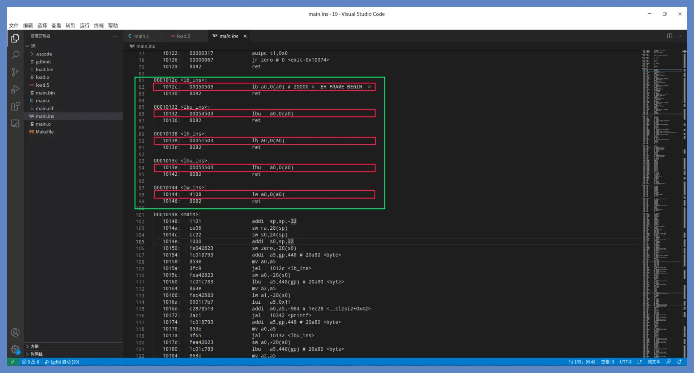

上图反汇编代码中包括伪指令和两个字节的压缩指令。比如 ret 的机器码是 0x8082，lwa0,0(a0) 机器码是 0x4108，它们只占用 16 位编码，即二字节。截图里五条加载指令的机器码与指令的对应关系，你可以参考后面这张表格。

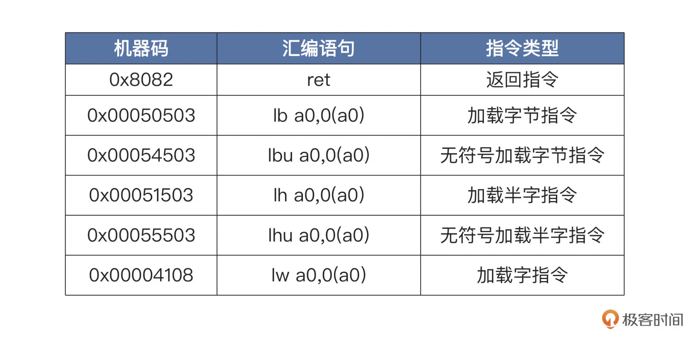

下面我们继续一起拆分一下 lb、lbu、lh、lhu、lw 指令的各位段的数据，看看它们都是如何编码的。如下图所示：

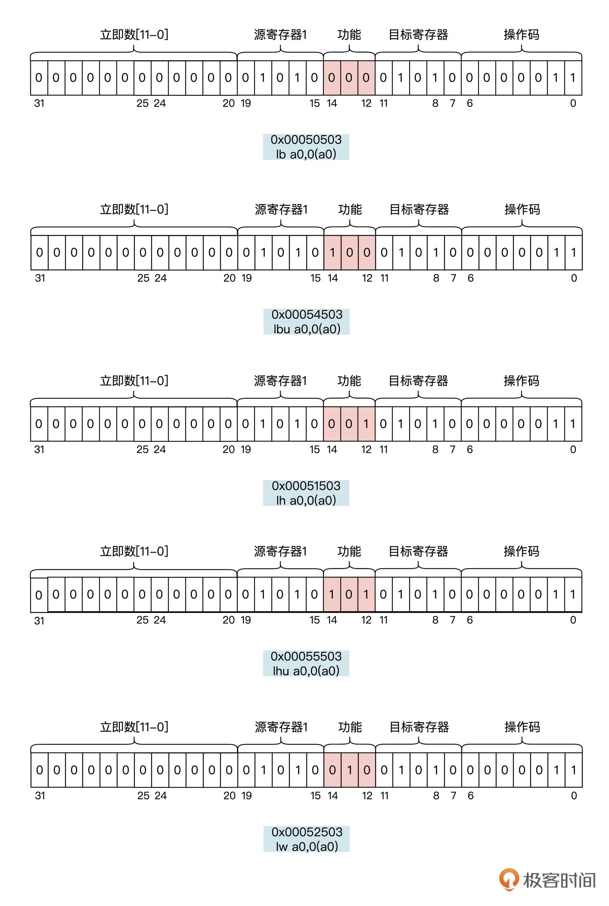

对照上图可以看到，lb、lbu、lh、lhu、lw 指令的功能码都不一样，我们可以借此区分这些指令。而这些加载指令的操作码都一样，立即数也相同（都是 0），这和我们编写的代码有关。

需要注意的是 lw a0,0(a0) 指令，上图的情况和反汇编出来的数据可能不一致，这是因为编译器使用了压缩指令。

我还原了 lw a0,0(a0) 正常的编码，你可以手动在 lw_ins 函数中插入这个数据 0x00052503，进行验证。怎么插入这个数据使之变成一条指令呢？代码如下所示：

```
.globl lw_ins
#a0内存地址
#a0返回值
lw_ins:
   .word 0x00052503    #lw a0, 0(a0)        #加载a0+0地址处的字到a0中
   jr ra               #返回
```

## 重点回顾

今天我们一共学习了五条加载指令，分别是加载字节指令、无符号加载字节指令、加载半字指令、无符号加载半字指令、加载字指令，它们可以加载不同大小的数据，同时又能处理数据的符号。

而且这五条指令组合起来，既可以加载不同位宽的数据，又能处理加载有、无符号的数据。这些指令为高级语言实现有无符号的类型变量提供了基础，让我们的开发工作更便利。比方说，在 C 语言中，实现的各种数据类型：unsigned、int、char、unsigned、char 等都离不开加载指令。

最后我给你总结了一张导图，供你参考复习。下节课，我们继续学习储存指令，敬请期待。

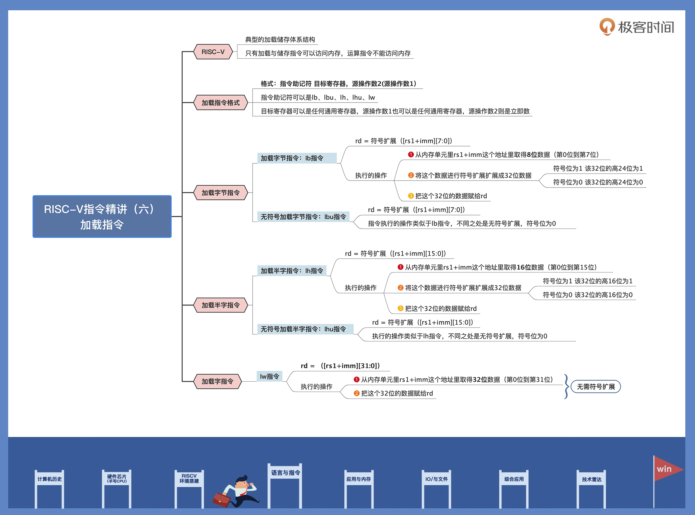

## 思考题

为什么加载字节与加载半字指令，需要处理数据符号问题，而加载字指令却不需要呢？

欢迎你在留言区跟我交流，也推荐你把这节课分享给更多同事、朋友。
