# 33 | lotop与lostat命令：聊聊命令背后的故事与工作原理

你好，我是 LMOS。

前面的课程里，我们学习了 IO Cache、IO 调度和 IO 管理的相关知识，但怎样度量和检测一个应用使用 IO 的情况呢？我们今天就来聊聊这个问题。

这节课我想带你认识两大监控 IO 操作的神器——iostat 与 iotop，让你掌握安装、使用它们的方法以及它们的工作原理。在 Linux 系统上，iostat 和 iotop 这两个 IO 数据工具非常常用。它们都是性能分析领域中不可缺少的工具性软件，也经常被 Linux 网络服务器运维人员，用于分析某些服务器的 IO 类性能与故障。

### 安装 iostat 与 iotop

在带你安装这两个工具之前，我先简单介绍下这两个工具的功能。iostat 可以用来分析 Linux系统整体 IO 的使用情况；而 iotop 作为 iostat 增强版和功能升级版，可以分析 Linux 系统每一个进程使用 IO 的情况。

在我们日常使用的 Linux 发行版中，是不包含 iostat 与 iotop 两个 IO 工具软件包的，需要我们自行安装它们才可以使用。

各大 Linux 发行版软件包管理方法并不统一，导致安装应用软件的方式不尽相同。考虑到Ubuntu、Deepin 都是基于 Debain 开发的，所以我们这里以 Debain 系的 Linux 发行版为例进行操作。

我们只要在终端中输入如下命令，就可以安装 iostat 与 iotop 了。

```bash
//安装iostat
sudo apt-get install sysstat
//安装iotop
sudo apt-get install iotop
```

不过，我们并不能直接安装 iostat，这样会提示找不到 iostat 软件包，因为它是包含在 sysstat软件包中，所以我们必须先安装 sysstat；而 iotop 却是独立的软件包，直接安装它就好了。如果你的 Linux 系统软件源和网络没有问题，肯定能安装成功。

你可能对这两个命令的使用方法不熟悉，没事，我们不妨在终端里输入这两个命令试一试，看看会出现什么效果。后面截图展示的是我自己机器上的情况：

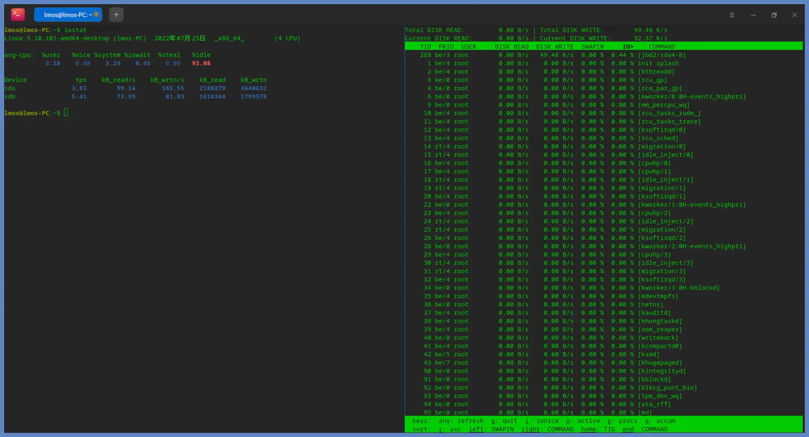

上图中左边是 iostat 命令执行的结果，右边是 iotop 命令执行的结果。如果你现在还看不懂这些信息，也没有关系，我们后面再介绍，这里仅仅是为了给你一个参考，你输入命令后显示效果类似上图的话，就说明安装成功了。

### iostat 命令

在前面我们已经成功安装了 iostat 命令，接下来我们重点聊聊它的使用方法，还有输出的数据表示的是什么。

iostat 命令，是用来展示系统中的 IO 设备和 CPU 使用情况的。它的最大优势在于能汇报所有块设备活动的统计情况，同时也能汇报出 CPU 使用情况。但是 iostat 命令有一个缺陷，就是它不能对每个应用程序进程进行深入分析，只能分析系统的整体情况。

我们先来看 iostat 如何使用，它的使用形式如下：

```
iostat [选项] [参数]
```

“[]”中的内容可以省略，我们直接在终端中输入 iostat，就会输出相关的全部信息。但是我们如果要观察特定信息，就需要使用相关选项了，我给你列了一个表梳理了最常用的部分，如下所示：

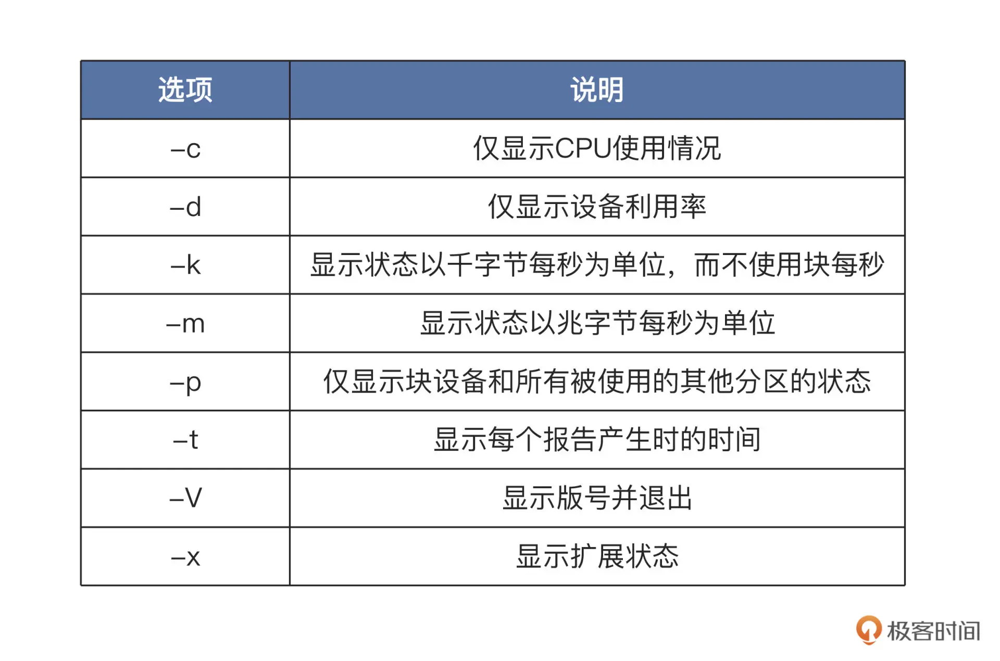

了解了选项，还有个参数我们可能用得上，这个参数可以指定为设备名，比如 /dev/sda。如果不带参数，就会默认显示所有 IO 储存设备的情况。

好，我们就这来练练手，使用 iostat 命令看看我们自己机器上的 IO 设备，主要是硬盘的使用情况。这里我们使用 iostat -d -m -p -x 这个命令，该命令可以显示所有硬盘及其分区的信息，在我的机器上情况如下所示：

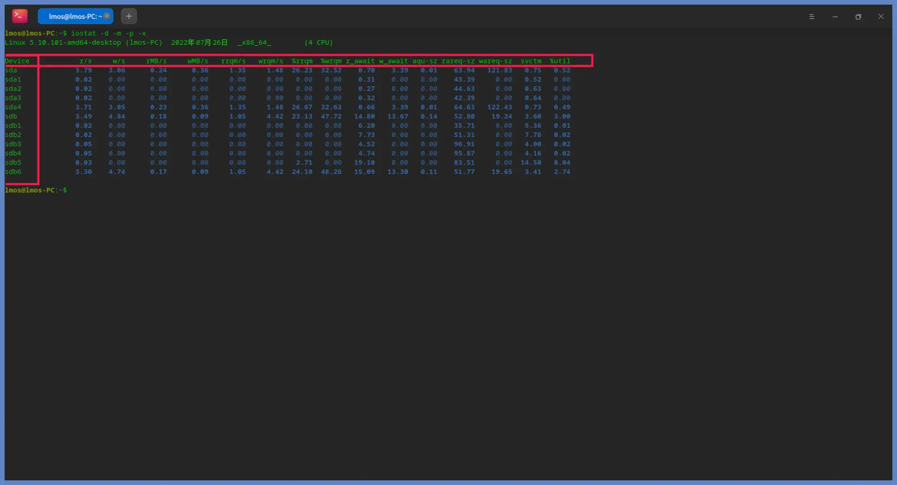

上图中展示了所有硬盘及其分区的 IO 情况，第一列就是设备名，后面几列的相关说明，我用表格方式给你做了梳理：

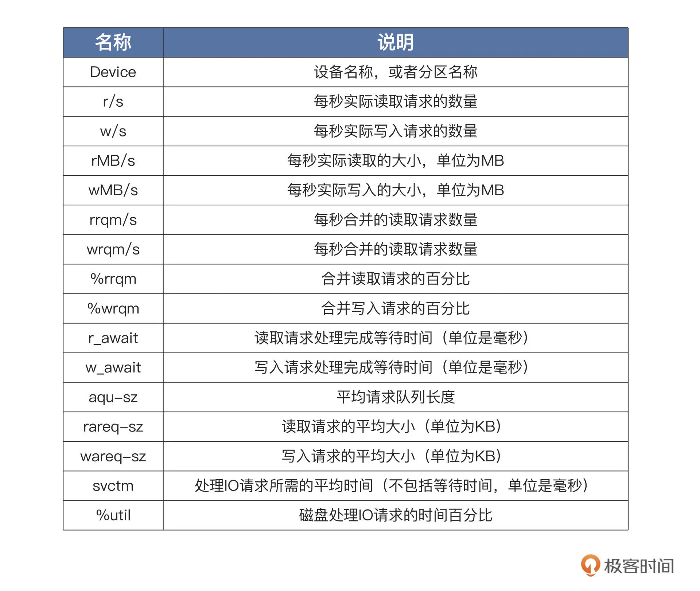

有了这些量化数据，我们就能判断每个硬盘分区的 IO 使用情况，从而分析出哪个设备占用 IO请求量高或者低、占用时间多少、读取或者写入的数据量有多少。这样，性能瓶颈出现在哪个设备上，我们心中就有数了。

接下来我们继续讲解 iostat 的工作原理。iostat 命令只是一个应用软件，它的功能就是计算统计数据并且显示。IO 设备操作的数据肯定来源于内核，那 iostat 怎么获取这些数据就成了关键。

Linux 的内核数据，都是以文件的形式提供的。换句话说，就是我们想要获取什么数据，就相应去读取什么文件。

下面我们手动读取一些文件，体验一下具体是什么情况，如下所示：

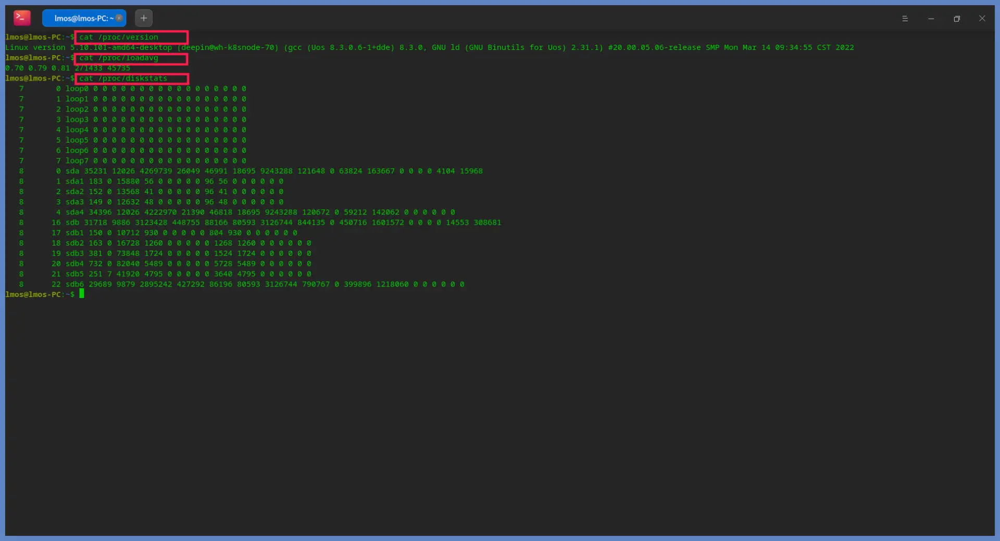

对比 iostat 产生的数据，是不是感觉和上面读取的三个文件得到的数据很相似？是的，你猜的没有错，这些文件就是 iostat 命令的数据来源，主要的数据来源是 /proc/diskstats 文件，它记录着块设备 IO 操作的全部统计信息。

下面我列了一个表，梳理了文件名和对应的统计信息，你可以看看：

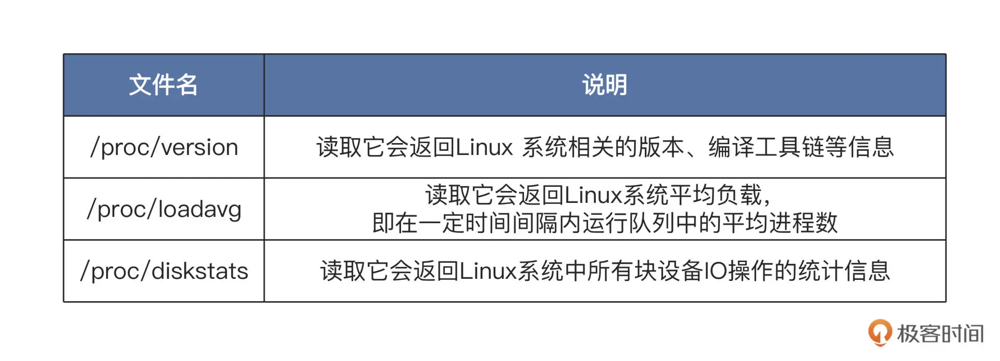

我们来看一看 /proc/diskstats 文件的数据结构，它的每一行代表一个块设备或者块设备的分区，总共 20 列数据，每一列的内容如下表：

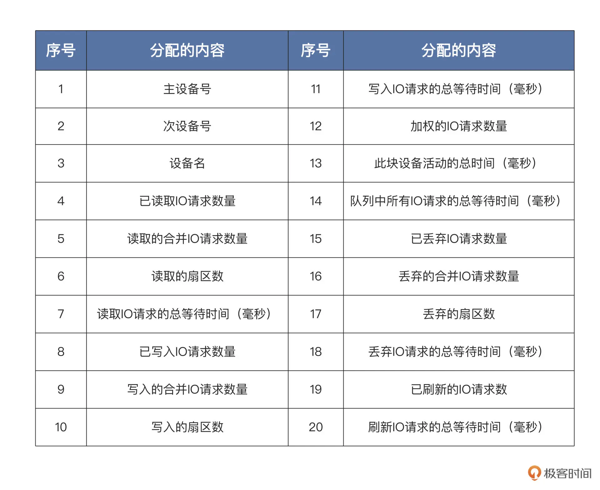

Linux 块设备层在处理每个 IO 请求的时候，都会更新这些数据，具体的流程这里不展开了，iostat 只使用了其中部分数据。由于这些数据是线性增加的，iostat 只需要经过多次采集，进行简单的运算就可以了。

iostat 只是负责的工作其实很简单，就是采集数据并计算显示。我们通过一段时间的 IO 请求数据、写入和读取的数据量、IO 请求等待时间等等这些数据，就可以评估一个设备的 IO 性能了。好了关于 iostat 的工作原理我们讲到这里，我们接着探索 iotop 命令。

### iotop 命令

我们前面刚学过的 iostat 这个 IO 工具，只能收集量化到每个块设备的读写情况，但如果我们想知道每个进程是如何使用 IO 的就做不到，这就要用到 iotop 命令了。

iotop 命令是一个 top 类工具，可以监视磁盘 I/O 使用状况，还可以作为 iostat 的升级工具使用。iotop 命令具有与 Linux 系统自带的 top 相似的 UI，只是 top 更关注进程，而 iotop 更关注 IO。

iotop 命令它是使用 Python 语言编写而成，需要用 Python2.5 以上的版本和 Linux 内核 2.6 以上的版本。iotop 提供了源代码和二进制软件包，可以自己选择安装。在前面我们已经安装了iotop，如果你没有安装好，请回到前面看看怎么安装的。

像 iostat 一样，我们一起看看 iotop 如何使用，它的使用形式如下：

```
iotop [选项]
```

“[]”中的内容可以省略，直接在终端中输入 iotop 就会输出相关的全部信息，这一点与 iostat 相同，但是我们如果要观察特定信息，就需要使用相关选项了。我给你列了一个表梳理选项，如下所示：

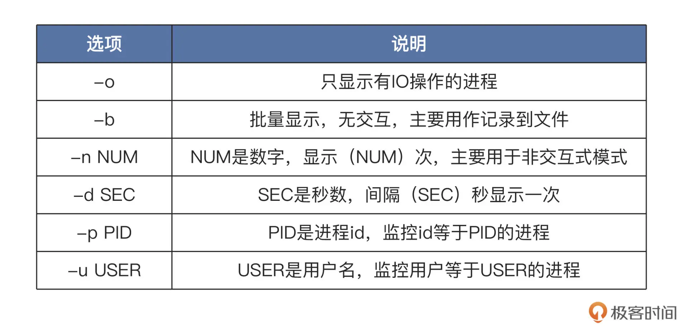

我们马上来测试一下，使用 sudo iotop 命令，注意该命令需要 root 权限才能运行，在前面要加上 sudo。这条不带任何选项的命令，会显示所有用户的所有进程使用 IO 的情况，在我的机器上情况如下所示：

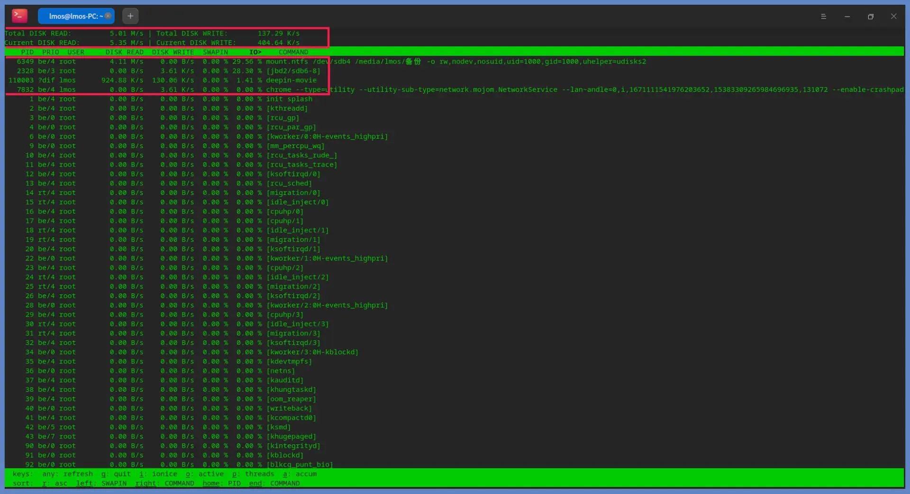

上图中展示了所有进程读写硬盘的情况，头部的数据显示了每一秒钟，所有硬盘和当前硬盘的读写数据量。而下面的每一行代表一个进程，每一行的第一列就是进程 id，也可以在运行过程中近“p”切换为线程 id，那一行就表示一个线程。后面几列的相关说明，我给你列出了一个表格，如下所示：

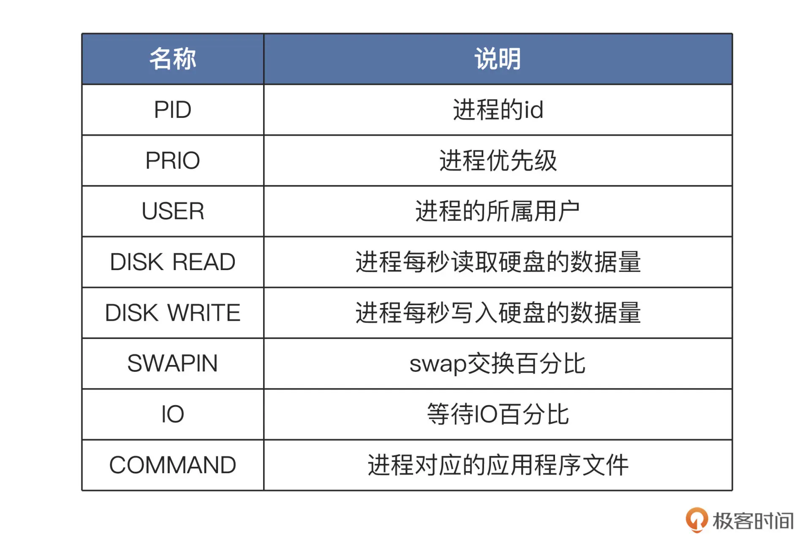

有了这些量化数据，我们就能判断哪些进程是 IO 型进程，哪些进程是计算型进程，每个进程的访问 IO 的数据一目了然。

根据这些数据，我们还能进一步分析出哪个进程使用 IO 的量是高或者低、占用时间多少、进程优先级多少。IO 性能瓶颈出现在哪个进程上，需要优化哪个进程的 IO 模型，我们心中就有底了。

我们已经了解 iotop 的作用是观察所有进程的 IO 操作情况，那 iotop 的工作原理是什么呢？与iostat 命令一样，iotop 只是一个应用软件，用来统计所有进程的 IO 数据并显示。进程和 IO操作数据必定来源于 Linux 内核，那 iotop 怎么获取这些数据呢？

在 Linux 上这些内核数据，都是以文件的形式提供的，即要获取什么数据，就读取什么文件。为了验证这个想法，下面我们试验一下，看看 iotop 是不是也是读取了一些 /proc 目录下的文件呢。

其实 iotop 是开源的，我们不妨下载它的代码来研究一下，命令如下：

```bash
//下载
wget http://guichaz.free.fr/iotop/files/iotop-0.4.4.tar.gz
//解压
tar zxf iotop-0.4.4.tar.gz
```

我已经帮你下载好了代码，放在了课程的工程目录中。我们进入工程目录，就可以发现 iotop是用 python 写的，入口点是 iotop.py 文件。

在 iotop/ui.pi 里，这个文件中会调用主函数 main，主函数进而会调用 run_iotop_window 函数执行主要功能。在 run_iotop_window 函数中会调用 ProcessList 对象，获取所有进程的相关信息。

我们不妨看一看它的代码片段，如下所示：

```python
class ProcessList(DumpableObject):
   def __init__(self, taskstats_connection, options):
       # {pid: ProcessInfo}
       self.processes = {}
       self.taskstats_connection = taskstats_connection
       self.options = options
       self.timestamp = time.time()
       self.vmstat = vmstat.VmStat()
       # A first time as we are interested in the delta
       self.update_process_counts()
   def get_process(self, pid):
       """Either get the specified PID from self.processes or build a new
       ProcessInfo if we see this PID for the first time"""
       process = self.processes.get(pid, None)
       if not process:
           process = ProcessInfo(pid)
           self.processes[pid] = process
       if process.is_monitored(self.options):
           return process
   def list_tgids(self):
       if self.options.pids:
           return self.options.pids
       tgids = os.listdir('/proc')
       if self.options.processes:
           return [int(tgid) for tgid in tgids if '0' <= tgid[0] <= '9']
       tids = []
       for tgid in tgids:
           if '0' <= tgid[0] <= '9':
               try:
                   tids.extend(map(int, os.listdir('/proc/' + tgid + '/task')))
               except OSError:
                   # The PID went away
                   pass
       return tids
   def list_tids(self, tgid):
       if not self.options.processes:
           return [tgid]
       try:
           tids = map(int, os.listdir('/proc/%d/task' % tgid))
       except OSError:
           return []
       if self.options.pids:
           tids = list(set(self.options.pids).intersection(set(tids)))
       return tids
   def update_process_counts(self):
       new_timestamp = time.time()
       self.duration = new_timestamp - self.timestamp
       self.timestamp = new_timestamp
       for tgid in self.list_tgids():
           process = self.get_process(tgid)
           if not process:
               continue
           for tid in self.list_tids(tgid):
               thread = process.get_thread(tid, self.taskstats_connection)
               stats = self.taskstats_connection.get_single_task_stats(thread)
               if stats:
                   thread.update_stats(stats)
                   thread.mark = False
       return self.vmstat.delta()
```

我们来梳理一下上述代码都做了什么。在 ProcessList 类的构造方法 __init__ 中，会调用update_process_counts 方法，接着在其中调用 list_tgids 方法，该方法会打开 /proc 目录获取所有以数字命名的目录名称，那就是 TGID。

TGID 就是线程组 ID，对于同一进程中的所有线程，TGID 都是一致的，也就是该进程的进程ID。接着循环调用 get_process 方法，在该方法中会构造 ProcessInfo 对象以获取每个进程的数据。

ProcessInfo 类的代码如下所示：

```python
class ProcessInfo(DumpableObject):
   def __init__(self, pid):
       self.pid = pid
       self.uid = None
       self.user = None
       self.threads = {} # {tid: ThreadInfo}
       self.stats_delta = Stats.build_all_zero()
       self.stats_accum = Stats.build_all_zero()
       self.stats_accum_timestamp = time.time()
   def get_uid(self):
       if self.uid:
           return self.uid
       try:
           uid = os.stat('/proc/%d' % self.pid)[stat.ST_UID]
       except OSError:
           # The process disappeared
           uid = None
       if uid != self.uid:
           # Maybe the process called setuid()
           self.user = None
           self.uid = uid
       return uid
   def get_user(self):
       uid = self.get_uid()
       if uid is not None and not self.user:
           try:
               self.user = safe_utf8_decode(pwd.getpwuid(uid).pw_name)
           except KeyError:
               self.user = str(uid)
       return self.user or '{none}'
   def get_proc_status_name(self):
       try:
           first_line = open('/proc/%d/status' % self.pid).readline()
       except IOError:
           return '{no such process}'
       prefix = 'Name:\t'
       if first_line.startswith(prefix):
           name = first_line[6:].strip()
       else:
           name = ''
       if name:
           name = '[%s]' % name
       else:
           name = '{no name}'
       return name
   def get_cmdline(self):
       # A process may exec, so we must always reread its cmdline
       try:
           proc_cmdline = open('/proc/%d/cmdline' % self.pid)
           cmdline = proc_cmdline.read(4096)
       except IOError:
           return '{no such process}'
       #……
       return safe_utf8_decode(cmdline)
   def did_some_io(self, accumulated):
       if accumulated:
           return not self.stats_accum.is_all_zero()
       for t in self.threads.itervalues():
           if not t.stats_delta.is_all_zero():
               return True
       return False
   def get_ioprio(self):
       priorities = set(t.get_ioprio() for t in self.threads.itervalues())
       if len(priorities) == 1:
           return priorities.pop()
       return '?dif'
   def set_ioprio(self, ioprio_class, ioprio_data):
       for thread in self.threads.itervalues():
           thread.set_ioprio(ioprio_class, ioprio_data)
   def ioprio_sort_key(self):
       return ioprio.sort_key(self.get_ioprio())
   def get_thread(self, tid, taskstats_connection):
       thread = self.threads.get(tid, None)
       if not thread:
           thread = ThreadInfo(tid, taskstats_connection)
           self.threads[tid] = thread
       return thread
   def update_stats(self):
       stats_delta = Stats.build_all_zero()
       for tid, thread in self.threads.items():
           if thread.mark:
               del self.threads[tid]
           else:
               stats_delta.accumulate(thread.stats_delta, stats_delta)
       nr_threads = len(self.threads)
       if not nr_threads:
           return False
       stats_delta.blkio_delay_total /= nr_threads
       stats_delta.swapin_delay_total /= nr_threads
       self.stats_delta = stats_delta
       self.stats_accum.accumulate(self.stats_delta, self.stats_accum)
       return True
```

以上代码，无一例外都是从 /proc 目录下那些数字命名的子目录里获取数据。我们不妨打开proc 目录观察一下，并且我们还要选择一个特定的、数字命名的子目录进入，如下所示：

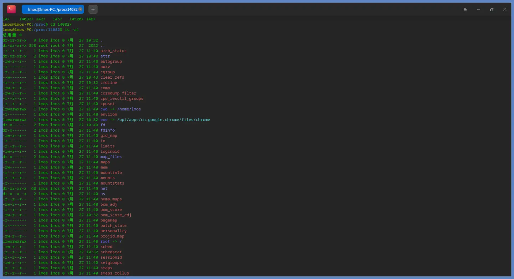

这是谷歌浏览器的进程，里面包含很多子目录，这些子目录中包括了进程的状态、属性、应用程序命令、打开的文件、IO、网络、虚拟内存空间、工作目录、权限、调度信息等大量信息数据。关于进程的所有信息，我们从这里都可以找到。而 iotop 也正是从这里获取数据，然后计算和显示的，这就是 iotop 的工作原理。

### 重点回顾

这节课我们一起学习了两大监控 IO 操作的神器，即 iostat 和 iotop。它们俩在以后的性能调优路上，将是我们最忠诚的伙伴，一个观察系统全局 IO 情况，另一个用来查看单个进程的 IO情况。有了它们，我们就能精确定位 Linux 服务器上 IO 性能瓶颈所在。

现在，让我们一起来回顾一下今天所学。首先我们安装了 iostat 和 iotop。由于 iostat 包含在sysstat 中，需要安装 sysstat 软件包，才能得到 iostat。安装成功后，别忘了进行测试。

然后，我们学习了 iostat 怎么用，熟悉了它的选项和参数，以及 iostat 输出的数据表示什么。之后我们研究了 iostat 实现原理，它是通过读取 /proc 目录下的一些文件做到的。

iotop 工具是一个用 python 语言编写的工具，它能监视全局硬盘的 IO 性能和每个进程的 IO情况，是一个全面的 IO 监视工具。和 iostat 一样，它也是通过读取 /proc 目录下每个进程目录中的一些文件，获取其中的数据，再经过计算把数据展示给我们。

这节课的导图如下所示，供你参考：

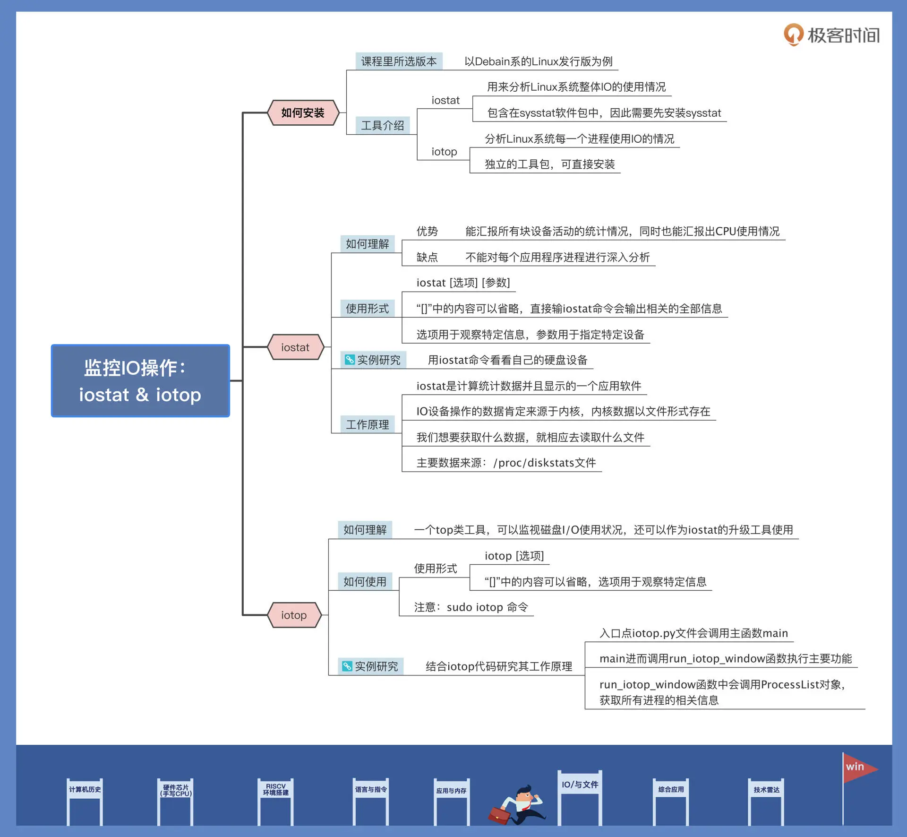

你是否想对 /proc 文件系统有更深的了解，写出更强大的监视工具呢？其实你需要的大部分数据源，都可以在 /proc 目录中找到，读取它们就能做出更符合自己业务需求的监视工具，赶快去大胆尝试吧。

### 思考题

请说一说 iostat 与 iotop 的不同之处？

欢迎你在留言区记录自己的收获或疑问，如果觉得这节课还不错，也别忘了推荐给自己身边的朋友。
