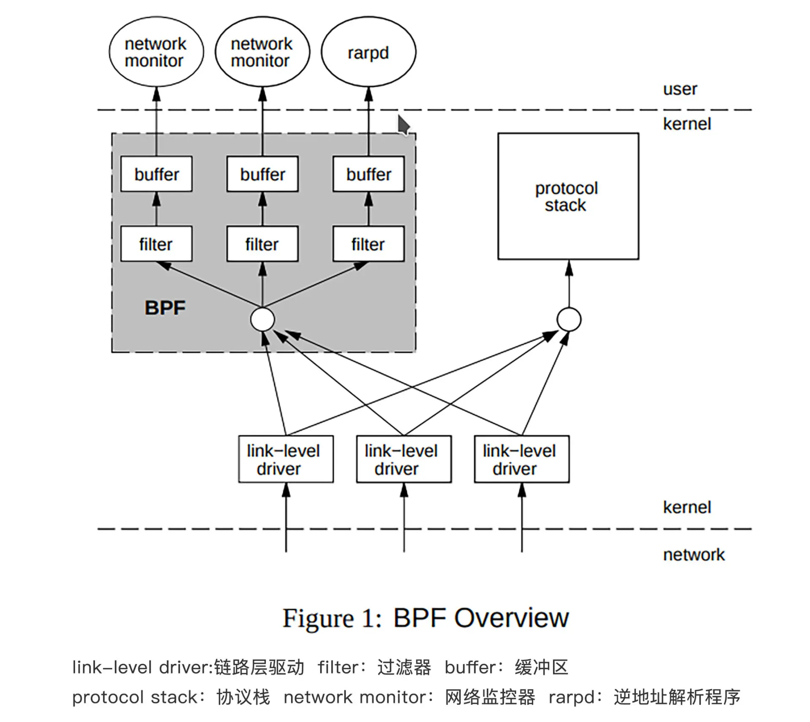
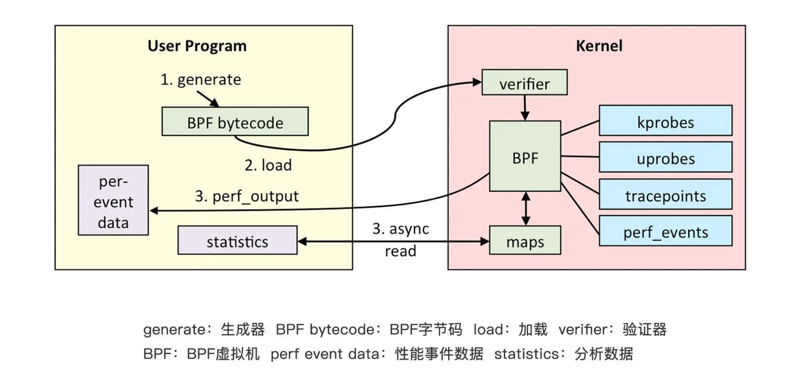
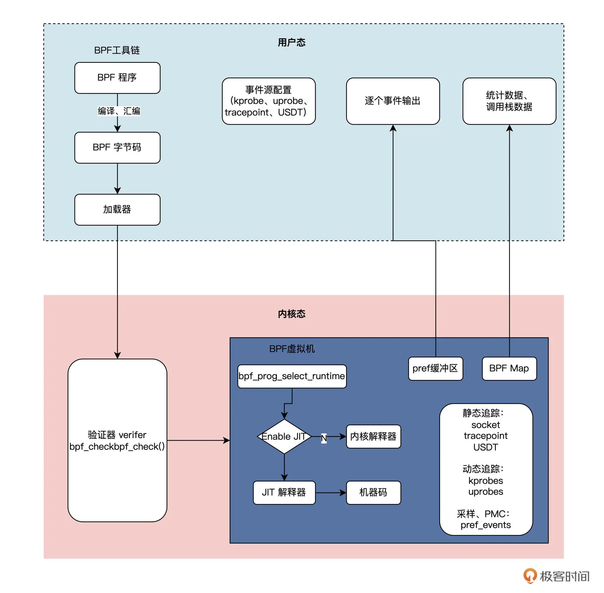
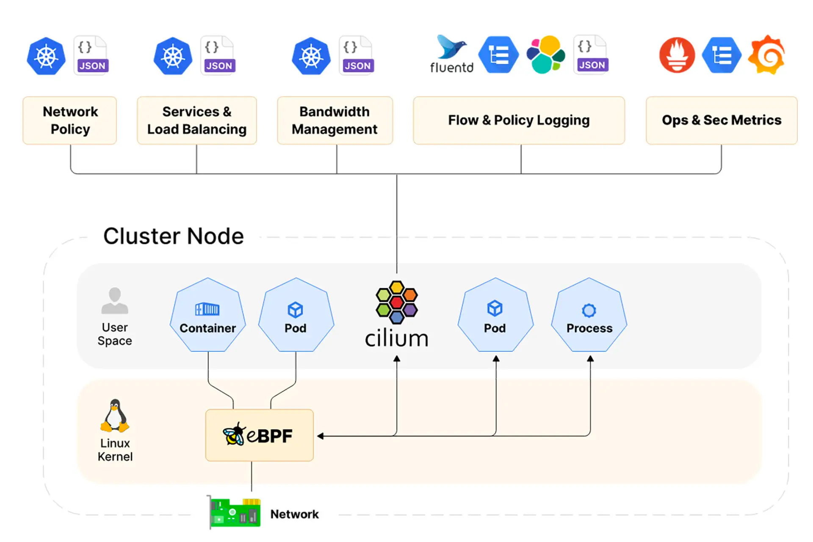
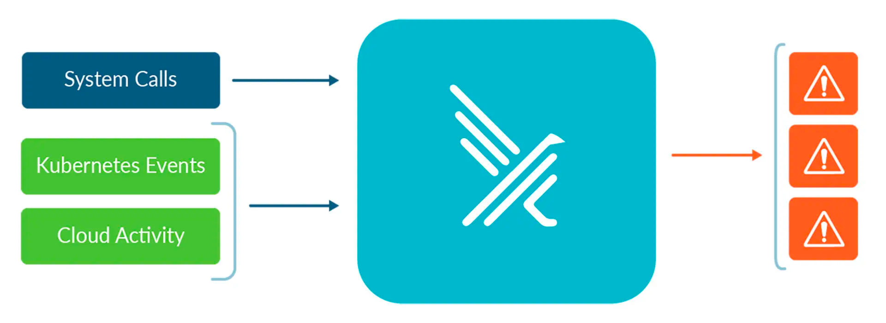
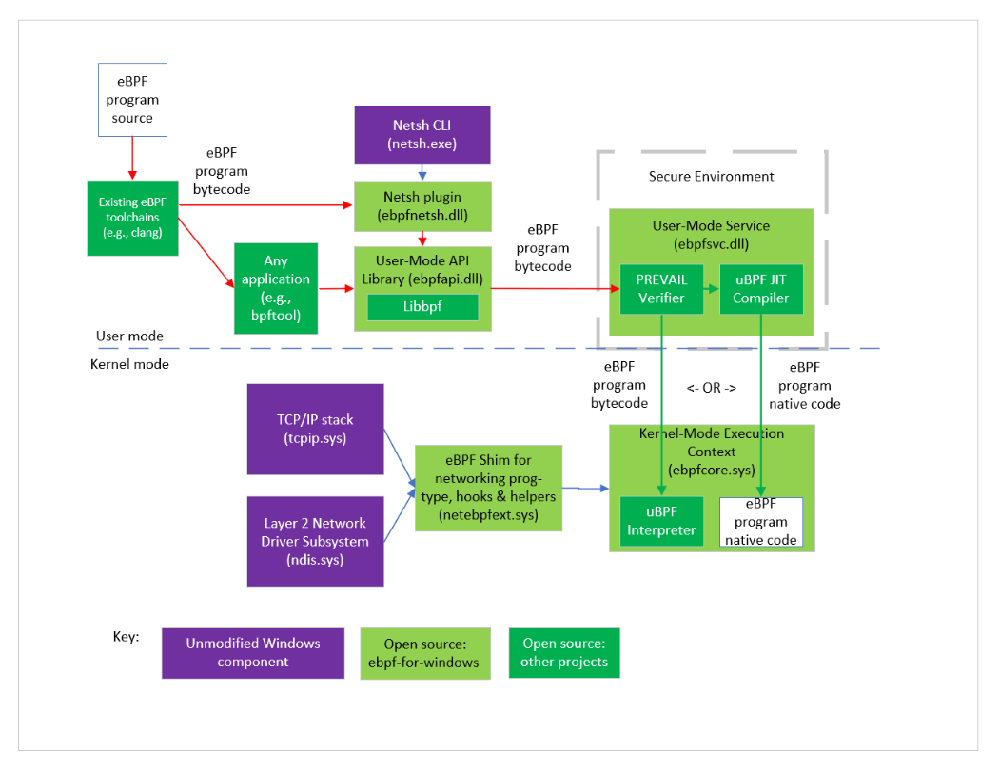
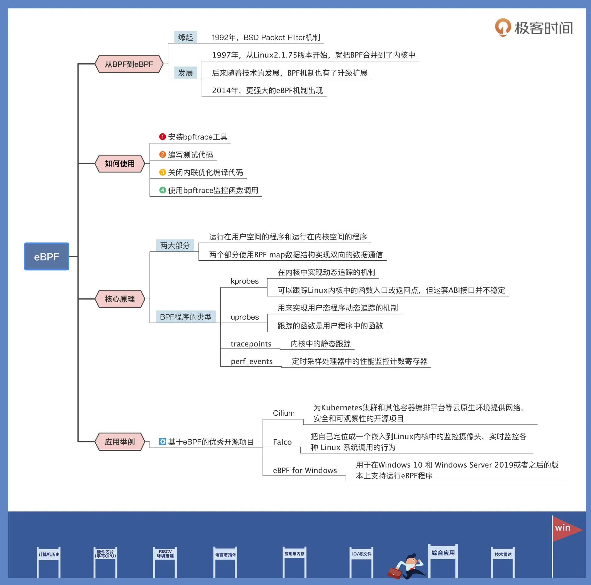

# 42 | 性能调优：性能调优工具eBPF和调优方法

你好，我是 LMOS。

在之前的学习中，我们了解到了很多计算机基础相关的知识，也学过了 iostat 等观察系统运行状态的命令。但在我们的实际工程中，排查分析一些具体的性能优化问题或者定位一些故障时，可能需要在不同的命令间来回切换、反复排查。

那么有没有一款工具可以贯穿操作系统的各个模块，帮我们准确分析运行的程序、系统的运行细节呢？当然有，答案就是 eBPF。

## 从 BPF 到 eBPF

eBPF 是怎么来的，还要从 1992 年说起。当年伯克利实验室的 Steven McCanne 和 VanJacobso 为了解决高性能的抓包、分析网络数据包的问题，在 BSD 操作系统上设计出了一种叫做伯克利数据包过滤器（BSD Packet Filter）的机制，并发表了《The BSD Packet Filter:ANew Architecture for User-level Packet Capture》这篇论文（论文链接在这里）。

为了让内核态能够高效率地处理数据包，这套机制引入了一套只有 2 个 32 位寄存器、16 个内存位和 32 个指令集的轻量级虚拟机，包过滤技术的性能因此提升了 20 多倍。

因为这套方案设计的太好用了，后来在 1997 年的时候，Linux 操作系统从 Linux2.1.75 版本开始，就把 BPF 合并到了内核中了。

早期的 BPF 的架构是这样子的：



- （图片出自上述论文）

从这张架构图中我们可以看出，当数据报文从设备驱动上传输过来之后，首先会被分流到BPF，这时候 BPF 会执行内部的过滤逻辑处理数据报文，当然这个处理逻辑也是可以灵活自定义的。

然后，BPF 就会把处理好的数据报文转给对应的用户程序。如果某些设备驱动发过来的数据,找不到对应的 BPF 处理逻辑的话，则会由正常的协议栈来处理。

听完这段原理，你会不会觉得，这是一个只适合抓包分析网络数据的机制？

没错，早期的时候 BPF 机制，确实也是用在 tcpdump 之类的抓包分析工具上的。只是后来随着技术的发展，BPF 机制也有了升级扩展，不但加入了 JIT 即时编译技术来提升性能，还引入了如 Seccomp 之类的安全机制。

这么优秀灵活的机制只用来分析网络数据，未免大材小用。所以，后来 2014 年的时候 AlexeiStarovoitov 和 Daniel Borkmann 沿着这条路，设计出了更强大的 eBPF 机制。

eBPF 不仅仅能实现传统的数据报文过滤，还把自己变成了一个运行在操作系统内核中的沙盒，基于它可以在不修改内核代码、不加载额外的内核模块的前提下，安全、高效地扩展内核的功能。有了它，我们就可以让自己的程序站在操作系统内核的“上帝视角”，随时灵活地监控调整程序的运行状态，堪称神器。

讲了这么多，有没有勾起你对 eBPF 的好奇？那么让我们先来看一下 eBPF 的架构简图吧：



首先，我们编写好的 BPF 程序会被 Clang、LLVM 等工具编译成 BPF 的字节码（因为 BPF程序并不是普通的 ELF 程序，而是要运行在虚拟机中的字节码）。eBPF 程序中还会包含配置的事件源，所谓事件源其实就是一些需要 hook 的挂载点。

加载器会在程序运行前通过 eBPF 系统调用加载到内核，这时候验证器会验证字节码的安全性，比如校验循环次数必须在有限时间内结束等。当校验通过后，一旦挂载的事件发生，回调到你的字节码，就会在 eBPF 虚拟机中执行字节码中的逻辑了。

## 如何使用 eBPF

接下来我们说说怎么使用 eBPF。我们需要在 Ubuntu 20.04 系统上执行 sudo apt-get install -ybpftrace 命令安装 bpftrace 工具。

然后编写后面这段 man.go 测试代码：

```go
package main
func main() {
 println(sum(3, 5))
}
func sum(a, b int) int {
 return a + b
}
```

接下来，我们要执行 go build -gcflags=“-l” ./main.go 命令关闭内联优化编译代码。因为如果内联优化了的话，很可能 Go 的编译器会在编译期消除函数调用，这样我们的 eBPF 就会找不到函数对应的探针了。

下一步，我们使用 bpftrace 监控这个函数调用，就会发现下面的输出：

```
shell> bpftrace -e '
   uprobe:./main:main.sum {printf("a: %d b: %d\n", reg("ax"), reg("bx"))}
   uretprobe:./main:main.sum {printf("retval: %d\n", retval)}
'
a: 3 b: 5
retval: 8
```

你看，我们写的代码一行都没改，eBPF 却帮我们把程序运行中的变量捕获出来了，是不是很神奇？那么 eBPF 是怎么实现这么神奇的功能的呢？这个问题，你听我讲完 eBPF 的原理就明白了。

## eBPF 的核心原理

在讲解 eBPF 的原理之前，我们先来看看 eBPF 的整体架构图。根据架构图一步步了解核心原理。

eBPF 整体结构图如下：



我们对照结构图分析一下 eBPF 的工作原理。

eBPF 分为两部分，分别是运行在用户空间的程序和运行在内核空间的程序。用户空间程序负责把 BPF 字节码加载到内核空间的 eBPF 虚拟机中，并在需要的时候读取内核返回的各种事件信息、统计信息；而内核中的 BPF 虚拟机负责执行内核中的特定事件，如果需要传递数据，就将执行结果通过 BPF map 或 perf 缓冲区中的 perf-events 发送至用户空间。

那这两部分是怎么“沟通”的呢？两者可以使用 BPF map 数据结构实现双向的数据通信（上图右下角的 BPF MAP），这为内核中运行的 BPF 字节码程序提供了更灵活的控制能力和数据交换能力。

内核中用户空间程序与 BPF 字节码交互的主要过程是这样的：首先，我们可以使用 LLVM 或GCC 工具，将程序从 BPF 代码编译为 BPF 字节码。然后我们通过 Loader 加载器，将字节码加载到内核中。内核使用验证组件，是用来保证执行字节码的安全性，避免内核异常的。在确认字节码安全执行后，加载器会加载相应的内核模块。

BPF 程序的类型包括：kprobes、uprobes、tracepoint、perf_events 几种，具体含义如下：

- kprobes：是一种在内核中实现动态追踪的机制，可以跟踪 Linux 内核中的函数入口或返回点，但这套 ABI 接口并不稳定。不同的内核版本的变化带来的 ABI 差异，有可能会导致跟踪失败。

- uprobes：用来实现用户态程序动态追踪的机制。与 kprobes 类似，区别在于跟踪的函数是用户程序中的函数而已。

- tracepoints：内核中的静态跟踪。Tracepoints 是内核开发者维护的 tracepoint，可以提供稳定的 ABI 接口，但是由于开发者维护，数量和场景可能会受到限制。

- perf_events：定时采样处理器中的性能监控计数寄存器（Performance MonitorCounter）。

所以看到这里，你可能看出门道了，原来 eBPF 能用上帝视角观察各种程序，关键就在于“内核中有自己人”。

eBPF 虚拟机则是相当于一个在内核中的、安全的“后门”，而在虚拟机上运行的 BPF 字节码程序可以使用 BPF map 数据结构和 perf-event 这两种机制，将测量数据“偷偷”传递到用户空间。

## eBPF 还能应用在哪里？

由于 eBPF 强大的扩展能力，目前业界已经有很多项目用它来实现生产环境中的观测、调试、性能优化、动态扩展等功能了。

我们都知道，开源项目是工程师的技术学习宝藏，通过学习开源项目，我们可以学习到业界最前沿的工程应用实战思路。接下来我就给你介绍一些基于 eBPF 的优秀开源项目吧。

### Cilium

Cilium 是一个为 Kubernetes 集群和其他容器编排平台等云原生环境提供网络、安全和可观察性的开源项目。

Cilium 的基础当然也是 eBPF 啦，它能够将安全逻辑、可见性逻辑和网络控制等逻辑动态插入Linux 内核，十分强大。基于这些扩展出的内核能力，Cilium 可以提供像高性能网络、多集群和多云能力、高级负载平衡、透明加密、网络安全能力、透明可观察性等很多能力。

看到这里，可能熟悉后端的小伙伴就好奇了：“我们明明也可以用 Wireshark、tcpdump 之类的工具来分析网络，也可以基于 K8S 的 Pod 机制，轻松实现 Sidecar 架构模式，以此透明地扩展容器的功能，那么我们为什么还要用 Cilium 呢？”

其实，在现代分布式系统架构中，不仅仅有传统的 TCP 协议、HTTP 协议，还会引入像GRPC、QUIC 等比较新的协议。同时，随着分布式系统规模的增加，会引入很多类似于Kafka、Elasticsearch、Redis 之类的各种中间件，这也使得传统的抓包分析工具越来越捉襟见肘。

基于 Pod 的 Sidecar 架构模式中容器本质也是运行在用户态的进程，所以免不了增加用户态 /内核切换、拷贝等操作带来的开销。

而 Cilium 则是基于 eBPF，直接把这些逻辑动态的扩展到了内核中，所以性能会远高于传统的方法，你可以对照下面的架构图看一看。



从图中我们可以看得出，Cilium 使用了 eBPF 机制，在 Linux 内核中直接扩展出了对容器中的各种网络协议的观测能力。这样既实现了高性能对系统进行观测，又扩展更多字节码程序，进而支持更多种类的协议。

### Falco

你听说过“容器逃逸”这种黑客攻击手段么？这种攻击手法可以让运行在容器沙盒中的恶意程序跳出沙盒攻击到宿主机中，从而实现突破限制、获得更高的权限的目的。比如著名的 CVE-2019-5736、CVE-2019-14271、脏牛等就是典型的容器逃逸漏洞。

如果你对容器的了解还不深入，可能觉得奇怪。容器不是类似于一台“虚拟机”么？不是说容器内外是隔离的，容器内的操作不会影响容器外么？那这类逃逸的攻击方式又要怎么防御呢？

其实，每一个运行中的容器只是同一个宿主机上不同的进程，特殊的地方是用 namespace、cgroup、UnionFS 之类的技术手段，给容器中的每个进程创造出一种独占一台机器的假象。

这意味着运行在同一台机器上的每个容器，虽然从表面上看他们是互相隔离的，但实际上他们都共用了同一套操作系统内核。这也就为容器安全埋下了隐患。容器实现机制的更多内容，你有兴趣的话，可以看看第一季里第四十四节课的讲解。

那么这类问题是不是就无解了呢？显然不是，Falco 这个项目就是为解决这类安全问题而生的。



Falco 的核心思想是，把自己定位成一个嵌入到 Linux 内核中的监控摄像头，实时监控各种Linux 系统调用的行为，并根据其不同的调用、参数及调用进程的属性来触发警告。

Falco 可以检测的范围非常广，比如：

- 容器内运行的 Shell

- 服务器进程产生意外类型的子进程

- 敏感文件读取（如 /etc/shadow）

- 非设备文件写入至 /dev

- 系统的标准二进制文件（如 ls）产生出站流量

有了这些能力之后，Falco 就可以根据安全策略，来决定什么时候是安全的行为，什么时候是异常的攻击行为，从而做到防患于未然，提升系统的安全性。

### eBPF for Windows

微软也发现了 eBPF 的强大功能和潜力，在2021 年 5 月的时候微软也发布了 eBPF forWindows这个项目，用于在 Windows 10 和 Windows Server 2019 或者之后的版本上支持运行 eBPF 程序。

这个设计也是比较巧妙的，eBPF 工具链编译出的字节码，首先会发到用户态的静态验证器来进行验证。当验证字节码通过了验证之后，就会被加载到 Windows NT 内核中，这时候，eBPF 程序就可以 hook 调用 eBPFshim 模块来提供暴露的各种 API 了。这样，Windows 系统也就拥有了 eBPF 的强大的动态扩展能力了。

整个过程如下图所示:



## 重点回顾

今天我们学习了 eBPF 的形成历史、设计思想和核心原理。了解了 eBPF 是怎么做到像乐高积木一样，灵活动态地扩展内核功能。另外，我还给你分享了 eBPF 在业界比较优秀的开源实践项目。

这节课的要点我梳理了导图，供你参考。



如果今天讲的内容你只能记住一件事，那请记住：eBPF 是如何把“自己人”送进内核，最终和“自己人”里应外合、传递各种信息的思路。

## 思考题

请你思考一下，eBPF 如果被误用，有没有可能带来新的安全问题呢？

期待你在留言区和我交流互动，也推荐你把这节课，分享给更多朋友。
