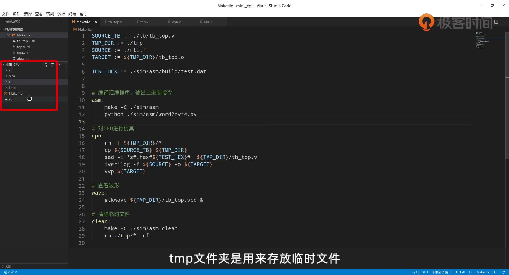

# 先睹为快：迷你CPU项目效果演示

你好，我是 LMOS。

这个模块里，我们将一起设计一个迷你 RISCV 处理器。我准备了演示视频，让你先睹为快，看看我们最后做出的迷你 CPU 长什么样子。

看了视频，你有什么感受呢？先别急着动手敲代码，我们接下来会通过九节课的时间，从Verilog 语言讲起，然后再进行迷你 CPU 的设计和实现。

希望通过这一阶段的学习，为你铺垫一些硬件的基础知识，也给你推开 RISC-V 的一扇窗。一起加油，希望在后面的留言区看到你的身影。
