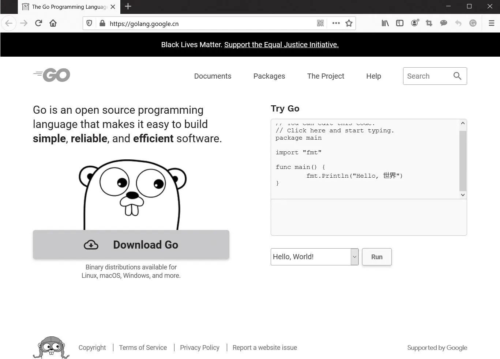

# 前言

在笔者刚开始使用互联网时，书店中出现了 Perl、PHP 和 CGI 等领域的图书专区，并开始不断侵占之前主流的桌面应用程序相关图书的书架。随着 Java、Ruby 等 Web 开发语言的广泛使用，使用 Web 服务器（而非 CGI）的开发方式也普及开来。在如今的书店中，与 Web 有关的图书越来越多。

本书将介绍 HTTP（Hypertext Transfer Protocol，超文本传输协议）这一用于 Web 传输的协

- 1

议

- 。CGI、Web 服务器和最近出现的 Serverless 架构等 Web 服务的底层实现所使用的语

言和结构在最近 20 年间发生了很大变化，但浏览器与服务器之间的通信则基本上没有变化。在计算机领域，由于技术日新月异，新技术层出不穷，所以人们常说要不断学习。其实这只说对了一半。计算机科学方面的内容、业界标准协议、易于测试的优秀代码的写法、算法和数据

- 2

库等，只要学过一次就能一直受用

- 。

本书旨在将 HTTP 的相关内容汇集成册，为人们学习提供便利，这也是 Web 时代图书的责任和使命。虽说 HTTP 协议没有过时，但与其相关的功能每天都在增加。笔者也因为工作和兴趣写了大量 HTTP 相关的代码，在每次编写代码时，都要查一查各网站上介绍的信息，从中学到了很多知识。实际上，许多读者虽然学习了服务器 API 的用法，但还是无法想象实际的 HTTP通信是如何进行的。虽然现在只要上网一查就能获取所需信息，但为了有效过滤旧信息并把握技术的全貌，还是要具备一定的基础知识。打好基础才能缩短掌握各种新技术所花费的时间。

虽然本书是从 HTTP 客户端（浏览器等）的角度编写的，但是 Web 服务开发人员并非在本书读者对象之外，反而应该是主要的读者对象。不过，所有编程语言的服务器框架都是高度抽象化的，与客户端相比，HTTP 层不容易理解。客户端相对简单，而且负责服务器实现的人员也是站在客户端的角度来调用其他 API 的，所以从客户端的角度来学习也很实用。客户端和服务器是表里如一的，学习客户端可以帮助我们更好地理解服务器。

本书在第 1 版的基础上新增了两章基于服务器视角的内容，分别介绍了在开发环境上运行的服务器和云环境。目前，开发环境的结构也变得更加复杂，比如 Web 前端和服务器同时开发等。使用云服务需要用到更高级的 HTTP 知识和网络知识。因此，笔者站在从事云基础设施相关工作的人员的角度，在这两章中介绍了他们可能需要了解的内容。

本书适合 Web 开发人员，以及和曾经的笔者一样 HTTP 学得不透彻的人阅读。有读者评论本书第 1 版是“Web 知识集”，但其实大部分内容是根据实际开发时的调查所得而编写的。现在可能有人认为不需要这样的内容，但许多阅读过本书的人在日常工作中会突然想到自己在这本书上看到过相关内容 3。如果你也有这样的经历，还请和笔者分享，笔者将深感荣幸。

## 本书内容

本书从 HTTP 协议的基础知识开始讲起，沿着 HTTP 的发展历史，介绍浏览器内部的动作，以及浏览器与服务器交互的内容等。HTTP 有以下 4 个基本元素。

- 方法和路径

- 首部

- 主体

- 状态码

这 4 个基本元素也是 4 个数据“容器”。HTTP 协议具有可扩展性。HTTP 分为“数据的语法”（表示方法）和“数据的语义”（含义）两个层次。我们会根据语法创建数据容器，存放在容器中的内容将随着浏览器功能的增加而不断增加。

HTTP 中的发送端（客户端）和接收端（服务器）会根据规则将数据放入容器中，然后发送请求（由客户端发送）和响应（由服务器发送）。本书首先会介绍这部分基础内容，然后沿着HTTP 的发展历史，介绍 Web 浏览器为了提升用户体验是如何处理这 4 个基本元素的。本书还会介绍 Web 浏览器与服务器进行交互的方法。

本书在编写时引用了大量的 RFC 规范，但本书并不是一本单纯的“规范大全”，其目的在于使读者掌握现实世界中 Web 浏览器的动作。当然，RFC 规范也很重要，如果通过本书开始查看RFC 规范的人变多了，笔者也会感到开心。

本书还将介绍使用 curl 这个工具发送和接收数据的方法。curl 对 Web 开发人员来说非常便利。它可以帮助我们轻松地创建请求，外部服务的文档中也存在一些使用 curl 命令来发送请求的例子。

在本书的最后，笔者将介绍如何用编程语言来实现使用 curl 命令完成的内容。

同时，本书还会介绍在确定服务的 API 时常用的 REST（Representational State Transfer，描述性状态迁移）架构。使用 JavaScript 实现的浏览器上的通信功能、Web 服务器和 Web 服务的结构，以及安全相关的内容等都会分别用一章进行介绍。

## 本书未涉及的内容

本书从客户端（浏览器）的角度出发，介绍 HTTP 协议和 Web 通信的相关内容，服务器中的代码实现仅停留在最低限度。关于 RESTful API，本书并未按照“先介绍架构的理论知识，然后介绍如何从零开始设计服务器的 API”这样的方式进行讲解。这主要是为了让读者在理解大体情况后能自己动手实现。另外，HTTP 下面的 TCP、IP 和 Wi-Fi 等层的相关内容也基本没有介绍。

本书的内容介于下面两本书之间。

- 《Web API 的设计与开发》

- 《高性能浏览器网络（影印版）》

本书也没有详细介绍二进制协议 QUIC。在本书出版时，以下杂志中的第一特辑《从包的设计

- 4

看 QUIC》

- 中有 QUIC 最新的详细介绍。

- 《n 月刊 LAMBDA NOTE Vol.2，No.1（2020）》5

另外，本书也不可能涵盖目前正在构想的技术。HTTP/3 虽然有提及，但基本上是一些已经实现并正在使用的内容。WebTransport、WebPackaging 和 Signed Exchange 等虽然是 Web开发社区的热门话题，但这些功能仅在特定的浏览器中实现，所以本书并未介绍。另外，本书也并未涉及通信之后的内容显示的相关知识（注释、渲染管线、JavaScript 和 CSS）。

现在有许多工具能帮助我们简化服务器和客户端进行通信的程序。这些工具包括 ApacheThrift、Google 的 gRPC、swagger UI 等通信中间件，以及分装器生成系统（wrappergenerator）等，不过本书并未介绍这些工具。这是因为如今有许多人正在对这些工具进行改善，其使用方法会很快发生变化。

## 从历史中学习

一般来说，即使是看起来很复杂的编程语言，其原型也是非常简单的。从最初的简单状态开始跟踪其发展变化，可以明白在各种情况下有什么样的需求、必须解决什么样的问题、需要什么样的功能，以及各个功能是如何确定下来的。

- 6

C++ 是复杂的编程语言的代名词，了解得越多，就感觉越难，让人甚是无奈

- 。阅读《C++7就可以知道 C++ 的根本思想其实非常简单，具体来说就是在 C 语言的

语言的设计和演化》基础上添加 Simula 的便于实现模拟器的结构（面向代理或面向对象），并改善 Simula 运行速度慢的缺点，由此形成一门实用的编程语言。C++ 的各个功能都体现了这种思想。

Python 因语法糖（为了减轻程序员的负担而添加的语法结构）较少，相同的代码用其他语言写出来更加简短而遭人诟病。“The History of Python”中记述了 Python 的历史：Python 以

- 8

ABC 这种教学用语言为基础，把易于阅读放在第一位，开发人员通过沿用语法结构

- 或故意

偷工减料来使 Python 保持简洁，同时不断添加各种功能。

计算机行业是通过互相借鉴并吸收其他思想而不断进步的。《代码之髓：编程语言核心概念》9

- 一书中总结了各种编程语言思想的历史，其中有很多东西值得我们学习。

了解了历史，就可以知道如何更好地使用工具。在设计工具时，必须将“我想让人们这样使用”这一想法具体化并进行讨论。无论何种编程语言，只要按照其设计目的来使用，代码写起来就会非常简单；反之，如果偏离目的，就会非常麻烦。

## 本书的结构

本书前半部分是以 HTTP/1.0、HTTP /1.1、HTTP 这种大的结构来划分章节的。另外，还设置了相应的章节来介绍 HTTP 各个版本的 HTML 层和浏览器层所实现的内容。在编写本书时，笔者比较重视“让读者了解如今的 HTTP 功能”和“为了让读者更容易理解 HTTP 而介绍它的历史”这两点，所以本书并不是一本严格按照年代顺序进行讲解的“历史书”。许多技术是平行发展的，按年代顺序讲解，不容易让人理解。

就算只读 HTTP/1.0 的相关章节，也可以学到对现在依然有用的知识。本书就是以这种方式排篇布局的。比如，HTTP/1.0 时期出现的功能如果在之后的版本中有小幅改动，笔者就会在该功能出现时进行说明。本书按功能对如今的 HTTP 和 HTML 知识进行划分，并按各功能出现的顺序进行排序，从而组织成各个章节，并在各个章节中介绍各个功能出现的背景。读者按这种方式理解本书结构即可。

本书要实现的目标有两个。一个是让读者能够了解 HTTP 的大致情况，掌握基础知识，这样一来，就算将来出现新的 HTTP 或 HTML 技术，读者也能够迅速掌握。即使出现看似全新的Web 技术，这项技术也不会从头到尾都是新的，大多是改善了一些旧的内容，或者添加了一些新的功能。了解了过去和现在，追寻未来也会充满乐趣。届时，读者应该就能像在会议中上台演讲的行家一样思考了。

另一个目标是让读者能够编写使用外部 Web 服务的代码或者 Web 服务，并且能够测试这些代码。换言之，就是会动手操作。使用 curl 命令进行 HTTP 通信的方法在本书很多地方有介绍。另外，本书还设置了相应的章节来介绍如何使用 Go 语言编写访问 HTTP 的代码。

对于不适合按时间轴划分的话题，本书会专门设置一章进行总结。例如，安全与各种 HTTP 元素都相关，如果按功能进行划分，则划分出来的各项中只能介绍一些小的安全漏洞。由于这些小的安全漏洞积累下来就会发生大问题，所以笔者专门用一章进行了介绍。

## curl

curl 是瑞典的丹尼尔·斯坦伯格（Daniel Stenberg）从 1997 年开始开发的一款工具。命令名称

```
为 curl。curl 由两个元素组成。
```

- 除了支持 HTTP 和 HTTPS，还支持 FTP、SCP（用于传输文件的通信协议）、IMAP、SMTP、POP3（用于收发邮件的协议）和 LDAP（主要用于管理用户和群组的协议）等

```
各种协议的 libcurl 库
使用 libcurl 进行各种通信的命令行工具 curl
```

本书使用的是后者——命令行工具 curl。另外，虽然 curl 支持各种协议，但本书仅讲解 HTTP协议的相关部分。虽然 curl 已经开发了 20 多年，但现在仍在不断地添加功能，在 HTTP/2 成

- 10

为正式规范的 2015 年的前一年，curl 就已经支持 HTTP/2 通信了

- 。

通过命令行进行 HTTP 通信的常用工具除了 curl 之外，还有 wget。在设置 HTTP 的首部、方法以及 HTTP 通信能够执行的操作方面，二者几乎没有差别。但 wget 有一个 curl 不具备的功能，那就是可以解析下载的 HTML 文件，然后汇总所链接的图像和 HTML 文件，并再次下载。另外，还有一个很受欢迎的 UNIX 工具 Netcat，本书未对其进行介绍。

另外，由于 curl 命令能够显式记述一次通信，所以在 Web API 的用户手册中，为了说明客户端的动作，示例代码中经常使用 curl 命令。Microsoft 公司发布的 Web API 指导文档中也强调“Web API 必须能用 curl 这种简单的 HTTP 工具进行访问”。curl 是 Web 开发人员的亲密伙伴。

## Go 语言

在日本，Go 语言的普及方式比较特殊。

Go 语言是 Google 公司开发的一种编程语言，自发布以来不断进行升级。笔者在工作中接触过的敏捷软件开发和 LL 语言等在导入方式上都曾引起热烈讨论：书和杂志中记载的这些技术该如何运用到工作中？如何说服上司？合同怎么办？而 Go 语言相关的图书很少，也没有大规模的推广活动。虽然悄无声息，但这门编程语言已经开始在企业的开发现场中使用，并且也在支持一些服务。在日本 IT 协会的圣诞日历中，Go 语言与 Swift 成为 2015 年最受欢迎的两大语言。不过，Swift 在发布后就涌现出了大量相关图书，这一点与 Go 语言形成了鲜明对比。

Go 语言之所以能够悄悄潜入开发现场，是因为它存在如下几个重要的特性。

- 语法拥有其他正统编程语言的公共基因，对了解其他编程语言的人来说很容易理解

- 拥有丰富的库，尤其是现代应用程序所必需的库

- 运行生成的程序无须 runtime，使用体验比较好

- 与 LL 语言相比，性能高且类型安全，移植时优点比较突出

- 11

本书虽然讲解的是 HTTP，但客户端语言采用了 Go 语言

- 。Go 语言的特性也使其比较适合

用于教学，特别是易读和编译时容易发现错误这两点。当然，HTTP 是不依赖于编程语言的规范，即使采用其他编程语言，本书的内容也同样适用。不过，由于 HTTP 标准库并不是特别抽象，所以 Go 语言依旧是学习 HTTP 最合适的语言。

例如，获取 O'Reilly Japan 新书信息的 XML 代码如下所示。有一半以上的代码是代码所属包

- 12

的声明和必需的库的声明，实际执行的代码只有 4 行

- 。

```go
package main
import (
"io/ioutil"
"log"
"net/http"
)
func main() {
resp, _ := http.Get("http://www.oreilly.co.jp/catalog/soon.xml")
body, _ := ioutil.ReadAll(resp.Body)
log.Print(string(body))
resp.Body.Close()
}
```

即使是不使用 Go 语言的人也不难理解上面代码的含义。笔者会在正文中介绍 Go 语言特有的类型信息等内容。

第 6 章和第 9 章的示例代码有点复杂，可能比较难，但从实用性来讲最重要的第 3 章的示例

```
代码可以看作 Python 3 的 http.client 模块、Python 2 的 httplib 模块、PHP 的
fopen() 函数、Node.js 的 http 模块、C# 的 System.Net.Http.HttpClient 类、
Java 的 java.net.HttpURLConnection 类、Objective-C 和 Swift 的 NSURLSession
类、Ruby 的 net/http 库等各编程语言的标准库，这样就容易理解了。有些标准库不支持创
```

建 multipart 表单形式的请求这一功能，除此之外的标准库在发送和接收数据方面是没有问题的。

```
另外，还有许多便于实现 HTTP 通信的库。Python 的 requests、Node.js 的 request、
Java 的 OkHttp 和 Objective-C 的 AFNetworking 等比标准库更常用。Ruby 有许多 HTTP
```

客户端库，使用这些库也有助于我们理解本书的内容。

## 阅读前的准备工作

我们先做一下准备工作。

### 安装 curl 命令

Linux 和 macOS 中已经预装了 curl 命令。Windows 中可以使用 Chocolatey 进行安装。

```
C:\> choco install curl
也可以使用 Cygwin、msys2、Bash on Windows 等安装 curl 命令。msys2 使用 pacman 命
```

令进行安装。在使用 PowerShell 的情况下，curl 是 Invoke-WebRequest 的别名，在安装 curl命令之后，需要使用下面的命令来删除别名。

```
> Remove-Item alias:curl
```

### 安装 Go 语言

从 Go 语言官网（图 1）下载并安装开发环境对应的二进制安装包，这里省略了各个操作系统中的详细设置方法。Go 语言使用 Git 命令来获取外部的库。在运行第 6 章之后的代码时，Git不可或缺。在使用 Windows 的情况下，请从 Git 官网上下载并安装 Git For Windows；如果是Linux 和 BSD 系列的操作系统，请安装相应的包管理器；如果是 macOS，请安装 XcodeCommand Line Tools。



- 图 1 Go 语言官网

大家也可以根据自己的喜好选择开发环境，免费的环境有 Visual Studio Code、Vim 和 Emacs等。在使用 Go 语言时，补全功能、重构功能和调试功能等各个开发辅助功能都有单独的开源工具，任何开发环境都可以使用这些工具。因此，不管我们使用什么编辑器，开发效率都不会有太大的变化。另外，还有 JetBranins 开发的收费的开发环境 GoLand。

本书未对各个开发环境的设置进行介绍，大家可以上网搜索针对各个操作系统的详细讲解。

## 安装 Docker

本书的部分示例代码使用了代理服务器。Docker 在本书中并不是很重要，即使不安装，也可以正常执行示例代码。但如果想尝试代理服务器的所有功能，建议安装 Docker。大家可以从Docker 官网上下载并安装。

Mac 用户请下载安装 Docker Community Edition for Mac。如果你使用的是 Windows 10 的64 位专业版，请下载 Docker Community Edition for Windows，否则请下载 DockerToolbox。

- 13

## 本书相对于“迷你版”

## 的变化

- 在介绍 URL 时，新增标准 URL 和 Protocol Relative URL 的相关内容

- 新增对 QUIC 和 HTTP/3 的介绍

- 新增一章介绍 Web 应用程序

- 附录新增首部和状态码的一览表

## 本书相对于第 1 版的变化

本书相对于第 1 版的变化大致如下。除此之外，笔者还做了很多修改，将语句改得更加通俗易懂，添加了最近发生的事情，等等。

- 新增对 HTTP 规范的制定组织和文档统一的介绍

- 新增对 HTTP/1.1 中可以修改响应的原因的介绍

- 新增对非标准状态码的介绍

```
新增对可以发送 POST 却无法使用 GET 这一错误的介绍
```

- sdch 压缩方式不再被推荐使用，Chrome 已不支持该方式，所以删除对 sdch 的介绍

- 新增对 Cookie 最大容量的介绍

- 新增对源的介绍

```
在 Cookie 的相关介绍中新增 SameSite 属性的内容
```

- 新增对 robots.txt 标准化的相关介绍

- 新增对用户代理的相关介绍

- 新增对 Content-Disposition 中无文件名时的动作的介绍

```
新增对 XMLHttpRequest 诞生的历史和 withCredentials 的介绍
```

- 新增对元数据 vCard 和 iCal 的介绍

- 新增对 QR 码的介绍

- 新增对移动应用程序特有的 DeepLink 的介绍

- 新增一章介绍 JavaScript API

- 新增对使用 Let's Encrypt 启动 HTTPS 服务器的方法的介绍

- 新增一章介绍 DNS 和 CND 等云时代的 HTTP

```
新增对 Content-Security-Policy 和 X-Frame-Options 的介绍
```

- 新增对密码保存的介绍

- 新增对多因素身份验证的介绍

## 意见和咨询

虽然笔者尽最大努力检查和确认了本书内容，但书中难免存在疏漏之处，还请读者随时指正。也欢迎读者为将来的修订再版提出宝贵建议。联系方式如下。

株式会社 O'Reilly Japan

邮箱：japan@oreilly.co.jp

读者可以通过以下网址访问本书主页。

ituring.cn/book/2449

https://www.oreilly.co.jp/books/9784873119038/（日语）

关于 O'Reilly 的其他信息，请参考 O'Reilly 官网。

## 表述规则

本书的表述规则如下。

粗体（Bold）

用于强调和表示新的术语及关键字。

```
等宽字（Constant Width）
```

表示程序代码、命令、数组、元素、语句、选项、开关、变量、键、函数、类型、类、命名空间、方法、模块、属性、参数、值、对象、事件、事件处理器、XML 标签、HTML 标签、宏、文件内容、命令输出。书中引用的片段（变量、函数和关键字等）也用该字体表示。

等宽粗体（Constant Width）

表示用户输入的命令和文本。该字体也用于强调代码。


- 表示提示、启发，以及相关事项的补充。


- 表示库的 bug、经常发生的问题等注意事项或警告。

## 关于示例代码的使用

本书的目的在于为读者的工作提供帮助。一般情况下，读者可以在自己的程序或文档中使用本书中的代码。除非大规模转载，否则无须征得我们的同意。例如，在编写程序时需要使用本书的一部分代码，就不需要征得我们的同意。在需要将 O'Reilly Japan 出版的图书中的示例代码刻录成光盘出售或赠送的情况下，必须征得我们的同意。在引用本书中的示例代码答疑的情况下，无须征得我们的同意。不过，在需要将本书中的示例代码大量转载到产品手册中的情况下，必须征得我们的同意。

引用示例代码时最好可以标明出处。引用时请写上书名、作者、译者、出版社和 ISBN 等信息。

关于示例代码的使用，如果读者感觉超出了正常的使用范围，或者超出了上述的许可范围，请联系 japan@oreilly.co.jp。

本书中使用的系统名、产品名均为各公司的商标或注册商标。

正文中省略了 ™、®、©标识。

出版社已尽最大努力确保本书内容正确，但对于应用本书内容所产生的一切结果，恕不负责，敬请理解。

[1]：事先约定好的事项。[2]：当然，有些内容也不再被人使用了，但新出现的内容基本上是对之前内容的改进，所以应该不难掌握。[3]：本书的编辑泷泽和笔者自己都有过这样的感受。[4]：原题为『パケットの設計から見る QUIC』。——译者注[5]：原杂志名为『n 月刊ラムダノート Vol.2，No.1（2020）』，是 LAMBDA NOTE 公司为计算机爱好者发行的技术解说杂志，每 个

- 月发行一次。——译者注

[6]：得益于 C++ 11 之后的 Lambda 与 auto 的类型推导，C++ 编程变得简单多了。[7]：本贾尼·斯特劳斯特卢普（Bjarne Stroustrup）著，裘宗燕译，人民邮电出版社 2020 年 9 月出版。——译者注[8]：例如，函数定义和类定义只是开头的关键字不同，创建对象和函数调用的语法结构并无差别。[9]：西尾泰和著，曾一鸣译，人民邮电出版社 2014 年 8 月出版。——译者注[10]：curl 使用了 库来支持 HTTP/2。[11]：本书基于 Go 1.14。[12]：这里省略了错误处理，在实际代码中要执行错误处理。[13]：O'Reilly Japan 在原书第 1 版的基础上发行的免费电子书，精简了原书第 1 版的内容，所以称为“迷你版”。——编者注
