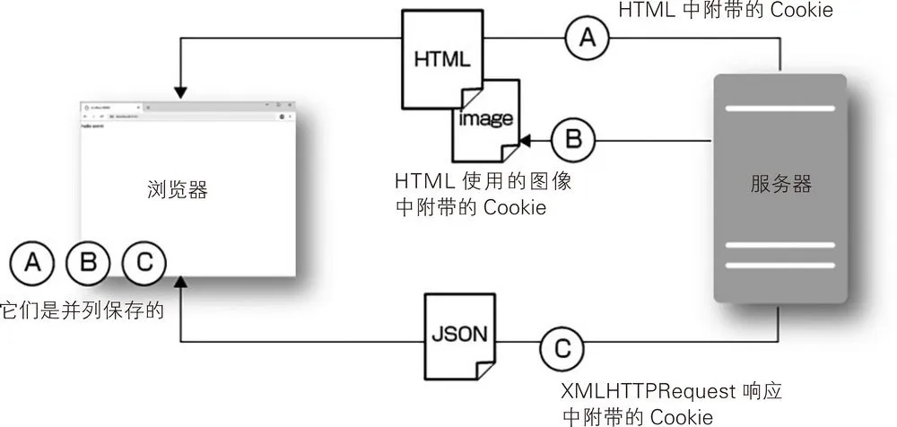

# 第2章HTTP-1.0的语义：浏览器基本功能的背后(1)

第 1 章我们介绍了 HTTP 的 4 个基本元素。

- 方法和路径

- 首部

- 主体

- 状态码

Web 浏览器通过将数据放到容器里发送，或者从通过服务器的响应发来的容器中取出数据来实现与服务器的交互。随着 Web 的发展，浏览器中新增了各种功能，尤其是首部结构中实现了许多功能。本章我们将看一下浏览器是如何使用这些基本元素来实现基本功能的。与第1 章一样，本章我们也会根据需要使用 curl 命令，了解浏览器的运行原理。

## 2.1　使用 x-www-form-urlencoded 发送表单

首先，我们来深入了解一下第 1 章未详细介绍的主体的相关知识。第 1 章介绍了 HTTP/1.0 中请求和资源一一对应的主体的接收。虽然也可以使用 JavaScript API 来发送数据，不过在本节和下一节中，笔者将介绍使用表单的发送方法。


- 另外，HTTP/1.1 中有一种叫作范围请求的特殊的请求方法。我们将在介绍HTTP/1.1 的章节中对此进行详细说明。

```xml
使用表单进行 POST 的方式有很多种。我们先来看一下最简单的发送方式。
<form method="POST">
   <input name="title">
   <input name="author">
   <input type="submit">
</form>
这是很常见的 Web 表单。method 中设置了 POST。我们也可以使用下面的 curl 命令以和表
```

单相同的形式发送数据。

```
$ curl --http1.0 -d title="The Art of Community" -d author="Jono Bacon" http://
localhost:18888
我们可以在 curl 命令中使用 -d 选项设置通过表单发送的数据。如果指定了 -d 选项，curl 命
令就可以像浏览器一样设置首部        Content-Type:application/x-www-form-
urlencoded。这时，主体就会变成下面这样的字符串，其中键和值用等号拼接，各项用 &
```

拼接。

```
title=The Art of Community&author=Jono Bacon
```

不过，该命令生成的主体与通过浏览器的 Web 表单发送的内容之间实际存在一些差别。在使

```
用 -d 发送数据时，指定的字符串会直接拼接。因为即使存在分隔符 & 和        =，也是直接拼
```

接，所以读取主体的一方无法正确还原数据集。例如，当主体中加上 Head First PHP &MySQL 这一书名时，读取主体的一方就很难弄清在哪里分隔了。

```
title=Head First PHP & MySQL&author=Lynn Beighley, Michael Morrison
```

浏览器根据 RFC 1866 中定义的转换格式对字符串进行转换。该格式要求除字母、数值、星号、连字符、点号和下划线这 6 种字符以外，其他字符都进行转义。由于空格会变为加号，所以主体实际上会变成下面这样。

```
title=Head+First+PHP+%26+MySQL&author=Lynn+Beighley%2C+Michael+Morrison
按照这种方式转换后，名称与值中包含的 = 和 & 会分别转换为 %3D 和        %26。作为分隔符
```

使用的字符未发生转换，因此读取主体的一方可以正确解析。curl 命令中还存在具备类似功能

```
的 --data-urlencode。使用该选项替换        -d 就可以按照 RFC 3986 中定义的方法进行
```

- 1

转义了

- 。该方法与 RFC 1866 中定义的方法在处理的字符种类方面存在一些差异。另

```
外，RFC 3986 中定义的方法规定空格转换为 %20，而不是 +。
```

操作结果如下所示。

```
$ curl --http1.0 --data-urlencode title="Head First PHP & MySQL" --data-urlencode
author="Lynn Beighley, Michael Morrison" http://localhost:18888
title=Head%20First%20PHP%20%26%20MySQL&author=Lynn%20Beighley%2C%20Michael%20
Morrison
```

无论哪一种转换方法，都可以通过相同的算法还原，因此不会出现什么问题。程序员平时也会把这些转换方法统称为 URL 转义。RFC 3986 中将 URL 的字符编码方法称为 URL 编码。

```
RFC 1866 中规定，当 Web 表单的方法设为 method="GET" 时，赋给 URL 的不是主体，而
```

是查询。格式与第 1 章中介绍的 HTTP/0.9 的查询功能中的格式相同。

## 2.2　使用 multipart/form-data 发送文件

```
在 HTML 的表单中，我们可以选择 multipart/form-data        这一编码格式。该格式比
前面介绍的格式复杂，不过可以用来发送文件。multipart/form-data 是在 RFC 1867 中
```

定义的。

```xml
<form action="POST" enctype="multipart/form-data">
</form>
HTTP 响应一般每次只返回一个文件，因此在发现空行后，按 Content-Type 中指定的字节
```

数进行读取，就可以获取全部数据。我们也不必关心数据之间怎么分隔。在使用

```
multipart/form-data 的情况下，一次请求可以发送多个文件，因此接收端必须对各个文
件进行区分。Google Chrome 使用        multipart/form-data 输出的首部如下所示。虽
然 Content-Type 确实为        multipart/form-data，但它还有另外一个属性——边界
```

字符串。各个浏览器的实现会采用自己的格式随机创建边界字符串。

```
Content-Type: multipart/form-data; boundary=----
WebKitFormBoundaryyOYfbccgoID172j7
主体如下所示。可以发现，主体被分隔符分割成两部分。另外，末尾是分隔符 +“--”的字符串
```

行。每一部分的结构都类似于 HTTP，即“首部 + 空行 + 内容”。首部包含

```
        Content-Disposition。英文 Disposition 是“性格”的意思，大致与 Content-Type
```

类似。这里声明为带项目名的表单数据。

```
------WebKitFormBoundaryyOYfbccgoID172j7
Content-Disposition: form-data; name="title"
The Art of Community
------WebKitFormBoundaryyOYfbccgoID172j7
Content-Disposition: form-data; name="author"
Jono Bacon
------WebKitFormBoundaryyOYfbccgoID172j7--
```

```
仅看这些，multipart/form-data 与分隔符变复杂的 x-www-form-urlencoded        格
```

式并无不同，但发送文件时就不一样了。我们试着添加一个常见的文件上传操作。

```xml
<input name="attachment-file" type="file">
发送该表单后，结果如下所示。在使用 x-www-form-urlencoded 的情况下，名称与其内
容信息一一对应。而在使用 multipart/form-data        的情况下，每个项目会分别持有添
加的元信息作为标签。我们可以发现，在发送文件时，表单的字段名（attachment-
file）、文件名（test.txt）、文件类型（text/plain）和文件内容这几项信息会发送过
去。想发送文件，可        enctype 中并未指定 multipart/form-data，导致文件发送失
败，想必有人经历过或听说过这样的事情吧。之所以会出现这种情况，是因为在使用        x-
```

- 2

```
www-form-urlencoded 发送文件时，无法发送所有需要的信息，只是发送文件名而已
```

- 。

```
------WebKitFormBoundaryX139fhEFk4BdHACC
Content-Disposition: form-data; name="attachment-file"; filename="test.txt"
Content-Type: text/plain
hello world
------WebKitFormBoundaryX139fhEFk4BdHACC--
采用 multipart/form-data 编码的文件也可以通过 curl 命令发送。
$ curl --http1.0 -F title="The Art of Community" -F author="Jono Bacon" -F
attachment-file=@test.txt http://localhost:18888
只要把 -d 替换为 -F，curl 命令就与设置为 enctype="multipart/form-data"        的
表单的发送形式一样了。-d 与 -F 不可以同时使用。如果加上 @ 指定文件名来发送文件，
```

curl 命令便会读取并添加该文件的内容。我们也可以像下面这样手动设置发送的文件名和

```
文件类型。type 和 filename 可以同时设置。
# 从 test.txt 获取文件内容。发送的文件名与本地文件名一样。类型是自动设置的
$ curl --http1.0 -F attachment-file=@test.txt http://localhost:18888
# 从 test.txt 获取文件内容。类型是手动设置的
$ curl --http1.0 -F "attachment-file=@test.txt;type=text/html" http://
localhost:18888
# 从 test.txt 获取文件内容。文件名是手动设置的
$ curl --http1.0 -F "attachment-file=@test.txt;filename=sample.txt" http://
localhost:18888
-d 的 x-www-form-urlencoded 中也可以使用“@ 文件名”这种形式。这时不会发送文件
名，而是将文件内容展开发送。如果想使用        -F 单独发送内容，可以使用 -F
"attachment-file=< 文件名 >"。
```

- 表单的第三种编码格式：text/plain

```
表单的 enctype 在不设置任何值时默认设置为 www-form-urlencoded，在发送文件的
情况下则设置为            multipart/form-data。除了这两种编码格式之外，还可以使用
text/plain。大家可能不怎么使用这种编码格式。实际上，笔者也是在为了编写本书而
重读 W3C 的规范时才第一次知道这种格式的。虽然它与            www-form-urlencoded
```

- 相近，但不进行转义，而是通过换行对值进行排列并发送。

```
title=The Art of Community
1
author=Jono Bacon
2
```

- 使用 curl 命令无法传递通过换行隔开的多个参数。若要采用与此相同的形式进行发送，则

```
需要事先准备一个与发送内容相同的文本文件，使用 -d "@ 文件名 " 选项进行发送。还
需要设置            -H "Content-Type:text/plain"。笔者并未见过实际使用该编码格
```

- 式的例子。当服务端的安全实现存在漏洞时，该编码格式可能会引发安全问题。

- 使用表单进行 POST 时的响应

```
使用表单进行 POST 后，服务器会接收表单信息并进行处理。不管是论坛还是 SNS
```

- （Social Networking Services，社交网络服务），用户在发送数据后，都会期待能显

```
示反映该表单信息的页面。在这种情况下，服务器最好返回 302 Found 状态码，并跳转
```

- 到显示发送结果的页面。还有一种不进行重定向，直接使用 URL 返回新页面内容的方法。由于重定向时会进行很多次没有必要的通信，所以这种方法的响应也不比重定向的差，但该方法有两个缺点。

```
URL 是用于 POST 的 URL。因此，如果直接将该 URL 添加到书签，或将链接发送给
```

- 他人，当打开链接时，页面就无法正常显示

- 如果重新加载浏览器，就会再次更新表单（浏览器会弹出确认对话框）

- 由于 URL 也是用户界面的重要元素之一，所以发送和显示最好明确分开。

## 2.3　使用表单进行重定向

第 1 章介绍了使用 3 字头的状态码进行重定向的相关内容，不过这种方法存在一些限制。

- 正如笔者在第 1 章介绍 URL 时讲解的那样，因为 URL 最长不超过 2000 个字符，所以

```
可以通过 GET 查询发送的数据有限
```

- 因为数据放在了 URL 中，所以要发送的内容可能会遗留在访问日志里

摆脱这些限制的一个方法是，使用 HTML 的表单进行重定向。如下所示，服务器将要发送给

```
重定向目标的数据通过 <input type="hidden"> 标签写入 HTML        并返回。表单的发
```

送目标就是重定向目标。由于 HTML 中记载了加载后立即触发事件来发送表单，所以浏览器在读取该 HTML 后会立即跳转到重定向目标。

```xml
HTTP/1.1 200 OK
Date: 21 Jan 2004 07:00:49 GMT
Content-Type: text/html; charset=iso-8859-1
<!DOCTYPE html>
<html>
<body onload="document.forms[0].submit()">
<form action=" 重定向目标" method="post">
<input type="hidden" name="data"
value=" 要发送的消息/>
<input type="submit" value="Continue"/>
</form>
</body>
```

这种做法的优点是，即使使用 Internet Explorer，也不存在数据容量方面的限制。当然这种做法也存在一些缺点，比如页面有一瞬间会变为空白，另外，虽然会临时显示向下跳转的按钮，但如果 JavaScript 失效，就无法实现自动跳转。

- 该方法在第 5 章中介绍的 SAML 认证协议和 OpenID Connect 等协议中作为规范使用。

## 2.4　内容协商

由于服务器和客户端是分开开发和维护的，所以适合二者的格式和设置并不总是一致。为了优化通信方法，服务器和客户端在一个请求中共享彼此的最优设置，这种结构就是内容协商。内容协商中会使用首部，如表 2-1 所示。

表 2-1　内容协商中使用的首部

请求首部

- 响应首部协商对象

```
Accept
Content-Type 首部
```

- MIME 类型

```
Accept-Language
Content-Language 首部 / HTML 标签
```

- 显示语言

```
Accept-Charset
Content-Type 首部
```

- 字符集

```
Accept-Encoding
Content-Encoding 首部
```

- 主体压缩

### 2.4.1　确定文件类型

```
Accept:
text/html,application/xhtml+xml,application/xml;q=0.9,image/webp,*/*
;q=0.8
```

上述内容取自笔者计算机上的 Google Chrome 的请求首部。前半部分是 HTML 的相关内容，

```
这里笔者来讲一下比较容易理解的图像部分（image/webp
```

及其后面的部分）。首先是用逗号隔开的各项。

- image/webp

- */*;q=0.8

```
q 称为品质因子，取值范围为 0~1，默认值为 1.0。该数值表示优先度。也就是说，Web 服务
```

器如果支持 WebP（Google 推荐使用的图像格式，其文件大小是 PNG 文件大小的80%），则需要向服务器发送 WebP，否则需要向服务器发送 PNG 等其他格式（优先度为 0.8）。

服务器按照请求要求的格式返回文件。具体来说，就是解析优先顺序，从最优先的格式开始依次查找支持的格式，如果有一致的格式，就采用该格式返回文件；如果没有一致的格式，就返回

```
        406 Not Acceptable 错误。
```

### 2.4.2　确定显示语言

显示语言的确定也基本一样。设置为英语优先的 Google Chrome 会把下面的首部赋给各个请求。

```
Accept-Language: en-US,en;q=0.8,ja;q=0.6
请求按 en-US、en、ja 的优先顺序发送。虽然 Content-Language        首部被定义为储
```

存语言信息的“容器”，但许多网站并没有使用该首部。我们经常看到下面这种在 HTML 标签中返回的页面。

```xml
<html lang="ja">
当不同语言显示的标签稍有不同时，只要使用 Content-Language 首部修改显示语言即
```

可。当不同语言的内容稍有不同时（如翻译进度不同、商品种类或价格不同等），许多服务会在 URL 中加入语言或国家的名称，在初次访问时根据该首部的信息进行重定向。

### 2.4.3　确定字符集

在确定字符集时会发送如下所示的首部。

```
Accept-Charset: UTF-8,Shift_JIS;q=0.7,*;q=0.3
不过，所有的现代浏览器都不会发送 Accept-Charset。可能是因为浏览器内嵌了所有的字
```

符集，所以没有必要提前协商了吧。响应内容的字符集会和 MIME 类型成对地存储在首部

```
Content-Type 中。
Content-Type: text/html; charset=UTF-8
```

在 HTML 中，字符集也可以记述在文档中，在 RFC 1866 的 HTML/2.0 中已经可以这样做了。由于很多浏览器会将 HTML 保存在本地重新显示，所以大多会同时使用上述两种方式。

```xml
不过，如果开头的 1024        字节中没有记述下述内容，就无法确保会使用 <meta http-
equiv> 标签。
<meta http-equiv="Content-Type" content="text/html; charset=UTF-8">
```

```
HTML 的 <meta http-equiv> 标签是一个“窗口”，用于将与 HTTP 首部相同的指示填充到
```

文档内部并返回。从 HTML5 开始，我们也可以按照下面的方式进行记述。

```xml
<meta charset="UTF-8">
```

IANA 负责管理可以使用的字符集。

Character Sets 的主页中有一个表，表的 Name 列中记载的是可以使用的字符集的名称，有几个字符集还拥有别名。对于拥有多个别名的字符集，最左边的列中记载了推荐使用的别名。

分隔符经常让开发人员感到困惑，是因为分隔符缺乏统一性，比如 UTF-8 中的分隔符是连字符，Shift_JIS 中的分隔符是下划线。

2017 年 12 月，HTML 5.2 成为 W3C 推荐的规范。该规范要求今后内容创作者应该使用 UTF-8。UTF-8 可以处理 Unicode 定义的约 100 万个字符，每个字符使用 1~4 字节的可变长度表示。用 1 字节表示的字符与 ASCII 码兼容。由于使用方便，到 2019 年 6 月，已经有

- 3

93.5% 的网站采用了这种编码方式

- 。

现在仍然可以使用 UTF-8 之外的编码方式。以前用户可以通过在浏览器端指定编码来浏览未设置编码的内容，但如今的 Chrome 中不可以手动选择编码。Firefox 中虽然有相关菜单，但也无法指定编码。另外，在处理 UTF-8 之外的内容时，如果编码设置不正确，则无法正常显示。

### 2.4.4　使用压缩提高通信速度

内容压缩是一种用来提高传输速度的结构，定义在 1992 年版的 HTTP 规范中。

虽然压缩程度会根据内容发生变化，但现在常用的压缩算法可以将文本文件的大小压缩为原来的 1/10。如果是多次出现相同符号的 JSON，文件大小可以压缩为原来的 1/20 左右。因为用于压缩和解压的时间少于通信所花费的时间，所以使用压缩算法能够减少显示 Web 页面所花费的总的处理时间。也就是说，从浏览器使用者的角度来看，传输速度提高了。

除此之外，压缩还会对费用产生影响。在 ADSL 和光纤普及之前，很多用户使用的是拨号上网，按时间收费，而现在的移动通信是按数据量收费的。无论哪种方式，我们都可以通过压缩算法来减少费用。在使用移动端时，收发电波会消耗很多电量，使用压缩算法也可以达到减少电量消耗的效果。

进行内容压缩的协商在 HTTP 的首部完成。首先，客户端通过首部指定其可以接收的压缩格式。这里指定的压缩格式为 deflate 和 gzip。

```
Accept-Encoding: deflate, gzip
在 curl 命令中指定 --compressed 选项，就可以添加与前面使用 -H 记述的首部一样的首部
```

4

- 。

```
$ curl --http1.0 --compressed http://localhost:18888
```

在服务器端，如果发送过来的列表中存在支持的格式，则服务器在响应时采用该格式对内容进行压缩，或者返回之前已经压缩好的内容。如果服务器支持的是 gzip，响应首部就会变成下面

```
这样。这时，表示内容数据量的首部        Content-Length 指的是压缩后的文件大小。
Content-Encoding: gzip
```

Google 开发了比 gzip 更高效的压缩算法 Brotli，其规范定义在 RFC 7932 中，源代码也作为开源软件公开。目前 Chrome、Safari、Firefox 和 Edge 等浏览器都对 Brotli 提供了支持。这些浏览器可以通过相同的结构使用 Brotli。将编码格式指定为 br，并发送请求，如果服务器也支持该格式，就能通过 Brotli 实现高速通信。即使浏览器支持该格式，如果编程语言的HTTP 客户端库不支持 Brotli，则也不会发送 br。另外，如果服务器不支持 Brotli，就会把压缩格式换为彼此都支持的格式（如 gzip）。像这样，使用 HTTP 的首部结构，能够在一次请求和响应的往返过程中保持向后兼容，与此同时实现最佳通信。

另外，关于从客户端向服务器上传数据时是否进行压缩的问题，人们也进行了讨论。虽然当前提出的方案都无法只通过一次通信来完成，但实现方式基本相同。服务器将最初的 Web 页面

```
返给客户端时会返回        Accept-Encoding 首部，之后，客户端在上传数据时会发送
Content-Encoding。由于请求和响应双方都使用了首部这一结构，所以可以轻松实现压
```

缩。

我们还可以使用表示没有压缩的 identity。主要的压缩算法如表 2-2 所示。

表 2-2　Web 浏览器可以使用的主要的压缩算法

- IANA 注册完毕

名称

- 别名算法

br

- Brotli√

```
UNIX 中自带的 compress 命令
```

compress

- x-compress√

```
zlib 库中提供的压缩算法（RFC 1951）
```

deflate

- √

exi

- W3C Efficient XML Interchange√

```
与 GZIP 命令相同的压缩算法（RFC 1952）
```

gzip

- x-gzip√

identity

- √用来声明没有进行压缩

pack200-gzip

- 面向 Java 的网络传输算法√

```
在通过压缩算法减少通信数据量时，除了可以使用 Content-Encoding 压缩内容，还可以
使用 Transfer-Encoding        首部来压缩通信线路，不过后者并不常用。
```

## 2.5　Cookie

Cookie 是将网站信息保存在浏览器端的一种结构。常见的数据库是通过客户端向数据库管理系统发送 SQL 来保存数据的，而 Cookie 正好相反，由服务端指示客户端（浏览器）保存数据。

Cookie 也将 HTTP 首部作为一种基础设施来实现。服务器以下面的方式发送响应首部。该服务器要在客户端保存最后的访问日期和时间。

```
Set-Cookie: LAST_ACCESS_DATE=Jul/31/2016
Set-Cookie: LAST_ACCESS_TIME=12:04
访问日期和时间都以“名称 = 值”的形式返回。客户端会保存该值，并在下次访问服务器时以
```

下面的方式发送该值。服务器读取该设置信息后，就可以知道客户端最后的访问日期和时间了。

```
Cookie: LAST_ACCESS_DATE=Jul/31/2016
Cookie: LAST_ACCESS_TIME=12:04
```

例如，下面的代码用来判断客户端是不是第一次访问服务器，并根据判断结果显示相应的内容。

```go
func handler(w http.ResponseWriter, r *http.Request) {
   w.Header().Add("Set-Cookie", "VISIT=TRUE")
   if _, ok := r.Header["Cookie"]; ok {
       // 有 Cookie 就代表曾经访问过
       fmt.Fprintf(w, "<html><body> 第 2 次及之后</body></html>\n")
   } else {
       fmt.Fprintf(w, "<html><body> 第 1 次访问</body></html>\n")
   }
}
```

从服务器的程序来看，数据保存在外部，每当客户端访问服务器时，就会加载该数据。虽然HTTP 是无状态（stateless）的（无论谁在什么时候发出请求，只要请求相同，结果就相同），但在使用 Cookie 后，HTTP 就可以提供让服务器看起来是有状态的一些服务，比如从中断位置开始重新运行等。

我们可以在浏览器上使用 JavaScript 读取 Cookie，或者向服务器发送 Cookie。例如，打开

```
Facebook 等需要登录的网站页面，然后打开开发者工具查看        document.cookie 属
```

性，就可以知道 Cookie 是以字符串格式存储的。

```
> console.log(document.cookie);
"_ga=GA1.2....; c_user=100002291...; csm=2; p = 02; act=147--2358...;..."
```

由于 Cookie 是基于首部创建的一种结构，所以在使用 curl 命令时，可以将接收到的首部内容放入 Cookie 中再次发送，以此来实现 Cookie 的功能。我们也可以使用专门的选项来实现

```
Cookie        的功能。将接收到的 Cookie 保存在用 -c/--cookie-jar 选项指定的文件中，
从 -b/--cookie 选项指定的文件中读取 Cookie        并发送。指定这两个选项可以同时发送
和接收 Cookie。-b/--cookie 选项不仅可以用来读取文件，还可以用来往文件中添加内
```

容。

并非只在浏览器请求从服务器读取 HTML 页面时才设置 Cookie。如图 2-1 所示，在获取页面中引用的图像等附属文件时的响应中，或者第 5 章介绍的 XMLHttpRequest 和第 7 章介绍的

```
Fetch API        访问的响应中，如果服务器添加了 Set-Cookie 首部，那么客户端也会保存
```

为 Cookie。不过，在读取其他域的图像文件或脚本时，从保护隐私的角度来看，是否接收Cookie 是有限制的，详细内容请参考 14.11 节。



- 图 2-1　除了 HTML 响应之外，也可以设置 Cookie

- Cookie 与用户同意欧盟在 2018 年 5 月针对个人信息出台了《通用数据保护条例》（General Data ProtectionRegulation，GDPR）。该条例在对个人信息的处理进行限制的同时，也对个人信息中关键的 Cookie 进行了限制。除了必要的 Cookie 之外，在使用 Cookie 之前要获得用户的同意

- 在获得同意之前，要用简单易懂的语言提供各个 Cookie 追踪的数据以及关于其用途的准确、具体的信息

- 保存用户的同意信息

- 即使用户不允许使用指定的 Cookie，也可以访问服务

- 用户取消同意的操作要与同意时一样简单

### 2.5.1　Cookie 的分类

GDPR 官网中对 Cookie 进行了详细介绍，这里笔者来介绍一下 Cookie 有哪些类别。我们可以按照来源、使用期限和用途对 Cookie 进行分类。

根据来源，Cookie 可分类为用户访问过的网站的 Cookie（第一方 Cookie）和除此之外的网站的 Cookie（第三方 Cookie）。

根据使用期限，Cookie 可分类为关闭浏览器后就消失的会话 Cookie 和设置有期限以在关闭浏览器后依旧存在的持久 Cookie。

根据用途，Cookie 可分为如下 4 类。

- 绝对必要的 Cookie。在电商网站上购物时，如果需要使用 Cookie 实现购物车功能，那1.么 Cookie 就是该功能所必不可少的要素。这种 Cookie 通常为第一方的会话Cookie。

- 用于设置环境的 Cookie。这类 Cookie 是之前用户设置的语言、用户名和密码等。2.

- 用于统计的 Cookie。这类 Cookie 用于收集网站的分析信息，比如访问过的页面或点击3.过的链接等。这类 Cookie 不用于识别用户，而用来改善网站。

- 用于市场营销的 Cookie。这类 Cookie 会追踪用户的行为，以提高广告的精准度，控制4.广告的显示次数。它们有时会在运营者之间共享。这类 Cookie 通常为第三方的持久Cookie。

### 2.5.2　Cookie 的错误用法

Cookie 是一个非常便利的功能，但其本身存在一些限制，因此在使用方法上需要我们多加注意。

首先是永久性问题。Cookie 保存在浏览器本地，在更换计算机或智能手机后，之前的 Cookie信息就不能再访问了。Cookie 并不是在任何情况下都能永久保存的，具体要看浏览器的安全设置。另外，设为隐私模式的浏览器会无视服务器的保存指示，或者在会话结束时进行重置。使用删除记录功能和开发者工具也能删除 Cookie。Cookie 不能用于更新服务器的数据库，因为一旦重置，数据就会消失。Cookie 只适合存储即使丢失也不会产生任何影响的信息，以及可根据服务器的信息复原的数据。

其次是数据大小的问题。因为 Cookie 在请求时会作为首部添加到通信中，所以通信量会有所增加，这就会对请求和响应的通信速度造成影响。因此，Cookie 的容量存在严格的限制。

RFC 6265 中规定，Cookie 的总容量最大是 4 KB，每个域可保存 50 个 Cookie，浏览器可保存的 Cookie 全部加起来约为 3000 个。为了节约资源，浏览器可以删除超出容量的部分。根据 Browser Cookie Limits 网站通过实验测量的可实际保存的容量来看，浏览器可保存的 Cookie 的总容量有时会超出规定容量。例如，虽然 Chrome 中一个 Cookie 的大小是4 KB，但 Chrome 可以接收大量的 Cookie，可以说基本上没有限制。另外，许多浏览器有 Cookie 总容量不超过 4 KB 的限制。如果容量超出规定范围，可使用的浏览器就会受限，因此 4 KB 的总容量是必须坚守的底线。在将 Cookie 用作简单的数据保存区域时，这种容量限制和通信量的增加会成为绊脚石。

```
最后是安全问题。虽然在设置了 secure 属性的情况下只能通过 HTTPS 进行加密通信，但在
```

HTTP 中，Cookie 是明文传递的。因为每次请求都会发送和接收 Cookie，所以如果其中存在不可以公开的密码，该密码就有泄露的危险。即使进行了加密，用户可以随便查看这一点也是一个不小的问题。从原理上讲，用户也可以自行改写 Cookie。Cookie 不适合保存系统需要的 ID 和改写后会造成错误动作的敏感信息。在添加敏感信息时，有的 Web 应用程序服务器会提供通过署名和加密等进行保护的方法。

- 正如下一节介绍的那样，最好只将认证后的记录或者删掉也没关系的信息放入Cookie 中。

### 2.5.3　对 Cookie 加以限制

客户端把从服务器接收的 Cookie 保存到本地存储（local storage）中，在访问同一个 URL时，客户端会读取该 Cookie，并将其添加到请求首部中。由于 Cookie 在很多情况下是作为使用特定的服务所需的令牌（token）使用的，所以如果我们将 Cookie 发送给不需要它的服务器，就会增加安全风险。因此，HTTP 中定义了用于控制发送目的地或设置生命周期的属性。HTTP 客户端有义务解析这些属性，并对发送 Cookie 的操作进行控制。

如下所示，多个属性之间用分号隔开。另外，由于属性名不区分大小写，所以也可以像各个网页上的说明消息一样全部使用小写。本书采用的是 RFC 6265 的规范。

```
Set-Cookie: SID=31d4d96e407aad42; Path=/; Secure; HttpOnly
Set-Cookie: lang=en-US; Path=/; Domain=××××.com
```

- Expires 属性、Max-Age 属性

```
这两个属性用于设置 Cookie 的生命周期。Max-Age 的单位为秒，在从当前时刻开始经过
指定的秒数后，Cookie 变为无效。Expires 用于解析            Wed, 09 Jun 2021
10:18:14 GMT 形式的字符串。如果这两个属性都未设置，Cookie 就会变为会话
```

- Cookie，在浏览器关闭的瞬间消失。Domain 属性该属性表示客户端发送 Cookie 的对象服务器。当省略该属性时，默认为发送 Cookie 的服务器。Path 属性该属性表示客户端发送 Cookie 的对象服务器的路径。当省略该属性时，默认为发送Cookie 的服务器的路径。Secure 属性该属性表示客户端仅在用 HTTPS 进行安全连接时向服务器发送 Cookie。Cookie 决定是否将 URL 作为键来发送和接收。不过，URL 可能会因 DNS 攻击而被冒充，这就存在将Cookie 发送给使用者预期之外的服务器的风险。攻击者即使不操作机器，也可以通

```
过冒充免费的 Wi-Fi 服务来实现 DNS 攻击。在使用 Secure 属性的情况下，一旦使用
```

- HTTP 连接，浏览器就会弹出警告，停止访问页面，以此来防止泄密。HttpOnly 属性笔者在介绍 Cookie 时提到过，我们可以使用 JavaScript 来操作 Cookie，但如果给 Cookie

```
加上 HttpOnly 属性，就无法使用 JavaScript 读取            Cookie 了。该属性可以防止跨
```

- 站脚本攻击，避免恶意的 JavaScript 被执行。SameSite 属性RFC 中并不存在该属性。它是 Chrome 在版本 51 中引入的属性，用于发送同源（见 2.5.4

```
节）的域。现在该属性可设置为 None、Lax 和            Strict。
```

Cookie 的功能添加历史也是 Web 安全的历史。关于具体存在的安全风险、应对措施，以及第三方 Cookie 等的内容将在第 10 章进行介绍。

### 2.5.4　源

Cookie 等 Web 安全的基础就是源。在登录 A 网站的状态下访问 B 网站，这时如果直接保持A 网站的访问权限，就可以在 B 网站上随意访问 A 网站中保存的信息。

如果方案、域（主机名）、端口这三组数据相同，浏览器就会判断为同一个网站。反过来讲，

```
如果有一组数据不同，浏览器就会判断为不同的网站。我们以 http://××××.com 为例来进
```

行思考。下面两个 URL 与该示例 URL 是同一个网站。

```
http://××××.com:80：HTTP 默认使用 80 端口，因此为同一个网站
http://××××.com/news：路径可以不同
```

下面这三个 URL 与该示例 URL 就是不同的网站。

```
http://www.××××.com：域不同
https://××××.com：方案不同
http://××××.com:8080：端口不同
例如，浏览器中有 localStorage 和 sessionStorage 这两个可用的存储 API。用户无法
```

从 B 网站读取 A 网站中写入的内容。源不同，权限也就不同。

上一节介绍的 Cookie 默认是以源为单位进行处理的，但我们也可以对其进行修改，比如按路径层次进行过滤，或者让子域也变得有效等。不过现在对完全不同的域进行写入操作是受限制的。

```
另外，当把 POST 等请求发送给其他域时，需要用到 CORS（Cross Origin Resource
```

Sharing，跨域资源共享），相关内容会在后面的章节中介绍。

### 2.5.5　SameSite 属性

```
SameSite 属性还未成为 RFC 规范，只是草案，但所有的浏览器中都已经实现了该属性。在
本书第 1 版出版时，SameSite 属性还只是 Chrome        拥有的功能，但之后包含 Internet
```

Explorer 在内的所有浏览器都支持了该属性。

Cookie 仅在源匹配时发送，但即使有来自被攻击者劫持的网站的访问，浏览器也不会进行判

```
别，而是直接发送 Cookie。如果不想执行来自其他网站的 POST 方式的 API        请求，只想
处理自己网站的请求，可以把 SameSite 属性设置为 SameSite=Strict 或
SameSite=Lax，其中，Strict 更加严格，即使是点击 <a> 标签的链接时会切换页面的
```

- 5

```
GET        访问（全局导航），也不会发送 Cookie。如果是需要登录的网站，就得重新登录
```

。

```
为了提高安全性，Google Chrome 计划将未设置 SameSite 属性时的默认 Cookie 从 None
改为        Lax。如果在其他网站访问时要发送第三方 Cookie，则必须显式设置
SameSite=None，同时附加 Secure 属性。Firefox        也计划这样做。
```

## 2.6　认证和会话

如今的 Web 服务大多需要登录。很多 Web 服务虽然允许查看一部分页面，但可使用的服务是有限的。通过认证，也就是输入用户名和密码进行登录，服务端就可以知道前来访问的用户是谁，并为其提示个性化信息，比如 SNS 显示朋友的最新消息等。

回顾历史，我们会发现认证分为很多种。笔者先来介绍一下客户端每次都发送用户名和密码的认证方式。

### 2.6.1　BASIC 认证和 Digest 认证

BASIC 认证是最简单的认证方式。用户名和密码采用 Base64 进行编码。因为 Base64是一种可逆的编码方式，所以服务器端可以还原和取出原来的用户名和密码。将还原的用户名和密码与服务器的数据库保存的用户名和密码进行比较，就可以确认用户是否合法。不过，在没有使用 SSL/TLS 通信的状态下，如果通信遭到监听，通信内容中的用户名和密码就容易泄露出去。

```
base64( 用户名 + ":" + 密码)
```

```
当使用 curl 命令进行 BASIC 认证时，使用 -u/--user 发送用户名和密码。--basic 用于
显式声明使用的认证方式是 BASIC        认证，但其实我们可以省略这个 --basic，因为
```

BASIC 认证就是默认的认证方式。

```
$ curl --http1.0 --basic -u user:pass http://localhost:18888
```

在加上上面的选项之后，我们会得到下面的首部。

```
Authorization: "Basic dXNlcjpwYXNz"
```

Digest 认证比 BASIC 认证更安全。Digest 认证使用的是散列函数（A → B 容易实现，但 B→ A 就无法轻易地计算出来了）。虽然在使用庞大的计算资源的情况下可以找出几个能输出 B 的 A 的备选，但短时间内是无法简单地还原最初的字符串的。首先，在浏览器要访问受

```
保护的区间时，服务器会返回        401 Unauthorized，添加的首部如下所示。
WWW-Authenticate: Digest realm=" 区间名称", nonce="1234567890", algorithm=MD5,
qop="auth"
realm 是受保护的区间名称，显示在认证对话框中。nonce 是服务器每次生成的随机数据。
qop 是保护等级。客户端基于它们的值和随机生成的        cnonce 来计算 response。
A1 = 用户名 ":" realm ":" 密码
A2 = HTTP 的方法 ":" 内容的 URI
response = MD5( MD5(A1) ":" nonce ":" nc ":" cnonce ":" qop ":" MD5(A2) )
```

```
nc 是使用给定的 nonce 值发送请求的次数的计数器。如果没有 qop，则省略 nc。nc
值使用 8 位的十六进制数表示。因为同一个 nc 值被使用的次数是已知的，所以服务器能够检
```

- 6

测到重放攻击

- （replay attacks）。

```
客户端会添加所生成的 cnonce 与计算出来的 response，然后加上下面的首部，再次发送
```

请求。

```
Authorization: Digest username="用户名", realm="区间名称",
   nonce="1234567890", uri="/secret.html", algorithm=MD5,
   qop=auth, nc=00000001, cnonce="0987654321",
   response="9d47a3f8b2d5c"
```

服务器也会使用该首部中的信息、服务内部保存的用户名和密码来进行相同的计算。如果计算

```
出与再次发送的请求相同的        response，就证明用户正确地输入了用户名和密码。这样一
```

来，就算请求中不包含用户名和密码，服务器也可以准确地对用户进行认证。

```
在使用 curl 命令的情况下，我们可以像下面这样加上 --digest 和 -u/--user 来使用
```

Digest 认证，但由于用于测试的服务器不返回 401，所以如果不采取任何措施，访问就会

```go
直接结束。在确认动作的情况下，我们可以让用于测试的服务器返回 401 Unauthorized。
当使用 /digest 路径且        Authorization 首部不存在时，为了让服务器返回 401，我
们在测试服务器中添加一个 handler 函数。
import (
// 在 import 段中添加以下两行代码
"io/ioutil"
"github.com/k0kubun/pp"
)
func handlerDigest(w http.ResponseWriter, r *http.Request) {
   pp.Printf("URL: %s\n", r.URL.String())
   pp.Printf("Query: %v\n", r.URL.Query())
   pp.Printf("Proto: %s\n", r.Proto)
   pp.Printf("Method: %s\n", r.Method)
   pp.Printf("Header: %v\n", r.Header)
   defer r.Body.Close()
   body, _ := ioutil.ReadAll(r.Body)
   fmt.Printf("--body--\n%s\n", string(body))
   if _, ok := r.Header["Authorization"]; !ok {
       w.Header().Add("WWW-Authenticate", `Digest realm="Secret Zone", nonce="Tg
25U2BQA=f510a2780473e18e6587be702c2e67fe2b04afd", algorithm=MD5, qop="auth"`)
       w.WriteHeader(http.StatusUnauthorized)
   } else {
       fmt.Fprintf(w, "<html><body>secret page</body></html>\n")
   }
}
在 main 函数中注册 handler 的地方，注册刚刚创建的函数。
http.HandleFunc("/", handler)
http.HandleFunc("/digest", handlerDigest)
import 段中添加的 github.com/k0kubun/pp 是一个第三方库。第三方库或者标准库必
须另行下载才能使用。我们可以使用        go get 命令来获取第三方库。
$ go get github.com/k0kubun/pp
通过下面的命令，可以确认返回的响应（secret page）与前面的不一样。如果加上 -v，
就可以知道在因状态码 401        被拒绝之后，客户端会再次发送请求。
$ curl --http1.0 --digest -u user:pass http://localhost:18888/digest
```

### 2.6.2　使用 Cookie 进行会话管理

现在 BASIC 认证和 Digest 认证已经不常用了，主要原因如下。

- 这两种认证方式只能用于禁止查看指定文件夹下的内容，无法在首页中显示用户固有的信息。如果要在首页显示用户固有的信息，就有必要对首页进行保护。也就是说，在用户访问首页时，登录对话框也要显示出来。这样的首页对初次访问的用户来说不够人性化

- 每次请求都要发送用户名和密码进行计算和认证。特别是 Digest 认证的计算量非常大

- 无法自定义登录页面。最近，为了防范网络钓鱼（phishing），有的网站会显示（预先持有的）与用户 ID 对应的页面等，让用户知道这不是钓鱼网站

- 无法显式退出登录

- 无法识别登录的终端。对于需要防止同时登录的游戏，以及在从未知的终端登录时向登录用的邮箱发送安全警告的 Web 服务来说，无法识别登录的终端会带来一些麻烦

最近流行使用表单进行登录，使用 Cookie 进行会话管理。

客户端使用表单发送用户 ID 和密码。与 Digest 认证不同，由于用户 ID 和密码会被直接发送，所以必须使用 SSL/TLS 通信。服务器使用用户 ID 和密码进行认证，如果没有问题，就发送会话令牌（session token）。服务器将会话令牌保存到关系数据库或者键值数据库中。令牌会作为 Cookie 返回给客户端。之后客户端再进行访问时会再次发送 Cookie，这时服务器就知道该客户端已经登录过了。

客户端只是组合使用前面出现的表单和 Cookie 这两种技术，因此这里省略了 curl 相关的介绍。有的 Web 服务为了应对跨站请求伪造（Cross-Site Request Forgery，CSRF）会发送随机的键，所以在发送请求时不要忘记这个键。关于 CSRF，我们将在第 14 章进行介绍。

### 2.6.3　使用带签名的 Cookie 保存会话数据

前面介绍过，Cookie 会增加通信数据量，因此在使用 Cookie 时要多加注意。当然，我们也可以按其原本的用途，将其用于保存。

无论哪种 Web 应用程序框架，都拥有读写永久性数据的对象关系映射器等结构，以及处理易变数据的会话存储功能。早期的会话存储会创建关系数据库专用的表，将会话管理中创建的ID 作为键，以在服务器端进行数据管理。

随着通信速度的提高和网站本身数据量的增加，我们已经没有必要在意 Cookie 导致的数据量的增加了。因此，使用 Cookie 进行数据管理的结构被广泛使用。

如今，Ruby on Rails 的默认会话存储就是使用 Cookie 保存数据的。Django 也从版本 1.4 开始使用 Cookie 进行数据管理。在使用 Cookie 保存数据的情况下，为了防止数据被篡改，服务器会向客户端发送电子签名后的数据，当客户端再次向服务器发送 Cookie 时，服务器会确认该电子签名。关于电子签名的结构，笔者将在第 4 章进行介绍。由于电子签名和确认工作都由服务器进行，所以客户端不持有任何密钥，公开密钥和私有密钥都由服务器持有。

服务器的优势在于无须准备保存数据的结构。另外，即使是将服务器以功能为单位进行细分的微服务，也可以通过相同的会话存储的加密方法来读写会话数据。

从客户端来看，访问服务进行操作的结果保存在了 Cookie 中。只要持有该 Cookie，就暂时持有了数据。不过，与使用了关系数据库的会话存储不同，在使用 Cookie 的情况下，如果同一个用户通过智能手机和计算机使用不同的浏览器访问服务，数据是不共享的。

[1]：JavaScript 的转义函数 使用更早的 RFC 2396 中定义的方法进行转换。[2]：RFC 中并未定义使用 发送文件时的动作。[3]：引自 W3Techs 网站中的文章“Usage Survey of Character Encodings broken down by Ranking”。[4]：curl 命令从版本 7.57.0 开始支持 Brotli，在编写本书时，最新版本也开始支持 br 这种编码格式了。[5]：虽然是这样规定的，但在编写本书时， 与 的区别还无法确认。由于只是在点击时不会发送 Cookie，所以如果之后手动加载浏

- 览器，Cookie 就会发送出去，这时就处于已经登录的状态了。

[6]：又称为回放攻击，具体来说就是监听并复制网络上传输的认证信息，利用盗取的信息进行非法登录。
