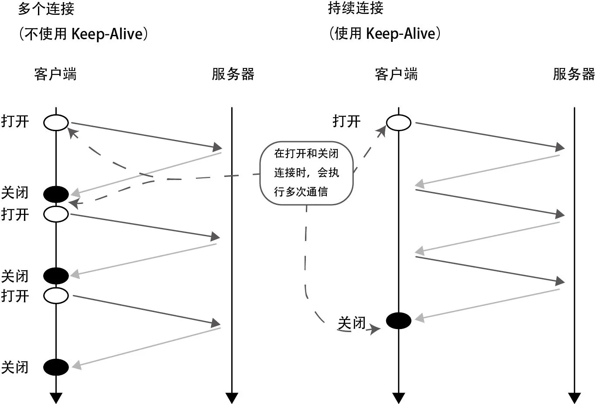
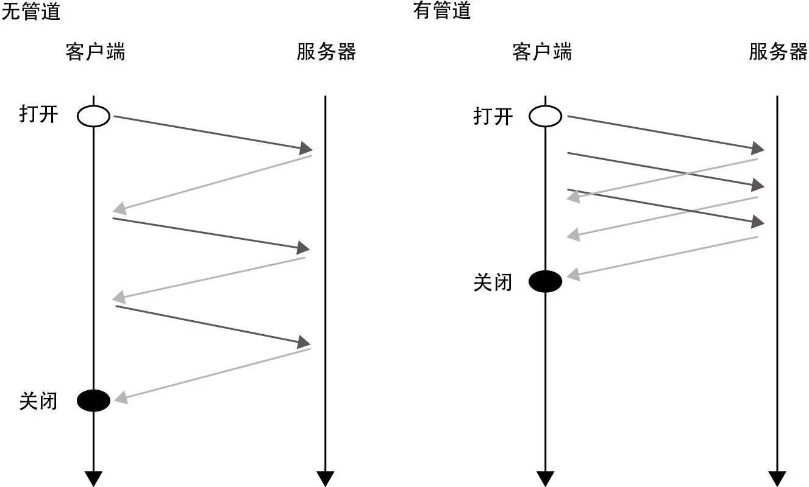
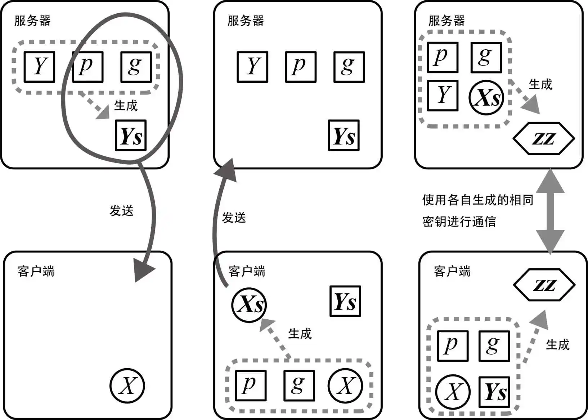
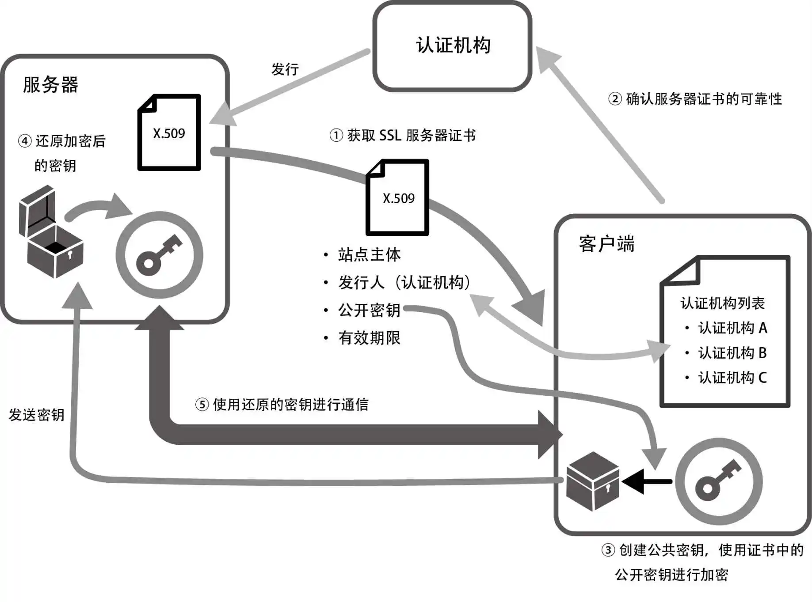

# 第4章HTTP-1.1的语法：追求高速化和安全性(1)

我们在第 1 章了解了 HTTP/1.0 的 4 个基本元素，在第 2 章了解了浏览器是如何使用这些基本元素完成各种处理的。因为 HTTP 保持向前兼容，所以这些框架和结构在 HTTP/1.1 之后也没有发生较大的改变。本章将介绍 HTTP/1.1 之后的新功能。

在 HTTP/1.0 出现的第二年（1997 年），HTTP/1.1 制定了初版的 RFC 2068。之后，在 RFC2616 中进行了修订，并在 RFC 2817（TLS）、RFC 5785（URI）、RFC 6266（Content-Disposition）和 RFC 6285（添加状态码）中扩展了功能。

在 2014 年，通过对完成了实现但未标准化的部分等进行整理，HTTP 实现了版本升级，相应的内容整理在了 RFC 7230（消息的语法）、RFC 7231（语义和内容）、RFC 7232（有条件的请求）、RFC 7233（指定范围的请求）、RFC 7234（缓存）和 RFC 7235（认证）等文件中。

当前的 HTTP/2 规范主要对通信高速化等底层交互的语法进行了更新，而通信内容、浏览器和服务器之间的交互的语义规范，仍采用 HTTP/1.1 中制定的内容。

本章介绍的 HTTP/1.1 与 HTTP/1.0 在语法方面的不同之处如下所示。

- 通信的高速化

- Keep-Alive 默认有效

- 支持使用 TLS 进行加密通信

- 添加新的方法

```sql
PUT 方法和 DELETE 方法成为必不可少的方法
添加了 OPTION 方法、TRACE 方法和 CONNECT 方法
```

- 协议升级

- 支持使用名称的虚拟主机

- 支持 Chunk 形式的数据传输

- DATA URI 方案

## 4.1　通过 Keep-Alive 提高通信速度

在 HTTP/1.1 的标准化内容中，最引人注目的是可以通过 TLS 实现安全通信这一点。该功能需要设置证书等。另外，使用 HTTP/1.1 还能实现高速通信。在第 2 章介绍缓存时提到的

```
ETag        和 Cache-Control 也是 HTTP/1.1 中的功能。缓存是按内容资源优化通信的技
```

术，而本章介绍的 Keep-Alive 可以让所有 HTTP 通信实现高速化。

HTTP/1.0 规定，浏览器与服务器的同时连接个数最好为 4 个，这是同时访问的连接个数。在HTTP/1.1 中，因为考虑到了 Keep-Alive 的效果，所以将同时连接个数调整为 2 个。随着协议版本的升级，通信速度将得到改善，服务器的负荷也会有所减轻。

为了进一步实现高速化，现在浏览器的同时连接个数增加为 6 个，这也是提高通信速度的一项举措。另外，服务提供端还使用了域名分片技术，即将资源配置在多个域上，以此来进行更多数量的通信。

Keep-Alive 用于提高 HTTP 下面的 TCP/IP 协议层的通信效率。如图 4-1 所示，如果不使用Keep-Alive，每次请求完毕都要关闭通信。而如果使用 Keep-Alive，就可以再次利用连接来处理连续的请求。这样一来，TCP/IP 的等待时间就会减少，吞吐量和通信速度就能得到提升，移动通信的电量消耗也会变少。



- 图 4-1　Keep-Alive

HTTP/1.0 的规范中并不包含该功能，但一些浏览器支持该功能。在 HTTP/1.0 中，要想使用Keep-Alive，就要在请求首部中添加下面的首部。另外，在 HTTP/2 中，Keep-Alive 始终是有效的，因此不能使用下面的首部。

```
Connection: Keep-Alive
```

如果接收该请求的服务器支持 Keep-Alive，那么服务器也会在返回的响应首部中加上相同的首部。

HTTP/1.1 之后开始默认支持 Keep-Alive。

Keep-Alive 可以帮助我们在使用后面介绍的 TLS 时大幅节约通信时间。HTTP 下面的 TCP/IP协议层在建立连接时要握手 3 次。包往返 1 次的时间称为 1 RTT（Round-Trip Time，往返时延）。在 TLS 中，服务器和客户端之间的通信开始前的信息交换（握手）需要花费 2 RTT的时间。使用 Keep-Alive 可以减少握手次数，这样响应时间也会相应地减少。

假设在下载游戏资源时，反复进行一个请求的 HTTP 通信，那么第 2 次及之后的资源下载时间就最多可以从 4 RTT 减少到 1 RTT。

在使用 Keep-Alive 进行通信时，客户端或服务器可以通过下面的首部断开连接，或者在超时之前保持通信。

```
Connection: Close
```

服务器无法判断所有通信是否都真正结束了。因为存在使用 JavaScript 动态发送请求的情况，所以服务器无法只通过静态解析 HTML 来检测客户端的通信是否全部结束。因此，服务器很难显式发送 Keep-Alive 已经终止的信息，只能等到超时后自动断开连接。

客户端和服务器都持有 Keep-Alive 的持续时间。只要其中一方切断 TCP/IP，通信就会立刻结束，所以取二者中持续时间较短的一方作为通信时间。Internet Explorer 默认 60 秒后超时，

- 1

Firefox 是 115 秒，服务器 nginx 是 75 秒

- 。Apache 1.3 和 Apache 2.0 是 15 秒，

Apache 2.2 之后的版本是 5 秒。

在通信期间，操作系统的资源会被不断消耗，所以在没有实际进行通信的情况下仍保持连接并不是一件好事，最好在较短的时间内切断连接。

我们可以通过在 curl 命令中记述多个请求来使用 Keep-Alive 连续发送多个请求。

```
$ curl -v http://www.google.com http://www.google.com
```


```
　Connection            首部中还可以设置用逗号分隔的文本，在这种情况下，当通过
```

- 第一层代理时，该首部会指示中间代理服务器删除指定的标签群。这与前面介绍的功能有很大不同。

### 管道技术

管道技术也是用来提高通信速度的功能。虽然管道技术已经实现了标准化，但有的服务器还没有对其提供支持，所以该技术还未得到广泛应用。但笔者认为该技术是今后改善的基础，所以这里我们来介绍一下。

管道技术是指在一个请求结束之前发送下一个请求，消除等待时间，以此来提高网络运行效率和性能（图 4-2）。管道技术的前提是使用 Keep-Alive。另外，根据规范，服务器会按请求发来的顺序返回响应。



- 图 4-2　管道技术

实际使用一下就会发现，管道技术在往返比较耗时的移动通信中能达到显著的效果。但它也有一些问题，比如在存在只能解释 HTTP/1.0 的代理的情况下会出现管道无法运行的问题；

有的浏览器会因服务器实现错误而根据服务器的版本来切换动作；有的浏览器未实现管道技术；有的浏览器虽然实现了管道技术，但默认为无效。另外，虽然 Chrome 在版本 18 中曾支持管道技术，但在版本 26 中又删掉了该功能。现在默认管道技术有效的是 Opera 和 iOS

- 2

5 之后的 Safari

- 。

另外，笔者也听说过一些使用了管道技术但性能没有得到提升的情况。之所以必须按请求顺序返回响应，是因为在生成响应方面非常耗时的处理和一些会返回较大文件的处理会对其他响应造成影响，该问题称为队头阻塞（Head-of-Line blocking，HOL blocking）。

在浏览器实现了管道技术的情况下，如果服务器不支持管道技术，那么就算浏览器首先发送几个请求，在确认返回的服务器名之后使管道技术有效，也无法完全发挥管道技术的性能。

```bash
curl 命令本身并不支持管道技术。从程序直接使用 curl 功能的 libcurl 提供了使用管道技术
```

的选项。

- 流管道技术可以解决各种问题，在 HTTP/2 中，管道技术演变成了一种新的结构——流。在 HTTP/2 中，流逐渐成为 HTTPS 通信的前提。因为是 HTTPS，所以我们基本无法查看代理发送和接收的数据内容。代理不会执行中继通信以外的操作，所以无法解释新协议的代理不会在中途带来麻烦

- HTTP/2 中没有了必须保持通信顺序的限制。HTTP/2 的一个会话中可以同时存在多个流。因为各个流的通信是分时间段进行的，所以按服务器完成准备的顺序返回响应也是一个可行之计。另外，在 HTTP/2 中还加入了按优先级切换顺序的功能

- 第 7 章还会对流的相关内容进行进一步的介绍。

## 4.2　TLS

对通信线路进行加密的 TLS（Transport Layer Security，传输层安全协议）与 HTTP/1.1 同时

```
实现了标准化。即使是不怎么了解计算机的用户，也知道以 https 开始的        URL 是“安全
```

的通信”。这种安全的通信在我们进行网购和使用网上银行等各种服务时是必不可少的。在制定 HTTP/1.0 时，Netscape Navigator 中就已经实现了 SSL 3.0。TLS 在 SSL 3.0 的基础上与 HTTP/1.0 一起在 1996 年开始标准化，但最终在 HTTP/1.1 完成之后才实现。

在创建 TLS 时考虑到了与 HTTP/1.1 的兼容性，但其实 TLS 加密可以在不依赖于 HTTP 的前提下双向传播各种形式的数据。TLS 是一种通用的结构，它能够加强既有协议的通信线路的安全性，从而创建出新协议。HTTP 的公认端口是 80，而 HTTPS（HTTP Secure）使用的是 443 端口。除 HTTPS 之外，邮件发送协议 SMTP（25 端口）的 TLS 版——SMTPS（465端口）等都用于既有协议的版本升级 3。

从在中途对 HTTP 通信进行中继的网关来看，TLS 是加密的、不能查看和修改通信内容的双向通信。在 HTTP/1.0 和 HTTP/1.1 的通信中，能够使用代理服务器等对通信进行解释和缓存，以此实现高速化，但也禁用了自己无法解释的协议。使用 TLS 能够建立无法被篡改的稳定的通信线路，从而可以顺利地引入与 HTTP/1.1 之前的版本无法兼容的许多新结构，比如HTML5 中引入的通信协议 WebSocket 和 HTTP/2 等。

TLS 的相关技术非常复杂，恐怕要用本书两倍以上的页数才能介绍完。笔者不是加密方面的专家，所以书中对 TLS 的介绍仅停留在“TLS 是什么、能做些什么”的程度。

如表 4-1 所示，TLS 存在多个版本，曾经人们也把它称为 SSL（Secure Sockets Layer，安全套接层）。如今，与 TLS 相关的技术的名称中还保留着 SSL，比如 OpenSSL 作为承担 TLS部分的库被广泛使用，对服务器进行认证的证书中有 EV SSL 证书等。因此，人们现在仍常把TLS 叫作 SSL。众所周知，实际的 SSL 中存在很多缺陷，RFC 并不推荐使用 SSL，互联网上的许多服务也将其设置为无效，实际使用的大多是 TLS。

表 4-1　SSL/TLS 的历史

版本

- 发布状态

SSL 1.0

- 最早由 Netscape 进行设计，但其

SSL 2.0

- 1994 年发布RFC 6176 中不推荐使用

SSL 3.0

- 1995 年发布RFC 7568 中不推荐使用

- 年以为基础定义在中浏览器厂商在年弃用该版本

在介绍完理解 TLS 所必需的几个技术元素之后，我们来介绍一下 TLS 的通信流程。

围绕 TLS 的一个重大课题就是 TLS 1.3 历经 4 年实现了标准化。本节主要以 TLS 1.3 为中心介绍 TLS 的相关知识。不过，由于会偏离本书从客户端的角度来讲解 HTTP 的宗旨，所

- 4

以这里不会深入，读者可以参考《HTTPS 权威指南》

- 等图书了解 TLS 技术的详细内容、发

展历程、风险、应用和设置方法等在实际工作中需要用到的信息。

TLS 1.3 制定完成后，浏览器厂商宣布 2021 年（有的是 2020 年）将不再支持 TLS 1.0 和TLS 1.1。安全相关的技术一般不能只有一种可用，否则在发现漏洞的情况下，只要不把这些漏洞全部删除，就只能使用有安全漏洞的方法了。TLS 及随后介绍的密码套件都遵循该惯例。

下面介绍的内容用于帮助我们理解 TLS 的大致情况和它的内部动作。实际的通信内容是加密

```
的二进制数据，很难让人看到其内容，但我们只要将 URL 写成 https://，就可以使用 curl
```

命令访问通信内容了。下面的选项可以用来设置详细动作。

```
-1、--tlsv1
```

- 使用 TLS 进行连接。

```
--tlsv1.0、--tlsv1.1、--tlsv1.2、--tlsv1.3
```

- 强制在 TLS 协商时按指定的版本进行连接。

```
--cert-status
```

- 确认证书。

```
-k、--insecure
```

- 使用自签名证书，程序也不会报错。

```
如果在运行时加上 --cert-status 和 -v，证书的状态就会表示成下面这样。
$ curl --cert-status -v https://××××.com
```

- ︙

```
* SSL certificate status: good (0)
```

虽然我们也可以使用下面的选项，但 RFC 中已经不推荐这些版本了，因此这些选项只能用来确认旧的通信是否被拒绝。

```
-2、--sslv2
```

- 使用 SSL 2.0 进行连接。

```
-3、--sslv3
```

- 使用 SSL 3.0 进行连接。

### 4.2.1　散列函数

按规则对输入数据进行汇总，就可以创建名为散列值的短数据。

散列函数在进行加密通信时具有数学方面的特征。假设散列函数 h() 的输入数据为 A、B 等，算出的散列值为 X、Y 等，长度为 len()。

- 如果算法相同，输入数据相同，那么算出来的散列值也相同。h(A) = X 总成立

- 如果算法相同，散列值的长度就相同。如果是 SHA-256 算法，散列值的长度就为 256位（32 字节）。如果输入数据太小，散列值就会很大，但一般情况下，len(X) <len(A)

- 很难通过散列值推导出原始数据，即不容易通过 h(A) = X 的 X 值找出 A（弱抗冲突性）

- 很难找出持有同一个散列值的任意数据组合，即不容易找出使 h(A) = h(B) 的任意数据组合 A 和 B（强抗冲突性）

散列函数在计算机中有各种用途。例如，它可以用来确认下载的文件是否损坏。即使数据只有1 字节的差异，散列值也会发生变化。在这种情况下，散列值也叫作校验和（checksum）或者指纹。

另外，在版本管理系统 Git 中，管理文件时使用的是基于文件内容（而非文件名）生成的散列值，在数据库中会将该散列值作为键来存储文件。当存在多个内容相同的文件时，数据实体只有一个。另外，在判断文件内容是否一致时，不用比较数据文件的所有内容，只比较散列值就可以了。

散列值很少发生冲突，在数据量较少的情况下，基本不会发生冲突。是否容易发生冲突是衡量算法好坏的标准。

在提高安全性方面，散列值可以用来判断内容是否相同。不过，如果使用了打破强抗冲突性的较弱的算法，就会创建出持有相同散列值的数据。也就是说，即使内容被篡改了，也不会被人发现。另外，强抗冲突性比弱抗冲突性要弱，这与它们的名称给人的印象正好相反。

比较有名的散列函数有 MD5（128 位）、SHA-1（160 位）、SHA-2（SHA-224、SHA-256、SHA-384、SHA-512、SHA-512/224、SHA-512/256）等 5。MD5 和 SHA-1 从 2016 年开始成为不建议在安全领域使用的散列函数。现在 MD5 的强抗冲突性可以在几秒内被打破。SHA-1 也成为不建议在服务器证书的签名上使用的散列函数了。2013 年出现了理论上可以打破强抗冲突性的方法。2017 年 3 月，Google 宣称成功创建了 SHA-1 散列值冲突的 PDF。

我们可以使用命令行工具来确认一下什么是散列值。不适合在安全领域使用的 MD5 仍在用作校验和，各个操作系统中都提供了相应的工具。macOS 和 BSD 系列的操作系统中提供了

```
md5 命令，Linux        中提供了 md5sum 命令。只用对文件修改 1 字节，就可以发现散列值
```

发生了很大的变化。

```
$ md5 index.rst
MD5 (index.rst) = 809318a5cb36956768d5ef72333adb4a
```

Windows 中提供了 FCIV 工具来计算校验和。

```
> fciv.exe index.rst
//
// File Checksum Integrity Verifier version 2.05.
//
809318a5cb36956768d5ef72333adb4a index.rst
```

### 4.2.2　公共密钥加密、公开密钥加密和数字签名

不熟悉加密通信的人对加密的印象可能是，采用秘密方法将文章设置为无法解读的形式，然后由接收方将其还原。如果按照这种方式进行加密，转换方法的算法本身就成了加密中最重要的元素。如果泄漏了转换方法，所有的通信都会被泄漏，因此互联网中并不使用这种加密方式。

对加密算法来说，重要的不是对算法本身加密，而是即使算法被公开，也能够安全地进行通信。互联网必须保证各种操作系统的计算机之间以及移动端的浏览器之间能够通信。现在，很多常用的浏览器的核心代码是开源的，谁都可以看到。由此也可以看出，不公开加密方式的做法并不能很好地奏效。现在常用的方法是，公开加密方式，另行准备加密用的数据（密钥）。TLS 中使用的是公共密钥方式和公开密钥方式。

公共密钥方式是指加密和解密使用同一个密钥。公共密钥方式也叫作对称加密。我们可以把它看作行李柜，解密时要用到加密时设置的号码，互相通信的人需要共享该号码。通信领域中的公共密钥方式的算法与物理钥匙的不同之处在于，密钥、加密前的数据和加密后的数据都是数据。不同于现实世界中的“隐藏”，通信中的加密是指“根据密钥数据来损坏数据”。有了密钥就能正确修复损坏的数据，因此接收方可以还原和阅读数据。TLS 就用于普通的通信加密。

公开密钥方式也称为非对称加密。在公开密钥方式中，公开密钥和私人密钥是必不可少的。正如其名字所表达的那样，公开密钥可以向全世界公开。私人密钥是不可以让他人知道的密钥。与家里的钥匙不同，加密时使用的密钥和还原时使用的密钥是不同的。加密时用的是公开密钥，而还原时用的是私人密钥。不过，它们都叫密钥，这就给我们增大了理解的难度。用现实世界中存在的物品为例，公开密钥就是挂锁，私人密钥就是钥匙。将几个相同的挂锁送给他人，想秘密通信的人会将该挂锁锁上，然后返还回来。其他没有钥匙的人无法开锁，只有持有钥匙的人才能打开。

数字签名就是公开密钥方式的一种应用案例。具体来说就是公开钥匙，加密挂锁。将书信正文和加锁的数据一起发送，当接收的人使用公开的钥匙打开挂锁时，如果内容与正文相同，就可以知道正文没有被篡改。这就是数字签名。实际的数字签名并不是加密正文，而是先执行散列处理，然后对处理结果进行加密。虽然有点不好理解，但在这种情况下，挂锁是加密的状态，是私人密钥，而钥匙则是公开密钥。

公开密钥方式也与物理钥匙不同，加密的数据、私人密钥和公开密钥都用数据表示。另外，在打开挂锁的情况下，挂锁还可以再次使用（摘下），而在使用公开密钥加密的情况下，即使密钥和加密后的数据可以还原，我们也无法取出相当于挂锁的私人密钥。

加密并不是没有任何缺点。以挂锁为例，加密的安全强度取决于算法（锯齿形状）和位数（锯齿个数）。我们可以花时间试着做出各种凹凸样式的钥匙。实际上，加密需要大量计算，但在一定时间内能够被解析的加密是不够安全的。随着 CPU 的进步，一些算法已经不作为推荐算法使用了。

### 4.2.3　密钥交换

密钥交换是指客户端和服务器之间交换密钥。密钥交换有两种方法：一种是客户端生成公共密钥，然后使用服务器证书的公开密钥进行加密并发送；另一种是使用密钥交换专用算法。这里，笔者来介绍一下 RFC 2631 中定义的 DH（Diffie-Hellman，迪菲 - 赫尔曼）密钥交换算法。在实际操作中，我们会使用由其派生出来的 DHE 算法。

如图 4-3 所示，该算法的关键点在于客户端和服务器各自生成用于生成密钥的“材料”，并互相交换，然后各自计算出相同的密钥。



- 图 4-3　密钥交换的示意图

在 TLS 中，服务器会准备用于计算的值 p 和 g，并将其作为公开信息直接传递给客户端。p是较大的质数，不过，为了便于计算，本章的示例中使用了比较简单的数值。g 是模 p 的原根。原根是满足下述条件的数值。实际上，在很多情况下，为了实现高速化，预先计算出的值的组合会保持在 TLS 的客户端中。

- g^ 1, g ^ 2,…, g ^ (p - 2) 中的任意一个数值除以 q，余数都不是 1

我们再计算另外一个加密数值。假设加密数值为 Y，p = 23，g = 5，Y = 6。我们可以通过下式计算出用于交换的 Ys。

- Ys = (g ^ Y) mod p = (5 ^ 6) mod 23 = 8

服务器将 p、g、Ys 作为 Server Key Exchange（服务器密钥交换）消息的参数发送给客户端，发送结束后的状态如表 4-2 所示。

表 4-2　服务器发送 p、g、Ys 后的状态

变量

- 值客户端中间人服务器

p

- 23知道知道知道

g

- 5知道知道知道

Y

- 6不知道不知道知道

Ys

- 8知道知道知道

客户端也会随机生成值 X。我们来计算一下 Xs，假设 X = 15。

- Xs = (g ^ X) mod p = (5 ^ 15) mod 23 = 19

客户端将 Xs 作为 Client Key Exchange（客户端密钥交换）消息的参数发送给服务器，发送结束后的状态如表 4-3 所示。

表 4-3　客户端发送 Xs 后的状态

变量

- 值客户端中间人服务器

X

- 15知道不知道不知道

Xs

- 19知道知道知道

客户端使用自己生成的值 X 和服务器发送过来的值 Ys，生成公共密钥的种子。

- ZZ = Ys ^ X mod p = 8 ^ 15 mod 23 = 2

服务器也使用自己生成的值 Y 和客户端发送过来的值 Xs，生成公共密钥的种子。

- ZZ = Xs ^ Y mod p = 19 ^ 6 mod 23 = 2

由于生成的密钥种子 ZZ 是除法运算的余数，高位上的 0 经常偏移，所以我们要根据计算出的数值，通过散列函数生成最终使用的密钥 K。

当然，ZZ 是不大于 p 的数值。密钥的强度会根据 p 的长度发生变化。这里使用的数值是 5位，但在实际工作中，我们会用到长度为 1024 位、2048 位的数值。如果生成的密钥较短，该密钥就比较脆弱。Logjam 攻击就是利用该性质，缩小所生成的密钥的位数，从而降低安全强度。如今，使用 2048 位以上的数值（也就是 616 位左右的质数）已成为主流。Xs和 Ys 因除法运算而处于离散状态，范围较大，所以回推原始值需要花费一定时间。代理等中间人虽然知道 p 和 g，以及中间计算的公开数值 Xs 和 Ys，但仅通过这些数值无法计算出X 和 Y，因此，只有服务器和客户端可以得到公共密钥。

椭圆曲线 DH（ECDHE）密钥交换算法对 DH 密钥交换算法进行了改进，可以通过更少的位数实现更强的密钥。

### 4.2.4　区分使用公共密钥方式和公开密钥方式的理由

对公共密钥方式和公开密钥方式进行比较就能发现，公开密钥方式更复杂，安全性更高。一直使用安全性高的方式会让人很放心，但 TLS 组合使用这两种方式。具体来说就是，每次通信时创建只使用一次的公共密钥，然后使用公开密钥方式将密钥交接给通信对象，之后使用公共密钥快速进行加密。之所以这么做，是因为虽然公开密钥方式的安全性更高，但加密和还原密钥所需的计算量要比公共密钥方式大很多。

很多人认为，与安全性相比，计算量大一些不算什么。我们不妨测试一下公共密钥方式（AES）的性能和公开密钥方式（RSA）的性能。这里使用的是 2013 版的 Core i7 的MacBook Pro。另外，虽然公开密钥方式现在仍用于签名，但基本上不用于加密，因此这里的值仅供参考，如代码清单 4-1 所示。

代码清单 4-1　比较公共密钥方式和公开密钥方式

```go
package main
import (
   "crypto/aes"
   "crypto/cipher"
   "crypto/md5"
   "crypto/rand"
   "crypto/rsa"
   "io"
   "testing"
)
func prepareRSA() (sourceData, label []byte, privateKey *rsa.PrivateKey) {
   sourceData = make([]byte, 128)
   label = []byte("")
   io.ReadFull(rand.Reader, sourceData)
   privateKey, _ = rsa.GenerateKey(rand.Reader, 2048)
   return
}
func BenchmarkRSAEncryption(b *testing.B) {
   sourceData, label, privateKey := prepareRSA()
   publicKey := &privateKey.PublicKey
   md5hash := md5.New()
   b.ResetTimer()
   for i := 0; i < b.N; i++ {
       rsa.EncryptOAEP(md5hash, rand.Reader, publicKey, sourceData, label)
   }
}
func BenchmarkRSADecryption(b *testing.B) {
   sourceData, label, privateKey := prepareRSA()
   publicKey := &privateKey.PublicKey
   md5hash := md5.New()
   encrypted, _ := rsa.EncryptOAEP(md5hash, rand.Reader, publicKey, sourceData,
label)
   b.ResetTimer()
   for i := 0; i < b.N; i++ {
       rsa.DecryptOAEP(md5hash, rand.Reader, privateKey, encrypted, label)
   }
}
func prepareAES() (sourceData, nonce []byte, gcm cipher.AEAD) {
   sourceData = make([]byte, 128)
   io.ReadFull(rand.Reader, sourceData)
   key := make([]byte, 32)
   io.ReadFull(rand.Reader, key)
   nonce = make([]byte, 12)
   io.ReadFull(rand.Reader, nonce)
   block, _ := aes.NewCipher(key)
   gcm, _ = cipher.NewGCM(block)
   return
}
func BenchmarkAESEncryption(b *testing.B) {
   sourceData, nonce, gcm := prepareAES()
   b.ResetTimer()
   for i := 0; i < b.N; i++ {
       gcm.Seal(nil, nonce, sourceData, nil)
   }
}
func BenchmarkAESDecryption(b *testing.B) {
   sourceData, nonce, gcm := prepareAES()
   encrypted := gcm.Seal(nil, nonce, sourceData, nil)
   b.ResetTimer()
   for i := 0; i < b.N; i++ {
       gcm.Open(nil, nonce, encrypted, nil)
   }
}
```

将代码保存为 encrypt_test.go，然后如下运行。

```
$ go test -bench .
```

基准测试的结果如表 4-4 所示。表中展示了 128 字节的数据在加密和还原时的处理时间。如果使用不同的计算机分别进行加密和还原，实际吞吐量的数值会更小。在使用 RSA 的情况下，即使使用性能较好的计算机，也只能达到 PHS 线路的速度。而在使用 AES 的情况下，即使是千兆光纤，速度也不会成为瓶颈，可达到使用 RSA 时的速度的约 15 000 倍。况且，AES 在面向 Go 语言的 64 位英特尔架构的实现中会执行硬件处理，由此，速度还能进一步提高 3~10 倍。即使不考虑这些，RSA 的速度和 AES 的速度也相差非常大。

表 4-4　RSA 和 AES 的基准测试的结果

- 时间 /ns吞吐量 /MB/s

加密方式

- 模式

RSA

- 84 3381.5加密

### 4.2.5　TLS 的通信步骤

前面介绍了理解 TLS 的相关术语所需要的技术元素。接下来，我们看一下 TLS 的具体通信步骤。

TLS 的通信步骤如图 4-4 所示，首先确立握手协议，然后在通信时使用记录协议，最后通过SessionTicket 在再次连接时实现快速握手。握手中包含两项任务，后面笔者会分别对其进行介绍。



- 图 4-4　TLS 的通信步骤

确认服务器的可靠性

确保服务器可靠性的结构也是确保公开密钥可靠性的结构，叫作公钥基础设施（Public KeyInfrastructure，PKI）。浏览器从获取服务器持有的 SSL 服务器证书开始执行处理。

证书是采用 X.509 格式记述的。该证书定义在 RFC 2459 中，之后更新为 RFC 3280，现在最新的规范是 RFC 5280。证书中包含站点主体（Subject：名称和域名）、发行人、主体的服务器的公开密钥、有效期限等内容。发行人也叫作认证机构（Certificate Authority，CA）。站点的域名和要通信的域名应该一致。另外，主体名称显示在浏览器的地址栏中。确认可靠性的关键在于发行人。

在证书中附有发行人的数字签名。只要获取该发行人的证书，就可以验证签名。其他上级发行人的证书也可以依次进行验证。最后，发行人和主体会拥有同一个证书，这就是根认证机构。根认证机构本身的可靠性无法仅通过公钥基础设施来确保。浏览器和操作系统中会预先安装可靠的认证机构的证书，与该证书进行比较之后就能确认服务器是否被承认。

- 6

发行人和主体拥有的不被信赖的证书叫作自签名证书

- 。自签名证书可以用 OpenSSL 等

工具创建。我们可以将自己创建的证书注册到操作系统中，来认证自己使用的服务，或者将自签名证书安装在企业内部的所有计算机中，来确认企业内部专用的服务器。

- 为了防止认证机构解散，公钥基础设施提供了终止证书或让证书失效的结构。

为了确保安全性，使用 160 位 SHA-1 算法的证书已经停止使用。这类证书从 2016 年 1 月起禁止发行，从 2017 年 1 月起禁止使用。现在，如果访问的服务器中只有使用了 SHA-1算法的证书，浏览器就会弹出警告。

```
如果是面向外部公开的服务，那么任何人都可以获取证书。我们试着使用 openssl 命令来获
```

取 Google 的证书，并显示其内容。

```
$ openssl s_client -connect www.google.com:443 < /dev/null > google.crt
$ openssl x509 -in google.crt -noout -text
Certificate:
   Data:
       Version: 3 (0x2)
       Serial Number: 3212404801251588877 (0x2c94c1258d5c3b0d)
   Signature Algorithm: sha256WithRSAEncryption
       Issuer: C=US, O=Google Inc, CN=Google Internet Authority G2
       Validity
           Not Before: Sep 1 14:06:15 2016 GMT
           Not After : Nov 24 13:45:00 2016 GMT
       Subject: C=US, ST=California, L=Mountain View, O=Google Inc, CN=www.googl
       com
         ︙
```

这就是实际使用的服务器证书。

密钥交换

接下来进行密钥交换。密钥交换的方法有两种：一种是使用公开密钥加密，另一种是使用密钥

```
交换专用算法。具体使用哪一种方法，要在最开始的 Client Hello 和        Server
Hello 的协商中决定。
```

客户端首先使用随机数来创建公共密钥。如果算法生成随机数的模式能被轻易解读，那么不管如何加密，最初创建的公共密钥和算法的计算过程都有可能被推测出来。随机数的性质非常重要。我们也可以使用 CPU 中的硬件随机数生成器，或者组合使用多个算法或生成器，让随机数变得难以解读。

使用公开密钥加密的方法很简单。使用服务器的证书中添加的公开密钥，对用于通信的公共密钥进行加密，并将该密钥发送给服务器。因为服务器持有与证书的公开密钥对应的私人密钥，所以服务器可以还原发送过来的数据，取出公共密钥。

在使用密钥交换专用算法时，客户端和服务器会各自创建密钥种子，然后互相交换密钥种子，并进行计算，计算结果就是公共密钥。在互相交换密钥种子时，也会使用公开密钥进行加密。

密钥交换专用算法具有非常好的向前保密（forward secrecy）的特性，今后将成为密钥交换的主流方法。TLS 1.3 中废除了使用公开密钥加密进行密钥交换的方法。在使用公开密钥加密进行密钥交换的情况下，如果密钥交换的所有通信都被记录下来，将来一旦服务器的私人密钥泄漏，公共密钥和记录的通信内容就可能被解析。密钥交换专用算法的密钥是动态计算的，无法保存成文件，所以不会出现泄漏的情况。另外，虽然不推荐使用公开密钥加密的方法进行密钥交换，但在签名和密钥交换以外的服务器认证、客户端认证和预共享密钥（PSK）中还会用到该方法。

通信

为了确保机密性和完整性（防止篡改），在通信时会进行加密。这里我们使用公共密钥加密。

TLS 1.2 之前的版本中允许在计算出通信内容的散列值后，使用公共密钥加密。具体来说，就是从发送内容的字节序列中生成散列值，然后将散列值添加到发送数据的末尾，以此来检查数据是否被篡改。不过，由于该方法受到了攻击，所以在 TLS 1.3 之后，该方法只能在AES-GCM、AES-CCM 和 ChaCha20-Poly1305（从 TLS 1.3 开始支持）等认证加密（Authenticated Encryption with Associated Data，AEAD）中使用。

例如，在使用 TLS 1.2 的 AES-GCM 进行加密和还原时，需要 12 字节的密钥，而不是普通的公共密钥。在这 12 字节的密钥中，有 8 字节是发送时随机生成并添加的，另外 4 字节是使用散列函数从握手时交换的服务器和客户端的随机数中生成的。

提高通信速度

前面讲解的都是新建连接的流程。在通常的连接中，在 HTTP 连接之前的 TCP/IP 阶段需要1.5 RTT 的通信时间，TLS 握手需要 2 RTT，之后的 HTTP 请求需要 1 RTT。不过，TCP/IP通信的最后 0.5 RTT 的处理与 TLS 的最开始的通信是一起进行的，因此通信时间合计为4 RTT。在不使用 TLS 的情况下，通信时间为 2 RTT。

在通信时间方面，电力信号到达服务器，然后服务器返回响应，这部分的时间占比最大。因此，减少往返时间就成了提高互联网显示速度的关键。TLS 和 HTTP 也为此实现了几种结构。

首先是本章开头介绍的 Keep-Alive。在使用 Keep-Alive 的情况下会话是持续的，因此第一次请求之后的通信时间是 1 RTT。

TLS 1.2 有会话重用（session resumption）功能，该功能通过在第一次握手时发送之前使用的会话 ID（32 位数值），从而能够省略之后的密钥交换，会话重用只花费 1 RTT。TLS 1.3通过共享预共享密钥，使得从请求到发送信息只花费 0 RTT。

在 TLS 1.3 中，密钥交换和私人密钥加密被分离开来，因此无须等待使用加密套件来协商私人

```
密钥加密的结果，通过发送最开始的 Client Hello        消息，就可以执行来自客户端的密
```

钥交换。这可以减少一次往返通信，只需 1 RTT 即可完成认证。

QUIC 将 TLS 下面的层从需要握手的会话类型的 TCP，替换为无须进行再次发送和流程控制的简单的数据图类型的 UDP，然后由应用程序层进行再次发送的处理，这一通信方式正在实现 RFC 化。QUIC 传输以 Google 提出的 QUIC 协议为基础，通过分离为上层的 HTTP/3和下层的 QUIC 传输来推进标准化。Google 服务器已支持最初的 QUIC（不同于 IETF 的标准

- 7

化版本，因此称为 gQUIC），Google Chrome 也正在使用

- 。到 HTTP/2 为止，虽然在

HTTP 和 TLS 的通信开始前的传输层的 TCP 阶段，握手已经花费了 1 RTT，但由于 UDP不进行握手，所以整个通信的时间至少减少 1 RTT，合计为 1 RTT（共享预共享密钥时为 0RTT）。如今 Google 实现的 gQUIC 拥有相当于 TLS 的功能，规范比较臃肿，不过它将来会被 TLS 1.3 替换。

曾经，TLS 的计算负荷很大，为了实现高速化，人们使用了名为“SSL 加速器”的硬件产品。因此，TLS 及其前身 SSL 给人留下了处理繁重的印象。不过，Google 在 2010 年 6 月表示，在将 TLS 交由 CPU 处理的情况下，CPU 的负荷为 1%，网络开销不足 2%。在 Google 发布该消息的几个月前（当时 Intel 在 CPU 中添加的命令可能还未投入使用），Intel 在 CPU 中添加了命令，用来加速 TLS 主体通信中使用的 AES。该专用命令不仅可以实现加速，而

- 8

且在 HTTP/2 中，服务器和客户端之间的会话个数还会减少为之前的 1/6

- ，甚至更少，握手

次数也会减少。在 TLS 1.3 中，握手的成本也会减少。如今 TLS 的 CPU 负荷已不再是问

- 9

题

- 。

### 4.2.6　加密强度

算法具有数学特征，所以我们可以使用数值来衡量它的强度，这个数值就是选择下一节介绍的加密算法和散列算法的指标。常见密钥长度下各加密算法的加密强度如表 4-5 所示 10。这个指标叫作比特安全性，加密强度按照公共密钥加密方式的位数进行划分。

表 4-5　常见密钥长度下各算法的加密强度

- RSA/DSA/DH

公共密钥加密方式

- 椭圆曲线加密散列值

80

- 1 024160160

112

- 2 048224224

128

- 3 072256256

256

- 15 360512512

64 位密钥可以在极短的时间内被小规模攻击破解，80 位密钥可以在短时间内被有组织的攻击破解。96 位密钥、112 位密钥、128 位密钥分别可以抵御 10 年、20 年、30 年的攻击，256位密钥可以抵御量子计算机的攻击。如今，公共密钥加密方式建议使用 112 位到 128 位的密钥，RSA 建议使用 2048 位，椭圆曲线加密建议使用 224 位到 256 位，散列值建议使用 224位到 256 位。RSA 中不建议使用 3072 位密钥，这是因为该加密算法的计算量非常庞大，使用 3072 位的密钥并不合适。特别是相对于客户端来说，服务器的负荷非常重，使用计算量大的算法会降低抵御 DDoS 攻击的能力。计算量相对较小且加密强度较大的椭圆曲线加密比较受欢迎。

最近被认为已经不够安全的 SHA-1 的散列函数是 160 位，比特安全性为 80 位。完全没有安全性可言的 MD5 的散列函数是 128 位，比特安全性为 64 位。另外，由于这是直接破解密钥所需的大致计算量，所以在出现更高效的攻击方法，或者算法的结果存在偏差时，比特安全性的实际数值会有所降低。

### 4.2.7　密码套件

TLS 采用了与 HTTP 不同的方式使规范拥有灵活性。TLS 的精髓是“认证服务器，交换密钥进行通信”这一流程，该流程从 TLS 1.0 到 TLS 1.3 都没有发生较大的改变。而使用列表对密钥交换方法、消息加密、消息的签名方式等算法的组合进行管理，筛选出服务器和客户端可以共同使用的算法，有助于进行新算法的引入和落后算法的淘汰。这种算法集合叫作密码套件（cipher suite）。

密码套件中存在大量的组合（表 4-6），键入下面的命令可以查看具体内容。

```
$ openssl ciphers -v
ECDH-RSA-AES128-GCM-SHA256   TLSv1.2 Kx=ECDH/RSA   Au=ECDH Enc=AESGCM(128) Mac=AE
ECDH-ECDSA-AES128-GCM-SHA256 TLSv1.2 Kx=ECDH/ECDSA Au=ECDH Enc=AESGCM(128) Mac=AE
```

- ︙

表 4-6　密码套件中的组合

值

- 含义示例

```
ECDHE-RSA-AES256-GCM-SHA384
```

- 识别密码套件的名称

```
TLSv1.2
TLSv1.2 等
```

- 支持该加密算法的协议版本

```
Kx=ECDH/RSA
DH/RSA、ECDH/
```

- 密钥交换算法名称、签名算法名称

```
Au=RSA
RSA/ECDSA
```

- 认证算法

```
Enc=AESGCM(256)
AES-GCM、CHAC
```

- 记录加密算法

```
Mac
AEAD、SHA386
```

- 消息签名

笔者的 macOS 中安装的 OpenSSL（MacPorts 版本的 OpenSSL 1.0.2h）中安装了 98 种组合。不过，其中的许多内容是为了保证向后兼容而添加的，已经不推荐使用了。TLS 1.3与之前的版本相比，推荐的组合发生了很大改变。HTTP/2 的 RFC 7540 中定义了密码套件的黑名单。

- 有几种加密方式（DES、RC4、MD5、SHA-1）被认定为不安全。另外，即使是安全的加密方式，如果密钥长度较短，强度也达不到标准。这种加密方式也在选择范围之外

- 流加密的 RC4 和分组加密的 Mac-then-Encrypt 方式都是脆弱的，因此仅保留了认证加密（AEAD）

- 因为公共密钥算法中只能使用 AES，在 AES 不安全的情况下，没有其他算法可用，所以考虑到安全性，增加了其他算法（RFC 7905 中定义的 ChaCha20-Poly1305）

ChaCha20-Poly1305 与 AES 相比，优点是传输量较小。另外，ChaCha20-Poly1305 的计算负荷也不大，在无法使用加速器（在 Intel 和 AMD 的 CPU 中内嵌的硬件加速器、在 ARM公司的 64 位架构的命令集 ARMv8 之后添加的加速器等）的环境中，ChaCha20-Poly1305 的

- 11

吞吐量是 AES 的 3 倍

- 。反之，如果加速器有效，那么 ChaCha20-Poly1305 的性能只

能达到 AES 的一半。

在密码套件中，如今仍然安全的算法、为了保持兼容性而应该保留的算法等的具体列表可以在Mozilla 网站上查到。通过选择所使用的 Web 服务器、加密的系统和代理，可以获取各个Web 服务器的设置文件的设置示例。

另外，基于之前被攻击的经验，有一些功能 TLS 已经不再支持了。仅从版本编号来看，TLS1.3 只是在原有版本的基础上稍微进行了调整，但从功能上来说，TLS 1.3 进行了比较大的改动 12。

### 4.2.8　选择协议

在 TLS 提供的功能中，用于选择应用程序层协议的扩展功能对下一代通信来说是必不可少的。

最初，Goolge 提出 NPN（Next Protocol Negotiation）扩展，并编写了草案以实现 RFC 化。但由于协商流程发生了较大改变，所以选择了 ALPN（Application-Layer ProtocolNegotiation）扩展方式，制定了 RFC 7301。

```
在 ALPN 中，当开始进行 TLS        的初次握手（Client Hello）时，客户端会将“客户端可
使用的协议一览表”发送给服务器。服务器通过响应（Server Hello），将选择的协议与证书
```

一起发送给客户端。客户端发送协议一览表，服务器从中选择并返回一个可以处理的协议，该方法与第 2 章介绍的内容协商一样。

可供选择的协议名称一览表由 IANA 进行管理。现在注册的协议名称如表 4-7 所示，主要是HTTP 系列和 WebRTC 系列的协议。

表 4-7　可供选择的协议

协议

- 标识符

```
http/1.1
```

HTTP/1.1

```
spdy/1
```

SPDY/1

```
spdy/2
```

SPDY/2

```
spdy/3
```

SPDY/3

```
stun.turn
```

Traversal Using Relays around NAT（TURN）

NAT discovery using Session Traversal Utilities for NAT

```
stun.nat-discovery
```

（STUN）

```
h2
```

HTTP/2 over TLS

```
h2c
```

HTTP/2 over TCP

```
webrtc
```

WebRTC 的多媒体和数据

```
c-webrtc
```

Confidential WebRTC 的多媒体和数据

```
ftp
```

FTP

其中需要注意的是 HTTP/1.1、HTTP/2，以及 HTTP/2 的前身 SPDY 的各个版本同时存在。前面介绍过，管道技术从语法上来说是作为 HTTP/1.0 的延伸引入的，但其动作并不兼容HTTP/1.0，因此有时不能正常运行。在使用 TLS 的情况下，运行过程中也不会受到代理的影响。因此，通过事先与服务器调整协议版本，也可以使用完全不兼容的协议。

```
另外，h2c 表示不管是否建立了 TLS 通信，都会使用非 TLS 协议。实际上，这个非 TLS 协
```

议是无法选择的，只能预留。同样，WebRTC 也无法使用。

此外，RFC 中规定标识符采用 URF-8 编码，从规则上来说，标识符可以包含汉字和表情符号。

### 4.2.9　TLS 保护的内容

TLS 是一种用于确保通信线路安全的结构。即使客户端和服务器之间的通信线路处于一种不可靠的状态，TLS 也能确保通信安全。通信线路处于一种不可靠的状态是指中间人可以监听通信，或者随意改写通信内容、假冒客户端发送请求等，但 TLS 在这种状态下仍然可以提供安全的通信。

在 TLS 1.3 中，这种安全的通信是由带认证的加密模式的算法来保护的。因此，安全交换公共密钥就成了重中之重。我们可以使用密钥交换算法 DHE 和 ECDHE。不过，这类算法不擅长应付能够在中途改写通信内容的中间人的攻击，因此，我们还要使用证书进行认证，从而抑制通信内容被改写的风险。

TLS 1.2 中提供了使用公开密钥加密进行密钥交换的方法。正如前面介绍的那样，该方法的向前保密性较差，不过只要保护好私人密钥，就能保证通信安全。

证书的安全性通过使用了公开密钥基础设施的发行人的认证来实现。

TLS 组合使用多种方法，各种方法互相补充，以此防御各种漏洞。安全漏洞有很多种，有算法的脆弱性导致的漏洞，也有因实现问题而出现的漏洞。另外，如果了解图结构，那么就可以知道问题的影响范围。笔者只介绍了 TLS 的一小部分内容，关于安全，最重要的是能够从可靠的信息发送源获取信息。

另外，有些内容不受 TLS 的保护，TLS 不对通信线路之外的信息进行保密。一些攻击用于盗取浏览器上的 Cookie，即使使用 TLS 保护通信线路，只要这些攻击让浏览器执行错误的操作，浏览器就会向非预期的服务器发送信息，服务器也无法保护被破解的信息。用户密码不是采用明文方式保存在数据库中的，散列化等保护措施要单独完成。

近年来，安全攻击也变得多种多样，最近几年比较严重的问题是对开发库的破解。具体来说就是注入代码，破解已经发布且得到广泛使用的库，制造后门，或者将信息传送到外部网站。在这种情况下，即使使用 TLS，也只会让数据的输出路径更加安全，反而帮了攻击者。幸运的是，我们有各种各样的程序可以用来检测源代码所依赖的库的漏洞，详细内容会在第 14 章介绍。

- 关于密码的散列化，我们将在第 14 章介绍 bcrypt。

### 4.2.10　TLS 时代

2016 年，免费认证机构 Let's Encrypt 开始提供服务。在那之前，有的证书只要持有域名即可购买，有的证书还要得到法人的确认。颁发证书也要花上几天的时间，而且级别不同收费也不同。即使是认证级别受限的域认证证书，价格也高于一台 VPS 服务器的租赁费用，可信赖性较高的 EV 证书的价格会更高。

另外，人们对隐私的关注度也在提高。2017 年，针对所有的非 HTTPS 通信，Chrome 都开始弹出警告。随后，其他浏览器也采取了同样的做法，现在的主流浏览器都会对未使用 TLS 的网站弹出警告。也有一部分功能仅在进行 TLS 通信的网站上有效。现在的情形是使用TLS 是理所当然的，未使用 TLS 才存在问题。

最近，Google、Firefox 的开发商 Mozilla、通信设备制造商 Cisco 和 Facebook 等企业赞助的Let's Encrypt 开始提供免费的证书服务。为了摆脱人力，免费提供服务，该机构使用 RFC8555 中制定的 ACME（Automatic Certificate Management Environment，自动化证书管理环境）协议颁发证书。如果服务器使用该协议，就可以自己获取并设置证书了。

这是最简单的证书，只要是域拥有者就能获取，它凭借免费这一巨大优势，对 TLS 的普及做出了很大贡献。2020 年 2 月末，其官方 Twitter 宣布已经颁发了 10 亿个证书。

该 RFC 是以 Let's Encrypt 相关的团体成员为中心制定的，现在 digicert 等其他 TLS 认证机构也支持该 RFC。

Go 语言也实现了一些 ACME 协议库。

## 4.3　PUT 方法和 DELETE 方法的标准化

```sql
在 HTTP/1.1 中，PUT 方法和 DELETE 方法也成为必不可少的方法。这样一来，用于在数据
库中处理数据的 4 个基本方法        CRUD（Create、Read、Update、Delete）就都有
```

了，HTTP 也可以作为处理数据的协议使用了（表 4-8）。

表 4-8　HTTP 方法与 CRUD

HTTP 方法

- 相应的 CRUD 操作SQL

```sql
GET
Read
select
POST
Create
insert
PUT
Update
update
DELETE
Delete
delete
```

HTTP 和 CRUD 的不同之处在于，HTTP 是处理文档的高级 API，而 CRUD 是基本操作。实际上，我们不可能让 CRUD 与方法一一对应，然后通过 HTTP 来创建数据库管理系统。假设

```
有一个照片共享网站，我们使用        POST 发布自己喜欢的烟花照片。如果在执行 POST
```

时还希望将照片放到目前为止拍摄的烟花照片的影集中，那么在自己的照片流和影集这两个表中都会添加项目。在某些情况下，还会识别照片中的人脸，将信息添加到相关的数据库中。像这样，发布一次照片有时要执行多次 CRUD，同时更新至少两个数据库。

在数据库中，为了防止事务中出现数据不完整的情况，使用一次 CRUD 就会刷新一次数据。HTTP 中不存在事务，HTTP 的一个请求就相当于一次操作。虽然二者看起来相似，但在HTTP 的情况下，不管底层发生多么复杂的处理，看起来都是一个操作。

```sql
新增加的 PUT 和 DELETE 无法通过 HTML 的 Web 表单发送请求。要想实现这一目标，需要
用到下一章介绍的        XMLHttpRequest。另外，关于 Web API 的语义，笔者会在第 10 章
```

进行介绍。

## 4.4　添加 OPTIONS 方法、TRACE 方法和 CONNECT 方法

```
HTTP/1.1 中还添加了 OPTIONS 方法、TRACE 方法和 CONNECT 方法。
```

### 4.4.1　OPTIONS

```
OPTIONS 方法用于返回服务器可接收的方法。我们试着对 curl 网站调用该方法。
$ curl -X OPTIONS -v https://curl.haxx.se
[master]
:（略）
> OPTIONS / HTTP/1.1
> Host: curl.haxx.se
> User-Agent: curl/7.49.1
> Accept: */*
>
< HTTP/1.1 200 OK
< Date: Mon, 04 Jul 2016 18:44:23 GMT
< Server: Apache
< Upgrade: h2
< Connection: Upgrade
< Allow: OPTIONS,GET,HEAD,POST
< Content-Length: 0
< Content-Type: text/html
<
* Connection #0 to host curl.haxx.se left intact
在响应中，结果存储在了 Allow 首部中。由此我们可以看出，该服务器可以接收 OPTIONS
方法、GET        方法、HEAD 方法和 POST 方法。
不过，许多 Web 服务器未将 OPTION 方法设为有效，nginx 也默认无法处理 OPTION 方法。
在这种情况下，Web 服务器会返回        405 Method Not Allowed。这里省略了详细的安
```

装步骤。安装了 Docker 的读者可以使用下面的命令进行试验。我们使用 Docker CommunityEdition for Mac 来验证一下。

```xml
# 启动 nginx 服务器
$ docker run -d -p 80:80 --name webserver nginx
# 发送 curl 命令
$ curl -X OPTIONS localhost
<html>
<head><title>405 Not Allowed</title></head>
<body bgcolor="white">
<center><h1>405 Not Allowed</h1></center>
<hr><center>nginx/1.11.1</center>
</body>
</html>
# 停止服务器
$ docker stop webserver
当浏览器向其他服务器发送请求时，可以使用 OPTIONS 方法进行事前确认，具体内容将在第
```

14 章中介绍。

### 4.4.2　TRACE（TRACK）

```
TRACE 方法更不常用。当服务器接收到 TRACE 方法时，会将 Content-Type 设置为
message/http，然后加上状态码 200 OK，直接返回请求首部和主体。不过，现在基本上
不使用该方法了。由于在使用 TRACE        方法时容易受到跨站脚本攻击和跨站跟踪攻击，所
以网上的方法也都只是将 TRACE 方法设置为无效。试着向几个网站发送 TRACE 方法，就会
收到        405 Not Allowed 错误。
$ curl -X TRACE https://google.com
服务器难以抵御跨站脚本攻击，再加上 TRACE 方法，有可能导致信息被窃取。
```

- 1.通过跨站脚本攻击，任意脚本都可以运行。

```
使用插入的恶意脚本，通过 XMLHttpRequest 向可以使用 TRACE 方法的服务器发送
```

- 2.

```
TRACE 方法。
在服务器响应后，浏览器能够获取普通脚本无法获取的 HttpOnly 的 Cookie 信息。
```

- 3.

```
现在，由于浏览器不允许通过 XMLHttpRequest 发送 TRACE 方法，所以上述情况不会发
生。不过使用 TRACE        方法的人也不是很多，所以没有必要把它设置为有效。
Microsoft 的 IIS Web 服务器中提供了具有相同功能的 TRACK 方法。在网上搜索一下该方法，
```

也只能看到它被设置为无效的相关信息。

### 4.4.3　CONNECT

```
CONNECT 方法用于在 HTTP 协议上传输其他协议的包，其目的是通过代理服务器来连接目标
```

- 13

```
服务器。CONNECT 方法主要用于中继 HTTPS 通信。即使查看与        Squid
 的 CONNECT
设置相关的 Web 文档，里面介绍的也都是如何拒绝 HTTPS 之外的        CONNECT 连接的相
```

关内容。

```
要使用 CONNECT 方法的客户端会向代理服务器发送以下内容。
CONNECT ××××.com:8889 HTTP 1.1
无条件接收 CONNECT 方法的代理允许中继任何协议，因此代理可能会被作为恶意软件发送邮
```

件的通信线路使用。

我们试着使用代理服务器 squid 连接外部站点。本地的 3128 端口用于启动 squid。

```
$ docker run -d -p 3128:3128 --name squid poklet/squid
```

接下来，将该 squid 用作代理，连接外部的 HTTPS 服务器。我们可以在命令中添加输出通信

```xml
内容日志的 -v。这里省略了一些不必要的内容。
$ curl --proxy http://localhost:3128 -v https://baidu.com
* Rebuilt URL to: https://baidu.com/
*   Trying ::1...
* Connected to localhost (::1) port 3128 (#0)
* Establish HTTP proxy tunnel to baidu.com:443
> CONNECT baidu.com:443 HTTP/1.1
> Host: baidu.com:443
> User-Agent: curl/7.49.1
>
< HTTP/1.0 200 Connection established
<
* Proxy replied OK to CONNECT request
* ALPN, offering http/1.1
 ︙
* SSL connection using TLSv1.2 / ECDHE-RSA-AES128-GCM-SHA256
 ︙
> GET / HTTP/1.1
> Host: baidu.com
> User-Agent: curl/7.49.1
> Accept: */*
>
< HTTP/1.1 301 Redirect
< Date: Tue, 05 Jul 2016 03:30:00 GMT
< Via: https/1.1 ir28.fp.ne1.baidu.com (ApacheTrafficServer)
< Server: ATS
< Location: https://www.baidu.com/
< Content-Type: text/html
< Content-Language: en
< Cache-Control: no-store, no-cache
< Connection: keep-alive
< Content-Length: 304
<
<HTML>
```

- ︙

```
</BODY>
* Connection #0 to host localhost left intact
```

首先，通过上面的代码可知，虽然连接的是本地主机的 3128 端口，但 squid 会使用

```
CONNECT 方法去连接 baidu.com 的 HTTPS 端口——443        端口。代理服务器会返回
HTTP/1.0 200 Connection established，然后针对 baidu.com 站点返回
TLSv1.2 形式的安全通信。实际的 baidu.com 服务器会认为代理服务器希望使用
www.baidu.com        进行连接，因此，为了重定向到该 URL 而返回 301 Redirect。这
```

会变成代理的目标服务器所返回的内容。

```
　我们可以使用下面的代码停止测试中使用的 squid。当使用            docker 启动某
些服务时，如果使用 --name 选项指定名字，管理起来就比较轻松，停止 squid 时也比较
```

- 简单。

```
$ docker stop squid
1
```

## 4.5　协议升级

HTTP 从版本 1.1 开始可以升级为 HTTP 之外的协议。HTTP/1.0 和 HTTP/1.1 是基于文本的协议，易于理解，不过通过协议升级，这些协议可以切换为二进制协议。客户端可以请求升级，服务器也可以请求升级。

具体来说，升级分以下 3 种类型。

```
从 HTTP 到使用了 TLS 的安全通信的升级（TLS/1.0、TLS/1.1、TLS/1.2）
从 HTTP 到使用了 WebSocket 的双向通信的升级（websocket）
从 HTTP 到 HTTP/2 的升级（h2c）
```

RFC 2817 中介绍了从 HTTP 到 TLS 的升级。不过，即使使用该方法升级协议，也无法确保安全性。现在所有的通信都朝着 TLS 的方向发展，使用 TLS 的 ALPN 成为比较推崇的做法。HTTP/2 中删掉了协议升级功能。

在 HTTP/2 的通信中，以 TLS 为前提，使用 TLS 的 ALPN 的做法也受到推崇。现在协议升级基本上是上述第 2 种类型。

### 4.5.1　客户端请求升级

```
当客户端请求升级时，首先要发送包含 Upgrade 首部和 Connection 首部的请求。
GET http://××××.com/... HTTP/1.1
Host: ××××.com
Upgrade: TLS/1.0
Connection: Upgrade
如果是其他协议可能没有什么问题，但如果不支持升级的 HTTP/1.0 服务器返回未加密的 GET
请求，就会泄露希望保密的内容。在这种情况下，客户端要发送 OPTIONS        请求来获取是
```

否可以升级的信息。

```
OPTIONS * HTTP/1.1
Host: ××××.com
Upgrade: TLS/1.0
Connection: Upgrade
```

如果可以升级，服务器则返回以下响应。

```
HTTP/1.1 101 Switching Protocols
Upgrade: TLS/1.0, HTTP/1.1
Connection: Upgrade
```

### 4.5.2　服务器请求升级

```
服务器在请求升级时会返回下面的响应，并添加状态码 426。
HTTP/1.1 426 Upgrade Required
Upgrade: TLS/1.0, HTTP/1.1
Connection: Upgrade
```

不过，在这种情况下，要等客户端重新请求切换协议之后再进行握手。

### 4.5.3　向 TLS 升级时的问题点

HTTP/1.1 最初只是用来将 HTTP 升级到 TLS。不过，HTTP/1.1 抵御中间人攻击（代理恶意盗取信息、向服务器发送意料之外的请求等）的能力较差。客户端发出升级请求，即使客户端和代理之间用 TLS 连接，也会出现一些问题，比如通信线路未加密、代理读取了信息等。在使用 TLS 时，不对客户端和服务器之间的所有通信线路进行加密就没有意义。

我们还可以使用其他方法让 HTTP 朝着 TLS 的方向升级。

```
首先，使用重定向结构，将页面重定向到以 https:// 开头的页面。Google 的指南中也推荐
使用了 301 的重定向。Google 的资料中提到，在用 HTTPS 替换        HTTP 提供页面的情况
```

下，不会影响检索效率。

RFC 6797 中定义的 HTTP Strict Transport Security 也可以让 HTTP 朝着 TLS 的方向升级，这部分内容将在第 10 章介绍。

[1]：虽然文档中记述的是 75 秒，但默认的设置文件中是 65 秒。[2]：不过，有随机交换图像这个 bug。[3]：还有一种方法是在开始通信时使用平常使用的端口，中途直接使用该端口对通信进行加密，这种方法叫作 StartTLS 或者

- Opportunistic TLS，在这种情况下直接使用 25 端口对通信进行加密。

[4]：伊万·里斯蒂奇著，杨洋、李振宇、蒋锷、周辉、陈传文译，人民邮电出版社 2016 年 9 月出版。——译者注[5]：还有很多不用于加密的散列函数，比如重视速度的 xxhash 等。[6]：为了进行手头的测试等而临时创建的证书，该证书不注册到操作系统或浏览器上，我们无法确认签名的合法性。[7]：在 2015 年，和 Chrome 的通信中有一半使用的是 QUIC 这一通信方式。[8]：到 HTTP/1.1 为止，浏览器是通过扩展和并行执行 2~6 个 TCP 会话来实现高速化的。在 HTTP/2 中，由于 1 个 TCP 会话可以

- 进行多路复用，所以不需要并行执行。

[9]：另外，QUIC 是以 UDP 为基础的，但其加密的握手次数会增加，而且与主流的 TCP 相比，内核之间与用户区之间的数据复制

- 情况较多，像这样，QUIC 还有许多地方尚未优化，更底层的性能还需提升，这是今后的课题。

[10]：引自《HTTPS 权威指南》（前面介绍过）。[11]：引自 lepidum 公司发布的「ChaCha20-Poly1305 の実装性能調査」（ChaCha20-Poly1305 的实现性能调查）。[12]：有段时间也讨论过是否将名称改为 2.0。[13]：开源代理、Web 缓存服务器。
