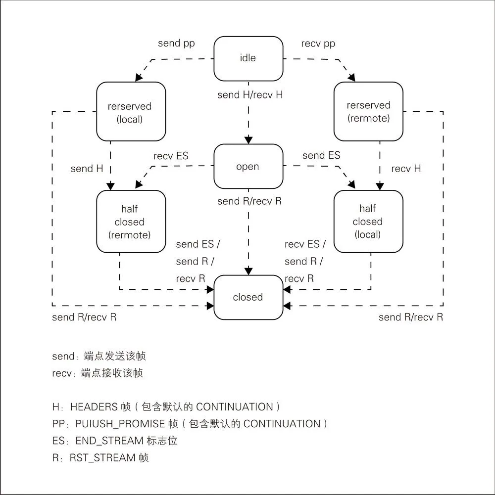
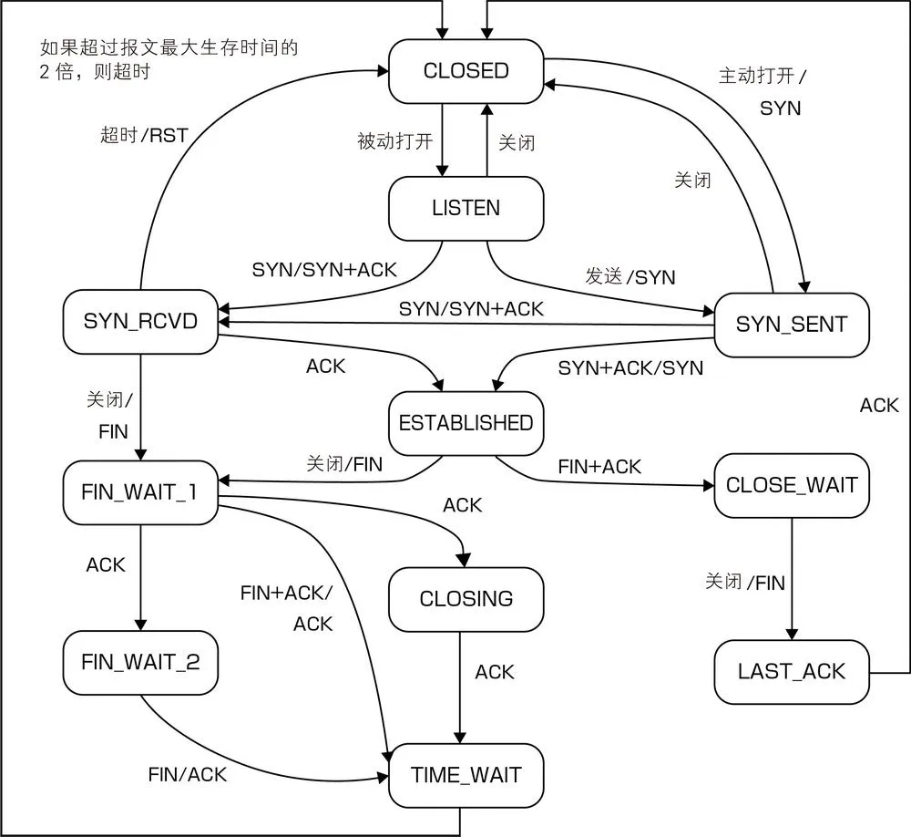
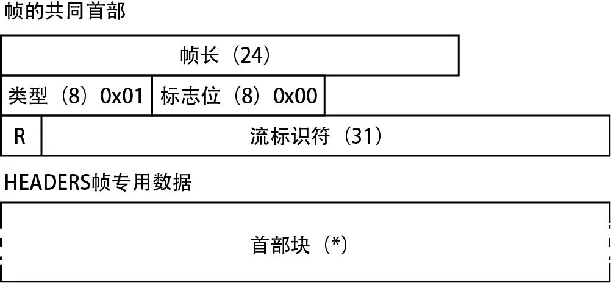
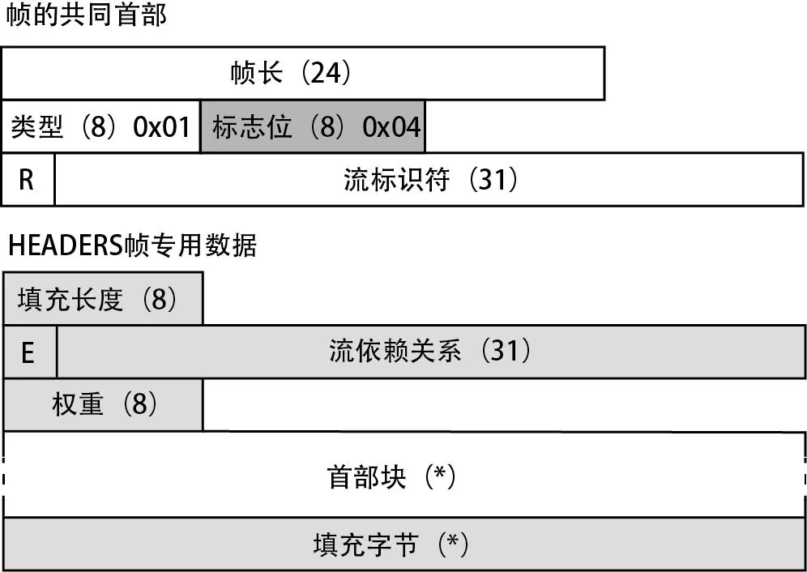
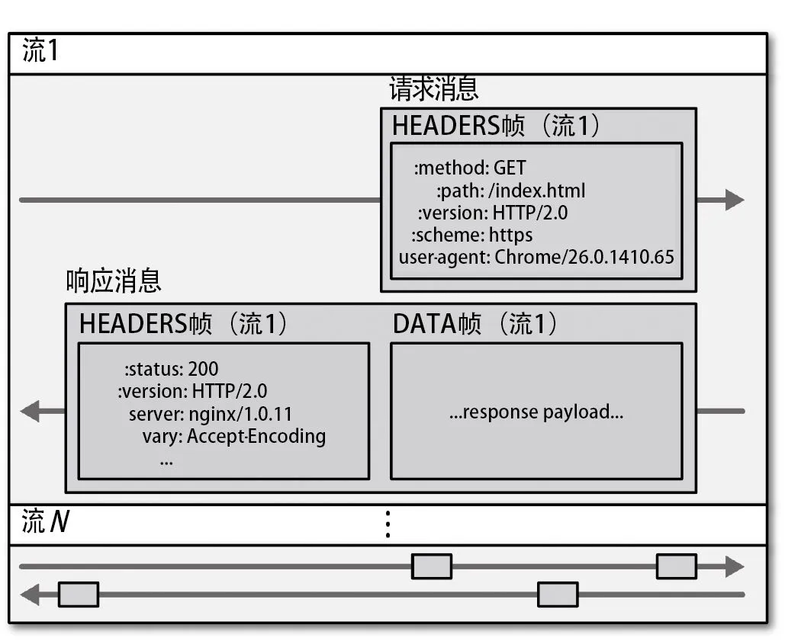
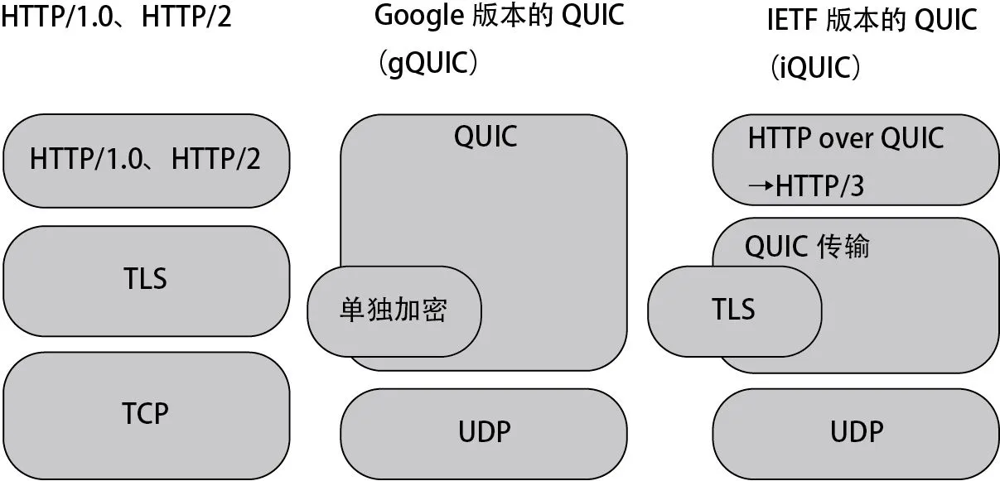
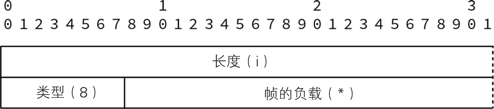

# 第7章HTTP-2和HTTP-3的语法：重新定义协议(1)

本章将介绍 HTTP/2、HTTP/3 以及在它们前后制定的各种新一代协议。

除此之外，本章还将介绍在 HTTP/1.1 中并未实现的 WebSocket 和 WebRTC，它们用来实现高速的双向通信、P2P 连接和符合动画特性的通信等，可以说进一步扩展了 Web 的可能性。

## 7.1　HTTP/2 和 HTTP/3 中未变化的内容

到 HTTP/1.1 为止的协议是参考电子邮件或新闻组制定的，使用文本表示，而 HTTP/2 和HTTP/3 实现了巨大的飞跃。这是因为网站中使用的图像、CSS 和 JavaScript 等的文件的数量和大小都不断增加，我们需要更高速的传输结构。HTTP/2 和 HTTP/3 并不是一点一点地修改功能，而是将所有的元素分解，并从零开始实现，以满足这个需要大量资源的时代的要求。

为了降低通信开销，HTTP/2 和 HTTP/3 变为二进制协议，添加了符合 HTTP 特性的首部压缩等技术。另外，HTTP/2 和 HTTP/3 中还模拟了 TCP 层的处理，引入了高级的控制结构。

另外，前面介绍的方法、首部、状态码和主体等 HTTP 提供的 4 个基本元素并没有变化，因此，虽然从直接读写 HTTP/2 和 HTTP/3 的协议的客户端和服务器来看发生了很大变化，但从浏览器的前端和 Web 应用程序看来，它们与 HTTP/1.1 并没有什么差别。

```
例如，使用了 Cache-Control 首部的缓存结构直接参照了同一时期一起更新的 RFC
```

7230~RFC 7235。这些 RFC 汇集了 HTTP/1.1 最主要的内容，因此，本书前面的介绍都不会浪费。这些 RFC 还考虑了 HTTP/2，为共享语义部分做好了准备。HTTP/3 也是如此。

另外，HTTP/2 的出现并不代表我们不再需要 HTTP/1.1，HTTP/3 的出现也并不代表 HTTP/2不再有用武之地。在只能使用 TCP 的环境中，要想达到最快的速度，还是需要使用HTTP/2。

在多个微服务协作的情况下，依然要使用 HTTP/1.1 进行通信。HTTP/3 通信必须加密。另外，在很多服务器中，如果没有 TLS，就无法启用 HTTP/2。在创建大型网络系统时，到负载均衡器等边缘部分的通信使用 TLS 加密，但负载均衡器内部的通信并不使用 TLS，这样就变成了使用 HTTP/1.1 的通信。

HTTP/2 和 HTTP/3 的目的都是实现高速的互联网通信，所以有时也想在服务内部的通信中也使用 HTTP/2 等，但其实只要不会并行下载大量资源，并且充分利用 Keep-Alive，即使使用HTTP/1.1，也不怎么影响本地区域中的通信速度。

## 7.2　HTTP/2

HTTP/1.1 的使用时间很长。HTTP/1.1 于 1999 年实现标准化，到 2015 年 HTTP/2 实现标准化，中间经过了 16 年。在不断出现新规范的计算机领域，这可以说是一个特例。HTTP/2是久违的一次大幅更新。首先在数据形式上，它与 HTTP/1.1 以及之前的规范有很大差别。

HTTP/2 的 RFC 7540 和 RFC 7541 也只是对二进制通信格式进行了说明。例如，使用了

```
Cache-Control 首部的缓存结构直接参照了同一时期一起更新的 HTTP/1.1 的        RFC
```

7230~RFC 7235。

### 7.2.1　SPDY

在介绍 HTTP/2 的历史时，一定会涉及 SPDY。SPDY 是 Google 开发的 HTTP 的替代协议，它基本等同于 HTTP/2。

SPDY 在 Google 的服务内部使用，Google Chrome、Firefox、Internet Explorer 和 Safari 中也都进行了实现。Chrome 于 2010 年实现了 SPDY，之后 SPDY 不断升级，于 2014 年将接力棒交给了 HTTP/2，完成了自己的使命。2016 年 5 月发布的 Chrome 51 不再支持SPDY，转而支持 HTTP/2。

Google 开发 SPDY 是为了进一步提高 HTTP 的传输速度。SPDY 对于不同的网站结构有不同的效果，传输速度最低提高 30%，最高可以提高到原来的 3 倍以上。由于并行访问时发生阻塞的次数有所减少，所以大量传输较小的文件时速度更快。


- Google 的优势在于，它拥有大规模流量的 Web 服务和市场占有率较高的浏览器。因此，即使协议仅在公司内部的服务和浏览器之间有效，也可以进行大规模的验证实验。

在 HTTP/1.1 时代，创建高速网站的技巧是，将网站的 JavaScript、CSS 和图像等汇总到尽量少的文件中。在 SPDY 和 HTTP/2 出现之后，通过汇总文件来提高通信速度的效果就没有那么明显了。


- 虽说首部进行了压缩，但其大小也不是零，而且文件越小，数据包的空间就越容易浪费 1，因此汇总文件能够减少通信量。而如果细分文件，在修改时缓存就容易有效。这两种做法各有利弊，效果差别不是很大。

### 7.2.2　HTTP/2 的改进

HTTP/2 在如下几个方面改动较大，其目的是提高通信速度。

- 修改为使用流（类似于 HTTP/1.1 中的管道技术）来多路收发二进制数据

- 实现了流内部的优先级设置，以及从服务器端进行数据通信的服务器推送技术

- 首部可以进行压缩

除此之外，在制定 TLS 之后，计算机速度提高，受此影响，一些密码套件在短时间内就可以被破解，在 HTTP/2 中，这些密码套件不再被推荐使用。这也是 HTTP/2 的一个较大的改动之处。HTTP 和 TLS 相互关联，进行版本升级。

从 TCP 套接字的层面来看，从 HTTP/1.0 到 HTTP/1.1 进行了如下改进（表 7-1）。

表 7-1　TCP 套接字的改进

功能

- 效果

```
缓存（max-age）
```

- 取消通信本身

```
缓存（ETag、Date）
```

- 如果没有修改，则取消主体的发送

Keep-Alive

- 减少每次访问的连接时间（1.5 TTL）

压缩

- 削减响应的主体大小

在一次通信中会多次传输数据包来建立连接。另外，用数据大小除以通信速度得到的时间就是通信时间。如果有通信等待，则完成通信所花费的时间就会变长。

HTTP/1.1 之前的高速化方法是在通信的各处实现高速化。HTTP/2 中新增了之前未涉及的首部压缩，以及虽然实现了标准化但未广泛使用的管道技术的代替实现等。

- 在第 4 章介绍管道技术时曾提到过，由于存在向前兼容的问题，管道技术的使用存在限制。

HTTP/2 是与以往完全不同的协议，反而不容易产生向后兼容的问题。HTTP/2 并不是切换HTTP 的文本协议内部的版本，而是使用在 TLS 内部创建的协议选择功能（第 4 章介绍过的ALPN），切换整个通信方式。HTTP/2 是与 HTTP/1.1 完全不同的协议，因此不会出现管道技术那样的问题。

### 7.2.3　使用流实现高速通信

相较于之前的 HTTP 协议，HTTP/2 最大的变化是，协议由基于文本的形式改为基于二进制的形式。数据以帧为单位进行发送和接收。在 HTTP/1.1 及其之前的协议中，每个请求都拥有自己的 TCP 套接字，因此，针对一个源服务器，会有 2~6 个 TCP 连接并行执行。

在 HTTP/2 中，每个 TCP 连接的内部会创建一个名为流的虚拟 TCP 套接字来进行通信。使用帧中附带的标志位可以轻松地创建和关闭流，并且不需要像普通的 TCP 套接字那样握手。因

- 2

此，只要流 ID 的数值和 TCP 的通信容量允许，就能并行执行上万个连接

- 。

流和 TCP 分别定义了状态机，二者的模型非常相近，如图 7-1 和图 7-2 所示。



- 图 7-1　HTTP/2 的流连接的状态机



- 图 7-2　TCP 的状态机

```
在 TCP 中，从关闭状态开始 LISTEN，当客户端有连接请求时进入 ESTABLISHED（可以通
信）状态。HTTP/2 的流最开始处于和        LISTEN 基本相同的 idle 状态，在接收到首部后
会立即变为可以通信的 open，于是通信步骤就变少了。
```

帧的首部固定为 9 字节。表 7-2 所示为帧的各个元素。

表 7-2　帧的各个元素

元素

- 大小含义

```
Length
```

- 24帧的负载的大小（共同首部除外）

```
Type
```

- 8帧的类型（续）

```
Flags
```

- 8

```
R
```

- 1保留位（固定为 0）

```
Stream Identifier
```

- 31流的标识符。如果数值相等，则为同一个流的

```
其中需要注意的是 Stream Identifier。HTTP/2 中创建流来模拟套接字，就算查看 TCP
套接字上的数据，也不会发现流的实体。流的接收方会将持有相同        Stream
Identifier 的一连串帧组合到一起，作为“同一个流的数据”处理。
Stream Identifier 为奇数时，表示流由客户端发起；为偶数时，表示流由服务器发起；
```

值“0”被保留下来，如果使用它，就会发生错误。

HTTP/2 中帧的类型如表 7-3 所示。

表 7-3　帧的类型

类型

- 发送内容可选的发送内容

```
HEADERS
```

- 首部依赖流、优先级、排

```
DATA
```

- 数据

```
PRIORITY
```

- 依赖流、优先级、排他标志位

```
RST_STREAM
```

- 错误码

```
在 SETTINGS 中可以修改首部压缩表的大小、是否允许推送、最大并行流数、初始窗口大
```

小、最大帧的大小、首部列表的最大值等。HTTP/2 允许不具备向后兼容性的功能扩展，但这

```
时要使用        SETTINGS 来选择性加入。
如果共同首部的 Flags 中指定“存在该数据”的位为 ON，那么数据大小信息就会按确定的顺序
添加到帧中。如果位为        OFF，那么整个数据就会被省略，从而防止不需要的数据占用数据
```

长度。

```
例如，HEADERS 帧中只需要首部本身的数据，因此最小的帧结构如图 7-3 所示。
```



- 图 7-3　最小的 HEADERS 帧

如果类型后面的 8 位是下面的标志位，首部块的前面指定的数据存在，则解析器就会解析二进制数据。

- PADDED 标志位（0x08）用 8 位表示填充长度，并按此填充长度填充字节。PRIORITY 标志位（0x20）添加 40 位的数据，其中 Dummy 占 1 位，流依赖关系占 31 位，权重占 8 位。

```
对所有可以设置的标志位进行设置时的帧格式如图 7-4 所示。各个标志位可以设置为 ON 或
OFF。如果仅添加 PRIORITY        标志位，就会变为在最小的结构中再添加 40 位数据这样的
```

帧格式。

```
HEADERS 帧和 CONTINUATION 帧持有首部结束标志位，HEADERS 帧和 DATA        帧持有流
结束（END_STREAM）标志位（0x01）。如果这些标志位为        ON，则表明首部和流到此结
束，之后不会再有数据了。还有一个表示不再有其他首部（END_HEADERS）的标志位
（0x04）。这些标志位用来改变控制，并不会影响帧格式。不过，CONTINUATION        帧可
能会跟在持有流结束标志位的 HEADERS 帧之后。由于 CONTINUATION 帧不持有流结束标志
位，所以在有大量首部但没有主体的情况下，通过        HEADERS 帧持有结束标志位，可以表
```

示不存在主体。



- 图 7-4　设置标志位后的 HEADERS 帧

```
4.7 节介绍过 Chunk 方式使用首部指示开始 chunked 编码，用换行符将数据大小和数据隔开
```

来发送正文，而 HTTP/2 中没有这种方法。这种发送方法可以通过帧结构来实现，将正文分割成多个帧来发送即可。

```
另外，帧的类型和 SETTINGS 的各项汇总在 IANA 的 Hypertext Transfer Protocol version 2
```

(HTTP/2) Parameters 中。在从 HTTP/2 的规范制定到笔者编写本书时，仅新增了一个用

```
于在 HTTP/2 中执行 WebSocket 的 SETTINGS 的值。今后对协议进行的比较小的扩展都会添
```

加到这里。

### 7.2.4　HTTP/2 的应用程序层

HTTP/1.0 只是一个搬运数据的容器。虽然之后它也开始包含 Keep-Alive 和管道技术等影响下一层的通信处理的功能，但正如本书中多次强调的那样，方法和路径、首部、主体、状态码这几个基本元素是不变的。不过，方法和路径、状态码以及其中包含的协议版本都类似于首部字段，嵌在首部中。

HTTP/2 中也删除了一些信息。首先是状态码中的原因文本删除了。虽然在上层的应用程序看来功能并没有什么变化，但实现上只有首部和主体。另外，在 HTTP/2 之前，服务器的响应中

```
还包含版本信息，比如        HTTP/1.1 200 OK，而这在 HTTP/2 中也删除了。不过，无论
```

是 HTTP/1.1 和 HTTP/2，还是接下来要介绍的 HTTP/3，首部的含义都是不变的。

HTTP/1.1 是文本协议。在查找首部结尾时，服务器需要逐字节读取，直至找到空行。由于还存在错误处理等，所以服务器只能逐步进行处理，很难实现并行处理。HTTP/2 是二进制协议（图 7-5），响应的开头是帧的大小。在 TCP 套接字层，数据会以帧为单位分割，因此接收方可以立即清空 TCP 套接字的缓冲区，快速地向通信对象请求接下来的数据。



- 3

- 3图 7-5　HTTP/2 的二进制通信（引自《Web 性能权威指南》）

```
主体大多由 Content-Length 确定大小，在使用 Chunk 形式的情况下，由于记述了大小，
```

所以读取一个请求的处理成本不会发生大的变化。不过，当存在多个请求时情况就不一样了。在 HTTP/1.1 中，即使是 Chunk 形式，在正在处理一个请求时也不能处理其他请求。即使采用 6 个 TCP 会话进行处理，如果存在 6 个繁重的响应，其他通信也无法完成。在HTTP/2 中，Chunk 被分割为帧，帧与帧之间是互相独立的，因此，即使中间插入其他的帧，也不会出现问题。

### 7.2.5　流量控制

HTTP/2 相当于四层网络模型中的应用程序层，但其特征是内部持有与传输层相近的功能。在HTTP/2 中实现了流量控制（flow control）这一与 TCP 套接字基本相同的功能。当然，TCP会进行包的顺序控制和重传处理，因此实现起来非常简单。TCP 套接字和 HTTP/2 的流之间

- 4

的关系类似于操作系统线程（native thread）和绿色线程

- （green thread）之间的关

系。

流量控制是为了高效传输流而使用的通信数据量的控制处理。如果通信时使用的机器之间的通信速度相差很大，当速度快的机器将大量的包发送给速度慢的机器时，处理就无法顺利完成，流量控制就是用来防止这种情况的。实现流量控制的具体方式是对通信目标的窗口大小进行管理。窗口大小就是能够接收数据的空缓冲区的大小。默认的初始窗口大小是 64 KB。发送端在接收端的缓冲区可容纳的最大范围内发送数据。当接收端处理完接收到的包而空出缓冲区

```
时，便会使用 WINDOW_UPDATE        帧，将新空出的缓冲区的大小返回给发送端。发送端在
```

收到消息后，发送相应大小的数据。

我们在开车路过十字路口或者铁路道口时，必须在停止线前或者栏杆后面等待，直到有足够的空间通过。而如果强行穿过，就可能酿成重大事故。流量控制的作用与之类似。

```
可以使用 SETTINGS 帧来调节初始窗口大小、最大并行流数、最大帧的大小、首部列表的最
```

大值等与速度相关的参数。

### 7.2.6　服务器推送

本章开头介绍过，HTTP/1.1 和 HTTP/2 在语义上是一样的，不过 HTTP/2 中新增了服务器推送功能。通过服务器推送，优先级较高的内容就能够在客户端请求之前发送。不过，与实现WebSocket 那样的双向通信的结构不同，服务器推送只是用于 CSS、JavaScript 和图像等构成 Web 页面的文件的下载。客户端在发送请求之前，是无法检测到服务器进行了推送的。推送的内容会提前放入缓存中，之后，如果客户端请求该文件，文件就会像已经下载好了一样呈现出来。当在聊天软件或者 Google Spreadsheet 中同时编辑时，不可以从服务器发送其他用户输入的内容。

### 7.2.7　使用预加载优化资源获取操作

HTTP/2 拥有优先级、服务器推送等下载优化功能。在只需进行一次 JSON 通信的 Web API中，这些功能是没有用的，但当存在脚本、CSS、图像以及和 API 访问等相关的文件时，就需要用到一些可以快速完成下载的功能。

- 服务器推送

- 优先级

还有一些功能本书中没有介绍，这里笔者一起介绍一下它们之间的关联。

- 资源提示

- 预加载提示

- 预先做好通信准备

效果最好的是服务器推送。由于在请求之前就开始发送数据，省略了一次客户端向服务器发送请求的通信，所以效果最为显著。

在未进行服务器推送的普通情况下，客户端会加载 HTML 文件，选择其中要使用的文件，开始发送请求。

另外，在实际的通信中，在建立 TLS 连接之前需要做很多准备。在获取 HTML 的服务器与其

- 5

他资源（如 Web 字体

- 、基于 XMLHTTPRequest 或 Fetch API 的对外部 API 的访问）

的服务器不同的情况下，在 HTTP/1.1 和 HTTP/2 中会存在 TCP 层的握手等开销，如果未预

```
先交换密钥，那么握手时间也不会为 0 RTT。我们可以使用        <link> 标签或 Link 首部
```

来指示提前进行这些工作。

```xml
这些标签与随后介绍的 prerender 都记述在资源提示中。
<!--提前进行 DNS 名称解析、TCP 握手和 TLS 握手 -->
<link rel="preconnect" href="//cdn.××××.com" crossorigin>
Link: <https://fonts.gstatic.com>; rel=preconnect; crossorigin
```

预加载是预先通知需要文件的方法。前面介绍过，HTTP/1.1 中是使用 Chunk 先发送 HTML

```
的首部来优化通信的，这也可以通过 Link 首部或        <link> 标签来实现。
Link: <https://××××.com/other/styles.css>; rel=preload; as=style
```

使用该功能，能够在开始下载 HTML 之前就开始下载相关资源。另外，在 nginx 1.13.9 中将

```
http2_push_preload 指令设为 ON，或者在 H2O        中将 http2-push-preload 指令
设为 ON，就可以升级为服务器推送。虽然只是预加载的草案，但其中明确表示 HTTP 服务器
也可以进行服务器推送。如果在        Link 首部中加上 nopush，则可以防止升级为服务器推
```

送。

另外，预加载和服务器推送本身只是获取文件，之后有实际使用的声明时才会进行处理（如果是 JavaScript 文件，则执行）。代码清单 7-1 中的 HTML 文件中会预加载样式表和 JavaScript文件。

代码清单 7-1　预加载与实际使用的声明的区别

```xml
<head>
   <meta charset="utf-8">
   <title>JS and CSS preload example</title>
   <!-- 预加载 -->
   <link rel="preload" href="style.css" as="style">
   <link rel="preload" href="main.js" as="script">
   <!-- 实际使用 CSS -->
   <link rel="stylesheet" href="style.css">
</head>
<body>
   <h1>bouncing balls</h1>
   <canvas></canvas>
   <!-- 实际使用 JavaScript -->
   <script src="main.js"></script>
</body>
```

预加载对 CSS 中定义的 Web 字体等能起到作用。读取并解析 CSS，然后向服务器发送请求，加载字体文件。由于读取很费时间，所以预加载是值得的。

与服务器推送不同，预加载还可以用于其他域的资源。预加载可以预先声明跳转页面中需要的资源（虽然最开始的页面不需要），在 Google Chrome 中，如果 3 秒内未实际进行加载，就会发出警告。

还有一种预渲染的方法，如果知道要跳转到哪个页面，浏览器就可以预先获取并渲染这个页面。

```xml
<link rel="prerender" href="//××××.com/next-page.html">
```

当然，这些方法并不是万能的，因为要跳转到的页面基本上是不固定的。在 HTML 非常小、使用 JavaScript 即可大致完成页面的单页面应用中，即使阻塞浏览器显示，也不会出现什么问题。由于单页面应用的页面跳转并不会获取 HTML 文件，仅使用 JavaScript 来完成页面，所以在这种情况下预渲染就不奏效了。

```xml
Akamai 公司和 Google 公司的员工目前在探讨 Priority Hints 规范。通过在        <link>、
、<script> 等标签中加上 importance        属性，就可以修改 HTTP/2 的优先级。

在默认情况下，CSS 按 highest 的优先级下载，JavaScript 按 high 的优先级下载。预读
取的优先级是 low。我们可以使用        Priority Hints 来改写这些优先级。
```

除了 JavaScript 和 CSS 的下载，执行的优先级也会影响用户体验。如果加上

```xml
async/defer，浏览器就会在后台进行下载，而不阻塞显示。在下载完成后，async 会阻塞
显示，立即执行文件，而 defer 会按照        <script> 标签的顺序来执行。不过，下载的优
先级是 low。
<script src="script1.js" async></script>
<script src="script2.js" defer></script>
```

为了正确设置服务器推送和优先级，我们需要充分理解应用程序的特性。虽然笔者介绍的是HTTP 协议的相关功能，但这些功能也与 HTML 的标签相关。提高某些处理的优先级，就会降低其他处理的优先级。针对不同网站的特性，效果也不一样，使用不当反而会带来不好的效果，因此要慎重使用。

### 7.2.8　使用 HPACK 压缩首部

首部采用 HPACK 方式进行压缩。现有的许多压缩算法在压缩数据时会创建字典和字典的键的数组。相同的长句越多，字典的项目就越少，同一个键被多次使用，这样一来压缩率就会提高。与我们平常使用的文件压缩算法不同，HPACK 持有字典。由于 HTTP 首部中经常出现固定的名称和结果，所以如果将它们放到外部字典中，压缩后的数据就会变小。HTTP/2 中使用静态表来预先存储频繁出现的首部名称和首部值的组合。

此外，在同一个连接中出现的 HTTP 首部会被加上索引而存储到动态表中。当这个 HTTP 首部再次出现时，就可以使用其索引值来表示，因此能够以较小的 HTTP 首部进行发送。

在 HTTP/2 中，之前未使用首部处理的一些项目开始作为模拟首部保存在首部中了。

```
:authority
```

- 请求目标的主机和端口。

```
:method
```

- 方法。

```
:scheme
```

- 方案（HTTP/HTTPS）。

```
:status
```

- 状态码。

```
另外，像 :status = 200 这种首部与值的常用组合会预先注册到静态表中，就该示例来
```

说，其索引值是 8。

- 《Web 性能权威指南》中提到，为了缩减大小，HPACK 只发送首部发生改变的部分，但其实这是标准化之前的 Reference Set 功能。该功能比较复杂，并且压缩效果不是很好，因此统一改为使用字典。

## 7.3　HTTP/3

SPDY 成了 HTTP/2 的基础，而 HTTP/3 是在 QUIC 标准化的过程中形成的。本节将介绍从QUIC 到 HTTP/3 的演化过程。

### 7.3.1　QUIC

HTTP/2 在与 HTTP 同一层的 TCP 套接字上进行了实现，但 Google 为了进一步提高通信速度，在 UDP 套接字上提供了 QUIC 协议。TCP 在连接开始时需要进行多次通信。另外，TCP会修正错误和排列顺序，但为此需要返回相应的接收通知等，高级功能的性能会有所降低。

UDP 是比 TCP 轻量的协议。UDP 中去除了 TCP 的重传处理、拥塞控制等高级功能，在第一次连接时就可以轻松地执行协商处理。QUIC 中实现了很多 TCP 的功能，比如包丢失时的重传处理、通信线路拥塞（拥挤、性能低下的状态）时的控制处理等。

在普通的 HTTPS 通信中，在执行完 TCP 握手之后，还要执行 TLS 握手，多次交换包。QUIC 对二者进行统一，能够以较少的通信次数实现连接。具体来说，就是在第一次连接时，通过往返一次通信进行协商，当再次连接时，无须协商，以 0 RTT 实现重传。另外，当智能手机从 3G/4G 线路切换为 Wi-Fi 时，连接也变得非常顺畅。

除了再次连接和首次通信时的开销较少，QUIC 还有一个优点，那就是通过整理 HTTP/2 执行的处理与 TCP 执行的处理，能够简化两层之间重复的任务。例如，将 TCP 和 HTTP/2 拥有的基本相同的流量控制功能统一。在对包的顺序进行排列时，TCP 会对所有包进行排列，而如果在这一层发生通信错误，所有的通信都会停止，所以 HTTP/2 以帧为单位，根据需要对包进行排列。

### 7.3.2　向 HTTP/3 迈进

Google 在 2013 年发布了 QUIC，并在 2015 年提出了标准化的最初方案。之后，在以最初的实现为基础进行讨论的过程中，规范发生了变化，Google 版本与 IETF 版本逐渐出现了差异。因此，为了对二者进行区分，Google 版本的 QUIC 称为 gQUIC，IETF 版本的 QUIC 称为 iQUIC，其中的 HTTP over QUIC 决定命名为 HTTP/3。

与 SPDY 一样，QUIC 也嵌入到了 Chrome 中。Google 表示，用户在使用 Google 的服务时，有一半的请求是使用 QUIC 来执行的。QUIC 目前正在申请实现标准化。

### 7.3.3　HTTP/3 的层

与到 HTTP/2 为止的协议相比，Google 实现的 QUIC 是一个大型协议，汇总了 HTTP 层、加密层，以及下面的由 TCP 执行的重传处理等的层。之后，IETF 版本的 QUIC（iQUIC）在讨论过程中进行了各种修改，对 Google 版本的 QUIC（gQUIC）进行了很大改进。在HTTP/3 中，加密由单独进行变为直接利用 TLS 1.3 的握手或密码套件进行。HTTP/3 大致分为两层。

- QUIC 传输：流控制等 TCP 的向上兼容层（支持并行）和 TLS 1.3

- HTTP over QUIC：从 HTTP/2 的功能中去掉与 QUIC 传输重复的功能，将 HPACK 换为QPACK

其中，上层的 HTTP over QUIC 协议被内定为 HTTP/3（图 7-6）。



- 图 7-6　HTTP over QUIC 协议被内定为 HTTP/3

QUIC 传输协议

QUIC 传输协议以 UDP 为基础，实现了重传处理、拥塞控制和加密等。简单来讲，就是替换了 TCP 和 TLS 层。

TCP 协议确保一个连接中的所有包都排列好进行发送。QUIC 会建立会话，其中有多个通信的伪会话（流），QUIC 确保流的内部的顺序，但不确保流之间的顺序。这样一来，当一个流失败时，就不会影响到其他的流。

QUIC 规范更适用于 21 世纪的网络。具体来说，即使是网络路径会动态变化的移动通信，比如从 4G 或 5G 切换到 Wi-Fi 来高速传输数据，在再次连接时也不会发生滞后。

如表 7-4 所示，到 HTTP/2 为止的协议使用的都是名为“五元组”的 5 种信息来识别连接。如果网络路径发生变化，就会识别为其他连接。

表 7-4　识别连接的方法

协议

- 识别连接的方法

到 HTTP/2 为止的协议

- 源 IP 地址、目的 IP 地址、源端口、目的端口、协议

QUIC 传输协议

- 连接 ID

而 QUIC 在连接时会发行连接 ID，并基于该 ID 进行流的通信。即使通信路径发生变化，连接ID 也保持不变，因此，无论什么样的通信路径混杂在一起，QUIC 都可以判断出属于同一连接的包，从而保持连接。这样一来，下层的变化就不会影响到上层了。

QUIC 可以对每个流进行流程控制，或者改变窗口大小。虽然实现方式不同，但可以说非常接近 HTTP/2 的概念。

QUIC 与 HTTP/2 的不同之处在于，它没有定义不使用 TLS 的协议。原本 HTTP/2 的许多库就仅在使用 TLS 时有效，这一点也直接被纳入规范。另外，QUIC 只有生成握手主密钥的部分直接使用 TLS，用于握手的信息交换则使用 QUIC 传输的帧，因此 QUIC 与 HTTP/2 之前的协议完全不同。虽然可使用的密码套件以 TLS 1.3 为基准，但一些弱算法不再有效。

HTTP 层与传输层是分开的，因此人们也期待 QUIC 可以用于 HTTP 之外的其他应用程序。不过，现在 QUIC 的主要任务是聚焦 HTTP 实现标准化。Google 已经在应用程序 duo 中实现了VP9/SVC over WebRTC over QUIC 的组合，特别是在 WebRTC 方面，QUIC 发挥了较大作用。

### 7.3.4　使用 HTTPAlternativeServices 进行升级

到 HTTP/2 为止，都是在 TCP 上建立 TLS 连接，使用 ALPN 来执行协议的协商。HTTP/3 不支持该操作，因此我们需要采用其他方法。一种方法是基于 RFC 7838 通知客户端可以用HTTP/3 再次连接。该 RFC 表示同一个服务可以在不同的源上运行。由于这时可以指定协议等，所以我们可以借此将客户端引导到支持 HTTP/3 的服务上。

```
Alt-Svc: h3=":50781"
```

现在，表示 HTTP/3 的公认端口还未确定（在 Google 的 QUIC 中是 UDP/443 端口），因此客户端还没有使用 HTTP/3 进行连接。尽管如此，我们也可以进行一些改善，比如保存连接过的服务，在再次连接时使用 HTTP/3 进行连接，或者像 HSTS 那样，由浏览器厂商创建可进行 HTTP/3 连接的数据库等。

HTTP/3

由于 QUIC 传输端与 HTTP/3 是分开的，所以与 HTTP/2 相比，HTTP/3 比较简单。

整体的区别如下所示。

- 流 ID 的位数从 31 位增加到 62 位，大大降低了溢出的危险

- 各个帧中不再持有流 ID 和标志位

- 没有了根据标志位进行增减的字段

- 首部压缩的算法从 HPACK 变为 QPACK

帧的结构变得非常简单，共同首部的长度变短了许多（图 7-7）。



- 图 7-7　HTTP/3 中帧的结构

长度表示除去 1 字节的类型字段后的负载长度，开头 2 位用来区分数据长度，表示 1~4 字节的可变长度。假如开头 2 位是 00，那么剩下的 6 位最大可以表示 63 字节。当开头 2 位是 11时，数据长度是 4 字节，有效位数是 62 位，可以表示 4 EB 的长度。

没有了关于流控制的帧，整体变简洁了。

HTTP/3 中帧的类型如表 7-5 所示。

表 7-5　帧的类型

- h2h3

类型

- 数据区别

```
HEADERS
优先级移到 PR
```

- √√首部

```
DATA
```

- √√数据无填充字节

```
PRIORITY
```

- √√依赖流、优先级和排他标志位仅在控制流上传

```
RST_STREAM
```

- √错误码

```
SETTINGS
```

- 多个标识符（16 位）和设置值（32 位）的组√√仅在连接的最开

```
PUSH_PROMISE
```

- 流 ID√√服务器请求使用

```
PING
```

- 8 字节的数据√

```
GOAWAY
```

- 最后的流 ID√√仅在从服务器到

```
WINDOW_UPDATE
```

- √窗口大小

```
CONTINUATION
HEADERS/PUSH_PROMISE 的后续数据
```

- √

```
MAX_PUSH_ID
```

- 客户端可接收的 Push ID 的最大值√仅在从客户端到

```
CANCEL_PUSH
```

- √拒绝接收服务器推送

```
DUPLICATE_PUSH
```

- √表示与多个客户端的请求相关

QUIC 传输可以确保流的内部的包的顺序，但不能确保流之间的包的顺序，因此 HTTP/3 不再使用要求发送顺序始终相同的 HPACK，转而采用其他方式。QPACK 与 HPACK 并没有太大区别，都使用索引来引用静态表和动态表中的数据。HPACK 在动态表中插入首部的键，并通过在实际的请求中设置索引来降低通信量。QPACK 仅牺牲一点压缩率，在插入时添加“插入到何处的索引”这一信息，就能防止表内的记录的顺序受到插入顺序的影响。当引用表中尚不存在的索引时，会产生等待时间，因此，队头阻塞的情况并不会完全消失，有时还会发生。

- 本书并未详细介绍二进制协议，感兴趣的读者可以参考前言中提到的《从包的设计看 QUIC》，里面介绍得比较详细。

[1]：TCP 的最大分段大小约为 1500 字节。在使用巨型帧的情况下，最大分段大小会更大，约为 9000 字节。[2]：流 ID 的数值为 31 位，其中第 1 位是用来确定收发信息的方向的，因此 HTTP/2 大约可以并行执行 10 亿次连接。[3]：Ilya Grigorik 著，李松峰译，人民邮电出版社 2013 年 9 月出版。——译者注[4]：在用户空间（不是内核空间）创建的模拟线程。Go 语言的 goroutine 就相当于绿色线程。[5]：这是用来在网页上显示的字体，使用 HTTP 下载。在下载完成之前，网页使用默认字体显示，下载后即可使用指定字体显示。

- 因此，尽快下载会改善用户体验。不过中文和日语字体文件会比较大，下载需要花费一些时间。
