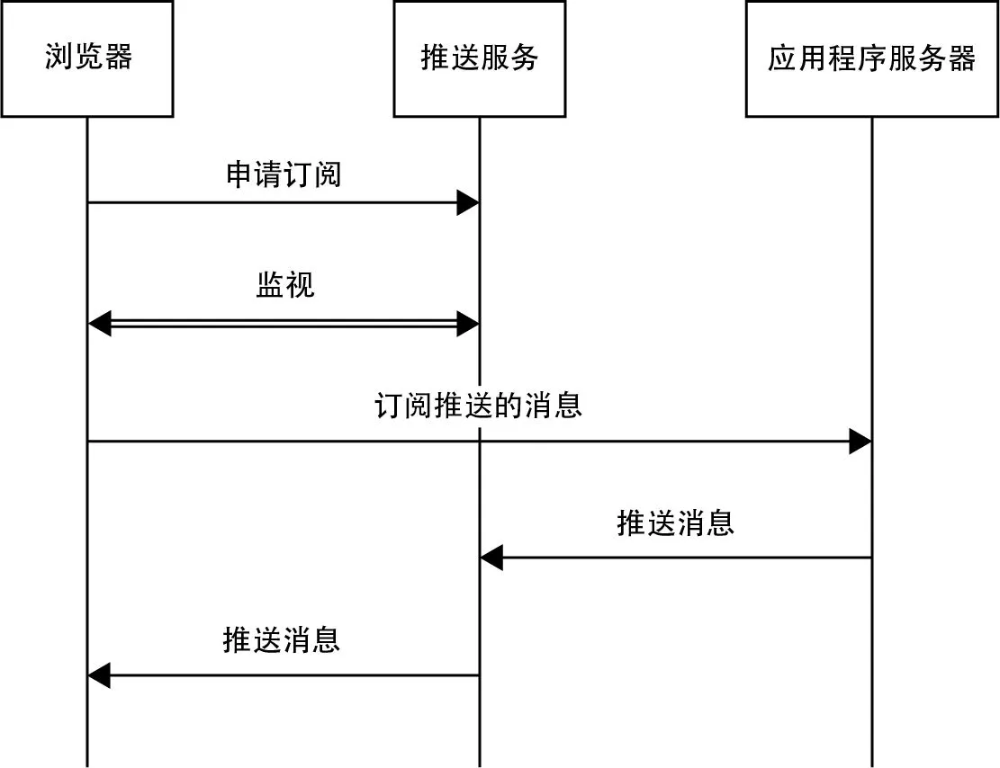

# 第7章HTTP-2和HTTP-3的语法：重新定义协议(2)

## 7.4　用于 JavaScript 的新的通信 API

Web 服务已经成为社会的基础设施，使用了 Ajax 等技术的动态交互式网站被广泛使用。为了让不断扩展的规范完美适配整个 Web 生态系统，重新设计了 XMLHttpRequest 的 Fetch API应运而生。另外，仅通过客户端的简单的 HTTP 请求难以高效进行实现的情况也在不断增加。为了解决该问题，出现了 Server-Sent Events、WebSocket 和 WebRTC（Web Real-TimeCommunication，网页即时通信）。

- Fetch API重新设计了客户端发出的 HTTP 请求。Server-Sent Events用于实现服务器到客户端的通信。WebSocket用于实现高效的双向通信（会修正错误）。WebRTC基于 UDP 实现 P2P 通信（也可以是经由服务器的通信）中的视频、声音和数据的通信。

### 7.4.1　FetchAPI

与 XMLHttpRequest 一样，Fetch API 也是执行服务器访问的函数。Fetch API 用于JavaScript，其特征如下所示。

- 与 XMLHttpRequest 相比，易于控制对源服务器之外的访问等 CORS 处理

- 遵循 JavaScript 的现代异步处理的写法——Promise

- 能够控制缓存

- 能够控制重定向

- 能够设置 Referer 策略

- 能够从 Service Worker 内部使用

虽然有人说 Fetch API 是底层 API，而且 W3C 的规范中也将其描述为底层 API，但这并不代表它能在套接字层进行处理。利用 Fetch API 控制缓存等也不是不可能，但存在各种安全方面的限制，比如有些首部在收发数据时存在限制、必须严格遵守同源策略等，导致 FetchAPI 依然是限定于 HTTP 请求的沙箱。Fetch API 无法用于从浏览器通过 ssh 连接外部服务器、发送 git 协议、开发 Web 服务器等。


- 详细的使用方法将在第 11 章介绍。

### 7.4.2　Server-SentEvents

Server-Sent Events 是 HTML5 的一个功能，在技术上以 HTTP/1.1 的 Chunk 形式的通信功能为基础。Chunk 是将庞大的文件内容分解成多个块来发送的通信形式。利用 Chunk 形式的“一点一点发送”的特性，我们可以让服务器在任意时间点将事件通知给客户端。2014 年，GREE 在聊天功能的后端中采用了 Server-Sent Events。

HTTP 是一个客户端 / 服务器模型，客户端将请求发送给服务器，服务器对请求进行响应。通信何时开始由客户端决定。客户端执行一次请求，服务器就会返回一次该请求所对应的响应，这是 HTTP 最基本的结构。

第 5 章中介绍的 Comet 是服务器返回信息的方法之一。客户端通过定期发送请求来检查服务器的事件（轮询），或者服务器在接收到请求的状态下保留响应（长轮询），这些都是常用的方法。在其他方法无法使用时，我们可以将这些方法作为备选。

Server-Sent Events 组合使用了 Comet 的长轮询和 Chunk 响应，针对一次请求，服务器会发送多个事件。由于通信使用了 Chunk 形式，所以向后兼容方面没有什么问题。

Server-Sent Events 虽然使用了 Chunk 形式，但也支持 HTTP 中的其他文本协议，即事件

```
流，MIME 类型是 text/event-stream。
id: 10
event: ping
data: {"time": 2016-12-26T15:52:01+0000}
id: 11
data: Message from PySpa
data: #eng channel
```

文本的字符编码是 UTF-8。数据写在标签之后，如表 7-6 所示，标签分为 4 类。数据之间使

```
用空行分隔。连续发送多个 data 标签的部分会作为一个包含换行的 data        进行处理。上
```

面的示例代码中包含两个数据。如果内容为文本，则都能进行处理。在采用 Base64 编码的情况下，Server-Sent Events 还可以使用二进制格式的数据，但大多情况下会使用 JSON。

表 7-6　事件流的标签

标签类型

- 说明

```
id
```

- 标识事件的 ID。用于重传处理

```
event
```

- 设置事件名称

```
data
```

- 与事件一起发送的数据

```
retry
```

- 重新连接的等待时间参数（ms）

```
JavaScript 使用 EventSource 类来访问 Server-Sent Events，具体内容会在第 11 章进行讲
```

解。

### 7.4.3　WebSocket

WebSocket 用于实现服务器和客户端之间开销较小的双向通信。当通信建立时，服务器和客户端之间会进行一对一的通信。虽然服务器和客户端以帧为单位收发数据，但由于通信目标是确定的，所以不会持有通信目标的信息。在使用 WebSocket 时，只有 HTTP 基本元素中的主体会被发送。帧中仅持有数据大小等，开销只有 2~14 字节。在开始通信后，双方可以自由地发送和接收数据。WebSocket 定义在 RFC 6455 中，浏览器的 API 由 W3C 制定。

WebSocket 可用于实时双向通信的应用程序和通知等。随后介绍的 Mozilla 的 Web 推送后端和 IIJ 公司提供的地震速报 API 中都使用了 WebSocket，具体的代码示例将在第 11 章介绍。

- 关于 WebSocket 协议的详细内容，请参考《Web 性能权威指南》。

WebSocket 是有状态的

WebSocket 与其他以 HTTP 为基础的协议的不同之处在于，WebSocket 是有状态通信。HTTP 为了实现高速通信而提供了 Keep-Alive 等复杂结构，即使连接以请求为单位中断，语义上也不会出现问题。使用负载均衡器将负载分散到多个服务器，在出现请求时，也可以由其他服务器进行响应。Server-Sent Events 也被设计为在能确保统一管理发送完毕的 ID时也可以切换处理请求的服务器。

使用 WebSocket 时的服务器经常在内存持有数据的状态下进行通信。在文本聊天的用例中，可以让所有的浏览器和一个服务器进行连接，也可以中继 Memcached 或者 Redis 来分散负载。不过，负载分散会造成延迟，在有多人在线玩游戏时是不允许出现延迟的。在这种情况下，以聊天为例，会以“房间”为单位，使用内存来管理连接。如果连接中断，重新连接时就需要连接与上次相同的服务器，单纯以 HTTP 为基础的负载均衡器就不能使用了。为了能够由客户端指定服务器来重新连接，在使用 WebSocket 时，有时不使用负载均衡器，有时则需要使用 TCP 层的负载均衡器或者支持 WebSocket 的负载均衡器。

WebSocket 协议的标准化早于 HTTP/2，不过 RFC 8441 中定义了它与 HTTP/2 的整合方法。在默认情况下可使用的网络连接有 6 个左右，如果在 HTTP/1.1 上使用 WebSocket，就会消耗 1 个网络连接。如果采用 HTTP/2 的流，WebSocket 就可以与 HTTP/2 共用连接，从而减少连接数。

HTTP/2 时期的 WebSocket 连接WebSocket 通信使用了与第 4 章介绍的协议升级相似的结构。先以 HTTP 开始，然后执行协议升级，将协议切换为 WebSocket。

```
首先，客户端向服务器发送请求，如代码清单 7-2 所示。通过将 CONNECT 赋给 :method 模
拟首部，将 websocket 赋给        :protocol 模拟首部，请求升级协议。
```

代码清单 7-2　请求使用 WebSocket 进行通信

```
:method = CONNECT
:protocol = websocket
:scheme = https
:path = /chat
:authority = server.××××.com
sec-websocket-protocol = chat, superchat
sec-websocket-extensions = permessage-deflate
sec-websocket-version = 13
origin = http://www.××××.com
Sec-WebSocket-Versions
```

- 目前版本固定为 13。

```
Sec-WebSocket-Protocol
```

- WebSocket 仅提供套接字通信功能。具体使用何种形式，由应用程序来决定。该首部与内容协商一样，用于选择多个协议。另外，该首部是可选的。

服务器的响应如代码清单 7-3 所示。

代码清单 7-3　服务器响应

```
:status = 200
sec-websocket-protocol = chat
```

```
Sec-WebSocket-Protocol
```

- 服务器在接收到客户端的子协议列表后，从中选择一个子协议返回。如果客户端接收到的子协议不是列表中的子协议，则必须拒绝连接。

```
然后使用 DATA 帧进行双向通信。
```

HTTP/1.1 时期的 WebSocket 连接

HTTP/1.1 的请求不发送上面的模拟首部，取而代之的是发送下面的方法和首部。请求中还会

```
发送对随机生成的 16 字节的值进行 Base64 编码的字符串，如 Sec-WebSocket-Key，但
```

HTTP/2 不再支持这种功能。

```
GET /chat HTTP/1.1
Host: server.××××.com
Upgrade: websocket
Connection: Upgrade
Sec-WebSocket-Key: dGhlIHNhbXBsZSBub25jZQ==
HTTP/1.1 101 Switching Protocols
Upgrade: websocket
Connection: Upgrade
Sec-WebSocket-Accept: s3pPLMBiTxaQ9kYGzzhZRbK+xOo=
Sec-WebSocket-Protocol: chat
Sec-WebSocket-Accept 是按固定规则对 Sec-WebSocket-Key 进行转换的字符串。由
```

此，客户端可以验证是否与服务器建立了通信。代码清单 7-4 是从随机字符串中生成

```
Sec-WebSocket-Key 和 Sec-WebSocket-Accept        的代码。Sec-WebSocket-
Accept 的值就是拼接特定的字符串（示例代码中的 salt 变量）后进行 SHA1 散列运算，
```

并将结果进行 Base64 编码而得到的。

代码清单 7-4　从随机字符串中生成 Sec-WebSocket-Key 和 Sec-WebSocket-Accept

```go
package main
import (
   "crypto/sha1"
   "encoding/base64"
   "fmt"
)
func main() {
   clientKeySrc := "the sample nonce"
   key := base64.StdEncoding.EncodeToString([]byte(clientKeySrc))
   fmt.Printf("Sec-WebSocket-Key: %s\n", key)
   // Sec-WebSocket-Key: dGhlIHNhbXBsZSBub25jZQ==
   salt := "258EAFA5-E914-47DA-95CA-C5AB0DC85B11"
   hash := sha1.Sum([]byte(key + salt))
   accept := base64.StdEncoding.EncodeToString(hash[:])
   fmt.Printf("Sec-WebSocket-Accept: %s\n", accept)
   // Sec-WebSocket-Accept: s3pPLMBiTxaQ9kYGzzhZRbK+xOo=
}
```

Socket.IO

```
虽然 WebSocket 是一个非常强大的 API，但在很多情况下，人们更喜欢通过 Socket.IO 库
```

使用 WebSocket。

```
Socket.IO 有以下 4 个优点。
```

- 当 WebSocket 无法使用时，可以通过 XMLHttpRequest 的长轮询进行模拟，让服务器发送数据

- 在 WebSocket 中断的情况下会自动进行重新连接

- 还存在能在服务器端使用的实现，能够按客户端预期的步骤来处理回退的XMLHttpRequest 通信

- 聊天室功能

WebSocket 在最开始的时候能够保持向后兼容性，所以提起 WebSocket 就是指

```
Socket.IO。不过，现在大多数浏览器能够使用 WebSocket。虽然用于企业内部安全管理的
```

Web 代理等可能会导致 WebSocket 无法使用，但以向后兼容为目的而使用其他库的情况

```
少了很多。Socket.IO 虽然有能够重新连接等优点，但今后大家可能更倾向于直接使用它，
```

或者在使用时关闭 XMLHttpRequest 回退。

## 7.5　WebRTC

WebRTC（Web Real-Time Communication，网页实时通信）与前面介绍的协议大不相同。前面介绍的都是在浏览器和服务器的通信中使用的协议，而 WebRTC 除了能在浏览器和服务器的通信中使用，还能用于浏览器到浏览器的 P2P 通信。RTC 是 Real-TimeCommunication 的缩写，是实现视频电话等实时通信的基础设施，其用例定义在 RFC 7478中。

WebRTC 要实现的应用程序也与其他协议有很大不同，因此使用的功能也发生了很大改变。作为通信基础的传输层主要使用不执行错误处理和重传处理的 UDP，而非负责重传处理的TCP。另外，因为是 P2P 通信，所以考虑到查找对方浏览器的信号处理，以及在仅持有路由器内部的私有地址的计算机中运行的浏览器，WebRTC 还使用了可以穿透 NAT、只通过私有地址进行通信的技术。

关于 WebRTC 协议的详细内容，读者可以参考《Web 性能权威指南》一书。WebRTC 的各种技术并不是专门开发的，而是在许多现有技术（视频电话相关的技术、添加了 TLS 加密的数据包通信等）的基础上加以更新、组合而成的。如果详细介绍这些技术，恐怕一本书也讲不完。

### 7.5.1　WebRTC 的用例（1）

RFC 7478 中汇总了 WebRTC 的使用场景。WebRTC 的技术元素不像 WebSocket 那么简单，我们可以组合使用这些技术来应对各种用例。相比自下而上地介绍功能，介绍用例并将其分解为技术元素更容易理解。笔者先来介绍使用了 P2P 的用例。

简单的视频通话系统

比如，两个人进行视频会议的系统。参加者使用浏览器登录同一个服务提供商，然后开始通话。服务提供商在 Web 应用程序中公开各参加者的状态。在开小组会议时，用户可以指定成员一对一通话。受邀参加一对一通话的用户可以接受通话或者拒绝通话。另外，用户可以打开或关闭自己的画面显示、改变屏幕大小、开启或关闭静音等。

- 笔者将在后面的章节中介绍服务提供商的功能需求。

Web 浏览器并不是直接同其他浏览器进行连接，而是以 Web 服务为起点。通信协议下面的传输层可以与其他 HTTP 通信协议一样使用 TCP（流式套接字），但它主要使用的是 UDP（数据包套接字）。重传处理、限制通信数据量的处理等都由 WebRTC 自己实现。不过，通信线路会通过 DTLS（Datagram Transport Layer Security，数据包传输层安全性协议）进行加密。

虽说是简单的视频通话系统，但浏览器也必须处理许多任务。浏览器将话筒和摄像头作为输入设备使用，采用双方系统都能使用的编解码器压缩声音和视频。视频可以使用 MPEG4 格式或者 Blu-Ray 格式的 H.264，这是当前移动环境的标准。在桌面系统中使用 H.264 或者VP8。声音的编解码器使用的是 Opus。这是 Skype 使用的编解码器，其特点是压缩和解压的延迟时间短，与其他形式相比，即使文件变小，品质也不会降低。Opus 是拥有专利的编解码器，它在 RFC 6716 中实现了标准化。如果在 RFC 的范围内使用 Opus，则不需要签订专利方面的许可合同，也不需要付费。

除此之外，浏览器还必须控制发送的比特率。当带宽较大时，可以传输更清晰的视频和更清楚的声音。另外，在使用互联网的情况下，需要根据可使用的通信线路来选择合适的比特率。如果视频和声音不同步，就会很不协调。

越过防火墙的视频通话

应用程序的功能需求与简单的视频通话系统相同，但非功能需求增加了以下两项。

- 一部分用户可以越过阻止 UDP 的防火墙来使用应用程序

- 一部分用户可以越过只允许经由 HTTP 代理进行通信的防火墙来使用应用程序

全球网络内的视频通话支持视频会议的服务提供商在全世界范围内提供互联网服务，这需要通过 ICE（InteractiveConnectivity Establishment，互动式连接建立）来实现。ICE 类似于电话交换机，根据用户ID 等信息来找到对方。另外，为了能在 NAT 内部进行通话，可能需要用到 STUN（Session Traversal Utilities for NAT，NAT 会话穿越应用程序）、TURN（Traversal UsingRelay NAT）等来摆脱 NAT 的限制。IPv4 和 IPv6 等也可能需要不同的 STUN 和 TURN。

企业环境内的视频通话

在将 WebRTC 用于企业内部时，需要能够管理从企业内部到企业外部的通话。为此，可以设置跨越内部网络和外部网络的 TURN 服务器。防火墙会阻塞不使用被监视的 TURN 服务器的通信。

共享画面

除视频之外，用户还可以将当前看到的桌面或桌面的一部分内容，以及应用程序的屏幕截图或者录屏内容发送给对方。

交换文件

在与多人进行视频会议时，可以将文件发送给特定的某个人。

冰球比赛转播

RFC 中的用例非常具体，这里笔者直接进行引用。冰球队的球探和教练要发掘新选手。在比赛开始后，球探会用智能手机的后置摄像头录制球赛，用前置摄像头拍摄自己。当教练与球探通话时，在教练的台式计算机上，浏览器画面中会显示球赛，以及通过画中画显示的球探的脸和由网络摄像头拍摄的自己的脸。

多人视频会议

在没有中央服务器的情况下，也可以进行由多人参加的视频会议。各浏览器与其他所有参加者的浏览器建立会话，互相发送和接收视频和声音的流。

当有多人参加视频会议时，大家的音量各不相同，非常混乱，这就需要通过混音功能来使音量达到平衡。另外，为了明确谁在讲话，WebRTC 也实现了一些功能，比如测量音量，将当前音量较大的人的画面放大显示等。

可有声聊天的多人在线游戏

从多人视频会议中去掉视频，取而代之的是在浏览器之间发送游戏数据。游戏数据的优先级高于声音。与视频会议不同，声音的音位由游戏画面中其他玩家操作的战车的位置决定。可以将声音和游戏内的 SE 混合后进行播放。

### 7.5.2　WebRTC 的用例（2）

这里介绍 P2P 以外的用例，分别是 MCU（Multipoint Control Unit，多点控制单元）和 SFU（Selective Forwarding Unit，选择性转发单元）。MCU 是指在服务器端合成各个客户端的视频进行传送，而 SFU 是由服务器中继各客户端的视频的集线器型的网络结构。MCU 存在服务器负载过高的问题，目前 SFU 比较有优势。日本时雨堂公司推出了 SFU 包 Sora。

客服中心

客户端与执行服务的 Web 服务器建立会话，进行通话。

IP 电话终端

WebRTC 能够实现使用 Web 浏览器拨打普通电话号码的 Web 服务。由服务器进行与实际的电话网络的连接，用户通过浏览器使用该服务。

客户支持经常会使用“查询话费请按 1”这种声音自动应答装置。为了实现 Web 服务对该装置的响应，需要能够发送 DTMF 信号。

使用了中央服务器的视频会议系统

通过中央服务器进行通信。如果采用 P2P 方式进行多对多会议，会话数就会大幅增加。而通过中央服务器进行通信，各浏览器的发送目的地就会减少，从而能够减少会话数。

在该系统中，服务器负责混合音频，然后将其作为一个声源来传送。

服务器能够传送一个高分辨率的视频和多个低分辨率的视频。发言人可选择高分辨率的视频使用。在允许的情况下，发送端不仅会发送高分辨率的视频，还会发送低分辨率的视频，或者只上传高分辨率的视频，由服务器端将其转码为较小的视频，由此创建两个版本，这叫作Simulcast。P2P 传输中也会使用该方法。高分辨率视频的流和低分辨率视频的流会被同时发送，移动终端接收低分辨率的视频，桌面接收高分辨率的视频。

### 7.5.3　RFC 之外的用例

在一对多的实时视频传送中也可以使用单向的流，不过该用例并未记述在 RFC 中。现在，会议的实况转播一般使用下一章介绍的各种流媒体技术，在传送事先创建的内容时也是如此。

在实况转播中，WebRTC 的优势是实时性强。使用 HTTP 的流媒体技术总会出现 10~30 秒的延迟，而 WebRTC 能够将延迟控制在几秒之内。

也有一些 P2P 的 CDN 服务用于实况转播。虽说是 CDN，但并不是传送静态文件，而是与查看相同视频的其他用户建立 WebRTC 会话，接收该用户而非服务器传送的内容，以此来降低服务器的负载。

WebRTC 在游戏中的应用也越来越普遍。著名游戏引擎 Unreal Engine 4 于 2018 年 11 月添加了 Pixel streaming 功能，Unity3D 在 2019 年 9 月添加了 Unity Render Streaming 功能。这些功能可以在具有强大 GPU 的计算机上创建游戏画面，并将其作为 WebRTC 进行传送。即使播放设备性能低下（延迟除外），也可以实现与高性能 GPU 相同画质的游戏。Google 的云游戏平台 Stadia 也在后台应用了 WebRTC。

### 7.5.4　RTCPeerConnection

接下来介绍一下 WebRTC 的技术元素。我们从浏览器使用的 API 的角度进行总结。

```
RTCPeerConnection
```

- 确保通信线路，打开媒体通道。

```
mediaDevices.getUserMedia
```

- 处理摄像头、话筒、视频和声音。

```
RTCDataChannel
```

- 数据通道的通信。

IP 电话是 WebRTC 的基础。这些技术元素汇总了 IP 电话中使用的技术，确定了 JavaScript的 API。实现 NAT 穿透等基础技术的协议在很早之前就已经存在了。

SDP

SDP（Session Description Protocol，会话描述协议）用于在 P2P 协商时共享彼此的 IP 地址和端口，以及双方能够使用的音频和视频的编码信息。

虽然 WebRTC 中规定“将自己能够使用的编码信息和 IP 地址等按照 SDP 协议的格式记述并传递给对方，对方返回彼此能够使用的编码信息作为响应”，但并未规定通过什么方式传递。Web 服务中既可以使用 HTTP 的 API，也可以使用 WebSocket。因此，我们可以根据服务形态灵活使用各种方法。

ICE

ICE 是穿透 NAT 建立 P2P 通信连接的方法，其中会用到 STUN 服务器或 TURN 服务器。

在路由器内部等与全球网络隔离的环境中，各个计算机仅知道本地地址。一旦访问路由器外部，NAT 就会分别对外部计算机和内部计算机创建地址与端口的映射。该结构用来正确接收通信响应，可以确保外部到内部的通信线路。本地计算机会将包发送到 STUN 服务器。STUN 服务器将请求的全球 IP 地址和端口返回给 NAT 内部的计算机。通过这两个步骤，就可以确保通信线路，并获取可以从外部进行通信的地址和端口。将该地址和端口发送给对方，就可以执行 NAT 内部的 P2P 连接。

在无法使用 STUN 服务器进行通信时，一般会回退到 TCP 等，不过这时 TURN 服务器会中继通信。在这种情况下，通信形态类似于 WebSocket。

据 Voluntas 所说，STUN 对穿透 NAT 来说必不可少，但即使没有 TRUN，也可以通过其他方法来解决，但如果存在 TURN，连接的成功率会变高。如果没有 TURN，连接的成功率为80% ；如果存在 TURN-UDP，连接的成功率为 90% ；如果存在 TRUN-TCP 和 TRUN-TLS，连接的成功率为 100%。

STUN 和 TURN 对获取 SDP 中记述的 IP 地址来说必不可少。ICE 的处理流程内部使用了SDP。

### 7.5.5　媒体通道和 getUserMedia

与对方建立连接后，就可以开始通信了。用于处理声音和视频的是媒体通道。

navigator.mediaDevices.getUserMedia()

该浏览器 API 用于设置和获取视频会议中使用的网络摄像头和音频设备。在设置摄像头的情况下，可以指定分辨率、帧率、前置摄像头和后置摄像头等。获取的内容叫作流。

在创建 API 时考虑到了与 WebRTC 组合使用的情况，不过这个 API 也可以单独使用，能够在

```
HTML 的 <video>        标签上显示摄像头拍摄的视频。<video> 标签的内容可以贴到
```

canvas 上作为图像文件保存。在屏幕截图的 API 中，API 名称会有所不同

```
（navigator.mediaDevices.getDisplayMedia），但屏幕内容可以作为流传送。
```

利用 Web Audio API 能够进行音频的高级控制或监视，比如指定立体声效果

```
（StereoPannerNode）、混音（ChannelMergerNode）和调整音量（GainNode）等。
```

在使用 Audio Worker 的情况下，声音信号能够用 JavaScript 来解析，这样就可以检测出正在聊天的人。

DTLS

WebRTC 的数据通信中包含媒体通道和数据通道，它们都是 DTLS 上的通信。DTLS 定义在RFC 4347 中。数据包与 UDP 一样，是加密的 UDP。作为 HTTP 基础的 TCP 持有时序编号，可以调整包的顺序，或者在包丢失时执行排序处理，并请求重传，以接收正确的数据。UDP 本身不会执行重传处理和排序处理，虽然可靠性较差，但速度很快。

当在视频电话或语音通话中发生重传处理时，在预期的帧发来之前，视频或声音是静止的。当接收到帧后，视频或声音就能正常播放了。人们对这种延迟很敏感，比如，当发生 10 次 100ms 的延迟时，彼此的通话就会累计延迟 1 秒。在这种用例中，不依赖重传处理，消除通信错误使延迟不再发生，系统才能简单易用。即使视频流的传送稍有卡顿，只要不丢帧，也是可以接受的。WebRTC 之所以与其他的 HTTP 通信性质不同，实现起来很难，就是因为这些应用程序要实现“无延迟”的需求。

WebRTC 媒体通道

WebRTC 媒体通道用于传送声音和视频，在 DTLS 上使用 SRTP（Secure Real-timeTransport Protocol，安全实时传输协议）。在介绍 TLS 时也提到过，TLS 上的协议的名称大多以 S 开头，SRTP 就是其中之一。如果在声音和视频的流媒体中调换了信息，就会出现问题，因此 SRTP 只将排序功能添加到了 UDP 中。重传处理在流媒体中的负载较大，所以该功能不一定能实现，声音和视频中会以跳音或丢帧的方式处理。

```
在 RTCPeerConnection 连接建立后，媒体通道的通信准备工作就完成了。
```

### 7.5.6　RTCDataChannel

数据通道用于通过 P2P 收发除声音之外的数据。用例包括将文件发送给聊天对象、共享通信对战游戏的操作信息等。

SCTP

数据通道将 SCTP（Stream Control Transmission Protocol，流控制传输协议）承载在 DTLS上。数据的用例比视频和声音稍广。数据文件中的数据在中途消失或者少了一部分会比较麻烦，但响应变差的问题更加严重。

各协议的通信特性如表 7-7 所示，我们可以根据性能和其他方面的考量来对 SCTP 进行设置，比如我们可以选择让 SCTP 更接近 UDP 还是 TCP。

表 7-7　各协议的通信特性（引自《Web 性能权威指南》）

- TCPUDPSCTP

可靠性

- 可靠不可靠可配置

交付次序

- 有序乱序可配置

传输方式

- 面向字节面向消息面向消息

流量控制

- 支持不支持支持

拥塞控制

- 支持不支持支持

数据通道的初始化如代码清单 7-5 所示。第 2 个参数用来控制特性，如果省略，则会变为与TCP 一样的确保交付顺序的可靠模式。该示例代码设置成了既不确保顺序也不执行重传处理

```
的 UDP 兼容模式。如果设置为        maxRetransmitTime 或者 maxRetransmits，将重
```

传方式设为手动，就会变为不可靠模式。

代码清单 7-5　数据通道的初始化

```javascript
var connection = new RTCPeerConnection();
var dataChannel =
   connection.createDataChannel("data channel", {
       ordered: false,       // 是否确保顺序
       maxRetransmitTime: 0, // 持续重传时间
       maxRetransmits: 0     // 重传次数
   });
```

在发送文件等用例的情况下，使用默认的可靠模式最为合适，因为图像文件或者 Excel 文件的数据一旦出现缺失或者顺序混乱，文件就没有用了。如果在游戏的状态下数据能容纳在 UDP的一个包中，就不需要确保顺序了。

## 7.6　HTTPWeb 推送

HTTP Web 推送是在网站中提供类似于智能手机应用程序那样的通知功能的结构。通信协议在 RFC 8030 中实现了标准化。另外，JavaScript API 由 W3C 制定。在编写本书时，Chrome 和 FireFox 就已经开始支持该结构了。

在本章中，笔者介绍了一些协议，这些协议与 HTTP/1.1 及 HTTP/1.1 之前的“客户端发送请求，从服务器接收响应”的流程并不相同，比如由服务器通知事件、双向通信和 P2P 等。不过，这些协议都以浏览器处于激活状态为前提。而 HTTP Web 推送就其功能特性来说，即使浏览器当时未启动或者处于离线状态，也需要将通知发送给用户。它比本章中介绍的其他协议都特殊。

该功能的奇妙之处在于，在没有浏览器的情况下也可以进行通信。实现这一点的秘密武器就是Service Worker。

从前端浏览器的 HTML 显示功能来看，Service Worker 类似于 Web 服务器和前端之间的代理服务器。不过，Service Worker 并不是一直启动着，只要注册了

```
addEventListener() 事件处理器，Service Worker 就只会在需要时启动并执行处理。
```

Service Worker 当前支持的事件如表 7-8 所示。

表 7-8　Service Worker 支持的事件

调用的时间点

- 事件名称

```
activate
```

安装时

```
来自前端的 postMessage()
message
fetch
```

前端访问服务器

```
push
```

接收推送通知

Web 推送是在当前的推送服务的基础上实现的。对于推送服务，Chrome 使用 Google 的通知服务，Firefox 使用 Mozilla 公司的通知服务。各个服务中都会获取服务的 ID 和用于发送信息的密钥。在接收信息时需要用到 ID，在发送信息时需要用到 ID 和密钥。

推送中包含两种用户：一种是接收推送的用户，另一种是执行推送的应用程序服务器。

首先，在启动浏览器时进行注册，以使用推送服务。推送通知是可选的，在默认情况下为无效，需要获得用户的许可。在获得用户许可之后，注册推送服务。当推送通知为有效时，可以

```
使用 Service Worker 中注册的        push 事件来接收通知。
```

应用程序服务器使用推送服务的 API 来发送推送通知。现在各个浏览器都会提供推送服务。浏览器是否接收通知，需要得到用户的确认。推送通知是可选功能。在用户允许的情况下，可以注册推送服务。密钥也是在这个时候创建出来的，推送服务会使用该密钥信息来指定浏览器。

然后，浏览器会将发送信息时需要用到的密钥发送给应用程序服务器。这样一来，应用程序服务器便可以向指定的浏览器发送信息。

服务器在进行通知时，会使用该浏览器发送来的密钥向推送服务发送请求。HTTP Web 推送的状态迁移情况如图 7-8 所示。



- 图 7-8　HTTP Web 推送的状态迁移

RFC 中指出，浏览器与推送服务器的通信是使用 HTTP 进行的，但实际上却没有这样实现。

Chrome 使用的推送服务是以 Google Cloud Messaging（GCM）和 Firebase CloudMessaging（FCM）为基础的。因此，我们需要在这些服务中注册应用程序等，为每个应用程序提供专用的密钥和 URL。

Firefox 使用的 autopush 在与推送服务器的通信中并没有使用 HTTP 通信，而是使用了WebSocket。浏览器厂商为各个浏览器准备了单独的推送服务，因此我们可以断定，浏览器的接口无须遵循标准。本章中介绍过，WebSocket 能够实现实时性较强的双向通信，因此推送通知的响应速度会变快，这对用户来说是一件好事。另外，autopush 也是通向GCN/FCM 和 Apple Push Notification Service（APNS，苹果信息推送服务）的桥梁。

本书介绍的内容以 RFC 为依据，并不针对特定服务，在使用实际的服务时，我们需要遵循每个服务特定的设置和步骤。这里笔者只介绍了大概的运行原理。

### 7.6.1　浏览器向推送服务申请订阅

首先，浏览器向推送服务申请订阅。

浏览器向推送服务发送请求

```
POST /subscribe HTTP/1.1
Host: push.××××.net
推送服务返回 201 Created 响应。
HTTP/1.1 201 Created
Date: Thu, 11 Dec 2014 23:56:52 GMT
Link: </push/JzLQ3raZJfFBR0aqvOMsLrt54w4rJUsV>;
       rel="urn:ietf:params:push"
Link: </subscription-set/4UXwi2Rd7jGS7gp5cuutF8ZldnEuvbOy>;
       rel="urn:ietf:params:push:set"
Location: https://push.××××.net/subscription/LBhhw0OohO-Wl4Oi971UG
```

### 7.6.2　应用程序服务器向推送服务投递消息

```
POST /push/JzLQ3raZJfFBR0aqvOMsLrt54w4rJUsV HTTP/1.1
Host: push.××××.net
TTL: 15
Content-Type: text/plain;charset=utf8
Content-Length: 36
iChYuI3jMzt3ir20P8r_jgRR-dSuN182x7iB
HTTP/1.1 201 Created
Date: Thu, 11 Dec 2014 23:56:55 GMT
Location: https://push.××××.net/message/qDIYHNcfAIPP_5ITvURr-d6BGt
响应为 201 表示成功，但这只是表示服务受理了请求，与响应是否发送给了客户端并无关
系。如果请求中带有 Prefer: respond-async        首部，那么在客户端的通知成功之
后，服务器便会返回响应，这时状态码为 202 Accepted。
```

### 7.6.3　浏览器接收推送消息

浏览器接收推送消息时使用的是 HTTP/2。浏览器并不会直接请求并获取通知信息。服务器不对请求进行响应，而是使用 HTTP 的服务器推送来返回通知。

```
HEADERS      [stream 7] +END_STREAM +END_HEADERS
   :method        = GET
   :path          = /subscription/LBhhw0OohO-Wl4Oi971UG
```

针对该请求的服务器响应中没有主体，返回的只是使用新的 4 号流进行通信的声明。前面我们提到过，偶数编号的流表示服务器到客户端的通信。

```
PUSH_PROMISE [stream 7; promised stream 4] +END_HEADERS
   :method        = GET
   :path          = /message/qDIYHNcfAIPP_5ITvURr-d6BGt
   :authority     = push.××××.net
```

使用随后的响应接收信息。通过服务推送，应用程序服务器推送的消息就被发送过来了。

```
HEADERS      [stream 4] +END_HEADERS
   :status        = 200
   date           = Thu, 11 Dec 2014 23:56:56 GMT
   last-modified  = Thu, 11 Dec 2014 23:56:55 GMT
   cache-control  = private
   link           = </push/JzLQ3raZJfFBR0aqvOMsLrt54w4rJUsV>;
                     rel="urn:ietf:params:push"
   content-type   = text/plain;charset=utf8
   content-length = 36
DATA         [stream 4] +END_STREAM
   iChYuI3jMzt3ir20P8r_jgRR-dSuN182x7iB
HEADERS      [stream 7] +END_STREAM +END_HEADERS
   :status        = 200
```

### 7.6.4　设置紧急度

```
在请求时加上 Urgency 首部，就可以过滤掉一些不需要的消息。该首部在发送消息及接收消
息时添加，能够设置的值如表 7-9 所示，在省略值时，默认为 normal。
```

表 7-9　Urgency 首部可以设置的值

值

- 设备状态用途

```
very-low
```

- 通电并连接 Wi-Fi广告

```
low
```

- 通不通电都可以，连接 Wi-Fi刷新话题

```
normal
```

- 未通电，也未连接 Wi-Fi聊天或者日历消息

```
high
```

- 电量少接听电话或者严格遵守时间的通知

## 7.7　本章小结

在 Web 成为基础设施之后，之前的 Web 中无法实现的很多高级请求的应对功能在 HTML5 之后得以实现，其中 HTML 本身无法实现的、通过 Flash 等浏览器插件执行的功能也得以标准化。这样一来，Web 体验变得更加丰富，不过与此同时，通信部分的负载变高了。另外，移动终端的使用超过了桌面操作系统，通信线路也在 3G/4G 和 Wi-Fi 之间频繁切换。HTTP/2 和 HTTP/3 就是在这种背景下出现的。

- HTTP/2 为应对持续增加的内容，提高了并行处理的数量，对之前没有压缩的首部进行压缩，以缩减其大小，并添加了设置优先顺序的功能。另外，HTTP/2 还添加了许多HTTP/1 系列不支持的功能，比如先行发送内容的服务器推送等

- HTTP/3 用于进一步提高 Web 效率。从应用程序的角度来看，它与 HTTP/2 在功能上没什么差别，但它进一步缩短了连接时间，实现了高速化，并面向移动终端进行了优化

与其他章节不同，本章在介绍 HTTP/3 时还介绍了一些尚未制定完成的内容，除此之外介绍的都是现在正在使用的内容。目前，各种规范不断出现，比如将多个资源的内容和首部一起打包发送的 WebPackaing、实现从一个网站返回其他网站内容的 Signed Exchange 等，以及使 HTTP/3 后台的 QUIC 通用化以用于 WebRTC 后台的 WebTransport 等。今后 Web 的发展令人期待。
