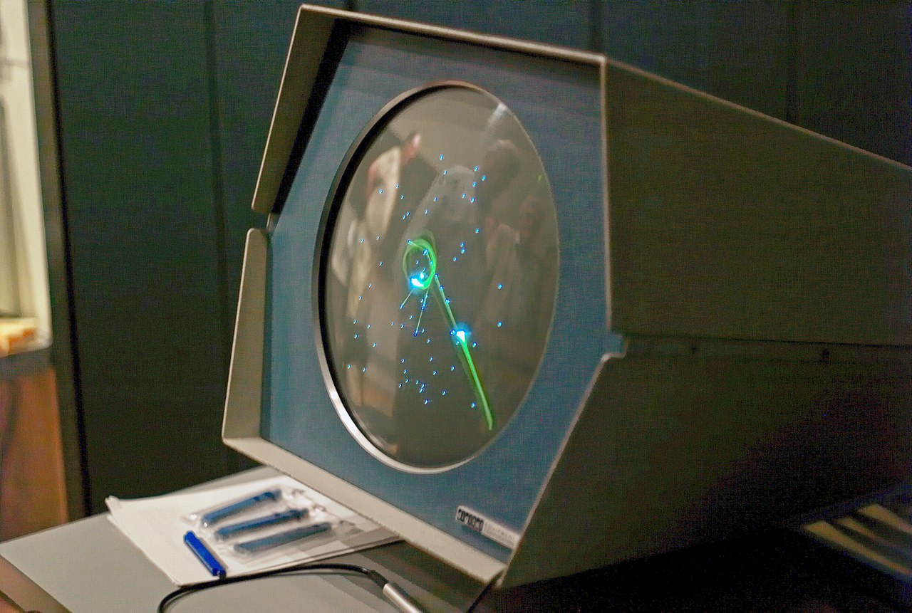
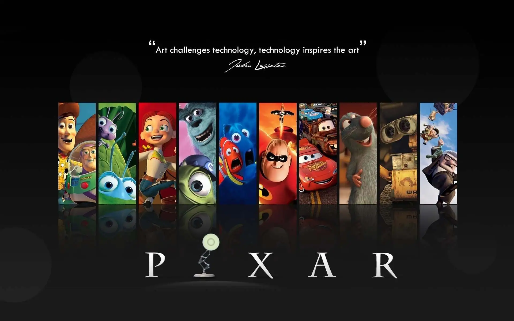

# 02-元宇宙简史：能看到多远的过去，就能看到多远的未来

你好，我是方军。

在这节课开始之前，我想先问你一个问题：我们可以用计算机做什么？你可能会说，电脑可以用来工作，手机可以用来聊天。没错，我们很容易被眼前熟悉的事物所影响，认为能用计算机做的就是这些事。

但现在，元宇宙热潮打开了我们的想象空间，我们开始设想，计算机可以用来做一些不一样的事情。围绕着元宇宙，我们已经听到了成千上百种在数字世界里面可以做的事，总之是各种各样新奇的未来。

但我认为，要想了解未来，还有一个途径是先走进历史看看。今天，我就来给你讲一个不一样的元宇宙简史，我们一起来看看计算机发展史上三个和元宇宙有关的脉络。我相信，有了对技术历史的认知，我们能更好地想象未来和探索未来。

## 计算机图形时代：第一个计算机视频游戏的诞生

我先给你讲一个冷门的计算机早期的故事。它标志着计算机图形时代的到来。现在看，你可以认为，它为元宇宙奠定了最初的基础。

在计算机发明后的很长一段时间，计算机是在机房里占据几个房间的庞然大物，也就是所谓的大型机、中型机。人们的认识是，计算机是政府或者大公司做税务计算、会计计算用的。

1959 年，迪吉多公司（也就是 DEC）造出了世界上第一台小型机“PDP-1”（也就是，PDP 一代计算机）。这台计算机跟我们现在熟悉的个人计算机已经有点像了。它装在一个机柜里，有了阴极射线管显示器，一个人就可以操作。

当然，这个“小型机”还是很大，我说完重量你能有个概念，它重 730 公斤，大约是一辆特斯拉汽车的一半。迪吉多公司之所以发明小型机，是希望减少计算机的制作成本和占用空间，并让计算机变得更容易操作。

1960 年，PDP 一代计算机产品上市。在这之后，就有越来越多的公司、高校和政府部门能够买得起计算机了。

1961 年，迪吉多公司送了一台 PDP 给麻省理工学院（MIT）。之后，有趣的事情就开始酝酿了。麻省理工学院有一群极客想用这台计算机搞点不一样的事情，简单地说，他们想要开发一个计算机视频游戏。

之前，麻省理工学院有人做过一款电子游戏，但不是在计算机上，而是在做电子实验的示波器上。这群人用示波器上的小光点代表一只老鼠，做了一个在迷宫里寻找奶酪的游戏。在其他大学，还有人在示波器上做过网球比赛的游戏，当然，网球也只能用一个小光点来表示。

现在，有了 PDP 一代计算机，特别是有了阴极射线管显示器之后，麻省理工学院的这帮极客准备做一个真正的计算机视频游戏。在此之前，可不是每台计算机都有显示器的。

但是，光有计算机还不够，要想做一款真正的计算机视频游戏，你还要做一些其他的准备。这其中最重要的一个准备就是绘制图形的算法。有一个牛人叫马文·明斯基，他是麻省理工学院的教授。他找到了一个算法，能够在计算机显示器中画一个圆圈。紧接着，他又找到一个办法让显示器显示三个圈，最终通过圈与圈的互动绘制出图案。这就是所谓的“明斯基电子”绘图方法。马文·明斯基现在更多的因为人工智能而知名，被称为是“人工智能之父”。

有了计算机，也有了这个在计算机屏幕上显示图形的算法，1962 年，第一个电子计算机游戏——空间大战（Spacewar!）——诞生了。

这个游戏的主要开发者是一个名叫拉塞尔的极客。在计算机上，他用圆点画出了两个卡通版的宇宙飞船，一个胖胖的，一个细细的。通过计算机上的按钮，玩家可以控制宇宙飞船加速、减速、转向，等等。宇宙飞船的头部还能发射出一个个圆点，这是它攻击对手的“导弹”。

接下来，很多人一起参与改进了这款游戏。有人在游戏里加了一个小太阳，当宇宙飞船靠近小太阳时，飞船就会被引力拉过去。还有人觉得，原来游戏里太空中的星球太不真实，他们用计算机绘制出了符合天文学常识的星体。当飞船前进时，星空还会慢慢地向后移动，也就是有了真实的视觉空间感。

你可以看看下面文稿中的图片感受一下：

- 运行在PDP-1上的空间大战（Spacewar!）

我没有机会试玩这个游戏，看过图片之后，我必须得说，你要有一点想象力，才能把那些光点看成是宇宙飞船和星空。但不管怎样，这是第一个计算机视频游戏！

这群极客当时肯定特别兴奋，因为计算机变了，计算机不光能够做计算，还可以显示图像，显示动态图像，并且是让人可以交互的动态图像！

现在，我们已经习惯了计算机渲染出的各种图像。比如，皮克斯电影公司用计算机制作出来的动画电影，是每个普通人都能享受到的计算机图形学成果。

那么，为什么在讨论元宇宙的时候，我们会说起这个小历史呢？

这是因为，几十年前，这些先驱们找到了显示动态画面、并让玩家操控动态画面的方法，他们开创了计算机图形时代。有这个最初的创新，我们现在才可以讨论用计算机创造的图像取代或叠加实体图像，这是元宇宙的基础。

当然，一直到不久前，计算机画面都还是局限在平面的屏幕上的。但现在，元宇宙则承诺，它会把我们带向三维立体图像的新阶段。

想象一下，在元宇宙，你可以戴着 VR 设备进入一个逼真的由计算机创造出来的三维立体图像的世界，你可以看到眼前的杯子，甚至还能感受到它的温度，但当你真的想要拿起杯子喝水时，却发现杯子其实只是计算机在你眼前绘制出来的图像而已。所有这些未来的可能性，都可以追溯到 1962 年第一个计算机视频游戏“空间大战”的诞生。

另外，有意思的是，除了在计算机图形方面和人工智能领域之外，我们刚才提到的马文·明斯基教授在头戴设备领域也是一个先驱。1963 年，他发明了头戴式显示器（也就是 HMD）。现在我们看到的头戴设备，不管是 Facebook 的 Oculus VR 头盔，还是微软的 Hololens 混合现实眼镜，都是沿着明斯基的头戴式显示器的思路在走。我们现在讨论元宇宙的时候，可要特别感谢他们这样的先驱人物。

## 计算机网络时代：互联网的出现

不过，元宇宙并不只是计算机图像的变革。上一讲我们说，大公司追逐元宇宙，是在追赶下一代的互联网。互联网，是元宇宙的另一个重要基础。所以接下来，我们也来看看互联网的早期历史。

可能因为太熟悉互联网了，现在我们已经很少再去提起它的历史了。其实，世界上的计算机从一个个分离的小点，逐渐连接成现在这样一张大网，是一个每次看都非常激动人心的过程。每次看这些历史，也都能激发我们对于互联网未来的更多想象。让我们通过利克里德（JosephLicklider）这个人物来看看，早期的计算机是怎么一步步进化成为现在的互联网的。

你可能会问，利克里德是谁？

现在人们提到互联网之父，想到的都是蒂姆·伯纳斯 - 李，因为他发明了万维网（WWW）协议，确实，正是万维网协议让我们通过浏览器（以及后来的 APP）实现了世界范围内的沟通。但其实，早期互联网有很多重要的贡献者，利克里德应该算得上是最重要的人物之一。

1968 年，利克里德发表了论文《计算机作为一种通信设备》，标题已经说明了一切，计算机不只是一种计算设备，它更是一种通信设备。这篇论文实际上是阿帕网（也就是互联网的前身）

的理论支柱。

“计算机是通讯设备”，现在我们觉得这个观点很平常，但这也正是它的强大之处，它发展得太好、太成功了，如今已经变成了平淡无奇的日常现实。并且现在已经到了移动互联网时代，我们更自然地把智能手机——其实是强大的个人计算机——看成是通信设备了。

有了理论支撑，下一步就要真枪实战了。利克里德在行动上也推动了阿帕网的诞生。

阿帕网是由美国军方研究机构 IPTO 资助的。在这个项目启动期间，利克里德是 IPTO 当时的负责人，他一手助推了阿帕网的启动。

最初的阿帕网的联网设备叫“互信报文处理机”（IMP）。1969 年，有两台 IMP 计算机分别被运到了加州大学洛杉矶分校（UCLA）和斯坦福大学。重要的时刻马上就要到来了，尽管当时人们其实都没有真的意识到。

加州大学洛杉矶分校的一个研究生带着电话耳麦，跟斯坦福大学的人通着电话。同时，他在IMP 计算机上输入了一个字母“L”，对方告诉他收到了。

加州大学这边又输入了第二个字母“O”，斯坦福又收到了。

不过，当加州大学这边想输入第三个字母“G”时，系统瘫痪了。

但不管怎样，互联网的第一次通信实现了，“LO”两个字母通过计算机网络传到了另一个地方。人们经常说起人类的第一次电话，却很少提及这第一次网络通信，其实，它在人类通信历史上有着非常重要的意义，这是互联网的开端。

后来，利克里德还在互联网发展历程中又一次扮演了重要角色。利克里德再次回到资助阿帕网的军方研究机构 IPTO 担任负责人，在他的第二个任期中，他制定了从阿帕网向互联网转变的方案。此后，才有了现在我们每个人都可以用的互联网。

我们当然不能把互联网的早期成就归功于某一个人，它是一群天才的发明创造。但你可以看到，在这群人中，利克里德居功至伟。

有了利克里德等人推动的早期的互联网，我们才有机会去创造下一代互联网，也就是元宇宙。

有意思的是，利克里德和元宇宙的缘分不止于此。除了推动互联网的早期发展，利克里德的另一个学术理念也可能成为未来元宇宙的基本理念之一。

1960 年，利克里德在论文《人机共生》中提出了交互式计算机和“人机共生”的理论，这篇论文被认为是计算机发展历史上具有开创性的文章。

“人机共生”是什么意思呢？

简单地说，在此之前，人们认为计算机就是做计算的，把数据送进去，结果拿出来。但利克里德提出，通过显示器和控制台，人可以直接与计算机进行互动。同时，他强调了简化计算机与用户交互流程的必要性。现在，我们几乎每天都在跟手机、电脑进行着互动，利克里德的这个理论在几十年之后也变成了现实。

我们可以认为，接下来，“元宇宙”会助推互联网和人机交互迈入新的阶段，人们开始试图创造三维立体的互联网，这会让真正的人机共生变成可能。因此，如果我们再来仔细看看人和计算机的关系，就可以把它分为三个阶段。

第一个阶段，计算机在计算后给我们数据，人看到数据后做出反应；第二个阶段，我们通过直观的屏幕与计算机互动，这是现在；第三个阶段，是元宇宙阶段，我们可以走进三维立体的环境，更直观地与之互动。

“人机共生”为什么重要呢？因为唯有在人机共生的情况下，我们人类才可以更好地根据计算机提供的信息做出决策。我们可以看看利克里德的一项具体研究。他曾经负责研究一个军事计算机系统的人机界面，他指出，从人机共生的角度看，通过屏幕与计算机互动，而不是仅仅看到数据，操作员能更好地、全面地掌握信息。

例如，如果在屏幕上显示过去几秒内空中的情况，并用颜色绘制出轨迹，那么控制台操作员就能直观地掌握信息，正确而迅速地做出反击的战斗决策。这时候，人机关系其实已经进入到了第二个阶段。现在我们可以再往前推一步，如果控制台操作员能够看到三维立体的空中情况，可以想象，他肯定能够更加直观地掌握信息、做出决策。

利克里德所在的年代，受到当时的计算机技术的限制，加上互联网才刚刚开始萌芽，人们根本无法想象大量的实时数据、影像、三维模型通过网络传输过来，然后立体地呈现在我们面前会是什么样子。人们更不能想象我们可以用三维立体的方式去跟它交互。

但现在，元宇宙让我们看到了这种可能性，如果能够实现，这将是人机共生的全新阶段，将赋予人更大的力量。

## 价值网络时代：区块链技术的发明

有了图像和网络，元宇宙的大致形态算是有了着落，但这里还有一个问题没有解决，如何在数字空间更方便地进行“价值转移”也就是转账呢？

互联网诞生至今，日益完善的网络技术满足了人们娱乐、购物、交流等多种需求。可以说，在相当长的时间里，几乎所有人都对互联网很满意：基础网络的性能越来越好，应用的形式也非常丰富。很少有人去思考，互联网是不是缺少点什么？

但的确有一小群人对这个现状并不满意，他们想要看看，除了互联网最擅长的信息传递之外，在互联网上有没有更好的“价值转移”方式？这个尝试最终在 2008 年取得突破性进展，补上了互联网一直以来缺失的一环，形成了后来以区块链技术为核心的价值网络。

这是什么意思呢？我们还是从“价值转移”说起。

价值转移是什么呢？在互联网上我们为什么需要它？其实从互联网商业应用出现开始，人们就想要在信息传递外进行价值转移了。比如说，我们在网上买东西，要把钱转给商家，这就是价值转移。

把钱转给商家实际上有两条道路可走。第一条路我们现在很熟悉，它是由 Paypal 开创的（你可以认为 Paypal 是美国的支付宝），它们帮我们处理价值转移的方式是：由一家公司在中间担任中间人，帮助用户向商家转账。以支付宝为例，用户付钱后，钱暂时存在支付宝，等用户收到货物确认没问题之后，钱再从支付宝转给商家。

第二条道路呢？人们想，我们能不能把中间人去掉？不经过一个中间人，而是在数字空间直接地点对点转账。这条道路上的公司、项目、技术我们都比较少听到了。其实，这条路上有很多技术名家，比如发明盲签的大卫·乔姆等，也有不少大公司参与进来，比如维萨就曾经推出基于硬件的电子现金系统“维萨现金”（VisaCash）。但是很遗憾，以上所有努力都失败了。

大家都找不到一个去掉中间人、在数字空间中点对点转账的方法。因此，很长时间以来，互联网底层可以很方便地进行信息传递，但是只有在应用层、在支付宝等“中间人”的协助之下，我们才能进行价值转移。

在线下实体世界，我要付钱给小贩，我给他现金就行了，没必要找一个中间人来做见证人。在数字空间，我们真的必须要有这个中间人吗？不经过中间人的价值转移在技术上真的不可行吗？这个难题，真的就没有解决方案吗？

虽然屡战屡败，但还有人在继续做尝试。

2008 年底，在一个计算机密码学家聚集的邮件组里，有个人匿名发送了一封邮件，分享了一篇他写的论文《比特币：一个点对点电子现金系统》。这个人自称“中本聪”，这是一个化名，到现在也没人知道他是男是女，是一个人还是一群人。

在这篇后来被证明堪称经典的论文中，中本聪讲解了采用分布式、链式数据结构来记账的方式，文中还讲述了让分布式节点达成共识的工作量证明机制。以此为基础，他找到了一种无需中间人的数字转账方法。

现在人们推测，虽然中本聪看起来学术素养不错，但他应该不是一个研究型学者，而是一个工程师。这是因为他写软件代码的能力很强，他同期开发了最初版的比特币区块链系统，并在2009 年 1 月 3 日在互联网上上线了这个系统。这个系统现在价值 7000 亿美元。

在计算机密码学家聚集的这个邮件组里，这最初的论文和系统的反响都一般。但上线一段时间之后，人们发现这个系统似乎真的解决了长期以来的难题：这个系统和它背后的技术思路，确实可以实现点对点转账，去掉价值转移中的中间人。现在，央行数字货币实际上就是借鉴了比特币系统的技术思路：原来我们两个人转账，必须要经过支付宝或者银行等这些中间人，现在采用央行数字货币，两个人就可以直接转账了。

为什么实现点对点转账这么重要呢？

简单地说，在数字空间里，如果能去掉中间人，直接用软件代码来转账，有两个直观的好处：首先，我们作为用户不必依赖中间机构，所以它收取“过路费”的机会也就没了；其次，我们作为程序员可以在软件代码上持续创新，让这个转账过程更自动化、智能化。基于这些考虑，比特币系统背后的技术的价值逐渐地被人们接受了，它也有了一个自己的名字，你可能已经听过了，它就是“区块链”（Blockchain）。

时至今日，区块链技术已经在金融、溯源、存证、政务等众多领域有了尝试性的应用。IBM 等大公司推动建立了开源联盟链系统 HyperLedger（超级账本），现在，超级账本是由 Linux 基金会运行的开源项目。大型云服务提供商如亚马逊云、腾讯云、阿里云都以联盟链技术为核心提供“区块链即服务（BaaS）”产品。

另外，还有一群人（比如维塔利克·布特林）提出接着以比特币系统为基础，构建一个可以运行去中心化应用的分布式网络，它就是以太坊区块链，这是与联盟链对应的公有链路径。现在，以以太坊为代表的几百种公有链被认为是第三代互联网的重要基础设施。

在区块链之前，互联网的关键协议是 WWW（万维网）协议，它的用途是进行信息的表示(HTML)、寻址 (URI）和传输（HTTP）。但互联网一直没有和价值表示与价值转移相关的基础协议。现在，区块链技术补上了互联网缺失的一环，它提供了价值转移的基础协议。有了区块链，我们一直以来使用的互联网就得加个定语了，它叫“信息互联网”，而围绕区块链技术逐渐形成互联网的另一半，就成了所谓的“价值互联网”。

你可能会问，这和元宇宙有什么关系呢？

试想一下，我们想要建立的名为元宇宙的新数字世界，如果只是三维立体的、你可以观看和走进去的数字世界，它终究是少了点什么。其实，理想的数字世界，有一点应该跟我们的线下世界一样。那就是，你不光可以看到店铺的数字商品，还可以买一个，也就是拥有它的所有权。更重要的是，未来，一个游戏道具如果属于你，你可以把它直接转让给别人，不需要经过最初卖给你道具的游戏公司。

在数字空间，财产所有权的确权和流转需要区块链技术的支撑。因此，虽然区块链技术仍然是一个发展中的技术，从 2008 年开始它才发展不到 15 年，但我确信，它也是元宇宙最重要的基础技术之一。

## 结语

好了，这节课的内容就讲到这里。刚才，我们讲了三段和元宇宙紧密相关的技术历史，通过这三个小小的切片，我也把技术发展史划分成了三个时代。

- 计算机图形时代：第一个计算机视频游戏《空间大战》将我们带入计算机图形时代。此后，计算机不光能够做计算，还可以显示动态图像，我们还可以控制其中的数字物体。

- 计算机网络时代：我们用一个人的贡献讲了互联网的早期历史，利克里德推动了早期互联网的诞生。现在，互联网将世界各处的计算机、信息和人紧密地联系了在一起。

- 价值网络时代：我们还讲了区块链技术的诞生过程。它带来了价值表示和价值转移的基础协议，为原本主要为信息传播而生的互联网补上了缺失的一环。从此之后，数字空间中的财产所有权确权和流转有了技术支撑。

能看到多远的过去，就能看到多远的未来。第一眼看，这三类技术的早期历史似乎跟元宇宙关系不大，其实它们是元宇宙的三类基础技术。这些技术在历史的某个时间点出现了。现在，它们最终汇聚到一起，将创造一个激动人心的新未来，这个未来，就是元宇宙，它是立体互联网+ 价值互联网。

## 课后题

今天，我也给你留一道思考题吧。你认为要实现元宇宙，需要的技术有哪些？欢迎你在留言区和我交流讨论，我们下节课再见。
