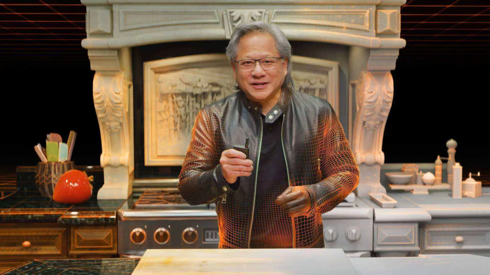
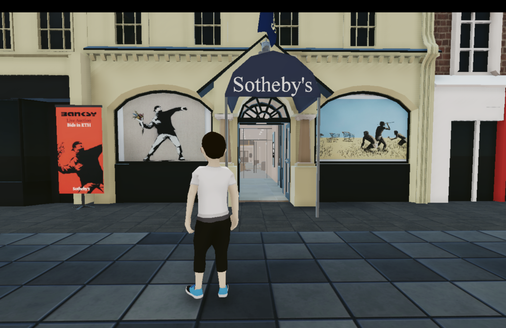

# 03-元宇宙=立体互联网：当我们的手和眼摆脱屏幕的束缚

你好，我是方军。

元宇宙这两年持续引起人们的关注，在我看来，一个重要原因是，它唤醒了我们对于三维立体互联网的向往。在科技发展的各个阶段，人们都没有停止过幻想这样一个由计算机创造出来的世界，它是一个我们可以走进去的三维立体空间。在那里，我们的双手可以拥有真实的触感，我们看到的物体虽然不存在、但就像真的一样。

我们之前说，元宇宙 = 立体互联网 + 价值互联网，立体互联网正是回应了人们这样的向往。在这节课，我们就来看看，立体互联网可以给我们带来什么？之后，在第 5-7 讲中，我还会对相关的技术做详尽的解读。

## 三维立体互联网的梦

现在，说起互联网，你想到的是什么？是桌上的电脑显示屏？还是越来越离不开的的手机？其实不管是哪个，我们看到的互联网都是在一个平面的屏幕上的。而我们一直希望能够亲身走进计算机创造的三维立体世界中。

比如，我们经常在电视广告里看到这样的对未来科技生活的想象：你早上起床之后去洗脸刷牙，这时，洗漱台上的镜子会变成屏幕，显示今天的天气、路况或者其他任何你选择的信息。到了办公室，你手一挥，一个个电脑窗口凭空浮现在你的眼前。

科幻电影的想象则狂野得多。有的电影直接让远方的人移动到你面前，他们说，这是有量子物理学的理论支撑的，量子物理可以实现所谓的“隐形传态”（或者称为瞬间移动）。另一些电影则尝试给我们设计一条在 IT 技术上可能实现的路径。比如在电影《星球大战》中，那台可爱的R2D2 机器人能把莉亚公主的立体影像投在地板上，欧比旺可以和莉亚公主面对面说话。现在，这种技术我们称为“全息影像”（Holography）。

但是，全息影像并不容易实现。

前几年，谷歌旗下的 Magic Leap 公司发布了一段视频。在体育馆里，大家正围坐着观看比赛，突然，一条鲸鱼从篮球场地板中央一跃而起。Magic Leap 当时宣称，它的所谓“光场投射技术”可以实现这样大规模的肉眼 3D。在视频中我们看到，投射出来的影像，也就是飞起的鲸鱼，和体育馆中的实体场景完全融为一体。我们都惊呼：“哇，太棒了！”只是很遗憾，事后证明，Magic Leap 到现在都没有能够实现那条视频中展示的肉眼 3D，那个视频只是它设想的未来的可能性。

我们还希望走进这个计算机创造出来的三维立体世界后，可以跟这个数字世界互动。这带来了新的技术上的挑战。比方说，我们会希望自己能够用仍然处在实体世界的身体去自然地控制各种数字物体。

现在，有一类叫体感互动的技术正在让这样的设想成为现实，它可能是未来我们与数字世界互动的重要方式之一。我对体感互动的认识，可以从一个我个人的小体验说起。十多年前，我周围的很多朋友都各买了一台任天堂 Wii 游戏机。当时这款游戏机并没有在中国市场正式销售，但我这个几乎从来不玩游戏的人也禁不住好奇，想办法搞到一台。

回到家，我把它接在电视机上，插入网球游戏碟片，拿起手柄开始打网球。玩那个游戏，真的跟打网球差不多，因为你不是坐在沙发上、通过几个按钮操控游戏任务，而是要整个身体动起来。这是我们最早感受到的体感游戏。

前些年，微软 Xbox 游戏机上的 Kinect 功能把真正的体感游戏带到了我们身边。为什么说是真正的体感游戏呢？因为 Kinect 不再只是靠我们甩动手柄的力度来推测我们的动作了，它的各种传感器、红外摄像头组合起来，可以精确地探测我们身体的动作，我们可以用身体灵活地控制游戏里的人物。

只是很可惜，这个功能在几代 Xbox 游戏机上出现过之后，在 2016 年又被彻底取消掉了。原因也简单，就是能够发挥 Kinect 体感功能的游戏太少了。

说到这儿，你可能发现了，我们是有着三维立体互联网的梦，但实现它的过程不太顺利。这一方面是技术原因，技术还不够完善，成本也太高。另一方面是应用的原因，三维立体的互联网似乎也没有什么应用场景，甚至连游戏里都找不到这样的场景。

我想啊，你很自然地就会有一个疑问：那么，为什么在元宇宙时代，我们又做起了三维立体互联网的梦呢？不严肃地回答：梦想总是要有的嘛！严肃地说呢，元宇宙概念大流行让我们重新看到，实现三维立体场景的技术已经比以前成熟了许多，三维立体的场景在工业和科研中有了不少探索，我们可能正处在立体互联网“从 0 到 1”的最后阶段，而“从 1 到 N”的阶段即将开始。

总体来说，三维立体的互联网需要两方面的探索。

- 第一，如何更好地在人眼前形成真实的三维立体画面效果？这个原理早就有了，只要在双眼前投射略有不同的电脑画面，就可以在视觉上欺骗我们的大脑，让我们觉得自己处在三维立体的世界中。但将这个原理变成性能好、价格合适的产品还有很长的路要走。

- 第二，如何让我们更好地用身体与三维立体的世界互动呢？怎么让用户更自然地操控数字世界中的物体，要实现这一点同样也有很多的障碍。

接下来，我们就分别从这两个角度来看看迄今为止的相关技术探索，试图通过历史梳理来回答，为什么我们相信，现在这两个方向都到了关键转折点？同时，为什么元宇宙可能推动三维立体互联网的实现？

## 从图形到图像和立体影像

要实现一个用计算机画面创造出来的三维立体的世界，关键就是电脑绘图，在电脑屏幕上呈现线条组成的图形，呈现像素组成的图像，然后创造立体的图形、图像，再之后是动态的三维图形、图像，最后是可以多角度观察的三维立体世界。

上一讲，我们提到了人工智能之父马文·明斯基，他找到了“明斯基电子”方法来显示图形。这个时期，计算机屏幕上的图形都是由线条组成的。接下来，又一个大咖伊凡·萨瑟兰（IvanSutherland）和他的一个学生进一步助推了计算机图形学的发展。我们今天重点来说他的学生。至于这个学生到底是谁，我在这里先卖个关子。

在美国犹他大学任教的时候，萨瑟兰关注的是怎么用计算机上的线条绘制出逼真的画面。这个学生受他影响，也开始学习和研究计算机图形学。这个学生还给自己定了一个目标：用电脑来绘制动画，还要让电脑动画的画质跟摄像机拍出来的电影一样。

1972 年，这个学生做了一个动画短片，他用石膏给自己的手做了模型，然后用 360 个三角形、多边形把手的形状勾勒了出来，再用电脑把这个手渲染了出来。他用虚拟的摄像头在这个手的三维模型里游走，拍摄生成一个动画视频。在这个四分钟的动画视频里，镜头带着我们看到了这只手的各个角度和细节。

这是最早的完全由计算机制作出来的动画视频短片之一，也是很多我们喜欢的动画电影的雏形。其实这个学生就是后来参与创办了皮克斯电影公司的艾德·卡特姆。卡特姆曾担任皮克斯总裁，给我们带来了《玩具总动员》《赛车总动员》这些家喻户晓的动画电影。

由三角形、多边形的线条组成的手的视频，到现在的动画电影，这之间还有一次重大升级，那就是“像素”的出现。

只靠线条组成的图形在人眼看来是不够逼真的，施乐公司的帕洛阿尔托研究中心找到了一个新思路。它提出，把图片看成是大量的点的集合，也就是像素的集合。未来学家尼葛洛庞帝在《数字化生存》中简洁有力地说：“像素威力大”，“只要有足够的像素，你可以在电脑上获得非凡的显示效果。”现在我们在电影中看到的精彩绝伦的视觉效果都是由超大量的像素组成的，要更精美，加大像素数量就够了。

到这里，我们看到了计算机图形学早期的三个苗头：线条图形、三维模型图形、像素图像。从那时至今的几十年间，这三个方向交错发展、持续进步。我们陆续看到了，比如精确扫描实体物品的三维模型，像素更高的图片，更精致的动画画面，等等。

另外，我们的电脑和手机的显示精度越来越高，显示芯片的性能越来越好。在可以预先渲染的前提下，现在计算机能够制作出来的画面已经非常精致了，比如说，3D 电影的特效可以给我们带来强烈的视觉震撼。

但是如果想要实现元宇宙，想要实时渲染以假乱真的动态图像，并希望这个图像是三维立体的、是随着你个人的视角变化的，我们就面临着一个主要的挑战：算力。

画面的渲染需要海量的算力，需要超长的时间。比如说，渲染一部皮克斯动画电影当中的一帧，就大约需要一台高性能机器花费 24 小时才能完成，如果只使用一台机器，那么渲染出一部电影需要 400 年。当然，解决方法是有的，我们可以用大量的机器同时渲染，最终完成电影成片，再放映给观众观看。

元宇宙对渲染的要求不太一样，它需要每个人的电脑或手机都能实时渲染画面，而没法动用大量的算力预先渲染。精度越高，我们越觉得逼真，而精度越高，需要的算力就越大，也就是说，要实现元宇宙，我们手机的图形芯片要很强大才行。因此，如何实时地渲染以假乱真的动态图像就成了元宇宙在视觉方面的一个主要挑战。

那么，这样的高性能图形芯片有没有可能实现呢？

2021 年 4 月，发生了一个也许会被人不断提起的小插曲。计算机图形芯片公司英伟达（Nvidia）在自家公司的线上发布会上发布了一段创始人黄仁勋在厨房演讲的视频。几个月之后，在一个计算机图形学会议上，英伟达发布论文说，这个视频中有 14 秒的人物和厨房都是由计算机渲染出来的。这个消息引起了众人惊呼：“老黄欺骗了全世界。”英伟达是用这种方式在展示了自己图形芯片的性能，它想告诉公众，我们现在可以近乎实时地渲染人物演讲的动态画面了，我们的算法和芯片已经准备好了。

当然，你要注意，这里我用的词是“近乎实时”。但也许在不久的将来，我们的手机就可以实时渲染以假乱真的动态画面了。当图形芯片的实时渲染能力突破临界点之后，能骗过我们双眼的三维立体数字世界就真的到来了，那就是理想状态的元宇宙。

## 与三维立体的数字世界互动

前面我们说了，一个由计算机创造出来的三维立体数字世界有两个挑战，除了在我们眼前呈现以假乱真的三维立体动态画面之外，还有一个挑战是，跟这个数字世界互动，而不只是看着。

互动，其实也是我们需要三维立体数字世界的主要原因。比如，如果我们想知道一个建筑设计是不是跟周围的环境协调，比起看平面的图片，看建筑沙盘模型的效果会更好。如果我们可以把自己变小、走进建筑沙盘中，用一个更贴近真实的视角观察建筑物；同时，如果我们能够在走动的过程中，直接调整建筑模型，那我们也许能够创造出更人性化的建筑。

在 Facebook 公司改名为 META 时，扎克伯格在公开信中对元宇宙的定义是“一个身临其境的互联网”（embodied）。我认为，所谓身临其境，就是你可以走入其中，可以感受到周围环境，并与之互动。关于如何互动现在已经有很多的探索，比如前面讨论的体感互动，比如已经较为常见的声音互动，比如更科幻一点的、目前还在理论探讨阶段的脑机接口。

具体的互动方式我们在第 7 讲会讨论，这里，我们先来看看，如果有了三维立体的新人机界面，它给我们带来的是什么？我认为，这会为我们增加一个新的感官维度。

“增加一个新的感官维度”，这是什么意思呢？我们可以借用未来学家尼葛洛庞帝讲过的一个例子来说明。有人问他：“你吃东西的时候，为什么要戴着眼镜呢？不戴眼镜不是也能看见盘子里的食物和刀叉吗？”他的回答是：“戴着眼镜的时候，食物会显得更加美味。能够看清食物，是美好味道的重要组成部分。”

三维立体的互联网，它给我们的真正承诺就是，给我们加上现有互联网没能给我们的新的感官维度，让我们的“食物”变得更美味。这个感官维度目前还没法准确地定义，但我们可以用下面的几个例子来分别看看。

现在我们能看到可以勉强称之为元宇宙的项目多是所谓“虚拟城市”或者“虚拟世界”，我们可以用自己的虚拟形象走入这个城市。它们虽然看起来都还比较简陋，但已经让我们体会三维立体的数字城市是什么了。在现实中，每次出差到一个城市时，我都会在酒店周边的街区走走，而当我进入 Decentraland 这样的虚拟城市时，我也会有类似的身在陌生街头的感觉，我可以走进博物馆、走进商场、走进知名公司大楼参观。

我们不只是可以用自己的虚拟形象走进虚拟城市，我们还可以把虚拟物品放进自己的肉身所在的实体环境。比如戴上微软的混合现实眼镜 Hololens，我们可以放一个三维立体的、虚拟的数字钢琴在客厅里，我们可以去弹钢琴。你可以随意放大和缩小你看到的虚拟数字物品，假设你在一个航天教学的课程上，你可以缩小庞大的火箭，完整地看到火箭，也可以放大火箭，走进火箭的内部、了解火箭的内部结构。

还有，和“数字虚拟人”的结合，也让立体互联网为我们新增加出来的感官维度更为精彩。去年，阿里宣布第一个数字人员工 AYAYI“入职”了，清华大学也宣称第一个数字人学生“入学”，当然，这些“入职”、“入学”都是要打引号的。有了三维立体的世界之后，发生的变化是，这些打引号的“人”都可以拥有立体的身躯了，三维立体的元宇宙可以成为数字虚拟人生活的家园。

以前，哪怕我们惟妙惟肖地把机器做成人的形状，但我们也很难把它看成一个真正的人，因为你明显看到他跟自己不一样。但是，在我们自己也化身为虚拟形象的元宇宙中，我们的感觉变了，我们会觉得，数字虚拟人就是“真正的人”，也会因此开始用与人交流的方式与他交流。

畅想一下未来，你是一个律师，虚拟人是你的助理，你对他说：“你去把过去十年某一类知识产权侵权的判例都找出来。”这个助理不是输入关键词、然后给你一堆链接，而是会主动梳理搜索结果，发给你一份条理清晰的报告。如果技术进一步发展，他甚至还会针对报告给你提一些建议。

这个虚拟人的工作能力需要依靠机器学习等人工智能技术，但这里我们想说的重点是，如果虚拟人和我们自己都是以同样的数字身体处在元宇宙中，我们就更有可能把它们当成真正的人看待。目前，以真人为基础，制作逼真的数字虚拟人形象的技术已经逐渐成熟。有了三维立体的数字世界这个家园，像人一样思考的人工智能机器人和像人一样逼真的虚拟人相遇了。

以上这一切汇聚起来，就是三维立体的元宇宙的魅力，我们开始看到一个充满无限可能的新感官维度。

## 总结

小结一下。在这一讲中，我们重点探讨了元宇宙的“立体互联网”这一面。

所谓立体互联网，就是一个由计算机创造出来的三维立体的数字世界。这个数字世界是联网的，它可以是完全虚拟的，也可以是叠加在实体世界之上的。我们可以走入这个三维立体的世界，与它互动。

我们首先讨论了计算机图形学在视觉上的演进。用计算机创造三维立体的逼真画面、并呈现在我们眼前，是计算机图形学长期以来的目标。现在，虽然在算力方面还有挑战，但我们已经看到了一线曙光。这是我们现在敢于大做元宇宙的梦的原因。

我们还讨论了三维立体的数字世界会带给我们的另一样东西，即，它给我们增加了一个全新的感官维度。我们可以放大缩小数字物体，可以穿越时间，可以虚实结合。同时，由于它可以成为数字虚拟人的家园，因此又带出了人与机器交互的新可能性。

## 课后题

在这一讲的最后，给你留一道思考题，如果元宇宙的立体互联网实现了，你想在其中做些什么？欢迎留言说出你的想法。
