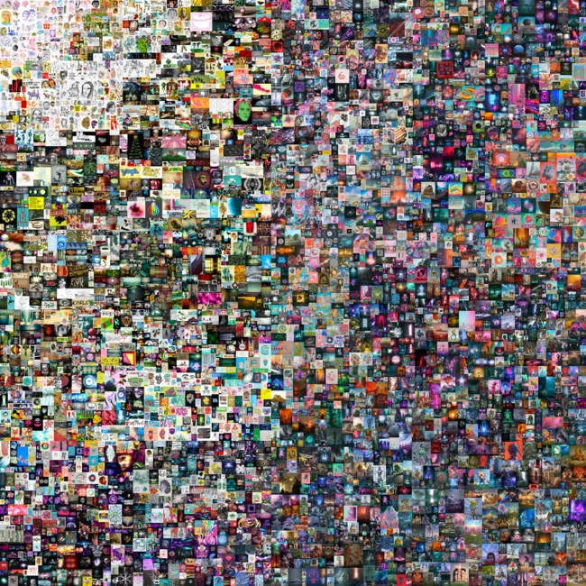
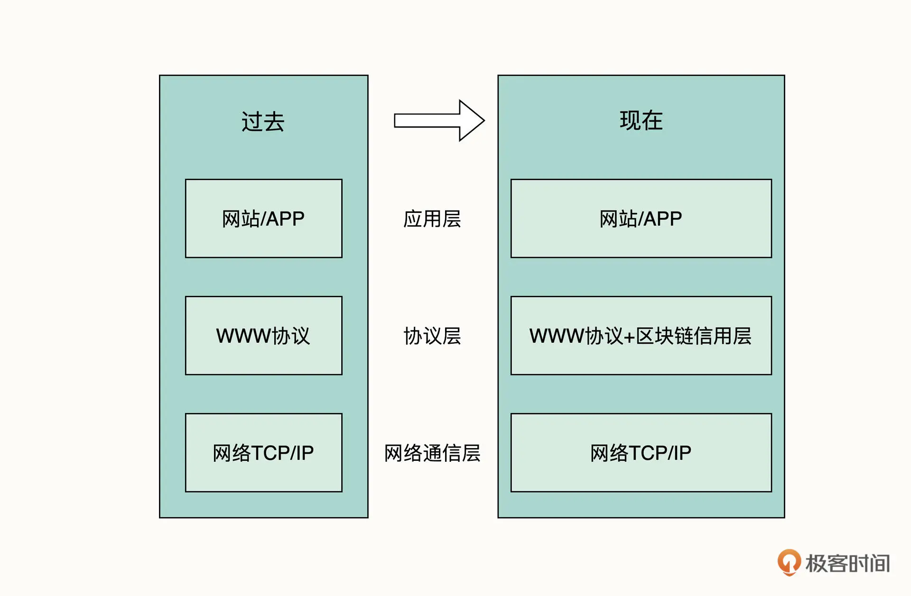

# 04-元宇宙=价值互联网：当我们在数字空间能拥有物品

你好，我是方军。

前面我们已经说了，元宇宙 = 立体互联网 + 价值互联网。上一讲，我们讨论了立体互联网，这一讲，我们来看看，什么是价值互联网？它又能够给我们带来什么？

所谓价值互联网，是以区块链技术为基础设施建立起来的价值确权、价值持有、价值交易的网络。有了它，在另一个维度，数字空间变得和实体世界一样了，我们可以拥有数字的财产所有权，通俗地说，我们可以像在实体世界一样，拥有数字世界中的房子、存款，也可以持有公司股份。

在我们的期待中，元宇宙是一个你可以走进去的三维立体的、美轮美奂的世界，同时，我们又可以在这个数字世界中工作与生活，各种各样的经济活动都可以在数字空间中展开。后者要能实现，就需要元宇宙的价值互联网这一部分，其中的重点是数字空间中的财产所有权机制。这是这一讲我们要讨论的。

## 元宇宙需要财产所有权

在我们的实体世界中，人类的经济活动大体上包括三个阶段。哪怕是一支简单的铅笔，从生产到消费，也都要经过这样的过程。第一阶段，生产者从事铅笔的生产；第二阶段，商家从事铅笔的贸易；第三阶段，消费者购买铅笔、使用铅笔。这些经济活动背后是一个人类经济与社会最为基本的组件：财产所有权。

- 生产者拥有自己生产出来的铅笔的财产所有权，他才有动力去生产。

- 商家购买了铅笔的所有权，他才能够进一步转卖，并获得贸易收益。

- 消费者付钱获得铅笔的财产所有权，然后拥有它的使用权。

在实体世界中，这一切我们都习以为常。但是，如果你仔细观察，你会发现，在当下的数字世界中，我们并没有财产所有权。财产所有权机制是现在的互联网平台或网络游戏没有提供给我们的。

你可能会提出反对意见。比如说，我们对游戏里的道具，难道没有所有权吗？如果细看用户协议，你会发现，自己实际上是游戏里的“房客”。你的游戏道具、甚至你的头像都是向游戏公司租借来的。

我们来对比看看。

在实体世界中，你可以带走属于你的、也就是你拥有财产所有权的东西。如果搬家去另一座城市，我们可以把房子卖掉换成现金，我们可以把家具、衣服运走。我们会把一些别人看来没有任何价值、但对我们个人来说充满美好记忆的东西带走。但是，不管你的游戏道具在一个游戏内部多么值钱，你都没法把它带到新的游戏里，这其实说明了，你没有这些游戏道具的财产所有权。

现在，当我们又一次想要建立全新的数字世界，也就是一个个元宇宙时，我们希望它们能够像实体世界一样，让我们拥有数字物品的财产所有权。理由很简单，只有有了财产所有权这个最基础的组件，人们才会有创造价值的动力，各种形态的、繁荣的数字经济活动才会出现。我认为，不管是实体世界还是数字世界，财产所有权都是一个完善的经济和社会的基础，是经济繁荣和个人自由的保障。幸运的是，这一次，元宇宙的价值互联网部分带来了让你在数字空间拥有财产所有权的一系列技术和设计。

在基本逻辑上，你可以拥有一个数字物品的财产所有权。你可以带走它，你可以处置它，比如把它送给别人。在具体的技术实现上，你要能完成如下三种操作：第一，你可以通过某种身份机制持有一个数字物品的所有权；第二，你的数字物品可以全网流动；第三，你的数字物品可以方便地转给他人。

而如果元宇宙还是没有财产所有权的概念，只是像现在一样把线下的知识产权沿用到线上来，那么元宇宙的发展很快会遇到像现在互联网发展一样的瓶颈。我们稍微展开聊聊这个话题。

互联网平台发展到现在的一个僵局是，平台实际上拥有所有用户主动、无偿提供的数据，他们能够利用数据让自己的利益最大化。用户逻辑上拥有自己的数据所有权，但实际上并非如此。其实，也就是在最近几年，随着世界各国的个人数据保护法规出台，我们用户才有了要求平台删除自己数据的权利。

但是直到今天，在互联网平台上，我们仍然缺乏一项重要的财产权利，也就是直接、自主地从自己创造的内容、数据中获得收益的权利。你可能会说，让平台分钱给我们不就好了吗？现在的平台分钱给内容创作者的做法远不能从根本上解决问题，甚至会带来很多负面效应。我们认为，真正的解决之道，是从根本上让用户拥有财产所有权，让用户拥有处置自己数字财产的自主决策权。

我们用一个具体的场景来说明一下。比方说，你是视频网站的 UP 主，你拥有你的视频的知识产权。但是，在数字世界，知识产权并不能代表视频这个数字物品的所有权益，知识产权只是视频的财产权的一部分。一般来说，除非有人侵权，否则你不会直接动用知识产权机制来维护自己的权益。

那对一个 UP 主来说，什么才是你的视频的财产权的主要部分呢？我认为你拥有的粉丝、你的视频曝光量，这些才是财产权的主要部分。表面上看，粉丝、视频曝光量都是你自己的，但实际上，视频网站的粉丝、曝光量都是属于平台的，平台可以随时剥夺。你的视频被算法推荐的几率由平台决定，广告收入是按照平台主导的规则来进行分成的。

这带来的恶果是，UP 主的行为会变得非常得短线。UP 主会迎合推荐算法，按照最容易吸引粉丝的方向来创作，并想办法快速变现，于是搞出来一些高度同质化的所谓作品。

真正有价值的优秀内容需要长线思维，即一个视频 UP 主持续创作自己觉得优秀的、同时又个性化的作品。要有长线思维，他要对自己的创作有信心、有耐心，同时也需要他相信自己拥有数字产品的所有权。他相信，自己未来将从自己创造的作品中获得收益，不会被任何平台束缚。

在《货币未来》这本书中，经济学者赛费迪安提出了“消费品思维”和“资本品思维”的二分法，跟我们这里说的短线思维与长线思维类似。所谓“资本品思维”的意思是，如果你知道这是一个资本品，未来能给你带来收益，你会不断地累积它。而“消费品思维”则是现在互联网的状态，互联网公司提供的是用完即抛的消费品，平台上的参与者也都被鼓励去创作快消品。这背后的原因是，现在的互联网从根本上缺乏财产所有权机制，这导致它不鼓励人去累积资本品，个人无法采取长线思维、谋求长期收益。

## 拥有数字财产所有权之后

那么，如果一个互联网博主拥有自己的数字作品的所有权，他也拥有长线思维或者说资本品思维，又会发生什么呢？

2021 年发生在艺术家 Beeple 身上的例子让我们看到了一个令人向往的未来。当然，这是一个特例，但是他的经历可以让每个创作者都受到启发。如果元宇宙世界沿着这个方向发展下去，我非常确信我们可以迎来数字文化的大繁荣。

### 一个案例：Beeple 的《第一个 5000 天》

从 2007 年 5 月 1 日开始，1981 年出生的年轻数码艺术家迈克·温克尔曼开始出现在网上。这一天，他用艺名 Beeple 在社交网络上发布了自己的第一幅数码绘画作品。你可以认为，Beeple 就是一名画漫画的互联网博主。

接下来的 5000 天里，他每天都会在网上发布一幅画，并把它发布在越来越多的平台上。他用数码漫画来反映时事，呈现对现实的观察。随着他的作品在技术和观念上的日渐成熟，Beeple成为了影响力越来越大的网络红人。他开始跟路易威登、耐克等大品牌合作，也有越来越多的作品被艺术收藏家买下。如果剧本就这么发展下去，这不过是一个有趣的数码绘画艺术家的故事。

惊人的变化发生在 2021 年 3 月 12 日。这一天，全球著名艺术拍卖行佳士得将 Beeple 的5000 幅作品集合起来，拼贴到一张巨大的画面里，将之命名为《每一天：第一个 5000 天》。

佳士得在组合这幅作品时用了一些新的技术手段，它用区块链上的所谓 NFT 来表示艺术作品的财产所有权。NFT 的全称是非同质化通证，是区块链用以表示两两不可互换的财产的凭证。一个作品通过 NFT 得到确权，意味着它在数字世界的唯一性。

3 月 12 日，揭晓拍卖结果的时刻到了。最终拍卖价格引起了全球轰动，这件作品拍出了 6930万美元的惊人价格。在世界艺术家的单件作品价格排名中，Beeple 一跃成为了第三名。

Beeple 的成功有他自己的努力，他持续地创作，完成了 5000 幅画，无论在技巧还是内容上，都非常有价值。他也遇上了一个很好的时代和特定的契机。在数字财产权可以被确权、能够被组合、能够被定价的关键转折点，他的作品被组合起来形成了一个 NFT 艺术品。然后，通过佳士得拍卖行的拍卖，他的作品的艺术价值和金钱价值都得到了确认。

这个案例虽然是特例，但它让我们看到，如果坚持本心的创作者在数字世界拥有了财产所有权，他就有可能获得艺术和商业的承认，得到的收获远超过当下的互联网平台能给他的。

我们讲这一个故事，是想用它来展望未来的一种可能性：在数字空间中，如果有了财产所有权的概念，文化创新、经济繁荣、个人财富都有了新的可能。

## 实现数字财产所有权管理系统的技术：区块链

数字世界中为什么一直没有财产所有权的概念呢？造成这一局面的一个原因是，我们缺乏一个有效的、优雅地实现数字财产所有权的技术。幸运的是，这一类的技术在过去十多年间逐渐发展成熟，它就是区块链技术。

在第 2 讲回顾元宇宙的技术脉络时，我们提到过区块链，接下来在专栏的第三模块，也就是“价值互联网的技术与应用部分”，我们还会有更多的时间深入探讨区块链技术的细节。这里，我们先来看看，区块链为什么是个有效地、优雅地实现数字财产所有权的技术？它为何能够成为价值互联网的基础技术？

一个极简的财产所有权管理系统需要实现三点：一、账户；二、余额；三、转账。以支付宝为例，我作为一个使用者有一个账户，这个账户记录我的余额。购物时我可以向商家转账付款。

就像实体经济中其他的所有权管理系统一样，支付宝的核心是一个账本，这个账本记录着每个用户的余额。当我向你转账 100 元时，支付宝要做的就是变更账本，将我的余额减少 100元，给你的余额加上 100 元。随着数字化进程的推进，人类经济生活中的各种账本都开始以数据库的形式存在服务器上，比如支付宝的账本，肯定是以数据库的形式保存在内部最高级安全级别的服务器上的。

区块链同样也实现了账户、余额与转账这三个功能，也就是实现了财产所有权的管理系统，但它的基本实现方法与现有的技术系统有所不同。

首先，虽然它的最底层也用到了数据库，但它的应用数据结构是专门为账户与转账设计的。它是由直接转账交易的数据区块组成的链条。后一个数据区块存有上一个区块的哈希值，从而用哈希指针将这些数据区块连成链条，这就是区块链这个名字的来源。这种应用数据结构在逻辑上借鉴了流水日记账，人们也因此将它称为账本（Ledger）。

第二，这些账本不是被严密地保管在一台中心服务器上的，而是分散地保管在每个参与者的服务器上。所有的参与者连成一个对等的网络，没有哪一台服务器是中心，所有服务器都是平等的。这个没有中心的网络共同保管这个账本。所有参与者一起，按照共识机制来接受新的转账交易，更新账本，然后由每个人复制一份更新后的账本。我们也称这种方式叫“去中心网络 +分布式账本”。

第三，它的账户机制是基于计算机密码学的，每个人都可以在离线状态下按照规则生成账户。我们不是到一个应用服务器去注册账户，而是按照这个系统选用的计算机密码学规则，自行生成账户，并用私钥自行掌管自己的账户。在转账时，我们用私钥签名确认，表明我们同意了这一交易。我们签名后的交易在去中心网络中广播、由所有人一起按照共识机制来纳入账本。就账户而言，变化是，账户不需要中心化的服务器来管理与协调了。

这一个个小的改变意味着互联网在基础层面的大变化。现在的互联网，我们主要是在应用层实现财产所有权管理系统，一个个公司用中心化服务器来提供“账户、余额与转账”三个功能。但有了区块链技术的独特设计之后，财产所有权管理系统可以下沉到在应用之下，变成不属于具体哪一家公司的基础功能。

其实早在 2015 年前后，敏锐的人就已经看到，蓬勃发展的区块链技术实际上补上了现有互联网底层缺失的一半。

现有的互联网在应用之下的这一层是 WWW（万维网）协议。它包括三个部分：HTTP（信息传输）、URI（信息寻址）和 HTML（信息呈现）。也就是说，它们都是关于信息的。

区块链技术在 WWW 协议旁边，增加了一个关于价值的基础协议，它实现了关于价值的三个基本功能：账户，余额，转账。

也就是说，如果大而化之地将互联网分成三个层次：最底下是网络通信层次，中间层原来是WWW 协议，上层是我们看到的网页与 APP。现在发生的变化是，在 WWW 协议旁边，多了一个处理价值的区块链协议，也常被称为“区块链信用层”。

这是互联网发展历程中的一次巨变。有了它之后，财产所有权管理系统的功能是在协议层实现的，而不是像现在一样是在应用层实现的。基于区块链技术的财产所有权管理系统是通用的、开放的，人们可以在之上开发各种各样的创新应用，比如用它来保管艺术品的所有权，用它来保管与分配员工期权，用它来管理游戏道具与金币等等。

我们的数字产品就不再被具体的互联网平台所束缚，而能够真正为我们个人所拥有了。比如，你创作了一幅绘画作品，生成了 NFT，你是在协议层做的，而不必受限于具体的平台。你购买了一个 NFT 绘画作品，你可以在任何平台都证明自己拥有它。

总之，有了区块链等一系列新技术的支撑，在数字世界，我们就可以真正拥有财产所有权了。

## 总结

好了，这一讲就到这里，我们最后小结一下。通过这一讲，我想你已经了解了元宇宙的价值互联网这个部分，并了解到数字财产所有权机制的重要性。

一方面，元宇宙，也就是未来的数字世界，需要财产所有权。只有有了财产所有权，我们每个人在数字世界中才能真正拥有主动性、持续创造，成为数字世界的主人。

另一方面，区块链技术已经逐渐成熟，它以技术上有效的、优雅的方式，为我们实现数字世界中财产所有权机制，它把财产所有权机制深嵌到了现有互联网的底层之中。

有了财产所有权机制之后，一个完整的经济和社会就可以在数字空间中展开了。这时，我们再展望未来元宇宙，你会发现，你不再是一个个数字世界的租客，你可以真的、完全地拥有一个数字物品，无论是使用、展示、交易都完全由你自己做主。

## 课后题

在这一讲的最后，我给你留一道思考题。请你设想一下，如果可以拥有数字物品的财产所有权，你觉得这会给你带来什么样的新机会？欢迎你在留言区和我交流讨论，我们下节课再见。
