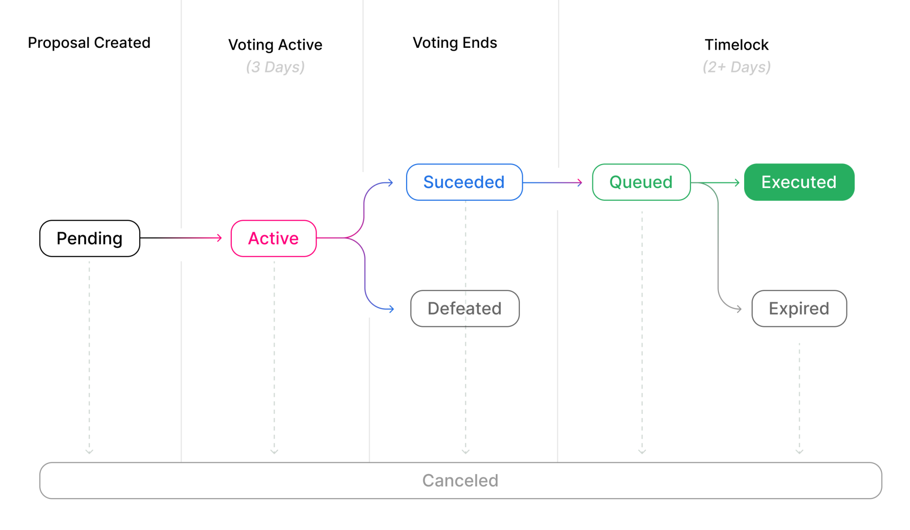

# 10-数字治理协议：数字世界中的人如何组织与大规模协作

你好，我是方军。

我们对于元宇宙的长期设想是，将人类的活动映射到数字空间，尤其是各种类型的经济活动。在元宇宙的价值互联网这个方向上，第一代区块链形成了财产所有权管理系统的雏形，之后，智能合约平台促成了数字交易协议的大爆发。

但是，单靠“数字交易协议”并不能覆盖人与人之间所有的经济互动，因为数字交易协议的代码只能处理预设的规则，不能很好地让人和人进行协商。当一群人聚在一起合作时，如何协商与决策会变成一个问题，这时，这一讲的主角就该出场了，那就是“数字治理协议”。

那么，什么是数字治理协议呢？

你可以这么看，治理协议在内涵上和现实世界中的“公司治理”很接近。一家公司的治理结构通常是这样的：股东是公司的所有者，股东大会是公司的最高决策机构，我们又会选出董事会和监事会来管理公司的利益。董事会将管理经营权委托给 CEO、总经理和管理团队，由管理团队来经营公司。

在数字空间中，当一群人聚在一起形成以经济目标为主的组织时，我们也相应地需要类似的利益的协商与授权机制。

## 治理协议的诞生

治理协议的诞生过程不像交易协议那么简单直接。交易协议的目标就是用自主运行的程序取代各种中间人，只要技术条件成熟，各种各样的交易协议会大量涌现。2020 年到 2021 年这段大爆发时期，人们用智能合约把各种交易都搬到了数字空间中来。

但是，治理协议并不是简单地把公司治理搬到数字空间中来，因为数字空间中其实并不存在公司这种商业主体。人们是在发展数字交易协议、构建新的组织、处理决策与利益的过程中才慢慢意识到：当大规模的人群在数字空间中展开协作时，我们需要某种机制来协商与授权，让大家按这些机制来决策与执行问题。

一些治理协议的原型开始出现了。治理协议是人们在数字空间中组建各种组织时慢慢摸索出来的。它的难点是：很难预设规则，只能是在过程中逐步形成规则。

举例来说，在发放薪酬时，是多劳多得好呢，还是奖励先进、兼顾公平好？再比如，在投票决策时，是一人一票好呢？还是一股一票好？而且，这种二分法也不能覆盖所有情形。在处理专业问题时，有人会觉得这两种方式都不够好，他宁愿把投票权交给专家。当人们在数字空间中构建存在协作的商业组织时，大家又开始从最基本的需求探索这些治理问题，形成治理协议的原型。

在具体讨论治理协议之前，我猜你可能想问，现在的互联网平台为什么不需要治理协议？互联网平台的现状不是挺好的吗？

实际上，治理协议正体现了元宇宙对当前互联网的一大升级。我们互联网的现状是，用户和所有参与者不自觉地把自己的决策权交给了各个平台。以打车平台为例，各种规则的制定、执行都是平台方来完成的，乘客、司机、社会公众基本上没有参与。社交平台决定推荐首页信息的算法规则，不会考虑我们作为用户的意见。

因此，元宇宙视角下讨论治理协议，是主张把各个网络的治理问题推到台面上来，它还主张把制定规则的权利归还到参与者手中，然后尝试探索出一些适合未来的治理协议。

那么到现在为止，我们探索治理协议取得了什么阶段性成果呢？接下来，我们就一起来看看。要说明的是，我不会采用宏大的叙述方式来讨论一般性的人与人的协商与授权，只是聚焦跟利益分配有关的治理协议。

跟利益分配有关的治理协议是治理问题的一个子集，它相对更容易达成一致，也更容易通过技术手段协助实现。这也是价值互联网要处理的问题的主要范畴（价值互联网关注的是财产所有权、高效交易、创造价值、利益分配等等）。

在我看来，价值互联网中的治理协议从三个方面借鉴了思路：第一个是开源软件，第二个区块链最初的共有网络设计，第三个是科技互联网公司的风投与期权机制。在价值互联网发展的过程中，人们把从这个三个方面借鉴来的经验结合起来，形成了治理协议的最初原型。

最初，治理协议的方案一半类似于开源软件，在代码及知识产权层面采取完全开源的机制；另一半则是所谓“共有网络”，网络由所有参与者共建，也属于所有参与者。

一般来说，开源软件有三个主要的特点。

第一，产权属于公域、属于所有人。具体到不同的开源协议会有微小的差别。

第二，开源开发者凭借热情编写代码，既不求回报，通常也得不到回报。

第三，商业公司可以用开源软件构建自己的产品与服务，但通常它开发的产品要按照相应的版权协议也对外开源。同时，很多广泛应用开源软件的公司，也会向开源社区捐赠资金和自己的其他代码。

可以看到，开源软件的设计中没有触及所有权问题，开源软件是属于公域的，它也不需要处理利益分配问题。今天我们看到的绝大部分区块链技术和交易协议，在代码层面都是开源的。

价值互联网不只是开源软件，技术人员通常还会用这些开源软件运行起一个个网络。比如比特币区块链网络这样的基础网络，Uniswap 这样的去中心化金融交易网络，还有 OpenSea 这样的 NFT 交易网络。那么，网络的所有权属于谁呢？

一开始，人们的选择是构建一个共有网络，由参与者共建，也属于所有参与者。以最早的比特币区块链网络为例，为了让这样一个分散在全球互联网上的分布式系统能够达成共识，它采用了“技术 + 经济”的共识机制。提供算力参与竞争的节点会得到经济回报，他们会拥有整个网络所有权的一小部分。如果这个网络逐渐发展壮大，那么这一小部分所有权就会变得很有价值；相反，如果这个网络失败了，那么这部分所有权的价值会很小、甚至是零。通过这样的方式，它既实现了共有网络，又使得所有人的利益在中长期保持一致。

我们拿它跟纯粹的开源软件对比一下。

第一，代码开源，这一点没有变化。开发者还是凭热情编写代码，不求回报。

第二，开发者和其他参与者一起，用开源软件运行起来一个网络，并为用户提供服务。网络中的所有参与者都可以拥有网络的部分所有权。网络的所有权被按照某种规则奖励给了参与者。

到这里，我们就有了价值互联网里网络的运行机制：开源软件 + 共有网络。

它的一半还是采用开源软件的方式，继续仰赖开源程序员们的热情。这是可行的，因为新的技术在初期总是极具魅力，程序员们也乐于奉献。另一半则是奖励网络中的主要参与者，也就是那些需要投入资金购置算力资源、参与算力竞争的人，其他参与者会被忽略掉。这也是合理的选择，这类似于最早人们组建一家公司，只有出资者才能获得股权，他们不考虑让技术或知识产权入股，也不会让管理者获得干股。

总的来说，共有网络的设计是非常精彩的：网络由多方共同运维，共同拥有，共享收益，共担风险。

但不可避免地，我们还是要面对治理协议相关的问题。第一个问题是，权益怎么分配呢？第二个问题则是，如何就软件的开发、网络运行、及长期发展方向等问题形成决策呢？

接下来，类似于科技互联网公司的风投与期权机制被引入进来了。这是自然而然发生的。在价值互联网领域出现了大量技术项目之后，公司需要融资支持技术研发，它们也需要在主要创始人、早期员工、早期用户之间分配利益。这些团队里的创始人、投资人本来就是科技互联网与风险投资浪潮中的人，他们就很自然地将自己熟悉的风投、期权概念引入进来了。

但要注意，他们引入的风投和期权机制并不是像科技互联网公司那样按天使轮、A 轮、B 轮、C 轮融资，然后投资机构获得公司的股权。这群人是在之前的代码开源和共有网络的基础上引入了风投与期权机制。通常来说，在价值互联网中，机构投入资金获得的不是一家公司的股权，而是获得共有网络的一部分所有权，和创始团队、员工、早期参与者获得的是同一性质的东西。

更重要的是，公司在给早期投资机构、给创始团队分配利益时，不改变共有网络的共有特性。共有网络的所有权是分配给所有利益相关者的，包括创始团队、投资机构、用户、服务提供者等等。

为了便于说明，我们假想一个案例：有一家类似于滴滴的打车平台叫“ABC 平台公司”，围绕这个平台形成了一个打车服务网络。这里我们讨论的主体其实是“打车服务网络”。

通常来说利益的分配是这样的：打车服务网络的所有权有 30% 属于 ABC 平台公司，这 30%又可以分配给创始团队、投资人、员工，而这个打车服务网络其他 70% 的所有权则按照贡献分配给了司机、打车用户以及为服务网络做出贡献的人。这与当前互联网平台逻辑下平台公司持有 100% 的所有权的方式是截然不同的。

因此，这就在代码开源、共有网络之外，给价值互联网治理协议增加了一个新原则：参与者按贡献获得回报。

为了将所有权权益公平地分配给贡献者，人们尝试了各种独特的机制：有的区块链项目推出名为 Grant 的奖励计划，给参与开发的外部工程师与团队分配奖金，推动他们参与技术产品的迭代；有的项目给早期用户不加区分地发放奖励，来冷启动网络、提高网络的密度；有的项目按照用户的使用频率等各种指标奖励忠实用户，以推动网络的健康生长。各种各样的新做法还在不断地涌现，它们的目标是相似的：吸引早期参与者，尽量扩大共有网络，并通过所有权实现利益共享、风险共担。

总之，到这里，代码开源、共有网络、按贡献获得回报三者结合起来，初步形成一个适应价值互联网发展的利益分配机制。而治理协议，就是受到这三者的启发产生的利益分配协议。由于网络是共有的，如何进行决策则是衍生出来需要处理的问题，这是治理协议的又一个重点，也是我们接下来要讨论的内容。

## 治理权的落实

共有网络属于所有参与者，那么作为“主人”，参与者应该要能对网络的重大事项有发言权、决策权吧？这是一个新问题。我们以一个典型场景为例更形象地说明一下。

假设一个创始团队只拥有一小部分权益，但是，由于他们控制着技术系统，他们对共有网络有着实际控制权。那么，怎么将控制权从创始团队手中拿出来，让所有参与者来共同决策与控制呢？

一种极致的做法就是将治理权完全交给代码，让代码按规则自主运行，也即是有人说的“codeis law”，代码即规则。在区块链上，我们可以用区块链和智能合约的技术特性很容易地实现这一点。

我们来看看这种把治理权交给代码实现的做法。要把问题解释清楚，我们还需要知道一些技术前提：你可能已经一再听说了，已经部署在链上的智能合约代码是不能修改的。是的，智能合约代码不能修改。但是，智能合约可能会有一些有特别权限的账户（比如 Owner 账户也就是所有者账户），这些账户可以调用某些函数，从而改变智能合约的运行参数。这一定程度上也能改变智能合约的运行规则。通常，这些特别账户由团队掌控，方便在必要时对智能合约进行变更。

有人就想，我们可以利用智能合约的特性，把共有网络的治理权完全交给代码。这很容易做到，我们将这个 Owner 账户转给零账户（所谓 0x0 地址）就可以了。由于没人有零账户的私钥、不能用它调用那些特别函数，因此，没有人拥有特别权限了。从此，这个共有网络会完全交给事先写在代码中的规则来运行，所有参与者只能遵循在代码中的预设规则。

我相信，你马上就可以看出这种方法的问题：如果以后需要变更参数怎么办？

一个改进的思路是这样的：直接放弃 Owner 账户过于简单粗暴，我们可以把这个特别权限交给一个多签账户。所谓多签账户，顾名思义，是一个由多方共同掌控的账户，只有获得了多方的共同认可，它才能执行某个动作，比如调用函数、变更参数。这样做的效果是，相比由创始团队单独掌控特别权限，现在这种机制把控制权交给了一个更可信的群体——多签账户背后的那一群人。

我们用一个技术项目的具体场景来解释这个问题。

比方说，项目智能合约的特别权限已经转给了一个包含五个人的多签账户，这五个人分别代表不同的利益方，他们分别来自团队、投资机构、服务者代表、用户代表、独立专家。同时，多签账户的使用规则为，一个决议需要至少四方签名方可执行。

我们还可以进一步引入更多的治理机制。比方说，这五个人不是自己判断就可以决策了，他们只是替所有参与者掌控签名权。我们可以这样设定规则：重要提案必须有 40% 以上的所有权份额持有者参与投票，赢得投票的各方的所有权份额加起来应占投票总份额的 51% 以上。这五人必须按照社区投票规定签名执行。在某些情况下，我们可以将投票和执行的过程自动化。比如，一旦完成投票就可以直接调用智能合约相应的函数，而不必让这五个人手动签名。

我们还可以再往前走，把其他的重大事项也设定为必须由所有参与者投票决策。比如，团队发起提案，将下一年度的团队运行资金预算定为 100 万美元；或者有人建议向高校捐赠 100 万美元以推广技术等等。这些重大事项也必须由参与者投票。

我们能这样做的是有技术基础的。一个共有网络的所有权是以通证形式分配出去的，让所有者凭通证进行投票既真实又安全，几乎不可能出现虚假投票的情况。

到这里，治理协议在技术上的建设就基本完成了：共有网络通过一个合理的技术路径，将决策权交到了每一位所有权持有者的手中。市面上也出现了一些对应的管理工具，比如多签、投票、社区讨论等。

不同的共有网络可以借助这些工具实现自己的治理，当然它们可以根据自身的特点设定具体的规则。比如，谁可以获得所有权？多签委员会由谁来组成？什么样的事项需要投票？投票采取什么规则？出现争议如何解决？这些问题需要具体问题具体分析，由特定网络的所有参与者来达成共识、最终形成网络内部的规则。

总结一下，落实治理权时的逻辑其实是很简单直接的：各参与方共同拥有网络的所有权，重大事务由大家按规则共同决策，关键是找到可信又可行的技术手段具体落实下来。

你可以通过下面这张图加强理解：

- Uniswap交易协议的提案、投票、执行流程

## 经济社群与去中心化自治组织（DAO）

在有了各种工具来就利益进行协商、授权时，人们开始发现，其实一群人在一起构成了一个“经济社群”，它的组织管理方式则是 DAO，去中心化自治组织。

先看经济社群，这是我们造的一个词。我们把价值互联网中的一个个网络叫做共有网络，这个词强调的是，这个网络是由所有参与者共有的。如果我们从参与者的角度来看，会发现所有的参与者平等地组成了一个社群，大家通过这个社群共同地达成某种经济性的目标，我们把这些参与者组成的群体叫“经济社群”。

经济社群是我们在向数字世界转移时出现的事物，是现实世界中公司和社群两者的组合体。在实体经济中，常见的经济组织形态是有限责任公司，它是属于股东的。我们很多人是作为员工在公司中工作。另外，我们还可能参与过某种兴趣社群，如果你喜欢摄影、钓鱼、读书，你可以在网上和别人一起讨论，也可以参加线下活动。通常来说，在这种社群中，人与人之间几乎没有经济关联。

在我们全面进入数字空间的时候，公司与社群融合起来，一群人在数字世界中组成了一个群体，他们共同创造和分享经济价值。这个群体有像公司一样的经济目标，群体内人与人之间的关系又经常是兴趣导向的。

经济社群这样的组织在现实中其实也有，比如美国的 NBA。它的上层组织就很像一个公司，负责组织比赛、推广比赛、获得经济收益，最后分配利益。NBA 的上层组织又像是一个协会，各个球队是协会的会员，而不是分公司，协会是用规则来协调和规范各个球队。在实体世界，经济社群是特例，但当我们以个体方式迁移到数字空间，经济社群将可能成为人与人协作的主要形态。

经济社群还有一个响亮的三个字母缩写而成的名字——“DAO”（去中心自治组织）。现在区块链领域出现了各种各样的 DAO，有投资 DAO、艺术收藏 DAO、游戏公会 DAO 等。在我看来，DAO 代表的是组织的管理方式，也是实现这种新管理方式的技术手段。也就是说，DAO是经济社群的管理方式与技术实现。我先给你一个我认为较为全面的 DAO 的定义：

- DAO 是由去中心化的区块链上的智能合约协调运转的组织。DAO 存在的目的是运行一款产品网络，网络的所有权属于一组特定的成员。成员按规则进行决策去修改产品参数和代码，处置实体的资金。

这个定义有点拗口，简单地说，DAO 就是基于智能合约的组织管理方式。

到这里你就可以看到了，就同一个事物我们提及了三个名词——共有网络、经济社群、去中心化自治组织（DAO）。它们其实是在讨论一个事物的不同方面：共有网络关注的是技术上的网络，经济社群说的是人与人的社群，DAO 关注的是组织管理方式。同时，每个词前面都是它们的修饰词。通过修饰词，我们强调网络是共有的、社群是经济导向的、组织方式是去中心化的与自治的。

所谓价值互联网中的治理协议，就是将利益分配的规则、治理权的落实用技术手段实现，也就是用智能合约来实现。它与实体世界中公司治理的不同是，治理协议最后大部分变成了程序代码，并由代码来按规则执行。

## 总结

好了，这节课就讲到这里。小结一下。在这一讲中，我们一步步地跟着治理协议的诞生与发展演变过程，看到了未来数字空间中人与人的协作方式，我们还了解了相关的技术手段。

首先，价值互联网中的组织实体通常遵照三个原则运作：代码开源、共有网络、按贡献获得回报。

既然网络是参与者共有的，那么就要把控制权交到所有参与者手中去，这带来了诸如多签、投票等技术性手段的使用。之后，人们开始关注到数字空间中新的组织形态，并展开大量的组织试验，这就带来了经济社群与 DAO 管理方式。总结起来看，所谓的数字治理协议，就是将上面这一系列原则、手段、管理方式都通过智能合约在技术上实现出来。这也是当前最热门的创新领域。

到这里，我们“价值互联网”部分的课程就结束了。通过对数字财产确权、数字交易协议、数字治理协议的学习，相信你已经看到，这些技术为我们将人类经济活动迁移到数字空间提供了很好的技术基础。

元宇宙 = 立体互联网 + 价值互联网。立体互联网，为我们创造了身临其境的三维立体体验。价值互联网，将所有权和经济规则引入了数字空间。我们看到立体互联网和价值互联网的技术准备与应用实践都有了很好的准备。因此，元宇宙，这个让我们可以生活和工作在其中的数字空间，正不容置疑地离我们越来越近了。

## 课后题

在这一讲的最后，给你留一道关于数字治理协议的思考题。

假设说，你是一个共有网络的参与者，你因为贡献拥有了网络所有权的一部分，成为了它的“主人”，那么，你希望自己的意见以什么样的方式被其他人接纳呢？

欢迎在评论区留言写下你的想法。
