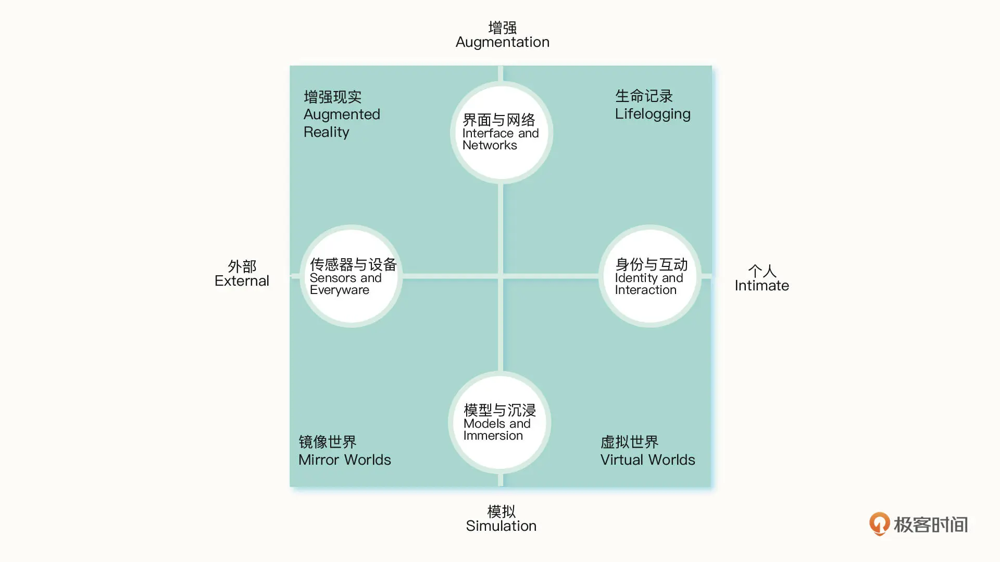
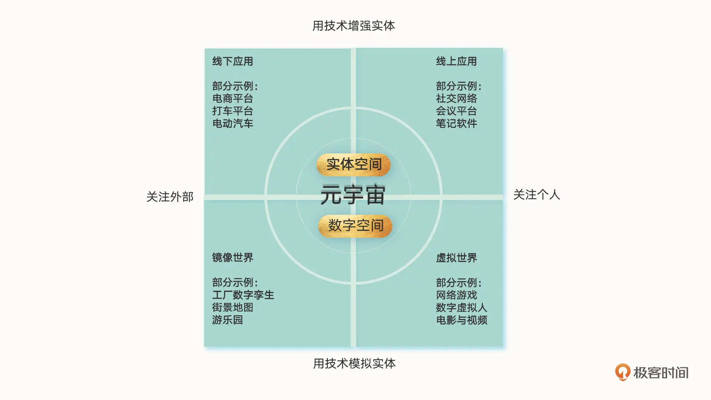

# 11-走向元宇宙：元宇宙的四大应用象限

你好，我是方军。

在前面的十讲，我们详细讨论了元宇宙相关的技术与应用，也一起展望了元宇宙作为下一代互联网的各种可能性。但我想，你可能还会有一个问题：在元宇宙时代，会有哪些典型的应用呢？

这一讲，我就来给你分享一个我常用的“元宇宙四大应用象限”分析框架，帮你分门别类地看到未来各种元宇宙应用的可能性。

## 元宇宙应用框架的提出

我的体会是，一个好的分析框架能帮助我们更好地理解技术的可能性。

比如，在移动互联网时代，“SoLoMo”是一个影响了我们很多人的分析框架。它把移动互联网的应用分成了三个方向：社交的（Social）、基于地理位置的（Local）和移动的（Mobile）。十多年过去了，移动互联网的多数应用仍然可以被归入 SoLoMo 所提及的这三个方向。比如，社交类的应用有微信、抖音，基于地理位置的应用有地图、支付，移动的应用有视频、在线会议等等。

开始探索元宇宙的时候，我也希望找到一个适用的分析框架。一开始我自然是把视线放在了市面上现有的元宇宙分析框架。比如，有全球金融机构从投资角度将元宇宙分为“基础设施、交付设备与内容”三大类。元宇宙专家乔恩·拉多夫提出了元宇宙的七个层次，将元宇宙分成了“基础设施、人机交互、去中心化、空间计算、创造者经济、发现机制和体验”等七个部分。我自己也按技术分层的方式将元宇宙分为“用户界面层、价值计算层和社会逻辑层”三个层次。

这些分析框架各有特点，也各有用途。但如果想要用它们来分析元宇宙的应用，我总觉得不太适用。2021 年底，我查资料时发现，其实在元宇宙领域，早就有了非常棒的应用分析框架，也就是我们这里讨论的“元宇宙四大应用象限”。

这个分析框架的历史相当悠久，它最早可以追溯到 2007 年，这同样也说明元宇宙是经过长期孕育而形成的。2007 年，产学研各界人士一起举办了一场名叫“元宇宙路线图”的元宇宙峰会，峰会的主要成果之一是一份 100 页左右的行业目录和调研报告。

在报告中，约翰·斯马特等人从两个维度尝试对元宇宙的应用进行分类。第一个维度是关于使用场景，我们用技术是去模拟实体世界、还是用技术增强实体世界？第二个维度是关于使用目的，我们用技术的目的是关注个人，还是关注外界？也就是说，我们的重点是用技术产品丰富人的内心感受，还是用技术产品去改造人所处的外部环境？

用这两个维度分别作为横轴和纵轴，他们把元宇宙应用划分成了四个象限，你可以在文稿中看到最初的四象限图表。

- 初版元宇宙四象限图，轴上的技术元素为后来所加

我们可以在这四个象限图当中找到现在各类元宇宙应用的位置。

比方说，如果我们关注的重点是人的内心，而且想要用技术模拟实体世界，那么我们创造的就是四象限中的虚拟世界。而如果我们主要关注的是人所处的外部环境，同时强调用技术模拟实体世界，那么我们创造的就是四象限中的镜像世界。这里又冒出了两个新名词：虚拟世界和镜像世界。它们是什么意思呢？我们一会儿接着往下看，一步一步地理解它们的内涵。

这之后，有些人进一步优化了这个四象限图。比如在上面加上相应的技术要素：关注个人时，技术要素是身份与互动；关注外部时，技术要素是传感器与穿戴式设备；关注模拟时，技术要素是模型与沉浸体验；关注增强时，技术要素是界面与网络。

总的来说，这个 2x2 的四象限图为探索元宇宙应用提供了一个很好的分类框架。

举个例子，关于元宇宙的应用有一种设想是，在数字空间中建造一座现实工厂的数字孪生，也就是建立一座工厂的数字模型。它可以对实体工厂的运转进行可视化呈现，模拟实体工厂的各种生产活动。这类应用其实就落在镜像世界这个象限。

再比如，网络游戏《我的世界》让我们用体素也就是立体小方块搭建建筑物、建立虚拟空间，《Detraland》注重将实体世界中的建筑和场景重建出来、构成一个虚拟城市，所以它们都落在了虚拟世界这个象限。

不过，这个四象限模型是很早之前被提出来的，在十几年后的今天，其中有些名词已经在其他领域有了更广为人知的内涵。比如它有一个象限叫做“增强现实”，这跟我们现在理解的增强现实并不是一个意思。

因此，为了让这个四象限分析框架继续发挥作用，又不产生不必要的歧义，我对它做了小小的调整。我把框架里增强现实、生活记录两个象限的名字重命名为“线上应用”和“线下应用”。这样就得到了一个我们在当下可以用来理解元宇宙应用的分析框架，我们也称它叫“元宇宙的四大应用象限”。

在文稿中，你可以看到我调整出来的四象限图，我在里面的各个象限都列举了一些元宇宙应用作为示例。

我们创造元宇宙的目的是用计算机与互联网技术改造外部世界，同时让人与人之间的连结更紧密。所以，在这个 2x2 的四象限图中，横轴的一端强调的是个人，另一端强调的是外部。另外，我们也知道，元宇宙是信息化、数字化、网络化的进一步深化，它既有在纯粹的数字空间的部分，也有实体空间的部分。体现在纵轴上的就是模拟实体世界和增强实体世界两个方向。

为了更精准地表示四象限中的事物，我们还做了一个小小的说法上的区分。我们把用技术增强实体的两个象限称为“应用”，所以横轴上方的两个象限分别叫做“线上应用”和“线下应用”。我们把用技术模拟实体而形成的数字空间称为“世界”，横轴下方的两个象限分别叫“镜像世界”和“虚拟世界”。

这么讨论是不是还是有点抽象？让我们用不同领域的游戏来类比、解释一下。

- 如果你创造了一个网络游戏，比如像《我的世界》，那你就是创造了一个玩家可以沉浸其中并参与建造的世界，这个世界是用计算机模拟出来的，我们称它为虚拟世界。

- 如果你去迪士尼乐园玩，你会发现它其实是一个人造的世界。它是现实中的城堡和幻想中童话的结合体，走进它的大门，你就走进了一个镜像世界。

- 如果你把游戏思维用在工作上，比如参与公司安排的在线学习，公司规定学习总结获赞最多的人可以获得额外的奖励，这就是游戏化了的线上应用。

- 如果你在线下的培训中组织了一个游戏环节，它则是线下应用。

用这个框架来观察元宇宙应用有一个明显的优点，那就是我们不会局限在某个方面，而是能够清晰地看到元宇宙应用现在与未来的全貌。

比方说，最近一年，Decentraland、百度希壤等虚拟城市，还有纯虚拟的数字物品（如国外的NFT、国内的数字藏品）都非常火爆。但是透过这个分析框架，我们立刻可以看到，这些流行的概念其实都落在了虚拟世界这个象限。除了它们之外，元宇宙应用还有三个象限，还有很多的可能性。

## 元宇宙应用就在你我身边

这个元宇宙四大应用象限除了能够帮我们理清不同应用所处的位置之外呢，还可以让我们更好地认识身边已经存在的元宇宙应用。

这也是在讨论元宇宙时我和其他人的一个不同点。很多人在谈起元宇宙时主要是在畅想未来。但是我认为，虽然现阶段元宇宙技术和应用还远没有成熟，但是它们已经在我们身边了。比如在讨论立体互联网和价值互联网相关的技术时，我们看到 iPhone 手机已经可以制作出逼真的三维模型了，你也可以通过手机 App 很容易地获得一个数字藏品。

施乐公司的首席科学家约翰·布朗曾说：“展望未来的正确方式，不是向前看，而是向周围看。”我很推崇这个元宇宙四大应用象限分析框架，也是因为它可以帮助我们更好地向周围看，帮助我们发现身边已经有的多种多样的元宇宙应用。当然如果再准确一点的话，我们也可以说它们是各种元宇宙应用的雏形。

接下来，我们就通过元宇宙四大应用象限分析框架向周围看看，通过它来理解元宇宙应用的现在与未来。

我们先来看看横轴的上半部分。因为元宇宙是计算机、互联网的延续，所以，元宇宙应用其实并不是全新的事物，而是现有计算机、互联网应用的延续。因此，列举四象限图上的线上应用和线下应用时，我们将一些常见的互联网应用加了进去。比如，在线上应用中，我们列入了会议平台；在线下应用中，我们列入了电商平台。我的看法是，只要我们在现有的应用上增加一些特性，就可以把它们变成元宇宙应用。

举个例子，如果我们可以用三维立体的数字化身（Avatar） 去参加在线会议，那么这些在线会议平台就变成了元宇宙会议平台。在未来的超市里，我们可以用特殊的眼镜看到货架上的商品，但其实，商品并不在货架上，它们只是用混合现实的方式投射在了我们的眼镜片上，尽管如此，我们还是可以方便地下单购物。如果这样的购物方式如果能够实现，那你完全可以说，我们正在使用一种元宇宙电商平台。

对于四象限中的虚拟世界和镜像世界，我们也可以用同样的方式来观察。现有的很多网络游戏都是彼此独立的，如果这些游戏都能够在底层接入价值互联网，那么用户就可以把一个游戏世界里的道具带到另一个游戏世界了。游戏的目的是满足人的内心需求，也就是关注个人。这些连接起来的多个游戏，就构成了元宇宙虚拟世界。

工作这样的行为也可以搬入数字空间。和游戏不同的是，工作的目的是满足人的外部需求，它的工作的主要功能之一就是获得收入。因此，和工作相关的产品会落入镜像世界这个象限。

在未来，一个人可以用数字方式绘画，他的作品还可以在网络上传播和交易，也就是说从创作到卖出的全流程都可以在这个镜像世界里完成。

再比如，在这一次准备《说透元宇宙》这个专栏时，我和极客时间的编辑老师并没有线下碰面，我们的所有准备工作都是在镜像世界里完成的。我们通过微信与在线会议讨论课程的方向，用在线文档协同修改文稿，连合作协议都是用在线签约工具完成的，根本不需要来回邮寄纸质版的协议。你可以说这个课程是一个元宇宙镜像世界中的工作成果。

讨论到这里，你可能会有一个小疑问：按你这么说，这四个象限里面的应用看起来本来就有了啊，元宇宙好像也没带来多大的改变啊？

我的想法跟你恰好相反，我认为，如果现在关于元宇宙的种种设想都变成现实，它带来的变化会相当大。

比如说，在现在的社交网络里，我可以在朋友圈给你点赞，而在元宇宙的社交网络中，我可以拍拍你的肩膀说：“干得真棒！”浏览现在的电商平台，你可以看到衣服的图片、视频，而在元宇宙的电商平台里，你可以直接试穿衣服，就像在线下实体店里一样。你能身临其境地步入三维立体互联网，获得全新的感官维度；你可以进入到可以掌握财产所有权的价值互联网，在数字空间中也成为拥有自我主权的人。

用元宇宙四大应用象限图观察现在的互联网，我们会看到，现有的互联网应用也在关注个人、关注外部，现有的互联网技术也在模拟实体、增强实体。

但是，当前的各种应用的发展水平还处在接近原点的小圈里。我们现在用计算机技术模拟出来的实体都很粗糙，用技术增强实体的能力也不够好。但是只要技术持续进步，应用的技术就会从原点不断向外扩展，等扩展到某个临界点时我们会突然发现，元宇宙虽然是在现在的互联网应用基础之上发展出来的，但又已经大不一样了。

## 总结

好，我们这一讲就讲到这里，我来做个小结。刚才，我们重点讨论了能够帮我们更好地展望元宇宙应用的分析框架，也就是“元宇宙四大应用象限”。

元宇宙四大应用象限强调用横向和纵向两个维度来分析未来的元宇宙应用。在横轴上，一端关注“个体”，另一端关注“外部”；在纵轴上，一端是“用技术增强实体”，另一端是“用技术模拟实体”。

这两条轴线相互交叉，将未来的元宇宙应用分成了四个象限，它们分别是：线上应用、线下应用、镜像世界、虚拟世界。

透过这个分析框架我们可以看到，各种各样的元宇宙应用早已分布在我们的周围了。如果技术进一步发展，这四个象限的范围会进一步向外扩展。也就是说，在技术的支撑下，数字与实体融合的元宇宙将会成为我们工作与生活的空间。

元宇宙时代的工作和生活将会是怎样的呢？下一讲，我们就一起跳跃到未来，看看这次技术浪潮到底会让我们的生活变成什么样子。

## 思考题

最后，给你留一道思考题。

对于线上应用、线下应用、镜像世界、虚拟世界这四个元宇宙应用象限，你认为哪个象限会率先爆发？你的理由是什么？

欢迎在评论区写下你的想法。
