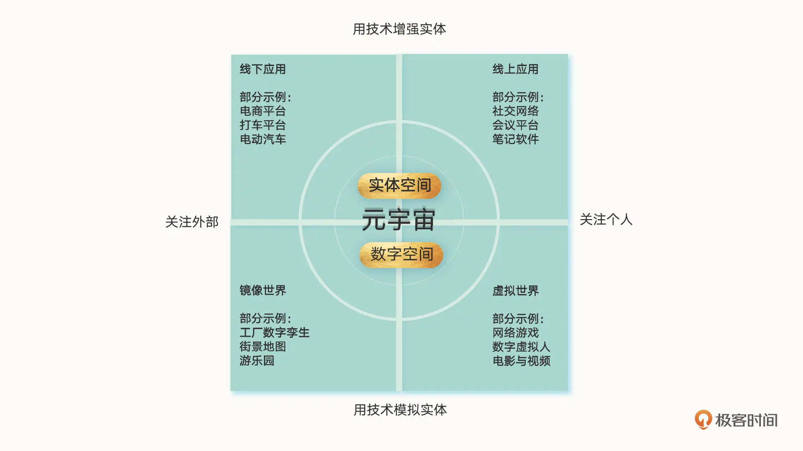

# 结束语-迎接下一代互联网的无限可能

你好，我是方军。

一起探索元宇宙的时间过得很快。在《说透元宇宙》这门课程中，我们一起深入探讨了元宇宙的技术与应用，希望这些讨论已经为你未来继续了解元宇宙准备好了必要的知识、工具与路线图。

今天这最后一节课，我想和你再一起梳理一下我们的元宇宙知识图谱，也跟你分享一下这段时间我在元宇宙这个领域工作的三点感想。

## 元宇宙知识图谱

### 元宇宙 = 立体互联网 + 价值互联网

在我看来，元宇宙是下一代互联网，是互联网融合实体世界与数字世界的最新尝试。具体而言，我又把元宇宙这个下一代互联网拆分成了两个部分：立体互联网与价值互联网。

立体互联网，指的是用计算机技术来构建三维立体的世界；而价值互联网，是指用计算机技术来构建价值流动的世界。再强调一下，所谓价值就是数字世界中的财产所有权。

### 立体互联网

立体互联网部分的技术挑战是，用计算机创造一个可以欺骗我们感官的、让我们可以沉浸其中的数字世界。

这个数字世界可以是完全数字化的，它和实体世界完全分离。具体的例子可以参考虚拟现实头盔，戴上它你就可以进入到完全数字化的世界。不过，这个数字世界也可以是与实体融合的，比如，你戴上混合现实眼镜，就既能够看到真实的物体，又能看到数字物体。

用计算机实现这样的数字世界需要完成下面三大任务。

第一，扫描实体世界，用技术捕捉实体物品的三维模型。

第二，渲染数字世界，用图形芯片与算法创造以假乱真的画面。

第三，操控数字世界，让人可以与数字世界的人和事物互动。

总的来说，立体互联网给我们创造了又一个与世界上其他人更好地连接的新空间。

### 价值互联网

我们还希望将人类社会中更多的经济活动转换到数字空间中去，这就需要价值互联网的帮助。

在数字空间中，我们要进行数字财产的确权，用技术促进各种交易与协作。现在看，以区块链技术为基础的价值互联网，为数字财产确权、数字交易协议和数字治理协议铺设了底层的基础设施。

目前，价值互联网相关的新兴技术平台正在获得大量的风险投资，被认为是最欣欣向荣的技术领域之一。

对比而言，元宇宙的两个领域中，立体互联网是大公司的主战场，而价值互联网是新创公司的主战场。

### 元宇宙四大应用象限

在课程的最后一模块，我还跟你分享了元宇宙四大应用象限。这个应用框架的原型是约翰·斯马特等人提出的。2007 年，他们从横向和纵向两个维度对元宇宙应用进行了分类分析，形成了最初版本的元宇宙四象限。在这个象限图的横轴上，一端是“关注个体”，另一端是“关注外部”；在纵轴上，一端是“用技术增强实体”，另一端是“用技术模拟实体”。

我沿用这个 2x2 的分析框架，又稍微调整了其中几个象限的名字，形成了“元宇宙的四大应用象限”，它包括线上应用、线下应用、镜像世界和虚拟世界四个象限。

透过这个分析框架我们看到，现在在四个象限中都发展出了一些互联网应用。随着元宇宙相关技术的发展，当我们能够越来越好地模拟实体世界、增强实体世界时，我们会从原点不断往外扩张，在某个时间点从量变达到质变，实现数字与实体全面融合的未来元宇宙。

元宇宙在过去一年多掀起巨浪，正是因为它给了我们全面数字化的希望，为我们打开了通往新世界的大门。

## 元宇宙发展的可能方向

我们也要认识到，我们正处在元宇宙大发展的初期，未来的元宇宙是什么样子，需要我们在实践中去摸索。

从去年开始，我也参与了不少元宇宙项目的建设。我很享受这个过程，因为这不是空谈，而是用我们已有的技术去尝试建造点东西出来。

但这个过程不可避免地会遇到困难、遇到障碍，这让我开始痛苦地反思，并问自己下面这样的问题：元宇宙发展的正确方向究竟是什么呢？我们自己在元宇宙发展中扮演的角色应该是什么呢？对这些问题，我也跟朋友有过各种各样的争论，估计你一定也对元宇宙的未来非常好奇吧。这里，我想跟你分享我的三点思考。

现在的元宇宙项目多数以构建三维立体的虚拟世界为目标。人们不自觉地把注意力都放在了三维模型上：要设计出漂亮、宏大的景观，要用 Unity3D 引擎制作建筑模型，要创造出用户可以聚集的场景（比如广场）。

那么问题来了，进入这一个个元宇宙的用户能获得什么呢？

体验了这么多元宇宙之后，我的感觉是，除了尝鲜体验之外，我很难找到城市、建筑、广场和自己的连接。我们可以用现实世界类比，CBD 的高楼大厦当然形成了城市美丽的天际线，但更实际影响我们生活品质的是我们自己的小家、办公桌，还有可以走进去消费的餐厅、咖啡馆等小空间。

这导向了我在关于元宇宙发展方向的第一个反思：当前的元宇宙建设主要采取宏大视角，我们把所有的资源都用来建造庞大的、如真如幻的立体城市，但这可能是一个错误的方向。

我的看法是，或许我们应该继续沿袭互联网的经验，为每一个参与者创造能让他乐在其中的小空间，那样，元宇宙才可能真正地落地。现在的元宇宙都是超级宏大的宇宙，而走向未来的传送门却可能是独属于每个人的小宇宙。

当下元宇宙发展过程中值得思考的另一个问题是对所有权的过度重视，或者说只看这一点而不顾其他。这个落在了我们讨论的价值互联网这个范畴里。

我们来举个具体的例子说说。无聊猿猴游艇俱乐部是去年兴起的一个 IP。无聊猿猴头像共有一万个，用户可以通过购买来持有它的所有权，然后把它作为自己社交网络的头像。比如，NBA 明星史蒂芬·库里的推特头像就是一个无聊猿猴。头像的持有者也拥有头像的知识产权和商业使用权，他们可以在头像的基础上进行再创造。我们看到阿迪达斯、中国李宁买入无聊猿猴头像后都用它开发了衍生产品。因此，它独特的所有权设计让所有者不再只是被动的主人，还可以参与共建和共创。

这个方向是值得欣喜的。但是，无聊猿猴背后的公司最近又用实际行动给我们举了个反例。几个月之前，这家公司也宣布进军元宇宙，并推出了一片数字大陆叫“Otherside（另一个世界）”。一开始，人们争先恐后地想要在这片数字大陆上拥有一块土地。但一个月之后的数据就不太乐观了：Otherside 土地的价值在暴涨之后开始大幅下跌，不管是单价还是总交易额都是如此。更糟的是，它过于强调数字土地的所有权，并没有实在的措施激发参与者共同建设的热情。

因此，无聊猿猴搞的元宇宙无论是和过去的自己比，还是和其他的写作平台（如 Mirror）、共同创作社区（如 SeedDAO）相比，都有很多不足之处。在其他那些社区中，你能够感受到人人参与的热烈氛围。

这就带来了我对于元宇宙的第二个反思：仅仅强调所有权是不够的，所有权是基础，但更为重要的是人人参与的氛围，还有支撑它的机制。

在这个方面，我们同样可以沿用互联网的经验。互联网产品会给 VC、给媒体、给潜在用户讲故事，但它们最终的目的是用产品去连接用户。价值互联网这部分的元宇宙所讲的故事是：“你是新世界的所有者、是新世界的主人。”但是，当用户被这个故事吸引过来之后，他们在乎的还是怎么和其他人连接，他在乎的是自己可以怎样与其他人互动。

我们相信，每个参与者都应该是一个个元宇宙在财产权意义上的主人，但作为未来元宇宙世界的建设者，我们不能只有这个理念，我们应该在这个基础上去创造让人与人产生联结、互动的产品与服务。

我对元宇宙的第三点思考，是在跟别人讨论的时候产生的。我在跟别人介绍元宇宙时，有的时候会遇到热情的响应，也有可能会被泼冷水，这都很正常。但另外有一类人的反应却让我非常困扰，这类人认同元宇宙就是未来这种说法，但就在你要觉得他们是典型的技术乐观主义者时，他们又说，这些技术还不成熟，元宇宙是很久之后的事。这么来看，他们其实是典型的技术悲观主义者。

我不喜欢去说服这些人，我的立场是，你信当然好，你不信就算了，我可没时间说服你。但他们的这种反应却让我想了很多。我认为，互联网既不是技术乐观主义者创造的，也不是技术悲观主义者创造的，它是那些脚踏实地的建设者一点一点创造的。

其实，互联网一直是在技术不成熟的情况下发展起来的。举一个普通用户都可以感受到的例子，十多年前，我们要尽量压缩移动 App 程序的大小，还要限制程序数据、图片的大小，只有这样用户才能有比较好的使用体验，因为当时的网络带宽很小、手机设备性能也不足。

可以说，技术从来没有完美的时刻，我们永远在遇到各种各样的问题。这几天我正在看一系列区块链的改进提案，从名字就可以看出，之所以叫改进提案，就是因为之前有问题，现在有人提出了解决方案。在用技术构建各种各样的互联网产品时，我们经历的都必然是发现问题、解决问题的循环，一轮又一轮地迭代与前进。

元宇宙作为一个典型的技术产品，也会按类似的方式迭代式前进：我们用当前还不完美的技术做点什么，做了很多设计上的妥协；我们也遇到了很多技术问题，尝试着解决那些问题；在一批又一批人的努力下，产品与服务改进得越来越好，越来越多的用户加入进来。最后，那个决定性的时刻到了，那个很早之前人们说的未来变成了现实，未来来了。

这就带来了我对元宇宙的第三个反思：不要等待技术的成熟，不要被问题所阻碍，我们其实应该继续像互联网的发展之路那样迭代式前进。

而对我们自己在这个发展过程中应该扮演什么样的角色，我的感悟是，在每一次新浪潮到来之时，我们应该努力地成为其中的一员。每十年，我们都会遇到类似于元宇宙这样的技术新浪潮，过去与现在我们的体会都是，在对新浪潮有了正确认知之后，勇于加入新浪潮。

面对元宇宙这个新趋势，你可以做悲观的批评者，可以做无所谓的旁观者，可以做乐在其中的参与者，但最佳的选择毫无疑问是做热情的建设者，尤其是早期的建设者。

总体来说，我认为元宇宙是互联网向前发展的必然一步，也是人类社会数字化的下一个阶段。我们每一个人都应该跃入其中去生活和工作。

我们的课程到这里就要结束了，但是元宇宙时代的大幕才刚刚开启。希望这门课能够让你对元宇宙有信心，也对建设元宇宙有了更多的热情，让我们元宇宙中见。
