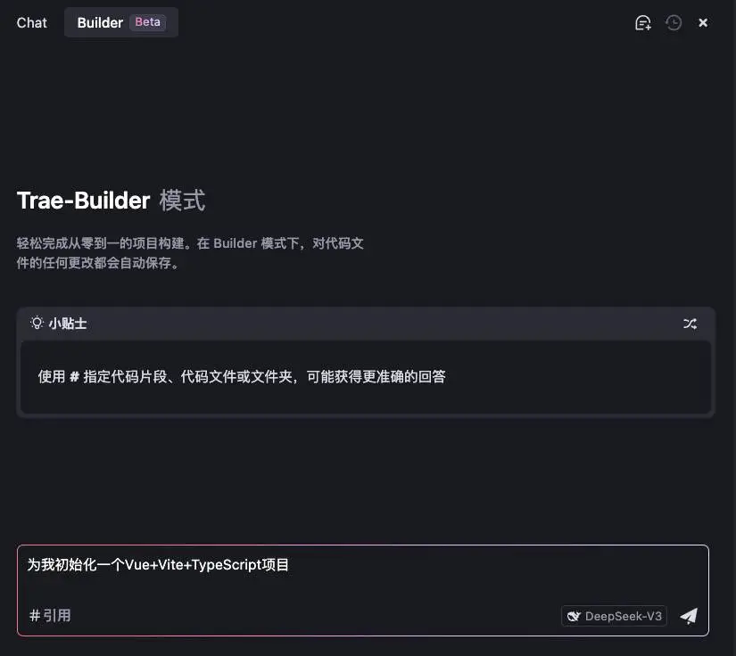
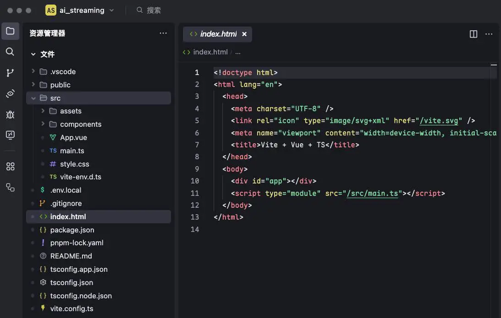
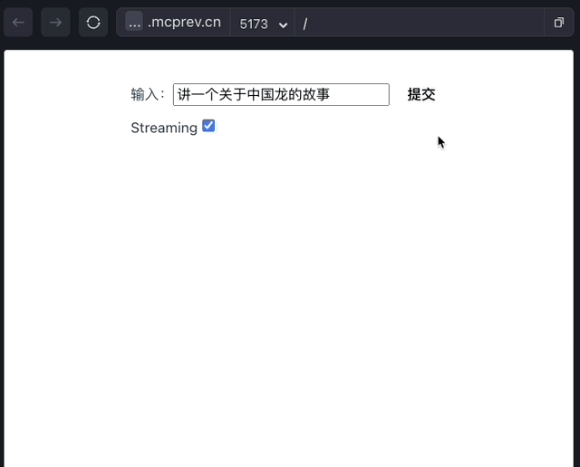
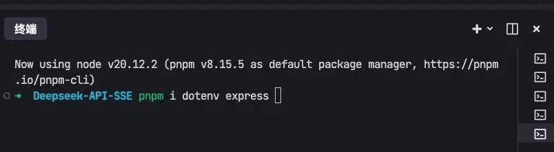

# 02 | 如何使用流式传输减少等待时间

你好，我是月影。

前一节课我们使用最简单的 HTTP 协议来处理请求响应，作为前端工程师的你，应该对这块内容并不陌生吧。

接下来呢，我们来了解一下对于初级前端工程师来说稍微复杂一点的内容，那就是通过流式（streaming）的传输方式来使用大模型 API。

## 为什么要使用流式传输

在具体实践之前，先来说说为什么要使用流式传输。

由于大模型通常是需要实时推理的，Web 应用调用大模型时，它的标准模式是浏览器提交数据，服务端完成推理，然后将结果以 JSON 数据格式通过标准的 HTTP 协议返回给前端，这个我们在上一小节里已经通过例子体会过。

但是这么做有一个问题，主要是推理所花费的时间和问题复杂度、以及生成的 token 数量有关。比如像第一节课里那样，只是简单问候一句，可能 Deepseek 推理所花费的时间很少，但是如果我们提出稍微复杂一点的要求，比如编写一本小说的章节目录，或者撰写一篇千字的作文，那么 AI 推理的时间会大大增加，这在具体应用中就带来一个显而易见的问题，那就是用户等待的时间很长。

而你应该已经发现，我们在使用线上大模型服务时，不管是哪一家大模型，通常前端的响应速度并没有太慢，这正是因为它们默认采用了流式（streaming）传输，不必等到整个推理完成再将内容返回，而是可以将逐个 token 实时返回给前端，这样就大大减少了响应时间。

如果你是熟悉比较传统的 Web 业务的前端工程师，可能会比较疑惑这种模式具体怎么实现，不要着急，我们接下来通过一个稍微复杂一点的例子，来学习和体会这项技术。

## 使用流式（streaming）传输减少等待时间

大多数文本模型，都支持使用流式传输来返回内容。在流式传输下，在模型推理过程中，生成的 token 会及时返回，而不用等待推理过程完全结束。在这一小节，我们先看一下 DeepseekPlatform 下如何使用流式传输。

首先我们从 Trae 创建一个新项目，这次我们选择创建 Vue+Vite+TypeScript 项目，在后续的课程中，我们基本上以 Vue+Vite+TypeScript 为标配。



创建的项目目录结构如下：



别忘了配置我们的.env.local 文件：

```sql
VITE_DEEPSEEK_API_KEY=sk-xxxxxxxxx
接着我们修改一下  App.vue。
<script setup lang="ts">
import { ref } from 'vue';
const question = ref('讲一个关于中国龙的故事');
const content = ref('');
const stream = ref(true);
const update = async () => {
 if(!question) return;
 content.value = "思考中...";
 const endpoint = 'https://api.deepseek.com/chat/completions';
 const headers = {
     'Content-Type': 'application/json',
     Authorization: `Bearer ${import.meta.env.VITE_DEEPSEEK_API_KEY}`
 };
 const response = await fetch(endpoint, {
   method: 'POST',
   headers: headers,
   body: JSON.stringify({
     model: 'deepseek-chat',
     messages: [{ role: 'user', content: question.value }],
     stream: stream.value,
   })
 });
 if(stream.value) {
   content.value = '';
   const reader = response.body?.getReader();
   const decoder = new TextDecoder();
   let done = false;
   let buffer = '';
   while (!done) {
     const { value, done: doneReading } = await (reader?.read() as Promise<{ val
     done = doneReading;
     const chunkValue = buffer + decoder.decode(value);
     buffer = '';
     const lines = chunkValue.split('\n').filter((line) => line.startsWith('data
     for (const line of lines) {
       const incoming = line.slice(6);
       if(incoming === '[DONE]') {
         done = true;
         break;
       }
       try {
         const data = JSON.parse(incoming);
         const delta = data.choices[0].delta.content;
         if(delta) content.value += delta;
       } catch(ex) {
         buffer += `data: ${incoming}`;
       }
     }
   }
 } else {
   const data = await response.json();
   content.value = data.choices[0].message.content;
 }
}
</script>
<template>
 <div class="container">
   <div>
     <label>输入：</label><input class="input" v-model="question" />
     <button @click="update">提交</button>
   </div>
   <div class="output">
     <div><label>Streaming</label><input type="checkbox" v-model="stream"/></div
     <div>{{ content }}</div>
   </div>
 </div>
</template>
<style scoped>
.container {
 display: flex;
 flex-direction: column;
 align-items: start;
 justify-content: start;
 height: 100vh;
 font-size: .85rem;
}
.input {
 width: 200px;
}
.output {
 margin-top: 10px;
 min-height: 300px;
 width: 100%;
 text-align: left;
}
button {
 padding: 0 10px;
 margin-left: 6px;
}
</style>
```

运行项目，点击提交按钮，你会看到 AI 正以流式传输的方式输出内容，这样就能减少用户的等待时间。



好，我们来一起看一下代码的关键部分。

首先，流式输出的 API 调用机制，和普通的 HTTPS 输出没有什么区别，都是通过 POST 请求，只不过提交的数据中，将 stream 参数设置为 true。

```javascript
 const endpoint = 'https://api.deepseek.com/chat/completions';
 const headers = {
     'Content-Type': 'application/json',
     Authorization: `Bearer ${import.meta.env.VITE_DEEPSEEK_API_KEY}`
 };
 const response = await fetch(endpoint, {
   method: 'POST',
   headers: headers,
   body: JSON.stringify({
     model: 'deepseek-chat',
     messages: [{ role: 'user', content: question.value }],
     stream: stream.value, // 这里 stream.value 值如果是 true，采用流式传输
   })
 });
```

在浏览器处理请求的时候，会通过 HTML5 标准的 Streams API 来处理数据，具体处理逻辑如下：

```javascript
const reader = response.body?.getReader();
const decoder = new TextDecoder();
let done = false;
let buffer = '';
while (!done) {
 const { value, done: doneReading } = await (reader?.read() as Promise<{ value:
 done = doneReading;
 const chunkValue = buffer + decoder.decode(value);
 buffer = '';
 const lines = chunkValue.split('\n').filter((line) => line.startsWith('data: ')
 for (const line of lines) {
   const incoming = line.slice(6);
   if(incoming === '[DONE]') {
     done = true;
     break;
   }
   try {
     const data = JSON.parse(incoming);
     const delta = data.choices[0].delta.content;
     if(delta) content.value += delta;
   } catch(ex) {
     buffer += `data: ${incoming}`;
   }
 }
}
```

首先，我们利用 ReadableStream API 通过 getReader() 获取一个读取器，并创建TextDecoder 准备对二进制数据进行解码。

然后我们设置控制流标志 done，以及一个 buffer 变量来缓存数据，因为某些情况下，Stream数据返回给前端时，不一定传输完整。

接着我们开始循环读取数据，通过 TextDecoder 解析数据，将数据转换成文本并按行拆分。

因为 API 返回流式数据的协议是每一条数据以 “data:” 开头，后续是一个有效的 JSON 或者[DONE]表示传输结束，所以我们要对每一行以"data:"开头的数据进行处理。

```javascript
for (const line of lines) {
 const incoming = line.slice(6);
 if(incoming === '[DONE]') {
   done = true;
   break;
 }
 try {
   const data = JSON.parse(incoming);
   const delta = data.choices[0].delta.content;
   if(delta) content.value += delta;
 } catch(ex) {
   buffer += `data: ${incoming}`;
 }
}
```

如果数据传输完整，且不是[DONE]，那么它就是合法 JSON，我们从中读取data.choices[0].delta.content，就是需要增量更新的内容，否则说明数据不完整，将它存入缓存，以便后续继续处理。

这样我们就实现了数据的流式传输和浏览器的动态接收。

## 使用 Server-Sent Events

刚才的做法虽然可以直接使用流式数据，但是处理起来还是略为繁琐。

实际上 Deepseek API 和其他大部分兼容 OpenAI 的平台，AI 返回的流式输出数据都是符合标准的Server-Sent Events（SSE）规范的，现代浏览器几乎都支持更简单的 SSE API，只不过我们目前暂时无法在前端直接使用它。

主要原因是，根据标准，SSE 的底层只支持 HTTP GET，并且不能发送自定义的 Header，而我们的授权却需要将 API Key 通过 Authorization Header 发送，而且必须使用 POST 请求。

尽管如此，并不意味着我们前端就不能使用 SSE 来处理流式输出，而是我们需要创建一个BFF 层，通过 Node Server 来做中转。

首先我们还是用 Trae 创建一个新的 Vue 项目 Deepseek API SSE。

接着在 IDE 终端安装依赖包 dotenv 和 express。



然后在项目根目录下添加如下 server.js 文件：

```python
import * as dotenv from 'dotenv'
import express from 'express';
dotenv.config({
 path: ['.env.local', '.env']
})
const openaiApiKey = process.env.VITE_DEEPSEEK_API_KEY;
const app = express();
const port = 3000;
const endpoint = 'https://api.deepseek.com/v1/chat/completions';
// SSE 端点
app.get('/stream', async (req, res) => {
   // 设置响应头部
   res.setHeader('Content-Type', 'text/event-stream');
   res.setHeader('Cache-Control', 'no-cache');
   res.setHeader('Connection', 'keep-alive');
   res.flushHeaders(); // 发送初始响应头
   try {
     // 发送 OpenAI 请求
     const response = await fetch(
       endpoint,
       {
           method: 'POST',
           headers: {
               'Authorization': `Bearer ${openaiApiKey}`,
           },
           body: JSON.stringify({
               model:'deepseek-chat', // 选择你使用的模型
               messages: [{ role: 'user', content: req.query.question }],
               stream: true, // 开启流式响应
           })
       }
     );
     if (!response.ok) {
       throw new Error('Failed to fetch from OpenAI');
     }
     const reader = response.body.getReader();
     const decoder = new TextDecoder();
     let done = false;
     let buffer = '';
         // 读取流数据并转发到客户端
     while (!done) {
       const { value, done: doneReading } = await reader.read();
       done = doneReading;
       const chunkValue = buffer + decoder.decode(value, { stream: true });
       buffer = '';
       // 按行分割数据，每行以 "data: " 开头，并传递给客户端
       const lines = chunkValue.split('\n').filter(line => line.trim() && line.s
       for (const line of lines) {
           const incoming = line.slice(6);
           if(incoming === '[DONE]') {
             done = true;
             break;
           }
           try {
             const data = JSON.parse(incoming);
             const delta = data.choices[0].delta.content;
             if(delta) res.write(`data: ${delta}\n\n`); // 发送数据到客户端
           } catch(ex) {
             buffer += `data: ${incoming}`;
           }
       }
     }
     res.write('event: end\n'); // 发送结束事件
     res.write('data: [DONE]\n\n'); // 通知客户端数据流结束
     res.end(); // 关闭连接
   } catch (error) {
     console.error('Error fetching from OpenAI:', error);
     res.write('data: Error fetching from OpenAI\n\n');
     res.end();
   }
 });
 // 启动服务器
 app.listen(port, () => {
   console.log(`Server running on http://localhost:${port}`);
 });
```

完成后，我们在终端启动服务：

```
node server.js
```

这个 server.js 的主要作用是在 server 端处理大模型 API 的流式响应，并将数据仍以兼容 SSE（以"data: "开头）的形式逐步发送给浏览器端。

```
现在我们在 IDE 中可以访问 http://localhost:3000/stream?question=hello 进行
```

测试。为了在前端页面上访问，我们可以通过配置 vite 的 server 来进行请求转发。

此时需要修改项目中的 vite.config.js 文件：

```bash
import { defineConfig } from 'vite';
import vue from '@vitejs/plugin-vue';
import vueDevTools from 'vite-plugin-vue-devtools';
// https://vitejs.dev/config/
export default defineConfig({
 server: {
   allowedHosts: true,
   port: 4399,
   proxy: {
     '/api': {
       target: 'http://localhost:3000',
       secure: false,
       rewrite: path => path.replace(/^\/api/, ''),
     },
   },
 },
 plugins: [
   vue(),
   vueDevTools(),
 ],
});
这样 server 请求就被转发到了 /api/stream。
```

最后我们这样实现 App.vue：

```sql
<script setup lang="ts">
import { ref } from 'vue';
const question = ref('讲一个关于中国龙的故事');
const content = ref('');
const stream = ref(true);
const update = async () => {
 if(!question) return;
 content.value = "思考中...";
 const endpoint = '/api/stream';
 const headers = {
   'Content-Type': 'application/json',
   Authorization: `Bearer ${import.meta.env.VITE_MOONSHOT_API_KEY}`
 };
 if(stream.value) {
   content.value = '';
   const eventSource = new EventSource(`${endpoint}?question=${question.value}`)
   eventSource.addEventListener("message", function(e: any) {
     content.value += e.data;
   });
 } else {
   const response = await fetch(endpoint, {
     method: 'POST',
     headers: headers,
     body: JSON.stringify({
       model: 'moonshot-v1-8k',
       messages: [{ role: 'user', content: question.value }],
       stream: stream.value,
     })
   });
   const data = await response.json();
   content.value = data.choices[0].message.content;
 }
}
</script>
<template>
 <div class="container">
   <div>
     <label>输入：</label><input class="input" v-model="question" />
     <button @click="update">提交</button>
   </div>
   <div class="output">
     <div><label>Streaming</label><input type="checkbox" v-model="stream"/></div
     <div>{{ content }}</div>
   </div>
 </div>
</template>
<style scoped>
.container {
 display: flex;
 flex-direction: column;
 align-items: start;
 justify-content: start;
 height: 100vh;
 font-size: .85rem;
}
.input {
 width: 200px;
}
.output {
 margin-top: 10px;
 min-height: 300px;
 width: 100%;
 text-align: left;
}
button {
 padding: 0 10px;
 margin-left: 6px;
}
</style>
```

注意和前面直接通过 Streams API 处理数据相比，有了 server 端处理转发后，浏览器只需使用 SSE，代码如下：

```javascript
const eventSource = new EventSource(`${endpoint}?question=${question.value}`);
eventSource.addEventListener("message", function(e: any) {
 content.value += e.data;
});
eventSource.addEventListener('end', () => {
 eventSource.close();
});
```

这不仅仅让前端代码实现变得简洁很多，而且 SSE 在浏览器内置了自动重连机制。这意味着当网络、服务器或者客户端连接出现问题，恢复后将自动完成重新连接，不需要用户主动刷新页面，这让 SSE 特别适合长时间保持连接的应用场景。此外，SSE 还支持通过 lastEventId来支持数据的续传，这样在错误恢复时，能大大节省数据传输的带宽和接收数据的响应时间。

关于 SSE 的问题，在后续课程中，我们还会有机会继续深入探讨。

## 要点总结

在大模型的 API 调用方式上，除了传统的 HTTP 调用方式外，还支持流式传输，由于这么做不用等待推理完成就可以实时响应内容，因此能够大大减少用户等待时间，是非常有意义的。

这节课，我们以 Deepseek Platform 为例，探讨了文本大模型使用 Streams API 的流式传输和Server-Sent Events 的方法。这两种方式，提高了响应实效性，从而能够大大减少用户的等待时间，带来较好的用户体验。这也是我在实际的 AI 应用产品中推崇并最常使用的两种调用方式。我也希望同为前端的你，能够掌握这些调用方式并将它们运用到实际产品项目中去，从而改进用户的体验。

## 课后练习

Server-Sent Events 是一种允许服务器主动推送实时更新给浏览器的技术，属于 Web 标准，它除了实时推送数据外，还可以支持自定义事件 (Custom Events）和内容的续传。你可以通过MDN 文档和询问 AI 进一步学习这部分内容，尝试给我们的例子增加事件通知和连接断开恢复后的数据续传能力，这些能力在实际 AI 应用产品的业务中都是可以用到的。
