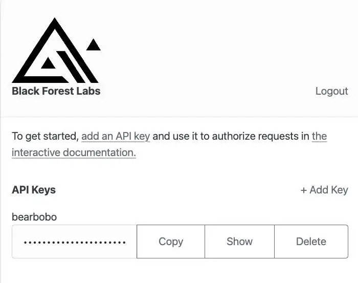
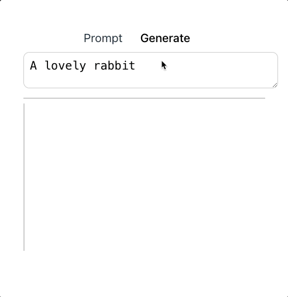
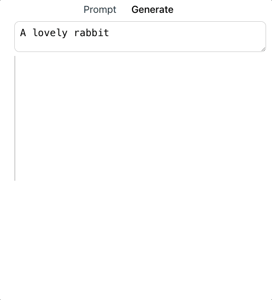

# 03 | 如何在前端调用图像大模型API

你好，我是月影。

在前面的课程中，我们主要学习了文本大模型 API 的使用。文本大模型是最常用的基础大模型，而在我们实际的应用开发中，不仅可以使用 AI 生成文本，还可以绘图、创作视频、处理语音以及识别图像。

在这一节课里，我们主要来探讨一些我自己实践用过的、表现不错的图像大模型产品。

## 使用 FLUX 模型

虽然在 AI 绘图领域，最广为人知的是 Stable Diffusion。但是，在我过去的应用实践中，比较了很多易用且经济实惠的图像生成模型，发现由 Black Forest Labs 团队推出的 FLUX 系列模型效果比较好，而且它用起来也比较简单。

在这一节，我们就来实践如何使用这一系列模型绘制图像。

首先我们在官网 https://api.us1.bfl.ai/ 注册一个账号，它支持邮箱注册，然后进入后台。

后台的功能非常简单，直接点击 Add Key 创建一个 API KEY 就可以了。



接着我们就可以用这个 API KEY、选择不同版本的模型来创建图像了。

需要注意的是，图像创建成功需要消耗一定的 Credits，使用不同版本模型的价格不同，具体价格可以在 API 文档中查看。

现在我们可以用 Trae 创建一个 Vue 项目 Flux.ai Demo 1。别忘了在项目目录下添加.env.local，设置我们创建的 API Key：

```
VITE_API_KEY=9007ab9a-****-****-****-ec0be19423ba
```

接着修改 App.vue，代码如下：

```xml
<script setup lang="ts">
import { ref } from 'vue';
const prompt = ref('A lovely rabbit');
const imgUrl = ref('');
const progress = ref('0%');
const generateImage = async () => {
const endpoint = `https://api.bfl.ml/v1`;
const modelName = 'flux-dev';
const payload = {
 prompt: prompt.value,
 width: 1024,
 height: 1024,
 steps: 40,
 prompt_upsampling: true,
 seed: 42,
 guidance: 3,
 sampler: 'dpmpp_2m',
 safety_tolerance: 2,
};
const headers = {
   'Content-Type': 'application/json',
   'x-key': import.meta.env.VITE_API_KEY,
 };
 const res = await fetch(`${endpoint}/${modelName}`, {
   headers,
   method: 'POST',
   body: JSON.stringify(payload),
 });
 const id = (await res.json()).id;
 const resultUrl = `${endpoint}/get_result?id=${id}`;
 imgUrl.value = 'https://res.bearbobo.com/resource/upload/a3IZyOsZ/loading-giaz5
 do {
   await new Promise((resolve) => setTimeout(resolve, 100));
   const result = await fetch(resultUrl);
   const resultJson = await result.json();
   if (resultJson.status === 'Pending') {
     const progressValue = resultJson.progress;
     if(progressValue) {
       progress.value = `${Math.round(progressValue * 100)}%`;
     }
     continue;
   }
   const sample = resultJson.result?.sample;
   if (sample) {
     imgUrl.value = sample;
   } else {
     imgUrl.value = 'https://res.bearbobo.com/resource/upload/vNg4ALJv/6659895-o
   }
   break;
 } while (1);
};
</script>
<template>
 <div class="container">
   <div>
     <label>Prompt </label>
     <button @click="generateImage">Generate</button>
     <textarea class="input" type="text" v-model="prompt" />
   </div>
   <div class="progress">
     <div :style="{width: progress}"></div>
   </div>
   <div class="output">
     
   </div>
 </div>
</template>
<style scoped>
.input {
 width: 100%;
 height: 2rem;
 font-size: 1rem;
 padding: 0.5rem;
 border: 1px solid #ccc;
 border-radius: 0.5rem;
}
.progress {
 width: 100%;
 height: 0.1rem;
 margin: .4rem 0;
 background: #ccc;
}
.progress > div {
 background: #c00;
 height: 100%;
}
.container {
 display: flex;
 flex-direction: column;
 align-items: start;
 justify-content: start;
 height: 100vh;
}
.output {
 display: flex;
 flex-direction: column;
 align-items: center;
 justify-content: center;
 min-height: 200px;
 border: 1px solid #ccc;
}
.output > img {
 width: 100%;
}
</style>
```

这样我们就创建好了一个简单的文生图的 AI 应用。

你可以输入和修改提示词，给出你想要的 AI 生成的任何风格图片，点击生成按钮，等待图片生成结果就可以了。



接下来，我们来简单过一下核心代码。其实最主要的逻辑就是 generateImage 这个函数，在

```
这里我们设置调用 api 的地址 https://api.bfl.ml/v1，模型名称 flux-dev，以及需要请
```

求的 payload 数据。

```javascript
const endpoint = `https://api.bfl.ml/v1`;
const modelName = 'flux-dev';
const payload = {
 prompt: prompt.value,
 width: 1024,
 height: 1024,
 steps: 40,
 prompt_upsampling: true,
 seed: 42,
 guidance: 3,
 sampler: 'dpmpp_2m',
 safety_tolerance: 2,
};
```

这里设置了一些常用的参数，含义如下：

- prompt: 即图片文本描述提示词。

- width: 图像宽度，单位为像素值。

- height: 图像高度，单位为像素值。

- steps: 表示模型生成图像时“去噪”或“细化”图像的迭代步骤数，通常步数越多，图像质量越高，但计算时间也会相应更长。

- prompt_upsampling：决定是否对输入文本描述进行上采样，以提高分辨率，从而可能获得更加精细的图像。

- seed：随机种子，用于确保每次生成图像时有一定的随机性。如果你使用相同的种子并且其他参数相同，模型生成的图像会是相同的。通过更改种子，你可以生成不同的图像。

- guidance：用于控制模型在生成图像时遵循文本描述的严格程度。较高的指导系数会使得图像更符合输入的文本描述，较低的系数则可能让图像结果更多样，允许模型在一定程度上发挥更多的创意。

- sampler：采样器，决定模型生成图像时使用的算法。dpmpp_2m 是其中一种扩散模型采样器。不同的采样器具有不同的效果和表现，选择不同的采样器会影响图像生成的质量、风格和效率。

- safety_tolerance：控制生成内容安全性容忍度，较低的安全容忍度可能会阻止模型生成带有暴力、色情或不适宜内容的图像。

除了这些参数外，还有其他一些参数，在这里就不一一列举了，有兴趣的同学可以自行查看Black Forest Labs 的官方文档进行进一步研究。

再接下来是请求头：

```javascript
const headers = {
 'Content-Type': 'application/json',
 'x-key': import.meta.env.VITE_API_KEY,
};
```

我们看到 Flux.ai 和前面我们体验过的文本大模型类似，是通过将 API Key 在请求头中发送给服务器来鉴权，不同点在于前面是设置 HTTP 协议标准的 Authorization 字段，而这里是设置x-key 扩展字段。

接下来就要发起请求，由于绘图过程是一个耗时比较长的过程，因此 Flux.ai 将生成图片请求设计为读写分离的异步操作，即分为两个接口，一个接口发起绘图操作，另一个接口查询绘图状态。

所以我们首先发起绘图操作：

```javascript
const res = await fetch(`${endpoint}/${modelName}`, {
 headers,
 method: 'POST',
 body: JSON.stringify(payload),
});
```

该操作成功执行后，服务器会立即返回一个图片生成任务的唯一 ID，后续可以通过查询状态接口，根据这个 ID 来查询绘图状态。

```javascript
const id = (await res.json()).id;
const resultUrl = `${endpoint}/get_result?id=${id}`;
imgUrl.value = 'https://res.bearbobo.com/resource/upload/a3IZyOsZ/loading-giaz5yc
do {
 await new Promise((resolve) => setTimeout(resolve, 100));
 const result = await fetch(resultUrl);
 const resultJson = await result.json();
 if (resultJson.status === 'Pending') {
   const progressValue = resultJson.progress;
   if(progressValue) {
     progress.value = `${Math.round(progressValue * 100)}%`;
   }
   continue;
 }
 const sample = resultJson.result?.sample;
 if (sample) {
   imgUrl.value = sample;
 } else {
   imgUrl.value = 'https://res.bearbobo.com/resource/upload/vNg4ALJv/6659895-ox3
 }
 break;
} while (1);
```

上面的代码片段里，我们拿到任务 ID 后，通过轮询的方式来查询图片生成的状态。因为generateImage 是个异步函数，所以我们可以直接用异步 while 循环的形式来写，这样更容易理解。

在每一轮查询过程中，我们先等待 100 毫秒，然后查询状态，此时如果状态是 Pending，表示生成图片的任务还在执行中，此时返回结果的 progress 字段返回任务的进度. 在这里我们在UI 细节上用 div 绘制了一个简单的进度条，此时更新进度条的进度值就可以。

当状态不为 Pending 的时候，我们尝试读取 result.sample，这个字段内得到的就是生成图片的临时 URL。在真正的业务里，我们应当将图片保存到自己的服务器或者 CDN 地址中，但是在这里，作为演示，我们可以直接将图片在前端展示出来。

这样我们就实现了使用 Flux.ai 生成图片的一个比较完整的小应用。

## 使用可灵 AI

除了 Flux 外，在国内也有一些不错的图像大模型，比如智谱清言的 CogView 模型，以及快手的可灵 AI，这些模型在我的 AI 应用产品中也会被使用。

现在我们就来通过实战了解一下可灵 AI 的使用方法。

首先，在https://klingai.kuaishou.com/注册可灵 AI，登录后，点击左下角“开发者平台”链接，可以进入控制台。

点击控制台左侧菜单项“密钥管理”，我们可以创建密钥。

可灵 AI 的密钥由一对字符串构成，分别是 AccessKey ID 和 AccessKey Secret，我们需要使用它们来完成鉴权。

可灵 AI 的鉴权机制相对来说比较复杂一些，安全性也更高。它采用 Json Web Token 加密的方式，通过 AccessKey ID 和 AccessKey Secret 生成 Token，然后再利用 Token 进行鉴权。

因此要使用可灵 AI 的话，我们需要自己实现生成 Token 的 API，具体的我们还是通过实践来学习。

首先还是用 Trae 创建一个 Vue 项目，同样先配置.env.local

```
ACCESS_KEY_ID=8f617**********fcf9
ACCESS_KEY_SECRET=36092**********94c5
```

接着在终端安装 node.js 依赖包：

```
pnpm i dotenv express jsonwebtoken
```

添加 server.js 文件，内容如下：

```python
import * as dotenv from 'dotenv'
import express from 'express';
import jwt from 'jsonwebtoken';
dotenv.config({
 path: ['.env.local', '.env']
});
const accessKeyId = process.env.ACCESS_KEY_ID;
const accessKeySecret = process.env.ACCESS_KEY_SECRET;
const app = express();
const port = 3000;
async function authKlingai() {
   const headers = {
       algorithm: 'HS256',
   };
   const now = Math.floor(Date.now() / 1000);
   const payload = {
       iss: accessKeyId,
       exp: now + 1800, // 有效时间，此处示例代表当前时间+1800s(30min)
       nbf: now - 5, // 开始生效的时间，此处示例代表当前时间-5秒
   };
   const token = jwt.sign(payload, accessKeySecret, headers);
   return token;
}
app.get('/jwt-auth', async (req, res) => {
   const token = await authKlingai();
   res.send(token);
});
app.listen(port, () => {
   console.log(`Server is running on port ${port}`);
});
```

上面的代码，我们主要是通过 jsonwebtoken 加密来获得鉴权 token。

我们在 vite.config.ts 中添加 server 配置项：

```bash
 server: {
   allowedHosts: true,
   port: 4399,
   proxy: {
     '/api': {
       target: 'http://localhost:3000',
       secure: false,
       rewrite: path => path.replace(/^\/api/, ''),
     },
     '/klingai': {
       target: 'https://api.klingai.com',
       changeOrigin: true,
       rewrite: path => path.replace(/^\/klingai/, ''),
     }
   },
 }
这样前端就可以通过  /api/jwt-token 接口获得 token 了。另外由于可灵 AI 不支持前端跨
```

域请求，所以我们在这里针对 https://api.klingai.com 也做了一个请求转发。

接下来还是改写 App.vue：

```xml
<script setup lang="ts">
import { ref } from 'vue';
const prompt = ref('A lovely rabbit');
const imgUrl = ref('');
const generateImage = async () => {
 const negativeWords = 'Blurry, Bad, Bad anatomy, Bad proportions, Deformed, Dis
 const endpoint = `/klingai/v1/images/generations`;
 const token = await (await fetch('/api/jwt-auth')).text();
 const payload = {
   prompt: prompt.value,
   negative_prompt: negativeWords,
   aspect_ratio: '1:1',
 };
 const headers = {
   'Content-Type': 'application/json',
   'Authorization': `Bearer ${token}`,
 };
 const res = await fetch(endpoint, {
   headers,
   method: 'POST',
   body: JSON.stringify(payload),
 });
 if (res.status >= 400) {
   throw new Error(`Non-200 response: ${await res.text()}`);
 }
 const ret: any = await res.json();
 const id = ret.data.task_id;
 const resultUrl = `${endpoint}/${id}`;
 imgUrl.value = 'https://res.bearbobo.com/resource/upload/a3IZyOsZ/loading-giaz5
 do {
   await new Promise((resolve) => setTimeout(resolve, 100));
   const result = await fetch(resultUrl, {
     headers,
   });
   const resultJson = await result.json();
   const taskStatus = resultJson.data.task_status;
   if (taskStatus === 'processing' || taskStatus === 'submitted') {
     continue;
   }
   if (taskStatus === 'failed') {
     throw new Error(`Task failed: ${JSON.stringify(resultJson)}`);
   }
   const sample = resultJson.data?.task_result;
   if (sample) {
     imgUrl.value = sample.images[0].url;
   } else {
     imgUrl.value = 'https://res.bearbobo.com/resource/upload/vNg4ALJv/6659895-o
   }
   break;
 } while (1);
};
</script>
<template>
 <div class="container">
   <div>
     <label>Prompt </label>
     <button @click="generateImage">Generate</button>
     <textarea class="input" type="text" v-model="prompt" />
   </div>
   <div class="output">
     
   </div>
 </div>
</template>
<style scoped>
.input {
 width: 100%;
 height: 2rem;
 font-size: 1rem;
 padding: 0.5rem;
 border: 1px solid #ccc;
 border-radius: 0.5rem;
}
.progress {
 width: 100%;
 height: 0.1rem;
 margin: .4rem 0;
 background: #ccc;
}
.progress > div {
 background: #c00;
 height: 100%;
}
.container {
 display: flex;
 flex-direction: column;
 align-items: start;
 justify-content: start;
 height: 100vh;
}
.output {
 display: flex;
 flex-direction: column;
 align-items: center;
 justify-content: center;
 min-height: 200px;
 border: 1px solid #ccc;
}
.output > img {
 width: 100%;
 max-width: 600px;
}
</style>
```

这样我们就可以使用可灵 AI 生成我们想要的图片了。



我们看一下前端代码。其实和调用 FLUX 类似，只不过我们需要先从 node.js 服务获取token：

```javascript
const token = await (await fetch('/api/jwt-auth')).text();
```

然后使用 token 进行请求图片生成。可灵 AI 也是异步读写分离，先请求图片生成接口，获取task_id，然后再通过 task_id 进行轮询直到生成完毕。有一个细节的区别是，可灵 AI 的轮询状态接口只能查询到状态，没有生成的进度条，所以我去掉了显示进度条的前端逻辑。

由于整体代码和前面 FLUX API 的逻辑区别不大，我在这里就不赘述了。如果你还有疑问，可以通过运行和修改代码进一步深入研究。

## 要点总结

这一节课，我们学习了两个图像生成模型的 API 调用方法。在鉴权方面，FLUX 采用简单的API Key 鉴权机制，这和我们前面介绍的文本大模型鉴权机制类似。而可灵 AI 则采用了 JsonWeb Token 的方式进行鉴权，鉴权过程稍微复杂一些，但是安全性更高。

无论是 FLUX 还是可灵 AI，它们在图像生成中都采用了读写操作分离的异步设计，这样我们在生成过程中通过接口查询状态，可以更灵活地实现前端的交互，这种设计方法，也是值得我们学习和借鉴的。实际上在我自己的业务中，也采用类似的设计来改进用户体验。

## 课后练习

FLUX 模型支持不同的采样器（sampler），通过配置这些采样器改变生成算法，可以获得不同的生成效果。你可以研究 FLUX 官方文档，尝试自己修改 sampler 参数，试试看它会得到怎样的效果，将你的结论分享到评论区吧。
