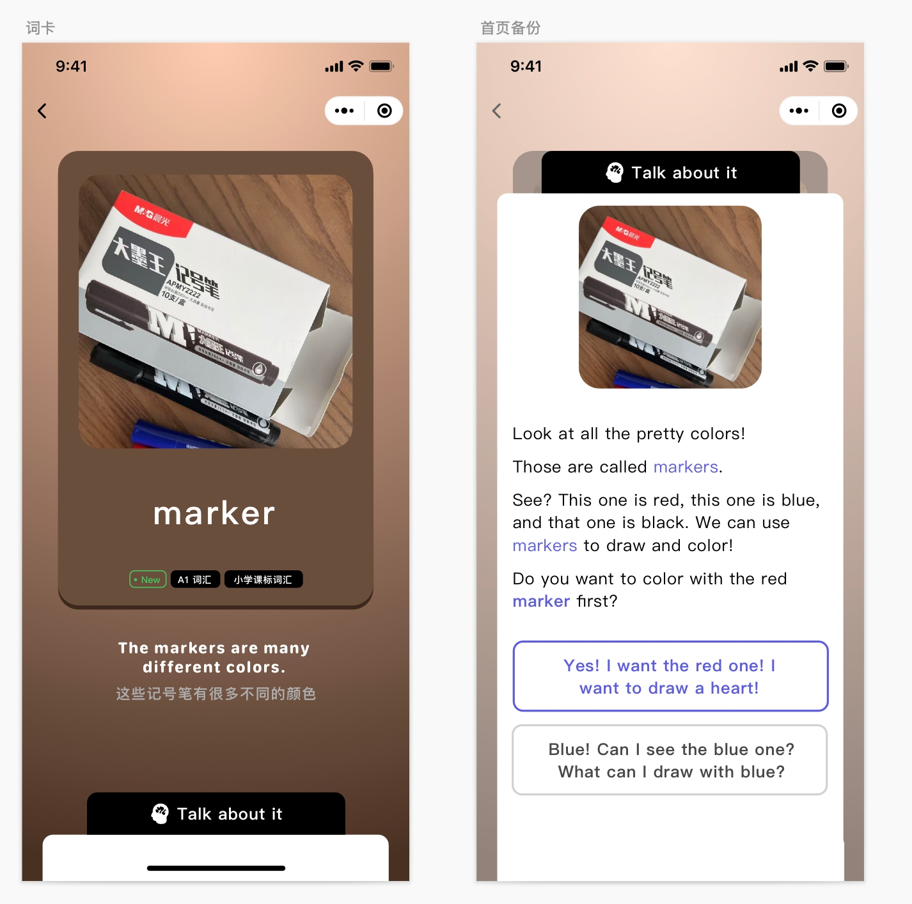
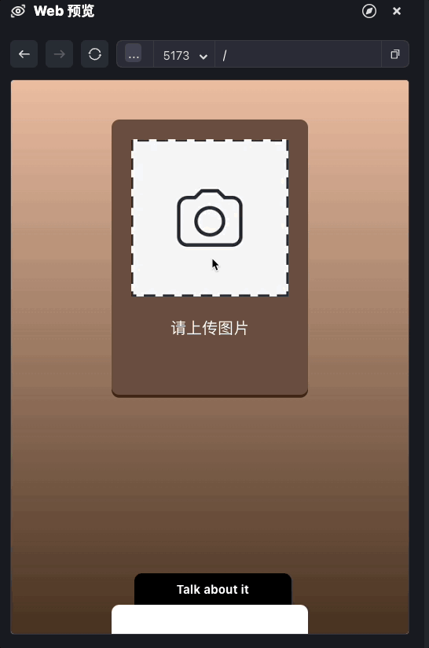
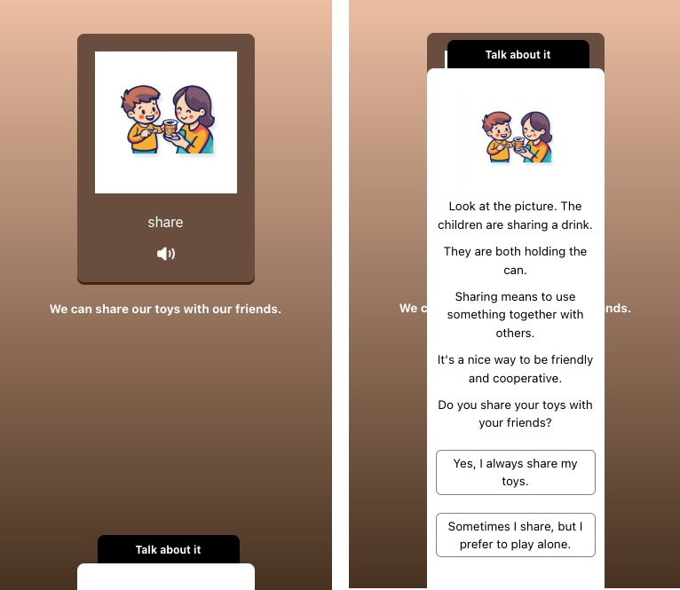

# 06 | 智能体应用实战：拍照记单词

你好，我是月影。

前面我们比较系统地学习了大模型 API 调用和智能体的创建，可能很多同学已经迫不及待地想要将学到的内容运用到具体工作中去了。

那么这节课，我们就来通过一个实战的小应用“拍照记单词”，来具体实践一下如何基于大模型API 开发 Web 应用。

## 拍照记单词

这个应用的核心功能只有一个，就是用户通过手机拍一张照片，让 AI 识别出照片主体，找到一个最合适的英文单词，生成一张单词卡片。卡片内容包括单词的拼写、读音、例句，以及生成一段对话，以帮助用户快速记忆这个单词和掌握这个单词的用法。



通过需求分析，我们知道这个应用可以通过结合使用两个模型来完成。

首先我们通过上节课使用的视觉模型 moonshot-v1-8k-vision-preview 来解释图片，生成单词、例句和解释，然后我们通过语音模型来实现朗读功能。整个流程并不复杂，让我们先实现UI 效果。

我们先用 Trae 创建一个新的项目“Capture the Word"。然后创建.env.local 文件并增加视觉模型配置的 API Key。

```
VITE_KIMI_API_KEY=sk-q**********txbp4
```

接着我们实现一个图片上传预览提交的 Vue 组件。

```xml
首先创建/src/component/PictureCard.vue文件，内容如下：
<script setup lang="ts">
import { ref } from 'vue';
const imgPreview = ref('https://res.bearbobo.com/resource/upload/W44yyxvl/upload-
const emit = defineEmits(['updateImage']);
const props = defineProps({
   word: {
       type: String,
       default: '',
   },
   audio: {
       type: String,
       default: '',
   }
});
const updateImageData = async (e: Event): Promise<any> => {
 const file = (e.target as HTMLInputElement).files?.[0];
 if (!file) {
   return;
 }
 return new Promise((resolve, reject) => {
   const reader = new FileReader();
   reader.readAsDataURL(file);
   reader.onload = () => {
     const data = reader.result as string;
     imgPreview.value = data;
     emit('updateImage', data);
     resolve(data);
   };
   reader.onerror = (error) => {
     reject(error);
   };
 });
};
</script>
<template>
 <div class="card">
   <input id="selecteImage" class="input" type="file" accept=".jpg, .jpeg, .png,
   <label for="selecteImage" class="upload">
     
   </label>
   <div class="word">{{ props.word }}</div>
   <div v-if="audio" class="playAudio">
       
 </div>
</template>
<style scoped>
#selecteImage {
 display: none;
}
.card {
 border-radius: 8px;
 padding: 20px;
 margin-top: 40px;
 height: 280px;
 box-shadow: rgb(63,38,21) 0 3px 0px 0;
 background-color: rgb(105,78,62);
 box-sizing: border-box;
}
.upload {
 width: 160px;
 height: 160px;
 display: flex;
 flex-direction: column;
 align-items: center;
 justify-content: center;
}
.upload img {
 width: 100%;
 height: 100%;
 object-fit: contain;
}
.word {
 margin-top: 20px;
 font-size: 16px;
 color: rgb(255,255,255);
}
.playAudio {
 margin-top: 16px;
}
.playAudio img {
 cursor: pointer;
}
</style>
这个组件主要是实现图片上传的 UI 卡片样式，并通过updateImage事件将图片 Base64 内
```

容传给父级组件。

```javascript
const emit = defineEmits(['updateImage']);
```

获取图片 Base64 内容的原理，我们在前面的课程中已经介绍过，这里就不再重复了。

这样我们就实现了一个预览并上传图片的 UI 组件，在 App.vue 中我们可以引入并使用它。

```sql
<script setup lang="ts">
import PictureCard from './components/PictureCard.vue';
...
const word = ref('请上传图片');
const audio = ref('');
...
</script>
<template>
...
   <PictureCard @update-image="submit" :word="word" :audio="audio"/>
...
</template>
```

这样就会得到如下效果：


接下来呢，我们修改 App.vue，实现整个界面主体：

```sql
<script setup lang="ts">
import { ref } from 'vue';
import PictureCard from './components/PictureCard.vue';
const word = ref('请上传图片');
const audio = ref('');
const sentence = ref('');
const detailExpand = ref(false);
const imgPreview = ref('https://res.bearbobo.com/resource/upload/W44yyxvl/upload-
const explainations = ref([]);
const expReply = ref([]);
const userPrompt = `
分析图片内容，找出最能描述图片的一个英文单词，尽量选择更简单的A1~A2的词汇。
返回JSON数据：
{
 "image_discription": "图片描述",
 "representative_word": "图片代表的英文单词",
 "example_sentence": "结合英文单词和图片描述，给出一个简单的例句",
 "explaination": "结合图片解释英文单词，段落以Look at...开头，将段落分句，每一句单独一行，解
 "explaination_replys": ["根据explaination给出的回复1", "根据explaination给出的回复2"
}
`;
const update = async (imageData: string) => {
 imgPreview.value = imageData;
 const endpoint = 'https://api.moonshot.cn/v1/chat/completions';
 const headers = {
   'Content-Type': 'application/json',
   Authorization: `Bearer ${import.meta.env.VITE_KIMI_API_KEY}`
 };
 word.value = '分析中...';
 const response = await fetch(endpoint, {
   method: 'POST',
   headers: headers,
   body: JSON.stringify({
     model: 'moonshot-v1-8k-vision-preview',
     messages: [
       {
         role: 'user',
         content: [{
           type: "image_url",
           image_url: {
             "url": imageData,
           },
         }, {
           type: "text",
           text: userPrompt,
         }]
       }
     ],
     stream: false,
   })
 });
 const data = await response.json();
 const replyData = JSON.parse(data.choices[0].message.content);
 word.value = replyData.representative_word;
 sentence.value = replyData.example_sentence;
 explainations.value = replyData.explaination.split('\n').filter((item: any) =>
 expReply.value = replyData.explaination_replys;
};
const submit = async (imageData: string) => {
 update(imageData);
};
</script>
<template>
 <div class="container">
   <PictureCard @update-image="submit" :word="word" :audio="audio"/>
   <div class="output">
     <div>{{ sentence }}</div>
     <div class="details">
       <button @click="detailExpand = !detailExpand">Talk about it</button>
       <div v-if="!detailExpand" class="fold"></div>
       <div v-else class="expand">
         
         <div class="explaination" v-for="item in explainations">
           <p>{{ item }}</p>
         </div>
         <div class="reply" v-for="item in expReply">
           <p>{{ item }}</p>
         </div>
       </div>
     </div>
   </div>
 </div>
</template>
<style scoped>
.container {
 display: flex;
 flex-direction: column;
 align-items: center;
 justify-content: start;
 margin: 0;
 padding: 0;
 width: 100vw;
 height: 100vh;
 font-size: .85rem;
 background: linear-gradient(180deg, rgb(235, 189, 161) 0%, rgb(71, 49, 32) 100%
}
#selecteImage {
 display: none;
}
.input {
 width: 200px;
}
.output {
 margin-top: 20px;
 /* min-height: 300px; */
 width: 80%;
 text-align: center;
 font-weight: bold;
}
.preview img {
 max-width: 100%;
}
button {
 padding: 0 10px;
 margin-left: 6px;
}
.details {
 position: absolute;
 bottom: 0;
 left: 50%;
 transform: translateX(-50%);
}
.details button {
 background-color: black;
 color: white;
 width: 160px;
 height: 32px;
 border-radius: 8px 8px 0 0;
 border: none;
 font-size: 12px;
 font-weight: bold;
 cursor: pointer;
}
.details .fold {
 width: 200px;
 height: 30px;
 background-color: white;
 border-top-left-radius: 8px;
 border-top-right-radius: 8px;
}
.details .expand {
 width: 200px;
 height: 88vh;
 background-color: white;
 border-top-left-radius: 8px;
 border-top-right-radius: 8px;
}
.expand img {
 width: 60%;
 margin-top: 20px;
 border-radius: 6px;
}
.expand .explaination {
 color: black;
 font-weight: normal;
}
.expand .explaination p {
 margin: 0 10px 10px 10px;
}
.expand .reply {
 color: black;
 font-weight: normal;
 margin-top: 20px;
}
.expand .reply p {
 padding: 4px 10px;
 margin: 0 10px 10px 10px;
 border-radius: 6px;
 border: solid 1px grey;
}
</style>
```

这里，除了一些 UI 细节外，大部分内容是我们前面课程已经学过的。其实关键就是当我们图片更新的时候，通过 PictureCard 的 update-image 事件，将图片的 Base64 发送给 Kimi 的视觉大模型处理。

不过呢，这里需要注意，和我们前面学视觉大模型的时候，让它简单描述图片内容不同，这里，我们使用的是一组提示词，让它输出结构化的 JSON 内容，提示词如下。

```
分析图片内容，找出最能描述图片的一个英文单词，尽量选择更简单的A1~A2的词汇。
返回JSON数据：
{
 "image_discription": "图片描述",
 "representative_word": "图片代表的英文单词",
 "example_sentence": "结合英文单词和图片描述，给出一个简单的例句",
 "explaination": "结合图片解释英文单词，段落以Look at...开头，将段落分句，每一句单独一行，解
 "explaination_replys": ["根据explaination给出的回复1", "根据explaination给出的回复2"
}
```

注意我们这里采用了一种结构化输出的技巧，通过 JSON 结构和结构描述，让大模型输出更加合理的内容，这是一种在实际项目中非常实用的技巧，在下一节课中，我们还会进一步详细讲解。

好，现在让我们回到课程代码的部分。

前面的代码我们已经实现了完整的文本内容输出，我们可以测试一下。



我们现在实现了内容文本输出的部分，接下来我们来处理合成语音。

## 合成语音

我们还是基于第四节课讲过的语音模型代码来调整。首先修改.env.local 文件。

```
VITE_KIMI_API_KEY=sk-q**********txbp4
VITE_AUDIO_APP_ID=5934290469
VITE_AUDIO_ACCESS_TOKEN=c-L**********Ln4N
VITE_AUDIO_CLUSTER_ID=volcano_tts
VITE_AUDIO_VOICE_NAME=en_female_anna_mars_bigtts
```

我们在其中添加语音配置项，配置 appId、accessToken、clusterId，然后我们将 vocieName也作为配置项，选择 en_female_anna_mars_bigtts，这是火山引擎语音的音色中比较好听的一个英文人物音色。

```bash
接着我们要修改vite.config.js文件，添加 server 代理：
 server: {
   allowedHosts: true,
   proxy: {
     '/tts': {
       target: 'https://openspeech.bytedance.com',
       changeOrigin: true,
       rewrite: path => path.replace(/^\/tts/, ''),
     }
   },
 },
接着我们来实现一个语音播放的库。在项目中创建文件 /src/lib/audio.ts，内容如下：
function createBlobURL(base64AudioData: string): string {
   var byteArrays = [];
   var byteCharacters = atob(base64AudioData);
   for (var offset = 0; offset < byteCharacters.length; offset++) {
       var byteArray = byteCharacters.charCodeAt(offset);
       byteArrays.push(byteArray);
   }
   var blob = new Blob([new Uint8Array(byteArrays)], { type: 'audio/mp3' });
   // 创建一个临时 URL 供音频播放
   return URL.createObjectURL(blob);
}
export const generateAudio = async (text: string) => {
   const token = import.meta.env.VITE_AUDIO_ACCESS_TOKEN;
   const appId = import.meta.env.VITE_AUDIO_APP_ID;
   const clusterId = import.meta.env.VITE_AUDIO_CLUSTER_ID;
   const voiceName = import.meta.env.VITE_AUDIO_VOICE_NAME;
   const endpoint = '/tts/api/v1/tts';
   const headers = {
       'Content-Type': 'application/json',
       Authorization: `Bearer;${token}`,
   };
   const payload = {
       app: {
           appid: appId,
           token,
           cluster: clusterId,
       },
       user: {
           uid: 'bearbobo',
       },
       audio: {
           voice_type: voiceName,
           encoding: 'ogg_opus',
           compression_rate: 1,
           rate: 24000,
           speed_ratio: 1.0,
           volume_ratio: 1.0,
           pitch_ratio: 1.0,
           emotion: 'happy',
           // language: 'cn',
       },
       request: {
           reqid: Math.random().toString(36).substring(7),
           text,
           text_type: 'plain',
           operation: 'query',
           silence_duration: '125',
           with_frontend: '1',
           frontend_type: 'unitTson',
           pure_english_opt: '1',
       },
   };
   const res = await fetch(endpoint, {
       method: 'POST',
       headers,
       body: JSON.stringify(payload),
   });
   const data = await res.json();
   if (!data.data) {
       throw new Error(JSON.stringify(data));
   }
   return createBlobURL(data.data);
}
```

这个库的作用，是将指定的文本转换为语音数据，并在客户端生成 BlobURL，这样就可以用audio 标签播放。

其中细节内容我们在第四节课已经讲过，这里也不再重复，如果有同学还是对代码不了解，可以复习第四节课内容，或者自己动手需改代码通过实践来学习。

接下来，我们继续修改 App.vue 文件，引入 generateAudio 函数，并在 update 方法中使用它。

```sql
...
import { generateAudio } from './lib/audio.ts';
...
const update = async () => {
 ...
 const audioUrl = await generateAudio(replyData.example_sentence);
 audio.value = audioUrl;
}
```

这样 App.vue 的主体流程就实现完了，文本模型返回的例句，通过 generateAudio 得到语音播放的 URL，通过 audio 参数传递给 PictureCard 组件。

那么我们还要进一步修改一下 PictureCard 组件，增加播放语音的功能。

```xml
<script setup lang="ts">
...
const playAudio = () => {
 const audio = new Audio(props.audio);
 audio.play();
}
</script>
<template>
...
   <div v-if="audio" class="playAudio" @click="playAudio">
       
...
</template>
...
```

那么最终，完整的 PictureCard 组件代码如下。

```xml
<script setup lang="ts">
import { ref } from 'vue';
const imgPreview = ref('https://res.bearbobo.com/resource/upload/W44yyxvl/upload-
const emit = defineEmits(['updateImage']);
const props = defineProps({
   word: {
       type: String,
       default: '',
   },
   audio: {
       type: String,
       default: '',
   }
});
const updateImageData = async (e: Event): Promise<any> => {
 const file = (e.target as HTMLInputElement).files?.[0];
 if (!file) {
   return;
 }
 return new Promise((resolve, reject) => {
   const reader = new FileReader();
   reader.readAsDataURL(file);
   reader.onload = () => {
     const data = reader.result as string;
     imgPreview.value = data;
     emit('updateImage', data);
     resolve(data);
   };
   reader.onerror = (error) => {
     reject(error);
   };
 });
};
const playAudio = () => {
 const audio = new Audio(props.audio);
 audio.play();
}
</script>
<template>
 <div class="card">
   <input id="selecteImage" class="input" type="file" accept=".jpg, .jpeg, .png,
   <label for="selecteImage" class="upload">
     
   </label>
   <div class="word">{{ props.word }}</div>
   <div v-if="audio" class="playAudio" @click="playAudio">
       
 </div>
</template>
<style scoped>
#selecteImage {
 display: none;
}
.card {
 border-radius: 8px;
 padding: 20px;
 margin-top: 40px;
 height: 280px;
 box-shadow: rgb(63,38,21) 0 3px 0px 0;
 background-color: rgb(105,78,62);
 box-sizing: border-box;
}
.upload {
 width: 160px;
 height: 160px;
 display: flex;
 flex-direction: column;
 align-items: center;
 justify-content: center;
}
.upload img {
 width: 100%;
 height: 100%;
 object-fit: contain;
}
.word {
 margin-top: 20px;
 font-size: 16px;
 color: rgb(255,255,255);
}
.playAudio {
 margin-top: 16px;
}
.playAudio img {
 cursor: pointer;
}
</style>
```

完整的 App.vue 代码如下。

```sql
<script setup lang="ts">
import { ref } from 'vue';
import PictureCard from './components/PictureCard.vue';
import { generateAudio } from './lib/audio.ts';
const word = ref('请上传图片');
const audio = ref('');
const sentence = ref('');
const detailExpand = ref(false);
const imgPreview = ref('https://res.bearbobo.com/resource/upload/W44yyxvl/upload-
const explainations = ref([]);
const expReply = ref([]);
const userPrompt = `
分析图片内容，找出最能描述图片的一个英文单词，尽量选择更简单的A1~A2的词汇。
返回JSON数据：
{
 "image_discription": "图片描述",
 "representative_word": "图片代表的英文单词",
 "example_sentence": "结合英文单词和图片描述，给出一个简单的例句",
 "explaination": "结合图片解释英文单词，段落以Look at...开头，将段落分句，每一句单独一行，解
 "explaination_replys": ["根据explaination给出的回复1", "根据explaination给出的回复2"
}
`;
const update = async (imageData: string) => {
 imgPreview.value = imageData;
 const endpoint = 'https://api.moonshot.cn/v1/chat/completions';
 const headers = {
   'Content-Type': 'application/json',
   Authorization: `Bearer ${import.meta.env.VITE_KIMI_API_KEY}`
 };
 word.value = '分析中...';
 const response = await fetch(endpoint, {
   method: 'POST',
   headers: headers,
   body: JSON.stringify({
     model: 'moonshot-v1-8k-vision-preview',
     messages: [
       {
         role: 'user',
         content: [{
           type: "image_url",
           image_url: {
             "url": imageData,
           },
         }, {
           type: "text",
           text: userPrompt,
         }]
       }
     ],
     stream: false,
   })
 });
 const data = await response.json();
 const replyData = JSON.parse(data.choices[0].message.content);
 word.value = replyData.representative_word;
 sentence.value = replyData.example_sentence;
 explainations.value = replyData.explaination.split('\n').filter((item: any) =>
 expReply.value = replyData.explaination_replys;
 const audioUrl = await generateAudio(replyData.example_sentence);
 audio.value = audioUrl;
};
const submit = async (imageData: string) => {
 // console.log(imageData);
 update(imageData);
};
</script>
<template>
 <div class="container">
   <PictureCard @update-image="submit" :word="word" :audio="audio" />
   <div class="output">
     <div>{{ sentence }}</div>
     <div class="details">
       <button @click="detailExpand = !detailExpand">Talk about it</button>
       <div v-if="!detailExpand" class="fold"></div>
       <div v-else class="expand">
         
         <div class="explaination" v-for="item in explainations">
           <p>{{ item }}</p>
         </div>
         <div class="reply" v-for="item in expReply">
           <p>{{ item }}</p>
         </div>
       </div>
     </div>
   </div>
 </div>
</template>
<style scoped>
.container {
 display: flex;
 flex-direction: column;
 align-items: center;
 justify-content: start;
 margin: 0;
 padding: 0;
 width: 100vw;
 height: 100vh;
 font-size: .85rem;
 background: linear-gradient(180deg, rgb(235, 189, 161) 0%, rgb(71, 49, 32) 100%
}
#selecteImage {
 display: none;
}
.input {
 width: 200px;
}
.output {
 margin-top: 20px;
 /* min-height: 300px; */
 width: 80%;
 text-align: center;
 font-weight: bold;
}
.preview img {
 max-width: 100%;
}
button {
 padding: 0 10px;
 margin-left: 6px;
}
.details {
 position: absolute;
 bottom: 0;
 left: 50%;
 transform: translateX(-50%);
}
.details button {
 background-color: black;
 color: white;
 width: 160px;
 height: 32px;
 border-radius: 8px 8px 0 0;
 border: none;
 font-size: 12px;
 font-weight: bold;
 cursor: pointer;
}
.details .fold {
 width: 200px;
 height: 30px;
 background-color: white;
 border-top-left-radius: 8px;
 border-top-right-radius: 8px;
}
.details .expand {
 width: 200px;
 height: 88vh;
 background-color: white;
 border-top-left-radius: 8px;
 border-top-right-radius: 8px;
}
.expand img {
 width: 60%;
 margin-top: 20px;
 border-radius: 6px;
}
.expand .explaination {
 color: black;
 font-weight: normal;
}
.expand .explaination p {
 margin: 0 10px 10px 10px;
}
.expand .reply {
 color: black;
 font-weight: normal;
 margin-top: 20px;
}
.expand .reply p {
 padding: 4px 10px;
 margin: 0 10px 10px 10px;
 border-radius: 6px;
 border: solid 1px grey;
}
</ t l >
```

我们运行一下应用，上传一张图片，效果如下：



点击播放按钮，我们可以听到例句的语音。

你看，这样我们就基本上实现了一个完整的 AI 应用的主体功能！

当然，我们还有很多细节需要处理，其中有 UI 细节，也有程序逻辑中错误分支的细节处理。在实际 AI 应用开发项目中，我们需要处理这些问题，因为我们无法保证这些 API 返回的数据会始终正确，也无法保证 API 服务本身不会出异常。这些都是项目开发中需要重点考虑的，其实不仅仅是 AI 项目，就算是其他 Web 应用项目，我们也是需要考虑容错的。

这些细节问题就不展开一一讲解了，有兴趣的同学，可以基于课程项目代码，自己动手修改细节并不断完善它。

- GitHub 上完整的代码在 https://github.com/akira-cn/frontend-dev-large-model-era/tree/main/capture_the_word

## 要点总结

这一节课，我们第一次进入项目实战，开发一个简单的拍照记单词应用，它的核心功能是上传图片，用视觉大模型的处理能力，生成我们想要的与图片关联的单词例句和单词解释，方便我们学习和记忆单词。

在这个例子中，我们将视觉大模型和大模型语音合成搭配使用，目的是希望同学们能够理解，大模型应用开发往往是通过将不同的模型进行协同工作，最终达到我们想要的效果。

师父领进门，修行在个人。建议你课后实际动手尝试一下，才能真正找到大模型应用开发的感觉。

## 课后练习

拍照记单词应用还有一些细节可以优化，比如功能上，如果我们除了支持例句的语音播放，也希望能支持 “Talk about it” 中的语音播放，那么应该怎么实现呢？

注意到，我们用大模型生成内容的过程，等待时间相对比较长，有什么办法能够减少用户等待时间吗？请同学们思考一下，将你的想法分享到评论区。
