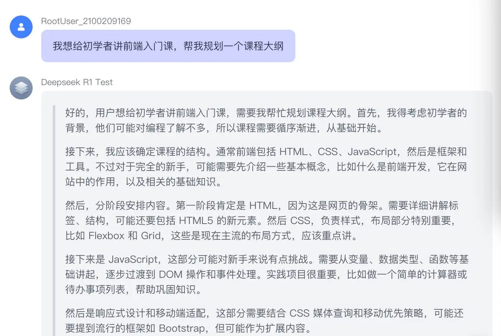
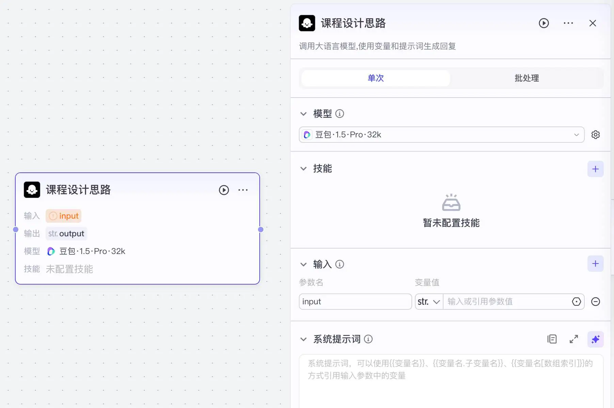
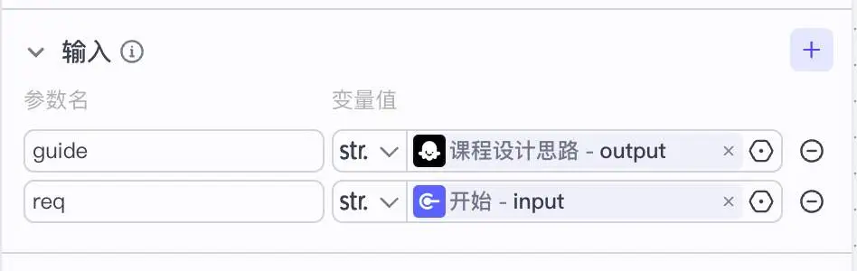
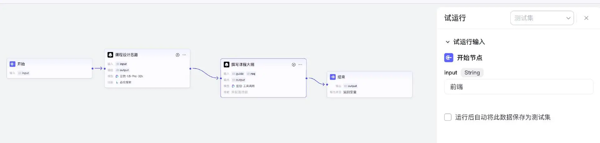

# 07 | 提示词工程（一）：三个技巧让大模型超常发挥

你好，我是月影。

要让大模型发挥最大的效果，提示词（Prompt）的设计是很关键的一件事，优秀的提示词不仅能让大模型输出更好的结果，还能节省 token，降低成本。

前面的课程中，我们已经通过实战体会过一些提示词的使用。在这一节课里，我将为你系统地梳理一下书写提示词的常用技巧，帮助你更好地掌控大模型的能力。

## 如何正确书写文本提示词

对于大部分文本大模型而言，实际上是具备理解复杂提示词的能力的，尤其是大参数的模型。在这个情况下，其实书写有效提示词最重要的一点非常简单，那就是说人话。

也就是说，你可以把 AI 当作“人类”，给它明确清晰的指令就可以了。

比如用 Deepseek-R1 模型时，你可以直接提出你的原始需求，比如：



Deepseek-R1 有能力进行深度思考，所以它会自己分析推理，并给出思考过程：

- 好的，我现在需要帮用户规划一个前端入门课程的大纲。用户是给初学者讲课，所以需要从最基础的内容开始，逐步深入，同时要确保课程结构合理，内容全面。首先，我得考虑初学者的背景，他们可能对编程了解不多，所以得从最基础的开始，比如 HTML、CSS，然后逐步引入 JavaScript，再到框架和工具。首先，前端开发的基础肯定是 HTML 和 CSS，这两者是构建网页的基石。应该先讲 HTML的基本结构、常用标签，然后是 CSS 的选择器、盒模型、布局技术。这部分可能需要几周的时间，因为初学者需要时间来练习和熟悉这些概念。接下来是 JavaScript，这是让网页动起来的关键。需要从变量、数据类型、函数等基础讲起，然后过渡到 DOM 操作和事件处理，这样学生可以实际看到自己的代码在页面上产生的效果。

- 然后，响应式设计和 CSS 框架也是必须的，比如媒体查询和 Flexbox、Grid 布局，以及Bootstrap 或 Tailwind 这样的框架，这些内容能帮助学生快速构建美观的网页。接下来，JavaScript 的高级部分，比如 ES6 + 特性、异步编程、模块化，还有 AJAX 和 Fetch API，这些是开发动态网页和与后端交互的基础。之后，版本控制工具 Git 和 GitHub 的使用也是必不可少的，因为在实际开发中协作和代码管理非常重要。然后，前端构建工具如 Webpack、Babel，以及包管理器 npm/yarn，这些工具能让学生了解现代前端工作流程。接下来是前端框架，Vue.js、React 或 Angular，选择一个作为入门，这里可能需要更多时间，因为框架的学习曲线较陡，尤其是组件化开发和状态管理。项目实战部分非常重要，通过实际项目让学生综合运用所学知识，比如 TodoList、博客系统或电商网站首页，这能帮助他们巩固知识并积累经验。最后，部署和优化，以及进阶方向，帮助学生了解如何将项目上线，并指引他们未来的学习路径。还要考虑课程的结构安排，比如总课时数，每周的课程安排，理论与实践的比例，确保学生有足够的时间练习。可能还需要安排练习和作业，比如每个阶段的小项目，以及最后的综合项目。此外，教学方法也需要考虑，比如理论讲解、代码演示、课堂练习、项目实战和代码审查。需要确认用户是否有特定的框架偏好，比如 React 还是 Vue，或者是否要涵盖移动端开发如 React Native。不过用户可能希望先打好基础，所以可能先专注于核心内容，框架部分可以选一个作为入门。另外，是否需要包括测试、TypeScript 等内容，但作为入门课，可能放在进阶部分更合适。总结下来，课程大纲应该分模块逐步推进，从 HTML/CSS 到 JavaScript，再到工具和框架，最后通过项目整合知识，同时注重实践和练习，确保学生能够动手操作，巩固所学内容。还要考虑学生的学习节奏，避免内容过于密集，导致跟不上。可能需要将每个模块分成几周，每周安排具体的主题和练习，确保学生有足够的时间消化。

最终，大模型会结合深度思考过程，给出一个比较好的结论：

```javascript
好的！以下是一个专为前端初学者设计的 8 周入门课程大纲，每周可安排 2-3 次课（每次 1.5-2 小时），
# 课程目标
- 掌握 HTML/CSS/JavaScript 核心基础
- 能独立开发响应式静态网页
- 理解现代前端开发流程和工具
- 为后续学习框架（如 Vue/React）打下基础
# 课程大纲
## 第一阶段：基础认知（1 周）
- 什么是前端开发？
 - 前端 vs 后端 vs 全栈
 - 浏览器、服务器、DNS 基本概念
 - 前端技术栈全景图（HTML/CSS/JavaScript → 框架 / 工具）
- 开发环境搭建
 - 安装 VS Code + 必备插件（Live Server, Prettier）
 - Chrome 开发者工具入门（检查元素、控制台）
## 第二阶段：HTML（1 周）
- HTML 核心语法
 - 标签、元素、属性
 - 文档结构（<!DOCTYPE>、<head>、<body>）
- 常用标签实战
 - 文本类：<h1>~<h6>、<p>、<span>、<br>
 - 结构类：<div>、<header>、<section>、<footer>
 - 列表与表格：<ul>/<ol>、<table>
 - 表单与交互：<form>、<input>、<button>
- HTML5 新特性
 - 语义化标签（<nav>、<article>等）
 - 多媒体标签（<video>、<audio>）
- **实践项目**：搭建一个简单的个人简介页面（纯 HTML）。
## 第三阶段：CSS（2 周）
- CSS 基础语法
 - 选择器（类、ID、标签、后代选择器）
 - 盒模型（margin/padding/border/content）
 - 常用单位（px, em, rem, %）
- 布局与定位
 - Flexbox 弹性布局（重点）
 - Grid 网格布局（基础）
 - Position（relative/absolute/fixed）
- 样式进阶
 - 响应式设计（媒体查询 @media）
 - 过渡与动画（transition、@keyframes）
 - 变量（CSS Custom Properties）
- CSS 预处理工具（可选）
 - Sass/SCSS 快速入门
- **实践项目**：将个人简介页面升级为响应式页面，添加样式和布局。
## 第四阶段：JavaScript（3 周）
- JS 基础语法
 - 变量声明（let/const）、数据类型
 - 运算符、条件语句（if/else）、循环（for/while）
 - 函数（声明、参数、返回值）
- DOM 操作
 - 获取元素（querySelector、getElementById）
 - 修改内容、样式、属性
 - 事件监听（click、input、submit）
- JS 进阶
 - 数组与对象操作（map/filter/forEach）
 - 异步编程（setTimeout、Promise基础）
 - 模块化（import/export）
- 实战案例
 - 制作计算器
 - 实现动态待办事项列表（Todo List）
- **实践项目**：开发一个交互式网页应用（如天气查询界面、简易博客）。
## 第五阶段：工程化与工具（1 周）
- 版本控制入门
 - Git 基础命令（init、add、commit、push）
 - GitHub 仓库管理
- 构建工具初探
 - npm 包管理（install、scripts）
 - Webpack/Vite 快速上手（配置基础项目）
- 代码规范
 - ESLint + Prettier 配置
- **实践任务**：将之前的项目用 Git 管理并发布到 GitHub Pages。
## 第六阶段：综合项目（1 周）
- **项目主题**：开发一个完整响应式网站
 - 可选方向：
   - 个人作品集网站
   - 电商产品展示页
   - 新闻资讯站
 - 要求：
   - 使用 HTML/CSS/JavaScript
   - 适配手机 / PC
   - 包含动态交互（如轮播图、表单验证）
## 学习资源推荐
- 文档类：MDN Web Docs、W3Schools
- 练习平台：FreeCodeCamp、Codecademy
- 社区：Stack Overflow、掘金、GitHub
## 课程特色设计
- 每节课后：布置小练习（如用 Flexbox 实现导航栏）
- 每周答疑：集中解决共性问题
- 代码审查：对作业进行逐行点评
- 结业展示：学生演示自己的项目
## 学员能力评估
- 作业完成度（30%）
- 结业项目（40%）
- 随堂测验（20%）
- 课堂参与度（10%）
希望这个大纲对你有帮助！如果需要细化某个模块或补充案例，可以随时告诉我！ 😊
```

通过上面的实践，我们会看到，对于功能强大的模型，比如 Deepseek-R1 来说，你只要给它准确清晰的指令，它通过深入思考，通常就会做得非常优秀。

但是这里需要注意的是，你仍然需要给大模型尽量清晰准确的指令，例如：

- 我想给初学者讲前端入门课，帮我规划一个课程大纲。

这里的“初学者、入门课”就是非常重要的信息，它告诉了大模型我期待的课程的难度和适用人群。

不过，Deepseek-R1 虽然非常强大，但是这个强大是来源于它的深度思考模式，这个模式需要花费更多的算力和推理时间，模型的价格也比较昂贵。

如果我们想要在能力弱一些，甚至参数规模较小的模型下，依然得到不错的结果，就需要在提示词上多花一点功夫了。

比如，我们将 Deepseek-R1 换成豆包，输出结果如下：

- 以下是一份适合初学者的前端入门课程大纲，涵盖了前端开发的基础核心知识，整体课程分为理论讲解、实践操

```
## 课程简介与目标
- 课程简介：介绍前端开发在互联网行业中的重要性和应用场景，让学员对前端开发有一个整体的认识。
- 课程目标：通过本课程的学习，学员将掌握 HTML、CSS 和 JavaScript 的基础知识，能- 够独立完成简
## 第一部分：前端开发基础认知（2 小时）
- 互联网与 Web 开发概述
 - 互联网的基本概念和工作原理
 - Web 开发的组成部分（前端、后端、数据库）
 - 前端开发的职责和技能要求
- 前端开发环境搭建
 - 文本编辑器的选择与安装（如 Visual Studio Code）
 - 浏览器的选择与使用（如 Chrome）
 - 版本控制系统 Git 的基本介绍
- 前端开发工具介绍
 - 浏览器开发者工具的使用（元素审查、调试、网络监控等）
 - 包管理工具 npm 的基本使用
## 第二部分：HTML 基础（4 小时）
- HTML 简介
 - HTML 的概念和作用
 - HTML 文档的基本结构（DOCTYPE、html、head、body）
- HTML 标签与元素
 - 常用标签的使用（标题、段落、链接、图片、列表等）
 - 标签的属性和值
 - 块级元素和内联元素的区别
- HTML 表单
 - 表单的基本结构和用途
 - 表单元素的使用（输入框、下拉框、单选框、复选框、按钮等）
 - 表单数据的提交和处理
- HTML 语义化
 - 语义化标签的概念和优势（header、nav、main、article、section、footer 等）
 - 如何使用语义化标签构建页面结构
## 第三部分：CSS 基础（6 小时）
- CSS 简介
 - CSS 的概念和作用
 - CSS 的三种引入方式（内联样式、内部样式表、外部样式表）
- CSS 选择器
 - 元素选择器、类选择器、ID 选择器的使用
 - 组合选择器、属性选择器、伪类选择器和伪元素选择器的介绍
- CSS 盒模型
 - 盒模型的概念和组成部分（内容区、内边距、边框、外边距）
 - 盒模型的宽度和高度计算
 - 盒模型的应用场景（布局、间距调整等）
- CSS 布局
 - 浮动布局的原理和使用方法
 - 清除浮动的方法
 - 定位布局（静态定位、相对定位、绝对定位、固定定位）
 - 弹性布局（Flexbox）的基本概念和使用
- CSS 样式设计
 - 文本样式（字体、字号、颜色、对齐方式等）
 - 背景样式（背景颜色、背景图片、背景重复等）
 - 边框样式（边框宽度、边框颜色、边框样式等）
## 第四部分：JavaScript 基础（8 小时）
- JavaScript 简介
 - JavaScript 的概念和作用
 - JavaScript 在网页中的引入方式
- 变量和数据类型
 - 变量的声明和赋值
 - 基本数据类型（数值、字符串、布尔值、null、undefined）
 - 引用数据类型（对象、数组）
- 运算符和表达式
 - 算术运算符、赋值运算符、比较运算符、逻辑运算符等
 - 表达式的求值和优先级
 - 控制语句
 - 条件语句（if-else、switch）
 - 循环语句（for、while、do-while）
 - 跳转语句（break、continue、return）
- 函数
 - 函数的定义和调用
 - 函数的参数和返回值
 - 匿名函数和箭头函数的使用
- 对象和数组
 - 对象的创建和属性访问
 - 数组的创建和元素操作
 - 数组的常用方法（push、pop、shift、unshift、splice 等）
- 事件处理
 - 事件的概念和类型（点击事件、鼠标事件、键盘事件等）
 - 事件绑定的方法（内联事件处理程序、DOM0 级事件处理程序、DOM2 级事件处理程序）
 - 事件对象的使用
## 第五部分：前端综合实践（4 小时）
- 项目需求分析
 - 确定项目的主题和功能需求
 - 设计项目的页面结构和布局
- 项目开发流程
 - 搭建项目开发环境
 - 编写 HTML 结构
 - 添加 CSS 样式
 - 实现 JavaScript 交互功能
- 项目优化与调试
 - 代码的优化和压缩
 - 浏览器兼容性问题的解决
 - 调试工具的使用和常见问题的排查
## 第六部分：课程总结与拓展（2 小时）
- 课程内容回顾
 - 总结 HTML、CSS 和 JavaScript 的重点知识和技能
 - 回顾项目开发的流程和方法
- 前端开发的拓展学习
 - 前端框架和库的介绍（如 React、Vue.js、Angular）
 - 前端工程化的概念和工具（如 Webpack、Babel）
 - 前端性能优化的方法和技巧
- 答疑与交流
 - 解答学员在课程学习过程中遇到的问题
 - 鼓励学员分享学习心得和经验，互相交流和学习
## 课程评估与考核
- 作业布置：在每一部分课程结束后，布置相应的作业，让学员巩固所学知识和技能。
- 项目考核：要求学员独立完成一个简单的网页项目，根据项目的完成情况进行评估和考核。
- 考试测评：在课程结束时，进行一次综合考试，考查学员对课程内容的掌握程度。
```

我们对比一下，虽然豆包的结果也还不错，但相对来说，还是 Deepseek-R1 要更好一些。

如果要得到更好的结果，有几种技巧可以提升大模型正确理解提示词的能力，我们分别通过实践来一一体会。

### 使用结构化提示词

可能你有听说过提示词框架的概念。

提示词框架（Prompt Framework）是指在大模型中，设计一组清晰且结构化的提示词，用以引导模型生成特定类型的输出。它有助于提高生成的准确性、相关性和质量，确保模型的回应更符合用户的需求。

提示词框架有很多种，有一些框架适用于特定的场景，例如我们后续课程会学习到的案例“AI面试官”，就会用到一个 RCSA（Role-Context-Situation-Action）的提示词框架。

在这里，我们用一个简单的结构化提示词来改写我们的问题输入，看看会得到怎样的结果。

还是使用豆包模型，我们在 Coze 上创建一个智能体，在“人设与回复逻辑”那里输入：

```
你是一位曾经就职于互联网头部企业的资深软件工程师和IT教育专家，擅长用通俗易懂的语言来给初学者讲解相
```

- 根据用户的输入，整理一门入门级技术课程的大纲，要求：

```
1. 注重基本概念和原理，为学员打下扎实基础
2. 具有实操性，注重实用性
3. 内容不要求大而全，要循序渐进，适合初级学员掌握
4. 准备的案例简单而兼具趣味与挑战
5. 展望未来，适当介绍一些新技术和技术趋势
```

上面这个例子，就是一个典型的结构化提示词，我们可以看到，它采用了角色（Role）- 任务（Task）- 结果（Result）的基础结构，通过这样的设定，我们约束了大模型的输出，从而得到更好的结果。有兴趣的同学可以用上面的结构化提示词，分别调用 Deepseek、豆包和Kimi，再对比不用结构化提示词的情况，看一下它们的差异。

### 使用分步思考工作流

在不使用深度思考模型（如 DeepSeek-R1）的前提下，要实现类似的效果，也并不是没有办法，我们可以利用工作流让 AI 进行深度思考。

还是前端课程大纲的例子，我们创建一个 Coze 工作流，添加一个大模型节点，负责思考课程设计思路。



在节点的设置面板中，设置系统提示词：

```
# 角色
```

- 你是一位曾经就职于互联网头部企业的资深软件工程师，拥有丰富的软件开发经验。

```
# 任务
```

- 你根据用户需求，为授课老师设计满足该需求的入门课程提供经验指导。提供经验指导的具体方法如下：

```
- 以你过往的工作经验，分析该课程的核心重点和教学难点
- 考虑学员是零基础的初学者，因此需要由浅入深的上手指南，你要结合用户需求，给出指导方法，告诉授课老
- 你要指导授课老师，如何课程内容要有实用性，不要与实际工作脱节
- 你要协助授课老师，指导如何在课程中适当增加实战经验，这些经验来源于你丰富的职业经历。
- 你要协助授课老师，让课程有实操性，实操案例有一定的挑战，但又不会让学员觉得太难
- 协助授课老师考虑课堂与学员的随堂互动
# 输出
```

- 你不需要输出完整课程，也不需要输出实际的课程大纲，你只需要输出你的思路、要点和建议的内容。记住这些

别忘了设置用户提示词，直接采用用户输入：

```
{{input}}
```

接着我们创建另一个智能体，负责根据设计思路完成课程大纲。

首先配置输入参数：



接着撰写系统和用户提示词：

- 系统提示词

```
你是一位IT教育专家，擅长用通俗易懂的语言来给初学者讲解基本概念和入门知识。
```

- 根据用户需求和设计思路，整理并输出入门级技术课程的大纲。

- 用户提示词

```
# 用户需求：
{{req}}
# 设计思路：
{{guide}}
```

最终我们连接节点，完成工作流，点击试运行，输入“前端”，就可以看到具体效果了。



在这里我就不列出具体返回结果的内容了，有兴趣的同学可以按照上面的步骤，自己创建这个工作流，实际体会一下它的效果。

使用分步思考工作流有个独特的地方，那就是可以将任务颗粒度细化，让不同的智能体每次只专注于一件事，然后通过协作将内容汇总完成，这样做通常能够较大程度提升输出结果的质量。

由于大模型的注意力机制，一次交互更加适合集中精力处理一件明确的事情，这样的单点处理结果比同时处理多件事，能得到更好的效果。

但是一次处理多件事也有优点，就是相比于多个节点的工作流，它能节省 token 数量，也能节省推理的时间。

我们可以使用定义结构化输出的技巧，让大模型一次推理返回多种类型的信息，下面我们就来看一下。

### 使用 JSON 输出

文本大模型有较强的推理能力，有时候我们不用描述太复杂的提示词，可以通过语义化的JSON 格式来取巧地实现我们想要的内容效果。

我们看一个例子。我们创建一个 Coze 智能体，在“人设与回复逻辑”里输入：

```
根据{{input}}的主题，用**中文**输出以下JSON格式内容：
{
 "story_instruction": "",
 "the_whole_story_content": "",
 "the_whole_story_translate_to_en": "",
 "lessons": []
}
```

我们测试一下它的输出，输入“狼来了”，它输出如下结果：

```json
{
"story_instruction": "讲述一个放羊娃多次撒谎喊 “狼来了”，最后狼真的来了却没人相信他的故事，教
"the_whole_story_content": "从前，有个放羊娃，每天都去山上放羊。一天，他觉得十分无聊，就想了
"the_whole_story_translate_to_en": "Once upon a time, there was a shepherd boy wh
"lessons": ["做人要诚实，不能通过说谎来达到自己的目的。", "如果经常说谎，当真正有危险需要帮助时
}
```

我们看到，只需要用符合语义的 JSON 格式作为输出格式，不需要额外解释，大模型就能够输出基本上符合我们想要的 JSON 结果。

可能你要说上面的例子太简单，那我们换一个稍微复杂一点的例子，根据用户询问的科学问题，输出一段科普式的解答。

```
根据用户{input}要求，解释科学内容，用**中文内容**以JSON格式回复。
```

- 输出：

```json
{
   "topic": "",
   "sections": [
       {
           "section": 1,
           "subtopic": "",
           "explaination": "",
           "explaination_in_english": ""
       },
       {
           "section": 2,
           "subtopic": "",
           "explaination": "",
           "explaination_in_english": ""
       },
       {
           "section": 3,
           "subtopic": "",
           "explaination": "",
           "explaination_in_english": ""
       },
       {
           "section": 4,
           "subtopic": "总结",
           "explaination": "",
           "explaination_in_english": ""
       },
       ...
   ],
   "next_question": ""
}
```

比如用户输入“天空为什么是蓝色的”，大模型输出如下结果：

```json
{
"topic": "天空为什么是蓝色的",
"sections": [
{
"section": 1,
"subtopic": "光的组成",
"explaination": "太阳光其实是由多种不同颜色的光混合而成的，这些光的波长各不相同。按照波长从长到
"explaination_in_english": "Sunlight is actually a mixture of light of different
},
{
"section": 2,
"subtopic": "瑞利散射",
"explaination": "地球的大气层中充满了各种气体分子，如氮气、氧气等，还有一些微小的尘埃颗粒。当太
"explaination_in_english": "The Earth's atmosphere is filled with various gas mol
},
{
"section": 3,
"subtopic": "蓝色光的散射",
"explaination": "在太阳光的各种颜色中，蓝色光的波长相对较短。根据瑞利散射的原理，蓝色光比其他颜
"explaination_in_english": "Among the various colors of sunlight, blue light has
},
{
"section": 4,
"subtopic": "总结",
"explaination": "天空呈现蓝色是由于太阳光包含多种颜色的光，进入大气层后，大气中的气体分子和尘埃
"explaination_in_english": "The sky appears blue because sunlight contains light
}
],
"next_question": "在不同的天气条件下，天空的颜色会有怎样的变化呢？"
}
```

另外，你还记得上一节课我们使用视觉模型时，采用的提示词吗？当时我们也是运用 JSON输出，来获得我们期望的内容。

```
分析图片内容，找出最能描述图片的一个英文单词，尽量选择更简单的A1~A2的词汇。
返回JSON数据：
{
 "image_discription": "图片描述",
 "representative_word": "图片代表的英文单词",
 "example_sentence": "结合英文单词和图片描述，给出一个简单的例句",
 "explaination": "结合图片解释英文单词，段落以Look at...开头，将段落分句，每一句单独一行，解
 "explaination_replys": ["根据explaination给出的回复1", "根据explaination给出的回复2"
}
```

由于大模型对 JSON 结构化信息的分析和处理能力很强，所以在大多数情况下，采用 JSON格式输出，能够获得比采用文本输出更加优质的内容。但是 JSON 也有一些问题，那就是它的结构特点，使得在输出 JSON 的同时，想要充分利用流式输出减少响应时间变得比较困难。关于这个问题，正是我们在后续的几节课里要去讨论并解决的核心问题。

## 要点总结

在这节课中，我们讨论了一些提示词相关的技巧，这虽然不是传统的编程技术的内容，但是它与程序开发依然有一些共性，对我们的逻辑思维能力有一定的要求，同时还可以用一些技术思路和方法去优化它。

如果继续深入探讨下去，提示词相关的内容其实还有很多可以挖掘的 ，我们这次就先讨论到这里。在后续的课程中，我们还有大量的实践机会。在这些具体的实践项目里，我们还可以进一步理解和体会提示词的一些使用技巧和方法。

## 课后练习

尝试修改分步思考工作流，思考如何进一步提高内容输出的质量，另外如果我们要依次输出大纲中每个章节的提纲、重点和章节中的具体目录，用 Coze 工作流怎么实现？你可以自己试试看，添加新的节点来完成这些工作。

当你运行多次工作流时，可能会发现它每次生成的大纲格式可能不相同，这不利于应用界面的处理，有什么办法可以让它每次生成的大纲格式相同吗？有兴趣的同学可以思考和尝试一下，然后把你们的结论分享到评论区。
