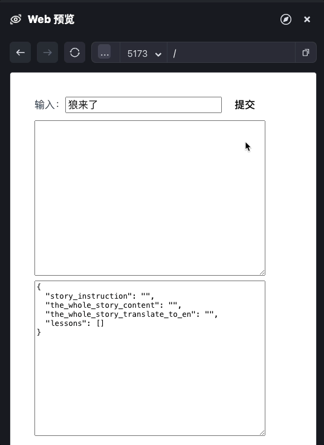
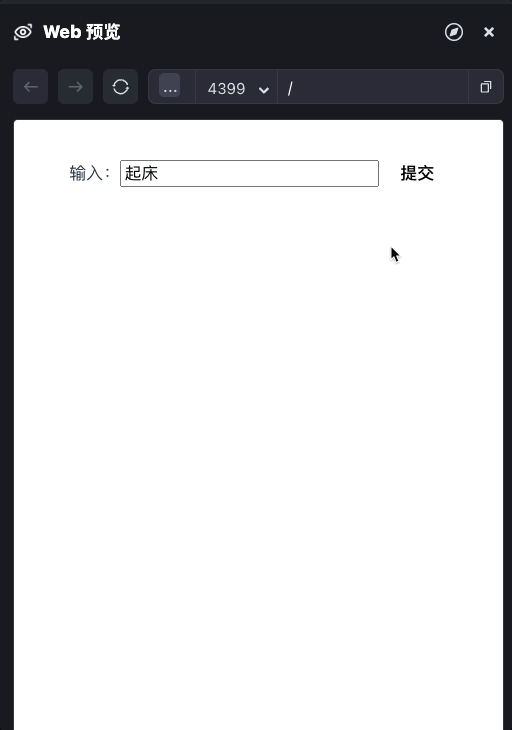
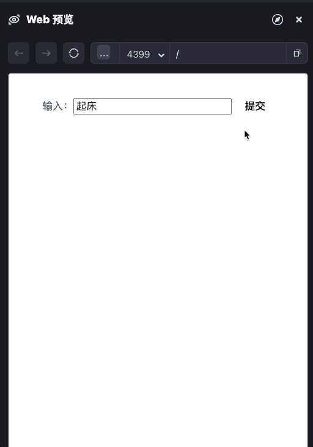

# 09 | 用户体验：如何解决流式传输与JSON结构化的矛盾

你好，我是月影。

在前面的内容里，我们讨论了一些让大模型高质量输出内容的方法。其中让大模型输出 JSON格式的数据，是一个非常有效且方便的方法。

但是，当我们要进一步改善用户体验，希望通过流式传输减少等待时间时，就会发现 JSON数据格式本身存在一个问题。

对于从事前端行业的你来说，JSON 应该并不陌生，它是一种封闭的数据结构，通常以左花括号“{”开头，右花括号“}”结尾。

封闭的数据结构，意味着一般情况下，前端对 JSON 的解析必须等待 JSON 数据全部传输完成，否则会因为 JSON 数据不完整而导致解析报错。

这就导致一个问题，即使我们在前端用流式获取 JSON 数据，我们也得等待 JSON 完成后才能解析数据并更新 UI，这就让原本流式数据快速响应的特性失效了。

那么有没有办法解决这个问题呢？

## JSON 的流式解析

办法是有的。

为了解决这个问题，有些人主张规范大模型的输出，比如采取 NDJSON（Newline-DelimitedJSON）的方式，要求大模型输出的内容分为多行，每一行是一个独立的 JSON。但是这么做对大模型的输出进行了限制，不够灵活，而且很可能会影响大模型推理的准确性，有点得不偿失。

另外一些人则使用 JSONStream 库，根据大模型输出的 JSON 配合 JSONStream 使用，这样能一定程度上解决问题，但是也不够通用，必须要事先针对大模型输出的特定结构进行处理，而且只能在 Server 端进行处理，没法直接在前端使用。

我们其实有一个更理想的办法，就是写一个动态解析 JSON 数据流的 parser，然后利用这个parser 来动态解析返回的数据流。

我在自己实现并开源的 AI 工作流框架 Ling 中，实现了这个 JSON parser，我们可以将它单独用在我们的项目中。

接下来就让我们通过实践来学习它的用法吧。

首先我们还是用 Trae 创建一个 Vue 项目 “JSON Streaming”。

```
然后配置一下 .env.local 文件，这次我们使用 Kimi 大模型。
```

```
VITE_API_KEY=sk-qi2**********xbp4
VITE_END_POINT=https://api.moonshot.cn/v1/chat/completions
```

接着我们到 GitHub 的 Ling 仓库，找到 /src/parser 目录下的 index.ts 文件并将它复制下来。

```
我们在 JSON Streaming 项目中创建一个  /src/lib/json-parser.ts 文件，将复制的
```

index.ts 文件内容粘贴过来。

现在有一个问题是，json-parser 依赖库 node:events，我们如果要在前端实践，需要略作改

```
造。我们将文件内容第一行的 import EventEmitter from 'node:events' 删掉，并
```

添加如下代码：

```python
class EventEmitter {
 private listeners: { [key: string]: ((...args: any[]) => void)[] } = {};
 on(event: string, listener: (...args: any[]) => void) {
   if (!this.listeners[event]) {
     this.listeners[event] = [];
   }
   this.listeners[event].push(listener);
 }
 emit(event: string,...args: any[]) {
   if (this.listeners[event]) {
     this.listeners[event].forEach(listener => {
       listener(...args);
     });
   }
 }
}
```

这样我们就完成了 json-parser 的前端改造，解决了依赖库的问题。

```
json-paser 在对动态数据进行解析的时候，通过 data 事件将增量数据以 {uri, delta} 格
```

式进行传输，所以我们需要将 uri 解析回 JSON 对象，这个操作可以通过 jsonuri 库执行。

我们在项目中安装依赖：

```
pnpm i jsonuri
```

然后我们修改 App.vue 文件：

```sql
<script setup lang="ts">
import { ref } from 'vue';
import { JSONParser } from './lib/json-parser';
import { set, get } from 'jsonuri';
const question = ref('狼来了');
const content = ref('');
const contentParsed = ref({
 story_instruction: '',
 the_whole_story_content: '',
 the_whole_story_translate_to_en: '',
 lessons: []
});
const systemPrompt = `
根据用户输入的主题，用**中文**输出以下JSON格式内容：
{
 "story_instruction": "",
 "the_whole_story_content": "",
 "the_whole_story_translate_to_en": "",
 "lessons": []
}
`;
const update = async () => {
 if (!question) return;
 content.value = "思考中...";
 const endpoint = import.meta.env.VITE_END_POINT;
 const headers = {
   'Content-Type': 'application/json',
   Authorization: `Bearer ${import.meta.env.VITE_API_KEY}`
 };
 const response = await fetch(endpoint, {
   method: 'POST',
   headers: headers,
   body: JSON.stringify({
     model: 'moonshot-v1-8k',
     messages: [
       { role:'system', content: systemPrompt},
       { role: 'user', content: question.value }
     ],
     stream: true,
   })
 });
 const reader = response.body?.getReader();
 const decoder = new TextDecoder();
 const jsonParser = new JSONParser();
 jsonParser.on('data', ({uri, delta}) => {
   console.log(uri, delta);
   const content = get(contentParsed.value, uri);
   set(contentParsed.value, uri, (content || '') + delta);
 });
 let done = false;
 let buffer = '';
 content.value = '';
 while (!done) {
   const { value, done: doneReading } = await (reader?.read() as Promise<{ value
   done = doneReading;
   const chunkValue = buffer + decoder.decode(value);
   buffer = '';
   const lines = chunkValue.split('\n').filter((line) => line.startsWith('data:
   for (const line of lines) {
     const incoming = line.slice(6);
     if (incoming === '[DONE]') {
       done = true;
       break;
     }
     try {
       const data = JSON.parse(incoming);
       const delta = data.choices[0].delta.content;
       if (delta) {
         content.value += delta;
         jsonParser.trace(delta);
       }
     } catch (ex) {
       buffer += incoming;
     }
   }
 }
}
</script>
<template>
 <div class="container">
   <div>
     <label>输入：</label><input class="input" v-model="question" />
     <button @click="update">提交</button>
   </div>
   <div class="output">
     <textarea>{{ content }}</textarea>
     <textarea>{{ contentParsed }}</textarea>
   </div>
 </div>
</template>
<style scoped>
.container {
 display: flex;
 flex-direction: column;
 align-items: start;
 justify-content: start;
 height: 100vh;
 font-size: .85rem;
}
.input {
 width: 200px;
}
.output {
 margin-top: 10px;
 min-height: 300px;
 width: 100%;
 text-align: left;
}
button {
 padding: 0 10px;
 margin-left: 6px;
}
textarea {
 width: 300px;
 height: 200px;
 font-size: 10px;
}
</style>
```

这个文件内容和之前课程里讲的流式 API 类似，只是其中引入了 JSONParser 和 jsonuri：

```python
import { JSONParser } from './lib/json-parser';
import { set, get } from 'jsonuri';
```

首先我们构建一个业务数据结构：

```javascript
const contentParsed = ref({
 story_instruction: '',
 the_whole_story_content: '',
 the_whole_story_translate_to_en: '',
 lessons: []
});
```

给出大模型的系统提示词，采用我们第七节课讲的使用 JSON 输出的技巧：

```javascript
const systemPrompt = `
根据用户输入的主题，用**中文**输出以下JSON格式内容：
{
 "story_instruction": "",
 "the_whole_story_content": "",
 "the_whole_story_translate_to_en": "",
 "lessons": []
}
`;
```

然后我们在处理请求的时候，创建 JSONParser，利用 JSONParser 来解析数据：

```javascript
 const jsonParser = new JSONParser();
 jsonParser.on('data', ({uri, delta}) => {
   console.log(uri, delta);
   const content = get(contentParsed.value, uri);
   set(contentParsed.value, uri, (content || '') + delta);
 });
```

最后在我们从流中获取数据的时候，利用 JSONParser 来动态解析内容即可：

```javascript
...
     try {
       const data = JSON.parse(incoming);
       const delta = data.choices[0].delta.content;
       if (delta) {
         content.value += delta;
         jsonParser.trace(delta);
       }
     } catch (ex) {
       buffer += incoming;
     }
...
```

我们可以看一下最后的效果：



可以看到，当我们点击提交时，上面的输出框给出的是原始数据，它是不完整的 JSON 数据，我们不能立即使用它。而下面的输入框，始终是保持着完整的 JSON 格式，我们随时可以处理它，用它来更新 UI。

这样的话我们就在客户端实现了基础的 JSON 流式解析。记住这个非常重要的能力，我们后续的实战课程中会反复用到它。

## 流式 JSON 的 SSE 服务

前面我们讲了在客户端使用 JSON 的动态解析，这样虽然很方便，但不够灵活和强大。

因为通常情况下，我们的工作流可以直接配置在 Node.js 端，不需要通过前端转发。而且JSONParser 还提供了 string-resolve 的事件，能在 JSON 某个属性动态解析完成时，立即获取完整数据并进行下一步处理，这样能够极大地压榨服务端性能，提升数据响应的及时性。

另外，在服务端执行，我们还可以将数据以 SSE 的方式返回给前端，这样前端使用起来就更加简单了。

我们还是通过一个实战例子来说明。

首先我们还是在 Marscode 上创建一个项目叫做“JSON Streaming SSE”。

这次我们在 src 目录的外边建立一个 lib 目录，添加 json-parser.ts 文件，将https://github.com/WeHomeBot/ling/blob/main/src/parser/index.ts 的内容复制过来。

因为这次我们要在服务端使用，所以我们不用改写文件内容，而且将它放置于 src 目录外边的平级目录下。

```
然后我们添加 .env.local 文件进行配置。
VITE_API_KEY=sk-qi2oJ**********txbp4
VITE_END_POINT=https://api.moonshot.cn/v1/chat/completions
VITE_AUDIO_APP_ID=5934290469
VITE_AUDIO_ACCESS_TOKEN=c-LRysB**********Ln4N
VITE_AUDIO_CLUSTER_ID=volcano_tts
VITE_AUDIO_VOICE_NAME=en_female_anna_mars_bigtts
```

这次我们换一个例子，根据用户场景生成英文例句并转换语音，所以我们不仅仅配置 Kimi 大模型，同时也把火山引擎语音合成服务配置上去。

接下来我们要实现 server.js，首先安装必要的依赖。

```
pnpm i dotenv express jsonuri jiti
```

然后创建 server.js 文件，内容如下。

```python
import * as dotenv from 'dotenv'
import express from 'express';
import { JSONParser } from './lib/json-parser.ts';
dotenv.config({
   path: ['.env.local', '.env']
})
const openaiApiKey = process.env.VITE_API_KEY;
const app = express();
const port = 3000;
const endpoint = process.env.VITE_END_POINT;
const systemPrompt = `
```

- 你是一位亲子英语启蒙老师，负责设计家庭英语亲子英语例句。

```javascript
根据用户输入的主题，生成不少于10句英文例句。
输出以下JSON格式内容：
{
 "example_sentences": [
   {
     "english": "example sentence",
     "chinese": "例句的中文翻译"
   },
   ...
 ]
}
`;
// SSE 端点
app.get('/stream', async (req, res) => {
   // 设置响应头部
   res.setHeader('Content-Type', 'text/event-stream');
   res.setHeader('Cache-Control', 'no-cache');
   res.setHeader('Connection', 'keep-alive');
   res.flushHeaders(); // 发送初始响应头
   try {
       // 发送 OpenAI 请求
       const response = await fetch(
           endpoint,
           {
               method: 'POST',
               headers: {
                   'Authorization': `Bearer ${openaiApiKey}`,
               },
               body: JSON.stringify({
                   model: 'moonshot-v1-8k', // 选择你使用的模型
                   messages: [
                       { role: 'system', content: systemPrompt },
                       { role: 'user', content: req.query.question }
                   ],
                   response_format: { type: "json_object" },
                   stream: true, // 开启流式响应
               })
           }
       );
       if (!response.ok) {
           throw new Error('Failed to fetch from OpenAI');
       }
       const reader = response.body.getReader();
       const decoder = new TextDecoder();
       const jsonParser = new JSONParser({
           autoFix: true,
           onError: (error) => {
               console.error('JSON Parser Error:', error);
           }
       });
       jsonParser.on('data', (data) => {
           if (data.uri) res.write(`data: ${JSON.stringify(data)}\n\n`); // 发送数
       });
       let done = false;
       let buffer = '';
       // 读取流数据并转发到客户端
       while (!done) {
           const { value, done: doneReading } = await reader.read();
           done = doneReading;
           const chunkValue = buffer + decoder.decode(value, { stream: true });
           buffer = '';
           // 按行分割数据，每行以 "data: " 开头，并传递给客户端
           const lines = chunkValue.split('\n').filter(line => line.trim() && li
           for (const line of lines) {
               const incoming = line.slice(6);
               if (incoming === '[DONE]') {
                   done = true;
                   break;
               }
               try {
                   const data = JSON.parse(incoming);
                   const delta = data.choices[0].delta.content;
                   jsonParser.trace(delta);
                   // if (delta) res.write(`data: ${delta}\n\n`); // 发送数据到客户
               } catch (ex) {
                   buffer += incoming;
               }
           }
       }
       res.write('event: end\n'); // 发送结束事件
       res.write('data: [DONE]\n\n'); // 通知客户端数据流结束
       res.end(); // 关闭连接
   } catch (error) {
       console.error('Error fetching from OpenAI:', error);
       res.write('data: Error fetching from OpenAI\n\n');
       res.end();
   }
});
// 启动服务器
app.listen(port, () => {
   console.log(`Server running on http://localhost:${port}`);
});
```

根据上面的代码，我们的系统提示词如下：

- 你是一位亲子英语启蒙老师，负责设计家庭英语亲子英语例句。

```
根据用户输入的主题，生成不少于10句英文例句。
输出以下JSON格式内容：
{
 "example_sentences": [
   {
     "english": "example sentence",
     "chinese": "例句的中文翻译"
   },
   ...
 ]
}
```

大模型输出的 JSON 内容，我们通过 jsonParser 进行处理，发送给客户端。

```
   jsonParser.on('data', (data) => {
       if (data.uri) res.write(`data: ${JSON.stringify(data)}\n\n`); // 发送数据到
   });
```

注意我们的 JSONParser 是 Typescript 写的，而 server.js 是用 JS，所以我们前面安装了 jiti

```
库，它可以让我们混合运行 TS 和 JS 的服务，我们只要执行jiti server 就可以启动
```

server。

别忘了配置 vite.config.js，转发 server 的接口：

```bash
 server: {
   allowedHosts: true,
   port: 4399,
   proxy: {
     '/api': {
       target: 'http://localhost:3000',
       secure: false,
       rewrite: path => path.replace(/^\/api/, ''),
     },
   },
 },
```

接着我们改写客户端的 App.vue，内容如下：

```sql
<script setup lang="ts">
import { ref } from 'vue';
import { set, get } from 'jsonuri';
const question = ref('起床');
const content = ref({
 example_sentences: [],
});
const update = async () => {
 if (!question) return;
 const endpoint = '/api/stream';
 const eventSource = new EventSource(`${endpoint}?question=${question.value}`);
 eventSource.addEventListener("message", function (e: any) {
   const { uri, delta } = JSON.parse(e.data);
   const str = get(content.value, uri);
   set(content.value, uri, (str || '') + delta);
 });
 eventSource.addEventListener('end', () => {
   console.log('传输完成');
   eventSource.close();
 });
}
</script>
<template>
 <div class="container">
   <div>
     <label>输入：</label><input class="input" v-model="question" />
     <button @click="update">提交</button>
   </div>
   <div class="output">
     <div v-for="sentence in content.example_sentences as any" :key="sentence.en
       <h3>{{ sentence.english }} </h3>
       <p>{{ sentence.chinese }} </p>
     </div>
   </div>
 </div>
</template>
<style scoped>
.container {
 display: flex;
 flex-direction: column;
 align-items: start;
 justify-content: start;
 height: 100vh;
 font-size: .85rem;
}
.input {
 width: 200px;
}
.output {
 margin-top: 10px;
 min-height: 300px;
 width: 100%;
 text-align: left;
}
button {
 padding: 0 10px;
 margin-left: 6px;
}
textarea {
 width: 300px;
 height: 200px;
 font-size: 10px;
}
h3, h3+p {
 margin: 0;
 padding: 0;
}
</style>
```

在 EventSource 中，我们使用 jsonuri 处理服务端返回的数据。

```javascript
 eventSource.addEventListener("message", function (e: any) {
   const { uri, delta } = JSON.parse(e.data);
   const str = get(content.value, uri);
   set(content.value, uri, (str || '') + delta);
 });
```

这样我们就实现了基础的流式 JSON 传输，我们可以看一下实际的效果：



## 并行处理语音合成

接下来，我们要为英文内容合成语音，这个工作在服务端完成。我们可以利用 JSONParser 的string-resolve 数据，及时地并行处理语音转换事件。

首先我们在 lib 目录下添加文件 audio.js，内容如下：

```bash
export const generateAudio = async (text) => {
   const token = process.env.VITE_AUDIO_ACCESS_TOKEN;
   const appId = process.env.VITE_AUDIO_APP_ID;
   const clusterId = process.env.VITE_AUDIO_CLUSTER_ID;
   const voiceName = process.env.VITE_AUDIO_VOICE_NAME;
   const endpoint = 'https://openspeech.bytedance.com/api/v1/tts';
   const headers = {
       'Content-Type': 'application/json',
       Authorization: `Bearer;${token}`,
   };
   const payload = {
       app: {
           appid: appId,
           token,
           cluster: clusterId,
       },
       user: {
           uid: 'bearbobo',
       },
       audio: {
           voice_type: voiceName,
           encoding: 'ogg_opus',
           compression_rate: 1,
           rate: 24000,
           speed_ratio: 1.0,
           volume_ratio: 1.0,
           pitch_ratio: 1.0,
           emotion: 'happy',
           // language: 'cn',
       },
       request: {
           reqid: Math.random().toString(36).substring(7),
           text,
           text_type: 'plain',
           operation: 'query',
           silence_duration: '125',
           with_frontend: '1',
           frontend_type: 'unitTson',
           pure_english_opt: '1',
       },
   };
   const res = await fetch(endpoint, {
       method: 'POST',
       headers,
       body: JSON.stringify(payload),
   });
   const data = await res.json();
   if (!data.data) {
       throw new Error(JSON.stringify(data));
   }
   return data.data;
}
```

这个文件的原理，我们之前的课程已经讲了很多，这里就不再赘述。

接着我们修改 server.js 文件，引入 generateAudio 进行处理。

```python
import { generateAudio } from './lib/audio.js';
...
 jsonParser.on('string-resolve', ({ uri, delta }) => {
     if (uri.includes('english')) {
         const task = generateAudio(delta);
         audioPromises.push(task);
         task.then((base64data) => {
             const audioUri = uri.replace('english', 'audio');
             res.write(`data: ${JSON.stringify({ uri: audioUri, delta: base64dat
         });
     }
 });
...
 await Promise.all(audioPromises); // 等待音频数据结束
 res.write('event: end\n'); // 发送结束事件
 res.write('data: [DONE]\n\n'); // 通知客户端数据流结束
 res.end(); // 关闭连接
...
我们在 jsonParser 的string-resolve事件中，判断 uri 是否包含 english。若是，则说明当
```

前 delta 内容是完整的英文例句，这时我们将它发送给 generateAudio 异步处理。

注意，由于这是异步过程，所以我们需要等待这些音频合成过程结束后才可以关闭，因此我们

```
将异步任务放到 audioPromises 列表中，通过 await Promise.all(audioPromises);
```

来等待所有的音频处理结束。

最后，我们改写客户端 App.vue，添加音频数据处理和播放部分：

```xml
<script setup lang="ts">
...
function playAudio(audio: string) {
 const audioElement = new Audio(audio);
 audioElement.play();
}
function createBlobURL(base64AudioData: string): string {
 var byteArrays = [];
 var byteCharacters = atob(base64AudioData);
 for (var offset = 0; offset < byteCharacters.length; offset++) {
   var byteArray = byteCharacters.charCodeAt(offset);
   byteArrays.push(byteArray);
 }
 var blob = new Blob([new Uint8Array(byteArrays)], { type: 'audio/mp3' });
 // 创建一个临时 URL 供音频播放
 return URL.createObjectURL(blob);
}
...
 eventSource.addEventListener("message", function (e: any) {
   let { uri, delta } = JSON.parse(e.data);
   if (uri.includes('audio')) {
     delta = createBlobURL(delta);
   }
   const str = get(content.value, uri);
   set(content.value, uri, (str || '') + delta);
 });
...
</script>
<template>
...
     <div v-for="sentence in (content.example_sentences as any)" :key="sentence.
       <h3>{{ sentence.english }}
         
       <p>{{ sentence.chinese }} </p>
     </div>
...
</template>
```

这样我们就完成了整个流程，最终效果如下：



内容生成的同时，动态生成音频，点击英文句子右侧的播放图标，就可以播放对应的音频了。

完整的 server.js 和 App.vue 代码如下：

- server.js

```python
import * as dotenv from 'dotenv'
import express from 'express';
import { JSONParser } from './lib/json-parser.ts';
import { generateAudio } from './lib/audio.js';
dotenv.config({
   path: ['.env.local', '.env']
})
const openaiApiKey = process.env.VITE_API_KEY;
const app = express();
const port = 3000;
const endpoint = process.env.VITE_END_POINT;
const systemPrompt = `
```

- 你是一位亲子英语启蒙老师，负责设计家庭英语亲子英语例句。

```javascript
根据用户输入的主题，生成不少于10句英文例句。
输出以下JSON格式内容：
{
 "example_sentences": [
   {
     "english": "example sentence",
     "chinese": "例句的中文翻译"
   },
   ...
 ]
}
`;
// SSE 端点
app.get('/stream', async (req, res) => {
   // 设置响应头部
   res.setHeader('Content-Type', 'text/event-stream');
   res.setHeader('Cache-Control', 'no-cache');
   res.setHeader('Connection', 'keep-alive');
   res.flushHeaders(); // 发送初始响应头
   try {
       // 发送 OpenAI 请求
       const response = await fetch(
           endpoint,
           {
               method: 'POST',
               headers: {
                   'Authorization': `Bearer ${openaiApiKey}`,
               },
               body: JSON.stringify({
                   model: 'moonshot-v1-8k', // 选择你使用的模型
                   messages: [
                       { role: 'system', content: systemPrompt },
                       { role: 'user', content: req.query.question }
                   ],
                   response_format: { type: "json_object" },
                   stream: true, // 开启流式响应
               })
           }
       );
       if (!response.ok) {
           throw new Error('Failed to fetch from OpenAI');
       }
       const reader = response.body.getReader();
       const decoder = new TextDecoder();
       const jsonParser = new JSONParser({
           autoFix: true,
           onError: (error) => {
               console.error('JSON Parser Error:', error);
           }
       });
       const audioPromises = [];
       jsonParser.on('data', (data) => {
           if (data.uri) res.write(`data: ${JSON.stringify(data)}\n\n`); // 发送数
       });
       jsonParser.on('string-resolve', ({ uri, delta }) => {
           if (uri.includes('english')) {
               const task = generateAudio(delta);
               audioPromises.push(task);
               task.then((base64data) => {
                   const audioUri = uri.replace('english', 'audio');
                   res.write(`data: ${JSON.stringify({ uri: audioUri, delta: bas
               });
           }
       });
       let done = false;
       let buffer = '';
       // 读取流数据并转发到客户端
       while (!done) {
           const { value, done: doneReading } = await reader.read();
           done = doneReading;
           const chunkValue = buffer + decoder.decode(value, { stream: true });
           buffer = '';
           // 按行分割数据，每行以 "data: " 开头，并传递给客户端
           const lines = chunkValue.split('\n').filter(line => line.trim() && li
           for (const line of lines) {
               const incoming = line.slice(6);
               if (incoming === '[DONE]') {
                   done = true;
                   break;
               }
               try {
                   const data = JSON.parse(incoming);
                   const delta = data.choices[0].delta.content;
                   jsonParser.trace(delta);
                   // if (delta) res.write(`data: ${delta}\n\n`); // 发送数据到客户
               } catch (ex) {
                   buffer += incoming;
               }
           }
       }
       await Promise.all(audioPromises); // 等待音频数据结束
       res.write('event: end\n'); // 发送结束事件
       res.write('data: [DONE]\n\n'); // 通知客户端数据流结束
       res.end(); // 关闭连接
   } catch (error) {
       console.error('Error fetching from OpenAI:', error);
       res.write('data: Error fetching from OpenAI\n\n');
       res.end();
   }
});
// 启动服务器
app.listen(port, () => {
   console.log(`Server running on http://localhost:${port}`);
});
```

- App.vue

```sql
<script setup lang="ts">
import { ref } from 'vue';
import { set, get } from 'jsonuri';
const question = ref('起床');
const content = ref({
 example_sentences: [],
});
function playAudio(audio: string) {
 const audioElement = new Audio(audio);
 audioElement.play();
}
function createBlobURL(base64AudioData: string): string {
 var byteArrays = [];
 var byteCharacters = atob(base64AudioData);
 for (var offset = 0; offset < byteCharacters.length; offset++) {
   var byteArray = byteCharacters.charCodeAt(offset);
   byteArrays.push(byteArray);
 }
 var blob = new Blob([new Uint8Array(byteArrays)], { type: 'audio/mp3' });
 // 创建一个临时 URL 供音频播放
 return URL.createObjectURL(blob);
}
const update = async () => {
 if (!question) return;
 const endpoint = '/api/stream';
 const eventSource = new EventSource(`${endpoint}?question=${question.value}`);
 eventSource.addEventListener("message", function (e: any) {
   let { uri, delta } = JSON.parse(e.data);
   if (uri.includes('audio')) {
     delta = createBlobURL(delta);
   }
   const str = get(content.value, uri);
   set(content.value, uri, (str || '') + delta);
 });
 eventSource.addEventListener('end', () => {
   console.log('传输完成');
   eventSource.close();
 });
}
</script>
<template>
 <div class="container">
   <div>
     <label>输入：</label><input class="input" v-model="question" />
     <button @click="update">提交</button>
   </div>
   <div class="output">
     <div v-for="sentence in (content.example_sentences as any)" :key="sentence.
       <h3>{{ sentence.english }}
         
       <p>{{ sentence.chinese }} </p>
     </div>
   </div>
 </div>
</template>
<style scoped>
.container {
 display: flex;
 flex-direction: column;
 align-items: start;
 justify-content: start;
 height: 100vh;
 font-size: .85rem;
}
.input {
 width: 200px;
}
.output {
 margin-top: 10px;
 min-height: 300px;
 width: 100%;
 text-align: left;
}
button {
 padding: 0 10px;
 margin-left: 6px;
}
textarea {
 width: 300px;
 height: 200px;
 font-size: 10px;
}
h3,
h3+p {
 margin: 0;
 padding: 0;
}
h3 img {
 cursor: pointer;
}
</style>
```

- 整个项目的代码我也提交到了 Github 上，有兴趣的同学可以访问https://github.com/akira-cn/frontend-dev-large-model-era/tree/main/json_streaming_sse进一步研究。

## 要点总结

这节课，我们了解了 JSON 的流式解析基本原理和方法。通过两个实战例子，分别学习了如何在客户端和服务端动态解析 JSON 和实时处理数据流。

实际上结构化 JSON 数据的流式处理，是我们实现快速实时响应的 AI 应用非常重要的基础，希望大家能够多多练习，牢固掌握这一技能，后续我们在综合项目实战中，还会进一步使用并深入探索。

## 课后练习

1. 注意到我们的第二个例子，server 端创建 JSONParser 对象时，传入了参数 autoFix，它的作用是什么？你可以自己实验一下。

2. 仔细阅读 JSONParser 代码，理解一下 data 和 string-resolve 事件的区别，回答为什么我们在语音合成的时候，要在 string-resolve 事件里处理？

你可以将你的答案或者疑问分享到评论区，我们一同交流探讨。
