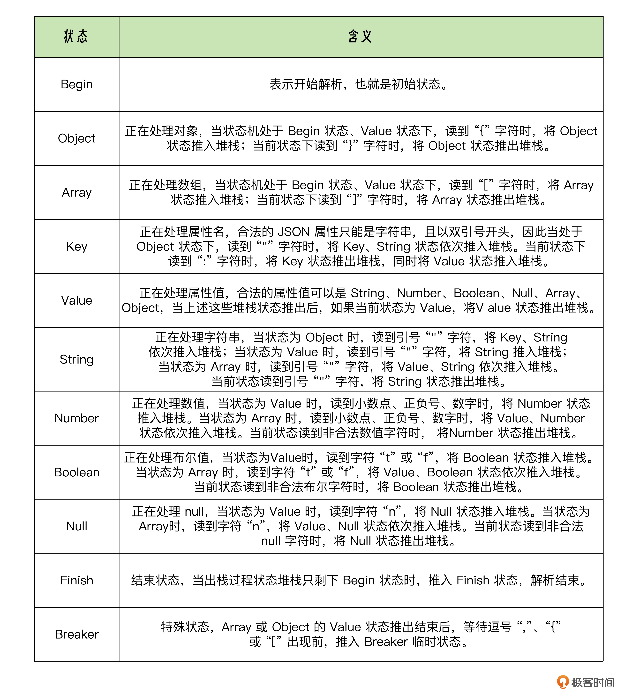

# 10 | 深入细节：如何实现动态JSON解析

你好，我是月影。

在上一节课，我们通过两个实践例子，详细讲解了使用动态 JSON 解析来解决大模型流式输出 JSON 数据的问题。

但是我们还遗留了一个非常重要的问题，那就是我们的 JSONParser 模块，具体是怎么实现的。

今天我们就来深入学习一下它的实现原理，这样既能让你知其所以然，也能让你的程序设计基础更加扎实。

## 解析器与状态机

JSONParser 本质上仍然是一个标准的 JSON 语言解析器。解析器（Parser）的作用是把一串字符串（在这里是 JSON 代码）转化为可被程序使用的数据对象。大多数编程语言的解析器，都包含一个或多个解析环节。这里我们的目标相对简单，只需要对 JSON 格式进行解析。

实现经典的语言解析器，通常采用状态机（state machine）来进行词法和语法分析。这是因为，在形式语言理论中，对应于正则文法的识别器是有限状态自动机（finite automaton），而对应于上下文无关文法的识别器是带栈自动机（pushdown automaton)。

包括 JSON 语法在内（事实上 JSON 属于比较简单的语法）的一般性编程语言，大多数是完全或近似的上下文无关语言，它们的词法部分可以用正则表达式来描述，对应的自动机就是有限状态机，而语法部分可以由上下文无关文法或其子集来描述，解析器就可以通过带栈的状态机来识别。

我们的 JSON 解析器实现，整体就是一个手写的基于状态机词法解析（lexer）加上带栈自动机的手写 JSON 解析器，它通过一个大分发函数 trace(input: string)，按照当前状态分类处理输入字符，最终解析完成后触发相应的事件。

我们详细来看一下其中的关键部分。

## 状态机的定义：LexerStates

首先我们定义确定状态机。

```javascript
const enum LexerStates {
   Begin = 'Begin',
   Object = 'Object',
   Array = 'Array',
   Key = 'Key',
   Value = 'Value',
   String = 'String',
   Number = 'Number',
   Boolean = 'Boolean',
   Null = 'Null',
   Finish = 'Finish',
   Breaker = 'Breaker',
}
```

这上面的枚举值就是解析 JSON 过程中可能出现的各种状态。

```
JSON 本质上是一套固定的语法，最外层只能是对象 {...} 或数组 [...] 。补充说明一
```

下，严格来说还有单独的数字、布尔、null、字符串也可以构成合法 JSON，但这些输出对于大模型来说不属于 JSON 输出，所以这里我们不予考虑。

我们首先用一个数组 stateStack 作为堆栈来保存当前所处的状态层级，最初是[Begin]。随着读入字符的不同，堆栈内的状态会在上面枚举的这些状态中发生变化。

可变化的状态分别如下：



基本上解析器主体逻辑就是由上面描述的状态机控制了，接下来我们看具体定义。

## JSONParser 类的属性和构造

```bash
export class JSONParser extends EventEmitter {
   private content: string[] = [];
   private stateStack: LexerStates[] = [LexerStates.Begin];
   private currentToken = '';
   private keyPath: string[] = [];
   private arrayIndexStack: any[] = [];
   private autoFix = false;
   private debug = false;
   private lastPopStateToken: { state: LexerStates, token: string } | null = nul
   constructor(options: { autoFix?: boolean, parentPath?: string | null, debug?:
       super();
       this.autoFix = !!options.autoFix;
       this.debug = !!options.debug;
       if (options.parentPath) this.keyPath.push(options.parentPath);
   }
   // ...
}
```

JSONParser 类继承 EventEmitter，这样它可以在解析中边读边触发事件，每当数据更新时，就可以立即通知外部处理。

以下是 JSONParser 类几个属性的作用：

1.content: string[]

```
用于把所有已读入的字符按顺序存起来，比如 ["{", "\"", "n", "a", "m", "e",
"\"", ":"] 等等。后续可能会拼成完整字符串做 new Function(...) 的执行，或者做
```

报错时的上下文提示。

2.stateStack: LexerStates[]

用一个数组来模拟“栈”结构，最后一个元素就是当前的状态。因为 JSON 解析会嵌套，比如对

```
{ ... } 里面还可以继续 parse 对象或数组，这里就需要入栈、出栈来表示进入、退出某个
```

嵌套。

3.currentToken: string

```
当我们进入 String 状态时，就要把字符一个个追加到 currentToken。当解析完这个字符
```

串后，才会把它清空，再去解析下一个值。

4.keyPath: string[]

```
用来记录我们在对象嵌套层级中，当前正在解析的字段路径，比如解析到 { user: {
address: { city: 'xxx' }}}，你可能会有类似 ['user', 'address', 'city']
```

这样的路径信息。

5. arrayIndexStack: any[]

```
如果遇到数组 [ ... ]，我们在解析第几个元素？一个数组里还可以套数组，所以用栈来记
```

录不同层级的下标。

6.autoFix 和 debug

```
autoFix：表示当解析遇到错误时，是否尝试帮我们做一些常见错误（比如引号不匹配、
```

- 缺少逗号等）的修正。

```
debug：用于在解析过程打印日志方便调试，不需要发布到生产时可以关闭。
7. 在构造函数 constructor(...) 里，除了初始化这些属性，还会把
options.parentPath 放到 keyPath 里，这样解析可以有一个“上层路径”的概念。
```

## 关键的栈操作

接下来我们定义几个和状态栈相关的操作。

首先是入栈方法：

```
private pushState(state: LexerStates) {
   this.log('pushState', state);
   this.stateStack.push(state);
   if (state === LexerStates.Array) {
       this.arrayIndexStack.push({ index: 0 });
   }
}
进入一个新的状态时，就调用这个函数。比如当我们识别到 {，就要
pushState(LexerStates.Object)。
```

其次是出栈方法：

```javascript
private popState() {
   this.lastPopStateToken = { state: this.currentState, token: this.currentToken
   this.currentToken = '';
   const state = this.stateStack.pop();
   this.log('popState', state, this.currentState);
   if (state === LexerStates.Value) {
       this.keyPath.pop();
   }
   if (state === LexerStates.Array) {
       this.arrayIndexStack.pop();
   }
   return state;
}
```

当确定某个状态解析完毕，要退出这个状态时，就弹栈。

```
这里我把 this.lastPopStateToken 存起来，方便我们知道“我们刚刚退的是什么状态”，
```

为后续自动修复或报错提示时使用。

然后是堆栈整理：

```javascript
private reduceState() {
   const currentState = this.currentState;
   if (currentState === LexerStates.Breaker) {
       this.popState();
       if (this.currentState === LexerStates.Value) {
           this.popState();
       }
   } else if (currentState === LexerStates.String) {
       const str = this.currentToken;
       this.popState();
       if (this.currentState === LexerStates.Key) {
           this.keyPath.push(str);
       } else if (this.currentState === LexerStates.Value) {
           this.emit('string-resolve', {
               uri: this.keyPath.join('/'),
               delta: str,
           });
           // this.popState();
       }
   } else if (currentState === LexerStates.Number) {
       const num = Number(this.currentToken);
       this.popState();
       if (this.currentState === LexerStates.Value) {
           // ...
           this.emit('data', {
               uri: this.keyPath.join('/'), // JSONURI https://github.com/aligay
               delta: num,
           });
           this.popState();
       }
   } else if (currentState === LexerStates.Boolean) {
       const str = this.currentToken;
       this.popState();
       if (this.currentState === LexerStates.Value) {
           this.emit('data', {
               uri: this.keyPath.join('/'),
               delta: isTrue(str),
           });
           this.popState();
       }
   } else if (currentState === LexerStates.Null) {
       this.popState();
       if (this.currentState === LexerStates.Value) {
           this.emit('data', {
               uri: this.keyPath.join('/'),
               delta: null,
           });
           this.popState();
       }
   } else if (currentState === LexerStates.Array || currentState === LexerStates
       this.popState();
       if (this.currentState === LexerStates.Begin) {
           this.popState();
           this.pushState(LexerStates.Finish);
           const data = (new Function(`return ${this.content.join('')}`))();
           this.emit('finish', data);
       } else if (this.currentState === LexerStates.Value) {
           // this.popState();
           this.pushState(LexerStates.Breaker);
       }
   }
   else {
       this.traceError(this.content.join(''));
   }
}
```

当检测到某个状态对应的结构已经完整读完，就调用 reduceState 函数做一些收尾操作。

```
比如如果当前状态是 String，说明字符串结束；如果上一个状态是 Key，那就意味着我
们刚拿到“键”，把它加进 keyPath；如果上一个状态是 Value，就把刚刚的字符串当成
“值”发射一个事件，然后看看下一步是要 Breaker 还是别的状态。
如果当前状态是 Object 或 Array 并且结束了 } 或 ]，则有可能还要退栈到外层，如果
外层都没有了，就意味着整个 JSON 解析完成，再通过 this.emit('finish', data)
```

- 通知外部。

此外，我们还有几个和堆栈有关的状态读写器。它们分别可以读取当前堆栈状态、堆栈中的上一个状态（即进入当前状态的前一个状态）以及当前数组的下标（当前如果正在解析数据，可以拿到已解析数组元素的个数，生成 jsonuri 的 uri 路径需要使用）。

```
get currentState() {
   return this.stateStack[this.stateStack.length - 1];
}
get lastState() {
   return this.stateStack[this.stateStack.length - 2];
}
get arrayIndex() {
   return this.arrayIndexStack[this.arrayIndexStack.length - 1];
}
```

## 解析流程核心

```javascript
接下来，最核心的方法就是 trace(input: string) 。
public trace(input: string) {
   const currentState = this.currentState;
   this.log('trace', JSON.stringify(input), currentState, JSON.stringify(this.cu
   const inputArray = [...input];
   if (inputArray.length > 1) {
       inputArray.forEach((char) => {
           this.trace(char);
       });
       return;
   }
   this.content.push(input);
   if (currentState === LexerStates.Begin) {
       this.traceBegin(input);
   }
   else if (currentState === LexerStates.Object) {
       this.traceObject(input);
   }
   else if (currentState === LexerStates.String) {
       this.traceString(input);
   }
   else if (currentState === LexerStates.Key) {
       this.traceKey(input);
   }
   else if (currentState === LexerStates.Value) {
       this.traceValue(input);
   }
   else if (currentState === LexerStates.Number) {
       this.traceNumber(input);
   }
   else if (currentState === LexerStates.Boolean) {
       this.traceBoolean(input);
   }
   else if (currentState === LexerStates.Null) {
       this.traceNull(input);
   }
   else if (currentState === LexerStates.Array) {
       this.traceArray(input);
   }
   else if (currentState === LexerStates.Breaker) {
       this.traceBreaker(input);
   }
   else if (!isWhiteSpace(input)) {
       this.traceError(input);
   }
}
在 JSONParser 类里，trace 函数是对外暴露的解析入口，每次调用 trace('某些字
符')，解析器就会把这些字符一个个“吃进来”，根据当前状态做处理。
```

它支持一次只给一个字符，或者一次给一串字符。如果是一串，就会拆分成单字符循环处理。

拆分后根据当前状态将字符分发给对应的处理器：

```
if (currentState === LexerStates.Begin) {
   this.traceBegin(input);
}
else if (currentState === LexerStates.Object) {
   this.traceObject(input);
}
else if (currentState === LexerStates.String) {
   this.traceString(input);
}
// ...
else if (!isWhiteSpace(input)) {
   this.traceError(input);
}
```

可以看到这是一个大分发逻辑：先看目前在哪个状态，然后把当前字符交给对应的“子函数”来

```
处理，比如 traceObject、traceString、traceNumber 等等。
如果既不在任何已知状态，也不是空白字符，就当作错误处理 traceError。
```

这些子函数根据当前状态对字符分别处理，其中很多细节就不一一列举了，这里仅举一个例子，详细代码有兴趣的同学可以查看 JSONParser，做深入了解。

```
private traceObject(input: string) {
   if (isWhiteSpace(input) || input === ',') {
       return;
   }
   if (input === '"') {
       this.pushState(LexerStates.Key);
       this.pushState(LexerStates.String);
   } else if (input === '}') {
       this.reduceState();
   } else {
       this.traceError(input);
   }
}
```

前面这段代码是一个状态处理子函数，当堆栈状态为 Object 时，trace 将字符分发给traceObject 进行处理。

```
它的逻辑是这样的。如果当前在 Object 状态下，接下来的字符可以是：
```

- 空白符，我们就忽略。

```
逗号，在 JSON 里有可能出现这种情况：{ "key1": "val1", "key2": "val2" }，
```

- 分隔多个键值对，但是要注意位置是否合法。

```
双引号，那就表示要读取一个“Key”，所以 pushState(LexerStates.Key) ->
pushState(LexerStates.String) 开始解析字符串键。
右花括号 }，表示这个对象结束。那就要调用 this.reduceState()，退栈或做收尾处
```

- 理。

```
其他情况都不符合标准 JSON，进入 traceError 看是否能修复或报错。
```

## 错误自动修复

由于大模型输出 JSON 数据有时候会有瑕疵，比如多了或者少了一些格式字符，所以我们在解析器执行过程中，如果读取了当前状态下非法的字符，可以按照一些规则进行错误修复。

```javascript
错误修复逻辑定义在 traceError(input: string) 函数里。
private traceError(input: string) {
   // console.error('Invalid Token', input);
   this.content.pop();
   if (this.autoFix) {
       if (this.currentState === LexerStates.Begin || this.currentState === Lexe
           return;
       }
       if (this.currentState === LexerStates.Breaker) {
           if (this.lastPopStateToken?.state === LexerStates.String) {
               // 修复 token 引号转义
               const lastPopStateToken = this.lastPopStateToken.token;
               this.stateStack[this.stateStack.length - 1] = LexerStates.String;
               this.currentToken = lastPopStateToken || '';
               let traceToken = '';
               for (let i = this.content.length - 1; i >= 0; i--) {
                   if (this.content[i].trim()) {
                       this.content.pop();
                       traceToken = '\\\"' + traceToken;
                       break;
                   }
                   traceToken = this.content.pop() + traceToken;
               }
               this.trace(traceToken + input);
               return;
           }
       }
       if (this.currentState === LexerStates.String) {
           // 回车的转义
           if (input === '\n') {
               if (this.lastState === LexerStates.Value) {
                   const currentToken = this.currentToken.trimEnd();
                   if (currentToken.endsWith(',') || currentToken.endsWith(']')
                       // 这种情况下是丢失了最后一个引号
                       for (let i = this.content.length - 1; i >= 0; i--) {
                           if (this.content[i].trim()) {
                               break;
                           }
                           this.content.pop();
                       }
                       const token = this.content.pop() as string;
                       // console.log('retrace -> ', '"' + token + input);
                       this.trace('"' + token + input);
                       // 这种情况下多发送(emit)出去了一个特殊字符，前端需要修复，发送一个
                       this.emit('data', {
                           uri: this.keyPath.join('/'),
                           delta: '',
                           error: {
                               token,
                           },
                       });
                   } else {
                       // this.currentToken += '\\n';
                       // this.content.push('\\n');
                       this.trace('\\n');
                   }
               }
               return;
           }
       }
       if (this.currentState === LexerStates.Key) {
           if (input !== '"') {
               // 处理多余的左引号 eg. {""name": "bearbobo"}
               if (this.lastPopStateToken?.token === '') {
                   this.content.pop();
                   this.content.push(input);
                   this.pushState(LexerStates.String);
               }
           }
           // key 的引号后面还有多余内容，忽略掉
           return;
       }
       if (this.currentState === LexerStates.Value) {
           if (input === ',' || input === '}' || input === ']') {
               // value 丢失了
               this.pushState(LexerStates.Null);
               this.currentToken = '';
               this.content.push('null');
               this.reduceState();
               if (input !== ',') {
                   this.trace(input);
               } else {
                   this.content.push(input);
               }
           } else {
               // 字符串少了左引号
               this.pushState(LexerStates.String);
               this.currentToken = '';
               this.content.push('"');
               // 不处理 Value 的引号情况，因为前端修复更简单
               // if(!isQuotationMark(input)) {
               this.trace(input);
               // }
           }
           return;
       }
       if (this.currentState === LexerStates.Object) {
           // 直接缺少了 key
           if (input === ':') {
               this.pushState(LexerStates.Key);
               this.pushState(LexerStates.String);
               this.currentToken = '';
               this.content.push('"');
               this.trace(input);
               return;
           }
           // 一般是key少了左引号
           this.pushState(LexerStates.Key);
           this.pushState(LexerStates.String);
           this.currentToken = '';
           this.content.push('"');
           if (!isQuotationMark(input)) {
               // 单引号和中文引号
               this.trace(input);
           }
           return;
       }
       if (this.currentState === LexerStates.Number || this.currentState === Lex
           // number, boolean 和 null 失败
           const currentToken = this.currentToken;
           this.stateStack.pop();
           this.currentToken = '';
           // this.currentToken = '';
           for (let i = 0; i < [...currentToken].length; i++) {
               this.content.pop();
           }
           // console.log('retrace', '"' + this.currentToken + input);
           this.trace('"' + currentToken + input);
           return;
       }
   }
   // console.log('Invalid Token', input, this.currentToken, this.currentState,
   throw new Error('Invalid Token');
}
如果 autoFix === true，它会试图做一些常见错误的修复，例如：
如果你在对象键上使用了中文引号或单引号，这里就会把它换成标准的英文 "。
如果解析到一半时发现缺了一些字符，也会尽量帮你加上 null 或补足一个右引号等等。
如果实在无法修复，就 throw new Error('Invalid Token')。
```

至此，我们 JSONParser 的大体逻辑就梳理完了，剩下的一些细节，你可以自己尝试复制、修改、运行代码，给出不同的输入，看看它的结果。

## 要点总结

这节课讲了 JSONParser 的具体实现，它的核心功能是一个支持动态字符输入的 JSON 语法解析器，能够做到边输入字符边解析。这样就能实现大模型流式输入的同时，解析 JSON 字符串的需求，这对于构建及时响应的 AI 应用非常重要。

我来带你回顾一下今天比较重要几个内容。

首先是状态机。我们为什么要给 JSON 定义这么多状态，而不是直接正则匹配一大串字符？因为 JSON 结构具有嵌套、递归特性，用状态机 + 栈可以清晰地表示进入和退出不同层级。

如果你想学习更深入的编译器原理，会发现它也使用类似思路——先词法分析（拆分token），再语法分析（构建语法树）。这里我们把这两步简化地糅合在一起，用“逐字符”的方式处理。

```
然后是事件驱动。继承 EventEmitter 可以让解析过程“边读边通知”，不一定要等到整个
```

JSON 读完才输出结果。这对于我们这种实时处理数据流的场景非常实用。

最后还有自动修复。标准 JSON 比较严格，但实际很多场景里会出现不标准的 JSON，所以AI 推理的时候，也可能会输出错误的不标准的 JSON 数据，需要进行修复。当解析错误时，并不一定要马上报错，我们可以试着“猜测”或者“补齐”缺失部分。

最后我想说明一下，这节课的内容会比较偏底层，有许多技术细节，可能对部分同学来说理解起来会偏难，尤其是不懂编译原理的同学。

但是不要紧，JSON 本身不是非常复杂的语言，所以整体代码的逻辑也没有那么复杂。最好的学习方法就是动手实践，只要你坚持不断地练习和跟踪代码执行，相信你一定能把这一共不到六百行的代码完全吃透。

## 课后练习

JSONParser 是一个手写的 JSON 解析器，它的思路与规范的 LL(1) 解析器类似，但它不完全采用经典的 LL(1) 实现，而是手写状态机，将状态跟踪转换逻辑拆分，这样的好处是便于维护。

如果你学过编译原理，你可以尝试用 LL(1) 的思路，用文法生成工具来生成标准的 JSON 解析器，再将它改造成可以动态接受字符实时解析，可以做出一个更加规范的 JSONParser。

你可以动手试一下，并将你的心得分享到评论区。
