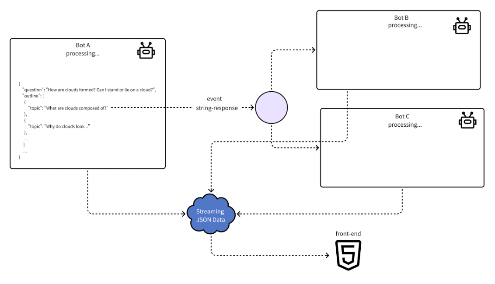
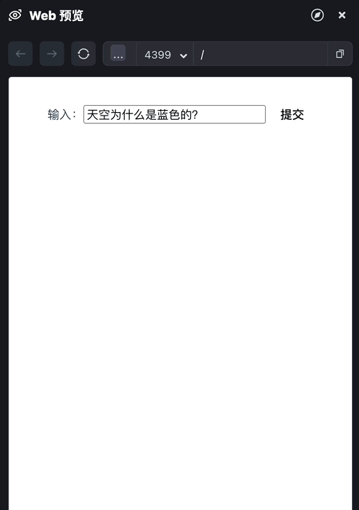

# 11 | 工作流框架：Ling的设计思想与整体架构

你好，我是月影。

前面两节课我们讲了 AI 应用的用户体验中，非常核心的一个技术挑战，即如何在流式输出下，实时处理 JSON 格式的数据。

我采用的思路是自己实现 JSON 解析器，使用动态解析 JSON 数据流的方式，用 jsonuri 来动态构建 JSON 数据，这个方案构成处理整个 AI 业务工作流的核心。

基于这个核心，我封装了一个开源框架叫做 Ling，用来方便地处理复杂的 AI 工作流。

由于在后续的 AI 应用实践课程中，我们会比较频繁地采用这个框架，因此在这一节课里，我先来介绍一下这个框架的设计思想与整体架构。

## Ling 基础架构

Ling 是一个基于流式 JSON 数据的异步工作流框架。它能够比较方便地管理 AI 业务工作流的节点，并及时处理其中流转的数据。



如上图所示，业务中三个 AI 节点分别是 BotA、BotB、BotC，当 BotA 推理生成数据时，Ling通过 string-response 事件在指定字段的数据输出完成时，及时分发给 BotB 和 BotC 进行处理。

在这个过程中，所有需要发送给客户端的数据，会通过单一的 Stream 实例完成数据的分发。

## 构建 Ling 工作流

这么说呢，还是比较抽象，我们还是看一个实际的例子。

让我们来实现一个简易的儿童版 AI 十万个为什么，用户输入一个问题，根据问题生成一篇适合儿童阅读的、内容稍微丰富一些的文章，效果如下：



我们看到，当我们输入一个问题“天空为什么是蓝色的”时，AI 能够非常快速地把内容实时生成出来。

实际上，这个是通过一个简单的工作流来实现的。我们用了两级 AI 节点，外层是一个大模型负责撰写大纲，内层是一组大模型，将大纲每一章节展开撰写。

具体如何做呢？你可以跟着我一起实际操作。

我们首先用 Trae 创建一个 Vue 项目。

然后安装依赖：

```
pnpm i @bearbobo/ling jsonuri
```

这样就安装了 Ling 框架以及客户端依赖的 jsonuri。

```python
接着我们配置  .env.local ：
VITE_API_KEY=sk-qi2oJBNF**********z8txbp4
VITE_END_POINT=https://api.moonshot.cn/v1/chat/completions
然后我们添加  server.js ，内容如下：
import * as dotenv from 'dotenv'
import express from 'express';
import { Ling } from "@bearbobo/ling";
import { pipeline } from 'node:stream/promises';
dotenv.config({
   path: ['.env.local', '.env']
})
const apiKey = process.env.VITE_API_KEY;
const endpoint = process.env.VITE_END_POINT;
const app = express();
const port = 3000;
const outlinePrompt = `
```

- 根据用户要求，生成科普文章大纲。

```javascript
输出以下JSON格式内容：
{
   "title": "文章标题",
   "outline": [
       {
           "section": 1,
           "title": "章节标题",
           "subtopics": "子主题1\n子主题2\n子主题3",
           "overview": "章节概述"
       },
       {
           "section": 2,
           "title": "章节标题",
           "subtopics": "子主题1\n子主题2\n子主题3",
           "overview": "章节概述"
       },
       {
           "section": 3,
           "title": "章节标题",
           "subtopics": "子主题1\n子主题2\n子主题3",
           "overview": "章节概述"
       },
       {
           "section": 4,
           "title": "总结",
           "subtopics": "子主题1\n子主题2",
           "overview": "章节概述"
       },
   ]
}
`;
const contentPrompt = `
```

- 根据用户发送的文章标题和概述，撰写详细文章内容。

```
要求：
文章的读者是6-8岁的儿童。
```

- 文章的风格要符合儿童的阅读习惯，避免使用过于复杂的句子结构和词汇。文章的内容要围绕用户发送的文章标题和概述进行，不要偏离主题。

```javascript
限制篇幅，不要超过3个自然段落，纯文本输出，不要加任何Markdown标签。
`;
// SSE 端点
app.get('/stream', async (req, res) => {
   const question = req.query.question;
   const config = {
       model_name: 'moonshot-v1-8k',
       api_key: apiKey,
       endpoint: endpoint,
       sse: true,
   };
   // ------- The work flow start --------
   const ling = new Ling(config);
   const outlineBot = ling.createBot();
   outlineBot.addPrompt(outlinePrompt);
   outlineBot.chat(question);
   outlineBot.on('object-response', ({ uri, delta }) => {
       const matches = uri.match(/outline\/(\d+)/);
       if (matches) {
           const section = matches[1];
           console.log(uri, delta);
           const contentBot = ling.createBot(`content/${section}`, {}, {
               response_format: { type: "text" },
           });
           contentBot.addPrompt(contentPrompt);
           contentBot.chat(`
# 主题
${delta.title}
## 子主题
${delta.subtopics}
## 摘要
${delta.overview}
           `);
       }
   });
   ling.close();
   // setting below headers for Streaming the data
   res.writeHead(200, {
       'Content-Type': "text/event-stream",
       'Cache-Control': "no-cache",
       'Connection': "keep-alive"
   });
   pipeline(ling.stream, res);
});
// 启动服务器
app.listen(port, () => {
   console.log(`Server running on http://localhost:${port}`);
});
```

我们梳理一下代码逻辑。

首先刚才说有两级大模型，它们的系统提示词分别如下：

```javascript
const outlinePrompt = `
```

- 根据用户要求，生成科普文章大纲。

```javascript
输出以下JSON格式内容：
{
   "title": "文章标题",
   "outline": [
       {
           "section": 1,
           "title": "章节标题",
           "subtopics": "子主题1\n子主题2\n子主题3",
           "overview": "章节概述"
       },
       {
           "section": 2,
           "title": "章节标题",
           "subtopics": "子主题1\n子主题2\n子主题3",
           "overview": "章节概述"
       },
       {
           "section": 3,
           "title": "章节标题",
           "subtopics": "子主题1\n子主题2\n子主题3",
           "overview": "章节概述"
       },
       {
           "section": 4,
           "title": "总结",
           "subtopics": "子主题1\n子主题2",
           "overview": "章节概述"
       },
   ]
}
`;
const contentPrompt = `
```

- 根据用户发送的文章标题和概述，撰写详细文章内容。

```
要求：
文章的读者是6-8岁的儿童。
```

- 文章的风格要符合儿童的阅读习惯，避免使用过于复杂的句子结构和词汇。文章的内容要围绕用户发送的文章标题和概述进行，不要偏离主题。

```
限制篇幅，不要超过3个自然段落，纯文本输出，不要加任何Markdown标题。
`;
```

接着呢，我们用配置创建一个 Ling 实例，然后创建一个 outlineBot，负责大纲的撰写。

```javascript
const question = req.query.question;
const config = {
   model_name: 'moonshot-v1-8k',
   api_key: apiKey,
   endpoint: endpoint,
   sse: true,
};
// ------- The work flow start --------
const ling = new Ling(config);
const outlineBot = ling.createBot();
outlineBot.addPrompt(outlinePrompt);
outlineBot.chat(question);
```

使用 Ling 创建工作流非常简单，我们直接用配置创建 Ling 的实例对象，然后调用该对象的createBot 方法，就可以创建出一个由 Ling 托管的大模型节点对象。

注意这里的 Bot 对象，可以用传给 createBot 独立的 api_key、endpoint 和 model_name 参数的方式创建出不同的大模型对象，但是不传的话，则默认使用从 Ling 实例继承的配置，这里我们配置的是 Kimi 大模型。

接着我们通过 addPrompt 方法将 outlinePrompt 传入，这个方法默认支持 nunjucks 模板，所以它的第二个参数可以传一个对象，不过我们这个例子没有用到动态参数。

接着我们调用 chat 方法，传入文本就可以了。

注意 Ling 默认做了 OpenAI 和 Coze 接口的兼容，所以我们创建 Ling 时，model_name、apk_key 和 endpoint 可以传 DeepSeek、Kimi（moonshot）或豆包，以及其他任何兼容OpenAI 的大模型。当我们使用豆包时，model_name 要传 botId。

```javascript
接下来，我们需要监听 outlineBot 的 object-response 事件：
outlineBot.on('object-response', ({ uri, delta }) => {
   const matches = uri.match(/outline\/(\d+)/);
   if (matches) {
       const section = matches[1];
       const contentBot = ling.createBot(`content/${section}`, {}, {
           response_format: { type: "text" },
       });
       contentBot.addPrompt(contentPrompt);
       contentBot.chat(`
# 主题
${delta.title}
## 子主题
${delta.subtopics}
## 摘要
${delta.overview}
       `);
   }
});
```

该事件在 JSON 解析完成某个数组或对象属性时被自动触发。

```
除了 object-response 外，Ling 还支持string-response 和  inference-done 事
件，前者在解析完成某个字符串属性时被触发，相当于前面课程 JSONParser 的 string-
resolve 事件；后者在整个 Bot 推理完成时触发。
```

因为我们希望在文章每个小节完成提纲生成时，就可以立即发给生成正文的 Bot 处理。所以这

```
里使用了object-response 事件，确保它第一时间就被后续节点立即处理，这样减少等待
```

时间。

```
在 object-response 事件中，我们根据事件 uri 参数判断是否是章节大纲，若是，那么 uri
```

对应的应该是 /outline/1、/outline/2 这样的路径，我们可以通过正则匹配出来。

然后我们创建二级 Bot 用来处理正文。因为这里的正文输出不需要 JSON 格式，所以我们通

```
过 response_format: { type: "text" }  强制 Bot 输出文本。我们通过设置
createBot 的第一个参数 root 为content/${section} 将文本输出到 /content 数组中的
```

section 下标对应元素里。

```
接着我们调用 ling.close() 将流结束，这个操作会发送 finished 事件给客户端，客户
```

端就可以结束 SourceEvent。

最后我们将 ling.stream 通过 pipleline 进行流式连接，并设置好对应的 HTTP Header，这样就可以正常发送数据流给客户端了。

```
ling.close();
// setting below headers for Streaming the data
res.writeHead(200, {
   'Content-Type': "text/event-stream",
   'Cache-Control': "no-cache",
   'Connection': "keep-alive"
});
pipeline(ling.stream, res);
```

## 实现前端 UI 交互

我们在创建 Ling 实例的时候配置了 sse 参数，所以接口返回的数据格式是 Server-SentEvents 格式，在前端使用起来会比较方便。

我们配置 vite.config.js 转发 server 接口：

```bash
 server: {
   allowedHosts: true,
   port: 4399,
   proxy: {
     '/api': {
       target: 'http://localhost:3000',
       secure: false,
       rewrite: path => path.replace(/^\/api/, ''),
     },
   },
 },
```

然后改写 App.vue。

```sql
<script setup lang="ts">
import { ref } from 'vue';
import { set, get } from 'jsonuri';
const question = ref('天空为什么是蓝色的？');
const content = ref({
 title: "",
 outline: [],
 content: [],
});
const update = async () => {
 if (!question) return;
 const endpoint = '/api/stream';
 const eventSource = new EventSource(`${endpoint}?question=${question.value}`);
 eventSource.addEventListener("message", function (e: any) {
   let { uri, delta } = JSON.parse(e.data);
   const str = get(content.value, uri);
   set(content.value, uri, (str || '') + delta);
 });
 eventSource.addEventListener('finished', () => {
   console.log('传输完成');
   eventSource.close();
 });
}
</script>
<template>
 <div class="container">
   <div>
     <label>输入：</label><input class="input" v-model="question" />
     <button @click="update">提交</button>
   </div>
   <div class="output">
     <!-- <textarea>{{ content }}</textarea> -->
     <h1>{{ content.title }}</h1>
     <div v-for="(item, i) in (content.outline as any)" :key="item.title + i">
       <h2>{{ item.title }}</h2>
       <p>{{ content.content[i] }}</p>
     </div>
   </div>
 </div>
</template>
<style scoped>
.container {
 display: flex;
 flex-direction: column;
 align-items: start;
 justify-content: start;
 height: 100vh;
 font-size: .85rem;
}
.input {
 width: 200px;
}
.output {
 margin-top: 10px;
 min-height: 300px;
 width: 100%;
 text-align: left;
}
button {
 padding: 0 10px;
 margin-left: 6px;
}
textarea {
 width: 300px;
 height: 200px;
 font-size: 10px;
}
</style>
```

客户端代码非常简单，核心还是 EventSource 处理：

```javascript
 const eventSource = new EventSource(`${endpoint}?question=${question.value}`);
 eventSource.addEventListener("message", function (e: any) {
   let { uri, delta } = JSON.parse(e.data);
   const str = get(content.value, uri);
   set(content.value, uri, (str || '') + delta);
 });
 eventSource.addEventListener('finished', () => {
   console.log('传输完成');
   eventSource.close();
 });
注意一个小细节，我们之前自己写的 SSE 实现中，结束事件我们用的是 end ，而 Ling 中默
认用 finished ，所以我们要把监听 end 事件改成监听 finished 事件。
```

这样我们就实现了简易儿童版 AI 十万个为什么。

## 前端渲染 Markdown 内容

再补充一个细节，我们在生成章节内容的大模型节点中禁止模型输出任何 Markdown 标签，因为我们不想让这个模型输出标题，否则它就和大纲的章节标题重复了。但是如果我们只是禁止输出标题，允许正文中有一些 Markdown 标签（比如字体加粗），那么我们怎么在前端展示呢？

我们可以将 Markdown 通过 marked 库转成 HTML 然后进行渲染，这也是 AI 应用常用的前端内容渲染方式。

我们安装 marked 库：

```
pnpm i marked
```

然后改写 App.vue，添加引用并改写内容渲染方式。

```xml
<script setup lang="ts">
import { marked } from 'marked';
...
</script>
<template>
...
     <div v-for="(item, i) in (content.outline as any)" :key="item.title + i">
       <h2>{{ item.title }}</h2>
       <p v-html=marked(content.content[i])></p>
     </div>
...
</template>
```

这样我们就可以在前端展示大模型输出的 Markdown 内容了。

## 要点总结

这节课我们学习了 Ling 框架的基础架构，通过完整的例子，了解了如何使用 Ling 来构建工作流并实现前端交互。我们可以看到，Ling 是一个非常方便易用的异步实时响应工作流框架。在后续的课程中我们还会继续使用它。

Ling 的完整代码在 GitHub 仓库：https://github.com/WeHomeBot/ling

有兴趣的同学可以进一步深入研究它。我希望你不仅能够掌握 Ling 的用法，还能了解 Ling 的设计细节，有能力的同学欢迎一起改进 Ling 的代码，让它变得更加方便和强大。

## 课后练习

Ling 的 createBot 默认只支持创建文本大模型对象，假设我们需要处理图片，给上面的例子增加配图功能，为每一篇文章生成一张封面图，我们应该怎么做呢？你可以课后动手修改项目代码试试看，遇到任何问题请分享到评论区，我会帮你解答。

- 完整的项目代码在 https://github.com/akira-cn/frontend-dev-large-model-era/tree/main/ling_sse
