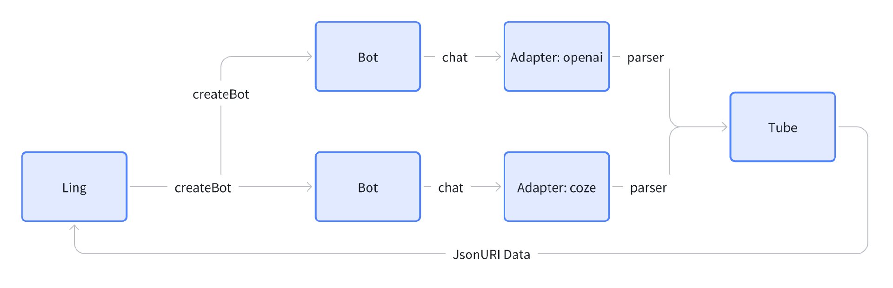

# 12 | 深度剖析（一）：Ling框架的底层实现

你好，我是月影。首先给假期还在学习的你点个赞。

上节课，我们已经通过实践初步了解了 Ling 的使用方法，那么接下来两节课，我们就来深入Ling 的实现细节，看看 Ling 框架里几个模块的具体设计，以及它们是如何协同工作的。掌握了这些，也会对你去处理复杂的 AI 工作流有所启发。

## Ling 的四个子系统

Ling 框架包含四个子系统。

- adapter：大模型 API 底层模块适配器，目前支持标准 OpenAI 和 Coze 两类文本大模型API。

- bot：对大模型节点的抽象，负责管理和控制单一节点。

- parser：JSONParser 实现，这是一个可独立使用的子系统，前面课程中已经使用过。

- tube：对流式（Streaming）对象的封装、前后端通讯的数据格式定义以及事件管理。

在使用 Ling 框架的时候，我们通过创建 Ling 对象实例来管理 bot。bot 在内部处理节点输入输出时调用 adapter，根据配置的模型参数，由 adapter 选择具体的 API 调用。在 adapter 具体调用 API 过程中会通过 parser 来动态解析大模型输入输出，并将处理好的数据通过 tube 发送，最后再由 tube 转发给前端。



下面我们来分别深入拆解一下这些模块，由于 Parser 模块就是动态 JSON 解析模块，在前面的章节中我们已经单独拆解过了，因此接下来我们主要分别介绍一下其他三个模块以及最外层的 Ling 管理模块。

在这一节课，我们主要关注 Adapter 模块，因为它是真正执行大模型对话的模块，因此是底层中的底层模块。

## Adapter 子模块

Adapter 模块是暴露给 Bot 的调用大模型对话接口，它的目的是兼容各种不同的 API 规格，目前只默认兼容 OpenAI 和 Coze 两种规格，由于大部分文本大模型都兼容 OpenAI 规格，所以这样已经基本上覆盖了几乎所有常用的文本大模型。

我们分别看一下这两种规格的具体实现代码。

### OpenAI 封装

首先是 OpenAI：

```sql
import OpenAI from 'openai';
import { AzureOpenAI } from "openai";
import "@azure/openai/types";
import { ChatConfig, ChatOptions } from '../../types';
import { Tube } from '../../tube';
import { JSONParser } from '../../parser';
import { sleep } from '../../utils';
import "dotenv/config";
const DEFAULT_CHAT_OPTIONS = {
 temperature: 0.9,
 top_p: 1,
 frequency_penalty: 0,
 presence_penalty: 0,
};
export async function getChatCompletions(
 tube: Tube,
 messages: any[],
 config: ChatConfig,
 options?: ChatOptions,
 onComplete?: (content: string) => void,
 onStringResponse?: (content: {uri: string|null, delta: string} | string) => voi
 onObjectResponse?: (content: {uri: string|null, delta: any}) => void
) {
 options = {...DEFAULT_CHAT_OPTIONS, ...options};
 if (options.response_format) { // 防止原始引用对象里的值被删除
   options.response_format = {type: options.response_format.type, root: options.
 }
 options.max_tokens = options.max_tokens || config.max_tokens || 4096; // || 163
 const isQuiet: boolean = !!options.quiet;
 delete options.quiet;
 const isJSONFormat = options.response_format?.type === 'json_object';
 let client: OpenAI | AzureOpenAI;
 let model = '';
 if(config.endpoint.endsWith('openai.azure.com')) {
   process.env.AZURE_OPENAI_ENDPOINT=config.endpoint;
   const scope = "https://cognitiveservices.azure.com/.default";
   const deployment = config.model_name;
   const apiVersion = config.api_version || "2024-07-01-preview";
   client = new AzureOpenAI({
     endpoint: config.endpoint,
     apiKey: config.api_key,
     apiVersion,
     deployment });
 } else {
   const {model_name, api_key, endpoint} = config as ChatConfig;
   model = model_name;
   client = new OpenAI({
     apiKey: api_key,
     baseURL: endpoint.replace(/\/chat\/completions$/, ''),
     dangerouslyAllowBrowser: true,
   });
 }
 const parentPath = options.response_format?.root;
 delete options.response_format.root;
 const events = await client.chat.completions.create({
   messages,
   ...options,
   model,
   stream: true,
 });
 let content = '';
 const buffer: any[] = [];
 let done = false;
 let parser: JSONParser | undefined;
 if (isJSONFormat) {
   parser = new JSONParser({
     parentPath,
     autoFix: true,
   });
   parser.on('data', (data) => {
     buffer.push(data);
   });
   parser.on('string-resolve', (content) => {
     if (onStringResponse) onStringResponse(content);
   });
   parser.on('object-resolve', (content) => {
     if (onObjectResponse) onObjectResponse(content);
   });
 }
 const promises: any[] = [
   (async () => {
     for await (const event of events) {
       if (tube.canceled) break;
       const choice = event.choices[0];
       if (choice && choice.delta) {
         if (choice.delta.content) {
           content += choice.delta.content;
           if (parser) { // JSON format
             parser.trace(choice.delta.content);
           } else {
             buffer.push({ uri: parentPath, delta: choice.delta.content });
           }
         }
       }
     }
     done = true;
     if (parser) {
       parser.finish();
     }
   })(),
   (async () => {
     let i = 0;
     while (!(done && i >= buffer.length)) {
       if (i < buffer.length) {
         tube.enqueue(buffer[i], isQuiet);
         i++;
       }
       const delta = buffer.length - i;
       if (done || delta <= 0) await sleep(10);
       else await sleep(Math.max(10, 1000 / delta));
     }
     if (!tube.canceled && onComplete) onComplete(content);
   })(),
 ];
 await Promise.race(promises);
 if (!isJSONFormat && onStringResponse) onStringResponse({ uri: parentPath, delt
 return content; // inference done
}
```

我们先整体扫一下上面的代码，你会发现实际上它兼容两种子规格，分别是标准的 OpenAI 和微软的 AzureOpenAI，这两种规格除了对象创建不同外，其他的部分是完全兼容的。所以我们只需要根据不同的 config.endpoint 判断，如果是 openai.azure.com，那么就通过AzureOpenAI 类创建对象，否则就通过 OpenAI 类创建对象。

```javascript
 if(config.endpoint.endsWith('openai.azure.com')) {
   process.env.AZURE_OPENAI_ENDPOINT=config.endpoint;
   const scope = "https://cognitiveservices.azure.com/.default";
   const deployment = config.model_name;
   const apiVersion = config.api_version || "2024-07-01-preview";
   client = new AzureOpenAI({
     endpoint: config.endpoint,
     apiKey: config.api_key,
     apiVersion,
     deployment });
 } else {
   const {model_name, api_key, endpoint} = config as ChatConfig;
   model = model_name;
   client = new OpenAI({
     apiKey: api_key,
     baseURL: endpoint.replace(/\/chat\/completions$/, ''),
     dangerouslyAllowBrowser: true,
   });
 }
```

注意模块暴露的接口是 getChatCompletions 函数，它有比较多的参数，我们分别来看一下。

- tube：Tube 子模块对象，负责接收推理输出的流式信息。

- messages：对话消息，一般是标准的大模型消息数组，每一条大模型消息由{role:user|assistant|system, content: string} 构成。

- config： ChatConfig 对象，大模型基础配置信息，详见下方类型定义。

- options：ChatOptions 对象，大模型对话配置信息，详见下方类型定义。

- onComplete：对话结束的回调函数。

- onStringResponse： parser 解析内容中触发 onStringResolved 时调用该回调函数。

- onObjectResponse ：parser 解析内容中触发 onObjectResolved 时调用该回调函数。

以下是 ChatConfig 对象和 ChatOptions 对象定义：

```bash
export interface ChatConfig {
 model_name: string;
 endpoint: string;
 api_key: string;
 api_version?: string;
 session_id?: string;
 max_tokens?: number;
 sse?: boolean;
}
export interface ChatOptions {
 temperature?: number;
 presence_penalty?: number;
 frequency_penalty?: number;
 stop?: string[];
 top_p?: number;
 response_format?: any;
 max_tokens?: number;
 quiet?: boolean;
}
```

ChatConfig 主要是选择大模型的配置，包括必选的模型名 model_name（Coze 则设置为coze:${botId}）、服务地址 endpoint、鉴权信息 api_key 以及可选的 api_version（主要给azure 平台使用）、session_id（Coze 模型需要作为 user_id）、max_tokens（一次对话最多token 数量）、sse（是否采用 Server-Sent Events）。

ChatOptions 则主要是大模型推理输出内容的配置，包括以下参数：

- temperature ：用来控制生成文本时的“随机性”或“创造性”，数值范围通常在 0 ~ 2 之间，或具体根据模型而定。越接近 0，输出越“确定”；越大，输出越“多样”或“发散”。

- presence_penalty：出现惩罚（presence penalty） 用来惩罚已经出现过的 token（词或词片段），从而鼓励模型输出更多的新信息，减少重复。数值越高，模型越倾向于避免重复先前已经生成的内容。

- frequency_penalty：频率惩罚（frequency penalty） 与 presence penalty 类似，也是一种惩罚机制，主要作用是在生成文本的过程中对于频繁出现的 token 进行惩罚，减少重复。与 presence penalty 不同之处在于，它根据某一 token 在整个对话或上下文中出现的“频率”来做惩罚。一般来说，presence_penalty 是只要出现过某 token，就会增加惩罚，而frequency_penalty 则是基于其出现次数来累积惩罚。

- stop：停止词（stop tokens）。在模型生成文本时，如果遇到这里定义的任意一个字符串，就会停止继续生成。用于控制回复的长度或终止条件，防止输出过长或产生不需要的内容。

- top_p ：核采样（top-p） 参数，与 temperature 类似，也是控制采样随机性或多样性的手段之一。在核采样中，模型会从累积概率达到 top-p 阈值的词汇中进行抽样，而不是从所有词汇里进行挑选。数值范围在 0 ~ 1 之间。数值越小，模型从概率最高的一部分候选词中采样（输出将更保守）；数值越大，候选词会更多，输出更具多样性。

- response_format：指定回复的格式。DeepSeek、Kimi 支持强制以 JSON 格式回复，这样模型会保证生成内容 JSON 语法的正确性。

- max_tokens：生成文本的最大长度限制，即最多能生成多少个 token（词或词片段）。

- quiet：是否静默输出，如果将 quiet 设为 true，那么流式输出的过程中，内容将不会被转发给 Tube 对象，也就不会被默认发送给客户端。

接着通过 OpenAI SDK 调用对话主体部分：

```javascript
const events = await client.chat.completions.create({
 messages,
 ...options,
 model,
 stream: true,
});
```

我们要通过 response_type 判断一下输出格式是否是 JSON，如果是 JSON 格式，那么我们采用 JSONParser 进行解析，将解析内容存入缓冲区。

```
 if (isJSONFormat) {
   parser = new JSONParser({
     parentPath,
     autoFix: true,
   });
   parser.on('data', (data) => {
     buffer.push(data);
   });
   parser.on('string-resolve', (content) => {
     if (onStringResponse) onStringResponse(content);
   });
   parser.on('object-resolve', (content) => {
     if (onObjectResponse) onObjectResponse(content);
   });
 }
```

再之后是模块主体逻辑的核心部分，通过遍历 events 来解析内容进行处理：

```javascript
 const promises: any[] = [
   (async () => {
     for await (const event of events) {
       if (tube.canceled) break;
       const choice = event.choices[0];
       if (choice && choice.delta) {
         if (choice.delta.content) {
           content += choice.delta.content;
           if (parser) { // JSON format
             parser.trace(choice.delta.content);
           } else {
             buffer.push({ uri: parentPath, delta: choice.delta.content });
           }
         }
       }
     }
     done = true;
     if (parser) {
       parser.finish();
     }
   })(),
   (async () => {
     let i = 0;
     while (!(done && i >= buffer.length)) {
       if (i < buffer.length) {
         tube.enqueue(buffer[i], isQuiet);
         i++;
       }
       const delta = buffer.length - i;
       if (done || delta <= 0) await sleep(10);
       else await sleep(Math.max(10, 1000 / delta));
     }
     if (!tube.canceled && onComplete) onComplete(content);
   })(),
 ];
 await Promise.race(promises);
```

注意这里我们有一个小设计，我们先处理内容放入缓冲对象 buffer，然后再用一个异步过程，将对象中的内容一一放入 Tube 对象的流式队列里，这样两步分离能够避免一次发送太多内容导致的阻塞。

最后我们解析完成后，即可返回 content 内容。如果是非 JSON 格式，那么我们在内容生成完毕后，补一个 onStringResponse 回调。

```
 if (!isJSONFormat && onStringResponse) onStringResponse({ uri: parentPath, delt
 return content; // inference done
```

这样我们就实现了兼容 OpenAI 的 API 的调用逻辑主体部分。

### Coze 封装

```
如果 ChatConfig 的 model_name 以 coze: 开头，那么由 Bot 会选择调用 Adapter 的 Coze
```

封装，我们来看一下 Coze 封装的具体实现代码：

```sql
import { ChatConfig, ChatOptions } from '../../types';
import { Tube } from '../../tube';
import { JSONParser } from '../../parser';
import { sleep } from '../../utils';
export async function getChatCompletions(
 tube: Tube,
 messages: any[],
 config: ChatConfig,
 options?: ChatOptions & {custom_variables?: Record<string, string>},
 onComplete?: (content: string, function_calls?: any[]) => void,
 onStringResponse?: (content: {uri: string|null, delta: string} | string) => voi
 onObjectResponse?: (content: {uri: string|null, delta: any}) => void
) {
 const bot_id = config.model_name.split(':')[1]; // coze:bot_id
 const { api_key, endpoint } = config as ChatConfig;
 const isQuiet: boolean = !!options?.quiet;
 delete options?.quiet;
 const isJSONFormat = options?.response_format?.type === 'json_object';
 // system
 let system = '';
 const systemPrompts = messages.filter((message) => message.role === 'system');
 if (systemPrompts.length > 0) {
   system = systemPrompts.map((message) => message.content).join('\n\n');
   messages = messages.filter((message) => message.role !== system);
 }
 const custom_variables = { systemPrompt: system, ...options?.custom_variables }
 const query = messages.pop();
 let chat_history = messages.map((message) => {
   if (message.role === 'function') {
     return {
       role: 'assistant',
       type: 'tool_response',
       content: message.content,
       content_type: 'text',
     };
   } else if (message.role === 'assistant' && message.function_call) {
     return {
       role: 'assistant',
       type: 'function_call',
       content: JSON.stringify(message.function_call),
       content_type: 'text',
     };
   } else if (message.role === 'assistant') {
     return {
       role: 'assistant',
       type: 'answer',
       content: message.content,
       content_type: 'text',
     };
   }
   return {
     role: message.role,
     content: message.content,
     content_type: 'text',
   };
 });
 let parser: JSONParser | undefined;
 const parentPath = options?.response_format?.root;
 if (isJSONFormat) {
   parser = new JSONParser({
     parentPath,
     autoFix: true,
   });
   parser.on('data', (data) => {
     tube.enqueue(data, isQuiet);
   });
   parser.on('string-resolve', (content) => {
     if (onStringResponse) onStringResponse(content);
   });
   parser.on('object-resolve', (content) => {
     if (onObjectResponse) onObjectResponse(content);
   });
 }
 const _payload = {
   bot_id,
   user: 'bearbobo',
   query: query.content,
   chat_history,
   stream: true,
   custom_variables,
 } as any;
 const body = JSON.stringify(_payload, null, 2);
 const res = await fetch(endpoint, {
   method: 'POST',
   headers: {
     'Content-Type': 'application/json',
     Authorization: `Bearer ${api_key}`,
   },
   body,
 });
 const reader = res.body?.getReader();
 if(!reader) {
   console.error('No reader');
   tube.cancel();
   return;
 }
 let content = '';
 const enc = new TextDecoder('utf-8');
 let buffer = '';
 let functionCalling = false;
 const function_calls = [];
 let funcName = '';
 do {
   if (tube.canceled) break;
   const { done, value } = await reader.read();
   if(done) break;
   const delta = enc.decode(value);
   const events = delta.split('\n\n');
   for (const event of events) {
     // console.log('event', event);
     if (/^\s*data:/.test(event)) {
       buffer += event.replace(/^\s*data:\s*/, '');
       let data;
       try {
         data = JSON.parse(buffer);
       } catch (ex) {
         console.error(ex, buffer);
         continue;
       }
       buffer = '';
       if (data.error_information) {
         // console.error(data.error_information.err_msg);
         tube.enqueue({event: 'error', data});
         tube.cancel();
         break;
       }
       const message = data.message;
       if (message) {
         if (message.type === 'answer') {
           let result = message.content;
           if(!content) { // 去掉开头的空格，coze有时候会出现这种情况，会影响 markdown 格
             result = result.trimStart();
             if(!result) continue;
           }
           content += result;
           const chars = [...result];
           for (let i = 0; i < chars.length; i++) {
             if (parser) {
               parser.trace(chars[i]);
             } else {
               tube.enqueue({ uri: parentPath, delta: chars[i] }, isQuiet);
             }
             await sleep(50);
           }
         }
       }
     } else {
       try {
         const data = JSON.parse(event);
         if (data.code) {
           tube.enqueue({event: 'error', data});
           tube.cancel();
         }
       } catch(ex) {}
     }
   }
 } while (1);
 if (!isJSONFormat && onStringResponse) onStringResponse({ uri: parentPath, delt
 if (!tube.canceled && onComplete) onComplete(content, function_calls);
 return content;
}
```

这里一些格式转换的细节我就不说了，大家可以自己去看代码。这里就说一些关键部分。

与 OpenAI 封装不同的是，OpenAI 调用 OpenAI sdk 提供的方法来完成对话，而 Coze 则直接使用 HTTP 请求：

```javascript
 const res = await fetch(endpoint, {
   method: 'POST',
   headers: {
     'Content-Type': 'application/json',
     Authorization: `Bearer ${api_key}`,
   },
   body,
 });
```

然后我们用调用 reader.read() 的方式读出流式内容，进行处理，处理逻辑和 OpenAI 类似，我们在前面课程中也介绍过流式输出的几个例子，实现方法都差不多，大家自己熟悉一下就可以了。

唯一要注意的是，Coze 中的 message 当 role 是 assistant 时，有个额外的 type 属性，一般设置为 anwser 就可以了。

```javascript
if (message.type === 'answer') {
 let result = message.content;
 if(!content) { // 去掉开头的空格，coze有时候会出现这种情况，会影响 markdown 格式
   result = result.trimStart();
   if(!result) continue;
 }
 content += result;
 const chars = [...result];
 for (let i = 0; i < chars.length; i++) {
   if (parser) {
     parser.trace(chars[i]);
   } else {
     tube.enqueue({ uri: parentPath, delta: chars[i] }, isQuiet);
   }
   await sleep(50);
 }
}
```

这样我们就了解了 Adapter 子模块的实现部分。

## 要点总结

这一节课，我们讲了 Ling 框架最底层的 Adapter 子模块，它实现了 OpenAI 和 Coze 两种API 封装的兼容，在这两个封装实现当中，我们都是通过将 Tube 对象传给getChatCompletions 函数，并创建 JSONParser 的方式处理流式数据的。

在下一节课，我们将继续介绍 Ling 框架的另外两个子模块，Bot 和 Tube。

## 课后练习

Ling 的底层为什么只实现了 OpenAI 和 Coze 两种封装呢？你是否用过或者看到过其他不一样的 API 规格呢？如果有的话，你可以将它分享出来，并尝试对其进行封装和兼容，并将你的收获分享到评论区。
