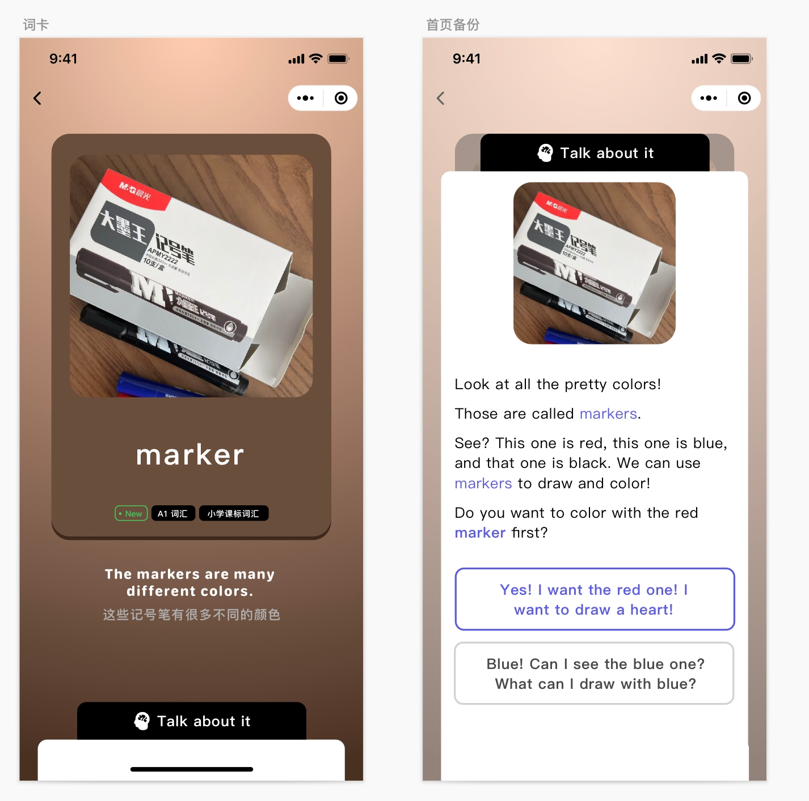
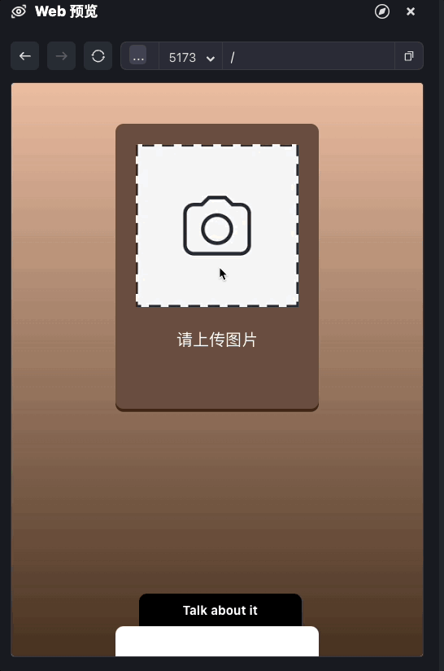
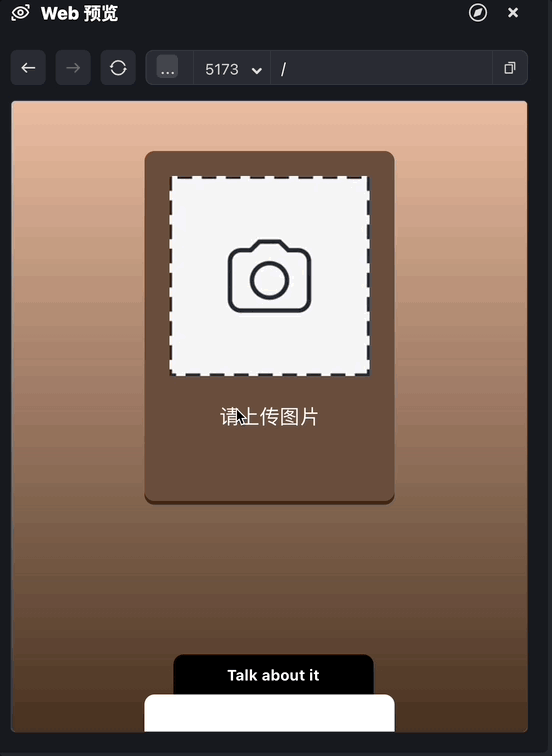
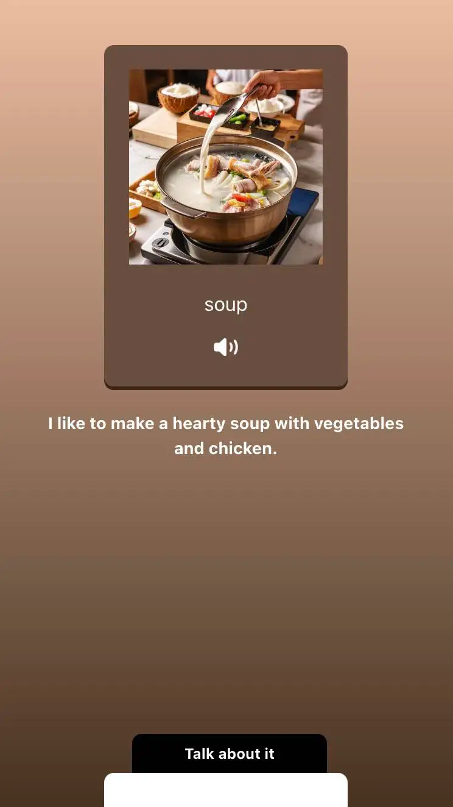

# 14 | 项目实战：使用Ling框架重构拍照记单词

你好，我是月影。

在前面两节课中，我们深入学习了 Ling 框架的实现细节。

在这一节课中，我们就通过实战例子，稍微带你熟悉一下 Ling 的一些高级用法，也让你对Ling 的能力有一个更直观的认识。

这是第二单元的最后一节必学课，下一章开始，我们就要进入更系统的项目实战单元了。在项目实战单元中，我们会面对更多技术挑战，通过解决这些实际问题，相信那时你也会对 Ling框架有更深刻的理解。

## 回顾：拍照记单词

还记得我们之前在第 6 节课创建的应用拍照记单词吗？



那时候，我们直接以非流式请求的方式来获取数据，并将数据渲染到页面上。

这么做是有效的，但是从前端用户交互的角度来说，它还是会需要一些用户等待时间。从产品体验的角度来看，效果上不是最好的。



## 使用 Ling 重构

现在我们来通过对它进行 Ling 框架重构，看看能否有效降低用户等待时间，达到比较好的效果。

我们用 Trae 创建一个项目 Capture the Word Ling。

首先安装依赖项。

```
pnpm i jiti dotenv express body-parser @bearbobo/ling jsonuri
pnpm i -D @types/express @types/body-parser
随后创建配置文件  .env.local。
VITE_KIMI_API_KEY=sk-qi2oJB**********xbp4
VITE_KIMI_END_POINT=https://api.moonshot.cn/v1/chat/completions
VITE_KIMI_MODEL_NAME=moonshot-v1-8k-vision-preview
VITE_AUDIO_APP_ID=5934290469
VITE_AUDIO_ACCESS_TOKEN=c-LRys**********Ln4N
VITE_AUDIO_CLUSTER_ID=volcano_tts
VITE_AUDIO_VOICE_NAME=en_female_anna_mars_bigtts
```

接着创建 server.ts，内容如下。

```python
import * as dotenv from 'dotenv'
import express from 'express';
import { pipeline } from 'node:stream/promises';
import { generateAudio } from './lib/audio.ts';
import { type ChatConfig, Ling } from '@bearbobo/ling';
import userPrompt from './lib/prompt.tpl.ts';
import bodyParser from 'body-parser';
dotenv.config({
   path: ['.env.local', '.env']
})
const apiKey = process.env.VITE_KIMI_API_KEY as string;
const endpoint = process.env.VITE_KIMI_END_POINT as string;
const modelName = process.env.VITE_KIMI_MODEL_NAME as string;
const app = express();
const port = 3000;
app.use(express.json({ limit: '50mb' }));
app.use(bodyParser.json());
// SSE 端点
app.post('/vision', async (req, res) => {
   // 设置响应头部
   res.setHeader('Content-Type', 'text/event-stream');
   res.setHeader('Cache-Control', 'no-cache');
   res.setHeader('Connection', 'keep-alive');
   res.flushHeaders(); // 发送初始响应头
   const imageData = req.body.imageData as string;
   const config: ChatConfig = {
       model_name: modelName,
       api_key: apiKey,
       endpoint,
   };
   // ------- The work flow start --------
   const ling = new Ling(config);
   const bot = ling.createBot();
   bot.addPrompt(userPrompt);
   bot.chat([{
       type: "image_url",
       image_url: {
           "url": imageData,
       },
   }, {
       type: "text",
       text: userPrompt,
   }]);
   bot.on('string-response', ({ uri, delta }) => {
       console.log('bot string-response', uri, delta);
   });
   ling.close();
   pipeline((ling.stream as any), res);
});
// 启动服务器
app.listen(port, () => {
   console.log(`Server running on http://localhost:${port}`);
});
```

我们用 express 服务器，引入 ling 框架，实现一个 /vision 接口，从前端接收 imageData 参数，然后用它来与 Bot 对话。

```javascript
const ling = new Ling(config);
const bot = ling.createBot();
bot.addPrompt(userPrompt);
bot.chat([{
   type: "image_url",
   image_url: {
       "url": imageData,
   },
}, {
   type: "text",
   text: userPrompt,
}]);
```

Ling 框架的 stream 属性是一个 Stream 对象（这个属性返回 Ling 创建的 Tube 对象中的Stream 对象），所以我们可以通过 pineline 将 express 的 response 对象与它连接在一起，从而实现流式输出。

```
pipeline((ling.stream as any), res);
```

接下来，我们还要定义用户提示词。创建 /lib/prompt.tpl.ts，添加我们的提示词：

```bash
export default `
分析图片内容，找出最能描述图片的一个英文单词，尽量选择更简单的A1~A2的词汇。
返回JSON数据：
{
 "representative_word": "图片代表的英文单词",
 "example_sentence": "结合英文单词和图片描述，给出一个简单的例句",
 "explainations": ["Look at the...", "", ""], // 用三句话描述图片代表的英文单词，第一句
 "explaination_replys": ["根据explaination给出的回复1", "根据explaination给出的回复2"
}
`;
```

这样我们就实现了 server 端的主体逻辑。

由于我们这次的 server 是一个 Typescript 文件，所以我们要用 jiti 来启动它，修改package.json。

```json
{
...
 "scripts": {
   "dev": "jiti server & vite",
...
}
```

然后我们别忘了修改 vite.config.js。

```bash
{
 ...
 server: {
   proxy: {
     '/api': {
       target: 'http://localhost:3000',
       changeOrigin: true,
       rewrite: path => path.replace(/^\/api/, ''),
     }
   },
 }
}
这样我们就可以通过 pnpm dev 启动 server，在 App.vue 中通过访问 /api/vision 来对
```

话。

接着我们修改 App.vue。

```sql
<script setup lang="ts">
import { ref, type Ref } from 'vue';
import PictureCard from './components/PictureCard.vue';
import { get, set } from 'jsonuri';
const word = ref('请上传图片');
const audio = ref('');
const sentence = ref('');
const detailExpand = ref(false);
const imgPreview = ref('https://res.bearbobo.com/resource/upload/W44yyxvl/upload-
const explainations: Ref<string[]> = ref([]);
const expReply: Ref<string[]> = ref([]);
const update = async (imageData: string) => {
 imgPreview.value = imageData;
 word.value = '分析中...';
 const res = await fetch("/api/vision", {
   method: 'POST',
   headers: {
     'Content-Type': 'application/json',
   },
   body: JSON.stringify({
     imageData,
   })
 });
 const reader = res.body!.getReader();
 const decoder = new TextDecoder();
 let done = false;
 const data = {
   representative_word: '',
   example_sentence: '',
   explainations: [],
   explaination_replys: [],
 };
 while (!done) {
   const { value, done: doneReading } = await reader.read();
   done = doneReading;
   if (!done) {
     const content = decoder.decode(value);
     const lines = content.trim().split('\n');
     for (const line of lines) {
       const input = JSON.parse(line);
       if (input.uri) {
         const content = get(data, input.uri);
         set(data, input.uri, (content || '') + input.delta);
         if (input.uri.endsWith('word')) {
           word.value = data.representative_word;
         } else if (input.uri.endsWith('sentence')) {
           sentence.value = data.example_sentence;
         } else if (input.uri.includes('explainations\/')) {
           explainations.value = [...data.explainations];
         } else if (input.uri.includes('explaination_replys')) {
           expReply.value = [...data.explaination_replys];
         }
       }
     }
   }
 }
 // const audioUrl = await generateAudio(replyData.example_sentence);
 // audio.value = audioUrl;
};
const submit = async (imageData: string) => {
 // console.log(imageData);
 update(imageData);
};
</script>
<template>
 <div class="container">
   <PictureCard @update-image="submit" :word="word" :audio="audio" />
   <div class="output">
     <div>{{ sentence }}</div>
     <div class="details">
       <button @click="detailExpand = !detailExpand">Talk about it</button>
       <div v-if="!detailExpand" class="fold"></div>
       <div v-else class="expand">
         
         <div class="explaination" v-for="item in explainations">
           <p>{{ item }}</p>
         </div>
         <div class="reply" v-for="item in expReply">
           <p>{{ item }}</p>
         </div>
       </div>
     </div>
   </div>
 </div>
</template>
<style scoped>
.container {
 display: flex;
 flex-direction: column;
 align-items: center;
 justify-content: start;
 margin: 0;
 padding: 0;
 width: 100vw;
 height: 100vh;
 font-size: .85rem;
 background: linear-gradient(180deg, rgb(235, 189, 161) 0%, rgb(71, 49, 32) 100%
}
#selecteImage {
 display: none;
}
.input {
 width: 200px;
}
.output {
 margin-top: 20px;
 /* min-height: 300px; */
 width: 80%;
 text-align: center;
 font-weight: bold;
}
.preview img {
 max-width: 100%;
}
button {
 padding: 0 10px;
 margin-left: 6px;
}
.details {
 position: absolute;
 bottom: 0;
 left: 50%;
 transform: translateX(-50%);
}
.details button {
 background-color: black;
 color: white;
 width: 160px;
 height: 32px;
 border-radius: 8px 8px 0 0;
 border: none;
 font-size: 12px;
 font-weight: bold;
 cursor: pointer;
}
.details .fold {
 width: 200px;
 height: 30px;
 background-color: white;
 border-top-left-radius: 8px;
 border-top-right-radius: 8px;
}
.details .expand {
 width: 200px;
 height: 88vh;
 background-color: white;
 border-top-left-radius: 8px;
 border-top-right-radius: 8px;
}
.expand img {
 width: 60%;
 margin-top: 20px;
 border-radius: 6px;
}
.expand .explaination {
 color: black;
 font-weight: normal;
}
.expand .explaination p {
 margin: 0 10px 10px 10px;
}
.expand .reply {
 color: black;
 font-weight: normal;
 margin-top: 20px;
}
.expand .reply p {
 padding: 4px 10px;
 margin: 0 10px 10px 10px;
 border-radius: 6px;
 border: solid 1px grey;
}
</style>
```

我们看一下代码的关键部分。

```javascript
首先我们直接请求 /api/vision 。
 const res = await fetch("/api/vision", {
   method: 'POST',
   headers: {
     'Content-Type': 'application/json',
   },
   body: JSON.stringify({
     imageData,
   })
 });
```

服务端返回流式输出，我们可以立即对它进行处理。

```javascript
const reader = res.body!.getReader();
const decoder = new TextDecoder();
let done = false;
const data = {
 representative_word: '',
 example_sentence: '',
 explainations: [],
 explaination_replys: [],
};
while (!done) {
 const { value, done: doneReading } = await reader.read();
 done = doneReading;
 if (!done) {
   const content = decoder.decode(value);
   const lines = content.trim().split('\n');
   for (const line of lines) {
     const input = JSON.parse(line);
     if (input.uri) {
       const content = get(data, input.uri);
       set(data, input.uri, (content || '') + input.delta);
       if (input.uri.endsWith('word')) {
         word.value = data.representative_word;
       } else if (input.uri.endsWith('sentence')) {
         sentence.value = data.example_sentence;
       } else if (input.uri.includes('explainations\/')) {
         explainations.value = [...data.explainations];
       } else if (input.uri.includes('explaination_replys')) {
         expReply.value = [...data.explaination_replys];
       }
     }
   }
 }
}
```

UI 组件方面，我们直接复用第 6 节课的 PictureCard 组件即可。

```xml
<script setup lang="ts">
import { ref } from 'vue';
const imgPreview = ref('https://res.bearbobo.com/resource/upload/W44yyxvl/upload-
const emit = defineEmits(['updateImage']);
const props = defineProps({
   word: {
       type: String,
       default: '',
   },
   audio: {
       type: String,
       default: '',
   }
});
const updateImageData = async (e: Event): Promise<any> => {
 const file = (e.target as HTMLInputElement).files?.[0];
 if (!file) {
   return;
 }
 return new Promise((resolve, reject) => {
   const reader = new FileReader();
   reader.readAsDataURL(file);
   reader.onload = () => {
     const data = reader.result as string;
     imgPreview.value = data;
     emit('updateImage', data);
     resolve(data);
   };
   reader.onerror = (error) => {
     reject(error);
   };
 });
};
const playAudio = () => {
 const audio = new Audio(props.audio);
 audio.play();
}
</script>
<template>
 <div class="card">
   <input id="selecteImage" class="input" type="file" accept=".jpg, .jpeg, .png,
   <label for="selecteImage" class="upload">
     
   </label>
   <div class="word">{{ props.word }}</div>
   <div v-if="audio" class="playAudio" @click="playAudio">
       
 </div>
</template>
<style scoped>
#selecteImage {
 display: none;
}
.card {
 border-radius: 8px;
 padding: 20px;
 margin-top: 40px;
 height: 280px;
 box-shadow: rgb(63,38,21) 0 3px 0px 0;
 background-color: rgb(105,78,62);
 box-sizing: border-box;
}
.upload {
 width: 160px;
 height: 160px;
 display: flex;
 flex-direction: column;
 align-items: center;
 justify-content: center;
}
.upload img {
 width: 100%;
 height: 100%;
 object-fit: contain;
}
.word {
 margin-top: 20px;
 font-size: 16px;
 color: rgb(255,255,255);
}
.playAudio {
 margin-top: 16px;
}
.playAudio img {
 cursor: pointer;
}
</style>
```

这样我们就完成了应用主体功能，我们先尝试用一下看效果：



和前面的第 6 节课对比，你会发现，由于内容用了流式动态生成的方式，用户的等待时间缩短了很多。

## 增加语音阅读功能

前面我们只是实现了文字流式输出，并没有实现语音朗读的功能，现在我们增加朗读功能。

```bash
首先，我们创建 /lib/audio.ts ，增加语音模块：
export const generateAudio = async (text: string) => {
   const token = process.env.VITE_AUDIO_ACCESS_TOKEN;
   const appId = process.env.VITE_AUDIO_APP_ID;
   const clusterId = process.env.VITE_AUDIO_CLUSTER_ID;
   const voiceName = process.env.VITE_AUDIO_VOICE_NAME;
   const endpoint = 'https://openspeech.bytedance.com/api/v1/tts';
   const headers = {
       'Content-Type': 'application/json',
       Authorization: `Bearer;${token}`,
   };
   const payload = {
       app: {
           appid: appId,
           token,
           cluster: clusterId,
       },
       user: {
           uid: 'bearbobo',
       },
       audio: {
           voice_type: voiceName,
           encoding: 'ogg_opus',
           compression_rate: 1,
           rate: 24000,
           speed_ratio: 1.0,
           volume_ratio: 1.0,
           pitch_ratio: 1.0,
           emotion: 'happy',
           // language: 'cn',
       },
       request: {
           reqid: Math.random().toString(36).substring(7),
           text,
           text_type: 'plain',
           operation: 'query',
           silence_duration: '125',
           with_frontend: '1',
           frontend_type: 'unitTson',
           pure_english_opt: '1',
       },
   };
   const res = await fetch(endpoint, {
       method: 'POST',
       headers,
       body: JSON.stringify(payload),
   });
   const data = await res.json();
   if (!data.data) {
       throw new Error(JSON.stringify(data));
   }
   return data.data;
}
```

这个模块的内容，我们在第 6 节已经讲过了，这里就不再重复了。

接着我们修改 server.ts：

```javascript
...
const audioBuffers: Record<string, Buffer> = {};
...
 bot.on('string-response', ({ uri, delta }) => {
     if (uri.endsWith('example_sentence')) {
         ling.handleTask(async () => {
             const audioData = await generateAudio(delta);
             const tmpId = Math.random().toString(36).substring(7);
             audioBuffers[tmpId] = Buffer.from(audioData, 'base64');
             ling.sendEvent({ uri: 'example_sentence_audio', delta: `/api/audio?
         });
     }
 });
...
app.get('/audio', (req, res) => {
   const id = req.query.id as string;
   const audioData = audioBuffers[id];
   if (!audioData) {
       res.status(404).send('Audio not found');
       return;
   }
   res.setHeader('Content-Type', 'audio/ogg');
   res.send(audioData);
});
当 Bot 对象的 string-response 事件被触发后，我们判断数据的 uri 是 example_sentence
时，delta 的内容就是我们要生成音频的文本。因此我们使用 ling.handleTask 方法，创建
一个异步处理过程，通过  await generateAudio(delta) 处理音频，并拿到音频的
```

base64 数据。

在上一节课我们提到过，handlerTask 处理异步请求，Ling 会判断这些异步请求是否处理完成，等待处理完成后再关闭 Tube 对象，因此我们就可以确保在 Ling 关闭 Tube 对象前将生成的音频发送给前端。

注意这里还有一个细节，因为 generateAudio 返回的 Base64 字符串比较大，所以我们不将它

```
的内容直接用 Stream 返回，而是将它缓存起来，通过 /api/audio?id=tmpId 的接口进行
```

访问，并将该接口 url 返回给前端。这是一种返回较大的数据（通常是高清图片、音频、视频等）常用的方法。

在实际真实项目中，我们可能不是像这样直接缓存（这里仅作演示，所以简单处理了），而是将它们上传到 CDN 上，然后将获得的 CDN 的 url 返回给前端。

接着我们修改 App.vue 的代码，增加一个处理分支：

```javascript
   if (!done) {
     const content = decoder.decode(value);
     const lines = content.trim().split('\n');
     for (const line of lines) {
       const input = JSON.parse(line);
       if (input.uri) {
         const content = get(data, input.uri);
         set(data, input.uri, (content || '') + input.delta);
         ...
         } else if (input.uri.endsWith('example_sentence_audio')) {
           audio.value = data.example_sentence_audio;
         }
       }
     }
   }
因为 server 通过ling.sendEvent(...) 发送  { uri: 'example_sentence_audio',
delta: /api/audio?id=${tmpId} } 给前端，所以前端就可以通过这个属性拿到音频
```

url。

最终，我们运行应用程序，它也会在单词下方生成播放音频按钮（如下图所示），点击后就可以播放相应的音频效果了。



这样我们就完成了整个拍照记单词项目的重构，新项目的完整代码我也提交到GitHub 项目仓库里，有兴趣的同学可以进一步详细研究。

## 要点总结

这一节课，我们用 Ling 框架将第 6 节课实现的拍照记单词应用又重构了一遍。对比第 6 节课的版本，你会发现新的版本下，用户不用等待很长时间直到内容生成出来。借助流式输出，用户等待几秒后，内容就会立即开始生成，这样就达到了较好的交互效果。

由于这个例子的 AI 工作流非常简单，仅用了一个大模型节点，所以 Ling 的优势其实并没有完全发挥出来。实际上，在越复杂的业务工作流中使用 Ling，获得的收益往往越大。我们马上要进入第三个单元，通过更加复杂的实战项目来学习如何开发 AI 应用，到时候我们将会继续深入 Ling 的使用，你就会发现它能发挥更大的价值了。

## 课后练习

在第 6 节课，我就提出让大家尝试给 Talk About 的内容也配上音频，现在有了 Ling，应该更容易做到了。你可以试试看，修改一下代码，增加新的音频功能，把你实现过程中的思考和得到的收获以及最后的结果分享到评论区吧。
