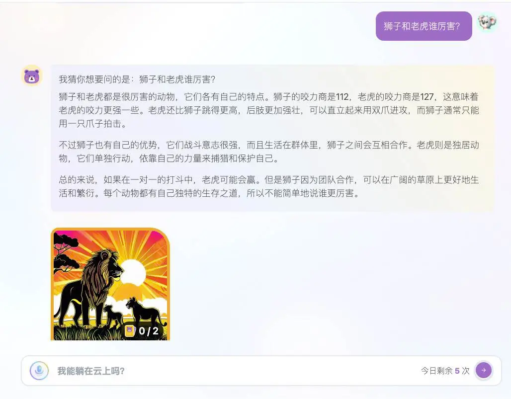

# 15 | 实战项目概览：AI版“十万个为什么”

你好，我是月影。

从这章开始，我们来聊聊我创业做的一个实际项目——波波熊学伴。 掌握了这一章的内容，相信你会对与 AI 应用产品的开发更加得心应手。


## 产品介绍

波波熊学伴是一款由 AI 驱动的学伴工具，只需输入问题或关键词，波波熊学伴将立刻生成与孩子年龄段匹配的解答和知识文章。

波波熊学伴支持孩子通过语音或文字输入，根据孩子的问题，不仅可以解答疑问，还会生成一篇完整的解答内容，并延伸出相关的知识点。


此外，每个知识点背后，还可以进行问答闯关，孩子回答后，系统会自动给出反馈。如果回答获得了高分，还会解锁一张由 AI 生成的知识卡片。


在产品设计底层，波波熊学伴采用了建构主义学习理论，强调个体在认知和理解世界时构建、建立或形成自己的知识结构和认知模式。

同时，为了帮助孩子更好地消化和吸收知识，波波熊学伴还设计了拼读、听读和插图功能，让孩子在阅读文字之外还能听音频或者看拼音，并通过插图的方式辅助理解。

## 核心功能拆解

接下来，我们把波波熊学伴的核心技术点详细拆解和梳理一下，我们将在后续章节中，对这些技术点展开来一一讲解。

波波熊学伴核心功能是它的探索功能，我们来看看这个功能的核心流程。

首先，用户（孩子）对波波熊问一个好奇心问题，波波熊会根据孩子的提问改写具体的问题，然后搜索相关的内容，最后生成一篇比较详细的科普文章。



我们来梳理一下这里面涉及到的技术点及相应的解决思路。

首先是问题改写和检索增强生成（RAG）。

当孩子输入一个问题时，他可能会输入完整的问题，比如“天空为什么是蓝色的”，这时候 AI 就可以直接使用这个问题进行内容搜索；但是孩子，尤其是年龄比较低的孩子，也可能会说一个笼统的，不完整的问题，比如“月球”。

这时候，就需要大模型“猜”出孩子想问的问题是什么，比如孩子想问的可能是“月球上有没有嫦娥”或者“人能不能在月球上生活”，这时候需要给孩子选项或提示，然后针对新的问题进行内容搜索，准备素材。

RAG，全称“检索增强生成”（Retrieval-Augmented Generation），其实就像是给大语言模型加了“查资料”的功能。当你问问题时，它不会只靠自己的记忆（也就是训练时学到的知识）来回答，而是先去外部的“资料库”里查找和问题相关的信息，然后把查到的信息和你的问题一起交给模型，让它生成答案。

第二是波波熊学伴生成文章的主智能体，包括生成标题和摘要、配图、大纲和章节划分，还有详细内容。

波波熊学伴的核心功能，就是根据用户提问，生成完整的结构化、体系化的知识内容，进行全面的讲述，这是通过由一系列复杂工作流组成的智能体来完成的。这个智能体的搭建至关重要。

第三部分就是插图绘制和知识挑战。

波波熊学伴生成的内容，每个段落都可以生成一张插图，在段落末尾会生成一道知识挑战问题，用于检验孩子对内容的理解，并通过收集卡片来激励孩子完成挑战。这里涉及到文生图的功能，需要使用图像生成的大模型。

第四是拼读功能。波波熊学伴为低龄孩子准备了拼读功能，它能对中文进行拼音标注，这虽然不是标准的大模型能解决的问题，但它是一个非常复杂问题，因为要考虑到汉字的多音字以及拼读时的变调（比如一个苹果，一盏灯，前面的“一”是变调二声，后面的“一”是变调四声），需要引入人工智能深度学习相关的知识和模块来解决这些问题。

第五是听书功能。波波熊学伴提供生成内容的语音讲述，它并不是简单的文本转语音，而是需要经过大模型的口语化转写，以适合孩子的口语化方式来讲述，这里面涉及到一些基本的模型配合和交互细节，值得仔细讨论。

最后还有语音输入技术的引入。由于年龄较小的孩子输入文字比较困难，波波熊学伴支持语音交流，这里涉及到一个前面课程没有详细说明过的语音转文字技术，它也是常用 AI 技术中的一种，在后续章节中，我们会利用这次实战项目的机会予以详细介绍。

我们将在后续的章节里详细展开讲解上面的这些技术细节。

- 第 16 节介绍如何改写问题和实现问题的搜索，以及对搜索获得的内容进行摘要整理。

- 第 17 节介绍文章生成的主体工作流，包括标题、摘要、封面图、大纲和章节划分、详细内容。

- 第 18 节介绍如何为每一段落实现插入插图的功能以及进行问答知识挑战。

- 第 19 节介绍如何具体实现拼读功能和听书功能。

- 第 20 节介绍产品的语音输入技术。

## 项目准备

为了后续更好地讲解课程，我们先完成项目前期的准备部分，创建项目工程，完成技术选型并安装必要的依赖库。

在真实的波波熊学伴项目中，我们的后端采用的是 Nest.js，这是一个经典的 Node.js 的MVVM 框架。但是我们课程里主要还是介绍 AI 和前端，所以我对业务逻辑进行了简化处理，不需要这么复杂的框架。为了降低大家的学习难度，我们的项目实践中，还是把它换成更加简单的 express 框架。

前端我们还是采用 Vue+Vite 的标准工程，编程语言统一采用 TypeScript。

现在我们用 Trae 创建 Vue 项目 Bearbobo Discovery。

然后安装必要的公共依赖项：

```
pnpm i @bearbobo/ling jiti dotenv express body-parser jsonuri
这些公共库包括主体框架 Ling、终端支持运行 TypeScript 的 jiti、读取 .env.local 配置的
```

dotenv、NodeJS 服务端框架 express、解析 HTTP body 的 express 的 body-parser 插件，以及处理 Ling 返回的 JsonURI 数据的 jsonuri 框架。

```
接着创建 .env.local 完成配置。
# 文本大模型
VITE_KIMI_API_KEY=sk-qi2oJB**********xbp4
VITE_KIMI_END_POINT=https://api.moonshot.cn/v1/chat/completions
VITE_KIMI_MODEL_NAME=moonshot-v1-32k
# 图像大模型
VITE_FLUX_API_KEY=9007a**********e19423ba
VITE_FLUX_END_POINT=https://api.bfl.ml/v1
VITE_FLUX_MODEL_NAME=flux-dev
# 语音大模型
VITE_AUDIO_APP_ID=5934290469
VITE_AUDIO_ACCESS_TOKEN=c-LRys**********kLn4N
VITE_AUDIO_CLUSTER_ID=volcano_tts
VITE_AUDIO_VOICE_NAME=zh_female_zhixingnvsheng_mars_bigtts
```

这个项目涉及到文本、图像和语音三类多模态输出，所以我们采用多个大模型。文本大模型选用月之暗面的 moonshot-v1-32k，图像大模型选用 flux-dev，而语音合成大模型选择火山引擎的 volcano_tts。

接下来我们创建项目目录结构。

```
├── lib
│   ├── prompt
│   └── service
├── src
└── server.ts
```

如前面提到的，因为是演示项目，我们在这里用一个非常简易的 express 服务器架构。

在 lib 目录下创建 prompt 和 service 子目录。prompt 目录下存放相关的提示词模板，在这里我们以 TypeScript 文件的方式维护相关的业务提示词，比如：

```bash
export default `
   这是业务提示词
`
```

这样实现简单和方便管理。在实际的波波熊学伴产品中，我们是将业务提示词存放于数据库的指定表中的，这样方便随时更新和修改。在这里我们只是为了便于讲解才做了简化处理。

service 目录下存放相关的业务工作流逻辑。src 目录下是 Vue 框架的部分，即项目的前端部分。

- 注意，在这里我简化了项目服务端大部分的非 AI 逻辑，省略了诸如用户登录、数据库存储、Redis 缓存等等实际的后端架构和具体业务实现，因为我们的课程不是学习后端开发的课程，我把这些无关的内容删减掉，有助于大家更加聚焦于 AI 和前端的具体实现。

接着我们将 vite.config.js 的 server 配置好：

```bash
{
 server: {
   allowedHosts: true,
   proxy: {
     '/api': {
       target: 'http://localhost:3000',
       changeOrigin: true,
       rewrite: path => path.replace(/^\/api/, ''),
     }
   },
 },
}
```

和前面的课程一样，我们通过 proxy 来转发 server 的服务，这样我们前端就可以通过

```
/api/<path> 来访问对应的服务。如果我们可以将 server 和前端服务部署在同一台测试或
```

者生产环境的主机上，那么这种配置是一个非常方便的做法。

最后我们修改 package.json：

```json
{
  "scripts": {
   "dev": "jiti server & vite",
   "build": "vue-tsc -b && vite build",
   "preview": "vite preview"
 },
}
我们通过 jiti sever 启动 Node.js 服务，vite 启动前端服务，这样配置后，我们直接运行 pnpm
dev 就可以同时启动我们的 Node.js 和前端了。
```

到这一步，我们就完成了整个项目的初始化工作。在后续课程中，我们将基于这个基础项目一步步完善功能，达到我们最终想要的效果。

## 要点总结

这一节，我们先简单了解一下波波熊学伴产品整体的核心功能和用到的技术。作为一个典型的AI 应用产品，它还是包括很多个 AI 相关的技术点的，主要的有用户问题改写和检索增强生成（RAG)、文章生成智能体、插图绘制和知识挑战、拼读功能、听书功能、语音输入技术。

为了实现这些功能，我们搭建了一个项目，完成初始化配置，在后续的章节中，我们将详细拆解上面这些技术，一步步完成我们最终的产品形态。

## 课后练习

一个 AI 产品往往用到的技术非常综合，在波波熊学伴这个产品中，我们要用到的除了前面所学过的几类大模型用法外，还会涉及到其他的一些新的技术挑战，比如语音转文字，以及拼读（汉字标注拼音）功能。

作为一名优秀的前端工程师，你应当有研究未知技术，找到最佳解决方案的能力。你可以试着对这些技术进行预研，然后告诉我你会选择怎样的语音转文字方案，以及用什么办法解决汉字标注拼音问题，将你的调研结论和解决方案分享到评论区吧。
